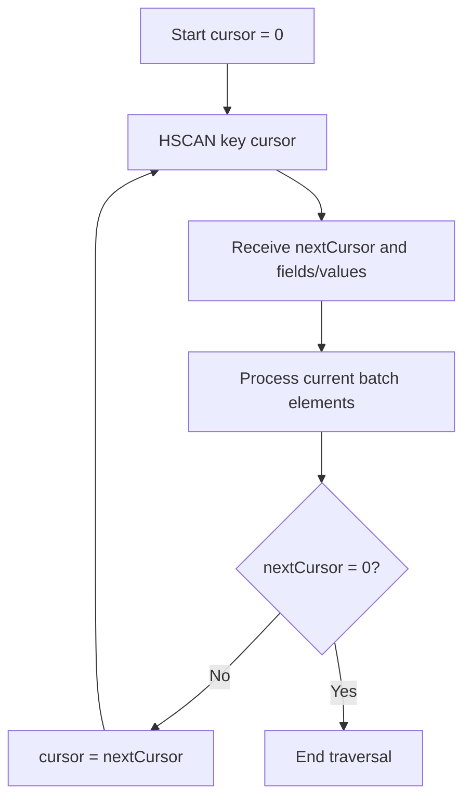

# Iterating Over a Hash with Cursor and HSCAN

## 1. Why Iterate Over a Redis Hash Incrementally?

A Redis Hash stores multiple **field–value** pairs under **a single Redis key**. For example, a Spring Boot application stores item quantities in a shopping cart:

```text
Redis key: carts:items:v1:cart-42
Redis type: hash

Field          Value
--------------------
sku-1001       2
sku-1002       1
sku-1003       5
...
sku-850000     3
```

For a Hash with only a few fields, you can fetch everything via the Redis `HGETALL` command or the Spring Data Redis API:

```java
Map<String, String> allItems =
        redis.opsForHash().entries("carts:items:v1:cart-42");
```

However, if the Hash has hundreds of thousands of fields, this approach creates multiple problems:

- Redis must build a response containing all fields and values.
- The network must transmit all that data in a single round-trip.
- Java must receive and retain a large `Map` in memory before processing.
- A huge response increases latency, GC pressure, and out-of-memory risk.
- The application cannot start processing chunks early while the full response is still transferring.

**`HSCAN`** is the Redis command for **incrementally iterating over fields/values of a Hash using a cursor**. Spring Data Redis provides `HashOperations.scan(...)`, returning a `Cursor<Map.Entry<...>>` so Java can consume elements one by one.

Key point: `HSCAN` **splits the traversal into multiple round-trips with Redis**, making it suitable for scanning large datasets, maintenance, reconciliation, or batch processing. It does **not** create a consistent snapshot, does not provide stable pagination, and does not reduce the total number of elements that must be traversed.

## 2. Redis Hash, HGETALL, HKEYS, HVALS, and HSCAN

Before using a Cursor, pick the right type of operation:

| Redis command | Common Spring Data Redis API | Result | Best suited when |
|---|---|---|---|
| `HGET key field` | `opsForHash().get(key, field)` | Value of one field | Exact field to read is known |
| `HMGET key field...` | `opsForHash().multiGet(key, fields)` | Values for a list of fields | Set of fields to read is known |
| `HGETALL key` | `opsForHash().entries(key)` | All field/value pairs | Small Hash with clear bounds |
| `HKEYS key` | `opsForHash().keys(key)` | All field names | Small Hash, only names needed |
| `HVALS key` | `opsForHash().values(key)` | All values | Small Hash, only values needed |
| `HLEN key` | `opsForHash().size(key)` | Current total field count | Need to know Hash size |
| `HSCAN key cursor ...` | `opsForHash().scan(key, options)` | Incremental field/value pairs via cursor | Large Hash, controlled sequential processing |

`HLEN` only returns the field count without reading contents. A practical approach is to measure or bound expected field counts before deciding between `entries` and `scan`. However, on a continuously changing Hash, the field count can change between calls.

Do not confuse `HSCAN` with `SCAN`:

- **`SCAN`** iterates over **Redis keys** in the keyspace or on relevant nodes.
- **`HSCAN`** iterates over **fields and values inside one specific Redis Hash key**.
- **`SSCAN`** iterates over Set members; **`ZSCAN`** iterates over Sorted Set members and scores.

If you want to find keys starting with `carts:items:`, `HSCAN` does not do that. If you already know the key `carts:items:v1:cart-42` and want to iterate through all SKUs inside that Hash, `HSCAN` is the right tool.

## 3. How HSCAN Works at the Redis Protocol Level

Command syntax:

```text
HSCAN <hash-key> <cursor> [MATCH <pattern>] [COUNT <count>]
```

Example run from Redis CLI:

```bash
redis-cli HSET carts:items:v1:cart-42 sku-1001 2 sku-1002 1 sku-1003 5
redis-cli HSCAN carts:items:v1:cart-42 0 COUNT 2
```

The response contains **two parts**:

1. **The next cursor** returned by Redis.
2. **The list of fields/values** for the current scan batch.

Illustrative output (actual cursor and field order may differ):

```text
1) "3"
2) 1) "sku-1001"
   2) "2"
   3) "sku-1002"
   4) "1"
```

The application then continues calling:

```bash
redis-cli HSCAN carts:items:v1:cart-42 3 COUNT 2
```

When Redis returns cursor **`"0"`**, a full scan pass has completed. Cursor **`0` in the first command** is the starting point; **`0` in the response** is the termination signal.



**Do not use the number of items returned in one step to decide whether scanning is finished.** Redis may return **0 items while the cursor is still non-zero**. Only when the cursor completes is the scan finished.

### 3.1. COUNT Is a Hint, Not a Strict Page Size

`COUNT 100` does not guarantee receiving exactly 100 fields/values per step. Redis treats `COUNT` as a **hint for how much work to perform**:

- A scan step may return fewer, more, or zero fields.
- A small Hash may return all elements in a single step, depending on internal encoding and Redis version.
- A larger `COUNT` generally reduces network round-trips while increasing response size, per-step processing time, and memory pressure.

Therefore, never write code assuming "`COUNT 500` means a page of exactly 500 records".

### 3.2. MATCH Filters Field Names by Glob Pattern

For example, wanting only fields with prefix `sku-active:`:

```bash
redis-cli HSCAN inventory:counts:v1:warehouse-1 0 MATCH 'sku-active:*' COUNT 200
```

`MATCH` applies **to field names inside the Hash**, not to Redis keys and not to values. The pattern syntax is Redis **glob** style, such as `*` and `?`; it is not SQL `LIKE` or full regular expressions.

Redis still has to traverse the Hash structure to inspect candidate fields; `MATCH` **does not create a prefix search index**. If only 1 field matches in a huge Hash, the application may still go through many iterations before finding it. When you know the exact field, use `HGET`, not `HSCAN MATCH`.

## 4. Spring Data Redis API: HashOperations.scan()

With `StringRedisTemplate`, the typical synchronous API is:

```java
HashOperations<String, String, String> hash =
        stringRedisTemplate.opsForHash();

Cursor<Map.Entry<String, String>> cursor =
        hash.scan(hashKey, scanOptions);
```

Involved classes:

- `HashOperations<H, HK, HV>`: `H` is the Hash's Redis key type, `HK` is the field type, `HV` is the value type.
- `ScanOptions`: declares scan options, usually `MATCH` and `COUNT`.
- `Cursor<T>`: stateful iterator that yields elements and must be closed after iteration.
- `Map.Entry<HK,HV>`: each element corresponds to **one field and its value** in the Hash.

Complete Spring Boot service example:

```java
import java.util.Map;
import java.util.function.BiConsumer;

import org.springframework.data.redis.core.Cursor;
import org.springframework.data.redis.core.HashOperations;
import org.springframework.data.redis.core.StringRedisTemplate;
import org.springframework.data.redis.core.ScanOptions;
import org.springframework.stereotype.Service;

@Service
public class CartItemScanner {

    private final StringRedisTemplate redis;

    public CartItemScanner(StringRedisTemplate redis) {
        this.redis = redis;
    }

    public void forEachItem(
            String cartId,
            BiConsumer<String, Integer> processor) {

        String key = "carts:items:v1:" + cartId;
        HashOperations<String, String, String> hash =
                redis.opsForHash();

        ScanOptions options = ScanOptions.scanOptions()
                .count(200)
                .build();

        try (Cursor<Map.Entry<String, String>> cursor =
                     hash.scan(key, options)) {

            while (cursor.hasNext()) {
                Map.Entry<String, String> entry = cursor.next();
                int quantity = Integer.parseInt(entry.getValue());
                processor.accept(entry.getKey(), quantity);
            }
        }
    }
}
```

Usage example:

```java
scanner.forEachItem("cart-42", (sku, quantity) -> {
    System.out.printf("%s: %d%n", sku, quantity);
});
```

Key takeaways:

1. `hash.scan(key, options)` creates a cursor API for **one Hash key**.
2. The `while (cursor.hasNext())` loop lets the driver / Spring Data Redis continue issuing HSCAN calls as needed.
3. Each `cursor.next()` returns a `Map.Entry`, avoiding forcing the program to accumulate everything in one huge `Map`.
4. `try-with-resources` guarantees `cursor.close()` is invoked whether the loop finishes normally or throws an exception.
5. `Integer.parseInt` only works if the field value adheres to a numeric data contract; malformed data or external edits must be handled per business logic.

Here, processing each element immediately inside the `processor` callback keeps memory usage relatively low. If the callback stores every entry into an unbounded list, the memory advantage of `HSCAN` disappears.

### 4.1. Using MATCH and COUNT in Spring

```java
ScanOptions options = ScanOptions.scanOptions()
        .match("active:*")
        .count(500)
        .build();

try (Cursor<Map.Entry<String, String>> cursor =
             redis.opsForHash().<String, String>scan(
                     "users:preferences:v1:segment-7", options)) {

    while (cursor.hasNext()) {
        Map.Entry<String, String> entry = cursor.next();
        System.out.println(entry.getKey() + "=" + entry.getValue());
    }
}
```

In a real project, declaring a `HashOperations<String,String,String>` variable upfront keeps generic types explicit and more readable. The `active:*` pattern in this example matches **field names** starting with `active:`. It does not match values containing `active`.

### 4.2. RedisTemplate with DTOs or Other Serializers

Suppose a `RedisTemplate<String, ProductAvailability>` uses a JSON serializer for hash values. When Hash fields are `String` and hash values are DTOs, the return type can be declared as:

```java
HashOperations<String, String, ProductAvailability> hashes =
        productRedisTemplate.opsForHash();

try (Cursor<Map.Entry<String, ProductAvailability>> cursor =
             hashes.scan("availability:by-sku:v1", options)) {
    while (cursor.hasNext()) {
        Map.Entry<String, ProductAvailability> entry = cursor.next();
        consume(entry.getKey(), entry.getValue());
    }
}
```

This assumes `productRedisTemplate` and `ProductAvailability` are defined with compatible value/hash-value serializers. `HSCAN` receives/returns bytes in the Redis protocol; Spring Data Redis decodes them using the template's configured serializers. If legacy data was written with a different serializer, unreadable fields/values or pattern mismatches can occur.

## 5. Cursor Lifecycle and Redis Connections

`Cursor` is not just a Java `Iterator` walking an already-loaded collection. It can **continue sending scan commands to Redis during iteration**. Hence, a cursor's lifecycle involves client resources, connections, and iteration state.

```text
Open Cursor
   |
   +-- receive first HSCAN batch
   |
   +-- hasNext()/next() --> process current element
   |
   +-- batch exhausted --> HSCAN with nextCursor
   |
   +-- repeat until ending cursor
   |
Close Cursor --> release resources
```

**Always prefer `try-with-resources`:**

```java
try (Cursor<Map.Entry<String, String>> cursor =
             hashOperations.scan(hashKey, ScanOptions.NONE)) {
    while (cursor.hasNext()) {
        handle(cursor.next());
    }
}
```

Even if stopping early—for instance, only checking for the first matching item—you still need to close the cursor:

```java
boolean found = false;
try (Cursor<Map.Entry<String, String>> cursor =
             hashOperations.scan(hashKey, options)) {
    while (cursor.hasNext()) {
        if (isRelevant(cursor.next())) {
            found = true;
            break;
        }
    }
}
// Cursor is closed even though iteration did not reach the end.
```

Never return a `Cursor` from a method and leave closing responsibility to unclear ownership. If an API genuinely must return a cursor to the caller, explicitly document that the caller owns the resource and must close it, and avoid holding a cursor open while waiting on another HTTP request from a user.

### 5.1. Do Not Use a Cursor After the Connection Scope Ends

An anti-pattern is creating a cursor inside a connection callback and returning it after the callback finishes:

```java
// Incorrect resource management concept:
Cursor<?> leakedCursor = redisTemplate.execute(connection -> {
    // Create a low-level cursor from this connection...
    return cursorCreatedFrom(connection);
});
// Callback has ended; connection may already be released.
// Using leakedCursor afterward can fail or leak resources.
```

This is **anti-pattern demonstration code**; `cursorCreatedFrom` is not a real Spring API. The principle is never to let a connection-dependent iterator outlive the scope that owns the connection.

For normal cases, call `hashOperations.scan(...)` and iterate/close the cursor within the same method as shown in section 4.

### 5.2. Do Not Share One Cursor Across Multiple Threads

`Cursor` tracks a mutating traversal position. Having multiple threads concurrently call `next()` on the same cursor risks corrupting iteration order and concurrency bugs; never assume a cursor is thread-safe.

If elements must be processed by multiple workers, a safer pattern is:

1. One thread **owns the cursor** and reads entries sequentially.
2. Hand off read data to a **bounded queue** or process in finite batches.
3. Workers process data detached from the cursor.
4. Apply concurrency limits and backpressure so huge entry counts do not accumulate.
5. Close the cursor when finished reading or when the task is cancelled.

Do not hold a cursor open while waiting on slow HTTP calls or external operations outside Redis. If processing takes a long time, separate fetching from processing using bounded batches, designing checkpoints by **field identifier** or appropriate business state.

## 6. HSCAN Does Not Guarantee a Consistent Snapshot

The most important point when designing business logic around `HSCAN`: **the Hash can change between scan iterations**.

Example:

```text
T0: Hash has fields A, B, C, D
T1: HSCAN returns A and B, next cursor
T2: Another client adds E, deletes C, changes value of D
T3: HSCAN continues on the changing Hash
```

The application cannot treat the sequence of results from T1 and T3 as a snapshot at T0 or T3. Per the Redis SCAN-family iterator guarantees:

- A **full iteration** over a stable dataset visits all elements present throughout the entire scan.
- An element may **be returned more than once** during the scan; processing should be idempotent or deduplicated if necessary.
- Elements added or deleted during the scan may or may not be seen.
- A field's value can change between when it is received and when the application processes it.
- If the Hash is deleted, expires via TTL, or changes data type, subsequent iterations may observe an empty set or related errors depending on timing and state.

**Do not use HSCAN for tasks requiring an exact snapshot or point-in-time financial/audit exports**, unless the application adds an appropriate consistency mechanism.

### 6.1. Handling Duplicates via Idempotency

Suppose a worker syncs a list of fields to an external system. If a field is read twice, the worker must not trigger two payments or increment a counter twice.

Several options:

- Write using an **upsert by field ID**, such as updating the latest value for `sku-1001`.
- Store an **operation ID** or version so the downstream system ignores duplicate events.
- Use a `seen` set to deduplicate within a pass when the Hash is small enough to fit in memory—though holding all IDs in RAM undermines streaming benefits.
- Partition business state into "unprocessed/processed" with explicit acknowledgments rather than treating a single HSCAN pass as sole proof.

If you both scan and delete/update fields in the same Hash concurrently, scan behavior can shift. For cleanup jobs, prefer **idempotent** rules, verify current update/delete conditions, and accept that re-scanning may be needed to reach the desired state. Do not assume scan + delete is atomic.

### 6.2. Do Not Confuse with Stable UI Pagination

Redis returns a cursor representing **an internal traversal position**, not an offset into sorted results:

- There is no fixed notion of "page 5, 20 items per page".
- Field order is not guaranteed.
- A "page" can be empty even before reaching the end.
- Mutating data can cause duplicates or omissions relative to snapshot expectations.
- Do not persist cursor numbers as permanent IDs to resume scanning days later.

If a user interface requires ordered, stable pagination, design a dedicated index (e.g., a Sorted Set by timestamp), use a database supporting ordered queries, or build a versioned data snapshot. `HSCAN` is better suited for **technical batch traversal**.

## 7. MATCH, COUNT, and Serializers in Spring Data Redis

### 7.1. Field Names Are Bytes; MATCH Operates on Bytes

Redis stores Hash fields as bytes. `HashOperations` uses the **hash key serializer** to translate between Java field objects and Redis bytes.

With `StringRedisTemplate`, fields are UTF-8 strings. The pattern:

```java
ScanOptions options = ScanOptions.scanOptions()
        .match("sku-*")
        .count(100)
        .build();
```

is typically suitable for filtering fields starting with `sku-`.

If the template uses `JdkSerializationRedisSerializer` for hash fields, field bytes carry a binary header; a text pattern `sku-*` will not necessarily match. When prefix `MATCH` is needed, align the field serializer, key schema, and pattern syntax. Changing serializers on existing data requires an explicit migration.

### 7.2. Large or Small COUNT?

This is a balance between **round-trips**, **per-step duration**, **memory**, and **latency of other requests**.

| COUNT value | Potential advantages | Costs and risks |
|---|---|---|
| Small, e.g., 10–50 | Less work/smaller response per step; helpful when per-item work is heavy | More Redis calls, higher total network latency |
| Medium, e.g., 100–500 | Practical starting point to measure and tune | Actual batch sizes will not equal COUNT |
| Large, e.g., 1,000–10,000 | Can reduce network round-trips | Larger response and CPU per step, higher risk of spikes or long blocking |

These numbers are **illustrative parameters**, not default recommendations for every system. When each field holds values several KB long, COUNT 1,000 produces a very different load than values a few bytes long. Benchmark on realistic datasets and monitor p95/p99 of other Redis commands.

### 7.3. MATCH Does Not Optimize Value Queries

`HSCAN MATCH 'active:*'` only filters **field names**. If you want "all orders with status = ACTIVE", a Redis Hash has no built-in value index for that query. Scanning and filtering in Java can cost `O(N)` over all fields.

For frequent business queries by an attribute, consider additional data/index structures (Set/ZSet), Redis Search if supported by your environment, or a database with proper indexing/querying. Do not use HSCAN as a low-latency search tool on a Hash with millions of fields.

## 8. Processing in Batches Without Loading the Whole Hash into RAM

Sometimes a worker needs to send data to another system in batches of 100 records. You can use a Cursor to read incrementally while holding **at most one batch** in memory:

```java
import java.util.ArrayList;
import java.util.List;
import java.util.Map;

import org.springframework.data.redis.core.Cursor;
import org.springframework.data.redis.core.HashOperations;
import org.springframework.data.redis.core.ScanOptions;

public void exportInBatches(
        String hashKey,
        int batchSize,
        java.util.function.Consumer<List<Map.Entry<String, String>>> sink) {

    if (batchSize <= 0) {
        throw new IllegalArgumentException("batchSize must be positive");
    }

    HashOperations<String, String, String> hashes =
            redis.opsForHash();

    ScanOptions options = ScanOptions.scanOptions()
            .count(200)
            .build();

    List<Map.Entry<String, String>> batch =
            new ArrayList<>(batchSize);

    try (Cursor<Map.Entry<String, String>> cursor =
                 hashes.scan(hashKey, options)) {

        while (cursor.hasNext()) {
            Map.Entry<String, String> entry = cursor.next();
            batch.add(Map.entry(entry.getKey(), entry.getValue()));

            if (batch.size() == batchSize) {
                sink.accept(List.copyOf(batch));
                batch.clear();
            }
        }
    }

    if (!batch.isEmpty()) {
        sink.accept(List.copyOf(batch));
    }
}
```

This is a synchronous batch-processing example. Purpose of each mechanism:

- `COUNT 200` is the **Redis-side** hint per HSCAN step.
- `batchSize` is the **Java-side business batch size**, independent of COUNT.
- `List.copyOf(batch)` creates an independent list before passing it to `sink`; callback code must not hold onto the mutable reused list.
- `Map.entry(...)` creates an immutable field/value pair detached from the iterator object; this assumes non-null fields/values per the Hash data contract.
- If `sink.accept(...)` throws an exception, `try-with-resources` closes the cursor, but previously sent batches **do not roll back automatically**. The receiver should support idempotency or business checkpoints.

If `sink` makes slow HTTP calls, this code holds the cursor open while waiting. Under heavy workloads, separate the reader and workers via a bounded queue or run scans in short slices. Strictly avoid unbounded queues or buffering all results before sending.

### 8.1. Be Careful Retaining `Map.Entry`

`Cursor` returns `Map.Entry`, so it is best not to store internal iterator references in long-lived caches/queues unnecessarily. Create a simple copy of the field/value when passing across threads or batches. At high throughput, still bound the number of copies in RAM.

### 8.2. Backpressure and Rate Limiting

A job scanning a multi-million-field Hash can compete for resources with normal API Redis requests:

1. Limit the number of concurrent HSCAN workers.
2. Tune COUNT and batch size based on Redis load and value lengths.
3. Monitor scan duration, timeouts, network, Redis CPU, and service heap.
4. Support stopping/cancelling the task and closing the Cursor promptly.
5. Never configure infinite retries on the entire scan loop when the server is overloaded.

The goal is not to pull every field as fast as possible at all costs, but to complete traversal with acceptable impact on user-facing traffic.

## 9. Distinguishing Spring's Cursor from Numeric Cursors in Redis CLI

In Redis CLI, the caller sees the **cursor token** and calls the next HSCAN manually. In Spring Data Redis, `Cursor<T>` hides token management and command loops:

| Redis CLI | Spring Data Redis |
|---|---|
| Start with `HSCAN key 0` | `hashOps.scan(key, options)` |
| Receive next cursor token | `Cursor` manages internal state |
| Manually invoke `HSCAN key <cursor>` again | `hasNext()/next()` continues automatically as needed |
| Manually parse field/value pairs | Receives each `Map.Entry<HK,HV>` |
| Must stop when cursor returns `0` | Loop terminates when `hasNext()` is false |
| Manually manage client resource cleanup | Use `try-with-resources` to close `Cursor` |

Do not confuse the **server cursor returned in the protocol** with a Java pointer you can arbitrarily save in a database to resume in a future run. The `Cursor` API is designed for one traversal within a specific connection scope; if checkpoints across restarts are needed, design a recoverable, deduplicated workflow that handles mutating data.

## 10. What to Do When the Hash Changes During a Scan?

### Scenario: Syncing Millions of Fields to a Database

Suppose Redis Hash `metrics:counter:v1:2026-11-12` holds counters by sub-key. A worker runs HSCAN to write into a database every minute. While the worker scans, the API keeps incrementing counters.

If the worker overwrites total counts based on a single scan, a field may have incremented after the worker read it. The database reflects **a non-simultaneous observed state**, not an atomic snapshot.

Approaches:

- **Accept eventual consistency:** the next sync pass updates the new value, and use per-field upserts to avoid duplicate records.
- **Attach versions or timestamps:** apply a record only if its version is newer; requires a version source with appropriate guarantees.
- **Separate snapshots when stability is needed:** create versioned/immutable data structures or use storage supporting snapshots.
- **Emit events/tasks upon change:** if missing changes is unacceptable, use an event log/outbox or durable data source rather than periodic scans alone.

**HSCAN is a traversal tool**, not a change-data-capture mechanism. Completing a scan does not prove the application observed every update that occurred during the scan window.

### Scenario: Deleting Expired Fields by Timestamp

Suppose each Hash value embeds an expiration timestamp for the item. Standard Redis TTL applies to the **entire Hash key**, not automatically per field. A worker might use HSCAN to find fields with stale timestamps and delete them.

However, if the worker reads an old timestamp and another request updates that field to a new timestamp right afterward, a blind `HDEL` can delete the freshly updated value. One fix is an **atomic conditional check-and-delete**, such as a Redis script comparing the current value/version before running `HDEL`.

Additionally, newer Redis versions support per-field expiration on Hashes, though you must verify exact server capabilities and Spring Data Redis API support. Do not assume every environment supports field-level TTL.

## 11. Redis Cluster, Keyspace, and Security

### 11.1. HSCAN in Redis Cluster

Redis Cluster distributes **Redis keys** across hash slots. A **Hash key** is a single Redis key, so fields inside a Hash are not split across separate slots just because there are many fields.

Consequently:

- `HSCAN carts:items:v1:cart-42` scans fields of **one Hash key** located on the node owning that key's slot.
- To scan **multiple Redis keys**, the problem shifts to `SCAN`/keyspace traversal across nodes, not one HSCAN spanning the cluster.
- If a slot migrates or Redis fails over during a scan, the client may need to handle redirects/reconnects; a scan pass may be interrupted and have to restart with an idempotent strategy.
- A Hash with millions of fields still lives under **one key**, which can cause memory or access hotspots; HSCAN does not automatically shard fields across nodes.

If data must be distributed across nodes, consider a model with multiple Hash keys partitioned by ID or time window matching access patterns. Design the key count and sharding strategy before data grows too large.

### 11.2. Keys, Fields, and Values All Require Protection

For example, `user:preferences:v1:42` is an observable key; fields like `language` or `timezone` are fairly benign. Yet a Hash can also hold tokens, emails, or personal data.

When using HSCAN:

- Do not log every field/value to the console in production.
- Do not embed secrets in key or field names because names can leak via logs/APM.
- Grant ACL permissions to run `HSCAN` only to clients that require access to that keyspace.
- Configure TLS and authentication appropriate to the environment.
- Restrict permissions of export/maintenance jobs and protect data extracted from Redis.

The Java library returning convenient entries does not mean all data is safe to expose in APIs or ship to external systems.

## 12. HSCAN, Transactions, and Pipelining

`HSCAN` uses an iterative, multi-step model driven by the **next** cursor. To issue the next command, the application must receive the cursor returned by the previous step. Therefore, do not try to pack **an entire multi-step HSCAN traversal** into a single pipeline as a pre-known command list.

### 12.1. Pipelining Does Not Turn Multiple Scan Steps into a Snapshot

In `RedisTemplate.executePipelined(...)`, calls inside the callback normally do not return results immediately; results come back after the pipeline closes. Because the algorithm needs the first step's cursor to issue the second step, a "send everything then collect results" pipeline cannot know the cursor sequence upfront.

Across many different Hash keys, independent command batches may fit pipelining, provided you check the API, serializers, and driver result handling. Do not equate network optimization via pipelining with consistency control.

### 12.2. MULTI/EXEC Does Not Turn a Long Scan into a Snapshot Either

`MULTI/EXEC` queues a group of Redis commands and executes them with Redis transaction semantics. Yet `HSCAN` must observe each cursor before deciding the next step; you cannot keep an unbounded Redis transaction open to scan a large Hash while observing intermediate cursors in the usual way.

Bundling millions of fields into a single atomic operation just for reporting usually creates heavy load and hurts latency. When exact snapshots are required, design consistency at the data layer (snapshots/versions/transactional source) instead of holding Redis connections or transactions open too long.

### 12.3. Do Not Use @Transactional to Assume HSCAN Consistency

Spring's `@Transactional` annotation does not make an HSCAN sequence a snapshot query, even when `RedisTemplate` is configured with transaction synchronization. When a SQL database and Redis coexist, there is no automatic cross-system ACID transaction across both.

Keep large scan jobs short-scoped with controlled timeouts and resources; never hold a database transaction open while millions of fields are scanned and processed.

## 13. Common Errors and Symptoms

| Symptom | Possible cause | How to resolve |
|---|---|---|
| Loop stops after an empty batch even though cursor has not finished | Treating an empty batch as completion | Let `Cursor.hasNext()` drive or follow Redis cursor until `0` |
| `COUNT 100` returns more or fewer than 100 items | COUNT is only a hint | Do not use COUNT as a strict page record count |
| A field appears twice | HSCAN does not promise "exactly once" | Process idempotently or deduplicate where appropriate |
| Newly added field missed during scan | Data mutated during scan | Accept eventual consistency or design change source/snapshot |
| `MATCH sku:*` fails to return expected fields | Field serializer is not UTF-8 text or pattern mismatches stored data | Inspect hash key serializer and field bytes |
| Java runs out of heap despite HSCAN | Accumulating all entries into a List/Map or unbounded queue | Process entry by entry or in bounded batches |
| Redis timeouts while scanning a large Hash | COUNT/batch too high, competing commands, slow network | Throttle load, limit concurrent scans, monitor p95/p99 |
| Cursor/connection not released | Cursor not closed on exception/break | Use `try-with-resources` |
| `WRONGTYPE` | Key is stored as String/List/Set, not Hash | Check `TYPE` and key namespaces |
| User asks for "page 5" and gets unstable results | HSCAN has neither ordering nor snapshots | Use an ordered index or a database |
| Cleanup job accidentally deletes a freshly updated field | Read followed by unconditional HDEL | Compare version/value and delete atomically |
| Scan fails after failover | Connection/topology changed | Restart with idempotency and appropriate checkpointing |

## 14. Verifying with Redis CLI Before Java Integration

When testing locally or troubleshooting, first verify that the key is a Hash and check how many fields it holds:

```bash
redis-cli TYPE carts:items:v1:cart-42
redis-cli HLEN carts:items:v1:cart-42
redis-cli HGET carts:items:v1:cart-42 sku-1001
```

Then test HSCAN by prefix:

```bash
redis-cli HSCAN carts:items:v1:cart-42 0 MATCH 'sku-*' COUNT 100
```

Take the next cursor from the reply and call again until it returns `0`. Never guess cursors, never increment cursors like `cursor + 1`, and never assume they correspond to page numbers.

For inspecting a small Hash, `HGETALL` can be convenient, but on large production datasets avoid pulling everything just to inspect a few fields. Use `HLEN`, `HGET` for known fields, or controlled `HSCAN`.

In Java, instead of manually coding Redis protocol token loops, most cases only need `HashOperations.scan(key, options)`, using `try-with-resources` and handling each `Map.Entry`.

## 15. Choosing: HSCAN or Another API?

| Need | API to consider | Explanation |
|---|---|---|
| Read one field by name | `opsForHash().get(key, field)` | Direct access, no iteration needed |
| Read a few known fields | `opsForHash().multiGet(key, fields)` | Avoids scanning unrelated fields |
| Count fields | `opsForHash().size(key)` | Returns count without loading data |
| Fetch an entire small, bounded Hash | `opsForHash().entries(key)` | Convenient when memory and response size are controlled |
| Traverse a large Hash for maintenance/export | `opsForHash().scan(key, options)` | Incremental with cursor and batches |
| Interested only in prefixed fields | `scan(... MATCH prefix*)` | Filters output, though traversal cost remains |
| Search by value or complex business criteria | More suitable index/dataset | HSCAN is not a search engine |
| Stable ordered pagination | Sorted Set or database query | HSCAN has no stable ordering/page numbers |
| Track every change in exact order | Appropriate Stream/event log/outbox | Scan is not change-data-capture |
| Exact point-in-time snapshot | Appropriate datastore and snapshot/transaction mechanism | Multiple HSCAN calls are not point-in-time consistent |

## 16. Mini Exercise

**Goal:** write a service that iterates over entries in the Redis Hash `reports:totals:v1:day-1`, processes only fields starting with `region:`, and avoids loading the entire Hash into RAM.

Step 1 — Create demo data:

```bash
redis-cli HSET reports:totals:v1:day-1 \
  region:north 125 region:south 92 region:central 41 \
  metadata:source api
```

Step 2 — Test the HSCAN command:

```bash
redis-cli HSCAN reports:totals:v1:day-1 0 MATCH 'region:*' COUNT 2
```

Step 3 — Implement the Java service:

```java
import java.util.Map;
import org.springframework.data.redis.core.Cursor;
import org.springframework.data.redis.core.HashOperations;
import org.springframework.data.redis.core.ScanOptions;
import org.springframework.data.redis.core.StringRedisTemplate;

public class RegionTotalReader {

    private final StringRedisTemplate redis;

    public RegionTotalReader(StringRedisTemplate redis) {
        this.redis = redis;
    }

    public void printRegionTotals() {
        String key = "reports:totals:v1:day-1";
        HashOperations<String, String, String> hash =
                redis.opsForHash();

        ScanOptions options = ScanOptions.scanOptions()
                .match("region:*")
                .count(2)
                .build();

        try (Cursor<Map.Entry<String, String>> cursor =
                     hash.scan(key, options)) {
            while (cursor.hasNext()) {
                Map.Entry<String, String> entry = cursor.next();
                System.out.println(
                        entry.getKey() + " -> " + entry.getValue());
            }
        }
    }
}
```

Step 4 — Observe that `metadata:source` does not match the `region:*` pattern. Note that all results may be returned in one batch even with `COUNT 2`, especially for a small Hash. A single-batch demo result does not negate the benefit of HSCAN on large Hashes.

Step 5 — Try updating a field while scanning a large Hash. Observe that runs can see different data; do not conclude from one run that HSCAN provides snapshots. When exact business results are required, design the data source and consistency boundaries upfront.

## 17. Summary of Design Principles

**HSCAN** iterates through fields/values of **one Redis Hash** by cursor; **`HashOperations.scan(key, ScanOptions)`** is the corresponding Spring Data Redis API. It solves incremental reading and memory control when the field count is large.

When implementing, remember:

1. Use `HGET`/`multiGet` when fields are known; scan only when traversal is truly required.
2. Treat `COUNT` as a hint and `MATCH` as glob filtering on **fields**; do not confuse with pagination or value search.
3. Iterate until the cursor finishes; do not stop because of an empty batch.
4. Use `try-with-resources` to close `Cursor`, especially on early exit or error.
5. Process item by item or in bounded batches; never collect all data into RAM.
6. Do not assume data is read exactly once or at a single instant when the Hash is changing.
7. Design idempotency, update conditions, and sources of truth appropriate to business impact.
8. Benchmark performance and limit concurrency so HSCAN serves maintenance needs without slowing production Redis.

With Spring Data Redis, properly using `Cursor<Map.Entry<...>>` keeps operations on large Hashes manageable in memory and resources. Correctness of the outcome still depends on consistency requirements, how data changes, and the application's duplicate-handling rules.
