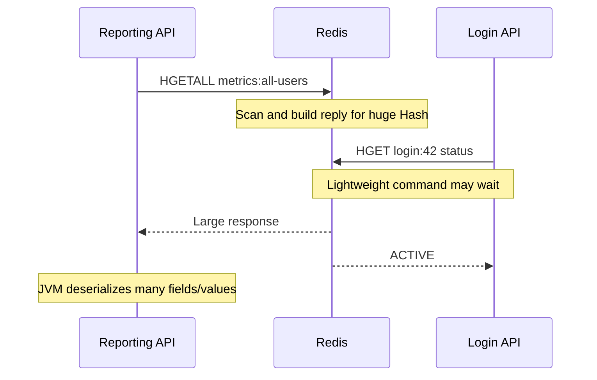

# Controlling Hash Size and the Cost of Reading All Fields

A Redis Hash is a structure storing multiple **field → value** pairs under one Redis key. With Spring Data Redis, Hashes are very convenient for managing user attributes, settings, shopping carts, or per-object state. However, the convenience of `opsForHash().entries(key)` can hide a problem: once a Hash grows to tens of thousands or millions of fields, **fetching all fields** creates heavy work on Redis, transmits a massive response, and allocates many objects on the JVM.

For example, an API needing only the `status` field yet calling `HGETALL` to load a Hash containing an entire activity history returns huge amounts of unnecessary data. Latency can creep upward as the system ages, even though the API and Java code have not changed.

This lesson focuses on evaluating and controlling **Redis Hash size**, understanding the costs of `HGETALL` / `HKEYS` / `HVALS`, reading only the needed fields through Spring Data Redis, iterating incrementally with `HSCAN`, splitting data when necessary, and observing costs on both Redis and the application.

## 1. A Hash Is One Redis Key Containing Many Fields

Suppose a system stores account profiles:

```redis
HSET user:42 displayName "Nguyễn An" status "ACTIVE" locale "vi-VN"
HGET user:42 status
# "ACTIVE"
HLEN user:42
# 3
HGETALL user:42
# displayName, "Nguyễn An", status, "ACTIVE", locale, "vi-VN"
```

Logical model:

```text
Redis database
└── key = user:42               (Redis type: hash)
    ├── displayName → "Nguyễn An"
    ├── status      → "ACTIVE"
    └── locale      → "vi-VN"
```

Several concepts must be distinguished:

- **Redis key count**: `user:42` is **one** key, whether the Hash holds three or three million fields.
- **Field count**: `HLEN user:42` reports the current number of field/value pairs in the Hash.
- **Field and value sizes**: each field name and value has its own byte length. A Hash with few fields whose values are several MB each can still be huge.
- **Memory footprint in Redis**: beyond field/value contents, there are management structures, allocator overhead, and internal encodings, so memory is not simply the sum of string lengths.
- **Response size on read**: `HGETALL` must transmit both field names and values over the network; replies also incur RESP protocol framing overhead.
- **Footprint on Java**: `RedisTemplate` must decode and allocate a `Map` plus all mapped keys/values from the reply.

A Redis Hash fits when fields belong to the same object and the application typically accesses **a specific set of fields**. It is a poor fit if one key becomes a "dumping ground for every event ever emitted" and every request loads the whole thing.

## 2. Distinguishing Field Count, Value Size, and Growth Rate

When saying a "Hash is too big", identify along which dimension it grew:

| Size dimension | Example | Risk |
| --- | --- | --- |
| **Many fields** | 500,000 product IDs in one Hash | `HGETALL` returns huge element counts; processing and allocating many entries |
| **Large values** | 50 fields, each a 1 MB JSON value | Few fields, yet responses can reach tens of MB |
| **Long field names** | Field names are long URLs or identifiers | Increases transmitted bytes and memory footprint |
| **Unbounded growth** | Appending on every request without pruning old fields | Size and read duration grow with data age |
| **High read frequency** | Same large Hash hit by `HGETALL` thousands of times/min | CPU, network, and JVM load spike even if the Hash rarely changes |
| **Hot key in Redis Cluster** | One Hash storing all data for a group of users | Commands concentrate on one slot/node, hard to balance load |

For each Hash type, establish **clear business bounds** on field count, per-value size, total payload, and data lifecycle. There is no universal "maximum reasonable Hash size" that fits every system; bounds depend on query patterns and latency, memory, and throughput targets.

### Estimating Bytes Returned for the Whole Hash

Let:

- `N`: number of fields in the Hash.
- `F`: average byte size of field names after serialization.
- `V`: average byte size of values after serialization.

The raw field/value byte volume `HGETALL` must return is approximately:

\\[
B_{\\text{raw}} \\approx N(F + V)
\\]

This is an **estimate of raw payload bytes**, excluding RESP protocol framing, internal Redis data structures, Java allocation overhead during processing, and other incidental costs.

Example: 200,000 fields, average field name 16 bytes, average value 250 bytes:

\\[
200{,}000 \\times (16 + 250) = 53{,}200{,}000\\text{ bytes}
\\]

Thus, **field names and values alone** already total around 53.2 MB (roughly 50.7 MiB). If every visit to an admin page runs `HGETALL`, the application must transfer and decode massive amounts of data even when displaying just 20 items.

The opposite example: a Hash has only 5 fields, yet each field holds 4 MB of JSON, giving a payload around **20 MB** even though `HLEN` returns 5. Hence `HLEN` is a very useful metric, yet **insufficient on its own** to conclude whether a Hash is small or large.

## 3. Complexity of Common Hash Commands

| Need | Redis command | Typical time complexity | Returned payload cost |
| --- | --- | --- | --- |
| Read one field | `HGET key field` | `O(1)` average per API docs | One value |
| Check field existence | `HEXISTS key field` | `O(1)` average | One result |
| Read multiple known fields | `HMGET key field1 ... fieldM` | `O(M)` where `M` is requested fields | Up to `M` values |
| Count fields | `HLEN key` | `O(1)` | One integer |
| Get byte length of one value | `HSTRLEN key field` | `O(1)` average | One integer |
| Write one field | `HSET key field value` | `O(1)` average | One integer |
| Write multiple fields in one command | `HSET key f1 v1 ... fM vM` | `O(M)` | Compact result, though `M` pairs must be processed |
| Delete one or more fields | `HDEL key field...` | `O(M)` by number of fields requested | One integer |
| Fetch all fields and values | `HGETALL key` | **`O(N)`** where `N` is total fields | **All fields and values** |
| Fetch all field names | `HKEYS key` | **`O(N)`** | All field names |
| Fetch all values | `HVALS key` | **`O(N)`** | All values |
| Iterate with cursor | `HSCAN key cursor ...` | Often near `O(1)` amortized per step, `O(N)` full pass | Portion of data per step, with caveats to note |

These complexities describe typical cases. Small Hashes may use compact internal representations; exact lookup details and conversion costs can vary. For application design, the key distinction is **reading a handful of fields** versus **forcing Redis to scan and ship all `N` fields**.

### Why Can `HGETALL` Cause Cascading Latency?

Most command execution on a Redis instance/shard happens sequentially on the main processing thread. An `HGETALL` scanning a huge Hash can prolong execution and force subsequent commands to wait. Modern Redis versions include multi-threaded I/O or background tasks, yet that does not reduce the logical processing cost of a full-Hash read to zero.



Client-side slowness has multiple contributors:

```text
Request duration in Spring Boot
 = waiting for connection/pool
 + sending request to Redis
 + Redis queuing and executing command
 + transmitting response back to application
 + deserializing into String/Map/DTO
 + business processing on received data
```

`SLOWLOG` only reflects command execution time inside Redis; it **does not** include all network transmission or Java deserialization time. An `HGETALL` might never show up in slowlog while the API is still slow due to large responses, connection waits, or excessive object allocation.

## 4. Mapping Between Redis Commands and Spring Data Redis

Spring Data Redis provides `HashOperations` via `RedisTemplate.opsForHash()` or `StringRedisTemplate.opsForHash()`. Convenient Java method names still carry the actual cost of the underlying Redis commands.

| Spring Data Redis code | Semantically matching Redis command | Read scope |
| --- | --- | --- |
| `opsForHash().get(key, field)` | `HGET` | One field |
| `opsForHash().multiGet(key, fields)` | `HMGET` | Selected fields |
| `opsForHash().hasKey(key, field)` | `HEXISTS` | Check one field |
| `opsForHash().size(key)` | `HLEN` | Count only |
| `opsForHash().lengthOfValue(key, field)` | `HSTRLEN` on supported versions | Value length only |
| `opsForHash().entries(key)` | **`HGETALL`** | Entire Hash |
| `opsForHash().keys(key)` | **`HKEYS`** | All field names |
| `opsForHash().values(key)` | **`HVALS`** | All values |
| `opsForHash().scan(key, scanOptions)` | `HSCAN` | Iterate across multiple steps |

`entries(key)` returns `Map<HK, HV>`. That means Java must allocate space for every returned field. If the Hash is large and serializers instantiate many objects, heap pressure and garbage collection pauses can become significant.

With `StringRedisTemplate`, keys, hash fields, and hash values default to String interpretation. With a `RedisTemplate` configured with JSON/JDK or custom serializers, objects inside the `Map` can consume even more memory and carry higher conversion costs. Always benchmark using **the exact serializers** you run.

## 5. Anti-Pattern Example: Loading the Whole Hash to Read a Few Fields

Suppose Hash `customer:42` holds profile data, app preferences, and thousands of fields appended over time. An API needs only display name and status.

**Costly approach:**

```java
import java.util.Map;
import org.springframework.data.redis.core.StringRedisTemplate;

public class CustomerProfileService {
    private final StringRedisTemplate redis;

    public CustomerProfileService(StringRedisTemplate redis) {
        this.redis = redis;
    }

    public String getStatus(String customerId) {
        String key = "customer:" + customerId;
        Map<Object, Object> allFields =
                redis.opsForHash().entries(key);  // HGETALL
        return (String) allFields.get("status");
    }
}
```

If the Hash has 100,000 fields, Redis still reads and returns all 100,000 fields just so Java can pluck out one `status` value.

**Appropriate approach when only one field is needed:**

```java
import org.springframework.data.redis.core.StringRedisTemplate;

public class CustomerProfileService {
    private final StringRedisTemplate redis;

    public CustomerProfileService(StringRedisTemplate redis) {
        this.redis = redis;
    }

    public String getStatus(String customerId) {
        return (String) redis.opsForHash().get(
                "customer:" + customerId, "status"
        );  // HGET
    }
}
```

The difference lies in **how many fields are requested from Redis**, not how fast Java's `Map.get(...)` runs. `HGET` ensures response size does not scale with the Hash's total field count. If the `status` value itself holds a huge payload, examine that value's size separately.

### Reading Multiple Known Fields: `HMGET`

When the API needs `displayName`, `status`, and `locale`, request those exact three fields in one command:

```java
import java.util.List;
import org.springframework.data.redis.core.HashOperations;
import org.springframework.data.redis.core.StringRedisTemplate;
import org.springframework.stereotype.Service;

@Service
public class CustomerSummaryService {

    private final HashOperations<String, String, String> hashes;

    public CustomerSummaryService(StringRedisTemplate redis) {
        this.hashes = redis.opsForHash();
    }

    public CustomerSummary load(String customerId) {
        String key = "customer:" + customerId;
        List<String> fields = List.of("displayName", "status", "locale");
        List<String> values = hashes.multiGet(key, fields); // HMGET

        return new CustomerSummary(
                customerId,
                values.get(0),
                values.get(1),
                values.get(2)
        );
    }

    public record CustomerSummary(
            String id,
            String displayName,
            String status,
            String locale
    ) {}
}
```

In normal calls, the result list preserves the order of the requested field list; missing fields correspond to `null` elements. The application must decide how to handle missing data or expired keys. This example illustrates selective reading; production logic may also require asserting that `status` is non-null, validating enum values, and enforcing access control.

**Comparing the three read approaches:**

- Calling `HGET` three times: reads only three fields, but incurs three round-trips if sent sequentially.
- Calling `HMGET` once: reads three fields in one command, saving round-trips while returning only needed data.
- Calling `HGETALL`: one round-trip, yet can return tens of thousands of unneeded fields.

Reducing round-trips alone is not enough optimization if the returned payload explodes in size.

## 6. When Does `HGETALL` Still Make Sense?

Do not treat `HGETALL` as always wrong. It fits when:

- The Hash has a **small, design-bounded field count**, e.g., 8–20 fixed attributes of a profile.
- The application genuinely needs to read **all** fields at once.
- Value sizes are controlled and response time / allocations have been measured under target load.
- You need a single atomic read of Hash data at the moment the server executes the command. `HGETALL` is a single Redis command, so no other command interleaves between reading fields inside that command.

However, once the response leaves Redis, other writers can still modify the Hash. A single `HGETALL` does not lock data so that the rest of Java business processing keeps seeing the latest snapshot.

If a schema has only 15 fields yet each value can be a 5 MB JSON document, having "only 15 fields" still does not make `HGETALL` cheap. Consider byte payload limits in addition to field count.

## 7. Traversing Large Hashes with `HSCAN`

When you genuinely need to iterate across many fields, such as an analytics or data maintenance job, `HSCAN` **splits the traversal into multiple calls**:

```redis
HSCAN customer:42 0 COUNT 200
# Redis returns [next cursor, field/value pairs]

HSCAN customer:42 <returned-cursor> COUNT 200
# Continue until the returned cursor is 0
```

You can filter field names with `MATCH`:

```redis
HSCAN customer:42 0 MATCH "feature:*" COUNT 200
```

Key points:

1. `COUNT 200` is a **work hint**, not a promise to always return exactly 200 or at most 200 fields.
2. One `HSCAN` step can return **zero fields** even when the cursor is not yet `0`. You must continue using the new cursor.
3. Total work to traverse the whole Hash still scales with field count, typically `O(N)`. Batching avoids one giant command, rather than turning total work into constant time.
4. For a Hash mutating during traversal, results **are not a consistent snapshot**. Some fields may appear twice; fields added/deleted during the scan have timing-dependent visibility.
5. For compact encodings of small datasets, Redis may return the entire set of elements in **one** scan step despite `COUNT`.
6. `MATCH` filters output by field name; **it does not turn a field pattern into an independent index**. Matching only a few fields will not necessarily reduce total traversal work.

Do not use `HSCAN` results as stable "pages 1, 2, 3" for users if Hash contents can change; cursors do not have offset-pagination semantics over a sorted dataset.

### Reading with `HashOperations.scan` in Spring Data Redis

Example background job processing fields matching `setting:*` without allocating a `Map` for the entire Hash:

```java
import java.util.Map;
import java.util.function.BiConsumer;
import org.springframework.data.redis.core.Cursor;
import org.springframework.data.redis.core.HashOperations;
import org.springframework.data.redis.core.ScanOptions;
import org.springframework.data.redis.core.StringRedisTemplate;
import org.springframework.stereotype.Service;

@Service
public class CustomerHashScanner {

    private final HashOperations<String, String, String> hashes;

    public CustomerHashScanner(StringRedisTemplate redis) {
        this.hashes = redis.opsForHash();
    }

    public void forEachSetting(
            String customerId,
            BiConsumer<String, String> processor
    ) {
        String key = "customer:" + customerId;
        ScanOptions options = ScanOptions.scanOptions()
                .match("setting:*")
                .count(200)
                .build();

        try (Cursor<Map.Entry<String, String>> cursor =
                     hashes.scan(key, options)) {
            while (cursor.hasNext()) {
                Map.Entry<String, String> entry = cursor.next();
                processor.accept(entry.getKey(), entry.getValue());
            }
        }
    }
}
```

`Cursor` must be closed with `try-with-resources` to release traversal resources. The `processor` function in this example must process each element incrementally and **not** silently accumulate all fields into a huge list, which merely moves the memory problem from `HGETALL` into Java code.

This example runs a synchronous loop from start to finish, suitable for **controlled maintenance jobs**. If a Hash is massive, add rate limiting, execution budgets, job-level retry/checkpointing, and impact monitoring. Never put a scan over millions of fields inside an HTTP request with a short deadline.

### Do Not Equate SCAN with Consistent Pagination

Suppose a product page needs exactly 20 items ordered by newest creation time. A Redis Hash has no guaranteed field order, and `HSCAN` does not guarantee a stable "page 2". A better design is:

- Use a **Sorted Set** as an item index by timestamp/score to fetch a bounded slice.
- After obtaining the ID list, use `HMGET` for the corresponding Hash fields or read per-ID keys.
- Define how index and data stay synchronized, as well as how to handle IDs that no longer exist.

When periodic full-Hash export is needed, `HSCAN` fits better, provided the job tolerates or handles data mutating mid-scan.

## 8. Inspecting Actual Hash Size

Redis provides several commands to inspect size across different dimensions:

```redis
TYPE customer:42
HLEN customer:42
HSTRLEN customer:42 settingsJson
MEMORY USAGE customer:42
OBJECT ENCODING customer:42
TTL customer:42
```

| Metric | Meaning | Interpretation limits |
| --- | --- | --- |
| `TYPE` | Confirms whether key is `hash` | Does not show how large the Hash is |
| `HLEN` | Field count | Does not show how many bytes values take |
| `HSTRLEN` | Byte length of one field's value (as stored by Redis) | Single field only; sample if many fields exist |
| `MEMORY USAGE` | Estimated memory bytes Redis uses for key/value and related structures | Depends on allocator/encoding and sampling mode |
| `OBJECT ENCODING` | Current internal representation of the key, e.g., compact or hash table | Implementation detail, can vary by Redis version |
| `TTL` / `PTTL` | Remaining key lifetime | Not a size metric; checks whether data has a bounded lifecycle |

`MEMORY USAGE` on collections can use **sampling** to estimate memory. Redis supports the `SAMPLES` option; for example:

```redis
MEMORY USAGE customer:42 SAMPLES 5
MEMORY USAGE customer:42 SAMPLES 0
```

`SAMPLES 0` instructs Redis to inspect all elements when evaluating nested structures, which can do significant work on large keys. Do not run full-inspection commands repeatedly on production hot keys without evaluating impact.

### Finding Big Keys Database-Wide

`redis-cli --bigkeys` is helpful for spotting keys with large cardinality by data type. The tool scans the keyspace and creates load; run it deliberately on appropriate systems while monitoring latency.

```bash
redis-cli --bigkeys
```

Bigkeys output does not replace:

- Checking byte footprints with `MEMORY USAGE` or equivalent observability tools.
- Profiling value lengths and returned payload sizes.
- Identifying **read frequency**, because a medium Hash read thousands of times per second can still be a hotspot.

On Redis Cluster systems, inspect metrics on **every relevant node**. A Hash is one key and Redis Cluster does not automatically split its fields across multiple nodes; all fields of the same key reside in one hash slot.

## 9. Internal Representation: Small Hashes Differ from Large Hashes

Redis typically uses a **compact** representation for small Hashes with sufficiently short fields/values; once size or count thresholds are crossed, Redis may convert to a hash table representation. On common Redis 7.x versions, relevant configuration parameters include:

```redis
CONFIG GET hash-max-listpack-entries
CONFIG GET hash-max-listpack-value
OBJECT ENCODING customer:42
```

Exact parameter names and defaults depend on Redis version and deployment configuration; older versions used different encodings or parameter names. Never copy default thresholds from docs for a different version and treat them as invariants.

Compact encoding saves overhead for small Hashes, yet when fields or values exceed thresholds, Redis converts encodings to serve larger scale. From an application perspective:

- Do not assume "stuffing every field into one Hash" **always saves memory** at every scale.
- Do not crank compact thresholds way up just to force small encodings: operations on huge compact structures can incur undesirable CPU costs.
- Do not rely on `OBJECT ENCODING` as a business interface: it is diagnostic implementation detail.
- Benchmark memory and latency with **realistic data sizes** instead of testing 5–10 fields in development.

**Takeaway on encoding:** optimizing data structures starts from query patterns and growth bounds; tuning Redis settings comes later based on measurements.

## 10. Controlling Hash Size by Design

### 10.1. Set a Business Cap on Field Count

For example, Hash `user:42:preferences` holds only schema-defined settings, capped at 30 fields. That is a great fit for a Hash. Conversely, if `user:42:history` appends a new field on every visit, field count will grow without bound unless there is a retention policy.

Measures you can apply:

1. **Allowlist of permitted fields** for fixed-schema structures; reject field names outside the schema.
2. **Maximum item count** for flexible collections, e.g., a shopping cart capped per business rules.
3. **Old-field eviction policy** when limits are exceeded, driven by an ordered or time-based index.
4. **Explicit data retention lifetimes** per key/object type.
5. **Post-serialization value size limit**, because a single field can store huge JSON even when field count is low.

If you must concurrently check `HLEN` and add a field while enforcing a cap under multiple writers, **`HLEN` followed by `HSET` are two separate operations**. Two clients can both see the Hash below the cap and both write past the limit. Use atomic logic in Lua/Redis Functions or coordinated writes when the cap is a strict invariant.

### 10.2. Set a Byte Budget per Hash

Illustrative policy for `session:context:{id}`:

```text
Maximum 40 fields
Field name max 64 bytes UTF-8
Value max 8 KiB per field
Total payload per Hash max 128 KiB
Key TTL: 30 minutes
Frequent read path: only HGET/HMGET for required fields
```

These values are **not universal recommendations for all applications**; they illustrate how to state measurable, enforceable policies. Redis itself does not enforce "max 128 KiB per Hash" from this example. The application, write scripts, or storage layer must enforce the policy; concurrent size checks/updates must be designed when multiple writers touch the same key.

### 10.3. Separate Large Fields from Metadata Hashes

A Hash works well for short fields:

```text
document:42:meta
  ownerId     -> u-42
  status      -> READY
  updatedAt   -> 2026-11-12T09:00:00Z
  contentType -> application/json
```

However, if there is a `body` field containing 5 MB of JSON, every `HGETALL document:42:meta` pulls the entire body along. Consider:

```text
document:42:meta     (Redis Hash, short metadata fields)
document:42:body     (Redis String or appropriate object store)
```

When an API only needs metadata, it avoids fetching the body. The trade-off is having multiple keys, requiring attention to TTL, update/delete consistency, and access counts. If the body is very large or needs durable long-term storage, Redis may not be the best place for the canonical copy.

### 10.4. Split Unbounded Hashes into Smaller Groups

Suppose a single Hash `customer:all-events` holds data for every customer. It is both a big key and a hot key, and in Redis Cluster fields of **the same Hash** cannot be sharded across nodes.

Instead of one key:

```text
customer:all-events
  u-1:event-1 -> ...
  u-2:event-3 -> ...
  ...
```

you can split by entity or time window:

```text
customer:u-1:events:2026-11
customer:u-2:events:2026-11
customer:u-1:events:2026-12
...
```

Or use deterministically computed buckets:

```text
customer:events:bucket:00
customer:events:bucket:01
...
customer:events:bucket:31
```

Splitting strategy depends on queries:

- If usually reading one user, splitting by **user ID** lets you directly compute the target key.
- If needing recent data, splitting by **time window** imposes natural bounds on size and lifecycle.
- If balancing load evenly, hashing into fixed buckets distributes keys, though producers/consumers must share the exact hash algorithm and bucket count; increasing bucket counts can require migration.
- If frequently querying by score/time with stable pagination, use an **ordered index** (e.g., sorted set) or an appropriate datastore instead of scanning every Hash.

Splitting keys has costs: more key metadata overhead, extra round-trips if reading multiple keys, more complex deletion/TTL management, and potential loss of atomicity across slots in Redis Cluster. Do not over-fragment when each object only has a few fixed fields.

## 11. TTL, Deletion, and Large Hashes

Redis applies TTL at the **key** level by default. If you run:

```redis
HSET session:42 status "ACTIVE" locale "vi-VN"
EXPIRE session:42 1800
```

the traditional TTL on key `session:42` applies to the entire Hash. An `HSET` updating a field in an existing Hash **does not automatically strip the key's TTL** the way `SET` overwriting a Redis String can. Still, when a new Hash key is created via `HSET`, it has no TTL by default unless the application sets one.

Newer Redis versions add **per-hash-field** TTL mechanisms, though APIs, server versions, and Spring Data Redis support must be verified before adopting that design. Do not assume all Redis environments support field-level expiration or that all client libraries expose identical support.

### Deleting Fields vs. Deleting the Whole Hash Are Different Workloads

```redis
HDEL customer:42 oldField1 oldField2
DEL customer:42
UNLINK customer:42
```

- `HDEL` deletes specific fields; cost scales with the number of fields requested for deletion.
- `DEL` deletes the whole key and performs synchronous memory reclamation. For very large Hashes, reclamation can block noticeably.
- `UNLINK` detaches the key from the keyspace on the main thread and offloads memory reclamation to background threads. Worth considering when deleting large Hashes, even though total resource work does not vanish.

In Spring Data Redis, you can call `redisTemplate.unlink(key)` or equivalent APIs when supported by Redis and the driver. Never run bulk `DEL` on big keys inside low-latency request paths when a dedicated cleanup job can handle it.

TTL prevents Hashes from living forever, yet **TTL is not a size cap** while the key is alive. A Hash with a one-hour TTL can still accumulate millions of fields within that hour.

## 12. Writing Multiple Fields: Never Build Unbounded Batches

To cut round-trips, you can use `HSET` with multiple field/value pairs in one command or pipeline in batches. Still, a single command carrying hundreds of thousands of fields forces Redis to parse and process the entire input payload.

Example writing a bounded batch with Spring Data Redis:

```java
import java.util.LinkedHashMap;
import java.util.Map;
import org.springframework.data.redis.core.HashOperations;
import org.springframework.data.redis.core.StringRedisTemplate;

public class BoundedHashWriter {
    private static final int MAX_BATCH_FIELDS = 200;
    private final HashOperations<String, String, String> hashes;

    public BoundedHashWriter(StringRedisTemplate redis) {
        this.hashes = redis.opsForHash();
    }

    public void saveBatch(String key, Map<String, String> fields) {
        if (fields.size() > MAX_BATCH_FIELDS) {
            throw new IllegalArgumentException("Too many fields in one batch");
        }

        Map<String, String> copy = new LinkedHashMap<>(fields);
        hashes.putAll(key, copy);
    }
}
```

200 is an **illustrative limit**; choose yours based on byte payload, write frequency, latency goals, and measurements. If each value is 1 MB long, 200 fields is still an unreasonable batch. Under multiple writers, bounding **one batch's** field count also does not guarantee the Hash's total field count stays under a threshold.

Pipelining small operations reduces round-trips, yet does not reduce total Redis work. A gigantic pipeline can inflate client/server buffers and stall other requests; chunk into batches and apply concurrency limits.

## 13. Monitoring Hashes Through Operational Metrics

To catch issues early, monitor **data size** and **access cost** together.

### 13.1. Metrics to Track

| Category | Suggested metrics | What it detects |
| --- | --- | --- |
| Hash cardinality | `HLEN` on representative keys, max/percentiles per key type | Hash growing beyond expectations |
| Footprint | `MEMORY USAGE`, value size distribution, response payloads | Big keys or oversized values |
| Redis commands | Counts of `HGETALL`, `HVALS`, `HKEYS`, `HSCAN`, `HGET`, `HMGET` | Full-Hash reads creeping upward |
| Server latency | `SLOWLOG`, `INFO commandstats`, latency monitoring | Slow command execution |
| Client latency | p50/p95/p99 Redis calls, pool wait, timeouts, retries | Delays from network, app, or backend |
| JVM | Heap, allocations, GC pauses, Map/object counts | Deserializing and retaining oversized payloads |
| Network | Response bytes/sec and peak response size | Excessive data returned at peak load |
| Redis nodes | CPU, memory, network, hot keys, client count | Impact on other services, cluster imbalance |

Depending on Redis version and metric integration, `INFO commandstats` aggregates by command type (and may include extra stats); it **does not tell you which specific key is hit most by `HGETALL`**. Finding hot keys requires application-side tracing, client telemetry, and appropriate diagnostic tools.

Illustrative inspection commands:

```redis
INFO commandstats
INFO memory
INFO stats
SLOWLOG GET 20
LATENCY LATEST
```

`SLOWLOG` measures execution time inside Redis and excludes most network time; some `LATENCY` features require enabling/configuring latency monitoring to record events. Never assume the system is healthy just because slowlog is empty.

### 13.2. Benchmark with Realistic Data and Load

A useful benchmark compares the same configuration, Redis node/network path, and client concurrency across dataset tiers:

| Dataset | Test behavior |
| --- | --- |
| Hash with 20 short fields | `HGETALL` and `HMGET` may both be very fast |
| Hash with 2,000 fields | Start measuring response bytes, p95/p99, and allocations |
| Hash with 200,000 fields | Measure `HGETALL` safely; compare against selective queries |
| Hash with few fields but huge values | Measure network transfer and deserialization, not just `HLEN` |

There are no absolute numbers like "2,000 fields is always safe" or "200,000 fields is always slow". Payload size, infrastructure, Redis version, serializers, and resource contention change the outcome. This table shows **exploration tiers**, not official performance boundaries.

### 13.3. Growth Monitoring and Alerting

Suppose a `cart:{userId}:items` key group has a business limit of 500 items. You can define alert thresholds as percentages of the established limit:

- At 70% of limit: log growth trends and occurrence rates.
- At 90%: alert and inspect for abnormal accumulation.
- At 100%: enforce rejection of new additions, switch storage models, or prune data per design.

The 70/90/100% ratios are **example policies**, not Redis rules. In multi-writer environments, rejecting additions at the cap requires an atomic mechanism if the limit must never be exceeded.

If monitoring `HLEN` across millions of keys, measurement itself can generate load. Use sampling, grouping, and scheduled checks rather than scanning every key on normal request paths.

## 14. Real-World Scenario: A List API Growing Progressively Slower

A service stores user shopping carts in a Hash:

```text
cart:user-42:items
  product-1   -> {"qty":1,"name":"...","price":...}
  product-2   -> {"qty":2,"name":"...","price":...}
  ...
```

Initially a cart held only 10 products. Over time, the application reused the same Hash to store **every product ever added**, pushing the field count to 80,000. An endpoint fetching the "10 most recent products" still wrote:

```java
Map<Object, Object> items =
        stringRedisTemplate.opsForHash().entries("cart:user-42:items");

// Only then sort, filter, and take 10 items in Java.
```

The API slowed down because:

1. Redis scanned all 80,000 fields/values.
2. The network response was vastly larger than the 10 items to display.
3. The JVM allocated a huge `Map` and Strings, parsing payloads that were thrown away.
4. Filtering and sorting in Java added extra CPU and memory cost.
5. Concurrent users hitting the endpoint multiplied the repeated Redis and network load.

### Redesigning Around Query Needs

If business logic needs the 10 most recent products along with each product's details:

```text
cart:user-42:items          (Hash: productId -> JSON item)
cart:user-42:recent         (Sorted Set: productId -> updatedAtScore)
```

Read flow:

1. Use `ZREVRANGE` / the matching sorted set API to get up to 10 `productId`s with the highest scores.
2. Use `HMGET cart:user-42:items` for just those 10 IDs.
3. Skip or handle IDs that no longer exist if the index and Hash are not updated atomically.
4. Clearly define item limits, history pruning policies, and TTL for each key.

Spring Data Redis example:

```java
import java.util.ArrayList;
import java.util.List;
import java.util.Set;
import org.springframework.data.redis.core.StringRedisTemplate;

public class RecentCartReader {
    private final StringRedisTemplate redis;

    public RecentCartReader(StringRedisTemplate redis) {
        this.redis = redis;
    }

    public List<String> recentItemJson(String userId) {
        Set<String> ids = redis.opsForZSet().reverseRange(
                "cart:" + userId + ":recent", 0, 9
        );
        if (ids == null || ids.isEmpty()) {
            return List.of();
        }

        // HMGET preserves the order of the requested field list.
        List<String> jsonValues = redis.<String, String>opsForHash()
                .multiGet("cart:" + userId + ":items",
                          new ArrayList<>(ids));

        // A Hash field may have been deleted; do not return null elements.
        List<String> present = new ArrayList<>();
        for (String json : jsonValues) {
            if (json != null) {
                present.add(json);
            }
        }
        return present;
    }
}
```

A typical request now fetches data for at most 10 products instead of loading 80,000 fields. In exchange, adding/removing items must manage consistency between the Hash and Sorted Set; use transactions/Lua when atomicity is needed and keep keys in the same slot in Redis Cluster. Pagination or tie-breaking when items share the same score must also be defined.

If the real goal is multi-year historical analysis, store canonical data in durable storage with proper querying/indexing and cache only the active working set in Redis. Redis should not be forced into the role of an unbounded history table merely because appending fields is convenient.

## 15. Common Pitfalls

| Misconception | Why it is problematic | Better approach |
| --- | --- | --- |
| "A Hash is a single Redis key, so `HGETALL` is always lightweight." | One key can hold millions of fields. | Check `HLEN`, bytes, and `O(N)` command cost. |
| "Counting fields with `HLEN` is enough to judge size." | A single value can be huge. | Measure value bytes and `MEMORY USAGE`. |
| "API needs three fields, so call `entries` and pick three in Java." | Redis still transmits the entire Hash. | Use `HGET` or `HMGET`. |
| "`HSCAN COUNT 100` always returns at most 100 fields." | COUNT is only a hint; compact encodings may return more. | Iterate via cursor, bound jobs and memory usage. |
| "`HSCAN` is a stable pagination tool." | Hashes have no field order and scan has no fixed snapshot. | Use an ordered index or design a dedicated paging API. |
| "Increasing timeouts will fix slow `HGETALL`." | Root cause is unbounded queries and data growth. | Trim payloads and partition structures by query needs. |
| "Enabling pipelining makes every big operation cheap." | Pipelining reduces round-trips, not total work or bytes. | Use bounded batches and proper query design. |
| "Hashes have a TTL, so they cannot grow too large." | A key can bloat rapidly before its TTL expires. | Bound fields/values and enforce cleanup policies. |
| "Redis Cluster automatically shards fields of one Hash." | One Hash is one key in one hash slot. | Split data into multiple keys if load distribution is needed. |
| "`HGETALL` isn't in slowlog, so it isn't causing latency." | Network transfer and JVM decoding are not fully captured in slowlog. | Measure end-to-end latency and response byte sizes. |

## 16. Self-Check Questions

**Question 1.** Hash `customer:42` has 200,000 fields. A service needs only `status` and `locale`. Should it use `HGETALL` or `HMGET`? Why?

*Hint:* compare how many fields Redis must return, network payload, and JVM memory.

**Question 2.** A Hash contains only 6 fields, yet each value is 3 MB. Why is `HLEN` insufficient to conclude the Hash is small?

*Hint:* distinguish cardinality from byte size.

**Question 3.** A job runs `HSCAN key 0 COUNT 100` and receives 0 fields with a non-zero cursor. Should it stop?

*Hint:* the number of fields returned in one step does not determine scan completion.

**Question 4.** Why can two requests both checking `HLEN < 500` and then calling `HSET` still push a Hash past 500 fields?

*Hint:* checking and writing are separate commands; handle race conditions if the cap is mandatory.

**Question 5.** A system needs a continuously read "20 newest items" page. Why is using `HSCAN` to fetch "page two" unsuitable?

*Hint:* Hash ordering and consistency while data is changing.

**Question 6.** A Hash has a 30-minute TTL and receives 10,000 new fields per minute. Is TTL enough to keep the Hash from becoming a big key?

*Hint:* 30 minutes can still accumulate hundreds of thousands of fields and cause large memory/response spikes before expiration.

**Question 7.** A Redis Cluster has four primaries, yet one massive Hash overloads a single node. Why won't adding more primaries automatically fix it?

*Hint:* a Hash lives in one key and one hash slot; split keys and redesign queries to distribute data.

**Question 8.** `SLOWLOG` shows no long read commands, yet the API still takes 400 ms when loading a Hash. Which components should you measure next?

*Hint:* response bytes, network, pool wait, Java deserialization, allocations/GC, and commands per request.

## 17. Key Takeaways

**Redis Hashes enable efficient field access when data counts and sizes are kept under control.** `HGET` reads one field, `HMGET` reads selected fields, whereas `HGETALL`, `HKEYS`, and `HVALS` must process **all fields**. With Spring Data Redis, `opsForHash().entries(key)` corresponds to `HGETALL`: a short Java method call can still trigger a massive response.

To control costs, design Hashes with growth bounds, measure both `HLEN` and byte footprints, read only truly needed fields, use `HSCAN` for batch traversal jobs, and split data across keys or add indexes when query patterns demand it. Finally, measure latency across **Redis, the network, and the JVM** on realistic data sizes. Limiting payload size by design is far more effective than raising timeouts or pool sizes when the real root cause is reading an ever-growing Hash in full.
