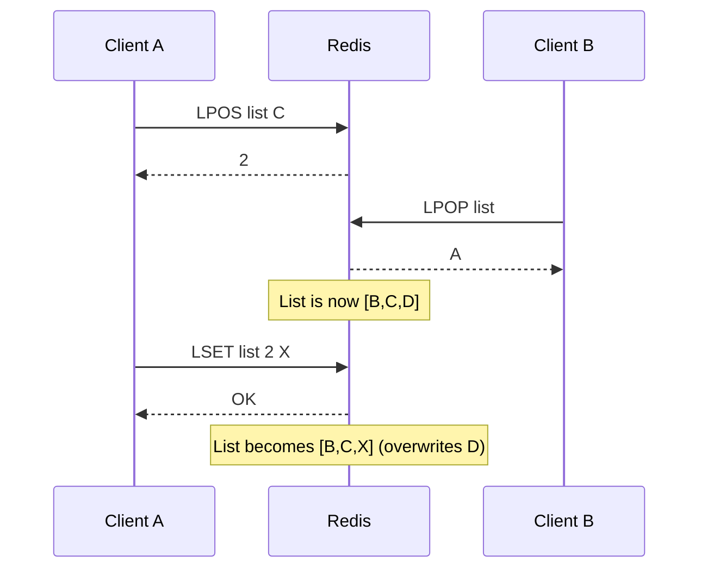

# Updating, Finding Positions, and Removing Elements

A Redis List is a structure that stores **an ordered sequence** of elements. In Spring Data Redis, you interact with a List through `ListOperations<K, V>` obtained from `RedisTemplate` or `StringRedisTemplate`. Once elements have been added with `leftPush` or `rightPush`, an application often needs to update an element at a given position, find where a value appears, remove duplicate values, or keep only a slice of the list.

These operations have characteristics that are easily misunderstood:

- **List indices start at 0**, and negative indices count from the end of the list.
- **Updating by index** is different from **inserting an element** or **finding an element by value**.
- Redis allows **duplicate values**, so you must specify whether to remove one occurrence, remove from the head/tail, or remove all occurrences.
- Each individual Redis command is executed atomically, but **"find index → update/delete" across multiple commands is not automatically atomic**.
- Return values from Spring Data Redis can differ when executed directly versus inside a pipeline or transaction.

This lesson explains these operations from the Redis CLI to the Java API, with data examples and guidance on choosing tools when a list is modified concurrently by multiple clients.

## 1. Redis List, Ordering, and Indices

### 1.1. Creating a Sample List

Using the Redis CLI:

```redis
DEL course:topics
RPUSH course:topics basics strings lists streams
LRANGE course:topics 0 -1
```

Logical result:

```text
Key: course:topics

Index:        0         1         2         3
Element:   basics    strings    lists    streams
```

`RPUSH` adds to the **right**, so the element order matches the order passed in. With `LPUSH course:topics basics strings lists streams`, each element is pushed onto the head in turn, leaving the final order reversed.

A Redis List does not have a per-element "element ID" like a primary key in a relational table. It only knows the **position** and **byte value** of each element. Consequently, the element at index 2 can become a different element after a client calls `LPOP` at the head of the list.

### 1.2. Positive and Negative Indices

Negative indices specify positions counted from the **end of the list**:

| Index | Position in a Four-Element List |
|---|---|
| `0` | `basics`, head of the list |
| `1` | `strings` |
| `2` | `lists` |
| `3` | `streams`, tail of the list |
| `-1` | `streams`, last element |
| `-2` | `lists` |
| `-3` | `strings` |
| `-4` | `basics`, first element |
| `4` or `-5` | Out of range |

This convention applies to commands such as `LINDEX`, `LSET`, `LRANGE`, and `LTRIM`, though **how invalid indices are handled varies by command**. For instance, `LINDEX` can return nil when an index is out of range, whereas `LSET` returns an error.

### 1.3. Mapping from Redis to Spring Data Redis

```java
import org.springframework.data.redis.core.ListOperations;
import org.springframework.data.redis.core.StringRedisTemplate;

ListOperations<String, String> lists = stringRedisTemplate.opsForList();
```

| Use Case | Redis Command | Spring Data Redis `ListOperations` |
|---|---|---|
| Read element by position | `LINDEX` | `index(key, index)` |
| Overwrite element by position | `LSET` | `set(key, index, value)` |
| Find first occurrence of a value | `LPOS` | `indexOf(key, value)` |
| Find last occurrence of a value | `LPOS ... RANK -1` | `lastIndexOf(key, value)` |
| Insert before a pivot value | `LINSERT ... BEFORE` | `leftPush(key, pivot, value)` |
| Insert after a pivot value | `LINSERT ... AFTER` | `rightPush(key, pivot, value)` |
| Remove occurrences of a value | `LREM` | `remove(key, count, value)` |
| Pop and remove first element | `LPOP` | `leftPop(key)` |
| Pop and remove last element | `RPOP` | `rightPop(key)` |
| Keep only a slice | `LTRIM` | `trim(key, start, end)` |
| Read a slice without modifying data | `LRANGE` | `range(key, start, end)` |
| Count elements | `LLEN` | `size(key)` |

Note that `ListOperations` uses the names **`leftPush(key, pivot, value)`** and **`rightPush(key, pivot, value)`** for pivot-based insertion. These two overloads have different semantics from `leftPush(key, value)` and `rightPush(key, value)`, which insert at the head or tail.

## 2. Updating an Element by Position with LSET

### 2.1. How `LSET` Works

Suppose the list currently contains:

```text
[basics, strings, lists, streams]
```

To change `strings` to `redis-strings` at index 1:

```redis
LSET course:topics 1 redis-strings
LRANGE course:topics 0 -1
```

Result:

```text
[basics, redis-strings, lists, streams]
```

`LSET` **replaces the value of an existing element**. The list still has four elements; it does not insert a new element.

Updating the last element with a negative index:

```redis
LSET course:topics -1 pubsub
LRANGE course:topics 0 -1
```

Result:

```text
[basics, redis-strings, lists, pubsub]
```

### 2.2. Calling from Spring Data Redis

```java
import org.springframework.data.redis.core.StringRedisTemplate;
import org.springframework.stereotype.Service;

@Service
public class TopicListEditor {

    private final StringRedisTemplate redis;

    public TopicListEditor(StringRedisTemplate redis) {
        this.redis = redis;
    }

    public void replaceSecond(String newValue) {
        redis.opsForList().set("course:topics", 1, newValue);
    }

    public void replaceLast(String newValue) {
        redis.opsForList().set("course:topics", -1, newValue);
    }
}
```

API signature:

```java
void set(K key, long index, V value);
```

`set(...)` returns `void`; it returns neither the number of replaced elements nor the old element. When you need to read the value at a position, call `index(...)` separately:

```java
String oldValue = redis.opsForList().index("course:topics", 1);
```

However, calling `index` and then `set` **is not an atomic compare-and-set**. Another client can modify the list between the two commands.

### 2.3. `LSET` Does Not Automatically Grow the List

Redis does not treat `LSET` like assignment into an auto-expanding array. If a List has length 4 and you call:

```redis
LSET course:topics 10 advanced
```

Redis returns:

```text
(error) ERR index out of range
```

The same happens with `LSET` on a non-existent key, because there is no element to update. A server error is translated by the driver/Spring Data Redis into an appropriate exception.

If the requirement is to **add a new element**, use `LPUSH`, `RPUSH`, or `LINSERT`. If the requirement is to replace an existing element, use `LSET` and handle the possibility that the position is no longer valid.

### 2.4. Does `LSET` Clear TTL?

Unlike Redis String `SET` which overwrites the entire key value, `LSET` replaces an element **inside an existing Redis List**. While the List still exists, the key's existing TTL is preserved; `LSET` does not set or clear TTL on its own.

Example:

```redis
DEL lab:lset:ttl
RPUSH lab:lset:ttl a b c
EXPIRE lab:lset:ttl 120
LSET lab:lset:ttl 1 B
TTL lab:lset:ttl
```

The `TTL` value stays positive and continues counting down over time, rather than turning into `-1` just because `LSET` was called.

If you need to extend TTL according to an application policy, that is a separate operation such as `EXPIRE`; consider atomicity if updating and extending expiry must happen together.

## 3. Reading by Index and Finding Position by Value Are Two Different Tasks

### 3.1. `LINDEX`: Knowing the Position, Fetching the Value

```redis
DEL lab:lookup
RPUSH lab:lookup alpha beta gamma beta delta beta

LINDEX lab:lookup 0
LINDEX lab:lookup 3
LINDEX lab:lookup -1
LINDEX lab:lookup 99
```

The results are `alpha`, `beta`, `beta`, and a nil/null reply for out-of-range index 99.

In Spring:

```java
String atThree = redis.opsForList().index("lab:lookup", 3);
String atLast = redis.opsForList().index("lab:lookup", -1);
```

`index(key, position)` returns the deserialized value, or `null` when there is no element at the requested position. Inside a pipeline or transaction, `null` can also simply mean the result is not yet available; check the execution context.

### 3.2. `LPOS`: Knowing the Value, Finding Its Position

When a list has duplicate elements:

```text
Index:    0       1      2      3      4      5
Value:  alpha    beta   gamma   beta  delta   beta
```

The command:

```redis
LPOS lab:lookup beta
```

returns `1` because that is the **first occurrence from left to right**.

Finding the second occurrence:

```redis
LPOS lab:lookup beta RANK 2
```

returns `3`.

Searching from tail to head:

```redis
LPOS lab:lookup beta RANK -1
```

returns `5`. Notice that **the returned index is still counted from the head of the list**, even when searching from the tail. `RANK -2` returns `3`, not a negative index.

Finding all positions:

```redis
LPOS lab:lookup beta COUNT 0
```

returns an array of positions equivalent to `[1, 3, 5]`.

### 3.3. Spring Data Redis `indexOf` and `lastIndexOf`

```java
Long first = redis.opsForList().indexOf("lab:lookup", "beta");
Long last = redis.opsForList().lastIndexOf("lab:lookup", "beta");

// In a normal synchronous call with the sample data:
// first == 1L
// last  == 5L
```

`ListOperations.indexOf(...)` and `lastIndexOf(...)` were introduced in Spring Data Redis 2.4 and require a Redis Server supporting `LPOS`, meaning **Redis Open Source 6.0.6 or later**.

When not found:

```java
Long missing = redis.opsForList().indexOf("lab:lookup", "omega");
// missing == null in a normal synchronous call
```

This is an important difference from `LREM`, where "no elements removed" is typically represented by `0L`. Do not check `indexOf(...) == -1`: the Spring Data Redis API uses `null` to represent not-found per its contract.

Also avoid unboxing `Long` without a `null` check:

```java
Long position = redis.opsForList().indexOf("lab:lookup", "beta");
if (position != null) {
    System.out.println("Found at " + position);
}
```

In a **pipeline/transaction**, a method's `null` return value can appear before Redis sends its response; code must retrieve results after the pipeline/transaction completes.

### 3.4. `RANK`, `COUNT`, and `MAXLEN` Options

`LPOS` has useful options:

| Option | Meaning |
|---|---|
| `RANK 1` | Returns the first occurrence from the left (default). |
| `RANK 2` | Returns the second occurrence from the left. |
| `RANK -1` | Returns the last occurrence, searching right to left. |
| `COUNT 2` | Returns positions of up to two occurrences in the chosen search direction. |
| `COUNT 0` | Returns all matching positions found by the scan. |
| `MAXLEN 1000` | Compares at most 1,000 elements in the search direction, bounding search work. |

Example:

```redis
LPOS lab:lookup beta RANK -1 COUNT 2
```

returns indices `[5, 3]`: starting from the last occurrence and moving backward.

`MAXLEN` is very useful if the List can grow very long and the application only wants to search within a bounded window. When limiting the scan, **not finding the value in the scanned window does not prove the value is absent from the rest of the List**.

High-level `ListOperations` in Spring Data Redis provides `indexOf` and `lastIndexOf` for the two common cases. When you need all advanced `LPOS` options such as `COUNT` and `MAXLEN`, check the lower-level driver/Redis connection APIs for your version; do not assume `indexOf` exposes those overloads.

## 4. Removing Elements by Value with LREM

### 4.1. Rules of the `count` Parameter

`LREM` deletes elements whose **value equals** the target value. The `count` parameter controls the maximum number of occurrences and the scan direction.

```redis
LREM key count element
```

| `count` | Behavior |
|---|---|
| `count > 0` | Scans from **head to tail**, removing up to `count` matching elements. |
| `count < 0` | Scans from **tail to head**, removing up to `abs(count)` matching elements. |
| `count = 0` | Removes **all** matching elements in the list. |

`LREM` returns the **actual number of elements removed**; if the key does not exist or no match is found, it returns 0.

Example initial List:

```text
[alpha, beta, gamma, beta, delta, beta]
```

If you run:

```redis
LREM lab:lookup 1 beta
```

New List:

```text
[alpha, gamma, beta, delta, beta]
```

If you reset the sample list and run:

```redis
LREM lab:lookup -1 beta
```

New List:

```text
[alpha, beta, gamma, beta, delta]
```

If you reset and run:

```redis
LREM lab:lookup 0 beta
```

New List:

```text
[alpha, gamma, delta]
```

The three examples above are **three independent cases**. If executed sequentially on the same key without resetting, the outcome of each operation will differ.

### 4.2. Calling from Spring Data Redis

```java
import org.springframework.data.redis.core.StringRedisTemplate;
import org.springframework.stereotype.Service;

@Service
public class ListValueRemover {

    private final StringRedisTemplate redis;

    public ListValueRemover(StringRedisTemplate redis) {
        this.redis = redis;
    }

    public long removeFirstBeta() {
        Long removed = redis.opsForList()
                .remove("lab:lookup", 1, "beta");

        if (removed == null) {
            throw new IllegalStateException("No Redis result available yet");
        }

        return removed;
    }

    public long removeLastBeta() {
        Long removed = redis.opsForList()
                .remove("lab:lookup", -1, "beta");

        if (removed == null) {
            throw new IllegalStateException("No Redis result available yet");
        }

        return removed;
    }

    public long removeAllBeta() {
        Long removed = redis.opsForList()
                .remove("lab:lookup", 0, "beta");

        if (removed == null) {
            throw new IllegalStateException("No Redis result available yet");
        }

        return removed;
    }
}
```

Signature:

```java
Long remove(K key, long count, Object value);
```

Difference from `LSET`: `remove` returns the number of elements removed. If the value is not in the List, the result is `0L` in a normal synchronous call. `null` occurs when the result is not yet available in a pipeline/transaction, so never silently treat `null` as 0.

### 4.3. Redis Compares Values Byte-for-Byte

When stored via `StringRedisTemplate`, comparisons are typically based on the UTF-8 bytes of the string. Redis does not understand Unicode normalization, JSON fields, Java classes, or Java `equals()` semantics.

Suppose one service stores:

```json
{"id":7,"status":"NEW"}
```

And another service searches/deletes with:

```json
{"status":"NEW","id":7}
```

These two JSON strings may be equivalent as objects, yet they have **different byte sequences**. `LREM` does not treat them as the same object. Even when a serializer produces JSON, field order, default values, type metadata, and schema can vary across versions.

When you need to remove "the element with id = 7," calling `remove(key, 0, a reconstructed object)` is reliable only if the entire byte serialization is deterministic and identical.

### 4.4. When a List Contains Duplicate Records

Example:

```text
[task-1, task-2, task-1, task-3, task-1]
```

`remove(key, 1, "task-1")` removes only the first occurrence, leaving two copies. `remove(key, 0, "task-1")` removes all of them. If business rules forbid duplicate IDs, a Redis Set or a pattern storing objects in Hashes and IDs in a List may be more suitable, depending on ordering and consistency requirements.

**Do not assume that removing one occurrence deletes every copy.** Conversely, `count=0` can delete more than intended if duplicate values are legitimate.

## 5. Removing from the Head/Tail with LPOP and RPOP

`LREM` deletes by **value**, whereas `LPOP` and `RPOP` retrieve and delete the element at the **head or tail** of the List.

### 5.1. CLI Example

```redis
DEL lab:pop
RPUSH lab:pop A B C D

LPOP lab:pop
RPOP lab:pop
LRANGE lab:pop 0 -1
```

Sequential results:

```text
LPOP -> A
RPOP -> D
Remaining list -> [B, C]
```

In Spring:

```java
String first = redis.opsForList().leftPop("lab:pop");
String last = redis.opsForList().rightPop("lab:pop");
```

This is a **destructive read**: it retrieves the element and removes it from Redis in the same command. If you only want to inspect the first/last element without removing it, use `index(key, 0)` or `index(key, -1)`.

### 5.2. Popping Multiple Elements at Once

Modern Redis versions support the `LPOP key count` and `RPOP key count` variants. Spring Data Redis provides the APIs:

```java
List<String> firstThree = redis.opsForList().leftPop("lab:pop", 3);
List<String> lastTwo = redis.opsForList().rightPop("lab:pop", 2);
```

The returned list contains the elements **popped in the order of the operation**, which may differ from the left-to-right order before popping. Verify ordering with `RPOP` when business logic relies on FIFO/LIFO.

When the List is empty or the key does not exist, pop operations can return `null`. Inside a pipeline/transaction, distinguish "no element" from "result not yet returned" according to the API context.

### 5.3. When Popping the Last Element

Redis deletes the key when the List has no elements left. Example:

```redis
DEL lab:one
RPUSH lab:one only
LPOP lab:one
EXISTS lab:one
```

`EXISTS` returns 0. This is normal behavior: **Redis does not keep an empty List as an existing key**. If you need to store the state "the list has been initialized but has no elements yet," use a separate metadata key.

### 5.4. Do Not Confuse Popping with Acknowledged Deletion

In a simple queue pattern, `LPOP` fetches and deletes the job before the worker finishes processing. If the worker crashes after popping, the job can be lost from the List.

For job processing requiring acknowledgements, retries, and consumer coordination, consider Redis Streams with consumer groups or an appropriate reliable queue pattern. This lesson focuses strictly on updating, finding, and removing elements in a Redis List.

## 6. Keeping a Slice with LTRIM

### 6.1. `LTRIM` Retains Only Elements Within the Range

`LTRIM key start stop` **deletes elements outside the range** `[start, stop]`. The `stop` index is **inclusive**.

Example:

```redis
DEL lab:trim
RPUSH lab:trim A B C D E F
LTRIM lab:trim 1 3
LRANGE lab:trim 0 -1
```

List after trimming:

```text
[B, C, D]
```

Index 1 is `B` and index 3 is `D`; both endpoints are kept.

To keep the last three elements:

```redis
LTRIM lab:trim -3 -1
```

If the list beforehand was `[A, B, C, D, E, F]`, the result is `[D, E, F]`. On the already-trimmed `[B, C, D]`, the result is simply `[B, C, D]`; make sure you track the starting state during hands-on practice.

### 6.2. Calling from Spring

```java
// Keep at most the first 100 elements of the current List:
redis.opsForList().trim("feed:recent", 0, 99);

// Keep at most the last 100 elements of the current List:
redis.opsForList().trim("feed:recent", -100, -1);
```

Signature:

```java
void trim(K key, long start, long end);
```

`trim` is a **mutating operation**, unlike `range` which only reads. Never call `trim` to "fetch a slice" when you do not want to delete the rest; use `range(key, start, end)`.

### 6.3. Empty Ranges and Out-of-Bounds Indices

`LTRIM` does not necessarily raise an error when the specified range falls outside the List. It may retain fewer elements than requested. When no elements remain in the range, Redis deletes the List key.

Example:

```redis
DEL lab:trim:empty
RPUSH lab:trim:empty A B
LTRIM lab:trim:empty 4 10
EXISTS lab:trim:empty
```

`EXISTS` returns 0. Once a List is emptied by trimming, subsequent `indexOf` or `leftPop` calls treat it as a missing key.

### 6.4. Bounded-Length List Pattern

A common pattern for "100 most recent events":

```redis
LPUSH feed:recent event-123
LTRIM feed:recent 0 99
```

Here `LPUSH` adds the newest event at the head; `LTRIM 0 99` keeps the 100 newest events in the current order.

In Java:

```java
redis.opsForList().leftPush("feed:recent", eventId);
redis.opsForList().trim("feed:recent", 0, 99);
```

These two Java lines **are two separate commands**. If multiple producers operate concurrently, another producer can push or trim in between; if the process dies after push but before trim, the list may temporarily exceed the limit. If "add and keep at most 100 elements" must be guaranteed atomically, use a Lua script:

```lua
-- KEYS[1] = list key
-- ARGV[1] = event value
-- ARGV[2] = maximum length (positive integer)

redis.call('LPUSH', KEYS[1], ARGV[1])
redis.call('LTRIM', KEYS[1], 0, tonumber(ARGV[2]) - 1)
return redis.call('LLEN', KEYS[1])
```

Validate that `ARGV[2]` is a positive integer **before invoking the script** in the application or add validation inside the script. When running on Redis Cluster, the keys accessed by the script must follow proper slot rules.

## 7. Inserting Before or After a Pivot Element with LINSERT

An update-related need is **placing a new element next to an existing element**, rather than overwriting it.

### 7.1. LINSERT Is Not LSET

Suppose:

```text
[A, C, D]
```

To insert `B` before `C`:

```redis
LINSERT lab:insert BEFORE C B
```

Result:

```text
[A, B, C, D]
```

Do not use `LSET 1 B` because that replaces `C` with `B` and **loses C**, instead of inserting.

### 7.2. Spring Data Redis Support via Pivot Overloads

```java
Long lengthAfterInsert = redis.opsForList()
        .leftPush("lab:insert", "C", "B");
```

Corresponding to `LINSERT ... BEFORE C B`.

To insert after `C`:

```java
Long lengthAfterInsert = redis.opsForList()
        .rightPush("lab:insert", "C", "B");
```

Corresponding to `LINSERT ... AFTER C B`.

With Redis `LINSERT`:

- On successful insertion, returns the new List length.
- If the key exists but the pivot is not found, returns `-1`.
- If the key does not exist, returns `0`.
- If the key holds a Redis type other than List, returns a `WRONGTYPE` error.

The Spring method returns `Long`; in a pipeline/transaction, it can return `null` before the response arrives. Do not treat this `Long` as the index of the newly inserted element: it is the **new length**.

If multiple elements equal the pivot value, `LINSERT` picks one occurrence per the command's semantics, rather than inserting next to **all** elements equal to the pivot. When you need to insert next to a specific "object with ID" in a list that allows duplicates, design the data model to avoid ambiguity.

## 8. Can You Delete Exactly One Index?

Redis provides `LSET key index value` to **replace** an element by index, but does not offer a built-in basic List command named `LDELETE key index` to "delete that exact index."

Related commands have different semantics:

| Command | Deletion Criterion |
|---|---|
| `LREM` | Bytes matching `element`, with direction and count. |
| `LPOP` / `RPOP` | Element at the head or tail of the List. |
| `LTRIM` | All elements **outside** the range to keep. |
| `LSET` | **Does not delete**; only overwrites at index. |

### 8.1. Why Is "LSET Sentinel Then LREM" Risky?

A trick that occasionally appears:

```redis
LSET mylist 3 __DELETE_ME__
LREM mylist 1 __DELETE_ME__
```

The idea is to replace the element at position 3 with a marker and then delete the marker by value. However, this carries risks:

1. **Two non-atomic commands** if sent separately. Another client can modify the list between them.
2. The marker might **collide with real data**, causing the wrong element to be deleted.
3. If the process crashes after `LSET`, the marker can remain in the data.
4. If the list receives pushes/pops between computing the index and running `LSET`, the element at index 3 may have shifted.

Therefore, do not treat this as a reliable default delete-by-index API. For a short List where the application fully controls the data, you can build an atomic Lua script that checks the index and uses a collision-free marker, though you still must account for semantics with concurrent producers.

### 8.2. If You Need to Delete by ID, What Should You Store?

If each element is an object such as:

```json
{"taskId":"t-100","status":"PENDING"}
```

`LREM` requires matching **the entire serialized value**, not just `taskId`. To support stable deletion/updating by ID, consider the pattern:

```text
Redis List  : order:task-ids       → [t-100, t-200, t-300]
Redis Hash  : task:by-id:<taskId>  → object/payload for each task
```

Then `LREM` by exact ID becomes much simpler than deleting full JSON strings. However, **the List and the Hash are separate keys**; if operations must stay synchronized between them, design transactions/Lua scripts or orphan-cleanup workflows. If frequent lookup/deletion by ID is required, a Redis Set, Sorted Set, or another database may also fit better depending on ordering requirements.

## 9. Concurrency: Indices Can Shift Before an Update

### 9.1. Race Condition Scenario

Suppose the List is:

```text
[A, B, C, D]
```

Client A wants to replace `C` with `X`. A finds `C` at index 2. Meanwhile, client B calls `LPOP`, so the list becomes `[B, C, D]`, making index 2 now `D`.



Each command (`LPOS`, `LPOP`, and `LSET`) is executed individually by Redis, but the "find then set" combination is **not atomic**.

This highlights the difference between:

- **Atomic command:** a single Redis command executing its own logic as an indivisible step.
- **Atomic workflow:** a sequence of commands requiring consistent preconditions and outcomes, which needs an appropriate coordination mechanism.

### 9.2. Lua Script for Updating Only If the Element Still Matches

When the business rule is "replace the element at index i **if it still equals the expected value**," a Lua script can check and write in a single execution:

```lua
-- KEYS[1] = list key
-- ARGV[1] = index, zero-based or negative
-- ARGV[2] = expected serialized value
-- ARGV[3] = new serialized value

local current = redis.call('LINDEX', KEYS[1], tonumber(ARGV[1]))

if not current then
    return 0  -- index does not exist
end

if current ~= ARGV[2] then
    return 0  -- index changed to a different value
end

redis.call('LSET', KEYS[1], tonumber(ARGV[1]), ARGV[3])
return 1
```

The script prevents another client from interleaving **between the script's check and write**. However, if multiple elements share the same serialized value, checking by value still does not establish a **stable identity** for an element: a different element with the same value could now sit at that index. For strict per-ID requirements, use stable IDs in your data model.

### 9.3. Is Find-Then-Remove by Value Different?

If A calls `indexOf(key, "B")` and then `remove(key, 1, "B")`, the `remove` command **does not use the index that was found**; it scans from the head and deletes the first match at execution time.

This may be acceptable if the business goal is "delete one element with value B," regardless of where it sits. But if the application intends to "delete specifically the second occurrence among three B elements," `LREM count=1` cannot target that occurrence. When duplicates and concurrency coexist, a different design is needed.

## 10. TTL, Key Types, and Behavior on Empty Lists

### 10.1. TTL When Modifying or Partially Deleting Elements

A Redis List key can have a TTL attached:

```redis
RPUSH lab:ttl A B C
EXPIRE lab:ttl 120
LSET lab:ttl 1 b
LREM lab:ttl 1 A
TTL lab:ttl
```

`LSET` and `LREM` operate **inside the List** and normally preserve the existing expiration while the key exists. If all elements are removed via `LREM` or `LPOP`, Redis deletes the key; `TTL` then returns `-2` because the key no longer exists.

Do not confuse this with Redis String `SET`: a successful `SET` without options to retain expiry normally clears the old TTL.

### 10.2. Non-Existent Keys

| Command | Behavior When the List Key Does Not Exist |
|---|---|
| `LINDEX` | Returns nil/null reply |
| `LPOS` | Returns nil without `COUNT`; value not found |
| `LREM` | Returns 0 |
| `LPOP` / `RPOP` | Returns nil/null reply |
| `LRANGE` | Returns empty list |
| `LLEN` | Returns 0 |
| `LSET` | Returns error `index out of range` |
| `LTRIM` | Does not create a new List |

In Spring Data Redis, some methods can return `null` even when commands are queued in a pipeline/transaction. Return values must be interpreted according to the **API and execution context**, not solely the raw Redis reply.

### 10.3. Wrong Key Type

If `course:topics` is currently a Redis String and code invokes ListOperations:

```redis
SET course:topics hello
LRANGE course:topics 0 -1
```

Redis returns an error like `WRONGTYPE Operation against a key holding the wrong kind of value`. That is a data-structure mismatch error, not proof of an empty List. Use `TYPE course:topics` during investigation.

Using clear namespaces, such as `list:topic-order:<courseId>`, prevents key collisions across Strings, Hashes, and Lists.

## 11. How Serialization Affects Searching and Removing

### 11.1. Elements Are Compared by Serialized Bytes

With `StringRedisTemplate`, each List element can be a UTF-8 string. With `RedisTemplate<String, Task>` and a JSON serializer, each element is a byte sequence representing `Task` after serialization.

`LPOS` and `LREM` do not understand Java's `equals()`. They compare the serialized bytes of the `value` argument; to match/remove accurately, the bytes of the supplied value must match the stored bytes.

For example, two objects with the same ID but different statuses:

```json
{"id":"t-1","status":"NEW"}
```

```json
{"id":"t-1","status":"DONE"}
```

To a Redis List, these are two distinct values. `remove(key, 0, taskWithStatusDone)` will not delete the NEW record just because the ID matches.

### 11.2. Do Not Treat a List as a Java Collection Holding Object References

An element is persisted as bytes inside Redis. If Java code mutates an in-memory object after calling `rightPush`, Redis **does not automatically update the stored element**. To persist changes, issue an explicit command such as `LSET` or adopt a by-ID object storage strategy.

Example:

```java
Task task = new Task("t-1", "NEW");
redis.opsForList().rightPush("task:list", task);

task.setStatus("DONE");
// Redis still stores the bytes of the old state until a new write command is issued.
```

This snippet assumes `RedisTemplate` is configured with a serializer for `Task`. If multiple services read the data, establish schema versioning and compatibility rules for nullable fields, enums, and timestamps.

### 11.3. Redis Hash + List Can Separate Ordering from Content

When the List only needs to maintain the order of IDs while payloads change frequently, you can design:

```text
List: tasks:order       [task-1, task-2, task-3]
Hash/String: task:1     {"status":"DONE", ...}
Hash/String: task:2     {"status":"NEW", ...}
Hash/String: task:3     {"status":"NEW", ...}
```

The application updates `task:1` without searching via `LPOS` and calling `LSET` on a JSON object in the List. The trade-off is maintaining consistency between the ordering key and data keys, and handling orphans and rollbacks per business needs.

## 12. Performance: Not Every Index Operation Is O(1)

Redis Lists are optimized for operations at **both ends**, whereas the cost of accessing or positioning in the middle can depend on list length.

| Command | Typical Complexity Characteristics | Implications |
|---|---|---|
| `LPUSH` / `RPUSH` | O(1) per element | Well suited for adding at head/tail. |
| `LPOP` / `RPOP` | O(1) when popping one element | Well suited for simple queues/stacks. |
| `LINDEX` | O(N) in general; elements near head/tail are typically fast | Avoid calling in a loop to iterate a large List element by element. |
| `LSET` | O(N) in general; updating head/tail is typically O(1) | Writing at deep indices in a long List can be costly. |
| `LPOS` | O(N) when scanning the list; `MAXLEN` can bound the scan | Do not use as a frequent search index on huge Lists. |
| `LREM` | Depends on List length and count of elements to remove | Removing many duplicates can require scanning. |
| `LTRIM` | Depends on number of elements removed | Works well on bounded lists, though real load should be measured. |

Here `N` is the number of List elements or elements scanned, depending on the command. This excludes network RTT, serialization, and Redis load.

### 12.1. Do Not Iterate a Large List with Repeated LINDEX Calls

Java example:

```java
Long size = redis.opsForList().size(key);
for (long index = 0; index < size; index++) {
    String element = redis.opsForList().index(key, index);
    // process element
}
```

This incurs many round trips and index lookups; on a large List it can be very slow. If you only need to read a slice, use:

```java
List<String> firstPage = redis.opsForList().range(key, 0, 99);
```

`LRANGE` avoids sending a separate `LINDEX` request per element. If the list changes continuously, offset-based pagination can duplicate or skip elements between reads. When stable pagination is required, consider another data model (such as a Sorted Set with score/ID and cursor).

### 12.2. When Is a Redis List No Longer Suitable?

If the primary requirements are:

- looking up objects by ID;
- deleting an arbitrary ID from a long list;
- updating object fields continuously;
- querying by multiple attributes;
- stable pagination under heavy write load;

then a List may not be the right primary structure. Consider a Redis Hash storing objects by ID, a Sorted Set for scored ordering, a Set for membership, or Redis Streams for message processing with consumer groups. Choose based on business semantics, not just because adding elements to a Redis List is easy.

## 13. Service Example Combining Operations

Suppose an application maintains a list of steps for a lesson:

```text
Key: lesson:steps:<lesson-id>
Value: Redis List containing steps as Strings
```

Required operations:

1. Append a step at the end.
2. Read a step by position.
3. Update a step by position.
4. Find the first/last position of a step.
5. Remove one or all steps with matching content.
6. Keep at most a certain number of leading steps to compact the list.

```java
import java.util.List;
import java.util.Objects;

import org.springframework.data.redis.core.ListOperations;
import org.springframework.data.redis.core.StringRedisTemplate;
import org.springframework.stereotype.Service;

@Service
public class LessonStepListService {

    private final ListOperations<String, String> lists;

    public LessonStepListService(StringRedisTemplate redis) {
        this.lists = redis.opsForList();
    }

    public long append(String lessonId, String step) {
        Long newSize = lists.rightPush(key(lessonId), requireStep(step));

        if (newSize == null) {
            throw new IllegalStateException("List length not available yet");
        }
        return newSize;
    }

    public String getAt(String lessonId, long index) {
        return lists.index(key(lessonId), index);
    }

    public void replaceAt(String lessonId, long index, String newStep) {
        // Server returns an error if the index is out of range.
        lists.set(key(lessonId), index, requireStep(newStep));
    }

    public Long findFirst(String lessonId, String step) {
        // null = not found in a normal synchronous call.
        return lists.indexOf(key(lessonId), requireStep(step));
    }

    public Long findLast(String lessonId, String step) {
        return lists.lastIndexOf(key(lessonId), requireStep(step));
    }

    public long removeFirst(String lessonId, String step) {
        return completed(lists.remove(key(lessonId), 1, requireStep(step)));
    }

    public long removeLast(String lessonId, String step) {
        return completed(lists.remove(key(lessonId), -1, requireStep(step)));
    }

    public long removeAll(String lessonId, String step) {
        return completed(lists.remove(key(lessonId), 0, requireStep(step)));
    }

    public List<String> readAll(String lessonId) {
        return lists.range(key(lessonId), 0, -1);
    }

    public void keepFirst(String lessonId, int maxItems) {
        if (maxItems < 1) {
            throw new IllegalArgumentException("maxItems must be positive");
        }
        lists.trim(key(lessonId), 0, maxItems - 1L);
    }

    private static String key(String lessonId) {
        if (lessonId == null || lessonId.isBlank()) {
            throw new IllegalArgumentException("lessonId is blank");
        }
        return "lesson:steps:" + lessonId;
    }

    private static String requireStep(String step) {
        Objects.requireNonNull(step, "step");
        return step;
    }

    private static long completed(Long result) {
        if (result == null) {
            throw new IllegalStateException(
                    "Redis result not available in pipeline/transaction");
        }
        return result;
    }
}
```

This sample service is designed for **direct synchronous calls**, not inside a pipeline or transaction. When no match is found, `findFirst` and `findLast` return `null` per the API; the `remove...` methods return the number of elements removed.

Steps here are identified by **string content**. If multiple steps can have identical text or require exact operations by unique ID, store stable IDs instead of using `step text` as identity.

### 13.1. Example Usage Flow

```java
service.append("redis-intro", "Overview");
service.append("redis-intro", "Strings");
service.append("redis-intro", "Lists");
service.append("redis-intro", "Strings");

Long first = service.findFirst("redis-intro", "Strings");
Long last  = service.findLast("redis-intro", "Strings");
// With no concurrent operations: first = 1, last = 3

service.replaceAt("redis-intro", 2, "Redis Lists");

// Remove the first occurrence:
long removed = service.removeFirst("redis-intro", "Strings");
// removed = 1

List<String> result = service.readAll("redis-intro");
// [Overview, Redis Lists, Strings]
```

This is the expected outcome when Redis is clean in the lesson namespace and no other client modifies the same key. In practice, leftover data from prior runs or concurrent requests can alter results. For deterministic practice, delete the demo key before running.

## 14. CLI Practice for Each Operation

You can run this entire section against a local Redis instance and `redis-cli`. Use the `lab:list129:...` namespace to stay clear of business data.

### 14.1. Updating by Index

```bash
redis-cli DEL lab:list129:edit
redis-cli RPUSH lab:list129:edit a b c d
redis-cli LSET lab:list129:edit 1 B
redis-cli LSET lab:list129:edit -1 D
redis-cli LRANGE lab:list129:edit 0 -1
```

Expected result:

```text
[a, B, c, D]
```

Try adding `LSET lab:list129:edit 99 X` to observe `index out of range`; that is a valid error, not a broken Redis server.

### 14.2. Finding Positions of Duplicate Values

```bash
redis-cli DEL lab:list129:find
redis-cli RPUSH lab:list129:find a b a c a d
redis-cli LPOS lab:list129:find a
redis-cli LPOS lab:list129:find a RANK 2
redis-cli LPOS lab:list129:find a RANK -1
redis-cli LPOS lab:list129:find a COUNT 0
```

The results are `0`, `2`, `4`, and `[0, 2, 4]`, respectively. If the Redis Server is older than **6.0.6**, `LPOS` may not be recognized; use a compatible version.

### 14.3. Removing by Value and Direction

```bash
redis-cli DEL lab:list129:remove
redis-cli RPUSH lab:list129:remove a b a c a d
redis-cli LREM lab:list129:remove 1 a
redis-cli LRANGE lab:list129:remove 0 -1
```

Remaining:

```text
[b, a, c, a, d]
```

Practice removing from the tail by recreating the list:

```bash
redis-cli DEL lab:list129:remove
redis-cli RPUSH lab:list129:remove a b a c a d
redis-cli LREM lab:list129:remove -1 a
redis-cli LRANGE lab:list129:remove 0 -1
```

Remaining:

```text
[a, b, a, c, d]
```

Practice removing all occurrences:

```bash
redis-cli DEL lab:list129:remove
redis-cli RPUSH lab:list129:remove a b a c a d
redis-cli LREM lab:list129:remove 0 a
redis-cli LRANGE lab:list129:remove 0 -1
```

Remaining:

```text
[b, c, d]
```

### 14.4. Trimming the List and Observing Key Deletion

```bash
redis-cli DEL lab:list129:trim
redis-cli RPUSH lab:list129:trim A B C D E
redis-cli LTRIM lab:list129:trim 0 2
redis-cli LRANGE lab:list129:trim 0 -1

redis-cli LTRIM lab:list129:trim 5 9
redis-cli EXISTS lab:list129:trim
```

First, the List becomes `[A, B, C]`. The second trim selects an out-of-range slice so the List empties and Redis deletes the key; `EXISTS` returns 0.

## 15. Common Pitfalls

| Symptom | Possible Cause | Resolution |
|---|---|---|
| `LSET` reports `index out of range` | List does not exist, shrank, or index is invalid | Check bounds; do not assume the key exists; under concurrency use an appropriate atomic check pattern. |
| `indexOf` returns `null` | Element not found, or running inside pipeline/transaction | Distinguish execution context and when replies are read. |
| `remove` returns `0` | No matching serialized bytes or key missing | Check serializer, duplicates, and key state. |
| `LREM` deletes more than expected | Used `count=0` or duplicate values exist | Choose the right count/direction; use stable IDs if needed. |
| `LREM` fails to remove an object with the same ID | Redis compares serialized bytes, not the ID field | Store IDs separately or use a consistent codec/schema. |
| `LTRIM` causes data loss | Mistook `trim` for a read or assumed end is exclusive | Use `range` to read; remember end is **inclusive**. |
| Key disappears after pop/trim/removal | Redis deletes a List when no elements remain | If "created but empty" state is needed, store separate metadata. |
| `WRONGTYPE` | Key holds String/Hash instead of List | Check `TYPE` and namespaces; do not overwrite other data. |
| Updated the wrong element under multiple clients | Read index then updated across multiple commands | Use stable IDs, Lua, or appropriate transactions. |
| Command `LPOS` does not exist | Redis Server is too old | Redis `LPOS` requires 6.0.6+; check server version. |
| Large List reads/updates are slow | O(N) scans, many round trips, or expensive serialization | Measure latency, batch with `LRANGE`, and revisit the data model. |

## 16. Practice Questions

**Question 1.** The initial List is `[A, B, C, D]`. After `LSET key -2 X`, what is the List?

Answer: `[A, B, X, D]`. `-2` is the second-to-last element.

**Question 2.** Given `[A, B, A, C, A]`, what does `LPOS key A RANK -1` return?

Answer: `4`. It searches from the end, but the returned index is still zero-based from left to right.

**Question 3.** Given `[A, B, A, C, A]`, which elements does `LREM key -2 A` remove?

Answer: it removes **the last two occurrences of A**, leaving `[A, B, C]`.

**Question 4.** To view elements from index 2 through 5 without modifying the List, should you use `trim` or `range`?

Answer: `range(key, 2, 5)`, because `trim` deletes elements outside the range.

**Question 5.** A client runs `LPOS key C` and gets index 2, then another client calls `LPOP`. Does calling `LSET key 2 X` guarantee replacing `C`?

Answer: no. The index may have shifted; handle concurrency or identify elements with stable IDs.

**Question 6.** Can you reliably delete exactly the third element of a Redis List using only `LREM key 1 value`?

Answer: not guaranteed. `LREM` deletes by **value and scan direction**, not by index. If values duplicate, it may remove a different occurrence.

**Question 7.** When a List has only one element and `LPOP` is called, what does `EXISTS key` return?

Answer: 0. After popping the last element, Redis does not keep an empty List key.

**Question 8.** Why might `indexOf(key, object)` fail to find an object with the same Java ID?

Answer: Redis compares serialized bytes; differences in JSON field order, status, or metadata produce different byte sequences.

## 17. Technical Conclusion

To work properly with Redis Lists in Spring Data Redis, clearly distinguish **three categories of actions**:

1. **Updating by position:** `set(key, index, value)` maps to `LSET`. It replaces an existing element and errors if the index is invalid.
2. **Finding by value:** `indexOf` / `lastIndexOf` map to `LPOS`. Returned indices start at 0, and `null` can indicate not-found in synchronous calls.
3. **Removing with specific semantics:** `remove(key, count, value)` removes by value; `leftPop/rightPop` pop and remove at either end; `trim` keeps only a range and removes elements outside it.

Redis Lists allow duplicate values, indices can shift on pushes/pops, and Redis does not assign an independent identity to each element. Therefore, when requirements call for "updating/deleting the exact object by ID" or cross-client consistency, design element identification and atomic operations before selecting commands.

### Official Documentation

- [Spring Data Redis — ListOperations API](https://docs.spring.io/spring-data/redis/reference/api/java/org/springframework/data/redis/core/ListOperations.html): `set`, `index`, `indexOf`, `lastIndexOf`, `remove`, `trim`, `leftPop`, and `rightPop`.
- [Spring Data Redis — RedisTemplate](https://docs.spring.io/spring-data/redis/reference/redis/template.html): serializers, pipelining, and transactions.
- [Redis — LSET](https://redis.io/docs/latest/commands/lset/): updating an element at an index.
- [Redis — LINDEX](https://redis.io/docs/latest/commands/lindex/): reading an element by index.
- [Redis — LPOS](https://redis.io/docs/latest/commands/lpos/): finding positions, `RANK`, `COUNT`, `MAXLEN`, requires Redis 6.0.6+.
- [Redis — LREM](https://redis.io/docs/latest/commands/lrem/): removing by value, count, and direction.
- [Redis — LTRIM](https://redis.io/docs/latest/commands/ltrim/): keeping a range and handling out-of-bounds slices.
- [Redis — LINSERT](https://redis.io/docs/latest/commands/linsert/): inserting before/after a pivot.
- [Redis — LPOP](https://redis.io/docs/latest/commands/lpop/) and [RPOP](https://redis.io/docs/latest/commands/rpop/): popping and deleting from head/tail.
- [Redis — Lists](https://redis.io/docs/latest/develop/data-types/lists/): choosing Lists and understanding how the data structure works.
