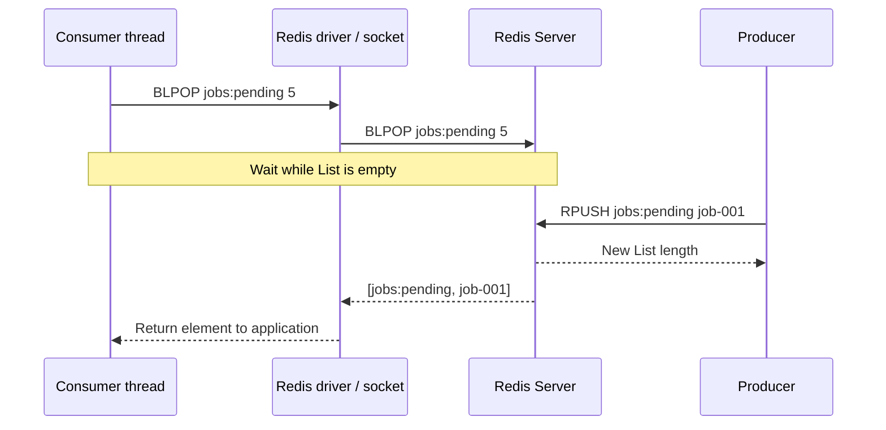

# Blocking Pop Commands and Dedicated Connection Requirements

Redis Lists are commonly used to build simple work queues: a **producer** process pushes elements onto a list, and **consumer** processes pop elements to handle them. When the list is empty, a consumer can repeatedly call `LPOP`/`RPOP` and sleep, or use **blocking pop** commands such as `BLPOP` and `BRPOP`.

With blocking pop, Redis can **hold the waiting request open** until an element arrives or the timeout expires. This reduces repeated commands polling an empty list. However, in Spring Data Redis, a blocking call does not involve only the List: it occupies the calling thread's execution time and may require **a dedicated native connection** at the Redis driver layer.

That is why two concepts must be learned side by side:

1. **Semantics of blocking List commands:** waiting when empty, popping from head/tail, timeouts, atomicity, and behavior with multiple consumers.
2. **Connection lifecycle:** why `RedisTemplate` can use a shared connection for normal `GET`/`SET` commands, yet the driver typically must allocate a dedicated connection for an in-flight waiting `BLPOP`/`BRPOP`.

> **"Blocking" has two layers here:** the Redis Server holds a client waiting on a data condition; in Spring Data Redis's synchronous API, the calling thread also waits for the result. Redis continues serving other clients while one client is blocked.

## 1. From Regular List Queues to Blocking Pop

### 1.1. The Two Ends of a Redis List

A Redis List is an ordered sequence of elements. Common commands:

| Command | Meaning |
|---|---|
| `LPUSH key value [value ...]` | Add elements to the **left end** |
| `RPUSH key value [value ...]` | Add elements to the **right end** |
| `LPOP key` | Pop and remove the element at the left end |
| `RPOP key` | Pop and remove the element at the right end |
| `LLEN key` | Count elements remaining in the List |
| `BLPOP key [key ...] timeout` | Wait if the List is empty; when data arrives, pop from the left |
| `BRPOP key [key ...] timeout` | Wait if the List is empty; when data arrives, pop from the right |
| `BLMOVE source destination LEFT\|RIGHT LEFT\|RIGHT timeout` | Wait for an element in source and **atomically move** it to destination |

A FIFO (*first in, first out*) queue can use either of two command pairs:

- **Producer `RPUSH` → consumer `BLPOP`:** Add on the right, pop the oldest element on the left.
- **Producer `LPUSH` → consumer `BRPOP`:** Add on the left, pop the oldest element on the right.

Both conventions implement FIFO. Standardize on **one convention per queue**; if producer and consumer swap ends arbitrarily, element ordering changes.

### 1.2. Why Shouldn't You Poll Too Aggressively?

With regular `LPOP`:

```text
Consumer:
  LPOP jobs:pending → nil
  sleep 100 ms
  LPOP jobs:pending → nil
  sleep 100 ms
  LPOP jobs:pending → nil
  ...
```

Polling has the advantage of a controllable check cycle, but when the queue is empty it constantly generates network round trips and Redis commands. Sleeping longer makes consumers react slowly to new items; sleeping shorter multiplies wasted commands as the number of consumers grows.

With `BLPOP`:

```text
Consumer: BLPOP jobs:pending 5 ────────────────┐
                                               │ Redis keeps client waiting
Producer: RPUSH jobs:pending "job-001"         │
                                               ▼
Consumer receives ["jobs:pending", "job-001"] ◄┘
```

The consumer still must keep a request/connection open during the wait. **Reducing polling does not mean zero resource cost:** a waiting client still consumes connection resources and, on a synchronous call path, also holds an application thread.

## 2. `BLPOP`: Popping from the Left and Waiting When Empty

### 2.1. Syntax

```redis
BLPOP key [key ...] timeout
```

Where:

- `key` is one or more Redis List names to watch.
- `timeout` is how long Redis is willing to wait, in seconds. `0` means **wait indefinitely on the Redis side**, provided the connection stays open and no other limit interrupts the command.
- If the List already has an element, Redis returns the result **immediately** without waiting for the timeout.
- If the timeout expires without an element arriving, Redis returns `nil`.
- When an element is popped, Redis returns a pair containing **the List name popped from** and **the element value**.

Example:

```redis
RPUSH jobs:pending "job-001" "job-002" "job-003"
BLPOP jobs:pending 5
# 1) "jobs:pending"
# 2) "job-001"

LRANGE jobs:pending 0 -1
# 1) "job-002"
# 2) "job-003"
```

If the List is empty:

```redis
DEL jobs:pending
BLPOP jobs:pending 3
# Redis waits up to about 3 seconds, then returns nil if no producer pushes
```

The command does not create a separate waiting-queue entry in the Redis keyspace. Redis tracks **waiting clients** internally on the server; the List key does not have to exist while the consumer is waiting.

### 2.2. Two-Terminal Demonstration

**Terminal A — consumer:**

```bash
redis-cli BLPOP jobs:pending 0
```

Terminal A now blocks waiting. **Terminal B — producer:**

```bash
redis-cli RPUSH jobs:pending "job-100"
```

Terminal A receives the key name and element `job-100`, then the command exits. To continue listening for subsequent jobs, the consumer must **call `BLPOP` again** inside a loop or worker lifecycle. One `BLPOP` command pops **one element** per successful return.

In production environments, `timeout 0` can make a consumer hard to stop or slow to react to configuration changes. Finite timeouts usually give the worker an opportunity to check shutdown flags.

### 2.3. Watching Multiple Lists

```redis
BLPOP jobs:critical jobs:normal 5
```

If both Lists already have elements when the command runs, Redis prioritizes **earlier keys** in the argument list (`jobs:critical` in this example). When Lists are empty and a producer writes later, wake-up behavior depends on the order in which Redis processes writes and blocked clients.

Do not treat key order as an absolute priority scheduler. If `jobs:critical` continuously receives items, normal jobs can suffer *starvation*. Design explicit fairness, worker allocation, or priority bounds when required by business rules.

In Redis Cluster, operations touching multiple keys must comply with Cluster hash slot rules. Do not assume `BLPOP listA listB` can watch two Lists residing in different hash slots; you may need matching hash tags or separate consumers per queue/slot.

## 3. `BRPOP`: Popping from the Right and Waiting When Empty

`BRPOP` shares the same waiting/timeout mechanism as `BLPOP`, differing only in **which end of the List is popped**.

Example using the `LPUSH` + `BRPOP` convention for FIFO:

```redis
LPUSH jobs:pending "job-001"
LPUSH jobs:pending "job-002"
LPUSH jobs:pending "job-003"

LRANGE jobs:pending 0 -1
# "job-003", "job-002", "job-001"

BRPOP jobs:pending 5
# "jobs:pending", "job-001"

BRPOP jobs:pending 5
# "jobs:pending", "job-002"
```

Diagram:

```text
LPUSH job-001     [job-001]
LPUSH job-002     [job-002, job-001]
LPUSH job-003     [job-003, job-002, job-001]
                    left             right
BRPOP             ─────────────────► pops job-001 first
```

Choosing `BLPOP` or `BRPOP` depends on the producer convention. Both commands **remove the element from the List** as soon as they return a result; this is crucial for worker error handling.

## 4. How Does Redis Handle Blocking Pop?

### 4.1. Blocking the Waiting Client, Not the Entire Redis Server

The Redis Server marks a client connection as blocked when executing `BLPOP` on an empty List. When another client pushes an item to that List, Redis wakes the consumer and sends the data.



While the consumer is blocked, Redis continues processing commands from other clients. "Blocking" refers to **one client's request** and **the thread waiting for the response**, not locking the entire server for the timeout duration.

### 4.2. One Element Is Not Broadcast to Every Consumer

Suppose two consumers are waiting on the same List:

```text
Consumer A: BLPOP jobs:pending 10 ── waiting
Consumer B: BLPOP jobs:pending 10 ── waiting
Producer:   RPUSH jobs:pending job-001
```

Only **one** consumer receives `job-001` because popping removes the element from the List. The other consumer continues waiting for the next element or until its timeout expires.

Redis follows defined rules for serving waiting clients in order, yet a multi-producer/consumer system should still never infer **business completion order**, strict fairness, or exactly-once processing. Workers vary in processing speed, network latency, and command timing.

### 4.3. Atomicity of the Pop Operation

Each `BLPOP`/`BRPOP` command is processed by Redis as a single pop operation once an element is ready. There is no gap between "checking whether the List has data" and "popping the element" at the Redis command level like in this pattern:

```text
LLEN key → 1
// Another client can pop the element here
LPOP key  → nil
```

Therefore, never rely on `LLEN` to guarantee that a subsequent `LPOP` will retrieve data. Only the pop result itself is authoritative at the moment of execution.

### 4.4. Distinguishing Different Outcomes

| Scenario | Observable Behavior |
|---|---|
| List already has elements on call | Pops immediately; returns element and key name in the Redis protocol |
| List empty; producer pushes before timeout | Consumer wakes up and receives the element |
| List remains empty until timeout | Redis returns `nil`; Spring typically maps this to `null` in the corresponding API |
| Connection dropped or auth error | Raises an exception/operational error; must not be treated as a normal timeout |
| Key holds a non-List data type | `WRONGTYPE` error |
| Consumer stopped while waiting | Command/connection must be cancelled or wait for timeout; depends on driver/lifecycle |

When a key becomes empty after popping the last element, Redis may remove the List key from the keyspace. `LLEN` returns 0 when no elements remain; do not use key existence as a sign that "the queue has been initialized."

## 5. Redis Timeout vs. Driver Timeout

### 5.1. Timeout Inside the Redis Command

```redis
BLPOP jobs:pending 5
```

Redis is instructed to wait up to about 5 seconds if no element is present. This timeout governs **how long a blocking command waits on the server**.

`BLPOP jobs:pending 0` asks Redis to wait indefinitely. However, the TCP connection or driver can still be severed by network issues, server restarts, command timeouts, or application lifecycle shutdown. Thus "0" is not a guarantee that the application will wait cleanly forever.

### 5.2. Timeout in the Redis Client/Driver

Lettuce/Jedis and Spring settings can also specify a command timeout, connect timeout, or pool borrow timeout. If the driver waits only 2 seconds for a reply while the Redis command is told to wait 10 seconds, the application can hit a **client-side timeout error first** before Redis returns `nil` on server timeout.

| Timeout | Where Applied | Expiration Can Lead To |
|---|---|---|
| Redis blocking timeout | `BLPOP`/`BRPOP`/`BLMOVE` on server | Empty reply (`nil`) if no element arrives |
| Driver command timeout | Lettuce/Jedis client | Exception or client-side operation cancellation |
| Pool borrow wait | Connection pool | Unable to borrow connection; error/timeout before command is sent |
| Connect/network timeout | Connection establishment and transport | Connection exception |
| Application shutdown deadline | Worker/app lifecycle | Worker asked to stop; command cancelled/awaited depending on mechanism |

Waiting for data timing out **is not a connection error**. The application should distinguish `null` caused by an empty queue from driver exceptions and track separate metrics for each.

### 5.3. Why Choose a Finite Timeout?

A long-running worker typically uses a loop:

```text
while applicationIsRunning:
    BLPOP queue 3
    if timeout:
        check stop signal and retry
    else:
        process job
```

A 2–5 second timeout is an illustrative choice balancing shutdown responsiveness against loop re-invocation frequency; the ideal value depends on latency needs, driver configuration, worker count, and infrastructure. Keep the **client command timeout larger than the Redis blocking timeout**, leaving headroom for network/scheduling, and never pick timeouts by guessing.

## 6. Performing Blocking Pop with Spring Data Redis

### 6.1. `ListOperations` in `StringRedisTemplate`

Spring Data Redis exposes List operations via:

```java
ListOperations<String, String> listOps = stringRedisTemplate.opsForList();
```

Common `ListOperations` overloads:

```java
// Immediate pop: does not wait when the queue is empty.
String immediate = listOps.leftPop("jobs:pending");

// Blocking pop: waits up to the declared duration.
String fromLeft = listOps.leftPop(
    "jobs:pending", Duration.ofSeconds(3));

String fromRight = listOps.rightPop(
    "jobs:pending", Duration.ofSeconds(3));
```

In Spring Data Redis, overloads accepting `Duration` correspond to blocking pop at the Redis layer. Older API overloads accept `long timeout, TimeUnit unit`, whereas in newer code `Duration` expresses the time unit more clearly.

When no element arrives before the timeout, the method can return `null`. If executed inside a pipeline/transaction, the contract of some Spring Data methods may return `null` because results are deferred, so **do not use `null` in that context to conclude the queue is merely empty**. Blocking pop is also unsuitable for running inside a pipeline/transaction as an independent waiting worker.

### 6.2. Minimal Producer and Consumer

```java
package com.example.redis.queue;

import java.time.Duration;
import org.springframework.data.redis.core.StringRedisTemplate;
import org.springframework.stereotype.Service;

@Service
public class SimpleJobQueue {

    private static final String PENDING = "jobs:pending";

    private final StringRedisTemplate redis;

    public SimpleJobQueue(StringRedisTemplate redis) {
        this.redis = redis;
    }

    public void submit(String jobId) {
        // LPUSH + BRPOP produces FIFO order for a single List.
        redis.opsForList().leftPush(PENDING, jobId);
    }

    public String takeOnce() {
        // Call only from a dedicated worker thread processing the queue.
        return redis.opsForList()
                .rightPop(PENDING, Duration.ofSeconds(3));
    }

    public Long pendingCount() {
        return redis.opsForList().size(PENDING);
    }
}
```

This service only shows how to invoke Redis; `takeOnce()` **is a synchronous call that can block for up to 3 seconds**. It belongs in a worker, and should not be called from an HTTP request expecting an immediate response.

Usage example:

```java
jobQueue.submit("job-101");
jobQueue.submit("job-102");

String first = jobQueue.takeOnce();
// "job-101" when no other consumer has popped it first.
```

Do not rely on `pendingCount()` to guarantee a subsequent `takeOnce()` will find data: other consumers may have already popped the element.

### 6.3. A Stoppable Worker Lifecycle

One illustrative approach is dedicating an executor to run blocking pops, using a finite timeout per wait so the loop can inspect the stop flag.

```java
package com.example.redis.queue;

import java.util.concurrent.ExecutorService;
import java.util.concurrent.Executors;
import java.util.concurrent.TimeUnit;
import java.util.concurrent.atomic.AtomicBoolean;
import jakarta.annotation.PreDestroy;
import org.slf4j.Logger;
import org.slf4j.LoggerFactory;
import org.springframework.boot.context.event.ApplicationReadyEvent;
import org.springframework.context.event.EventListener;
import org.springframework.stereotype.Component;

@Component
public class SimpleJobWorker {

    private static final Logger log =
        LoggerFactory.getLogger(SimpleJobWorker.class);

    private final SimpleJobQueue queue;
    private final ExecutorService executor =
        Executors.newSingleThreadExecutor();
    private final AtomicBoolean running = new AtomicBoolean(false);

    public SimpleJobWorker(SimpleJobQueue queue) {
        this.queue = queue;
    }

    @EventListener(ApplicationReadyEvent.class)
    public void start() {
        if (running.compareAndSet(false, true)) {
            executor.submit(this::loop);
        }
    }

    private void loop() {
        while (running.get() && !Thread.currentThread().isInterrupted()) {
            try {
                String jobId = queue.takeOnce();
                if (jobId != null) {
                    process(jobId);
                }
            } catch (RuntimeException ex) {
                log.warn("Redis worker failed; retrying after backoff", ex);
                try {
                    TimeUnit.SECONDS.sleep(1);
                } catch (InterruptedException interrupted) {
                    Thread.currentThread().interrupt();
                    break;
                }
            }
        }
    }

    private void process(String jobId) {
        // Illustrative business logic.
        log.info("Received job {}", jobId);
    }

    @PreDestroy
    public void stop() {
        running.set(false);
        executor.shutdownNow();
    }
}
```

This example uses a single worker and a dedicated executor for clarity. In production, manage worker concurrency, lifecycle, backpressure, dead-letter/retry handling, and business processing errors. **In particular:** with `BRPOP`, the element is removed from the List before `process()` runs; if processing fails or the process crashes mid-flight, the job can be **lost from the queue**. Consequently, this code is only appropriate when losing jobs is acceptable, or when a separate recovery mechanism exists outside this example.

For systems requiring "receive first, then acknowledge," a later section introduces the pattern of moving elements from a pending queue to a processing queue.

## 7. Why Does Blocking Pop Need a Dedicated Connection?

### 7.1. Spring's Logical Connection vs. the Native Connection

When calling `redis.opsForList().rightPop(key, Duration.ofSeconds(3))`:

1. `RedisTemplate` requests a connection from `RedisConnectionFactory`.
2. Spring Data uses a `RedisConnection` object to issue the Redis command.
3. The driver (such as Lettuce or Jedis) sends `BRPOP` over a native connection/socket.
4. That socket waits for Redis to respond until an element arrives, the timeout expires, or the connection closes.
5. Once the command finishes, Spring releases the **logical connection lifecycle**; the driver may retain the native connection for reuse.

The Spring-layer `RedisConnection` object is an abstraction/wrapper; acquiring a `RedisConnection` **does not necessarily open a new TCP socket**. What actually happens depends on the factory configuration, driver, and command type.

### 7.2. The Problem with Sharing One Socket for a Waiting Command

A single Lettuce native connection can usually send multiple ordinary commands via asynchronous multiplexing. However, a blocking pop **puts the client session into a data-waiting state**. While the server blocks that session, the same session should not serve as a shared channel for unrelated commands that need immediate responses.

```text
Unsuitable for sharing the same Redis client session:

Consumer thread ── BRPOP key 30 ─┐
                                 ├── Same socket S1 ── Redis
API thread      ── GET key ──────┘
                    ↑ Risk of waiting behind the blocking command

Properly separate connection sources:

API thread      ── GET key ─────── Shared native connection S1 ── Redis

Consumer thread ── BRPOP key 30 ── Dedicated native connection S2 ── Redis
```

In the common `LettuceConnectionFactory` model:

- `shareNativeConnection = true` allows ordinary, non-blocking Redis commands to use a shared native connection.
- Blocking operations and transactions typically acquire a **dedicated native connection** through the connection provider instead of tying up the shared connection used by normal commands.
- Dedicated connections may be created on demand or borrowed from a pool, depending on configuration and implementation.

The diagram above illustrates two physical sockets S1/S2. In practice, Redis Cluster, Sentinel, Pub/Sub, multiple pools, or multiple client factories may open additional connections.

### 7.3. How the Number of Waiting Consumers Affects Connection Count

Suppose:

- 20 workers wait concurrently on `BRPOP`.
- Each worker needs a dedicated native connection for the entire wait duration.
- The pool serving dedicated connections allows at most 8 concurrent borrows.

The outcome can be:

```text
20 worker threads
       │
       ├── 8 workers borrow a native connection
       │      └── 8 BLPOP/BRPOP commands waiting in Redis
       │
       └── Remaining 12 workers
              └── wait for pool connection / hit borrow timeout
```

This does not mean Redis itself limits consumers to 8 by design; it can be a **client-side pool limit**. Meanwhile, the server may also hold other connections for regular commands, monitoring, and external clients.

These numbers illustrate a single pool; there is no fixed formula "Redis sockets = max-active" because a pool only manages connections within its own scope.

### 7.4. Lettuce and Jedis Use Different Strategies

| Aspect | Lettuce | Jedis |
|---|---|---|
| Factory in Spring Data Redis | `LettuceConnectionFactory` | `JedisConnectionFactory` |
| Native connection for regular commands | Can be shared if configuration allows | Typically managed via appropriate connection resources/pool |
| Native connection for blocking pop | Usually allocated separately via connection provider | Borrows/holds an appropriate Jedis connection while waiting |
| Thread running synchronous blocking API | Waits for result | Waits for result |
| Returning connection after command completes | Driver/provider decides whether to reuse or close | Driver/pool decides whether to reuse or close |

Do not hold a Spring Data Redis `RedisConnection` instance as a singleton shared across multiple threads. `RedisTemplate` is the abstraction designed for safe reuse once configured; connections it borrows have their own lifecycle. Nor should you infer from Lettuce's multi-threaded native connection capability that every `RedisConnection` wrapper is thread-safe.

## 8. Connection Pools for Blocking Consumers

### 8.1. Sizing by the Number of Waiting Calls

When `N` independent consumers are waiting on blocking pops, the dedicated connection path needs enough capacity for the **concurrent blocking commands**, plus any other operations needing the same connection type if they share a pool.

An initial estimation approach:

```text
pool demand ≈ concurrent blocking consumers
             + other transactions/operations borrowing dedicated connections
             + headroom based on observed load
```

This is planning guidance, not a ready-made optimal configuration value. Pool sizing must also match Redis Server resource limits, number of application instances, workers per instance, processing latency, and Redis topology.

In particular, if **one shared pool** serves both long-waiting consumers and other Redis operations requiring dedicated connections, consumers can exhaust every connection and starve the remaining operations. When isolation matters, consider a dedicated client/factory or pool specifically for queue workers.

### 8.2. Configuring a Lettuce Pool via Spring Boot

Configuration example for a Spring Boot application using Lettuce:

```groovy
dependencies {
    implementation 'org.springframework.boot:spring-boot-starter-data-redis'
    implementation 'org.apache.commons:commons-pool2'
}
```

```yaml
spring:
  data:
    redis:
      host: localhost
      port: 6379
      lettuce:
        pool:
          enabled: true
          max-active: 12
          max-idle: 12
          min-idle: 0
          max-wait: 2s
```

Meaning:

- `max-active`: limits how many connections can be **borrowed** concurrently from this pool.
- `max-idle` / `min-idle`: idle connection targets/caps per the pool implementation.
- `max-wait`: how long to wait to **borrow** a connection when the pool is busy; this is not the Redis List element wait timeout.

In `LettuceConnectionFactory` with `shareNativeConnection=true`, regular commands can continue using the shared native connection; enabling pooling **does not force every `GET`/`SET` to borrow a socket from the pool**.

If workers routinely wait for long stretches, size the pool around **worker concurrency**, not merely HTTP requests per second. Do not raise the pool limit indefinitely: every connection on the Redis Server still consumes resources and is bounded by server configuration.

### 8.3. When Do You Need a Separate Client/Factory for Queues?

A dedicated factory can be helpful when:

- Consumer count is large and blocking concurrency is high.
- Queue and cache share Redis yet have different latency targets.
- You do not want consumer pool pressure to affect web requests.
- You need distinct timeouts, client names, or metrics for the queue.
- You plan to scale workers independently from the API application.

You can define a separate `StringRedisTemplate` backed by a worker-specific `RedisConnectionFactory`. However, registering multiple beans of the same type requires careful `@Qualifier`/`@Primary` and lifecycle management. A separate template **only truly isolates connection resources when it uses a separately configured factory/client/pool**; two templates sharing the same factory still share its underlying connections.

In larger systems, separating workers into their own deployable process also makes concurrency, autoscaling, and shutdown easier to control without blocking API threads.

## 9. Limitation of `BLPOP`/`BRPOP`: Elements Are Removed Before Processing

`BRPOP` performs **atomic retrieval and removal** in Redis. It does not hold the element until the application reports "processing complete."

```text
Pending list: [job-101, job-102]
                    │
Consumer BRPOP ─────┘
          │
          ▼
job-101 has been removed from pending
          │
          ▼
Application processes job-101
          │
          ├── succeeds
          └── process dies / throws exception before completion
                         └── job-101 does not automatically return to pending
```

This pattern fits jobs that can tolerate loss or be reconstructed from another source. For critical tasks, you need a **pending → processing → acknowledge** mechanism, or a queue with consumer groups/acks like Redis Streams where appropriate.

One distinction to keep clear:

- **Atomic pop:** an element cannot be popped successfully by two consumers from the same List state.
- **Reliable processing:** the job completes successfully or can be recovered if a worker dies.

Atomic pop **does not automatically guarantee reliable processing or exactly-once**.

## 10. `BLMOVE`: Blocking and Moving an Element to a Processing List

Redis supports `BLMOVE` to move an element from a source List to a destination List **in a single atomic command**. It is the blocking counterpart of `LMOVE`; the older `BRPOPLPUSH` command has been deprecated since Redis 6.2 and can be replaced with `BLMOVE ... RIGHT LEFT ...`.

### 10.1. Syntax

```redis
BLMOVE source destination LEFT|RIGHT LEFT|RIGHT timeout
```

Parameters:

- `source`: List holding waiting jobs.
- `destination`: List holding jobs claimed by consumers for processing.
- First `LEFT|RIGHT`: which end of `source` to pop from.
- Second `LEFT|RIGHT`: which end of `destination` to push onto.
- `timeout`: seconds to wait when source is empty; `0` waits indefinitely on the Redis Server.

Example preserving FIFO under the `LPUSH` convention:

```redis
LPUSH jobs:pending "job-101"
LPUSH jobs:pending "job-102"

BLMOVE jobs:pending jobs:processing RIGHT LEFT 5
# "job-101"

LRANGE jobs:pending 0 -1
# "job-102"

LRANGE jobs:processing 0 -1
# "job-101"
```

Key difference: `job-101` **is no longer in pending** but is already present in **processing** before the consumer begins processing. If the consumer connection drops after Redis moves the element and before the client receives the response, the job may sit in processing without the worker knowing it was claimed. Recovery design must account for this ambiguous response case.

### 10.2. Acknowledging Completion

After successful processing, the application can remove the corresponding element from processing:

```redis
LREM jobs:processing 1 "job-101"
```

`LREM` removes a number of matching elements. Hence **the element content must uniquely identify a single job** for acknowledgement to be accurate. For instance, use a unique job ID rather than two identical payloads that cannot be told apart.

If multiple workers share `jobs:processing`, the application must also track which worker claimed which job, lease state, and processing expiration. A Redis List itself **does not grant lease timeouts or automatically redeliver** an element sitting in processing.

### 10.3. How Should Stuck Jobs Be Handled?

A processing-list pattern usually requires a **recovery/sweeper** component:

1. When a worker claims a job, record metadata: job ID, owner/attempt, and start timestamp or processing deadline.
2. When the worker finishes, acknowledge and clean up the metadata.
3. If the worker crashes, the sweeper identifies jobs that have remained in processing too long without completion.
4. The sweeper moves the job back to pending or routes it to a dead-letter queue per the retry policy.
5. Moving elements and updating metadata must be safely synchronized when multiple workers/sweepers run concurrently.

Do not run `LRANGE jobs:processing`, then `LPUSH jobs:pending`, then `LREM jobs:processing` as three separate commands without accounting for races; jobs can be duplicated or lose state. Use scripts/Redis Functions or an appropriate consistent data and protocol design.

This pattern typically provides **at-least-once** delivery when recovery is implemented properly: a job may be redelivered if a worker completes its side effect and crashes before acknowledging. Therefore **handlers must be idempotent** or use idempotency keys in the primary data store. Never claim exactly-once solely from `BLMOVE` and `LREM`.

### 10.4. Spring Data Redis and `BLMOVE`

The `ListOperations` API in supported Spring Data Redis versions exposes move operations with source and destination directions. For example, in versions providing a blocking overload accepting `Duration`:

```java
import java.time.Duration;
import org.springframework.data.redis.connection.RedisListCommands.Direction;
import org.springframework.data.redis.core.StringRedisTemplate;

public class ReliableQueueReceiver {
    private final StringRedisTemplate redis;

    public ReliableQueueReceiver(StringRedisTemplate redis) {
        this.redis = redis;
    }

    public String takeIntoProcessing() {
        return redis.opsForList().move(
            "jobs:pending",
            Direction.RIGHT,
            "jobs:processing",
            Direction.LEFT,
            Duration.ofSeconds(3)
        );
    }
}
```

This snippet expresses the same semantics as `BLMOVE jobs:pending jobs:processing RIGHT LEFT 3`. Exact API names and overload support depend on the Spring Data Redis version; when upgrading, check the API documentation for that version. **Do not** infer from a `null` result that no job existed if the command ran inside a pipeline/transaction context that defers results.

For cleaner design, encapsulate receive/ack/retry inside one service owning both the Lists and related metadata, rather than letting multiple layers manipulate `LREM`/`LPUSH` directly.

## 11. `BLMPOP` and Multiple Lists (Extended Concept)

Redis 7 and later add `BLMPOP` for waiting on **multiple Lists** and popping a batch of elements in one command. Syntax:

```redis
BLMPOP timeout numkeys key [key ...] LEFT|RIGHT [COUNT count]
```

Example:

```redis
BLMPOP 5 2 jobs:critical jobs:normal LEFT COUNT 3
```

The command waits on two Lists, prioritizes keys in command order per its semantics, and can return multiple elements from the chosen List (up to the requested `COUNT`, depending on available items).

Notes:

- Unlike waiting for a single element with `BLPOP`/`BRPOP`, the return shape can include **the List name and an array of elements**.
- Popping a batch of elements still provides no built-in acknowledgement or recovery; multiple items can be lost from pending if the consumer crashes.
- Do not invoke `BLMPOP` against a Redis Server that does not support it. When integrating via Spring Data Redis, verify the library version and matching command/driver API.
- On Redis Cluster, keys in a multi-key command remain subject to slot constraints.

Choose batch blocking pop only when throughput needs and result shape genuinely fit and error handling for the whole batch is already designed.

## 12. Blocking Pop with Transactions, Pipelines, and Reactive APIs

### 12.1. Do Not Run Blocking Consumers Inside a Redis Transaction

Redis transactions (`MULTI`/`EXEC`) queue commands to execute together at `EXEC`; Redis does not provide semantics to "hold a transaction open waiting for an element to appear" like an independent blocking consumer. Blocking commands inside a transaction do not behave like a normal waiting consumer when a List is empty.

In Spring Data Redis, `SessionCallback` groups commands on the same session, but **is not a mechanism for a worker to sleep waiting inside `MULTI/EXEC`**. Run blocking calls separately outside transactions, then perform processing/ack steps under a separate protocol.

### 12.2. Pipelines Are for Sending Many Commands, Not Holding Workers Waiting

A Redis pipeline sends multiple commands without waiting immediately for each response. A waiting blocking command can make collecting batched replies unpredictable or stall subsequent commands. A queue worker should not place `BLPOP` inside a pipeline alongside independent commands expecting them all to finish quickly.

### 12.3. Reactive Does Not Stop Redis Server from Blocking the Client

With Spring Data Redis Reactive and a supporting driver, application execution does not block a Java thread the way the synchronous blocking API does. However, **a Redis command with blocking semantics still keeps the corresponding client connection/session waiting for data on the server**. "Reactive" describes how the application schedules I/O; it does not turn `BLPOP` into an instant operation inside Redis.

Do not call synchronous blocking APIs like `StringRedisTemplate.opsForList().rightPop(key, timeout)` directly on a WebFlux event-loop thread. Doing so can block the event loop. If the system truly needs reactive consumers, use reactive APIs with a compatible connection/subscription strategy, or isolate workers onto separate threads/processes.

## 13. Observing Blocked Clients

Redis lets you inspect current client connections and how many clients are in the blocked state:

```redis
INFO clients
CLIENT LIST
```

Useful fields:

| Observation | Meaning |
|---|---|
| `connected_clients` | Current number of client connections tracked by Redis Server |
| `blocked_clients` | Number of clients waiting on blocking commands tracked by Redis Server |
| `CLIENT LIST` | Per-client details (address, name, flags, recent command depending on version) |
| `LLEN jobs:pending` | Number of elements remaining in pending at query time |
| Pool metrics | Active/idle connections, borrow wait time, borrow timeouts |
| Command latency and errors | Helps distinguish data-wait timeouts from network/client errors |

Example observation steps:

1. Run a dedicated Redis instance for the lab.
2. Open three terminals, each running `redis-cli BLPOP jobs:pending 30` while the queue is empty.
3. In a fourth terminal, run `INFO clients` and locate `blocked_clients`.
4. Push one element and observe one consumer receive data; the other two consumers can remain waiting.
5. Wait for the remaining consumers to time out or push more elements and compare the `blocked_clients` count.

`redis-cli` clients used for monitoring are also counted in `connected_clients`. If the system uses a Lettuce pool, Redis Insight, health checks, and multiple application instances, `connected_clients` will not equal the exact number of Java workers. Track **values over time** and distinguish connection sources.

### When Pool Exhaustion Errors Occur

Suppose workers report failing to borrow a connection:

1. Count concurrent blocking tasks per application instance and across all instances.
2. Check the pool/provider configuration of the factory actually used by the workers.
3. Compare active connection count, hold duration, and `max-wait`.
4. Check whether transactions or other operations share the dedicated connection pool.
5. Check whether Redis Server is approaching max clients, CPU/RAM limits, or experiencing network issues.
6. Adjust concurrency or split pools/factories as needed; only raise pool limits after identifying the bottleneck.

An empty queue with 100 workers waiting on `BLPOP` can produce 100 blocked connections. **That is not proof Redis is hung**: it can be normal working state, provided connection capacity is sized accordingly.

## 14. Failure Scenarios and How to Handle Them

### 14.1. Element Wait Timeout

`StringRedisTemplate` returns `null` after a finite wait if no element was popped. The worker should continue waiting on the next loop iteration or check shutdown flags. Do not log an ERROR on every normal empty-queue timeout.

### 14.2. Network Failure Mid-Pop

When a connection drops, the client may not know whether Redis already executed the pop. Never immediately assume "nothing was popped; retrying is definitely safe." With `BRPOP`, that can leave a lost job; with `BLMOVE`, inspect processing and recover by job ID.

### 14.3. Redis Restart or Failover

Waiting connections can be severed. The driver may reconnect automatically per configuration, but **a prior blocking command is not guaranteed to resume seamlessly as if no interruption happened**. Workers need a reconnect loop with backoff and a mechanism to resolve ambiguous outcomes when high reliability is required.

### 14.4. Slow Consumers

`BLPOP` only eliminates empty-queue polling; it does not throttle producers. If producers push faster than workers process, `LLEN jobs:pending` can grow unbounded. Monitor queue depth, throughput, and enqueue-to-completion latency, and design backpressure, worker scaling, and payload storage limits.

### 14.5. Multiple Consumers Finishing Out of Enqueue Order

Pop commands retrieve elements in List order under normal conditions, yet two workers receiving `job-1` and `job-2` may finish in reverse order due to differing execution times. If you need **guaranteed sequential processing** for a business key, limit concurrency per group or adopt an appropriate partitioning/ordering model rather than relying solely on List FIFO order.

### 14.6. Redis List Disappears When Empty

When the last element is popped, Redis may delete the key because the List is empty. Subsequent `BLPOP` calls can still wait on the key name; there is no need to pre-create an "empty List." If using TTL on the List key, understand that a key recreated after becoming empty may not retain the old TTL.

### 14.7. Command Returns `WRONGTYPE` Error

A key intended as a List already has a String/Hash stored by another application under the same name. Enforce clear naming/namespace conventions and inspect with:

```redis
TYPE jobs:pending
```

Never run `DEL` on a key in production without verifying its owner and contents; deleting a key used by another service can cause data loss.

## 15. When Should You Choose Redis Streams?

Redis Lists with blocking pops are very handy for simple queues, yet they do not provide every capability of a message broker out of the box.

| Requirement | Redis List + Blocking Pop | Redis Streams |
|---|---|---|
| Wait until data arrives | `BLPOP`/`BRPOP`, `BLMOVE` | `XREAD BLOCK`, `XREADGROUP BLOCK` |
| Simple FIFO | Yes, with consistent push/pop ends | Ordered by message ID in stream |
| Pop and remove from pending immediately | Yes | Consumer groups do not delete messages merely on read |
| Consumer groups and pending entries | Must design yourself if using a processing List | Consumer groups include a pending entries list |
| Processing acknowledgement | Must implement via List/metadata | `XACK` supports ack within a consumer group |
| Claim/retry after consumer failure | Requires custom sweeper/lease | Tools like `XAUTOCLAIM`; still needs a policy |
| Retention and message limits | Managed manually via List/TTL/other structures | Stream trimming available; requires configuration/ops |
| Exactly-once side effects with external DB | Not guaranteed automatically | Not guaranteed either; needs idempotency/business protocol |

If the requirement is simply "one worker waits for a short signal and loss on worker crash is acceptable," a Redis List can suffice. If jobs require retries, acks, multi-consumer distribution, and durable pending tracking, Redis Streams usually offer a cleaner model. The final choice still depends on ordering, durability, throughput, and business guarantees.

## 16. Complete Hands-on Practice in Redis CLI

Run this lab on a dedicated learning Redis instance.

**Step 1 — Create a FIFO queue:**

```redis
DEL lab:pending lab:processing
LPUSH lab:pending "job-A"
LPUSH lab:pending "job-B"
LRANGE lab:pending 0 -1
# "job-B", "job-A"
```

**Step 2 — Consumer pops from the right:**

```redis
BRPOP lab:pending 3
# "lab:pending", "job-A"

BRPOP lab:pending 3
# "lab:pending", "job-B"

BRPOP lab:pending 3
# Waits and returns nil when no new job arrives
```

**Step 3 — Waiting on an empty List:**

Terminal A:

```bash
redis-cli BLPOP lab:pending 10
```

Terminal B (within 10 seconds):

```bash
redis-cli RPUSH lab:pending "job-C"
```

Observe Terminal A receiving `lab:pending` and `job-C`.

**Step 4 — Observing blocked clients:**

While Terminal A is waiting (before pushing), run:

```redis
INFO clients
CLIENT LIST
```

Observe `blocked_clients`. Once the consumer times out or receives a job, this metric drops.

**Step 5 — Atomic move to processing:**

```redis
DEL lab:pending lab:processing
LPUSH lab:pending "job-D"
BLMOVE lab:pending lab:processing RIGHT LEFT 3
# "job-D"

LRANGE lab:pending 0 -1
# empty

LRANGE lab:processing 0 -1
# "job-D"
```

**Step 6 — Acknowledge after successful processing:**

```redis
LREM lab:processing 1 "job-D"
# (integer) 1

LLEN lab:processing
# (integer) 0
```

This is a manual acknowledgement step. In production, use unique job IDs and recovery for unacknowledged processing entries.

**Step 7 — Clean up only the lab scope:**

```redis
DEL lab:pending lab:processing
```

Never run `FLUSHDB` or `FLUSHALL` on a shared Redis instance just to clear practice queues.

## 17. Design Checklist for Workers Using Blocking Lists

Before deploying, answer:

1. **Queue ordering:** Does the producer use `LPUSH` or `RPUSH`? How does the consumer match with `BLPOP`/`BRPOP`?
2. **Processing guarantees:** Is losing a job after pop acceptable? If not, are `BLMOVE`, processing/ack/recovery, or Streams a better fit?
3. **Consumer count:** How many workers wait concurrently per instance and across the entire deployment?
4. **Connection resources:** Which driver and factory are used, shared vs. dedicated connections, and how many slots are in the pool?
5. **Timeouts:** Are blocking timeout, driver command timeout, pool wait, and shutdown timeout aligned?
6. **Processing duration:** How long do tasks run, and are concurrency limits and backpressure configured?
7. **Idempotency:** If a job is redelivered after retry/failover, can side effects execute twice?
8. **Background execution:** Do workers run on dedicated worker threads/processes, away from HTTP/event-loop threads?
9. **Observability:** Are there metrics for pending length, processing length, blocked clients, pool borrows, and success/failure counts?
10. **Durability:** Do Redis persistence, failover, queue recovery, and the primary data store meet requirements?

## 18. Self-Check Questions

**1. How does `BLPOP` differ from `LPOP`?**  
`BLPOP` can wait when the List is empty until an element arrives or the timeout expires; `LPOP` returns immediately when the List is empty.

**2. With an `LPUSH` producer, should a FIFO consumer choose `BRPOP` or `BLPOP`?**  
Choose `BRPOP` to pop the oldest element on the right while the producer continuously prepends on the left.

**3. Why might a consumer waiting on `BRPOP` need a dedicated native connection even when `GET` commands share a connection?**  
Because Redis places the blocking command's client session into a waiting state. Using a dedicated connection avoids delaying unrelated commands on the same session and allows independent worker resource management.

**4. Does `BRPOP key 0` guarantee a Java worker will wait forever?**  
No. Redis is told to wait indefinitely, yet driver timeouts, network drops, failover, command cancellation, or shutdown can still terminate the operation.

**5. With a pool of 8 connections and 20 concurrent long-waiting consumers, what happens?**  
If all consumers need a dedicated connection from that pool, roughly 8 can borrow connections; the remaining consumers wait or encounter a borrow timeout, depending on configuration.

**6. `BRPOP` succeeds and the worker crashes before finishing. Does Redis automatically redeliver the element?**  
No. `BRPOP` already removed the element from the List. Recovery requires a separate reliable processing design.

**7. What does `BLMOVE pending processing RIGHT LEFT 3` solve?**  
It atomically moves an element from pending to processing, allowing the system to keep visibility into a job that has been claimed but not yet acknowledged. It does not by itself implement leases, retries, or exactly-once.

**8. Why can `LREM processing 1 payload` be dangerous if two jobs have identical payloads?**  
Because `LREM` matches by element value and may delete an occurrence belonging to a different job than the one being acknowledged. Embed a unique ID in each entry and design explicit ownership/ack handling.

**9. Does calling `BLPOP` inside `MULTI/EXEC` turn a transaction into a waiting consumer?**  
No. Blocking commands do not behave like normal waiting consumers inside transactions; separate job acquisition from processing/ack transactions.

**10. Why shouldn't a WebFlux application call synchronous `StringRedisTemplate.opsForList().rightPop(key, timeout)` on the event loop?**  
Because a synchronous call can block the event-loop thread during the wait, stalling other requests; use an appropriate reactive API or dedicated worker threads/processes.

**11. Redis reports rising `blocked_clients`. Is the Redis Server hung?**  
Not necessarily. It may simply reflect workers waiting on empty Lists as designed. Correlate with queue depth, errors, latency, connection counts, and resource limits.

**12. Does using Redis Streams automatically guarantee exactly-once?**  
No. Streams provide consumer groups and acknowledgements, yet side effects on external systems still require idempotency and appropriate business protocols.

## 19. Key Takeaways

- **`BLPOP` and `BRPOP`** are blocking pop commands: they wait only when the List is empty, returning an element when data is available or nil when the timeout expires.
- **FIFO depends on both the push end and the pop end.** `RPUSH + BLPOP` or `LPUSH + BRPOP` are the two standard conventions.
- **Blocking pop does not block the entire Redis Server**, but it holds a client session and can hold a thread in synchronous Spring Data Redis calls.
- **Lettuce typically allocates a dedicated native connection for blocking commands**, even when regular commands use a shared native connection. Driver, pool, and topology govern actual socket counts.
- **The number of concurrently waiting consumers translates into real connection demand.** Pool borrow timeouts differ from List wait timeouts.
- **`BLPOP`/`BRPOP` remove the element before the application processes it**, so they do not guarantee reliable processing on their own.
- **`BLMOVE` atomically moves pending → processing**, yet acknowledgements, recovery, retries, and idempotency remain the application's responsibility.
- When built-in consumer groups, pending entries, and acknowledgements are needed, consider **Redis Streams**.

When writing consumers in Spring Data Redis, treat **List semantics** and **dedicated connection costs** as two halves of the same architectural decision. Doing so lets the system wait efficiently for data without stalling unrelated requests and recover work to the degree required by the business.
