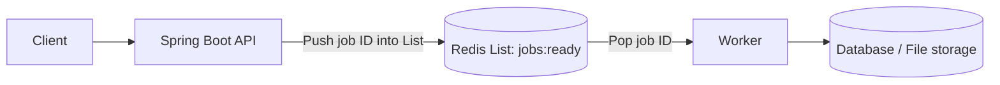
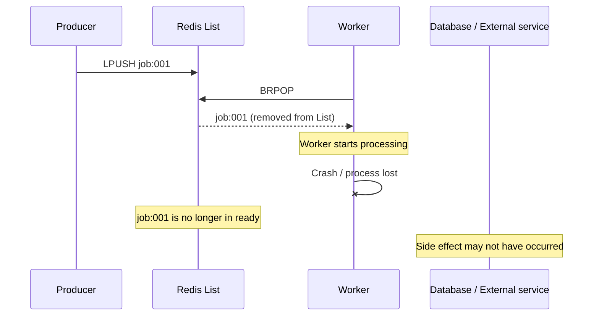
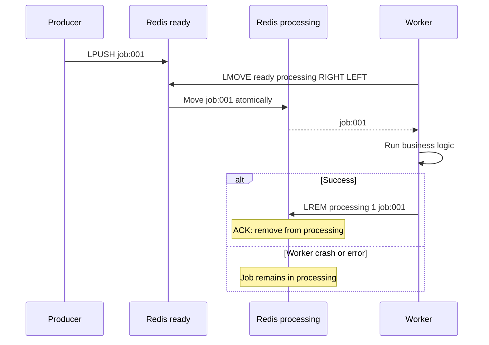
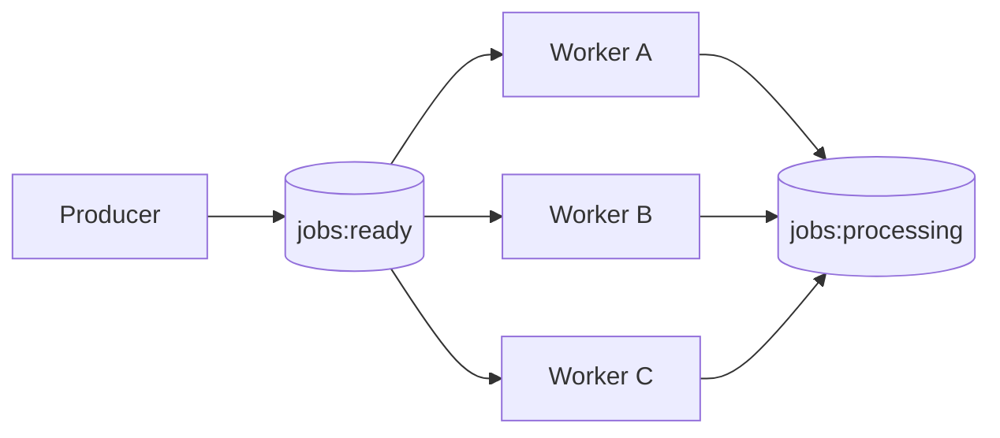

# Simple Queue Pattern and the Risk of Losing Work After Popping

A Redis List can serve as a **work queue**: a producer pushes an element onto a List, and a worker pops an element to process it. In Spring Data Redis, this is commonly implemented using `StringRedisTemplate.opsForList()` with operations such as `leftPush`, `rightPop`, or `rightPop` with a timeout.

The pattern is very easy to get started with, yet it carries a major risk: **`POP`-style commands remove the job from the List at the same time they return it**. If the worker fails after popping the item but before finishing processing, Redis no longer has that element in the queue. The job can be lost with no built-in mechanism to put it back automatically.

This lesson focuses on how a List queue works, the exact window where work can be lost, the pattern of moving elements to a `processing` list, how ACK and recovery work, duplicate processing scenarios, and when to move from Redis Lists to Redis Streams or a dedicated queuing system.

## 1. The Problem: Offloading Work to a Worker

Suppose a Spring Boot application's API receives a request to generate a report. Generating the report can take seconds or minutes, so the API does not want to hold the HTTP connection open until the calculation completes.

A simple design:



Business flow:

1. The API receives the request and creates a job identifier such as `job:001`.
2. The producer pushes `job:001` into the Redis queue.
3. A worker waiting on the queue pops `job:001`.
4. The worker reads the relevant data, builds the report, writes the output, and updates status.
5. The client polls job status via an API or receives a notification upon completion.

A Redis List holds only **an ordered list of elements**. It does not natively provide business states like `PENDING`, `PROCESSING`, `SUCCEEDED`, or `FAILED`, does not automatically retry jobs, and does not know whether a job succeeded.

**Note:** A Redis List queue fits simple tasks, transient data, rebuildable jobs, or learning environments. For critical workloads, clarify delivery guarantees, idempotency, persistence, monitoring, and recovery requirements before choosing an architecture.

## 2. How Does a Redis List Support Queuing?

A Redis List stores elements in order. Its two ends are typically called **LEFT (head)** and **RIGHT (tail)**.

Common commands:

| Redis Command | Role | Effect |
|---|---|---|
| `LPUSH key value` | Add job at the head of the List | List grows if write succeeds |
| `RPUSH key value` | Add job at the tail of the List | List grows if write succeeds |
| `LPOP key` | Pop and remove head element | Returns element or nil when empty |
| `RPOP key` | Pop and remove tail element | Returns element or nil when empty |
| `BLPOP` / `BRPOP` | Wait then pop head/tail element | Blocks caller until element arrives or timeout expires |
| `LLEN key` | Count elements in List | Useful for observing backlog |
| `LRANGE key start stop` | Read a slice without deleting | Useful for inspecting sample data |
| `LMOVE` / `BLMOVE` | Move element between two Lists | Can be used to build a safer reserve step |

An easy-to-remember FIFO convention is **`LPUSH` to enqueue, `RPOP` to dequeue**.

```text
Initial:  [ ]
LPUSH A:  [A]
LPUSH B:  [B, A]
LPUSH C:  [C, B, A]

RPOP  → A
Left:   [C, B]
RPOP  → B
Left:   [C]
RPOP  → C
Left:   [ ]
```

In the Redis CLI:

```redis
DEL demo:jobs:ready
LPUSH demo:jobs:ready job:A
LPUSH demo:jobs:ready job:B
LPUSH demo:jobs:ready job:C
LRANGE demo:jobs:ready 0 -1
RPOP demo:jobs:ready
RPOP demo:jobs:ready
RPOP demo:jobs:ready
```

The `RPOP` calls return `job:A`, `job:B`, and `job:C` in sequence, giving the queue FIFO behavior in **the order commands are processed by Redis**. When multiple producers submit requests concurrently, that order may differ from the wall-clock order users expect; Redis does not resolve priorities or cross-source business ordering on its own.

### 2.1. Why Can `LPUSH` and `RPOP` Pair Up?

If you add and remove on the left (`LPUSH`/`LPOP`), the result behaves as **LIFO**, like a stack. Adding on the right and removing from the left (`RPUSH`/`LPOP`) is another way to achieve FIFO.

| Producer | Consumer | Typical Order |
|---|---|---|
| `LPUSH` | `RPOP` | FIFO |
| `RPUSH` | `LPOP` | FIFO |
| `LPUSH` | `LPOP` | LIFO |
| `RPUSH` | `RPOP` | LIFO |

For any given queue, pick one consistent convention and use that same convention across producers, workers, operational tools, and retry workflows.

## 3. Using `StringRedisTemplate` to Build a Simple Queue

Suppose Redis is running on a development machine and the Spring Boot app includes the Redis starter.

With Gradle Groovy DSL:

```groovy
dependencies {
    implementation 'org.springframework.boot:spring-boot-starter-data-redis'
}
```

Example configuration for Spring Boot 3.x:

```yaml
spring:
  data:
    redis:
      host: ${REDIS_HOST:127.0.0.1}
      port: ${REDIS_PORT:6379}
      timeout: 2s
```

`StringRedisTemplate` operates on string keys and values, making it convenient to push a `jobId` into a Redis List without configuring an object serializer.

```java
package example.queue;

import java.time.Duration;

import org.springframework.data.redis.core.StringRedisTemplate;
import org.springframework.stereotype.Service;

@Service
public class SimpleListQueue {

    private static final String READY = "demo:jobs:ready";

    private final StringRedisTemplate redis;

    public SimpleListQueue(StringRedisTemplate redis) {
        this.redis = redis;
    }

    public void enqueue(String jobId) {
        redis.opsForList().leftPush(READY, jobId);
    }

    public String takeNow() {
        // RPOP: returns null when the List is empty.
        return redis.opsForList().rightPop(READY);
    }

    public String waitAndTake() {
        // Wait up to 5 seconds, then return null if no job arrives.
        return redis.opsForList().rightPop(
                READY, Duration.ofSeconds(5)
        );
    }

    public Long queuedCount() {
        return redis.opsForList().size(READY);
    }
}
```

Corresponding commands:

```text
enqueue(jobId) → LPUSH demo:jobs:ready <jobId>
takeNow()      → RPOP demo:jobs:ready
waitAndTake()  → BRPOP demo:jobs:ready 5
queuedCount()  → LLEN demo:jobs:ready
```

Method names and signatures can vary across Spring Data Redis versions; this example uses the `Duration`-based style of modern Spring Data Redis releases.

### 3.1. Why Push Only `jobId` Instead of the Whole Object?

You can push a JSON string into the List, but for important work, pushing a **stable identifier** is usually more practical:

```text
Job ID in Redis List: "job:001"

Business details in database:
    id          = job:001
    type        = GENERATE_REPORT
    inputRef    = report-request:448
    status      = PENDING
    createdAt   = ...
```

The benefit is that workers read the payload from a store with clear durability, update job status, and check duplicates by ID. A plain List has no mechanism to distinguish identical JSON payloads or provide a dedicated index by `jobId`.

If you push only a job ID into Redis **without persisting the job record in durable storage**, losing Redis can still lose the list of pending work. That is a separate architectural decision not solved simply by choosing `StringRedisTemplate`.

## 4. Worker Processing an Element

A worker can pop a job and invoke a business handler:

```java
package example.queue;

import java.util.function.Consumer;

import org.springframework.stereotype.Service;

@Service
public class SimpleQueueConsumer {

    private final SimpleListQueue queue;

    public SimpleQueueConsumer(SimpleListQueue queue) {
        this.queue = queue;
    }

    public void processNext(Consumer<String> jobHandler) {
        String jobId = queue.waitAndTake();

        if (jobId == null) {
            // Queue remained empty during the wait interval.
            return;
        }

        // Assumes jobHandler performs work that may throw errors.
        jobHandler.accept(jobId);
    }
}
```

This example lets the caller supply processing logic via `Consumer<String>`. Real applications should manage worker lifecycles, thread counts, shutdown, and concurrency limits. Do not spawn a new thread on every HTTP request; job workers typically run on a managed executor or separate process.

In this model, Redis only knows that `RPOP` popped the element. Redis **does not know** whether `jobHandler.accept(jobId)` is still running, succeeded, or failed.

## 5. The Work-Loss Window After Popping an Element

This is the core risk of queues built on `RPOP`/`BRPOP`.



Timeline:

```text
T0  Redis: jobs:ready = [job:001]
T1  Worker calls RPOP.
T2  Redis returns job:001 and removes it from the List.
T3  Worker prepares to process job:001.
T4  Worker crashes before saving the result.
T5  Another worker calls RPOP, but the queue is now empty.
```

**The job is lost from the queue**, because a plain Redis List has no copy or `unacknowledged` state. Whether Redis stays healthy, has persistence enabled, or runs replicas does not cause a `POP` command to undo itself.

### 5.1. Failure Points and Consequences

| When the Worker Fails | Simple List State | Possible Consequence |
|---|---|---|
| Before calling `RPOP` | Job is still in ready | Another worker can still pick it up |
| After Redis receives `RPOP` but before client receives reply | Redis may have already deleted the job | Client is unsure whether the job was popped; risk of loss |
| After receiving the job but before processing | Job has left ready | Work lost unless another recovery source exists |
| While calling a database/external API | Job has left ready | Side effect may not have happened, occurred partially, or completed |
| Processing succeeded but worker dies before saving status | Job has left ready | Result may exist while status wasn't recorded; recovery needs reconciliation |
| After processing and recording status successfully | Job has left ready | Acceptable once the durable state store has confirmed completion |

A subtle issue is network errors: **a timeout does not prove Redis did not execute the command**. The worker may fail to receive the `BRPOP` reply even though Redis already popped a job from the queue. That is a source of lost work even when the worker process itself did not crash.

### 5.2. `BRPOP` Does Not Make a Queue More Reliable Than `RPOP`

`BRPOP` is a **blocking pop**: if the List is empty, it waits until an element arrives or the timeout expires. Once an element is present, the command still **retrieves and removes** it.

```text
RPOP:
  Empty list → returns nil immediately.

BRPOP:
  Empty list → waits.
  Element arrives → pops and removes.
```

Blocking reduces constant polling and delivery latency, yet **provides no ACK, pending tracking, retry, or recovery mechanism**.

### 5.3. Why Can't AOF/RDB Rescue a Popped Job?

RDB and AOF persist **Redis's state**. Once Redis executes `RPOP`, the new queue state is **a state without that job**. Persistence saves and restores that exact state.

If a crash occurs before changes are synced to disk, the post-restart state depends on configuration and crash timing; a job might even reappear if an acknowledged operation was not yet flushed durably. Therefore:

- Persistence **does not replace worker ACKs**.
- Replication/failover does not automatically guarantee zero job loss or zero duplicates.
- Define RPO/RTO and design duplicate handling for critical queues.

## 6. At-Most-Once, At-Least-Once, and Exactly-Once

When designing queuing systems, distinguish **delivery** from **business effect**.

### 6.1. At-Most-Once: Possible Loss, Low Risk of Automatic Reprocessing

The `RPOP`-then-process pattern behaves roughly like **at-most-once delivery** when there are no retries/recovery: an element is removed as soon as it is handed to a consumer. If the consumer dies, the job is lost from the queue.

This suits non-critical jobs, such as recomputable recommendation updates, transient metrics, or optional signals.

### 6.2. At-Least-Once: Retry Until ACKed

A model with **pending/in-flight** tracking and retries can return unacknowledged jobs to ready, reducing the chance of lost work after a worker crash.

In return, a job may be delivered and processed **more than once**. That is why business logic must enforce idempotency.

### 6.3. Exactly-Once Is a Complex System-Wide Goal

A Redis operation can be atomic, yet that does not guarantee **exactly-once effects** when external databases, payment gateways, email providers, or other systems are involved.

For example, a worker sends an email successfully and crashes before ACK. The job is recovered and retried, sending a second email unless the service deduplicates.

Critical systems typically combine:

- Stable, unique job identifiers.
- Durable job state tracking.
- Idempotency/deduplication where side effects occur.
- Bounded retry rules and dead-letter handling.
- Reconciliation workflows for uncertain outcomes after timeouts.

## 7. Improvement: Moving Work from `ready` to `processing`

A Redis List-based pattern splits the queue into two lists:

```text
jobs:ready       → unclaimed jobs
jobs:processing  → jobs claimed by a worker, not yet ACKed
```

Instead of `RPOP` removing a job from the queue, the worker **moves the element** to another List in a single Redis command:

```redis
LMOVE jobs:ready jobs:processing RIGHT LEFT
```

In Redis 6.2+, `LMOVE` pops from the RIGHT of source and pushes onto the LEFT of destination **atomically in Redis**. If `ready` is empty, nothing is moved.



Key advantage: if the worker dies after reserving the job but before ACKing, the job **remains stored in `jobs:processing`**. The system has a place to inspect and decide to requeue it.

**Requirements:** both keys must be Redis Lists; in Redis Cluster, multi-key operations must satisfy hash slot rules. If keys live in different slots, the command can fail with `CROSSSLOT`. The Redis Cluster section later explains how to structure keys.

### 7.1. Waiting with `BLMOVE`

To wait for work like `BRPOP`:

```redis
BLMOVE jobs:ready jobs:processing RIGHT LEFT 5
```

Meaning: wait up to about 5 seconds for an element in `ready`; when one appears, move it to `processing` and return it to the worker.

On timeout, it returns empty/nil; no job was moved.

Older Redis documentation may show:

```redis
RPOPLPUSH jobs:ready jobs:processing
BRPOPLPUSH jobs:ready jobs:processing 5
```

Both commands express the same idea of popping from RIGHT and pushing onto LEFT, but since Redis 6.2, **`LMOVE`/`BLMOVE` are the recommended replacements**. In Spring Data Redis, check the methods and versions available; both the legacy `rightPopAndLeftPush` API and the newer `move` API may exist.

### 7.2. Acknowledging by Removing the Element from `processing`

After processing completes:

```redis
LREM jobs:processing 1 job:001
```

`LREM key 1 value` deletes one element matching `value` according to Redis's scan direction. It returns the number of removed elements.

This is a simple pattern with **no dedicated ACK ID**. If the same value appears multiple times in `processing`, or two workers run the same job due to recovery, `LREM` may remove an entry that does not match the exact claim being acknowledged.

To reduce risk in this illustrative pattern:

- Every queue entry carries a **unique ID**.
- Avoid intentionally pushing the same entry multiple times.
- Recovery logic must not requeue a job while a valid worker is still actively processing it.
- When strict ownership/claim guarantees are needed, build dedicated state/lease tracking or use a queuing system with stronger pending/ack semantics.

## 8. Illustrating `ready → processing → ACK` in Spring Data Redis

A queue management service using `StringRedisTemplate`:

```java
package example.queue;

import java.time.Duration;

import org.springframework.data.redis.connection.RedisListCommands.Direction;
import org.springframework.data.redis.core.StringRedisTemplate;
import org.springframework.stereotype.Service;

@Service
public class ReservableListQueue {

    private static final String READY = "demo:jobs:ready";
    private static final String PROCESSING = "demo:jobs:processing";

    private final StringRedisTemplate redis;

    public ReservableListQueue(StringRedisTemplate redis) {
        this.redis = redis;
    }

    public void enqueue(String jobId) {
        redis.opsForList().leftPush(READY, jobId);
    }

    public String reserveNext() {
        // Spring Data Redis / Redis supports LMOVE/BLMOVE.
        // Moves RIGHT of ready to LEFT of processing.
        return redis.opsForList().move(
                READY, Direction.RIGHT,
                PROCESSING, Direction.LEFT,
                Duration.ofSeconds(5)
        );
    }

    public boolean acknowledge(String jobId) {
        Long removed = redis.opsForList().remove(
                PROCESSING, 1, jobId
        );
        return Long.valueOf(1L).equals(removed);
    }

    public Long readyCount() {
        return redis.opsForList().size(READY);
    }

    public Long processingCount() {
        return redis.opsForList().size(PROCESSING);
    }
}
```

Meaning:

- `enqueue`: producer adds a job ID to the ready List.
- `reserveNext`: worker claims a job via an **atomic List move**, keeping the element inside the queue system.
- `acknowledge`: removes one matching ID from processing after successful execution.
- `readyCount`/`processingCount`: provide basic counts for monitoring.

The `move(..., Duration)` call in this example uses a Spring Data Redis version supporting blocking List moves, and requires a Redis server supporting `BLMOVE`. On older versions, review available APIs (`rightPopAndLeftPush`) and corresponding command semantics; never substitute `rightPop` followed by `leftPush`, because **two separate calls reopen the job-loss window**.

### 8.1. Worker ACKs Only After Processing Succeeds

Define the business processing interface:

```java
package example.queue;

public interface JobHandler {
    void handle(String jobId) throws Exception;
}
```

Worker:

```java
package example.queue;

import org.slf4j.Logger;
import org.slf4j.LoggerFactory;
import org.springframework.stereotype.Service;

@Service
public class ReservingWorker {

    private static final Logger log =
            LoggerFactory.getLogger(ReservingWorker.class);

    private final ReservableListQueue queue;
    private final JobHandler handler;

    public ReservingWorker(
            ReservableListQueue queue,
            JobHandler handler
    ) {
        this.queue = queue;
        this.handler = handler;
    }

    public void processOne() {
        String jobId = queue.reserveNext();
        if (jobId == null) {
            return;
        }

        try {
            handler.handle(jobId);
        } catch (Exception ex) {
            log.error("Job {} failed; remains in processing", jobId, ex);
            return;
        }

        boolean acknowledged = queue.acknowledge(jobId);
        if (!acknowledged) {
            log.warn(
                    "Job {} completed, but no matching processing entry was removed",
                    jobId
            );
        }
    }
}
```

This is an **illustrative example of the reserve/ACK mechanism**, not a complete production queue system:

- `JobHandler` requires a Spring-managed implementation.
- Proper worker lifecycle, thread bounds, and shutdown handling are needed.
- Failed jobs stay in processing; a retry/recovery path is required.
- The ACK command can fail or return uncertain results if the connection drops.
- Multiple workers and duplicate IDs require dedicated ownership handling.
- A succeeded side effect followed by a failed ACK risks **reprocessing** when the job is recovered.

### 8.2. Why Must ACK Happen After Processing?

Compare the two orderings:

```text
Wrong if job loss is unacceptable:
  Reserve → ACK → Process
             ↑
             if crash after ACK, job is lost

Common for at-least-once:
  Reserve → Process successfully → ACK
                 ↑
                 if crash before ACK, job can be retried
```

Placing ACK after processing avoids losing jobs from premature deletion, at the cost of a **duplicate-processing window** if a crash happens after side effects and before ACK.

This is a fundamental trade-off: you cannot simultaneously eliminate both job loss and duplicate execution merely by reordering two operations across separate systems.

## 9. Does the `processing` Pattern Recover Automatically?

**No.** A Redis List has no built-in way to know which worker died or which job has been waiting too long. Moving to processing only solves **retaining visibility of unacknowledged jobs**.

Example:

```text
jobs:ready      = [job:004, job:003]
jobs:processing = [job:002, job:001]
```

If the worker handling `job:001` died, another component must detect that condition and return the job to ready.

A recovery service typically needs additional metadata such as:

```text
jobId
claimedBy
claimedAt
leaseUntil
attemptCount
lastError
status
```

This metadata can live in a database, separate Redis structures, or directly in a queuing platform. Design it according to the required reliability level.

### 9.1. Why Not Simply Scan `processing` and Requeue Everything?

Suppose Worker A is running a job that legitimately takes 60 seconds. A watchdog scans `processing` after 10 seconds and pushes the job back to ready. Worker B pops the job and runs it as well.

```text
Worker A ─────────────── processing job:001 ───────────────
Watchdog       requeues job:001
Worker B             ───────── processing job:001 ────────
```

Two workers execute the side effect simultaneously. If the job sends an email or deducts inventory, the consequences can be severe.

You need at least one strategy to distinguish **a dead owner from a slow worker**: heartbeats, finite leases, worker health state, per-job-type timeouts, or broker-managed delivery.

### 9.2. Leases and Heartbeats

One way to organize this:

```text
jobs:ready                   Redis List
jobs:processing              Redis List
job:lease:<jobId>            TTL, owner token
job:state:<jobId>            durable state / attempts
```

When a worker reserves a job, it records an owner token and a lease; the worker can renew the lease while running. A watchdog considers requeuing only after the lease expires and business status permits.

However, if reserving via `BLMOVE` and setting the lease are **two separate commands**, the worker can crash in between, leaving the job in processing with no lease. Recovery must handle that state too. When strict invariants are required, use an appropriate atomic protocol, careful claim/metadata design, or a queue technology with built-in pending management.

Even after a lease expires, the old worker may still be alive and writing results. For critical side effects, **fencing tokens** or conditional writes in the primary data store may be needed to block stale workers after ownership changes.

### 9.3. Retries with Backoff and Attempt Caps

Do not immediately requeue every failed job indefinitely. If an upstream API is down, tight retries amplify load and bloat the backlog.

A policy can include:

- `attemptCount` and a maximum attempt cap.
- `nextRetryAt`/exponential backoff, with jitter where appropriate.
- Separating transient errors (`timeout`, HTTP 503) from non-retryable errors (invalid input).
- Routing jobs that exceed retry limits to a dead-letter queue for investigation or manual handling.
- Metrics for failed jobs, wait durations, and total attempts.

Redis Lists do not provide delayed delivery or dead-letter semantics natively; these must be built on top or delegated to another queue platform.

## 10. Requeuing an Element: Avoiding a New Loss Window

Suppose the watchdog has verified that `job:001` truly needs a retry. A two-command approach:

```redis
LREM jobs:processing 1 job:001
LPUSH jobs:ready job:001
```

opens a failure window: if Redis executes `LREM` successfully but the client dies before `LPUSH`, the job disappears from both Lists. That **reintroduces the job-loss risk during recovery**.

A Lua script can perform **remove from processing and push to ready in a single execution**:

```lua
-- KEYS[1]: processing list
-- KEYS[2]: ready list
-- ARGV[1]: job ID confirmed for requeue

local removed = redis.call('LREM', KEYS[1], 1, ARGV[1])

if removed == 1 then
    redis.call('LPUSH', KEYS[2], ARGV[1])
end

return removed
```

Running on Redis, checking the removal count and re-inserting are coordinated inside the script, closing the loss window **between two separate client commands**.

Still, the script solves only **the atomicity of the requeue operation**. It **does not verify** whether the job's lease truly expired, whether the previous worker is still running, or whether side effects partially ran. Those checks belong in the recovery protocol and authoritative state before calling the script.

In Redis Cluster, keys touched by a script must follow hash slot rules; a multi-key script normally requires all keys to share the same slot.

### 10.1. Requeuing Alters FIFO Order

If you `LPUSH` a retried job onto the ready List, it goes to the head. With `RPOP` consumers, it may run after other jobs closer to the tail.

If you `RPUSH`, the retried job goes to the tail and may be picked up sooner. The two options have different **fairness semantics**; neither fits every queue.

For prioritized jobs or delayed retries, plain Lists may no longer be adequate. Consider priority queues, Sorted Sets keyed by retry timestamp, or a message broker with scheduled delivery.

## 11. Idempotency: Running the Same Job Multiple Times Must Stay Safe

At-least-once delivery accepts the possibility of reprocessing. The application's responsibility is ensuring **side effects** are not multiplied.

Suppose job `job:invoice:001` generates an invoice. Two executions of the same ID must not create two invoices.

A database schema pattern:

```text
jobs
  id              unique
  status
  attempts
  completed_at

invoices
  id
  source_job_id    unique
```

The worker can run a transaction to:

1. Check whether the job is already completed.
2. If already completed, skip side effects and proceed to ACK.
3. If not, apply business updates and record `SUCCEEDED` inside the appropriate transaction.
4. Rely on unique constraints in the database so two concurrent workers cannot create two records.
5. ACK the queue only after durable evidence of completion.

Conceptual example:

```java
@Transactional
public void process(String jobId) {
    JobEntity job = repository.lockJob(jobId);

    if (job.isSucceeded()) {
        return;
    }

    // Create or update outcome keyed by the job's unique key.
    businessService.applyEffect(jobId);

    job.markSucceeded();
}
```

This is a **conceptual business structure**, not runnable standalone code: `JobEntity`, the repository, and the service are abstractions to implement for your actual database and locking model.

Keep in mind: a database `@Transactional` **does not automatically wrap Redis**. If the DB commits and the Redis ACK fails, the job may still be retried; idempotency ensures the retry sees it already completed and avoids repeating side effects.

### 11.1. Is a Single `SETNX` Enough for Deduplication?

Redis offers operations like:

```redis
SET job:processed:001 yes NX EX 3600
```

This is an atomic check-and-set on a key and can assist with temporary deduplication. However, it is insufficient in many situations:

- Marking processed **before** the side effect means a worker crash can cause the job to be skipped permanently for the TTL duration.
- Marking **after** the side effect means a crash in between can repeat the side effect on retry.
- A dedup key with a TTL can expire while a job is replayed much later.
- Redis persistence/failover can drop the marker depending on configuration.
- A dedup marker in Redis is not in the same transaction as the authoritative business data store.

For critical side effects, constraints/transactions inside the system executing the side effect are usually the decisive safeguard.

## 12. Multiple Workers Sharing One Queue

Redis executes `RPOP` or `BLMOVE` atomically on the server. When multiple workers consume from a List, a specific queue entry is normally delivered to **one successful pop call**, in the order Redis processes commands.



Even so:

- Multiple workers **do not mean** jobs finish in FIFO order. A short Job B can finish before a long Job A.
- Concurrency must be capped so downstream databases/APIs are not overwhelmed.
- A job ID pushed twice into ready due to producer retries can be popped by two workers in two separate deliveries.
- Flawed recovery can hand the same job out again while the original worker is still alive.
- A single shared `processing` List makes tracking per-job ownership harder; per-job metadata or another model may be needed.

Never rely on JVM-level `synchronized` blocks to enforce ordering or single execution across multiple Spring Boot instances. Redis commands and authoritative data-store constraints must solve distributed coordination.

## 13. Spring Data Redis: `ListOperations` and Related Operations

Common APIs:

| Spring Data Redis API | Redis Command / Meaning | Watch Out For |
|---|---|---|
| `opsForList().leftPush(key, value)` | `LPUSH` | Pair with `rightPop` for FIFO |
| `opsForList().rightPush(key, value)` | `RPUSH` | Pair with `leftPop` for FIFO |
| `opsForList().rightPop(key)` | `RPOP` | Deletes job from queue immediately |
| `opsForList().rightPop(key, timeout)` | Blocking `BRPOP` | Still deletes job immediately upon delivery |
| `opsForList().move(source, RIGHT, dest, LEFT)` | `LMOVE` | Reserves into another List in one command |
| `opsForList().move(..., Duration)` | `BLMOVE` | Waits and reserves when a job arrives |
| `opsForList().remove(key, 1, value)` | `LREM` | Simple ACK; avoid duplicate values |
| `opsForList().size(key)` | `LLEN` | Reports element count only, not job age |
| `opsForList().range(key, start, end)` | `LRANGE` | Read-only; avoid unbounded ranges |

An important detail of `StringRedisTemplate`: **List values are strings**, yet Redis Lists still store raw bytes. Using `RedisTemplate` with the default Java serializer or a custom serializer produces binary data that differs from plain text in the CLI.

Keep serializers consistent between producers and workers; if a producer writes Strings while a consumer reads with a Java object serializer, the queue can fail to decode messages.

### 13.1. Is `RedisTemplate` Thread-Safe?

Once configured, the template is designed to be shared safely across request/worker threads. Never hold a Spring Data Redis `RedisConnection` in a singleton service and share it across threads concurrently.

For `BRPOP`/`BLMOVE`, blocking calls use connections managed by the client/factory. When running many blocking consumers, watch connection pool limits, waiting thread counts, and shutdown behavior.

### 13.2. Do Not Blindly Put a TTL on a Queue List

If you call:

```java
redis.expire("jobs:ready", Duration.ofMinutes(5));
```

the TTL applies to the **entire List key**, not individual job IDs. Upon expiration, **every job in that List** vanishes. A work queue should not use a key-level TTL like this if business rules expect waiting jobs to be processed.

To expire jobs individually, store deadlines in metadata and enforce expiration/cancellation/retry rules per job, or use a queue system supporting per-message retention policies.

## 14. Consistency Between API, Database, and Queue

Another issue lies on the **producer side**: the API inserts a job record in the database and then pushes the job ID to Redis.

```text
Step 1: INSERT jobs(id, status=PENDING)
Step 2: LPUSH jobs:ready id
```

If the process crashes after Step 1 and before Step 2, the database has a `PENDING` job with no corresponding element in Redis. This is an **enqueue signal-loss gap**, distinct from losing a job after `RPOP`.

Conversely, if the job is pushed to Redis before the database commits, a worker can pop the ID before the row is visible or read an incomplete state.

### 14.1. Transactional Outbox

For critical jobs, use a **transactional outbox** in the database:

```text
Database transaction:
  INSERT job
  INSERT outbox_event(jobId, type=QUEUE_JOB)
  COMMIT

Background publisher:
  read unpublished outbox
  LPUSH jobId to Redis
  mark outbox as published
```

If the publisher crashes, the outbox event remains for retry. However, crashing after `LPUSH` and before marking the outbox published can **enqueue twice**, so workers and the job system still require idempotency.

An outbox solves coordinating **database writes and event publishing**; it does not fix losing work after a worker `POP`s from a simple Redis List. For reliable end-to-end processing, producer, queue, worker, and side effects all need recovery strategies.

## 15. Redis Persistence, Memory Policy, and Queue Durability

A List queue can lose data even before any worker pops it if Redis crashes and writes were not persisted durably. Related mechanisms:

| Mechanism | Purpose | Limitation |
|---|---|---|
| RDB snapshot | Point-in-time snapshot recovery | Writes after the last snapshot can be lost |
| AOF | Logs write operations | Data-loss window depends on fsync policy and crash timing |
| Replication | Copies data to replicas | Replication is usually asynchronous; failover can lose recent writes |
| Sentinel / Cluster | Improves availability by topology | Does not create exactly-once semantics |
| `maxmemory-policy` | Governs eviction near RAM limit | If policy evicts queue keys, jobs can be lost |
| Monitoring and backups | Detect anomalies and aid recovery | Does not replace ACK/idempotency |

Queues differ from caches in that losing an element can mean losing a business request. If Redis shares an instance with a cache using an eviction policy, pay special attention to the risk of queue keys being evicted under memory pressure.

Never treat a successful Redis command as proof that every replica received the write or that it was fsynced to disk in all configurations. Additional durability options exist, yet their bounds and SLAs must be understood and cannot replace retry handling.

## 16. Redis Cluster and Moving Between Two Lists

`LMOVE ready processing` is a **two-key** operation. In Redis Cluster, keys used in a single multi-key command normally must reside in the **same hash slot**.

Naming keys such as:

```text
{jobs:report}:ready
{jobs:report}:processing
```

gives both the `{jobs:report}` hash tag, mapping them to the same slot. Thus `LMOVE`/`BLMOVE` between them satisfies slot requirements when Redis topology and clients are properly configured.

However:

- Putting every queue under one hash tag funnels them onto one slot, potentially creating a hot shard.
- One huge List still belongs to a single key/slot; Redis Cluster does not split a single List across nodes.
- If partitioning queues by tenant or shard, scope hash tags per partition and avoid moving elements across different slots directly.
- Redis Cluster does not manage in-flight state, ACKs, or retries for Lists.

Choose partitioning based on business needs, worker count, and scalability before trying to micro-optimize hash tags.

## 17. What Happens When a Redis Client Times Out or Disconnects?

Suppose a worker sends:

```redis
BLMOVE jobs:ready jobs:processing RIGHT LEFT 5
```

Redis may have moved a job, yet the connection drops before the worker receives the reply. Then:

```text
Redis processing: has job
Worker: unsure which job was reserved
```

The reserve pattern **retains the job** in processing, yet the worker still needs a recovery mechanism to determine ownership and redeliver per policy.

Conversely, when a worker sends `LREM` to ACK:

```text
Redis removes job from processing
Response lost over the network
Worker unsure whether ACK succeeded
```

Do not blindly retry ACKs and treat `0` as meaning the job wasn't handled. Idempotent repeated ACKs can be valid, provided you understand ID semantics and ownership.

A timeout tells you **the client received no reliable response within the deadline**, not whether Redis executed the command. That is why many queue systems adopt at-least-once with idempotency rather than assuming every command happens once.

## 18. Observing and Operating List Queues

An operable queue requires more than `LLEN`.

### 18.1. Key Metrics

| Metric | Meaning |
|---|---|
| `ready_count` | Jobs waiting to be claimed |
| `processing_count` | Jobs reserved, not yet ACKed |
| `oldest_ready_age` | Age of the oldest waiting job |
| `processing_age` | How long a job has remained in processing |
| `jobs_enqueued_total` | Jobs pushed by producers |
| `jobs_reserved_total` | Jobs claimed by workers |
| `jobs_completed_total` | Jobs completed at the business level |
| `jobs_failed_total` | Jobs that failed processing |
| `jobs_retried_total` | Number of retry attempts |
| `dead_letter_count` | Jobs needing intervention after exceeding limits |
| `worker_heartbeat_age` | Worker liveness |
| `redis_latency` | Redis operation latency, timeouts, and connection errors |

A steadily rising `processing_count` can indicate workers crashing without ACKing, slow processing, or broken ACK logic. A `ready_count` of 0 **does not prove** all work finished; jobs may have been popped and lost, or stuck in processing.

### 18.2. Inspecting with Redis CLI

In a development environment:

```redis
LLEN demo:jobs:ready
LLEN demo:jobs:processing
LRANGE demo:jobs:ready 0 9
LRANGE demo:jobs:processing 0 9
TYPE demo:jobs:ready
```

`LRANGE ... 0 9` reads only a small slice. Never routinely run `LRANGE key 0 -1` on Lists with millions of elements: giant replies spike latency, network traffic, and client memory.

Enqueue/claim timestamps must come from separate metadata; `LLEN` cannot measure job age when a List stores only IDs.

### 18.3. Alerts and Actions Under Backpressure

Consider alerting when:

- Ready backlog stays above threshold longer than normal.
- Jobs remain in processing past the SLA for that job type.
- Failure/retry rates spike abnormally.
- Worker heartbeats stop updating.
- Redis timeouts, memory pressure, or connection exhaustion rise.
- The outbox/job database has overdue PENDING records making no progress.

Do not blindly bulk-requeue solely on high `processing_count`, because slow legitimate jobs may be running. Distinguish **stuck** from **slow** using job-specific signals.

## 19. When Is a Redis List Queue Still Appropriate?

| Scenario | Simple Redis List | Commentary |
|---|---|---|
| Experimental or droppable jobs | Suitable | `LPUSH`/`RPOP` is easy to understand |
| Rebuildable cache-refresh signals | Can be suitable | Occasional signal loss is tolerable or has a fallback |
| Work requiring at-least-once processing | Requires extra design | Reserve + processing + ACK + recovery + idempotency |
| Multiple workers needing pending visibility | Plain List lacks built-in metadata | Build yourself or use Streams |
| Need retries, backoff, dead-letter, clear metrics | Lists become complex | Evaluate a dedicated broker |
| Payments, invoicing, inventory deduction | Simple Lists are usually insufficient | Durable business store and deduplication are mandatory |
| Event log consumed by independent groups | List is the wrong abstraction | Redis Streams / broker per requirements |
| Strict durability/failover SLAs | Evaluate entire architecture | Redis List queues do not provide every guarantee automatically |

For a quick internal prototype, Lists are a great starting point. Once you find yourself building pending tracking, leases, ACKs, timeouts, retries, deduplication, dead-lettering, metrics, and replay, evaluate whether Redis Lists are still saving maintenance effort.

## 20. When Should You Use Redis Streams?

Redis Streams are designed much closer to stateful event/job consumption. Key commands and concepts:

- `XADD`: append an entry to a Stream.
- `XGROUP`: create/manage consumer groups.
- `XREADGROUP`: consumers read entries via a group.
- **Pending Entries List (PEL):** entries delivered but not yet ACKed.
- `XACK`: confirm processing of an entry.
- `XPENDING`: inspect pending entries.
- `XAUTOCLAIM`/`XCLAIM`: transfer ownership of pending entries under conditions.
- `XTRIM` or capped writes: manage retention.

Comparison:

| Feature | Redis List Queue | Redis Streams + Consumer Group |
|---|---|---|
| Enqueue work | `LPUSH`/`RPUSH` | `XADD` |
| Dequeue work | `RPOP`/`BRPOP` | `XREADGROUP` |
| Pending tracking | Must design yourself | Built-in consumer group PEL |
| ACK | Usually DIY via `LREM`/custom state | `XACK` |
| Claim stuck work | Must design yourself | Built-in `XCLAIM`/`XAUTOCLAIM` |
| Retries/backoff and dead-letter | DIY | Still requires business policy design |
| Retain entry history | No once POPped | Yes, governed by retention/trimming |
| Exactly-once side effects | Not built-in | **Also not built-in** |

Streams eliminate part of the manual pending/ack plumbing, yet do not solve everything: consumer monitoring, retention, retries, idempotency, and database coordination are still required. Brokers like RabbitMQ or Kafka may fit better depending on delivery, throughput, retention, consumer group, and operational needs.

### 20.1. `XACK` Does Not Mean "Side Effects Executed Once"

A consumer can write to the database successfully and crash before `XACK`. The entry remains pending and gets reclaimed. Even with Streams, side effects **must still be idempotent** or guarded by constraints in the authoritative data store.

Never promote Redis Streams as an automatic exactly-once solution.

## 21. Hands-on Practice: Observing the Job-Loss Window Yourself

Run this on a Redis instance **dedicated to development**, never on production queues. Examples use the `demo:jobs:` namespace.

### 21.1. Verifying FIFO

```redis
DEL demo:jobs:ready demo:jobs:processing
LPUSH demo:jobs:ready job:001 job:002 job:003
LRANGE demo:jobs:ready 0 -1
RPOP demo:jobs:ready
LLEN demo:jobs:ready
```

Note: when `LPUSH` receives multiple values in **one command**, they are pushed onto the left one by one. With `job:001 job:002 job:003`, the resulting List from left to right is `job:003, job:002, job:001`; hence `RPOP` returns `job:001`.

### 21.2. Simulating Job Loss with `RPOP`

```redis
DEL demo:jobs:ready demo:jobs:processing
LPUSH demo:jobs:ready job:crash-demo
RPOP demo:jobs:ready
LLEN demo:jobs:ready
```

Suppose the worker receives `job:crash-demo` and crashes before processing. `LLEN` returns `0`; no other worker can recover the job from the List. Redis holds no processing record in this example.

### 21.3. Comparing with `LMOVE`

```redis
DEL demo:jobs:ready demo:jobs:processing
LPUSH demo:jobs:ready job:recoverable
LMOVE demo:jobs:ready demo:jobs:processing RIGHT LEFT
LLEN demo:jobs:ready
LLEN demo:jobs:processing
LRANGE demo:jobs:processing 0 9
```

Expected outcome:

```text
ready_count      = 0
processing_count = 1
processing List contains job:recoverable
```

Suppose the worker crashes and **does not ACK**. The job remains in processing for a watchdog/operator to inspect.

### 21.4. ACKing After Processing

After simulating successful processing:

```redis
LREM demo:jobs:processing 1 job:recoverable
LLEN demo:jobs:processing
```

`LLEN` returns `0` if only one entry existed and it was removed cleanly.

If the worker fails before ACK, **do not call `LREM`**; let the recovery system decide after checking claim/lease state.

### 21.5. Cleaning Up Lab Data

```redis
DEL demo:jobs:ready demo:jobs:processing
```

Delete only the `demo:` keys created in this lab. Never run `FLUSHALL` on a Redis instance that may serve other applications.

## 22. Common Misconceptions

**"Because `BRPOP` blocks, it won't lose jobs when a worker fails."** False. It only waits for data in the List; once the job is returned, the element has already been deleted from the List.

**"Because Redis has AOF, an `RPOP`ped job comes back if a worker dies."** False. A worker crash and a Redis crash are two separate events. AOF persists Redis state per persistence settings, not worker business progress.

**"`LMOVE` guarantees exactly-once processing."** False. It keeps the job in processing; duplicate processing can still happen on crashes/retries or mistimed requeues.

**"Having a `processing` List makes Redis retry automatically."** False. Redis does not know which workers died or timed out. Explicit recovery mechanisms and policies are needed.

**"ACK should be called immediately upon reserve to keep the queue tidy."** If the job has not finished processing, early ACK opens a job-loss window. ACK is normally placed after side effects are durably confirmed.

**"If I ACK after processing, all errors disappear."** False. Workers can crash after side effects and before ACK, triggering retries and reprocessing. Idempotency is required.

**"Just using UUIDs eliminates duplicate jobs."** UUIDs provide distinct IDs, yet producer retries, recovery, and duplicate workers can still trigger multiple deliveries of the same business operation. Constraints by business operation ID are required.

**"One large List queue automatically shards across all Redis Cluster shards."** False. A single Redis key maps to one hash slot; partition across multiple keys when scaling out.

**"A queue List with a 1-day TTL expires each job individually after 1 day."** False. A key-level TTL deletes **the entire List**, not individual elements.

**"Switching to Redis Streams removes the need for deduplication."** False. Stream consumer groups can still redeliver unacknowledged entries; business side effects must remain safe on retry.

## 23. Choosing an Implementation Based on Business Requirements

Before picking a queue model, clarify:

1. **Is job loss acceptable?** If not, avoid plain POP patterns without a recovery record.
2. **What is the impact of duplicate processing?** If severe, enforce idempotency/constraints where side effects happen.
3. **How many workers and what concurrency are needed?** Define backpressure and resource caps.
4. **Are there long-running jobs?** Require leases/heartbeats and per-job-type timeouts.
5. **How should retries behave?** Define backoff, max attempts, and dead-lettering.
6. **Is pending/claim visibility required?** If yes, plain List queues require substantial custom metadata.
7. **Where is the authoritative job record?** If in a database, consider outbox and reconciliation.
8. **Can Redis evict queues or drop writes on failover?** Choose persistence/HA matching RPO/RTO.
9. **How many days of history must be retained?** List POP retains no event history; Streams or brokers provide clearer retention.
10. **Which tests prove the system handles crashes?** Test crashes in the producer, reserve step, side effects, ACK, and recovery.

A common decision rule:

```text
Work is droppable and easily regenerated
    → Redis List LPUSH/RPOP may suffice.

Need retries and at-least-once processing
    → Need pending + ACK + recovery + idempotency;
       Redis Streams are usually more practical than DIY on Lists.

Need strict delivery, complex scheduling/retention,
high consumer scale, or specialized operational guarantees
    → Evaluate a dedicated message broker/queue
       alongside database transactions and business idempotency.
```

## Conclusion

Redis Lists let you build a very fast FIFO queue using `LPUSH` paired with `RPOP` or `BRPOP`. However, **POP commands remove the job from the queue before the worker proves it finished processing**. If a worker crashes in between, the job can be lost from the queue without being retried.

The `ready → processing → ACK` pattern using `LMOVE`/`BLMOVE` retains unacknowledged elements in a second list, enabling recovery. It still requires stuck-job detection, leases, retries, idempotency, and coordination of side effects with the database. When these capabilities become central to your Spring Data Redis application, evaluate **Redis Streams with consumer groups** or a more suitable queue platform instead of assuming a plain List provides full delivery guarantees.
