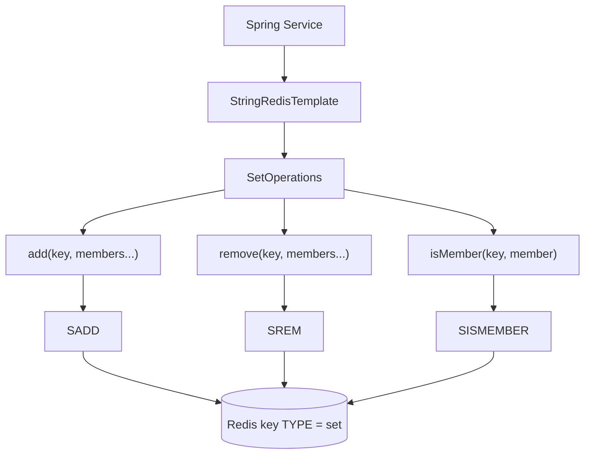
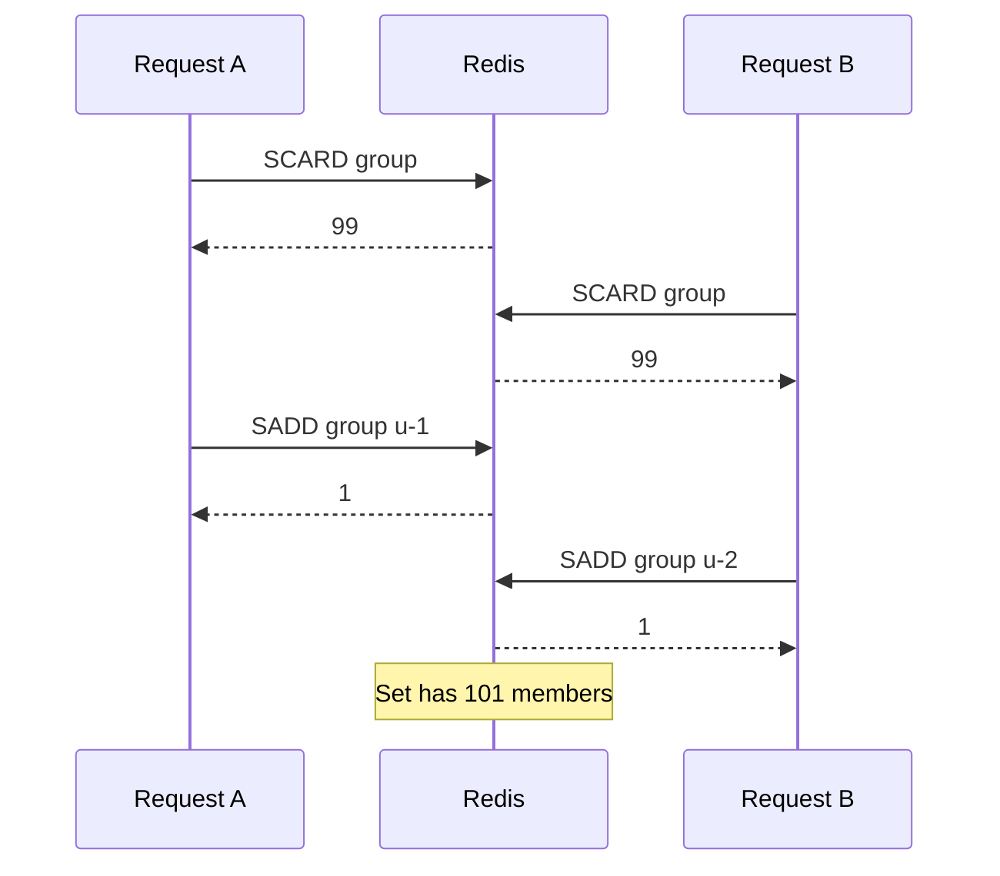
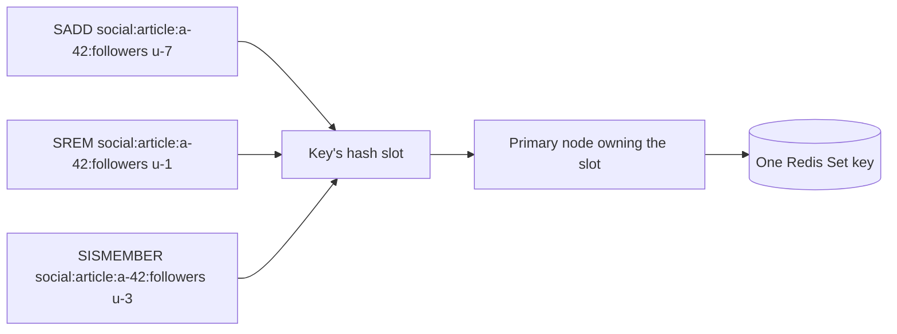

# Adding, Removing, and Checking Set Members in Spring Data Redis

In Redis, a **Set** is a collection of **unique** and **unordered** elements. A Redis key of type `set` can hold multiple members, such as a set of user IDs following an article, a set of tagged product codes, or a set of processed identifiers. In a Spring Data Redis application, the core operations for this data type are provided by `SetOperations`, typically accessed via `RedisTemplate.opsForSet()` or `StringRedisTemplate.opsForSet()`.

This lesson focuses on the three most fundamental and important groups of operations:

1. **Adding** one or more members using `SADD` / `SetOperations.add()`.
2. **Removing** one or more specific members using `SREM` / `SetOperations.remove()`.
3. **Checking whether a member belongs to the set** using `SISMEMBER` / `SetOperations.isMember()`.

Along with these, we cover how to interpret return values, behavior when a key is absent, single-command Redis atomicity, TTL, serializers, performance, and practical application examples. Examples are presented for **Spring Boot 3.x, Spring Data Redis 3.x**, with a suitably configured Redis driver from Spring Boot. Version-dependent or Redis topology-dependent behaviors are explicitly noted.

## 1. How Is a Set Different from a List and a Sorted Set?

Suppose we need to manage the tag codes of product `p-42`:

```text
Redis key: catalog:product:p-42:tags
Redis TYPE: set

Members:
    keyboard
    gaming
    wireless
```

If `wireless` is added a second time, Redis **does not create a duplicate copy**. If `gaming` is removed, the remaining members stay in the set. Redis does not guarantee that `keyboard` will be returned before `wireless` when listing results.

| Redis Structure | Duplicate Elements? | Data-Meaningful Ordering? | Typical Operations |
|---|---|---|---|
| **Set** | No | No | `SADD`, `SREM`, `SISMEMBER`, `SCARD` |
| List | Possible | Ordered by position | `LPUSH`, `RPUSH`, `LPOP`, `LRANGE` |
| Sorted Set | No duplicate members | Ordered by score and tie-break rules | `ZADD`, `ZRANGE`, `ZSCORE` |
| Hash | Unique field names | Not an ordered structure | `HSET`, `HGET`, `HEXISTS` |

**A Set is suitable when the primary question is "does this member belong to the group?"**, rather than "what position is this member at?" or "which member has the highest score?".

A Redis Set is stored under **one Redis key**. For example, `catalog:product:p-42:tags` is the key; `gaming` is a member inside that key. Adding a member does not create a new Redis key named `gaming`.

### Mapping from Java to Redis



Where:

- `StringRedisTemplate` determines how key names and string members are serialized.
- `SetOperations` provides APIs with Set semantics.
- The Redis server executes commands and stores the collection of members as serialized bytes.

## 2. Setting Up the Spring Data Redis Environment

Example with Gradle:

```groovy
dependencies {
    implementation 'org.springframework.boot:spring-boot-starter-data-redis'
}
```

Example `application.yml` when standalone Redis runs on a development machine:

```yaml
spring:
  data:
    redis:
      host: localhost
      port: 6379
      connect-timeout: 2s
      timeout: 3s
```

The Spring Data Redis starter provides the appropriate Redis connection infrastructure when the application has the required dependencies and configuration. With `StringRedisTemplate`, keys and members are typically written in UTF-8, making them easy to inspect with the Redis CLI. Redis data does not appear automatically from YAML alone; the Redis server must be running and reachable from where the application is deployed.

Example injecting a template:

```java
import org.springframework.data.redis.core.SetOperations;
import org.springframework.data.redis.core.StringRedisTemplate;
import org.springframework.stereotype.Service;

@Service
public class ProductTagService {
    private final SetOperations<String, String> sets;

    public ProductTagService(StringRedisTemplate redis) {
        this.sets = redis.opsForSet();
    }
}
```

This is the initial skeleton; specific methods will be added in later sections. A Spring bean `StringRedisTemplate` is normally shared across multiple services once fully configured. You do not need to manually open/close a Redis connection inside every business method.

## 3. Adding Members with `SADD` and `add()`

Redis command:

```redis
SADD catalog:product:p-42:tags keyboard gaming wireless
```

In Spring Data Redis:

```java
Long addedCount = sets.add(
    "catalog:product:p-42:tags",
    "keyboard",
    "gaming",
    "wireless"
);
```

`SetOperations.add(key, values...)` takes **one Redis key** and one or more members to add. Redis adds those members that are not yet in the Set; existing members are not duplicated.

### 3.1. What Is the Return Value of `add()`?

Important point: `SADD` returns **the number of new members actually added**, **not the total number of members after the operation** and not necessarily the number of arguments.

Example on an initially nonexistent key:

```text
SADD product:42:tags keyboard gaming wireless
→ 3

SADD product:42:tags gaming
→ 0

SADD product:42:tags gaming premium
→ 1

SCARD product:42:tags
→ 4
```

At the final step, the Set has four members, but the third `SADD` only returns `1` because only `premium` is new.

| State Before Command | Command | Number of New Members | State After |
|---|---|---|---|
| Key does not exist | `SADD k a b` | 2 | `{a,b}` |
| `{a,b}` | `SADD k a` | 0 | `{a,b}` |
| `{a,b}` | `SADD k b c d` | 2 | `{a,b,c,d}` |
| `{a,b,c,d}` | `SADD k c d` | 0 | `{a,b,c,d}` |

In a normal synchronous call path, `add()` returns a `Long` representing that count. With a pipeline/transaction, some Spring Data Redis APIs may return `null` at the time the command is queued, and the result only appears after executing/processing the pipeline.

### 3.2. Adding One Member and Knowing Whether It Was the First Time

```java
public boolean addTag(String productId, String tag) {
    String key = "catalog:product:" + productId + ":tags";
    Long added = sets.add(key, tag);
    return added != null && added == 1L;
}
```

Meaning:

- `true`: at the moment Redis executed the `SADD` command, the member **did not previously exist** and was just added.
- `false` with a result of `0`: the member was already present.
- If Redis fails, the operation may throw an exception; you **should not** catch all exceptions and return `false` because a "network error" is different from "the member already exists".

This avoids a race condition for the question *"did I just add this newly?"*. Do not write:

```java
// Prone to race conditions when multiple requests run concurrently.
if (!Boolean.TRUE.equals(sets.isMember(key, member))) {
    sets.add(key, member);
}
```

Between `isMember` and `add`, another request might have already added the member. If you only need to create the member when absent, **a single `SADD` command is already atomic** and the newly added count provides the information you need.

### 3.3. Adding Multiple Members at Once vs. Adding One by One Multiple Times

```java
// One call generates one SADD command with multiple members (typically).
sets.add(key, "a", "b", "c");

// Three separate Redis operations.
sets.add(key, "a");
sets.add(key, "b");
sets.add(key, "c");
```

On standalone Redis, a single `SADD key a b c` command is executed atomically by Redis at the command level: no other client observes an intermediate state of "added a but not yet b/c" **in the middle of the same SADD command**.

Three separate calls are three Redis commands; other requests can interleave between calls. If the connection drops partway through, only a subset of the calls might succeed.

However, when you need to check complex constraints such as **"only add a member if the Set has fewer than 100 people"**, `SADD` alone is not enough because checking the count and writing must be combined. In that case, an appropriate atomic mechanism such as a Lua script or a transaction with optimistic concurrency is required.

## 4. Removing Members with `SREM` and `remove()`

To remove **specific members** from a Set, use `SREM`:

```redis
SREM catalog:product:p-42:tags gaming
```

Spring Data Redis:

```java
Long removedCount = sets.remove(
    "catalog:product:p-42:tags",
    "gaming"
);
```

`SetOperations.remove(key, members...)` does not unconditionally delete the Redis key. It removes **the specified members** if they are currently in the Set.

### 4.1. Result of `remove()`

Redis `SREM` returns **the number of members actually removed**:

```text
Initial Set: {keyboard, gaming, wireless}

SREM key gaming
→ 1
Remaining Set: {keyboard, wireless}

SREM key gaming
→ 0
Set remains: {keyboard, wireless}

SREM key wireless keyboard missing
→ 2
Set becomes empty
```

A single `SREM` command can request removing multiple members, and absent members do not cause the command to fail. Removing the same member again is generally **idempotent with respect to the final state**: after the first removal, the member is gone; subsequent calls return `0`.

### 4.2. Removing and Knowing Whether You Just Modified the Data

```java
public boolean removeTag(String productId, String tag) {
    String key = "catalog:product:" + productId + ":tags";
    Long removed = sets.remove(key, tag);
    return removed != null && removed == 1L;
}
```

If the goal is "only emit an event when a member was just removed successfully", the returned count is a better signal than calling `isMember` first and then `remove`, because it avoids a **race-prone check step**.

Even so, emitting an event to an external system after `SREM` is still **two actions not in the same transaction**. If Redis deletes successfully and then sending the event fails, a controlled recording/retry mechanism is needed if the business workflow requires ensuring events are not lost.

### 4.3. How SREM Differs from DEL and SPOP

| Command | Meaning |
|---|---|
| `SREM key member` | Removes specific member(s) from the Set |
| `DEL key` | Deletes **the entire Redis key**, meaning the whole Set disappears |
| `UNLINK key` | Unlinks the entire key, letting Redis reclaim memory asynchronously on the server side |
| `SPOP key` | Pops and removes a **random member** (not a caller-specified member) |

Do not use `DEL` to "leave a group" if the Set key holds members for **many** people. `DEL` deletes the entire set, affecting all members.

### 4.4. What Happens When Removing the Last Member?

Redis does not maintain an empty Set key as a standalone entity. When `SREM` removes the last member, the Set Redis key typically **ceases to exist**:

```bash
redis-cli SADD demo:set only
# (integer) 1

redis-cli SREM demo:set only
# (integer) 1

redis-cli EXISTS demo:set
# (integer) 0
```

Therefore, at the application layer you need to distinguish:

- **A Set with no members**: Redis may represent this via a **nonexistent key**.
- **A nonexistent entity/business group**: a different business state that cannot be reliably inferred solely from an empty Set.

If "a group has been created but has no members yet" must differ from "a group has never been created", store additional metadata or a marker under a separate key. Do not rely solely on key presence/absence as the single state model when the business distinguishes them.

## 5. Checking Membership with `SISMEMBER` and `isMember()`

When you need to answer "does a member belong to this Set?", use:

```redis
SISMEMBER catalog:product:p-42:tags keyboard
```

Or:

```java
Boolean present = sets.isMember(
    "catalog:product:p-42:tags",
    "keyboard"
);
```

Redis returns `1` if present, `0` if not. In Spring Data Redis, `isMember()` returns `Boolean`, so it is common to write:

```java
public boolean hasTag(String productId, String tag) {
    String key = "catalog:product:" + productId + ":tags";
    return Boolean.TRUE.equals(sets.isMember(key, tag));
}
```

Using `Boolean.TRUE.equals(...)` is safer than directly unboxing `Boolean` when the API might return `null` in special contexts like pipelines or transactions. However, **an unexpected `null` result in a synchronous call path should not silently default to "no permission" or "empty Set"**; that requires a clear error policy.

### 5.1. Missing Key or Absent Member

| Situation | Redis `SISMEMBER` | Normal `isMember()` |
|---|---|---|
| Key is a Set and member is in the Set | `1` | `true` |
| Key is a Set but member is absent | `0` | `false` |
| Redis key does not exist | `0` | `false` |
| Key exists but has a Redis type other than Set | `WRONGTYPE` | Exception translated through the Spring Data Redis layer |
| Redis server is unreachable | Connection/timeout error | Exception, not a valid `false` |

Notably, Redis returns `false` when the Set key does not exist. It **does not** distinguish "Set key has not been created" from "this member is not in the existing Set key". If business logic needs to know whether the key exists, you can check `EXISTS`/`hasKey`, though two separate operations may observe two different points in time when concurrent writers are present.

### 5.2. Why Check-Then-Act Can Be Wrong

Suppose the workflow is:

```text
T1: isMember(group, "u-42") → true
T2: another request removes "u-42"
T3: service continues because earlier check returned true
```

`SISMEMBER` returns the result **accurate at the time the command ran**, without locking the member for subsequent operations. If membership guards a critical mutation, you need to define the invariant and an appropriate atomic check-and-act mechanism (script, transaction, or validation at the authoritative data source).

For example, resource access permissions: checking Set membership separately and then updating data in a database does not form a transaction across Redis and the database. A Redis Set can be useful as a permission cache or index, but the final security decision requires a policy for managing the source of truth and handling stale/failed cache cases.

## 6. Interacting in the Redis CLI

You can run the illustrative commands:

```bash
# Create a Set; SADD returns the number of newly added elements.
redis-cli SADD demo:members alice bob carol
# (integer) 3

# Adding a duplicate does not increase size.
redis-cli SADD demo:members bob
# (integer) 0

# Check membership.
redis-cli SISMEMBER demo:members alice
# (integer) 1
redis-cli SISMEMBER demo:members dave
# (integer) 0

# Count members.
redis-cli SCARD demo:members
# (integer) 3

# Remove one member.
redis-cli SREM demo:members bob
# (integer) 1

# Remove an already missing member again.
redis-cli SREM demo:members bob
# (integer) 0

# View all members; order is not fixed.
redis-cli SMEMBERS demo:members

# Check the Redis type.
redis-cli TYPE demo:members
# set
```

When experimenting multiple times, the key may already exist from a previous run. If you want to observe the exact `3` result when adding for the first time, use a new demo key or delete **only the test key**:

```bash
redis-cli DEL demo:members
```

Do not use `FLUSHDB` or `FLUSHALL` to clean up a demo key on a Redis instance that holds data from other applications.

## 7. Complete Service: Managing Followers of an Article

A practical use case: storing the set of follower user IDs for each article. Requirements:

- One person must not be counted as two duplicate members.
- Follower IDs can be added/removed.
- Check whether a user is currently following.
- Retrieve the follower count when needed.
- Prevent arbitrary input data from breaking the key convention.

### 7.1. Key Design

```text
social:article:<articleId>:followers
```

Example:

```text
social:article:a-42:followers
    -> "u-1"
    -> "u-7"
    -> "u-19"
```

### 7.2. Implementation with `SetOperations`

```java
import java.util.Objects;
import org.springframework.data.redis.core.SetOperations;
import org.springframework.data.redis.core.StringRedisTemplate;
import org.springframework.stereotype.Service;

@Service
public class ArticleFollowStore {
    private final SetOperations<String, String> sets;

    public ArticleFollowStore(StringRedisTemplate redis) {
        this.sets = redis.opsForSet();
    }

    public boolean follow(String articleId, String userId) {
        String key = followersKey(articleId);
        String member = userMember(userId);

        Long added = sets.add(key, member);
        return requireCount(added) == 1L;
    }

    public boolean unfollow(String articleId, String userId) {
        String key = followersKey(articleId);
        String member = userMember(userId);

        Long removed = sets.remove(key, member);
        return requireCount(removed) == 1L;
    }

    public boolean isFollowing(String articleId, String userId) {
        String key = followersKey(articleId);
        String member = userMember(userId);

        Boolean present = sets.isMember(key, member);
        return Objects.requireNonNull(
            present, "Unexpected deferred Redis result"
        );
    }

    public long followerCount(String articleId) {
        Long count = sets.size(followersKey(articleId));
        return requireCount(count);
    }

    private static long requireCount(Long count) {
        return Objects.requireNonNull(
            count, "Unexpected deferred Redis result"
        );
    }

    private static String followersKey(String articleId) {
        return "social:article:" + requireId(articleId) + ":followers";
    }

    private static String userMember(String userId) {
        return requireId(userId);
    }

    private static String requireId(String id) {
        if (id == null || !id.matches("[A-Za-z0-9_-]{1,80}")) {
            throw new IllegalArgumentException("Invalid identifier");
        }
        return id;
    }
}
```

**Interpreting the results:**

```java
boolean firstFollow = store.follow("a-42", "u-7");
// true if at the time of SADD, u-7 did not yet belong to the Set.

boolean secondFollow = store.follow("a-42", "u-7");
// false because no new member was added.

boolean currentlyFollowing = store.isFollowing("a-42", "u-7");
// true if no concurrent operation removed the member before SISMEMBER.

long count = store.followerCount("a-42");
// Number of members currently in the Set at the time of SCARD.

boolean removed = store.unfollow("a-42", "u-7");
// true if SREM actually removed the member.
```

The code assumes `store` is invoked from a client with an injected `ArticleFollowStore` bean; the `store` variable in the example is not a default global variable.

Note: `follow` and `unfollow` here manage membership in Redis, **they do not automatically keep a business database, event queue, or email notification consistent**. If the requirement is to count each follow event only once and retries may occur after a network timeout, an operation ID or reconciliation with the primary data source is needed.

### 7.3. Why Is `requireCount` There?

In normal synchronous `RedisTemplate` calls, `SADD`/`SREM`/`SCARD` return a result. However, in certain queued-command contexts (such as pipelines/transactions), Spring Data Redis may return `null` immediately inside the callback. Failing fast instead of silently treating null as `0` prevents a synchronous service from masking misuse of context.

In other words, **`null` from an API at queue time does not prove a member is absent**. A pipeline/transaction processing path must read results after execution and deserialize them properly.

## 8. Adding or Removing Multiple Members in One Command

Both `SetOperations.add()` and `remove()` accept multiple members:

```java
Long added = sets.add(
    "social:article:a-42:followers",
    "u-1", "u-2", "u-3"
);

Long removed = sets.remove(
    "social:article:a-42:followers",
    "u-2", "u-9"
);
```

If the Set previously had no one:

```text
SADD followers u-1 u-2 u-3 → 3
SREM followers u-2 u-9   → 1
Set remaining: u-1, u-3
```

With one Redis key and one Redis server, Redis executes the members of **a single** `SADD` or `SREM` command atomically. This differs from a Java loop sending multiple separate calls:

```java
for (String userId : userIds) {
    sets.add(key, userId);
}
```

A loop sends multiple commands; a network error partway through can leave only a subset of elements added. A single `SADD` with multiple members typically reduces round trips and is more suitable when business logic requires adding a group of members together.

However, an overly large list can create a huge request and consume excessive time/memory. For hundreds of thousands of members, batching in controlled chunks, monitoring latency, and designing partial-progress handling across multiple batches are necessary.

## 9. A Single SADD/SREM Is Atomic, Not the Entire Workflow

What Redis guarantees at the command level:

```text
SADD group u-7
→ adds if absent, returns 1
→ if already present, returns 0
```

What Redis **does not automatically guarantee** when code splits into multiple commands:

```java
if (sets.size(key) < 100) {
    sets.add(key, member);
}
```

Suppose the Set currently has 99 members and two requests run concurrently:



Both `SCARD` commands are accurate at their own moments, and both `SADD` commands are atomic, yet **the maximum 100-member constraint is violated** because the check and update are not inside the same transaction/script.

### Lua Solution When Atomic Check-and-Add Is Required

An illustrative script:

```lua
-- KEYS[1]: Redis Set key
-- ARGV[1]: member to add
-- ARGV[2]: maximum number of members

if redis.call('SISMEMBER', KEYS[1], ARGV[1]) == 1 then
    return 0  -- already in Set, no need to add
end

if redis.call('SCARD', KEYS[1]) >= tonumber(ARGV[2]) then
    return -1 -- Set has reached the limit
end

return redis.call('SADD', KEYS[1], ARGV[1])
```

Because Redis calls inside a script execute as a single atomic unit on the server, two requests cannot interleave between the check and add steps of **this script on the same Redis key**.

Results:

- `1`: added a new member.
- `0`: member already existed before running the script.
- `-1`: member was not present, but the Set had already reached the limit.

This script illustrates a solution for the *"do not exceed maximum members"* invariant; the application must execute the script via `RedisScript`/`RedisTemplate.execute` with proper keys and arguments, along with error policies, monitoring, and load limits. Do not use a script for every simple `SADD` when there are no additional constraints.

## 10. TTL of a Redis Set When Adding or Removing Members

TTL belongs to **the Redis key**, not by default to individual members.

Example:

```bash
redis-cli SADD online:room:42 u-7 u-8
redis-cli EXPIRE online:room:42 60
redis-cli TTL online:room:42
```

Here the entire Set `online:room:42` expires after approximately 60 seconds. `SISMEMBER` does not automatically renew TTL; `SADD`/`SREM` on an existing Set key normally **do not automatically reset TTL**.

### 10.1. Does a New Key Have a Default TTL?

No. `SADD` creates a new Set key if the key does not exist, but does not automatically attach a TTL. If the key needs to live for 60 seconds, it must be declared:

```java
String key = "online:room:42";
sets.add(key, "u-7");
Boolean expiring = redis.expire(
    key, java.time.Duration.ofSeconds(60)
);
```

Two separate `SADD` and `EXPIRE` calls have a gap between them. If the application crashes after `SADD` but before `EXPIRE`, the key may exist without a TTL. If "add member and attach TTL **atomically**" is required, an appropriate mechanism such as a Lua script or a suitable Redis transaction is needed.

### 10.2. Sliding Expiration Is Not Default Behavior

For example, a Set managing online users with the requirement "every time new activity is recorded, extend by 60 seconds":

```text
t=0:   SADD u-7; EXPIRE 60s
t=30:  SADD u-8; if EXPIRE is not called, the Set's expiry remains near t=60
t=61:  The Set may have expired, even though u-8 was active at t=30
```

To achieve sliding expiration, the application must **explicitly** refresh the TTL according to policy. However, key-level TTL means renewing for one member extends the lifetime **of all members**, so you cannot infer individual per-user online durations.

If business logic wants each user to have an independent last-seen/timeout, a shared Set with key-level TTL is insufficient. You may consider a Sorted Set storing timestamps per member alongside an expired-member cleanup mechanism, or another suitable schema.

### 10.3. Key Deletion When No Members Remain and Re-Creation

When `SREM` removes the last member, the Set key disappears. If `SADD` later recreates the key, the TTL from the previous creation does not "come back" by key name. Expiry must be applied to the new key according to policy.

Furthermore, if a Redis Set serves as authoritative data that must be retained long-term, do not attach a TTL just to "clean memory" without considering data loss. TTL is a business decision, not a mandatory part of `SetOperations`.

## 11. Serializers: Redis Compares Members by Bytes

Redis does not know whether one Java object equals another by `equals()`/`hashCode()`. It compares **the byte representation of members** inside the Redis Set.

With `StringRedisTemplate`:

```text
Java "u-7"
    |
    v
StringRedisSerializer (UTF-8)
    |
    v
byte[] of "u-7"
    |
    v
Redis Set member
```

If other code uses a binary serializer or JDK serialization to write to the same key, the two pieces of code may see different members even though both represent "user u-7" in Java.

### 11.1. Configuring a Dedicated RedisTemplate for String Sets

`StringRedisTemplate` already simplifies things when both key and member are Strings. With a custom `RedisTemplate`, configure it explicitly:

```java
import org.springframework.context.annotation.Bean;
import org.springframework.context.annotation.Configuration;
import org.springframework.data.redis.connection.RedisConnectionFactory;
import org.springframework.data.redis.core.RedisTemplate;
import org.springframework.data.redis.serializer.StringRedisSerializer;

@Configuration
class RedisSetConfiguration {

    @Bean
    RedisTemplate<String, String> stringSetTemplate(
            RedisConnectionFactory factory) {
        RedisTemplate<String, String> template = new RedisTemplate<>();
        template.setConnectionFactory(factory);
        template.setKeySerializer(new StringRedisSerializer());
        template.setValueSerializer(new StringRedisSerializer());
        template.afterPropertiesSet();
        return template;
    }
}
```

`SetOperations` uses the key and value serializers on the appropriate template; **do not use `hashKeySerializer` to serialize Redis Set members**. Hash serializers only apply to Redis Hash operations.

### 11.2. Normalizing Input Before Storing

Redis Sets distinguish exact member bytes:

```text
"Admin" != "admin"
"u-7"   != "u-7 "
```

With Unicode, strings that look identical can have multiple code-point representations. If a key/member carries logical identification meaning, normalization rules (casing, whitespace, Unicode normalization, canonical IDs) must be defined **right at the application boundary**, and the exact same rules must be applied across `add`, `remove`, and `isMember`.

Example:

```java
import java.util.Locale;

public static String normalizeTag(String raw) {
    if (raw == null) {
        throw new IllegalArgumentException("Tag is required");
    }
    String result = raw.trim().toLowerCase(Locale.ROOT);
    if (!result.matches("[a-z0-9_-]{1,40}")) {
        throw new IllegalArgumentException("Invalid tag");
    }
    return result;
}
```

This is a rule specifically for **ASCII-only tags** in the example. If the system supports Vietnamese or Unicode tags, appropriate normalization must be specified and implemented rather than naively stripping all non-ASCII characters.

## 12. Checking Multiple Members: Available Options

Sometimes an application needs to know whether dozens of users belong to the same Set. Redis has the **`SMISMEMBER`** command (available since Redis 6.2) to check multiple members of **one Set key** in a single call:

```redis
SMISMEMBER social:article:a-42:followers u-1 u-7 u-19
```

The reply contains 0/1 values corresponding to the input member positions.

In Spring Data Redis, `SetOperations.isMember(key, member)` is the clear API for the **single-member** case. Some versions provide corresponding multi-member APIs or low-level commands; check your actual version to pick the right overload instead of guessing method names from the Redis command.

If the current API does not provide a suitable bulk method, you can:

- Send multiple `SISMEMBER` commands using a pipeline when supported and when reducing round trips is desired.
- Use a low-level command supporting `SMISMEMBER` if the Redis server and driver have that capability.
- For a small Set where the members being checked make up most of the set, read all members via `members(key)` and check in memory — **only when size is controlled**.

Each approach has trade-offs. Do not call `SMEMBERS` just to check two members when a Set has millions of elements.

## 13. Counting, Listing, and Scanning a Set — Supporting Tools

Although the focus is on adding/removing/checking, several other operations help inspect results:

### 13.1. Counting with `SCARD` and `size()`

```java
Long count = sets.size("social:article:a-42:followers");
```

`SCARD` returns the member count; if the key does not exist, Redis returns `0`. Use `size()` instead of loading all members and calling `Set.size()` just to count.

### 13.2. Listing with `SMEMBERS` and `members()`

```java
import java.util.Set;

Set<String> members = sets.members(
    "social:article:a-42:followers"
);
```

`SMEMBERS` returns all members, **with no ordering guaranteed**. For very large Sets, it can produce a huge reply, consume significant memory, and increase latency. Do not serialize an entire Set into an HTTP response if the user only needs a count or a membership check.

### 13.3. Incremental Traversal with `SSCAN` and `scan()`

Redis provides `SSCAN` to scan members by cursor. Spring Data Redis supports `SetOperations.scan()`:

```java
import org.springframework.data.redis.core.Cursor;
import org.springframework.data.redis.core.ScanOptions;

ScanOptions options = ScanOptions.scanOptions()
    .count(200)
    .build();

try (Cursor<String> cursor = sets.scan(
        "social:article:a-42:followers", options)) {
    while (cursor.hasNext()) {
        String member = cursor.next();
        // Process one by one, without holding the entire Set in memory.
        System.out.println(member);
    }
}
```

`COUNT` is a hint, not a hard limit on the number of members returned per batch. `SSCAN` **does not provide an immutable snapshot** while the Set is being updated: you may see duplicate members, miss members that existed during only part of the scan, or observe differing results due to concurrent writes.

For migration, export, or cleanup jobs, process idempotently and close the cursor properly. `SSCAN` iterates over **members inside one Set key**; this differs from `SCAN`, which iterates over **Redis key names**.

## 14. Redis Cluster: One Set Key, One Hash Slot

`SADD`, `SREM`, and `SISMEMBER` all operate on **a single Redis key**, so in Redis Cluster they are routed to the node owning that key's hash slot. Having thousands of members in a Set does not mean those members are distributed across multiple slots.



This has two sides:

- **Advantage:** operations on a single Set key do not hit `CROSSSLOT` restrictions simply from having many members.
- **Limitation:** an extremely large or very "hot" Set key concentrates operations on one node; Redis Cluster does not automatically shard members of the same Set across multiple shards.

If you need to check membership simultaneously across multiple Set keys or perform operations like intersection, union, and difference across multiple Sets, multi-key commands may be subject to same-hash-slot constraints. Only then should you consider hash tag design, locality, or changing the data model.

Do not mechanically put a shared hash tag like `{all-social-data}` on every Set: that forces many keys into the same slot and can create a hotspot.

## 15. Common Errors

| Symptom | Possible Cause | How to Identify / Handle |
|---|---|---|
| `add()` returns `0` even though members were passed | Member(s) already existed | Check the newly added count; do not confuse with total size |
| `remove()` returns `0` | Member is not in the Set or key does not exist | This can be a valid outcome, not necessarily an error |
| `isMember()` returns `false` | Member is absent or Set key does not exist | If you need to distinguish them, use a separate convention/metadata |
| `isMember()` throws an exception | Network, timeout, serializer, or wrong key TYPE | Inspect the exception/cause chain; do not turn it into false arbitrarily |
| `WRONGTYPE` | Key was written as String/Hash/List | Run `TYPE key`; avoid namespace collisions |
| Visually identical members added twice | Casing, whitespace, Unicode, or serializer mismatch | Normalize members and standardize serializers |
| Set disappears after removal | Last member was removed | Redis does not keep empty Set keys |
| Set disappears after some time | Key had a TTL and expired | Use `TTL key` and review the expiry policy |
| SADD added members without a TTL | Creating a new key does not auto-set expiry | Attach TTL per policy; use an atomic script when needed |
| `members()` is very slow | Set is too large, reply payload is huge | Use `size()`/`isMember()`/`SSCAN` for the right purpose |
| After `SISMEMBER` returns true, a subsequent operation still fails | Concurrency: member was removed or other state changed | Use atomic check-and-act when business logic requires it |
| Retrying after timeout yields uncertain results | Redis may have processed the command while the reply was lost | Design idempotency, result tracking, and a source of truth |

### Debugging from the Redis CLI

```bash
# Determine which type the key holds.
redis-cli TYPE social:article:a-42:followers

# Check a few members.
redis-cli SISMEMBER social:article:a-42:followers u-7

# Count and check TTL.
redis-cli SCARD social:article:a-42:followers
redis-cli TTL social:article:a-42:followers

# Inspect members when the Set is known to be small.
redis-cli SMEMBERS social:article:a-42:followers

# Scan incrementally when the Set is large.
redis-cli SSCAN social:article:a-42:followers 0 COUNT 100
```

`TTL` returns the remaining seconds when an expiration is set, `-1` if the key exists with no TTL, and `-2` if the key does not exist. If you only want to find **Redis key names** with the prefix `social:article:`, use `SCAN`; do not use `SSCAN` for that task.

## 16. Business Design Scenarios

### Scenario A — Product Tagging

Each product has a Set of tags:

```text
catalog:product:p-42:tags -> {gaming, keyboard, wireless}
```

Choose `SADD` to add tags, `SREM` to remove tags, and `SISMEMBER` to check "does the product have the `gaming` tag?". If you need to find **all products with the `gaming` tag**, a single Set keyed by product ID **is insufficient for efficient reverse queries**. Consider also maintaining a Set keyed by tag (e.g., `catalog:tag:gaming:products`) or an appropriate index, while designing consistency between both directions.

### Scenario B — Users Following an Article

Key `social:article:a-42:followers` holds user IDs.

- `follow()` calls `SADD`: prevents duplicate followers.
- `unfollow()` calls `SREM`: removes specific members.
- `isFollowing()` calls `SISMEMBER`: returns membership state at read time.
- `SCARD` counts followers based on Redis's current state.

If the system also writes a relationship table in a database, define the **source of truth** to resolve discrepancies if the two diverge. A Set only reflects current Redis data and does not automatically repair the database.

### Scenario C — Chat Room Member List

For a chat room, `SADD`/`SREM` are suitable for managing participants, but distinguish "joined the room" from "currently online". Online status expires over time; a shared Set's TTL **does not automatically track per-member expiry**. Do not conflate the two needs.

### Scenario D — Recording That an Event Was Processed

`SADD processed:eventIds evt-123` returns `1` if the ID was absent and `0` if already present. This can act as a deduplication signal **within Redis**, but if database business processing occurs afterward, a scenario where "SADD succeeded, database processing failed" can cause the event to be treated as processed even though it never completed. Proper processing states, outbox/inbox patterns, or transactions/idempotency are needed where appropriate.

### Scenario E — User Role List

`user:42:roles` could be a Set like `{reader, editor}`. `SISMEMBER` easily answers current roles, yet **does not by itself guarantee secure authorization** if Redis is only a cache or data can go stale. For security decisions, clarify the authoritative data source, TTL/invalidation, and fail-closed behavior when Redis is unavailable.

### Scenario F — Limit of 100 Members

If you require "the Set has at most 100 people", do not run `SCARD` followed by `SADD` as two separate commands under concurrency. Use atomic check-and-add via an appropriate script/transaction, or enforce the limit at the persistent storage layer that guarantees the invariant.

## 17. Common Misconceptions About SetOperations

| Misconception | Correct Understanding |
|---|---|
| "`SADD` only adds one element." | A single command can add multiple members. |
| "`add()` returns the Set size." | It returns the number of **newly** added members. For size, use `SCARD`/`size()`. |
| "`SREM` deletes the Redis key." | It removes the specified members; the key may disappear when the last member is removed. |
| "`SISMEMBER` false proves the Set key exists without the member." | False also occurs when the key itself does not exist. |
| "Set remembers insertion order." | Set has no guaranteed order; if order is needed, use another structure. |
| "SADD followed by EXPIRE is an atomic operation." | Two separate calls can fail in between. |
| "One Set key has a separate TTL per member." | Default TTL applies at the key level. |
| "Once membership checks true, a subsequent operation is guaranteed valid." | Membership can change between two Redis commands. |
| "`StringRedisTemplate` and other serializer templates see the same member." | Redis compares bytes; serializers must be compatible. |
| "Each member is distributed to a different Redis Cluster node." | One Set is one Redis key belonging to one slot. |
| "`SMEMBERS` is suitable for every Set." | Large Sets can make replies very heavy; use `SISMEMBER`/`SSCAN` appropriately. |

## 18. Guidelines for Choosing APIs

When coding with Redis Sets, decide based on the actual question:

1. **Want to add one or more members?** Use `sets.add(key, values...)` and check the newly added count.
2. **Want to remove specific members?** Use `sets.remove(key, members...)` and check the actually removed count.
3. **Only need to know whether a member belongs to the Set?** Use `sets.isMember(key, member)`; do not load the entire Set.
4. **Only need the count?** Use `sets.size(key)`, not `members().size()`.
5. **Large Set that needs traversal?** Use `scan()` with proper cursor handling, idempotency, and data-churn awareness.
6. **Does the key need a TTL?** Specify TTL at the key level and avoid the failure gap between key creation and setting TTL when atomicity is required.
7. **Check-then-update operations?** Analyze concurrency; a single atomic Redis command does not make an entire multi-command workflow atomic.
8. **Does business logic depend on ordering or timestamps?** If yes, Set is likely not the right data type.

**`SADD`, `SREM`, and `SISMEMBER` form the foundational operations for Redis Sets:** unique addition, exact member removal, and membership checks. Spring Data Redis exposes them through `SetOperations` with an ergonomic Java API, but correctness still depends on understanding return values, serializers, TTL, race conditions, and data ownership. By understanding each command and its atomicity boundaries, you can use Redis Sets effectively for managing membership without turning them into a data model built on false assumptions.
