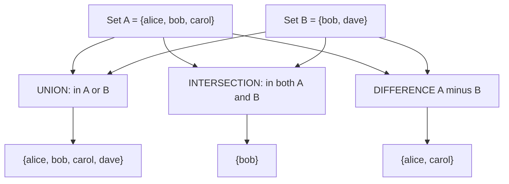

# Union, Intersection, and Difference Between Sets

## 1. Why Do We Need Set Operations in Redis?

In Spring Data Redis, a **Redis Set** is a data type that stores **unique** and **unordered** elements. Each element in a Set is a member, and Redis compares members by the byte sequences sent by the application. When business logic needs to combine multiple member lists, Redis can directly execute **union, intersection, and difference** without pulling all Sets into Java to process them.

For example, a store has three customer groups:

- `campaign:email`: customers subscribed to emails.
- `campaign:app`: customers with in-app notifications enabled.
- `campaign:blocked`: customers excluded from receiving campaigns under current policy.

Business questions immediately arise:

- Who belongs to **at least one** of the email or app channels? → **Union**.
- Who belongs to **both** channels? → **Intersection**.
- Who belongs to the contactable group but **not** the blocked group? → **Difference**.

Redis natively supports `SUNION`, `SINTER`, and `SDIFF`. Spring Data Redis provides the same capabilities through `SetOperations.union(...)`, `intersect(...)`, and `difference(...)`.

As a result, the operations run on the Redis side against existing keys. The application simply receives the result or instructs Redis to store the result in another key for further use.

### Sample Data Used Throughout

Suppose we have two sets:

```text
A = campaign:email = {alice, bob, carol}
B = campaign:app   = {bob, dave}
```

Results:

| Operation | Notation | Result Members |
|---|---|---|
| Union | `A ∪ B` | `{alice, bob, carol, dave}` |
| Intersection | `A ∩ B` | `{bob}` |
| Difference A minus B | `A \ B` | `{alice, carol}` |
| Difference B minus A | `B \ A` | `{dave}` |

These results represent **membership**, not insertion order. Redis Sets do not guarantee that the first member is `alice`, and the returned Java `Set` must not be relied upon as a fixed-order list.

## 2. Reviewing Redis Set Characteristics

A Redis Set has these key characteristics:

1. **No duplicate members:** adding `bob` twice does not create two `bob` entries.
2. **No index positions:** you cannot read the "third" element in the sense of a List; if sorting is required, handle it separately or use a Sorted Set for scored data.
3. **Members are compared by bytes:** `Bob` differs from `bob`, and different serializers can produce distinct members from seemingly identical Java meanings.
4. **Union/intersection/difference mathematically return a new Set:** source data remains unchanged when using the read commands `SUNION`, `SINTER`, `SDIFF`.
5. **Store variants exist to write results back into Redis:** `SUNIONSTORE`, `SINTERSTORE`, `SDIFFSTORE` modify the destination key.
6. **TTL typically applies to the Redis key holding the entire Set:** mathematical results do not automatically inherit TTLs from source keys to the destination key.

Sample data in the Redis CLI:

```redis
SADD campaign:email alice bob carol
SADD campaign:app bob dave

SMEMBERS campaign:email
SMEMBERS campaign:app
SCARD campaign:email
SISMEMBER campaign:email bob
```

`SADD` adds members, `SMEMBERS` reads members, `SCARD` gives the count of unique members, and `SISMEMBER` checks a specific member.

If a top-level key is a Hash, String, or List, calling Set commands on it can raise a `WRONGTYPE` error. Redis does not automatically convert a key's type just because a user calls `SINTER` or `SUNION`.

## 3. Union: SUNION

**Union** takes all members appearing in **at least one** input set. For sets A and B:

\[
A \cup B = \{x \mid x \in A \text{ or } x \in B\}
\]

Example:

```redis
SUNION campaign:email campaign:app
```

Resulting members:

```text
alice
bob
carol
dave
```

Actual display order may vary. `bob` belongs to both Sets but appears only once.

### 3.1. Union of More Than Two Sets

Suppose we add a website customer group:

```redis
SADD campaign:web carol erin
SUNION campaign:email campaign:app campaign:web
```

The result contains `alice`, `bob`, `carol`, `dave`, `erin`, each once.

`SUNION` accepts multiple keys. Redis collects members from all input Sets, deduplicates them, and returns the result. It is **commutative** and **associative** as a set operation:

\[
A \cup B = B \cup A
\]

\[
(A \cup B) \cup C = A \cup (B \cup C)
\]

Key order does not change the **member composition** of the union result, even though the member order returned by Redis remains unguaranteed.

### 3.2. Use Cases for Union

Union fits aggregating users from multiple sources, combining permissions or tags, merging lists of devices registered on any channel, or finding products present in at least one recommendation list.

Example:

```text
followers:author:1 = {u1, u2, u3}
followers:author:2 = {u2, u4}

SUNION -> {u1, u2, u3, u4}
```

For list-display APIs, remember that Redis results **have no priority order**. To sort by follow time, relevance, or score, separate ordering data is required.

## 4. Intersection: SINTER

**Intersection** takes members appearing in **all** input sets:

\[
A \cap B = \{x \mid x \in A \text{ and } x \in B\}
\]

With our sample data:

```redis
SINTER campaign:email campaign:app
```

The result has only:

```text
bob
```

`alice` is only in email, and `dave` is only in app; neither belongs to the intersection.

### 4.1. Intersection of Multiple Sets

```redis
SADD campaign:vip bob alice
SINTER campaign:email campaign:app campaign:vip
```

`bob` appears simultaneously across all three groups and is kept.

Intersection satisfies:

\[
A \cap B = B \cap A
\]

\[
(A \cap B) \cap C = A \cap (B \cap C)
\]

If **any** input set is empty or its Set key does not exist, the intersection is empty. This is very useful when filtering across multiple mandatory conditions.

### 4.2. Using Intersection in Authorization and Segmentation

Suppose:

```text
users:paid       = {u1, u2, u3}
users:newsletter = {u2, u3, u4}
users:active     = {u2, u5}
```

`SINTER users:paid users:newsletter users:active` yields `{u2}`: only users who are simultaneously paid, subscribed to the newsletter, and active.

Intersection is convenient for combining pre-built segments. However, if the result governs sensitive access rights or critical transactions, evaluate freshness, durability, and Redis's role as a source of truth. A stale or evicted permission Set can produce unintended decisions if the application relies on it alone.

## 5. Difference: SDIFF

**Difference** keeps members present in the first set that do **not** appear in subsequent sets:

\[
A \setminus B = \{x \mid x \in A \text{ and } x \notin B\}
\]

Example:

```redis
SDIFF campaign:email campaign:app
```

Result:

```text
alice
carol
```

Swapping the two keys:

```redis
SDIFF campaign:app campaign:email
```

Result:

```text
dave
```

**This is the most important difference compared to union and intersection: set difference is not commutative.**

\[
A \setminus B \ne B \setminus A
\]

Aside from special cases where the two results happen to coincide, reversing the key order changes the business meaning.

### 5.1. SDIFF with Multiple Sets

Redis supports the syntax:

```redis
SDIFF keyA keyB keyC
```

Meaning:

\[
A \setminus (B \cup C)
\]

That is, take members in A and exclude any member appearing in **B or C**.

Example:

```redis
SADD campaign:blocked carol dave
SDIFF campaign:email campaign:app campaign:blocked
```

Only `alice` remains. The command keeps members from `campaign:email` while removing anyone in `campaign:app` **or** `campaign:blocked`.

Read key names and business goals carefully: if you want **everyone in email or app except blocked users**, the correct expression is:

\[
(A \cup B) \setminus C
\]

You cannot use `SDIFF A B C` because that removes all members of B from A before even applying C.

One Redis approach is to materialize the union first and then compute the difference, or design an appropriate Lua/script if the entire process must be atomic. The STORE variants section illustrates storing intermediate results.

### 5.2. Common Use Cases for Difference

- Users **eligible to apply** minus users who already applied.
- Campaign recipients minus users who opted out of notifications.
- Event registrants minus users who have already checked in.
- Products in a category minus hidden products.
- Followers of A who do not yet follow B.

For every example, explicitly label the **kept** side and the **excluded** side, as parameter-order mistakes in `difference(key, otherKey)` are easy to make.

## 6. Quick Comparison of the Three Operations

| Aspect | Union | Intersection | Difference |
|---|---|---|---|
| Redis read command | `SUNION` | `SINTER` | `SDIFF` |
| Spring method | `union` | `intersect` | `difference` |
| Meaning | In at least one set | In all sets | In the first set, excluding subsequent sets |
| Commutative A/B? | Yes | Yes | No |
| Result when one input is empty | Equal to the remaining set for two inputs | Empty | Depends on which set is empty |
| Member ordering? | No | No | No |
| Write-result command | `SUNIONSTORE` | `SINTERSTORE` | `SDIFFSTORE` |

Conceptual flow diagram:



The diagram only illustrates set elements, not traversal order or return order from Redis.

## 7. Spring Data Redis: Using SetOperations

In Spring Boot, `RedisTemplate` or `StringRedisTemplate` exposes `opsForSet()`. When data consists of string user IDs, SKUs, or tags, `StringRedisTemplate` usually keeps the byte format readable and compatible with `redis-cli`.

Dependency (Gradle Groovy):

```groovy
dependencies {
    implementation 'org.springframework.boot:spring-boot-starter-data-redis'
}
```

Example local Redis configuration in Spring Boot 3.x:

```yaml
spring:
  data:
    redis:
      host: localhost
      port: 6379
      connect-timeout: 2s
      timeout: 2s
```

A service can access Set operations:

```java
import org.springframework.data.redis.core.SetOperations;
import org.springframework.data.redis.core.StringRedisTemplate;
import org.springframework.stereotype.Service;

@Service
public class AudienceSetService {

    private final SetOperations<String, String> sets;

    public AudienceSetService(StringRedisTemplate redis) {
        this.sets = redis.opsForSet();
    }

    public void addToEmailAudience(String userId) {
        sets.add("campaign:email", userId);
    }

    public void addToAppAudience(String userId) {
        sets.add("campaign:app", userId);
    }
}
```

`SetOperations<String, String>` has two important type parameters:

- First `String` type: top-level Redis key.
- Second `String` type: Redis Set member.

Sets do not have hash fields. `opsForSet()` uses the serializers for **key** and **member** according to the `RedisTemplate` contract; no hash key serializer is involved in these operations.

### 7.1. Writing a Service for the Three Operations

```java
import java.util.Set;
import org.springframework.data.redis.core.SetOperations;
import org.springframework.data.redis.core.StringRedisTemplate;
import org.springframework.stereotype.Service;

@Service
public class AudienceAlgebraService {

    private final SetOperations<String, String> sets;

    public AudienceAlgebraService(StringRedisTemplate redis) {
        this.sets = redis.opsForSet();
    }

    public Set<String> usersInEitherChannel() {
        return requireResult(sets.union(
                "campaign:email",
                "campaign:app"));
    }

    public Set<String> usersInBothChannels() {
        return requireResult(sets.intersect(
                "campaign:email",
                "campaign:app"));
    }

    public Set<String> emailOnlyUsers() {
        return requireResult(sets.difference(
                "campaign:email",
                "campaign:app"));
    }

    public Set<String> appOnlyUsers() {
        return requireResult(sets.difference(
                "campaign:app",
                "campaign:email"));
    }

    private static Set<String> requireResult(Set<String> members) {
        if (members == null) {
            throw new IllegalStateException(
                    "No direct result from Redis");
        }
        return members;
    }
}
```

Command mapping:

```text
sets.union(A, B)      -> SUNION A B
sets.intersect(A, B)  -> SINTER A B
sets.difference(A, B) -> SDIFF A B
```

In normal synchronous calls, an operation with no matching members returns an empty Set. `SetOperations` can return `null` when used inside a pipeline or transaction because results are collected later; the `requireResult` helper in this example is intended for direct synchronous call paths, not inside pipelined callbacks.

**Do not depend on the iteration order of `Set<String>`**. If an API requires alphabetical order, you can sort **after** receiving the result, provided the result size is small enough to hold in memory.

### 7.2. Calling with Multiple Keys

When computing union/intersection/difference across more than two Sets, `SetOperations` provides overloads accepting a collection of additional keys:

```java
import java.util.List;
import java.util.Set;

// Union of email + app + web.
Set<String> anyChannel = sets.union(
        "campaign:email",
        List.of("campaign:app", "campaign:web"));

// Intersection across all three groups.
Set<String> allChannels = sets.intersect(
        "campaign:email",
        List.of("campaign:app", "campaign:web"));

// Keep email members, exclude app and blocked.
Set<String> emailWithoutOthers = sets.difference(
        "campaign:email",
        List.of("campaign:app", "campaign:blocked"));
```

The first parameter of `difference` is the **minuend set**; the collection that follows contains **the sets used to exclude members**. For union and intersection, changing key order does not alter the mathematical result set.

When key lists come from dynamic input, validate the number of keys, namespace permissions, and Redis Cluster constraints. Do not allow clients to pass thousands of arbitrary key names into one command on a hot request path.

### 7.3. Returned Sets Are Not Live Projections of Spring Entities

The result is a set of members deserialized by the template. If Redis stores JSON objects as members, the result can be `Set<MyDto>` when `RedisTemplate<String, MyDto>` is configured accordingly, but you must clearly define **equality and a stable byte format**. Two Java objects considered equal via `equals()` can still produce different JSON bytes due to field order, formatting, or schema differences, causing Redis to treat them as two distinct members.

For user/product lists, it is usually better to store **stable string IDs** instead of serializing entire entities into Redis Sets.

## 8. Demonstrating Real Data from Java

Suppose a service includes a task to prepare demo data:

```java
import org.springframework.data.redis.core.SetOperations;
import org.springframework.data.redis.core.StringRedisTemplate;
import org.springframework.stereotype.Component;

@Component
public class AudienceSeedExample {

    private final StringRedisTemplate redis;

    public AudienceSeedExample(StringRedisTemplate redis) {
        this.redis = redis;
    }

    public void seedDemo() {
        SetOperations<String, String> sets = redis.opsForSet();

        // Only use for demo data or keys with clear ownership.
        redis.delete("campaign:email");
        redis.delete("campaign:app");
        redis.delete("campaign:blocked");

        sets.add("campaign:email", "alice", "bob", "carol");
        sets.add("campaign:app", "bob", "dave");
        sets.add("campaign:blocked", "carol", "dave");
    }
}
```

After seeding:

```text
campaign:email   = {alice, bob, carol}
campaign:app     = {bob, dave}
campaign:blocked = {carol, dave}
```

Basic operations:

```java
SetOperations<String, String> sets = redis.opsForSet();

Set<String> union = sets.union("campaign:email", "campaign:app");
// {alice, bob, carol, dave}

Set<String> intersection =
        sets.intersect("campaign:email", "campaign:app");
// {bob}

Set<String> difference =
        sets.difference("campaign:email", "campaign:app");
// {alice, carol}
```

Comments show **set contents**, not iteration order. In production systems, do not call `redis.delete(...)` on shared keys at application startup without clear data ownership: this seed example is strictly for demo data.

### When Should Set Results Be Used in Java?

- When you need to convert a small group of members into DTOs for an API response.
- When you want to perform additional Java transformations beyond the operations Redis supports.
- When a business rule needs to inspect a member list at a point in time and the list size is strictly bounded.

If a Set has millions of members, `sets.union(...)` or `sets.intersect(...)` must transfer a massive result from Redis to the JVM, putting pressure on memory and network. When you only need to check if a member exists in a Set, prefer `isMember(...)`; when you need a count, consider an appropriate counting command; when you need to iterate over a large set, use scan/cursor according to its contract.

## 9. STORE Commands: Saving Operation Results into Redis

The three commands `SUNION`, `SINTER`, and `SDIFF` return results to the caller without modifying source keys. Redis also provides **STORE** variants to write the resulting set into a destination key:

```redis
SUNIONSTORE destination source1 source2 ...
SINTERSTORE destination source1 source2 ...
SDIFFSTORE destination source1 source2 ...
```

A STORE command:

1. Computes the result from the source Sets.
2. **Writes/overwrites the destination key** as a Redis Set containing the result.
3. Returns **the number of members** in the stored set.

Example:

```redis
SUNIONSTORE campaign:eligible:any campaign:email campaign:app
SINTERSTORE campaign:eligible:both campaign:email campaign:app
SDIFFSTORE campaign:eligible:email-only campaign:email campaign:app
```

Reading the results:

```redis
SMEMBERS campaign:eligible:any
SMEMBERS campaign:eligible:both
SMEMBERS campaign:eligible:email-only
```

An important point: **STORE creates a computed snapshot at the time the command runs**, not an automatically updating view. If a new user is later added to `campaign:email`, `campaign:eligible:any` does not automatically change until recomputed or updated by another mechanism.

### 9.1. Spring Data Redis: unionAndStore, intersectAndStore, differenceAndStore

`SetOperations` provides corresponding methods:

```java
import org.springframework.data.redis.core.SetOperations;
import org.springframework.data.redis.core.StringRedisTemplate;
import org.springframework.stereotype.Service;

@Service
public class AudienceMaterializationService {

    private final SetOperations<String, String> sets;

    public AudienceMaterializationService(StringRedisTemplate redis) {
        this.sets = redis.opsForSet();
    }

    public long materializeAnyChannel() {
        Long size = sets.unionAndStore(
                "campaign:email",
                "campaign:app",
                "campaign:eligible:any");

        return requireCount(size);
    }

    public long materializeBothChannels() {
        Long size = sets.intersectAndStore(
                "campaign:email",
                "campaign:app",
                "campaign:eligible:both");

        return requireCount(size);
    }

    public long materializeEmailOnly() {
        Long size = sets.differenceAndStore(
                "campaign:email",
                "campaign:app",
                "campaign:eligible:email-only");

        return requireCount(size);
    }

    private static long requireCount(Long count) {
        if (count == null) {
            throw new IllegalStateException(
                    "No direct result from Redis");
        }
        return count;
    }
}
```

Comparison:

| Spring API | Redis Command | Return Value |
|---|---|---|
| `union(A, B)` | `SUNION A B` | `Set<V>` containing result members |
| `intersect(A, B)` | `SINTER A B` | `Set<V>` containing result members |
| `difference(A, B)` | `SDIFF A B` | `Set<V>` containing result members |
| `unionAndStore(A, B, D)` | `SUNIONSTORE D A B` | `Long` number of stored members |
| `intersectAndStore(A, B, D)` | `SINTERSTORE D A B` | `Long` number of stored members |
| `differenceAndStore(A, B, D)` | `SDIFFSTORE D A B` | `Long` number of stored members |

`unionAndStore` does not return all members to Java; it returns **the cardinality of the result**. When you want to read the materialized members, use `members(destination)` or another query API. STORE can reduce the amount of data transferred to the client when you only need to save the result for further Redis use.

### 9.2. STORE with Multiple Keys

When computing the union of more than two sources, you can use the overload taking `Collection<K>`:

```java
import java.util.List;

Long count = sets.unionAndStore(
        "campaign:email",
        List.of("campaign:app", "campaign:web"),
        "campaign:eligible:all-channels");
```

Similarly, there are overloads for `intersectAndStore(...)` and `differenceAndStore(...)`. For difference, semantic ordering is preserved: **the first set minus all remaining sets**, stored into the destination.

### 9.3. Existing Data in Destination Will Be Overwritten

Suppose `campaign:eligible:any` already holds data from a previous run. When `SUNIONSTORE` is called again, Redis overwrites the destination key's contents with the new result. This is a **replace** mechanism, not an automatic merge adding new members to old results.

If the operation yields an empty result, the destination no longer holds a Set with members; with STORE commands, the destination key may be removed from the keyspace when the result set is empty. When reading `members(destination)`, the application should treat an empty result according to contract rather than assuming every "missing key" case is an error.

In particular, if destination shares the same name as a source, you must understand the overwrite impact and key ownership; it is usually better to use a separate namespace for computed results to avoid losing source data.

## 10. TTL of Source Sets and Result Sets

TTL is attached to **a Redis key**, not to Java operations.

Example:

```redis
EXPIRE campaign:email 3600
TTL campaign:email
SUNIONSTORE campaign:eligible:any campaign:email campaign:app
TTL campaign:eligible:any
```

Do not assume the TTL of `campaign:email` automatically transfers to `campaign:eligible:any`. `SUNIONSTORE` creates/overwrites the destination key in Redis's standard way; the destination key must have **its own expiration policy** if the application wants a temporary result.

In Spring Data Redis:

```java
import java.time.Duration;

Long count = sets.unionAndStore(
        "campaign:email",
        "campaign:app",
        "campaign:eligible:any");

Boolean ttlApplied = redis.expire(
        "campaign:eligible:any",
        Duration.ofMinutes(5));
```

Here `redis` is `StringRedisTemplate`. The two calls `unionAndStore` and `expire` **are not atomic as a single block**. If the application fails right after STORE, the destination key may exist without a TTL.

When "save snapshot and set TTL together" is a critical invariant, you can place both commands in a controlled Redis transaction or use a Lua script/server-side function depending on your deployment capabilities. Using multi-key scripts must also obey Redis Cluster restrictions and key naming policies.

**Do not confuse TTL with freshness.** Even while the snapshot key still has a 5-minute TTL remaining, the source `campaign:email` may have already changed right after the STORE command. TTL only sets how long the result is kept; it does not refresh the result when sources change.

### 10.1. Strategies for Keeping Results Fresh

If you want a result set to stay aligned with source sets, there are three common approaches:

- **Compute on read:** call `SUNION`/`SINTER`/`SDIFF` whenever needed; no snapshot management, though it can be costly if Sets are large.
- **Compute periodically:** run `*STORE` on a schedule or upon change events; accept a window of staleness.
- **Incremental updates:** listen to member add/remove events and update the result set; more complex because retries, races, and intersection/difference logic must be handled accurately when a member belongs to multiple sources.

Which approach to choose depends on Set size, update frequency, tolerance for stale data, and business accuracy requirements.

## 11. A Three-Step Problem: Reachable and Not Blocked

We want to compute:

\[
(\text{Email} \cup \text{App}) \setminus \text{Blocked}
\]

This is a common problem when building notification recipient lists, though you must distinguish the set operation from the actual send decision: notification consent, privacy preferences, and opt-out status can change between computation time and send time.

Data:

```text
Email   = {alice, bob, carol}
App     = {bob, dave}
Blocked = {carol, dave}

Email ∪ App            = {alice, bob, carol, dave}
(Email ∪ App) \ Blocked = {alice, bob}
```

### 11.1. Implementing with STORE Variants

```redis
SUNIONSTORE campaign:tmp:all campaign:email campaign:app
SDIFFSTORE campaign:eligible:send campaign:tmp:all campaign:blocked
EXPIRE campaign:tmp:all 60
EXPIRE campaign:eligible:send 300

SMEMBERS campaign:eligible:send
```

Final result set: `{alice, bob}`.

In Java:

```java
import java.time.Duration;
import org.springframework.data.redis.core.SetOperations;
import org.springframework.data.redis.core.StringRedisTemplate;
import org.springframework.stereotype.Service;

@Service
public class EligibleAudienceService {

    private final StringRedisTemplate redis;
    private final SetOperations<String, String> sets;

    public EligibleAudienceService(StringRedisTemplate redis) {
        this.redis = redis;
        this.sets = redis.opsForSet();
    }

    public long recomputeEligibleAudience() {
        String intermediate = "campaign:tmp:all";
        String destination = "campaign:eligible:send";

        sets.unionAndStore(
                "campaign:email",
                "campaign:app",
                intermediate);

        Long resultCount = sets.differenceAndStore(
                intermediate,
                "campaign:blocked",
                destination);

        // TTL must be managed according to the application's snapshot policy.
        redis.expire(intermediate, Duration.ofMinutes(1));
        redis.expire(destination, Duration.ofMinutes(5));

        if (resultCount == null) {
            throw new IllegalStateException(
                    "No direct result from Redis");
        }
        return resultCount;
    }
}
```

The example intentionally shows each step clearly. **Do not treat all of `recomputeEligibleAudience()` as an atomic transaction.** Sources can change between `SUNIONSTORE` and `SDIFFSTORE`; if two jobs run in parallel sharing the same intermediate key, they can read/overwrite each other's results.

In real implementations, use **a unique intermediate name per job/run** or proper synchronization, set TTL immediately after creation, clean up on exceptions, and establish a consistent result-publishing mechanism if multiple consumers read it. If opt-out users must be excluded right before sending, the send step must also verify final status against the authoritative data source.

### 11.2. Why Not Use SDIFF Email App Blocked?

The command:

```redis
SDIFF campaign:email campaign:app campaign:blocked
```

computes:

\[
\text{Email} \setminus (\text{App} \cup \text{Blocked})
\]

Thus `bob` would be excluded for also belonging to App, even though `bob` is actually eligible under the union. This mistake happens when developers mistakenly assume Redis "unions the first sources automatically before subtracting". `SDIFF` does not have those semantics.

## 12. Are Set Operations Atomic?

A Redis command such as:

```redis
SINTER campaign:email campaign:app
```

is processed by Redis as **one command**. The result reflects the state of the keys when that command runs under Redis's execution semantics; other commands do not interleave between internal steps of the same normal command.

Similarly, `SINTERSTORE` computes and saves the result within a single Redis command. This avoids the situation in a **single command** where an application has to read A, read B, compute the intersection in Java, and risk another operation interleaving between the two reads.

However, this atomicity has limits:

- A **sequence of multiple commands** `SUNIONSTORE` → `SDIFFSTORE` → `EXPIRE` does not automatically become a transaction.
- Operation results can become stale right after the command when source Sets change.
- STORE commands do not create a distributed transaction across Redis and another database.
- If the result drives external actions such as sending emails or charging payments, state can change before the side effect occurs.
- A timeout does not prove Redis failed to execute the command, especially for STORE commands that mutate a destination.

If you need "read Sets, compute result, check condition, and update another key" as an invariant, design it with appropriate Redis primitives, Lua/server-side logic, or transactions, while keeping Redis Cluster cross-key/cross-slot limits in mind.

## 13. Redis Cluster and the Same-Hash-Slot Requirement

Redis Cluster distributes top-level keys by **hash slot**. `SUNION`, `SINTER`, `SDIFF`, and their STORE variants take multiple keys, so in Redis Cluster related keys must **reside in the same hash slot** for multi-key commands that require it.

If keys are spread across different slots, Redis may return a `CROSSSLOT` error. In standalone Redis, cross-slot issues do not occur, so this error often surfaces only when changing topology to Redis Cluster.

### 13.1. Using Key Hash Tags When Truly Needed

Redis Cluster supports hash tags via curly braces `{...}` to specify the substring hashed for slot calculation. Example:

```text
campaign:{black-friday}:email
campaign:{black-friday}:app
campaign:{black-friday}:blocked
campaign:{black-friday}:eligible
```

These keys all contain the `{black-friday}` tag and are mapped to the same hash slot, allowing related multi-key operations to satisfy Redis Cluster requirements.

Example:

```redis
SUNION campaign:{black-friday}:email campaign:{black-friday}:app
SDIFFSTORE campaign:{black-friday}:eligible campaign:{black-friday}:email campaign:{black-friday}:blocked
```

**Do not put the same hash tag on every key across the entire system.** That concentrates too much data and traffic onto one slot/node, defeating Redis Cluster's distribution benefits. Group only the keys that truly must participate in multi-key commands, scoped appropriately such as by campaign or tenant for your workload.

### 13.2. Do Not Confuse {tag} Syntax with Member Data

`campaign:{black-friday}:email` is a **key name**. Members `alice` and `bob` are still data inside the Redis Set and do not have individual hash slots. Redis does not split members inside one Set across different nodes.

If a Set becomes very large or very hot, that key remains a single unit of distribution and can concentrate load on one node.

## 14. Serializers Directly Affect Set Operation Correctness

Redis Sets compare members by **bytes**. This is crucial when multiple Spring services operate on the same Set.

With `StringRedisTemplate`:

```java
redis.opsForSet().add(
        "campaign:email",
        "alice",
        "bob");
```

Keys and members are normally encoded with `StringRedisSerializer` as UTF-8, so the Redis CLI can read members accurately:

```redis
SMEMBERS campaign:email
SISMEMBER campaign:email alice
```

### 14.1. Two Identical Java Objects May Not Be the Same Redis Member

If using `RedisTemplate<String, Customer>` with a JSON serializer, two objects with the same ID can produce different JSON strings due to changed fields, serialization order, or schema versions. Redis treats different bytes as **two distinct members**.

For example:

```json
{"id":"42","name":"Alice"}
```

and:

```json
{"id":"42","name":"Alice","status":"ACTIVE"}
```

have different bytes, so both can coexist in one Set. An intersection between two Sets storing these two formats will not treat them as the same person solely because they share an `id`.

**Design tip:** for storing membership, place **immutable IDs** in the Redis Set; store full object details in another data source or key. When additional details are needed, use the ID to query wherever the full content resides.

### 14.2. Standardizing Members Across Services

Conventions to agree on:

- Casing: `Alice` differs from `alice`.
- Unicode normalization when data contains accents, whitespace, and special characters.
- Namespace prefixes on members if multiple ID types are mixed.
- Encoding / key serializer / value serializer.
- How members are added/removed and deletion policies as required.
- Whether a person can have multiple IDs, and which ID is canonical across services.

An `SINTER` returning an empty set can be **byte-wise accurate** yet **contrary to business expectations** if service A uses uppercase emails while service B uses lowercase emails.

## 15. Union, Intersection, and Difference with Empty or Missing Keys

Redis treats a nonexistent Set key as an empty set in corresponding set operations. Analyzing two sets:

\[
A = \{alice, bob\}, \quad \emptyset = \varnothing
\]

| Operation | Result |
|---|---|
| `A ∪ ∅` | `A` |
| `A ∩ ∅` | `∅` |
| `A \ ∅` | `A` |
| `∅ \ A` | `∅` |

In Redis:

```redis
SUNION campaign:email campaign:does-not-exist
SINTER campaign:email campaign:does-not-exist
SDIFF campaign:email campaign:does-not-exist
SDIFF campaign:does-not-exist campaign:email
```

This differs from when a key exists but holds a **non-Set** data type. For example, if `campaign:app` is a Hash, `SUNION` can fail with `WRONGTYPE` rather than treating the Hash as an empty Set.

In Spring Data Redis, normal direct calls with no matching members return an empty result set per contract. Inside a pipeline/transaction, methods may return null temporarily due to how responses are collected; do not mistake `null` in this context for "empty intersection".

### 15.1. Is an Empty Result an Error?

No. For instance, the intersection of `users:paid` and `users:trial` may have nobody. An empty result is valid data. Applications should separate:

- **No matching members:** return an empty set, not an error.
- **Source key does not yet exist:** set operations treat the key as an empty Set under Redis semantics.
- **Wrong type error:** fix key ownership or serializer/writer.
- **Network or timeout error:** apply retry/fallback policy based on the data's role.
- **Cross-slot error:** revisit key layout or algorithm in Redis Cluster.

## 16. Easily Overlooked Performance Costs

Redis optimizes Set operations, but that does not mean union/intersection/difference are cheap at all data sizes. A Set with millions of members can consume substantial CPU, memory, and network when returning the entire result to the client.

### 16.1. Redis Must Process Input Members

With large data:

- `SUNION` must examine members from source Sets and deduplicate them.
- `SINTER` must identify members present in every set; implementations often leverage the smallest set to reduce work.
- `SDIFF` must exclude members present in the subtracted sets.
- `*STORE` commands also write results into the destination and consume memory for the new Set.

Complexity varies by command, number of sources, and Set sizes. Do not assume every operation is `O(1)` simply because Sets support fast membership checks.

### 16.2. Returning Large Results to Java Can Cost More Than Computing Them

Example:

```java
Set<String> result = redis.opsForSet()
        .union("audience:segment:a", "audience:segment:b");
```

If the result has two million IDs, the application must receive, deserialize, and retain a `Set<String>` in the JVM. Even if Redis executes the operation quickly, the network and heap/GC can still become bottlenecks.

If you need to reuse the result in Redis without pulling all members into Java, `unionAndStore` or another STORE variant often avoids transmitting all data to the client at computation time.

### 16.3. Alternative Options Based on Requirements

| Goal | Option to Consider |
|---|---|
| Only check whether one member is in a Set | `isMember(key, member)` / `SISMEMBER` |
| Only need the cardinality of one Set | `size(key)` / `SCARD` |
| Only need the count of members in the intersection of Sets | A command like `SINTERCARD` on supported Redis versions, or an appropriate counting strategy; verify client API support |
| Iterate over a large Set | `SSCAN` or `SetOperations.scan(...)` with a cursor |
| Keep the result in Redis | `*STORE` and a TTL policy |
| Need ordered/scored results | Consider Sorted Sets or a separate ranking data source |
| Need complex attribute filtering | Consider an appropriate index/search/database structure instead of materializing too many Sets |

`SSCAN` scans **one Set**, not a direct way to stream `SUNION` results across multiple Sets. For huge union/intersection results, evaluate architecture, load limits, and another suitable pagination/streaming approach.

### 16.4. Watch Out for Hot Keys

A key `audience:global` containing millions of user IDs accessed concurrently by many intersection/union requests can become a hot key. In Redis Cluster, an entire Set under one top-level key resides in one slot; large Set operations still consume resources on the node owning that key.

Solutions may include segmenting keys by campaign/tenant, precomputing results periodically, bounding dynamic queries, or moving large analytical workloads to an appropriate storage/indexing system.

## 17. Common Pitfalls When Designing Set Operations

### 17.1. Mixing Up Difference Direction

Semantically wrong when "A minus B" is needed:

```java
sets.difference("campaign:app", "campaign:email");
```

This computes **B minus A** in our example. Name variables clearly and write verification tests with small sample sets:

```java
Set<String> emailOnly =
        sets.difference("campaign:email", "campaign:app");
```

### 17.2. Using Difference to Compute (A union B) minus C

`SDIFF A B C` does not compute `(A ∪ B) \ C`. It computes `A \ (B ∪ C)`. Union A and B first and then take the difference with C, or use an equivalent strategy.

### 17.3. Treating Returned Results as a Sorted List

Redis Sets have no order. `SUNION` results are not guaranteed to follow member insertion order or source Set order. If business logic needs sorting by registration time, retrieve metadata and sort in a controlled way or use an appropriate data structure.

### 17.4. Using JSON DTOs as Members and Comparing by ID

Two JSON payloads with different bytes are still two distinct members. Unless the object format is strictly canonical and byte-level equality is intentional, store IDs as members.

### 17.5. Forgetting That STORE Overwrites the Destination Key

`SUNIONSTORE destination A B` writes the result to destination, rather than merging into old destination contents. If destination collides with a key holding other business data, data loss can occur.

### 17.6. Assuming STORE Auto-Updates When Sources Change

`*STORE` produces a result set at the time the command runs. Adding members to sources afterward does not update the snapshot. Recompute or update incrementally by design.

### 17.7. Forgetting the Result's TTL

Source Sets have their own TTLs; a new destination does not inherit expiration policies automatically. If the result key is temporary, set a TTL and consider atomicity at creation time.

### 17.8. Hitting CROSSSLOT After Migrating to Redis Cluster

Multi-key Set commands require related keys to be placed in the same hash slot per Redis Cluster rules. Plan key layout early if intending to run in Cluster, while avoiding overly broad hash tags that concentrate load.

### 17.9. Fetching Huge Results on Every Request

Returning millions of members via `union(...)` or `members(...)` for a small API wastes memory and network. Limit query scope, materialize, choose count/membership APIs, or adjust the architecture as needed.

### 17.10. Using Snapshot Results for Access Control Without Checking Fresh Data

A precomputed result can become stale; Redis is also subject to expiration/eviction/failover depending on configuration. For security and transactional decisions, clearly define the source of truth and required consistency level.

## 18. Business Scenario: Registered Event Guests Who Have Not Checked In

Suppose:

```text
event:42:registered = {u1, u2, u3, u4}
event:42:checked-in = {u2, u4}
```

The system needs the list of guests **registered but not yet checked in**:

\[
\text{Registered} \setminus \text{CheckedIn} = \{u1, u3\}
\]

Redis CLI:

```redis
SADD event:42:registered u1 u2 u3 u4
SADD event:42:checked-in u2 u4
SDIFF event:42:registered event:42:checked-in
```

Spring Data Redis:

```java
import java.util.Set;
import org.springframework.data.redis.core.StringRedisTemplate;
import org.springframework.stereotype.Service;

@Service
public class EventCheckinService {

    private final StringRedisTemplate redis;

    public EventCheckinService(StringRedisTemplate redis) {
        this.redis = redis;
    }

    public Set<String> notYetCheckedIn(String eventId) {
        String registered = "event:" + eventId + ":registered";
        String checkedIn = "event:" + eventId + ":checked-in";

        Set<String> result = redis.opsForSet()
                .difference(registered, checkedIn);

        if (result == null) {
            throw new IllegalStateException(
                    "No direct result from Redis");
        }
        return result;
    }

    public void checkIn(String eventId, String userId) {
        redis.opsForSet().add(
                "event:" + eventId + ":checked-in",
                userId);
    }
}
```

`notYetCheckedIn` computes from the current Sets in one command. However, if two staff members check in the same user concurrently, `SADD` deduplicates the member automatically but **does not automatically perform all other business actions** such as ticket validation, timestamp recording, or exactly-once notification dispatch. Those tasks must be protected with appropriate idempotency/transactions.

### 18.1. Adding a "VIP Guests Only" Condition

Suppose the set `event:42:vip` = `{u1, u4}`. We need:

\[
(\text{Registered} \cap \text{VIP}) \setminus \text{CheckedIn}
\]

The result is `{u1}`.

Example computed in Redis using two STORE commands:

```redis
SINTERSTORE event:42:tmp:vip-registered event:42:registered event:42:vip
SDIFFSTORE event:42:vip-pending event:42:tmp:vip-registered event:42:checked-in
```

This is a multi-command workflow; if sources change between the two commands, the result is not necessarily a simultaneous snapshot of all sources. In systems requiring strong invariants, design proper synchronization or atomic computation matching the Redis topology.

## 19. Debugging with redis-cli

When union/intersection/difference results differ from expectations, a useful inspection sequence is:

```redis
TYPE campaign:email
TYPE campaign:app
SCARD campaign:email
SCARD campaign:app
SMEMBERS campaign:email
SMEMBERS campaign:app
SISMEMBER campaign:email bob
SISMEMBER campaign:app bob
SUNION campaign:email campaign:app
SINTER campaign:email campaign:app
SDIFF campaign:email campaign:app
SDIFF campaign:app campaign:email
```

Analyze layer by layer:

1. **Key type:** Is `TYPE` actually `set`?
2. **Cardinality:** How many members are in each Set?
3. **Members:** Are IDs formatted inconsistently, mismatched in case, or using different serializers?
4. **Difference order:** Is the first key really the set you want to keep?
5. **TTL:** Did a source key expire?
6. **Topology:** Did a multi-key command hit `CROSSSLOT` in Cluster?
7. **Sources and snapshots:** Was the STORE result recomputed after the latest change?
8. **Pipeline results:** Is the application mistaking a temporary null for an empty Set?

For large Sets, avoid `SMEMBERS` when you only need to check a few members. You can use `SISMEMBER`, `SCARD`, or `SSCAN`, while respecting cursor semantics and performance limits.

## 20. Summary of Command and API Selection

| Business Question | Redis | Spring Data Redis |
|---|---|---|
| Who belongs to at least one group? | `SUNION A B` | `sets.union(A, B)` |
| Who belongs to both groups? | `SINTER A B` | `sets.intersect(A, B)` |
| Who belongs to A but not B? | `SDIFF A B` | `sets.difference(A, B)` |
| Who belongs to B but not A? | `SDIFF B A` | `sets.difference(B, A)` |
| Store union into key D? | `SUNIONSTORE D A B` | `sets.unionAndStore(A, B, D)` |
| Store intersection into key D? | `SINTERSTORE D A B` | `sets.intersectAndStore(A, B, D)` |
| Store difference A minus B into D? | `SDIFFSTORE D A B` | `sets.differenceAndStore(A, B, D)` |
| Is member in A? | `SISMEMBER A member` | `sets.isMember(A, member)` |
| How many members does A have? | `SCARD A` | `sets.size(A)` |

Before choosing a command, write the set expression to compute in business terms. Especially for difference, clarify **which set to keep and which set(s) to exclude**; only then translate the expression to the Spring API.

## 21. Conclusion

In Spring Data Redis, **union, intersection, and difference** let you process membership directly across existing Redis Sets:

- `SUNION` / `SetOperations.union(...)` retrieves members belonging to at least one set.
- `SINTER` / `SetOperations.intersect(...)` retrieves members belonging to every set.
- `SDIFF` / `SetOperations.difference(...)` keeps members of the first set and excludes members appearing in subsequent sets.

The `*STORE` and `*AndStore(...)` variants write results into a Redis key, which is useful when you want to reuse results inside Redis without transferring all members to Java immediately. However, the result key is a point-in-time snapshot, requires its own TTL/freshness policy, and can cause overwrites if pointed at the wrong destination.

Operation correctness depends on **byte-level member format**, **difference direction**, **source key state**, **atomicity boundaries across multiple commands**, and **hash slot constraints when using Redis Cluster**. When working with large Sets, weigh Redis CPU, network, and Java heap instead of assuming you can pull all members into the application.

Understanding these traits allows you to implement audience segmentation, user filtering, authorization helpers, and check-in tracking cleanly with Spring Data Redis, while recognizing when a simple Set operation needs stronger business-level consistency mechanisms.
