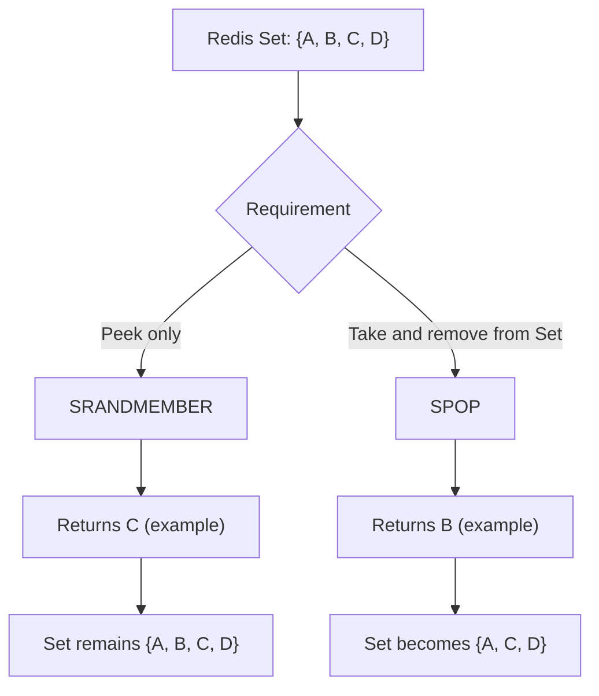
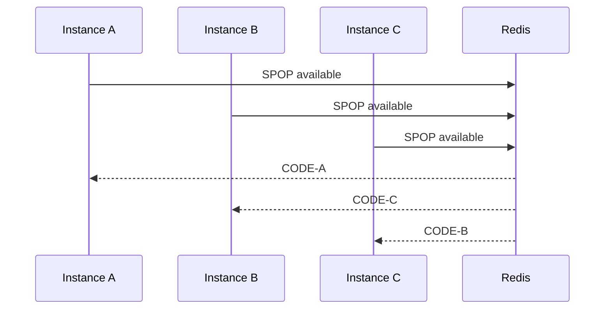
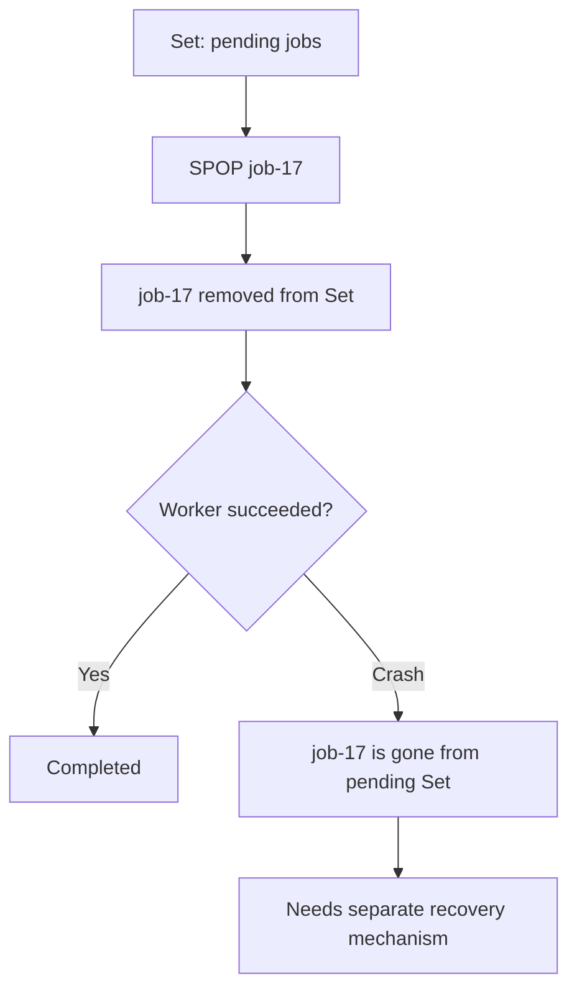

# Getting Random Members and Distinguishing Peek from Pop

## 1. Context: Selecting an Element from a Redis Set

In Redis, a **Set** is a collection of unique values with **no stable order**. Each Set is stored under a single Redis key. For example, a Spring Boot application has a list of unissued promo codes:

```text
Redis key: promotion:codes:available:v1:campaign-42
Redis type: set

Members:
  CODE-A7
  CODE-B8
  CODE-C9
  CODE-D0
```

The application might need two very different behaviors:

1. **Previewing a random code** to display a suggestion while keeping the code in the Set so it can be picked again later.
2. **Taking a code out and removing it from the Set** so that the code is no longer in the unissued pool.

Redis provides two command families for those two needs:

- **`SRANDMEMBER`**: retrieves random member(s) **without modifying the Set**.
- **`SPOP`**: retrieves random member(s) and **removes the retrieved member(s) from the Set**.

Spring Data Redis exposes these commands on the `SetOperations<K,V>` API of `RedisTemplate` or `StringRedisTemplate`. The method names may look similar, yet their effects on data and under concurrency are completely different.



Random selection commands **do not guarantee "strict fairness" for prize draws**. Redis provides sampling operations for the data structure; requirements involving cryptographic randomness, anti-fraud guarantees, or audit records require a separate design.

## 2. Identifying SetOperations in Spring Data Redis

On `StringRedisTemplate`, you typically obtain Set operations via:

```java
import org.springframework.data.redis.core.SetOperations;
import org.springframework.data.redis.core.StringRedisTemplate;

SetOperations<String, String> sets = redis.opsForSet();
```

`StringRedisTemplate` uses string serializers for keys and elements, making it well suited for identifiers, voucher codes, tags, or member names. If you use `RedisTemplate<String, MyValue>`, you must configure compatible serializers for keys and values; Redis stores bytes and is unaware of Java generics.

Key APIs for this lesson:

| Spring Data Redis API | Semantically Equivalent Redis Command | Result | Set After Operation |
|---|---|---|---|
| `randomMember(key)` | `SRANDMEMBER key` | One random member | **Unchanged** |
| `distinctRandomMembers(key, count)` | `SRANDMEMBER key count` with positive count | Set of distinct members in one sample | **Unchanged** |
| `randomMembers(key, count)` | `SRANDMEMBER key -count` with replacement semantics | Sampled list, duplicates allowed | **Unchanged** |
| `pop(key)` | `SPOP key` | One random member | **Returned member removed** |
| `pop(key, count)` | `SPOP key count` | Multiple distinct members, up to available count | **Returned members removed** |

These are the typical synchronous APIs of modern Spring Data Redis. Overload details, Redis server limits, and return types when using transactions/pipelines should be checked against your application's version. In a normal synchronous call context, an empty or nonexistent Set provides no elements; for single-element APIs, you must handle `null`.

### "Random Selection" Differs from "Reading by Position"

Sets have no stable index. They are not equivalent to Lists:

```text
List:  [A, B, C]   -> has element ordering
Set:   {A, B, C}   -> no order to pick "the second element"
```

Redis decides the random member. You should not assume internal Set ordering, the return order of multiple elements, or predict the selected sample based on `SADD` insertion order.

## 3. SRANDMEMBER: Picking Randomly While Keeping the Set Intact

Single-element command:

```text
SRANDMEMBER key
```

Example with the Redis CLI:

```bash
redis-cli SADD demo:raffle:eligible:v1 alice bob carol dave
redis-cli SRANDMEMBER demo:raffle:eligible:v1
redis-cli SCARD demo:raffle:eligible:v1
```

Suppose calling `SRANDMEMBER` returns `carol`. The Set's element count remains **4** because the command removes no members.

With Spring Data Redis:

```java
String key = "demo:raffle:eligible:v1";
String candidate = redis.opsForSet().randomMember(key);

if (candidate != null) {
    System.out.println("Sampled: " + candidate);
}
```

Calling it multiple times can return the same member:

```text
Call 1: carol
Call 2: alice
Call 3: carol
```

That is valid behavior because the Set has not changed. If the application requires *no repeats across actual allocations*, `SRANDMEMBER` alone does not satisfy that requirement.

### When Is It Appropriate?

- Randomly displaying a tag, suggestion, or item from a non-consumable list.
- Sampling to inspect data, experiment, or verify a set.
- Picking a random member to read related data when duplicates across selections are acceptable.
- Building content recommendation experiences that do not require an exact distribution history.

### When Is It Inappropriate?

- Issuing one-time vouchers, allocating scarce resources, or assigning exclusive tasks.
- Cases where two concurrent requests **must** not receive the same member.
- Systems requiring provable fairness of a draw algorithm or tamper-evident selection records.

Thinking of picking first and then deciding whether to delete with separate `SRANDMEMBER` and `SREM` calls? Those two commands **do not form an atomic operation**. Another request can pick or delete the same member in between; if you need "take and remove together", look at `SPOP`.

## 4. SRANDMEMBER with COUNT: Positive vs. Negative Counts Differ

Redis allows:

```text
SRANDMEMBER key count
```

**The sign of `count` changes the sampling semantics.**

| COUNT | Sampling Rule | Example with Set `{A,B,C}` |
|---|---|---|
| Omitted | One random member | `B` |
| `2` | Up to two **distinct** members | `[C,A]` |
| `5` | Up to the available number of members, no duplicates | `[A,C,B]` |
| `-5` | Allows a member to appear multiple times, usually returning five elements if the Set is non-empty | `[B,A,B,C,B]` |
| `0` | No elements requested | Empty list |

With a **positive count**, Redis samples **without replacement within that call**. If count exceeds the current number of members, the result contains only the available members. With a **negative count**, Redis samples **with replacement** (allowing duplicates), so the returned count can exceed the Set's cardinality.

One distinction to keep clear: requesting a positive count does not prevent **separate** calls from repeating members across calls. Only within the same sampling call is the list free of duplicate members.

### 4.1. API for Multiple Distinct Members

`distinctRandomMembers(key, count)` expresses requesting a subset without duplicates in a single call:

```java
import java.util.Set;

String key = "demo:raffle:eligible:v1";

Set<String> candidates =
        redis.opsForSet().distinctRandomMembers(key, 3);

if (candidates != null) {
    for (String candidate : candidates) {
        System.out.println(candidate);
    }
}
```

The return type is `Set<String>`; do not rely on its iteration order. If the Redis Set has only two members, the result size cannot exceed two. Calling `distinctRandomMembers(key, 3)` multiple times can still pick members that appeared in previous calls because **no members were removed**.

### 4.2. API for Sampling with Replacement

`randomMembers(key, count)` fits when the number of draws may exceed the number of elements or repeats are acceptable:

```java
import java.util.List;

List<String> suggestions =
        redis.opsForSet().randomMembers(
                "demo:raffle:eligible:v1", 5);

if (suggestions != null) {
    suggestions.forEach(System.out::println);
}
```

The result type is `List` because the same member can repeat. In this mechanism, the application passes a **positive desired count** to the Spring Data Redis API; the library maps it to Redis's duplicate-allowing sampling semantics. Do not manually pass a negative number to `randomMembers` just because the Redis CLI uses `SRANDMEMBER key -count`: **the Java method contract expects the desired number of draws**.

### 4.3. Example of Choosing the Right API

Suppose a service has 100 product IDs:

- Want **1 arbitrary ID**: `randomMember(key)`.
- Want **5 distinct IDs on a recommendation page**: `distinctRandomMembers(key, 5)`.
- Want to simulate **1,000 draws with replacement** from the 100 IDs: `randomMembers(key, 1000)`, while evaluating memory cost and statistical goals.
- Want to **issue 5 IDs and remove them from the available pool**: `pop(key, 5)`.

Do not call `randomMembers` and convert the result to a Java `Set` to "fix" duplicates: that can leave fewer items than requested and hides choosing the wrong API upfront.

## 5. SPOP: Pick Randomly and Remove Immediately from the Set

`SPOP` has two forms:

```text
SPOP key
SPOP key count
```

`SPOP` picks random member(s), **returns** them to the client, and **removes those member(s) from the Set** in the same Redis operation.

Example:

```bash
redis-cli SADD demo:vouchers:available:v1 VC-1 VC-2 VC-3
redis-cli SCARD demo:vouchers:available:v1
redis-cli SPOP demo:vouchers:available:v1
redis-cli SCARD demo:vouchers:available:v1
redis-cli SMEMBERS demo:vouchers:available:v1
```

If there were initially 3 vouchers, after a successful `SPOP` the Set has 2 remaining. You cannot predict which voucher was picked; Redis chooses randomly according to its algorithm.

In Spring Data Redis:

```java
String key = "demo:vouchers:available:v1";
String voucher = redis.opsForSet().pop(key);

if (voucher == null) {
    System.out.println("No vouchers available");
} else {
    System.out.println("Popped: " + voucher);
}
```

`pop(key)` does not need a subsequent `remove` call: removal is already part of `SPOP`. If the client calls `SREM key voucher` again afterward, the extra delete command wastes resources and may hide a misunderstanding in the code.

### 5.1. Taking and Removing Multiple Elements

`pop(key, count)` returns multiple distinct members and removes them from the Set:

```java
import java.util.List;

String key = "demo:vouchers:available:v1";

List<String> claimed =
        redis.opsForSet().pop(key, 5);

if (claimed != null && !claimed.isEmpty()) {
    claimed.forEach(System.out::println);
}
```

If the Set only has 3 members left, there is no way to pop 5 **distinct members** from that Set. The call will only take up to the available count. Do not treat a 3-element result as Redis "ignoring two requests"; insufficient supply must be handled directly in business logic.

Key difference when retrieving multiple elements via `SPOP` vs. `SRANDMEMBER`:

```text
Initial: Set = {A, B, C, D}

SRANDMEMBER key 2 -> [B, D]
After command: Set = {A, B, C, D}

SPOP key 2        -> [A, C]
After command: Set = {B, D}
```

The lists above merely illustrate one sample run, not a fixed order or output.

### 5.2. When Popping the Last Element

When `SPOP` removes the last element, the Set has no members left and Redis typically **deletes the Set key** (Redis does not keep an empty Set as a separate data object). When checking:

```bash
redis-cli EXISTS demo:vouchers:available:v1
redis-cli SCARD demo:vouchers:available:v1
```

A missing key yields `EXISTS = 0` and `SCARD = 0`. If the application only needs to know how many elements remain, `SCARD` is usually sufficient; if it needs to distinguish the business states "never created" and "depleted", separate metadata/state is required.

## 6. Comparing Random Peek vs. Pop

| Question | `SRANDMEMBER` / `randomMember*` | `SPOP` / `pop` |
|---|---|---|
| Picks randomly? | Yes | Yes |
| Shrinks the Set? | **No** | **Yes** |
| Can the same member be picked in a later call? | Yes | No, unless re-added |
| Can duplicates occur in a multi-element result? | `randomMembers` yes; `distinctRandomMembers` no | No, because elements are removed from the Set |
| Needs a separate delete operation? | If business logic wants removal, needs another command, prone to races | No |
| Good for suggestions/sampling? | Yes | No, because it mutates the source data |
| Good for consuming finite items? | Insufficient | Suitable if "remove first, process after" is acceptable |
| Guarantees processing succeeds after retrieval? | Consumption semantics do not apply | **No**, SPOP only guarantees retrieval and removal in Redis |
| Supports acknowledgment (ack), retry, automatic pending tracking? | No | No |

**Rule of thumb:** if you only need to view an element, choose `SRANDMEMBER`. If an element must leave the available pool immediately upon selection, choose `SPOP`. If the real requirement is "assign work and guarantee processing", you need to design explicit processing states, acknowledgments, and recovery, or consider another data structure/system.

## 7. Atomicity Across Multiple Spring Boot Instances

Suppose a system has three Spring Boot instances and one Set holding promo codes:



On a healthy Redis primary processing commands normally, **each `SPOP` is an atomic operation**. Commands are processed individually, so two successful `SPOP` commands will not retrieve the same removed member, provided no re-insertion or other complex state mutations interleave.

If you replace `SPOP` with `SRANDMEMBER`:

```text
Instance A: SRANDMEMBER -> CODE-A
Instance B: SRANDMEMBER -> CODE-A
Instance C: SRANDMEMBER -> CODE-C
```

This is not a bug: the operations are read-only and the Set does not change. Command atomicity does **not** mean concurrent read requests will pick different members.

### 7.1. Race Condition in "Read First, Delete Later"

The following code can suffer from bugs:

```java
String item = redis.opsForSet().randomMember(key);

if (item != null) {
    // Another client may also have randomly picked this same item.
    redis.opsForSet().remove(key, item);
    process(item);
}
```

Between `randomMember` and `remove`, other clients can pick the exact same `item`. Moreover, `remove` returns the count of removed elements: if it is 0, another client may have already deleted it; yet the example code still calls `process(item)`. If you want to **draw a member and remove it immediately**, `pop(key)` expresses the exact semantics and avoids the gap between selecting and deleting.

### 7.2. Atomic Does Not Mean "Processed Exactly Once"

Even atomic `SPOP` does not guarantee the entire workflow runs exactly once:

```text
1. Redis executes SPOP -> removed CODE-A
2. Application receives CODE-A
3. Application calls API to issue code to user
4. API fails or application crashes
5. CODE-A is no longer in the source Set
```

Or the connection drops **after Redis executed SPOP but before the reply reached Java**. The application cannot tell which element was popped or whether the operation occurred. Retrying `SPOP` right then could pop **another element**.

Therefore `SPOP` is an **atomic remove**, not an acknowledged queue, nor does it create a distributed transaction between Redis and a database.

## 8. Spring Boot Example: Sampling Without Consuming

The following service provides three sampling modes so the application calls the right one for each need:

```java
import java.util.List;
import java.util.Set;

import org.springframework.data.redis.core.SetOperations;
import org.springframework.data.redis.core.StringRedisTemplate;
import org.springframework.stereotype.Service;

@Service
public class SuggestionService {
    private static final String KEY =
            "content:suggestions:eligible:v1";

    private final SetOperations<String, String> sets;

    public SuggestionService(StringRedisTemplate redis) {
        this.sets = redis.opsForSet();
    }

    public String suggestOne() {
        // May return null if the Set has no remaining members.
        return sets.randomMember(KEY);
    }

    public Set<String> suggestDistinct(long count) {
        if (count < 0 || count > 100) {
            throw new IllegalArgumentException(
                    "count must be within 0..100");
        }
        Set<String> result = sets.distinctRandomMembers(KEY, count);
        return result == null ? Set.of() : result;
    }

    public List<String> simulateDrawsWithReplacement(long count) {
        if (count < 0 || count > 100) {
            throw new IllegalArgumentException(
                    "count must be within 0..100");
        }
        List<String> result = sets.randomMembers(KEY, count);
        return result == null ? List.of() : result;
    }
}
```

The second method uses `Set<String>` to represent requiring **distinct suggestions within the same result**. The third method uses `List<String>` because draws can contain repeats. The 100 cap is an **example service policy**, not a Redis limit.

No call in this service deletes members from Redis. The same article can continue to be suggested in subsequent requests. To reduce repeats across requests, you must add a viewed-history or another recommendation algorithm, rather than just swapping `randomMember` for `distinctRandomMembers`.

## 9. Spring Boot Example: Issuing Codes from an Available Pool

Suppose a Redis Set holds available codes. The service uses `pop` to retrieve a code and remove it from the pool:

```java
import java.util.List;
import org.springframework.data.redis.core.SetOperations;
import org.springframework.data.redis.core.StringRedisTemplate;
import org.springframework.stereotype.Service;

@Service
public class VoucherPoolService {
    private final SetOperations<String, String> sets;

    public VoucherPoolService(StringRedisTemplate redis) {
        this.sets = redis.opsForSet();
    }

    private String keyFor(String campaignId) {
        return "voucher:available:v1:" + campaignId;
    }

    public String takeOne(String campaignId) {
        return sets.pop(keyFor(campaignId));
    }

    public List<String> takeUpTo(String campaignId, long requested) {
        if (requested < 1 || requested > 50) {
            throw new IllegalArgumentException(
                    "requested must be within 1..50");
        }

        List<String> result = sets.pop(keyFor(campaignId), requested);
        return result == null ? List.of() : result;
    }
}
```

Example usage:

```java
String voucher = voucherPoolService.takeOne("campaign-42");
if (voucher == null) {
    // Out of codes or no data in the corresponding key.
    return;
}

// This is a separate business step that can fail.
// Must have recovery/idempotency design if code issuance is critical.
issueVoucherToCustomer(voucher);
```

**Business design warning:** `takeOne` only guarantees that Redis retrieved and removed the code from the Set when the command succeeded. It does not guarantee `issueVoucherToCustomer` succeeds or can recover after a crash. For high-value vouchers or auditable data, you need a durable source of truth and an issuance-tracking workflow that handles failures between steps.

### 9.1. When Exactly N Codes Must Be Issued

`pop(key, N)` only takes **at most** N codes. If the pool has fewer than N codes, the caller must define the rule:

- Partial issuance allowed: return the actual list and the shortfall.
- Partial issuance disallowed: check the condition and design **check + pop** inside a single atomic boundary, rather than running `SCARD` and `SPOP` separately.
- Temporary reservation required: build a reservation state and expiration time instead of only removing from the available Set.

Anti-pattern example:

```java
Long available = sets.size(key);

if (available != null && available >= requested) {
    // Race: after SCARD, another client can pop elements!
    List<String> chosen = sets.pop(key, requested);
}
```

`SCARD` and `SPOP` are two independent commands. If the requirement is "all N or nothing", design it with a Redis script or an appropriate synchronization mechanism, while accounting for Redis Cluster constraints and potential script errors.

## 10. Pop-and-Remove Is Not a Reliable Queue

A Set with `SPOP` looks like a simple work queue, but it differs substantially from a queue/broker with acknowledgment support.



Requirements that `SPOP` does not natively provide:

- **Acknowledgment:** Redis does not wait for a consumer to confirm completion.
- **Pending list:** no automatic "delivered but unacknowledged" state.
- **Redelivery:** Redis does not automatically return popped elements when a worker crashes.
- **Ordering:** Sets have no order; `SPOP` is neither FIFO nor a priority queue.
- **Per-item lease:** no individual visibility timeout per popped item.
- **Exactly-once end-to-end:** no cross-system guarantee spanning Redis, APIs, and databases.

For background processing needing ack/retry, consider **Redis Streams** with consumer groups and pending/ack management, or a message broker such as RabbitMQ/Kafka depending on requirements. Streams also do not automatically guarantee exactly-once business execution; consumers still need idempotency.

### 10.1. Moving to a "Processing" Set

Sometimes a simple design uses two Sets:

```text
tasks:{batch-42}:available
tasks:{batch-42}:processing
```

The goal is "draw a job from available and add it to processing in one operation". Running `SPOP` followed by `SADD` as two Java calls can lose track of a job if a crash occurs between the two steps.

You can use a Redis Lua script to execute both steps in a single pass:

```lua
-- KEYS[1]: available Set
-- KEYS[2]: processing Set
local jobId = redis.call('SPOP', KEYS[1])
if not jobId then
    return nil
end

redis.call('SADD', KEYS[2], jobId)
return jobId
```

This narrows the failure window between `SPOP` and `SADD` on **the same Redis node**. When running Redis Cluster, both keys must share the same hash slot, e.g., using hash tag `{batch-42}`. Both keys must have compatible types; **errors inside a Redis script do not perform RDBMS-style data rollbacks**, so input state must be controlled.

More importantly, **a processing Set is not enough for a reliable queue**. You still must design ack (`SREM` on completion), start timestamps, leases/timeouts, recovery of stalled jobs, preventing two workers from reclaiming simultaneously, monitoring, persistence, and failover handling. Once those needs appear, a dedicated queue/Stream system is usually more sensible than layering more rules onto Sets.

## 11. BoundSetOperations: Pinning the Key When Working with One Set

If a method operates multiple times on the same Redis Set, `RedisTemplate` also provides **`boundSetOps(key)`**, returning `BoundSetOperations` bound to a fixed key.

```java
import org.springframework.data.redis.core.BoundSetOperations;

String key = "demo:vouchers:available:v1";

BoundSetOperations<String, String> vouchers =
        redis.boundSetOps(key);

Long available = vouchers.size();
String preview = vouchers.randomMember(); // Does not remove.
String taken = vouchers.pop();            // Removes.
```

Corresponding bound APIs include `randomMember()`, `randomMembers(count)`, `distinctRandomMembers(count)`, `pop()`, and `pop(count)`, depending on the Spring Data Redis version.

**Binding only avoids repeating the key**; it does not mean the Redis Set is exclusively locked, commands are automatically grouped into a transaction, or consecutive method calls share a single snapshot. In the snippet above, `size()`, `randomMember()`, and `pop()` remain separate operations. Another client can modify the Set in between.

Do not create a singleton `BoundSetOperations` bound to a specific user ID and reuse it for all users. When the key varies per tenant/campaign, create Bound Operations in the appropriate scope or pass the key to `SetOperations`.

## 12. TTL and Set Lifecycle When Drawing Members

Redis **TTL** normally applies to **the entire Set key**, not individual members. Example:

```bash
redis-cli SADD demo:vouchers:available:v1 VC-1 VC-2 VC-3
redis-cli EXPIRE demo:vouchers:available:v1 3600
redis-cli TTL demo:vouchers:available:v1
```

After `SRANDMEMBER`, the TTL keeps counting down because the command is read-only. After `SPOP`, if the Set still has members, the key's TTL is normally preserved; `SPOP` does not automatically renew TTL. If `SPOP` removes the last member, the key is deleted. When `SADD` later recreates the key, the old TTL is not automatically restored.

In Spring Boot:

```java
import java.time.Duration;

String key = "demo:vouchers:available:v1";
redis.opsForSet().add(key, "VC-1", "VC-2", "VC-3");
redis.expire(key, Duration.ofHours(1));
```

The two calls `add` and `expire` are **two independent Redis operations**. If Redis or the application fails between them, the key may be created without the intended TTL. If setting TTL at creation time is mandatory, organize an atomic operation or another creation/cleanup mechanism.

Additionally, the Set may expire **while workers are waiting to use it**. A `pop` call then finds no members to issue, which is a business condition that must be handled. Never assume every initialized key will exist until all members are popped.

## 13. Handling Empty Results, Errors, and Transactions/Pipelines

### 13.1. No Members Available

A single-element `SRANDMEMBER` or `SPOP` on a nonexistent key or depleted Set cannot return a member. With synchronous `SetOperations`, single-element APIs typically return `null` in this case:

```java
String sample = redis.opsForSet().randomMember(key);
String removed = redis.opsForSet().pop(key);

if (sample == null) {
    // No element available to sample at read time.
}
if (removed == null) {
    // No element available to pop and remove at pop time.
}
```

For multi-element APIs, handle both empty collections and `null` according to the version/client contract. When code runs inside a **Redis pipeline or transaction**, a `null` return from a call can also mean **the result is not yet available because the command is queued**. Do not use a `null` inside a pipeline/`MULTI` callback to conclude the Set is actually empty.

### 13.2. Redis Key Has the Wrong Type

If the existing key is a String or Hash and you call `SPOP`/`SRANDMEMBER`, Redis may return a `WRONGTYPE` error. Keep namespaces distinct so multiple features do not reuse the same key name with different data types.

```bash
redis-cli TYPE demo:vouchers:available:v1
redis-cli SCARD demo:vouchers:available:v1
```

`TYPE` should be `set` when the key exists, or `none` when absent. `SCARD` reports the element count at the moment of the call, though that count can change immediately after reading.

### 13.3. A Timeout Does Not Prove the Command Did Not Run

Suppose Redis executed `SPOP` and deleted `VC-1`, but the connection dropped before returning the reply. The application receives an exception and does not know which voucher was removed. Retrying the call could pop `VC-2`.

For **non-idempotent** operations like `SPOP`, do not retry blindly after network errors. If the business cannot afford losing or over-issuing resources, design operation IDs, reservation states, reconcilable results, and a durable data source. Redis persistence and replica/failover must also be configured according to acceptable data-loss tolerances, since writes acknowledged to a client can still carry risk in certain deployment modes.

## 14. Inspecting with the Redis CLI Without Losing Real Data

When experimenting, use a **dedicated demo key** so `SPOP` does not delete members from a production dataset:

```bash
# Use a dedicated demo namespace; avoid real business keys.
redis-cli SADD demo:sample:set:v1 A B C D

# Sampling only; the Set does not change.
redis-cli SRANDMEMBER demo:sample:set:v1
redis-cli SRANDMEMBER demo:sample:set:v1 2
redis-cli SRANDMEMBER demo:sample:set:v1 -6
redis-cli SCARD demo:sample:set:v1

# Removing from the Set; this mutates data.
redis-cli SPOP demo:sample:set:v1
redis-cli SCARD demo:sample:set:v1
redis-cli SPOP demo:sample:set:v1 2
redis-cli SMEMBERS demo:sample:set:v1
```

Points to observe:

1. After the three `SRANDMEMBER` commands, `SCARD` is still 4.
2. `SRANDMEMBER ... -6` can return repeated elements across six samples.
3. `SPOP` decreases the remaining count when elements are present.
4. `SPOP ... 2` takes at most two remaining members; if the pool has fewer, it returns fewer.
5. `SMEMBERS` order is neither insertion order nor a guaranteed random order.

Never run `SPOP` just to "peek" at a key serving real business traffic. To inspect members without altering data, use `SRANDMEMBER` or an appropriate read query.

## 15. Key Conventions, Serializers, and Security

Well-managed keys should have clear namespaces:

```text
content:suggestions:eligible:v1
promotion:codes:available:v1:campaign-42
tasks:{batch-42}:processing
tasks:{batch-42}:available
```

With `StringRedisTemplate`, Set members are serialized as strings, making inspection via the Redis CLI straightforward. If a service uses a different binary serializer for the same key/value, read results may be incompatible. Do not assume two equal Java `String` values represent the same Redis member if encoded into two different byte sequences.

Members and keys should not contain secret tokens, emails, phone numbers, or sensitive data that might leak through logs/monitoring. For promo codes with real monetary value, enforce Redis ACL permissions, TLS, and logging controls; simply placing a code in a Set is not enough on its own to call it a secure distribution system.

In Redis Cluster, each Set key belongs to one hash slot. `SPOP` on **a single key** has no multi-key same-slot constraint. However, scripts or operations coordinating multiple Sets must place related keys in the same slot, such as `tasks:{batch-42}:available` and `tasks:{batch-42}:processing`. Do not use a single global hash tag across the entire system if it unbalances cluster load.

## 16. Complexity, Capacity, and Concurrent Load

Redis performs random selection on a Set using its internal data structure; retrieving a single member is typically low-cost. When requesting a large number of elements, reply construction, network, serialization, and Java collection allocation costs scale with the returned data.

A few guidelines:

- **Bound `count`** per business rules rather than letting clients request millions of elements in one API call.
- Avoid calling `randomMembers(key, veryLargeCount)` on a Set with only a few elements; the result can be a huge list of repeated members.
- `distinctRandomMembers(key, count)` returns at most the Set's cardinality; a large count does not cause Redis to invent extra members.
- `pop(key, count)` mutates the Set across multiple members; consider service-side result handling and behavior if downstream fails.
- Do not call `members(key)` to read the entire Set just to pick one element in Java; `SRANDMEMBER`/`SPOP` avoid transferring all members over the network.
- Monitor Redis CPU, p95/p99 latency, request rate, Set sizes, timeouts, and depletion rates.

When distributing valuable resources requiring auditing, `SPOP` performance is not the sole criterion. You need to know **who received which member, when, whether confirmation succeeded, and how to recover**.

## 17. Hands-On Exercise: Sampling and Issuing Elements

**Problem:** a Spring Boot application manages a list of gifts available to distribute to users. Redis key `demo:gifts:available:v1` initially contains `gift-A`, `gift-B`, `gift-C`, `gift-D`.

### Part A — Non-Consuming Sampling

```java
String key = "demo:gifts:available:v1";

redis.opsForSet().add(
        key, "gift-A", "gift-B", "gift-C", "gift-D");

String preview = redis.opsForSet().randomMember(key);
Set<String> threeDifferent =
        redis.opsForSet().distinctRandomMembers(key, 3);
List<String> fiveDraws =
        redis.opsForSet().randomMembers(key, 5);

Long stillAvailable = redis.opsForSet().size(key);
```

Expected behavior per API semantics:

- `preview` is one member, with no fixed order.
- `threeDifferent` has at most three members and no duplicates within the result.
- `fiveDraws` may contain duplicates because sampling is with replacement.
- `stillAvailable` still reflects the unremoved member count (unless another client modified the Set or the key expired).

### Part B — Drawing Gifts from the Pool

```java
String firstGift = redis.opsForSet().pop(key);
List<String> nextGifts = redis.opsForSet().pop(key, 2);

Long remaining = redis.opsForSet().size(key);
```

If no other client intervened and the Set still exists, after successfully popping 1 + 2 gifts from the initial 4 gifts, 1 gift remains. The drawn gifts are distinct because they were removed from the Set.

### Part C — Failure Scenario

Suppose after `pop(key)`, the application crashes before recording the gift recipient. Determine:

- Is that gift still in `demo:gifts:available:v1`?
- Can `randomMember` be used to find the lost gift again?
- If `pop` is retried, is there a risk of drawing another gift?
- How should a database gift-issuance table, transaction, reservation state, or acknowledged queue be added to meet requirements?

Answer regarding the Redis Set: **the popped gift is no longer in the available Set; `randomMember` only sees remaining elements; retrying `SPOP` can take another gift**. Additional business mechanisms must be based on the system's durability and traceability constraints.

## 18. Summary of API Decisions

| Need Expressed in Words | Spring Data Redis Method |
|---|---|
| "Give me any one member, keep the Set intact" | `opsForSet().randomMember(key)` |
| "Give me N **distinct** members to view, without removing" | `opsForSet().distinctRandomMembers(key, n)` |
| "Give me N sampling draws, duplicates allowed" | `opsForSet().randomMembers(key, n)` |
| "Take one member out of the unused pool" | `opsForSet().pop(key)` |
| "Take up to N distinct members and remove them from the pool" | `opsForSet().pop(key, n)` |
| "I know the exact member to remove" | `opsForSet().remove(key, member)` |
| "Check whether a member is still in the Set" | `opsForSet().isMember(key, member)` |
| "Count how many members are currently present" | `opsForSet().size(key)` |
| "Dispatch work then acknowledge, retry/reclaim if worker dies" | Design a custom ack/lease mechanism or consider Redis Streams/a message broker |

**Key takeaway:** `SRANDMEMBER` is **read-only**, while `SPOP` **reads and removes in the same Redis operation**. `randomMembers` and `distinctRandomMembers` also differ in whether duplicates are allowed **within the same sampling call**. When data must be consumed reliably, the atomicity of `SPOP` is only the first step; the application still needs result recording, error handling, retries, idempotency, and a source of truth aligned with business needs.
