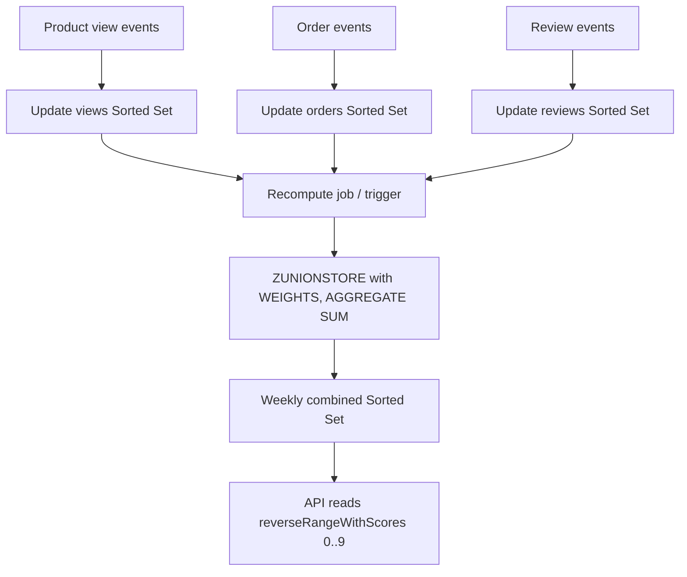

# Union, Intersection, and Score Aggregation Across Multiple Sorted Sets

## 1. Problem Statement and Goals

In Redis, a **Sorted Set** (commonly called a ZSet) stores **non-duplicate members**, each paired with a **score**. Redis uses scores to order members, making Sorted Sets ideal for leaderboards, priorities, engagement scores, recommendation scores, or weighted lists.

An e-commerce application might keep two weekly scoreboards:

- `ranking:views:week45`: score based on product views.
- `ranking:orders:week45`: score based on purchase counts.

The product team wants to answer these questions:

- Which products appear in **at least one** scoreboard? → **Union**.
- Which products appear in **both** scoreboards? → **Intersection**.
- If purchase score matters three times as much as view score, how is each product's **combined score** calculated?
- When multiple sources contain the same member, should scores be summed, take the minimum, or take the maximum?
- How do we store the resulting leaderboard in Redis to read the top 10 without transferring all data through Java?

Redis provides `ZUNION`, `ZINTER`, `ZUNIONSTORE`, and `ZINTERSTORE`, along with `WEIGHTS` and `AGGREGATE SUM|MIN|MAX`. In Spring Data Redis, `ZSetOperations` provides methods like `unionAndStore(...)` and `intersectAndStore(...)`; when advanced aggregation control is needed, you can use library-version-appropriate overloads, `RedisCallback`, or a Redis script.

**This lesson clearly distinguishes two aspects:** *membership* decides whether a member enters the result; *score aggregation* decides how the selected member's score is computed.

## 2. Reviewing the Nature of a Sorted Set

A Sorted Set can be visualized as a collection of pairs:

```text
key: ranking:views:week45

member    score
------    -----
alice      10
bob         6
carol       3
```

Each member appears at most once within the same Sorted Set. Writing an existing member again with standard `ZADD` and a new score updates that member's score; it does not create a duplicate.

### Key Characteristics

| Characteristic | Redis Sorted Set |
|---|---|
| Member | Unique within a single key |
| Score | Double-precision floating-point number per Redis representation |
| Order | Primarily ascending by score; equal scores are ordered lexicographically by member bytes |
| Reading top high scores | Can read descending via `ZREVRANGE` or `ZRANGE ... REV` |
| Add/edit score | `ZADD` |
| Increment a member's score | `ZINCRBY` |
| Union/intersection | `ZUNION`/`ZINTER` and STORE variants |
| Inspect member | `ZSCORE` returns the score when the member exists |
| Standard expiration scope | TTL of the top-level Redis key holding the Sorted Set |

A **standard Set** primarily answers whether a member belongs to a set. A **Sorted Set** also answers **what score** the member has, what its rank is, and how scores should be aggregated when combined with other Sorted Sets.

### Running Dataset Used Throughout This Lesson

We define:

```text
A = ranking:views:week45
    alice -> 10
    bob   ->  6
    carol ->  3

B = ranking:orders:week45
    bob   -> 4
    carol -> 8
    dave  -> 5
```

Create the data in `redis-cli`:

```redis
ZADD ranking:views:week45 10 alice 6 bob 3 carol
ZADD ranking:orders:week45 4 bob 8 carol 5 dave

ZRANGE ranking:views:week45 0 -1 WITHSCORES
ZRANGE ranking:orders:week45 0 -1 WITHSCORES
```

`ZRANGE` with `0 -1` returns all members in **ascending** score order. `-1` marks the end position in range syntax, not “only select members with negative scores”. Output displays alternating members and scores, not necessarily arranged like tables in documentation.

## 3. Union ZUNION: Selecting Members Present in at Least One Set

Suppose the two member sets are:

\[
M_A = \{\text{alice},\text{bob},\text{carol}\}
\]

\[
M_B = \{\text{bob},\text{carol},\text{dave}\}
\]

The union selects members belonging to **at least one** of the two sets:

\[
M_A \cup M_B =
\{\text{alice},\text{bob},\text{carol},\text{dave}\}
\]

For Sorted Sets, the result needs both **membership** and a **new score**. Redis's default rule is to **sum the scores** across the sources containing that member.

Syntax for Redis 6.2 and later:

```redis
ZUNION numkeys key [key ...]
  [WEIGHTS weight [weight ...]]
  [AGGREGATE SUM | MIN | MAX]
  [WITHSCORES]
```

Example:

```redis
ZUNION 2 ranking:views:week45 ranking:orders:week45 WITHSCORES
```

Result using default score aggregation:

| Member | Score from A | Score from B | Result score (SUM) |
|---|---:|---:|---:|
| alice | 10 | Absent | 10 |
| bob | 6 | 4 | 10 |
| carol | 3 | 8 | 11 |
| dave | Absent | 5 | 5 |

The result set contains four members. The `ZUNION` command **does not write** this set to a new key; it only returns the result.

In ascending score order, the logical order is:

```text
dave    5
alice  10
bob    10
carol  11
```

On tied scores, Redis uses member lexicographical order to break ties; the application must not assume `alice` ranked before `bob` because it came from the first source key.

### 3.1. Why Does a Member Belonging to Only One Source Still Have a Score?

In a union, membership only requires **appearing in at least one source**. If `alice` only exists in A, its score comes from A after applying A's weight. Redis does not require `alice` to have a score-0 entry in B.

This differs from an intersection, where `alice` is dropped because she is absent from B, regardless of how high her score in A is.

### 3.2. Unioning More Than Two Sorted Sets

Example adding a review scoreboard:

```redis
ZADD ranking:reviews:week45 7 alice 5 carol 2 erin

ZUNION 3 \
  ranking:views:week45 \
  ranking:orders:week45 \
  ranking:reviews:week45 \
  WITHSCORES
```

In a Redis CLI prompt, everything can be written on a single line; line breaks in the example are solely for readability. With three keys, `numkeys` must be `3`. When `WEIGHTS` is omitted, all weights default to 1. When `AGGREGATE` is omitted, Redis uses `SUM`.

**A member appearing only in the third source still appears in the union**. This forms the basis for merging multiple signals from independent sources.

## 4. Intersection ZINTER: Keeping Only Common Members Across All Sets

Intersection keeps only members present in **every** specified Sorted Set:

\[
M_A \cap M_B = \{\text{bob},\text{carol}\}
\]

Command:

```redis
ZINTER 2 ranking:views:week45 ranking:orders:week45 WITHSCORES
```

With default score summation:

| Member | Score A | Score B | Intersection score (SUM) |
|---|---:|---:|---:|
| bob | 6 | 4 | 10 |
| carol | 3 | 8 | 11 |

`alice` belongs only to A and is excluded. `dave` belongs only to B and is excluded. **Score aggregation happens only for members satisfying the intersection membership rule.**

### 4.1. Intersecting More Than Two Sets

With three boards A, B, and C:

```redis
ZINTER 3 ranking:views:week45 ranking:orders:week45 ranking:reviews:week45 WITHSCORES
```

Only members present simultaneously in all three are returned. If one key does not exist or is empty, the intersection is empty. If any input key has a Redis type other than Sorted Set, the command returns `WRONGTYPE` rather than converting it automatically.

### 4.2. When Should You Use Intersection?

Intersection fits when results must satisfy multiple mandatory conditions, such as:

- Products with engagement signals in **both views and orders**.
- Users active in **both community A and community B**.
- Authors appearing across multiple topic leaderboards.
- Candidate lists scored across multiple evaluation stages, keeping only participants who completed every stage.

Do not use intersection to merge signals from sources with uneven coverage if the goal is “any member with at least one signal”. Use union for that; use intersection when presence in every source is required.

## 5. Aggregating Scores: SUM, MIN, and MAX

Union/intersection decides **which members exist in the result**. Then `AGGREGATE` decides how a member's score across multiple sources is combined.

Redis supports three aggregations:

| Option | Meaning | Typical use |
|---|---|---|
| `SUM` | Sum weighted scores | Combine multiple signals into a total score |
| `MIN` | Pick the smallest score among sources containing the member | Evaluate by weakest signal |
| `MAX` | Pick the largest score among sources containing the member | Retain strongest signal |

With default weights of 1, computed over A and B:

| Member | Score A | Score B | SUM | MIN | MAX |
|---|---:|---:|---:|---:|---:|
| alice | 10 | — | 10 | 10 | 10 |
| bob | 6 | 4 | 10 | 4 | 6 |
| carol | 3 | 8 | 11 | 3 | 8 |
| dave | — | 5 | 5 | 5 | 5 |

The `—` symbol means the member does not appear in that source. In a union, **a member missing from one source is not treated as score 0 by MIN/MAX**; Redis aggregates only the scores that actually exist for the selected member.

This distinction is crucial: when computing `ZUNION ... AGGREGATE MIN`, `alice` keeps score 10 rather than being pulled down to 0 because she is absent from B.

### 5.1. Concrete Commands

```redis
ZUNION 2 ranking:views:week45 ranking:orders:week45 AGGREGATE SUM WITHSCORES

ZUNION 2 ranking:views:week45 ranking:orders:week45 AGGREGATE MIN WITHSCORES

ZUNION 2 ranking:views:week45 ranking:orders:week45 AGGREGATE MAX WITHSCORES
```

With intersection:

```redis
ZINTER 2 ranking:views:week45 ranking:orders:week45 AGGREGATE SUM WITHSCORES

ZINTER 2 ranking:views:week45 ranking:orders:week45 AGGREGATE MIN WITHSCORES

ZINTER 2 ranking:views:week45 ranking:orders:week45 AGGREGATE MAX WITHSCORES
```

`MIN` and `MAX` results for intersection contain only `bob` and `carol`, since the other members were filtered out during the membership step.

### 5.2. SUM Is Not Always the Right Business Score

If source A scores on a 0–100 scale while source B scores on a 0–5 scale, direct summation lets A overwhelm B. Normalize values or define weights based on what each source represents.

Similarly, `MAX` does not mean “most trustworthy source”; it just picks the highest numeric value. `MIN` does not enforce “lowest quality” if scales differ across sources. **AGGREGATE only computes numbers**, while business meaning depends on your scoring design.

## 6. WEIGHTS: Adjusting Each Source's Importance

The `WEIGHTS` option multiplies each source's scores by a factor before applying `AGGREGATE`.

For two Sorted Sets A and B with weights `w_A` and `w_B`, the aggregated SUM score for member `m` is:

\[
S(m) = \sum_{i \in \{A,B\},\, m \in i} w_i \cdot s_i(m)
\]

Here `s_i(m)` is member m's score in source i, and only sources that actually contain that member contribute.

Suppose:

- View score has weight 1.
- Order score has weight 3.

Redis command:

```redis
ZUNION 2 ranking:views:week45 ranking:orders:week45 WEIGHTS 1 3 AGGREGATE SUM WITHSCORES
```

Result:

| Member | A × 1 | B × 3 | Weighted union score |
|---|---:|---:|---:|
| alice | 10 | — | 10 |
| bob | 6 | 12 | 18 |
| carol | 3 | 24 | 27 |
| dave | — | 15 | 15 |

Leaderboard in descending score order:

```text
1. carol   27
2. bob     18
3. dave    15
4. alice   10
```

This matches the model's intent: `dave` with only order points still appears in the union with score 15; `alice` with only view points is still retained.

### 6.1. Weights Must Match Key Order

The command:

```redis
ZUNION 2 ranking:views:week45 ranking:orders:week45 WEIGHTS 1 3 WITHSCORES
```

is interpreted as:

```text
ranking:views:week45   -> weight 1
ranking:orders:week45  -> weight 3
```

If you swap the key order while keeping `WEIGHTS 1 3`, members' scores will change. For maintainability, when calling from Java with a dynamic key list, keep the key list and weight list in **paired ordered structures**, avoiding collections whose iteration order can vary unexpectedly.

### 6.2. Combining WEIGHTS and MIN/MAX

Weights are applied **before** computing MIN/MAX.

For example, `bob`'s weighted scores are:

```text
A: views  = 6 × 1 = 6
B: orders = 4 × 3 = 12

SUM = 18
MIN = 6
MAX = 12
```

For `carol`:

```text
A: views  = 3 × 1 = 3
B: orders = 8 × 3 = 24

SUM = 27
MIN = 3
MAX = 24
```

Commands:

```redis
ZINTER 2 ranking:views:week45 ranking:orders:week45 WEIGHTS 1 3 AGGREGATE MIN WITHSCORES

ZINTER 2 ranking:views:week45 ranking:orders:week45 WEIGHTS 1 3 AGGREGATE MAX WITHSCORES
```

`WEIGHTS` does not change membership filtering for union or intersection; it only affects scores. Even when a source has weight 0, members still participate in intersection membership checks; weight 0 does not drop the key from the operator.

### 6.3. Should You Use Negative or Zero Weights?

Redis accepts many numeric weights, though negative weights can invert the entire ranking meaning: high scores in a penalized source reduce the total score. Control the formula and explicitly document plus/minus signs. Do not assume scores are always positive.

A weight of 0 can express “this source only determines membership eligibility without contributing to score”. In an intersection, that is useful when one source acts strictly as a filter. Document that usage clearly so nobody mistakes it for ignoring the source altogether.

## 7. ZUNIONSTORE and ZINTERSTORE: Saving Results to Another Key

`ZUNION` and `ZINTER` return results directly to the caller. If you want to **persist the aggregated leaderboard in Redis**, use the `STORE` variants:

```redis
ZUNIONSTORE destination numkeys key [key ...]
  [WEIGHTS weight [weight ...]]
  [AGGREGATE SUM | MIN | MAX]

ZINTERSTORE destination numkeys key [key ...]
  [WEIGHTS weight [weight ...]]
  [AGGREGATE SUM | MIN | MAX]
```

Example creating an aggregated scoreboard:

```redis
ZUNIONSTORE ranking:combined:week45 2 ranking:views:week45 ranking:orders:week45 WEIGHTS 1 3 AGGREGATE SUM
```

Redis computes the union, sums weighted scores, and writes the result to `ranking:combined:week45`. The command returns the **number of stored members**, not the score list.

Then read the top 10:

```redis
ZREVRANGE ranking:combined:week45 0 9 WITHSCORES
```

Descending score output:

```text
carol  27
bob    18
dave   15
alice  10
```

In modern Redis, you can also use `ZRANGE ranking:combined:week45 0 9 REV WITHSCORES`. Standardize syntax according to your deployed Redis version.

### 7.1. Storing an Intersection

```redis
ZINTERSTORE ranking:active-in-both:week45 2 ranking:views:week45 ranking:orders:week45 WEIGHTS 1 3 AGGREGATE SUM
```

This destination contains only:

```text
carol  27
bob    18
```

The result **excludes** `alice` and `dave` despite their scores in one source, because intersection keeps only members present in both.

### 7.2. STORE Overwrites the Destination

When a STORE command runs, Redis replaces the destination key's contents with the new result. This has several implications:

- The old destination **does not accumulate** points with the new result.
- If the destination already had a TTL, overwriting replaces the key state per command semantics; **do not rely on the old TTL being preserved**.
- An empty result can cause the destination key to be deleted rather than storing a long-lived empty Sorted Set.
- If the destination key is actively used as a business source key, overwriting causes data loss.
- Each run creates a **snapshot** of the sources at command execution time, not a self-updating materialized view.

Give aggregated keys a dedicated namespace:

```text
ranking:source:views:week45
ranking:source:orders:week45
ranking:combined:week45
ranking:combined:week45:generated-at
```

Do not treat these sample namespaces as mandatory contracts; choose names consistent with your system and avoid collisions with keys of other Redis data types.

## 8. Spring Data Redis: ZSetOperations in a Spring Boot Application

For a Spring Boot application using Gradle Groovy DSL:

```groovy
dependencies {
    implementation 'org.springframework.boot:spring-boot-starter-data-redis'
}
```

Local configuration example:

```yaml
spring:
  data:
    redis:
      host: localhost
      port: 6379
      connect-timeout: 2s
      timeout: 2s
```

Spring Boot automatically configures `StringRedisTemplate` when an appropriate Redis connection factory is present. The string template is very convenient for Sorted Sets holding user IDs, product IDs, or fixed string identifiers.

`StringRedisTemplate.opsForZSet()` returns a `ZSetOperations<String, String>`. Key names and members use the template's String serialization; scores are passed as numeric values.

### 8.1. Writing Sorted Set Data from Java

```java
import org.springframework.data.redis.core.StringRedisTemplate;
import org.springframework.data.redis.core.ZSetOperations;
import org.springframework.stereotype.Service;

@Service
public class RankingSourceStore {

    private final ZSetOperations<String, String> zsets;

    public RankingSourceStore(StringRedisTemplate redis) {
        this.zsets = redis.opsForZSet();
    }

    public void recordDemoScores() {
        String views = "ranking:views:week45";
        String orders = "ranking:orders:week45";

        zsets.add(views, "alice", 10.0);
        zsets.add(views, "bob", 6.0);
        zsets.add(views, "carol", 3.0);

        zsets.add(orders, "bob", 4.0);
        zsets.add(orders, "carol", 8.0);
        zsets.add(orders, "dave", 5.0);
    }
}
```

`add(key, member, score)` inserts a new member or updates an existing member's score. The example uses fixed scores for clarity; if you want to **add a delta to the current score** rather than overwrite, use `incrementScore(...)` or `ZINCRBY`.

In real systems, avoid using display IDs like `alice` and `bob` to identify a user across services; choose an immutable business-issued ID.

### 8.2. Union and Intersection with Two Keys

Common `ZSetOperations` methods:

```java
Long unionCount = zsets.unionAndStore(
        "ranking:views:week45",
        "ranking:orders:week45",
        "ranking:combined:week45");

Long commonCount = zsets.intersectAndStore(
        "ranking:views:week45",
        "ranking:orders:week45",
        "ranking:common:week45");
```

Without custom weights, sources are aggregated using defaults: weight 1 and `SUM`.

- `unionAndStore(...)` corresponds to `ZUNIONSTORE`.
- `intersectAndStore(...)` corresponds to `ZINTERSTORE`.
- The return value is typically a `Long` counting stored members.
- Inside pipelines/transactions, the method can return `null` before aggregated responses are read.

Depending on the Spring Data Redis version, `ZSetOperations` also offers overloads for multiple keys and `WEIGHTS`/`AGGREGATE` options. If your project needs custom scoring, check your version's method signatures; do not assume `unionAndStore(A, B, D)` infers weights from key names or global settings.

### 8.3. Service Storing Results and Reading Top K

```java
import java.util.Collections;
import java.util.LinkedHashMap;
import java.util.Map;
import java.util.Set;
import org.springframework.data.redis.core.StringRedisTemplate;
import org.springframework.data.redis.core.ZSetOperations;
import org.springframework.stereotype.Service;

@Service
public class CombinedRankingService {

    private final ZSetOperations<String, String> zsets;

    public CombinedRankingService(StringRedisTemplate redis) {
        this.zsets = redis.opsForZSet();
    }

    public long buildUnweightedUnion(String week) {
        Long size = zsets.unionAndStore(
                "ranking:views:" + week,
                "ranking:orders:" + week,
                "ranking:combined:" + week);

        if (size == null) {
            throw new IllegalStateException(
                    "Did not receive an immediate result from Redis");
        }
        return size;
    }

    public Map<String, Double> topScores(String week, int limit) {
        if (limit <= 0 || limit > 100) {
            throw new IllegalArgumentException(
                    "limit must be between 1 and 100");
        }

        Set<ZSetOperations.TypedTuple<String>> tuples =
                zsets.reverseRangeWithScores(
                        "ranking:combined:" + week,
                        0,
                        limit - 1L);

        if (tuples == null || tuples.isEmpty()) {
            return Collections.emptyMap();
        }

        Map<String, Double> result = new LinkedHashMap<>();

        for (ZSetOperations.TypedTuple<String> tuple : tuples) {
            result.put(tuple.getValue(), tuple.getScore());
        }

        return result;
    }
}
```

`reverseRangeWithScores(key, 0, 9)` reads up to the 10 highest-scoring members along with their scores. The results are `TypedTuple` instances containing member and score, differing from `reverseRange(...)` which returns members only.

The example collects entries into a `LinkedHashMap` to preserve tuple iteration order. When multiple members share the same score, tie-breaking follows Sorted Set rules rather than source insertion order.

Note that the top-K read code does not verify that the destination was freshly recomputed right beforehand. If `ranking:combined:week45` is a snapshot built yesterday, the API serves that snapshot until recomputed.

## 9. Weighted Aggregation in Spring Data Redis

Sometimes business logic requires the formula:

\[
\text{combinedScore} = 1 \times \text{viewsScore}
                     + 3 \times \text{ordersScore}
\]

High-level APIs may offer `unionAndStore`/`intersectAndStore` overloads for weights and aggregation types depending on your Spring Data Redis version. Because this lesson focuses on **Redis semantics independent of specific overloads**, a version-portable pattern in Spring Data Redis uses `RedisScript` to run `ZUNIONSTORE` with full arguments.

### 9.1. Lua Script Creating a Weighted Aggregated Sorted Set

```lua
-- KEYS[1] = ranking views
-- KEYS[2] = ranking orders
-- KEYS[3] = destination
-- ARGV[1] = weight views
-- ARGV[2] = weight orders
-- ARGV[3] = TTL seconds

local count = redis.call(
    'ZUNIONSTORE',
    KEYS[3],
    2,
    KEYS[1],
    KEYS[2],
    'WEIGHTS',
    ARGV[1],
    ARGV[2],
    'AGGREGATE',
    'SUM'
)

if count > 0 then
    redis.call('EXPIRE', KEYS[3], tonumber(ARGV[3]))
end

return count
```

The script does two important things:

1. Uses `ZUNIONSTORE` to compute union membership and weighted scores.
2. Sets the destination's TTL in the same server-side execution, avoiding the failure window between STORE and `EXPIRE` in separate client calls.

If the result is empty, `ZUNIONSTORE` can remove the destination key, so the script does not need to set a TTL on a non-existent key.

### 9.2. Java Service Calling RedisScript

Spring Data Redis example using `StringRedisTemplate` and `DefaultRedisScript<Long>`:

```java
import java.time.Duration;
import java.util.List;
import org.springframework.data.redis.core.StringRedisTemplate;
import org.springframework.data.redis.core.script.DefaultRedisScript;
import org.springframework.data.redis.core.script.RedisScript;
import org.springframework.stereotype.Service;

@Service
public class WeightedRankingService {

    private static final RedisScript<Long> MERGE_SCRIPT =
            new DefaultRedisScript<>(
                    """
                    local count = redis.call(
                        'ZUNIONSTORE',
                        KEYS[3],
                        2,
                        KEYS[1],
                        KEYS[2],
                        'WEIGHTS',
                        ARGV[1],
                        ARGV[2],
                        'AGGREGATE',
                        'SUM'
                    )
                    if count > 0 then
                        redis.call('EXPIRE', KEYS[3], tonumber(ARGV[3]))
                    end
                    return count
                    """,
                    Long.class);

    private final StringRedisTemplate redis;

    public WeightedRankingService(StringRedisTemplate redis) {
        this.redis = redis;
    }

    public long rebuild(String week, Duration ttl) {
        long seconds = ttl.getSeconds();
        if (seconds <= 0) {
            throw new IllegalArgumentException(
                    "TTL must be greater than 0 seconds");
        }

        String views = "ranking:views:" + week;
        String orders = "ranking:orders:" + week;
        String combined = "ranking:combined:" + week;

        Long count = redis.execute(
                MERGE_SCRIPT,
                List.of(views, orders, combined),
                "1",
                "3",
                Long.toString(seconds));

        if (count == null) {
            throw new IllegalStateException(
                    "Did not receive aggregation result");
        }
        return count;
    }
}
```

`rebuild` creates `ranking:combined:week45` with weighted combined scores and the caller-chosen TTL. One script invocation on Redis executes atomically server-side, though it **does not guarantee the snapshot stays fresh after the command finishes**.

**Warning for Redis Cluster:** all of `KEYS[1]`, `KEYS[2]`, and `KEYS[3]` must map to the same hash slot if multi-key commands/scripts require it. Normal keys like `ranking:views:week45` and `ranking:orders:week45` may land in different slots; see the Redis Cluster section below before deploying this pattern on a cluster.

Furthermore, the script only handles Redis state, not transactions involving a relational database or event queues. Never treat a Lua script as a “system-wide exactly-once” guarantee.

### 9.3. Replacing SUM with MIN or MAX

If business rules call for `AGGREGATE MIN` or `AGGREGATE MAX`, replace the final argument in `redis.call(...)` accordingly, or pass the matching aggregate option in your Spring API.

Never accept an arbitrary aggregate string directly from an HTTP request and interpolate it into a script without validation. Restrict strictly to `SUM`, `MIN`, and `MAX`, along with sources/weights governed by business configuration.

## 10. Multi-Source Score Aggregation Example

Suppose there are three Sorted Sets:

```text
ranking:engagement:week45
  alice -> 10
  bob   ->  6
  carol ->  3

ranking:orders:week45
  bob   -> 4
  carol -> 8
  dave  -> 5

ranking:reviews:week45
  alice -> 7
  carol -> 5
  erin  -> 2
```

Formula:

\[
S(m)=1\cdot engagement(m)+3\cdot orders(m)+2\cdot reviews(m)
\]

**With union**, a member appearing in just one or two sources is still kept; sources without that member contribute nothing to the sum.

| Member | Engagement × 1 | Orders × 3 | Reviews × 2 | Total |
|---|---:|---:|---:|---:|
| alice | 10 | — | 14 | 24 |
| bob | 6 | 12 | — | 18 |
| carol | 3 | 24 | 10 | 37 |
| dave | — | 15 | — | 15 |
| erin | — | — | 4 | 4 |

Commands:

```redis
ZUNIONSTORE ranking:combined:week45 3 ranking:engagement:week45 ranking:orders:week45 ranking:reviews:week45 WEIGHTS 1 3 2 AGGREGATE SUM

ZREVRANGE ranking:combined:week45 0 9 WITHSCORES
```

Expected ranking: `carol 37`, `alice 24`, `bob 18`, `dave 15`, `erin 4`.

**With intersection across all three sources**, only `carol` appears simultaneously in engagement, orders, and reviews. `carol`'s score remains `37` under the same SUM formula, while every other member is excluded.

```redis
ZINTERSTORE ranking:all-signals:week45 3 ranking:engagement:week45 ranking:orders:week45 ranking:reviews:week45 WEIGHTS 1 3 2 AGGREGATE SUM
```

`ranking:all-signals:week45` contains only `carol`.

### 10.1. Weighted Union Is Not Equivalent to Intersection

If the business wants to prioritize purchased products, two models are possible:

- `ZUNION` with a high purchase weight: still includes unpurchased products; merely reduces their relative score.
- `ZINTER` between the engagement board and purchase board: completely excludes products absent from the purchase board.

This is a **filtering difference**, not a score-tuning difference. Increasing one source's weight in a union cannot force members to appear in that source.

### 10.2. Scoring Models Need Explicit Units and Versioning

A score of 10 in one source might be click count, whereas a score of 10 in another source might be normalized revenue. Before combining:

1. Define each source variable and its unit.
2. Document scaling and normalization.
3. Specify weights and how weight updates roll out.
4. State whether higher scores are better or worse.
5. Keep matching time windows across sources.
6. Version the formula so old and new outputs are not compared inconsistently.

For production recommendation systems, Redis score aggregation serves well as a fast ranking serving layer, not necessarily where models are trained or computed end-to-end.

## 11. Result Order, Top K, and Handling Tied Scores

Redis Sorted Sets order members by score. If two members share the same score, Redis uses lexicographical order of members to break ties. When reading descending, tie-breaking also reverses along the descending sort direction.

Default unweighted union example for A/B:

```text
alice = 10
bob   = 10
carol = 11
dave  =  5
```

When read ascending, `alice` comes before `bob` because those two member strings share the same score. When read descending, that order reverses accordingly. **Do not rely on Java input array order** or source key order to decide tie-breaks.

CLI examples:

```redis
ZRANGE ranking:combined:week45 0 9 WITHSCORES
ZREVRANGE ranking:combined:week45 0 9 WITHSCORES
```

Spring examples:

```java
Set<String> topMembers = redis.opsForZSet()
        .reverseRange("ranking:combined:week45", 0, 9);

Set<ZSetOperations.TypedTuple<String>> topWithScores =
        redis.opsForZSet()
                .reverseRangeWithScores(
                        "ranking:combined:week45", 0, 9);
```

To make leaderboards stable under business tie-breaking rules, an extra tie-breaker beyond score may be needed, such as a timestamp or standardized key. Redis does not know “products sold earlier rank higher” unless time data is encoded in the ranking design.

### 11.1. Why Not Fetch the Full Union Result and Sort in Java?

With dozens or hundreds of members, sorting in Java may be acceptable. With millions of members:

- Redis must transmit massive data over the network.
- The JVM consumes memory for member/score objects.
- Deserialization and sorting increase CPU usage and GC pressure.
- A single small endpoint can introduce latency spikes for other requests.

When you only need the top 20, the standard approach is to **store the result in a destination Sorted Set** and run `ZREVRANGE 0 19 WITHSCORES`, rather than downloading the entire set into Java.

### 11.2. ZUNION/ZINTER Can Return the Full Result

Read-only `ZUNION` and `ZINTER` fit when you need direct results of bounded size. They do not impose `LIMIT 20` on the full aggregation natively. If optimizing top K for huge outputs, consider materializing, incremental updates, or redesigning source datasets for the workload.

A `ZUNIONSTORE` returning a small count does not mean internal computation was cheap; Redis still evaluates source members and constructs the result Sorted Set.

## 12. Atomicity of Union and Intersection Commands

A single `ZUNIONSTORE` or `ZINTERSTORE` command runs as one server-side command. Thus, selecting members, aggregating scores, and writing the result for **that single command** are atomic in Redis semantics; other commands do not interleave inside that single command's internal execution.

However, do not stretch that guarantee beyond a single command.

Java example:

```java
zsets.unionAndStore(sourceA, sourceB, destination);
redis.expire(destination, Duration.ofMinutes(10));
```

This is **two commands**. If the application loses connectivity after STORE and before EXPIRE, `destination` survives without a TTL. If another job mutates sources or recomputes `destination`, results can be overwritten.

Similarly:

```text
ZUNIONSTORE tmp A B
ZINTERSTORE result tmp C
EXPIRE result 600
```

This is a sequence of three commands, not an atomic snapshot across A, B, and C. Sources or the intermediate key can change between steps. When end-to-end point-in-time consistency or guaranteed TTL attachment is needed, use a script/transaction and watch resource bounds.

### 12.1. Scripts Group Steps, Not the Entire System

The Lua script shown earlier performs union+TTL in one Redis execution, eliminating the client-side gap between two commands. Yet:

- Once the script returns, source keys can immediately continue changing.
- If an external service must update a database alongside Redis, Lua does not provide a distributed ACID transaction.
- On Redis failover or client timeout, the caller cannot know for sure whether the result was written.
- Heavy scripts can block other commands and raise server latency.

Use scripts only when specific atomicity is needed, and keep their logic small.

## 13. Lifecycle and TTL of Aggregated Results

Mathematical union/intersection has no TTL concept. Redis stores the result under a key with its own lifecycle.

### 13.1. Source TTLs Are Not Inherited by the Result

Example:

```redis
EXPIRE ranking:views:week45 3600
EXPIRE ranking:orders:week45 3600

ZUNIONSTORE ranking:combined:week45 2 ranking:views:week45 ranking:orders:week45

TTL ranking:combined:week45
```

Never assume the destination inherits the one-hour expiration of its sources. Define a separate TTL policy:

```redis
EXPIRE ranking:combined:week45 600
```

Note: `ZUNIONSTORE`/`ZINTERSTORE` replaces the destination, so manage TTL after every recomputation according to design. If result keys are kept long-term, the policy may omit TTL while running weekly or version-based cleanup.

### 13.2. Freshness Is Not Expiration

Suppose a dashboard reads `ranking:combined:week45` with a 10-minute TTL. If `ranking:orders:week45` changes after the result was materialized, the destination still reflects the earlier snapshot until recomputed. TTL only states **how long the key is kept**, not **how fresh its contents are**.

Three patterns exist:

| Pattern | How it works | Trade-offs |
|---|---|---|
| Compute on read | Each request calls ZUNION/ZINTER | Fresher data at read time, but expensive under high request volume |
| Scheduled recomputation | Periodic ZUNIONSTORE/ZINTERSTORE job | Fast queries, accepts update staleness |
| Incremental updates | React to source changes to update result | Lower staleness, yet complex logic requiring retry/race handling |

If you recompute hourly, the API should not advertise the leaderboard as “real time” unless that aligns with actual acceptable lag.

### 13.3. Preventing Concurrent Jobs from Overwriting Newer Results with Stale Data

Suppose two jobs compute `ranking:combined:week45`:

```text
Job A starts at 10:00 and runs slowly.
Job B starts at 10:01, runs fast, and writes fresh results.
Job A finishes afterward, overwriting with stale data.
```

When freshness matters, use job ownership, proper locks/leases, versioned destinations followed by key publishing, or version verification. Do not rely on union/intersection alone to coordinate jobs.

## 14. Redis Cluster: Multi-Key Limits and Hash Slots

Redis Cluster distributes top-level keys by **hash slot**. `ZUNION`, `ZINTER`, and their STORE commands touch multiple keys, so participating keys must obey same-slot rules for multi-key commands. If keys sit in different slots, Redis returns a `CROSSSLOT` error.

Keys like:

```text
ranking:views:week45
ranking:orders:week45
ranking:combined:week45
```

are not guaranteed to share a slot.

### 14.1. Hash Tags for Keys That Must Union/Intersect

Place a shared hash tag on the computation scope:

```text
ranking:{week45}:views
ranking:{week45}:orders
ranking:{week45}:reviews
ranking:{week45}:combined
```

Redis Cluster hashes only the substring inside curly braces `{...}`, allowing these keys to participate in same-slot multi-key operations.

Example:

```redis
ZUNIONSTORE ranking:{week45}:combined 2 ranking:{week45}:views ranking:{week45}:orders WEIGHTS 1 3 AGGREGATE SUM
```

With a three-key Lua script, pass slot-compatible keys per Cluster rules as well.

**Never use one global hash tag** like `{ranking}` for all products/weeks, as that routes all traffic and storage to a single slot/node. Scope tags to the smallest group actually needing union/intersection—such as a campaign, tenant, or week depending on queries.

### 14.2. One Large Sorted Set Still Lives in One Slot

Even with a million members, Redis never splits members of one Sorted Set key across multiple slots. If a system-wide leaderboard becomes a hot key, routing all reads and writes to it concentrates load on the node owning that slot.

To scale, partition by time/segment, cap top K, precompute periodic boards, or use an analytics/search engine for high-volume global workloads.

### 14.3. Application Merging Cannot Bypass Cluster Boundaries Without Trade-Offs

Running two separate commands on two slots and merging in Java works at the application layer, yet it is no longer **one atomic Redis command** and may transfer large datasets over the network. Do not treat it as equivalent in consistency and performance to same-slot `ZUNIONSTORE`.

## 15. Serializers and Member Consistency Across Sources

Spring Data Redis serializes keys and members into bytes. Redis compares members by **bytes**, not Java object `equals()`.

With `StringRedisTemplate`:

```java
zsets.add("ranking:views:week45", "bob", 6.0);
zsets.add("ranking:orders:week45", "bob", 4.0);
```

Both writes encode member `bob` in UTF-8 so Redis recognizes them as the same member during union/intersection.

If one service writes `"bob"` and another writes `"BOB"`, Redis treats them as two distinct members. Likewise, two JSON objects sharing the same ID yet differing in fields or formatting become two distinct byte sequences and **will not merge scores**.

Example:

```json
{"id":"42","name":"Keyboard"}
```

differs from:

```json
{"id":"42","name":"Keyboard","active":true}
```

Even though a Java application views both as product `42`, Redis Sorted Set does not know that.

### Recommended Conventions

- Members should be immutable IDs (product ID/user ID), not JSON entities that evolve over time.
- Use identical encoding, normalization, and casing rules.
- Enforce shared key prefixes and Redis data types; prevent another service from writing a String to a Sorted Set key.
- Do not swap a singleton template's serializer at runtime.
- When changing member formats, plan a migration and potentially recompute aggregated boards.

### 15.1. Aggregated Scores Can Have Floating-Point Error

Redis scores are double-precision floating-point values. Multiplying by weights and summing across sources can introduce floating-point representation error. Redis does not enforce currency rounding or exact decimal arithmetic.

For ranking scores, tiny inaccuracies are acceptable if accounted for in design. For money, inventory, or transactional ledgers requiring exact precision, do not use Sorted Set aggregation as the financial source of truth.

In addition, huge scores, invalid weights, or operations producing NaN can be rejected by Redis; validate value bounds before writing and when updating formulas.

## 16. Confusing Multi-Set Formulas to Watch Out For

### 16.1. Aggregating with SUM Is Not Computing an Average

Command:

```redis
ZUNION 2 ranking:views:week45 ranking:orders:week45 AGGREGATE SUM WITHSCORES
```

sums source scores. If you want the simple average of present sources per member, you cannot apply a single formula dividing by 2 across every union member when some members appear in only one source.

For example, `alice` only has A=10:

- SUM = 10.
- Average over **present** sources = 10.
- Average over **both sources, treating missing as 0** = 5.

These are two distinct definitions. Passing weight 0.5 on both sources produces 5 for `alice`, matching the missing-as-zero definition rather than averaging over present sources. In an intersection of two sets, every member has both scores, making division by 2 consistent.

### 16.2. Weighted MIN/MAX Differs from “Pick Max Source Then Multiply by a Weight”

For `bob`: A=6, B=4, weights A=1, B=3.

- Multiply then MAX: max(6, 12) = 12.
- Picking the raw max score and then multiplying by an arbitrary factor is not what Redis does.

Redis applies weights per source first, then aggregates. For more complex conditional formulas, preprocess source scores or compute scores in a dedicated service.

### 16.3. Union Differs from Intersection Even Though Both Accept WEIGHTS

`WEIGHTS` never determines membership. If you only want purchased products, intersect with the purchase set or apply an equivalent filter step; a high weight boosts ranking of selected members without forcing membership in that source.

### 16.4. Do Not Use ZUNION to Perform Set Difference

Union/intersection and score aggregation do not directly solve “members in A but not in B”. Redis provides commands such as `ZDIFF`/`ZDIFFSTORE` on supported versions; remaining scores from the primary source are preserved without `AGGREGATE SUM|MIN|MAX` like union/intersection.

If business logic needs “combined score from A/B excluding blocked members in C”, add a difference step after union or an equivalent filtering workflow. Multi-command pipelines must consider atomicity, TTL, and Cluster rules.

## 17. Performance of ZUNION/ZINTER and STORE Variants

Sorted Set set-algebra commands are not constant-time `O(1)` operations. Redis inspects source members, checks membership, applies scores, and builds the sorted result set. Cost scales with the number of Sorted Sets, their sizes, and member overlap.

### 17.1. Unions Usually Produce Larger Results Than Intersections

With very large sources:

- A union can approach the total number of distinct members across sources.
- An intersection can be drastically smaller when sources overlap little.
- If any source key is missing, intersection is empty whereas union still preserves members from existing sources.

However, **a small intersection result does not mean zero work**, because Redis still evaluates membership across sources.

### 17.2. STORE Reduces Network Transfer, Not Server Compute Cost

`ZUNIONSTORE` does not send every member/score back to Java; it writes them inside Redis and returns the count. This reduces network transfer when you only want a materialized board to query the top K.

Still, Redis must build the resulting Sorted Set in server memory and spend CPU, especially on large datasets. Monitor latency, memory, evictions, and slowlog entries.

### 17.3. Recomputation Frequency Also Drives Load

Recomputing a million-member leaderboard every second is far more expensive than reading the top 10 from a prebuilt key. Strategies:

1. Batch source updates over time windows.
2. Recompute on a schedule or via debounced event triggers.
3. Materialize per campaign/segment rather than one global board.
4. Retain only needed members in source sets if domain rules allow.
5. Limit concurrent recomputation jobs.
6. Measure command p95/p99 latency and observe Redis Server CPU/memory.

### 17.4. Should You Add Pipelining?

Pipelining reduces network round trips when sending many commands. Yet `ZUNIONSTORE` is **one command**; wrapping it in a pipeline does not speed up internal Redis computation. When issuing multiple independent commands, pipelining helps throughput without providing atomicity across commands.

If your goal is atomically computing scores and attaching a TTL, a compact script fits better than a two-command pipeline.

## 18. Handling Missing Data and Common Errors

| Symptom | Possible cause | Resolution |
|---|---|---|
| `ZINTER` returns empty | No common members, or one source is empty/missing | Check `ZCARD`, `ZSCORE`, and key namespaces |
| `ZUNION` has expected members with unexpected scores | Wrong weight order, mismatched scale, or SUM vs. MIN/MAX | Document key-weight mapping and formula explicitly |
| STORE result disappears when read | TTL expired, eviction, deletion, or empty compute result | Define destination lifecycle clearly |
| Destination scores stale despite fresh sources | STORE is a snapshot, not auto-updating | Choose scheduled recompute or incremental updates |
| `WRONGTYPE` | Input key is not a Sorted Set | Inspect `TYPE key`, fix ownership/type |
| `CROSSSLOT` | Multi-key command spans Redis Cluster slots | Use scoped hash tags or change architecture |
| Intersection empty despite matching-looking IDs | Member bytes differ in encoding/case/serializer | Standardize member format across writers |
| Small inaccuracies in scores | Floating-point arithmetic | Choose tolerance/rounding matching requirements |
| p99 spikes during recomputation | Heavy computation command and busy Redis server | Partition segments, lower frequency, measure resources |
| Java API returns null in pipeline | Result not collected at invocation time | Read aggregated pipeline/transaction responses |
| Top K returns unexpected order | Default ZRANGE is ascending; code needed reverse | Use `reverseRangeWithScores` or `REV` |
| Retries produce confusing state | STORE command may have succeeded despite client timeout | Design idempotent recomputes and versioning |

### 18.1. When a Source Is Missing, Is Its Score Treated as 0?

In **union with SUM**, a member present in only one source receives that source's contribution. Intuitively, people think of a missing source as contributing 0 to a sum; SUM output matches that intuition. However, **MIN/MAX does not inject a synthetic 0 for a missing source**. If business rules require “missing source counts as 0” under MIN/MAX, model or compute it explicitly.

In **intersection**, a member absent from any source is excluded completely; there is no resulting score to treat as 0.

### 18.2. When All Sources Are Empty

The union of empty sources returns empty; STORE may leave no destination key because Redis does not store empty Sorted Sets as populated keys. `ZCARD destination` returns 0 if the key does not exist. If the system must distinguish “job succeeded with empty output” from “job has not run yet”, store job status metadata in a separate key rather than relying solely on whether the destination Sorted Set exists.

### 18.3. When a Key Has the Wrong Type

Suppose another service overwrote `ranking:orders:week45` with a Redis String:

```redis
TYPE ranking:orders:week45
```

If it returns `string`, `ZUNION` or `ZINTER` cannot use that key as a Sorted Set. Do not catch `WRONGTYPE` and silently convert it into an empty set, as that masks severe schema/ownership bugs.

## 19. Systematic Debugging with redis-cli

Given two source keys:

```redis
TYPE ranking:views:week45
TYPE ranking:orders:week45

ZCARD ranking:views:week45
ZCARD ranking:orders:week45

ZRANGE ranking:views:week45 0 -1 WITHSCORES
ZRANGE ranking:orders:week45 0 -1 WITHSCORES

ZSCORE ranking:views:week45 bob
ZSCORE ranking:orders:week45 bob

ZUNION 2 ranking:views:week45 ranking:orders:week45 WITHSCORES
ZINTER 2 ranking:views:week45 ranking:orders:week45 WITHSCORES

ZUNION 2 ranking:views:week45 ranking:orders:week45 WEIGHTS 1 3 AGGREGATE SUM WITHSCORES
ZUNION 2 ranking:views:week45 ranking:orders:week45 WEIGHTS 1 3 AGGREGATE MIN WITHSCORES
ZUNION 2 ranking:views:week45 ranking:orders:week45 WEIGHTS 1 3 AGGREGATE MAX WITHSCORES
```

Tips for reading results:

1. `TYPE` confirms both keys are genuinely `zset`.
2. `ZCARD` reveals member counts.
3. `ZRANGE ... WITHSCORES` shows each source's scores.
4. `ZSCORE key bob` verifies whether a member exists and holds the expected score.
5. Default `ZUNION`/`ZINTER` shows membership and SUM scores.
6. Add `WEIGHTS` and each `AGGREGATE` option to verify the target formula.
7. After STORE, inspect `ZREVRANGE destination 0 9 WITHSCORES` and `TTL destination`.
8. On Cluster, if `CROSSSLOT` occurs, inspect hash tag placement rather than randomly changing serializers.

For very large boards, avoid running `ZRANGE ... 0 -1 WITHSCORES` routinely in production just for debugging. Limit ranges, query sample members, or use controlled observability tooling.

## 20. Architecture Case Study: Weekly Multi-Signal Leaderboard

A minimal design can use these keys:

```text
ranking:{week45}:views
    product-42 -> 10
    product-51 ->  6
    ...

ranking:{week45}:orders
    product-42 ->  3
    product-99 ->  8
    ...

ranking:{week45}:reviews
    product-51 ->  7
    ...

ranking:{week45}:combined
    aggregated score per published formula
```

Processing flow:



In a production design:

- Events must be processed idempotently; message redelivery must not double-count scores by default.
- When sources originate from databases/payment systems, Redis rankings serve as a **read model**, not the authoritative source of truth.
- Do not assume a freshly materialized top K reflects every newly emitted event in flight.
- Define weekly windows consistently by business timezone or UTC.
- When scoring formulas change, version them clearly and provide a strategy to rebuild older boards if needed.
- Control Redis resource usage when many weeks or campaigns recompute concurrently.

### 20.1. Read API

The service above already provides `topScores(week, limit)`. A controller can act as the presentation layer:

```java
import java.util.Map;
import org.springframework.web.bind.annotation.GetMapping;
import org.springframework.web.bind.annotation.PathVariable;
import org.springframework.web.bind.annotation.RequestParam;
import org.springframework.web.bind.annotation.RestController;

@RestController
public class RankingController {

    private final CombinedRankingService rankings;

    public RankingController(CombinedRankingService rankings) {
        this.rankings = rankings;
    }

    @GetMapping("/rankings/{week}/top")
    public Map<String, Double> top(
            @PathVariable String week,
            @RequestParam(defaultValue = "10") int limit) {
        return rankings.topScores(week, limit);
    }
}
```

This only illustrates reading the prebuilt aggregated Sorted Set. In production, validate `week` to prevent unexpected keys, enforce authorization, cap queries, and define behavior when the snapshot key has not been computed yet or has expired.

### 20.2. Distinguish Absent Members from Score 0

If a member is added with score 0, it **still exists** in the Sorted Set and can participate in unions/intersections. If the member is completely absent from the source key, membership rules differ.

Example:

```redis
ZADD ranking:views:week45 0 erin
ZSCORE ranking:views:week45 erin
```

`erin` exists with score 0. If `erin` is absent from orders, union still retains this member; intersection excludes her. This parallels “field exists with value 0” in Redis Hashes, though Sorted Sets have dedicated membership and score APIs.

## 21. Choosing the Right API for the Question

| Question | Redis CLI | Spring Data Redis |
|---|---|---|
| Members in A or B, default summed scores? | `ZUNION 2 A B WITHSCORES` (supported Redis versions) | Version-appropriate operation, or materialize via `unionAndStore` |
| Members in both A and B? | `ZINTER 2 A B WITHSCORES` | Can materialize via `intersectAndStore` |
| Store union into D? | `ZUNIONSTORE D 2 A B` | `zsets.unionAndStore(A, B, D)` |
| Store intersection into D? | `ZINTERSTORE D 2 A B` | `zsets.intersectAndStore(A, B, D)` |
| Combine with A×1 and B×3? | `WEIGHTS 1 3 AGGREGATE SUM` | Overloads supporting weights/aggregate or RedisScript/RedisCallback |
| Take min/max score across sources? | `AGGREGATE MIN`/`MAX` | Choose matching aggregation in your API version |
| Read top 10 highest scores from D? | `ZREVRANGE D 0 9 WITHSCORES` | `reverseRangeWithScores(D, 0, 9)` |
| What is one member's score in D? | `ZSCORE D member` | `score(D, member)` |
| How many members in destination? | `ZCARD D` | `size(D)` |
| Set expiration for destination? | `EXPIRE D seconds` | `redis.expire(D, Duration...)` |

Note that direct Spring Data Redis API availability depends on version; for read-only `ZUNION`/`ZINTER`, you may need a version-specific API or low-level connection commands. Regardless of implementation path, preserve Redis's membership, score, and hash-slot rules.

## 22. Common Pitfalls

**Mistake 1 — Thinking union only merges members without adding scores.** In Sorted Sets, `ZUNION` sums scores from sources sharing a member by default. If you only want membership without scores, consider Redis Sets or an explicit conversion.

**Mistake 2 — Using intersection and being surprised when high-scoring members vanish.** Intersection requires a member to exist in *every* source. A member scoring 1,000 in A yet absent from B is excluded.

**Mistake 3 — Swapping weight order.** `WEIGHTS 1 3` always maps positionally to the key list in the command, not Java variable names if key ordering changed.

**Mistake 4 — Thinking MIN/MAX uses 0 for missing sources.** In a union, Redis aggregates scores only across sources that actually contain the member. If missing sources must contribute 0 under MIN/MAX, design accordingly.

**Mistake 5 — Confusing sum with average.** `AGGREGATE SUM` adds scores. Averages or normalization require custom formulas, especially when members appear in varying numbers of sources.

**Mistake 6 — Using STORE and expecting the destination to auto-update.** STORE writes a snapshot. You need scheduled recomputes or incremental updates.

**Mistake 7 — Forgetting destination TTL after recomputation.** Source TTLs are not inherited automatically. Overwriting the destination can clear or change expiration.

**Mistake 8 — Running multiple commands and treating them as an atomic snapshot.** A STORE/EXPIRE sequence or multi-step merge is not automatically a transaction. You may need Lua/transactions or job coordination.

**Mistake 9 — Using different serializers across sources.** Redis compares member bytes; the same product ID inside two differing JSON payloads will not be recognized as the same member.

**Mistake 10 — Running multi-key operations across different Redis Cluster slots.** Use properly scoped hash tags or adjust the architecture.

**Mistake 11 — Pulling the entire scoreboard into Java for a top-10 request.** For large sets, materialize results in Redis and read a bounded top K.

**Mistake 12 — Treating aggregated scores as strictly authoritative financial data.** Sorted Set scores are floating-point numbers and depend on source freshness; they fit ranking models rather than accounting ledgers.

## 23. Summary

**Sorted Set union and intersection combine set logic with score aggregation.** Redis selects members by membership rules and aggregates scores across participating Sorted Sets:

- **`ZUNION` / `ZUNIONSTORE`:** keeps members appearing in **at least one** source.
- **`ZINTER` / `ZINTERSTORE`:** keeps only members appearing in **all** sources.
- **`WEIGHTS`:** multiplies each source's scores by its corresponding factor, matching key order.
- **`AGGREGATE SUM`:** sums weighted scores; this is the default.
- **`AGGREGATE MIN/MAX`:** picks the lowest or highest weighted score across sources containing the selected member.
- **`*STORE`:** writes results into a destination key, enabling fast top-K reads in many applications.

In Spring Data Redis, `StringRedisTemplate.opsForZSet()` provides `ZSetOperations` for reading/writing Sorted Sets and executing common STORE operations. When advanced formulas or atomic TTL attachment are required, use library-version overloads or `RedisScript` with the corresponding Redis commands.

What must remain consistent are **score definitions, member formats, weight ordering, expiration rules, snapshot freshness, atomic boundaries, and same-slot placement in Redis Cluster**. Once those pieces align, applications can blend multiple scoreboards into actionable rankings while keeping business semantics and operational costs under control.
