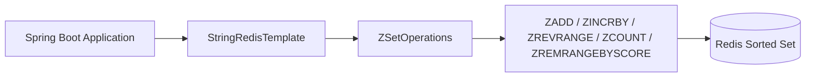
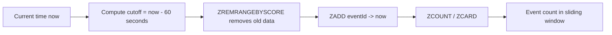
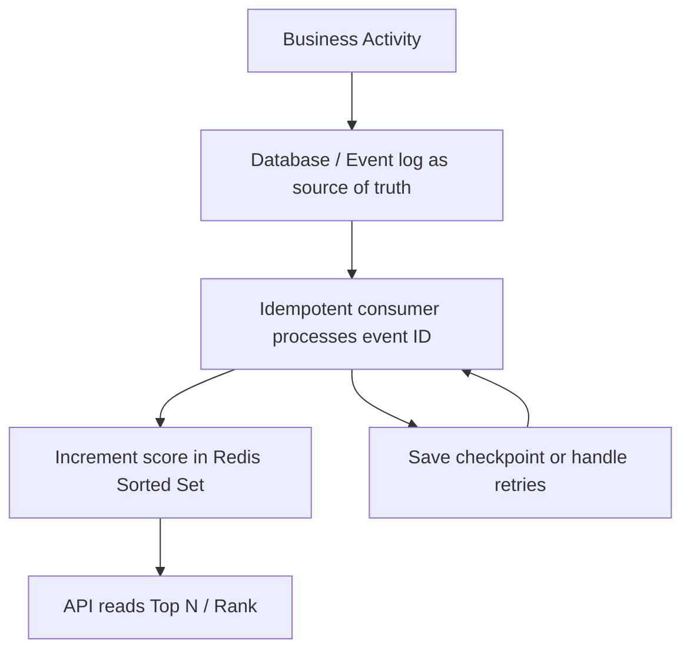

# Building Leaderboards and Time-Based Data Windows

## 1. The Problem: Score-Based Ranking with Time Boundaries

Suppose a Spring Boot application includes a user leaderboard based on contribution points. Initial requirements:

- Whenever a user completes an activity, award points to that user.
- Display the **Top 10** highest-scoring users.
- View a user's **current position**.
- Provide **today**, **this week**, and **this month** leaderboards.
- Prevent last week's scores from affecting this week's leaderboard.

Redis provides the **Sorted Set (ZSet)** data type, which is well suited for holding unique members and sorting them by score. In Spring Data Redis, `ZSetOperations<K,V>` exposes operations such as `add`, `incrementScore`, `reverseRangeWithScores`, and `reverseRank`.

However, another time-related requirement often arises alongside that:

> “Tell me how many actions a user performed in the **last 60 seconds**.”

This is a **sliding window** problem. It can also use a Sorted Set, except the role of `score` changes: instead of ranking points, the score represents an **event timestamp**; each member represents **one unique event**. Both designs share the same Redis data structure yet differ in key naming, member identity, score meaning, and how old data is pruned.

**Lesson goal:** build leaderboards and time-based data windows using Spring Data Redis, understanding when to choose fixed windows vs. sliding windows, atomicity, TTLs, precision, and operational limits.

## 2. Redis Sorted Sets and ZSetOperations

A Redis Sorted Set holds pairs of:

```text
member -> score (double)
```

Example:

```text
Key: leaderboard:daily:v1:2026-11-12
Type: zset

member      score
-----------------
user-42     180
user-17     240
user-91     120
```

Key characteristics:

1. **Every member is unique** within a Sorted Set. Re-adding the same member with `ZADD` updates its score instead of creating two entries.
2. **Scores are double-precision floating-point numbers** in Redis. Members are ordered by score; when scores tie, Redis applies a member ordering rule.
3. You can fetch slices **from lowest to highest** or **from highest to lowest** without pulling the entire Set into Java to sort.
4. You can look up **ranks**, **count within a score range**, **increment scores**, or **delete elements by score range**.
5. A Sorted Set is **one Redis key**. Redis Cluster distributes keys by hash slot; members within a single key are never split across multiple nodes.



With `StringRedisTemplate`, keys and members are strings. Scores use `double` in both Java and Redis:

```java
import org.springframework.data.redis.core.StringRedisTemplate;
import org.springframework.data.redis.core.ZSetOperations;

ZSetOperations<String, String> zset = redis.opsForZSet();
```

### Key APIs Used

| Requirement | Corresponding Redis command | Spring Data Redis API |
|---|---|---|
| Add/update a member's score | `ZADD` | `add(key, member, score)` |
| Increment current score | `ZINCRBY` | `incrementScore(key, member, delta)` |
| Get a member's score | `ZSCORE` | `score(key, member)` |
| Get rank from lowest to highest | `ZRANK` | `rank(key, member)` |
| Get rank from highest to lowest | `ZREVRANK` | `reverseRank(key, member)` |
| Top N from highest to lowest | `ZREVRANGE ... WITHSCORES` | `reverseRangeWithScores(key, start, end)` |
| Count elements in a score range | `ZCOUNT` | `count(key, min, max)` |
| Get elements with scores in range | `ZRANGEBYSCORE` or equivalent variant | `rangeByScore(key, min, max)` |
| Remove elements with scores in range | `ZREMRANGEBYSCORE` | `removeRangeByScore(key, min, max)` |
| Count total members | `ZCARD` | `size(key)` |
| Remove a known member | `ZREM` | `remove(key, member)` |

Underlying wire command names may differ when Spring Data Redis targets newer Redis variants, yet the API semantics in the table remain the foundation for design. The examples below use Spring Data Redis's **synchronous API**; WebFlux has separate reactive APIs.

## 3. Ranks Are 0-Based, Not Display Positions

Redis CLI example:

```bash
redis-cli ZADD demo:leaderboard:v1 120 user-91 240 user-17 180 user-42
redis-cli ZREVRANGE demo:leaderboard:v1 0 2 WITHSCORES
redis-cli ZREVRANK demo:leaderboard:v1 user-42
redis-cli ZSCORE demo:leaderboard:v1 user-42
```

When sorted by descending score, the order is:

```text
index 0: user-17 -> 240 points
index 1: user-42 -> 180 points
index 2: user-91 -> 120 points
```

`ZREVRANK` or `reverseRank` returns a **0-based index**: `user-42` has rank `1` in Redis, whereas the UI typically displays **rank 2**. Therefore:

```java
Long zeroBased = zset.reverseRank(key, "user-42");
Long displayRank = zeroBased == null ? null : zeroBased + 1;
```

If the member does not exist in the key or the key has expired, `reverseRank` can return `null`. Never coerce `null` to 0 and mistakenly display rank 1.

### 3.1. Tied Scores

Two members with the same score remain two distinct members. Redis uses **member lexicographical order** to break ties when scores match; reverse queries also reverse the tie-breaking order.

Example:

```text
user-42 -> 100
user-91 -> 100
```

`reverseRank` still returns **two separate positions**, rather than applying sports-style “shared 1st place for equal scores”. If product rules require **tied ranks**, the application must define its own rule:

- **Dense rank**: 100 points → rank 1 for both; 90 points → rank 2.
- **Competition rank**: two people at 100 points share rank 1; 90 points gets rank 3.
- **Position rank**: each member has its own position in Redis's ordering.

Do not rely on `reverseRank` to infer score-based ties. When member counts are large, compute tied ranks using score-count commands or a separate projection instead of loading the entire board into the JVM.

## 4. A Simple Leaderboard with Spring Data Redis

Example service storing cumulative scores, reading Top N, and looking up rank:

```java
import java.util.ArrayList;
import java.util.List;
import java.util.Set;

import org.springframework.data.redis.core.StringRedisTemplate;
import org.springframework.data.redis.core.ZSetOperations;
import org.springframework.stereotype.Service;

@Service
public class GlobalLeaderboard {
    private static final String KEY = "leaderboard:all-time:v1";

    private final ZSetOperations<String, String> zset;

    public GlobalLeaderboard(StringRedisTemplate redis) {
        this.zset = redis.opsForZSet();
    }

    public Double addPoints(String userId, double points) {
        if (!Double.isFinite(points) || points <= 0) {
            throw new IllegalArgumentException(
                    "points must be a finite positive number");
        }
        return zset.incrementScore(KEY, userId, points);
    }

    public Long rankForDisplay(String userId) {
        Long zeroBased = zset.reverseRank(KEY, userId);
        return zeroBased == null ? null : zeroBased + 1;
    }

    public List<RankedUser> top(int limit) {
        if (limit < 1 || limit > 100) {
            throw new IllegalArgumentException("limit must be from 1 to 100");
        }

        Set<ZSetOperations.TypedTuple<String>> tuples =
                zset.reverseRangeWithScores(KEY, 0, limit - 1L);

        List<RankedUser> result = new ArrayList<>();
        if (tuples == null) {
            return result;
        }

        int position = 1;
        for (ZSetOperations.TypedTuple<String> tuple : tuples) {
            result.add(new RankedUser(
                    position++, tuple.getValue(), tuple.getScore()));
        }
        return result;
    }

    public record RankedUser(
            int position, String userId, Double score) {}
}
```

Here:

- `incrementScore` uses **single-command atomic score incrementing** in Redis, avoiding lost updates from `score` → Java calculation → `add`.
- `reverseRangeWithScores(KEY, 0, limit - 1)` fetches the highest-scoring members with scores instead of loading everything to sort in Java.
- `position` in the example is solely the **positional index** of the result, not dense/competition tie ranking.
- `TypedTuple` holds the member and score deserialized per template configuration.
- Reading Top N and reading a user's rank are **two independent operations**; if scores change in between, the two results can reflect different moments.

`ZSetOperations` is normally used via the `StringRedisTemplate` bean. You do not need to create a manual Redis connection per request.

## 5. One All-Time Leaderboard or One Board per Window?

No single Sorted Set layout fits every kind of time window. Before writing code, clarify what “time window” means.

| Type | Example | Window bounds | Recommended storage |
|---|---|---|---|
| **All-time** | Total points since launch | No end point | One cumulative ZSet |
| **Fixed daily window** | Leaderboard for Nov 12 | 00:00 to 00:00 next day in chosen timezone | Separate ZSet per day |
| **Fixed weekly window** | ISO week starting Monday | Monday 00:00 to next Monday | Separate ZSet per week |
| **Fixed monthly window** | November | Start of month to start of next month | Separate ZSet per month |
| **Sliding/rolling window** | Last 60 seconds or last 24 hours | Continuously slides with evaluation time | Event-timestamp ZSet plus old-event pruning |
| **Bucketed rolling approximation** | Total points over last 7 days, by day | Combine multiple time buckets | Multiple daily ZSets plus aggregation mechanism |

A **fixed window** has crisp calendar boundaries. A **sliding window** advances every second/millisecond as time moves forward. A leaderboard for “the last 7 calendar days” is not identical to “exactly 7 × 24 hours before the current instant”.

For example, at 15:00 on Nov 12, a rolling 24-hour window starts at 15:00 on Nov 11; “today's” leaderboard started at 00:00 on Nov 12. If you only store per-day totals, you cannot reconstruct arbitrary 24-hour rolling windows without finer-grained event data.

## 6. Key Design for Daily and Weekly Leaderboards

An easy-to-operate convention:

```text
leaderboard:<domain>:daily:v1:<yyyy-MM-dd>
leaderboard:<domain>:weekly:v1:<ISO-week-year>-W<week-number>
leaderboard:<domain>:monthly:v1:<yyyy-MM>
leaderboard:<domain>:all-time:v1
```

Examples:

```text
leaderboard:activity:daily:v1:2026-11-12
leaderboard:activity:weekly:v1:2026-W46
leaderboard:activity:monthly:v1:2026-11
leaderboard:activity:all-time:v1
```

Each key is **one Redis Sorted Set**, where:

- **member** = stable `userId`, e.g., `user-42`.
- **score** = user's accumulated points **within the time period represented by the key**.
- Each activity increments the user's score in the exact boards required by business logic.
- Moving to a new day/week means **writing to a new key**, without resetting all of Redis or deleting keys currently being read by other users.

### 6.1. Timezone and ISO Weeks

Time boundaries must be defined explicitly. For instance, a campaign targeting the Vietnam market chooses `Asia/Ho_Chi_Minh` for daily boundaries. If a backend runs in UTC and takes dates from the OS timezone, two instances in different regions could write **two different keys for the same activity**.

For ISO standard weeks:

- Weeks begin on **Monday**.
- Each week has a week number following ISO rules.
- **ISO week-based year** can differ from **calendar year** around New Year's Day. Never mix calendar year with ISO week number arbitrarily.

Java example building keys by timezone and ISO week:

```java
import java.time.Clock;
import java.time.LocalDate;
import java.time.ZoneId;
import java.time.temporal.TemporalAdjusters;
import java.time.DayOfWeek;
import java.time.temporal.WeekFields;

public final class LeaderboardKeys {
    private static final ZoneId BUSINESS_ZONE =
            ZoneId.of("Asia/Ho_Chi_Minh");

    private LeaderboardKeys() {}

    public static String daily(Clock clock) {
        LocalDate date = LocalDate.now(clock.withZone(BUSINESS_ZONE));
        return "leaderboard:activity:daily:v1:" + date;
    }

    public static String weekly(Clock clock) {
        LocalDate date = LocalDate.now(clock.withZone(BUSINESS_ZONE));
        LocalDate monday = date.with(
                TemporalAdjusters.previousOrSame(DayOfWeek.MONDAY));
        WeekFields iso = WeekFields.ISO;

        int year = monday.get(iso.weekBasedYear());
        int week = monday.get(iso.weekOfWeekBasedYear());
        return String.format(
                java.util.Locale.ROOT,
                "leaderboard:activity:weekly:v1:%04d-W%02d",
                year, week);
    }
}
```

Injecting `Clock` lets unit tests control time deterministically. An application bean can provide:

```java
@Configuration
class ClockConfiguration {
    @Bean
    Clock clock() {
        return Clock.systemUTC();
    }
}
```

`Clock.systemUTC()` supplies the instant, while `withZone(BUSINESS_ZONE)` during key calculation defines **how dates/weeks are interpreted**, without requiring the server OS timezone to be Vietnam.

## 7. Incrementing Scores in a Fixed Window

A daily leaderboard uses a separate key per day; each activity increments the actor's score.

```java
import java.time.Clock;
import java.time.Duration;
import java.time.LocalDate;
import java.time.ZoneId;
import java.time.ZonedDateTime;
import java.util.Date;

import org.springframework.data.redis.core.StringRedisTemplate;
import org.springframework.data.redis.core.ZSetOperations;
import org.springframework.stereotype.Service;

@Service
public class DailyLeaderboard {
    private static final ZoneId ZONE =
            ZoneId.of("Asia/Ho_Chi_Minh");

    private final StringRedisTemplate redis;
    private final Clock clock;
    private final ZSetOperations<String, String> zset;

    public DailyLeaderboard(StringRedisTemplate redis, Clock clock) {
        this.redis = redis;
        this.clock = clock;
        this.zset = redis.opsForZSet();
    }

    public Double addPoints(String userId, long delta) {
        if (delta <= 0) {
            throw new IllegalArgumentException("delta must be positive");
        }

        LocalDate day = LocalDate.now(clock.withZone(ZONE));
        String key = "leaderboard:activity:daily:v1:" + day;

        Double score = zset.incrementScore(key, userId, delta);

        // Daily data is kept for 2 extra days after the day ends.
        ZonedDateTime nextDay = day.plusDays(1).atStartOfDay(ZONE);
        Date expireAt = Date.from(
                nextDay.toInstant().plus(Duration.ofDays(2)));
        redis.expireAt(key, expireAt);

        return score;
    }
}
```

This highlights two distinct effects:

1. `incrementScore` **atomically increments the member's score**, even when multiple instances concurrently award points to the same user.
2. `expireAt` sets an expiration **on the whole Sorted Set key**, cleaning up old daily boards once they are no longer needed.

**These two calls do not form an atomic Redis transaction.** If the process crashes after incrementing the score and before setting the TTL, the key can remain without a TTL. If TTL is a strict invariant, combine the operations appropriately—for example, with a Redis Lua script (covered later), or a periodic job that detects and fixes missing TTLs.

The TTL is **anchored to the end of the window plus grace retention**, not “24 hours from the last activity”. Calling `expire(key, Duration.ofDays(3))` on every write could keep an old daily board alive longer whenever late events arrive, making cleanup unpredictable.

### 7.1. Choosing the Date by Processing Time vs. Event Time

Suppose an activity occurred at 23:59, yet the request reaches the server at 00:01 the next day:

- Using **processing time**, points are credited to the next day.
- Using **event time** (when the action actually happened), points are credited to the previous day.

Both approaches can be valid, provided the rule is explicit. With event time, read the timestamp from a trusted event, convert to the business timezone to compute the key, and handle late-arriving events, duplicates, and future timestamps. Never trust arbitrary client-supplied timestamps when they affect rewards or prizes.

## 8. Reading Top N by Day, Week, and Month

Once you have the window's key, querying ranks works just like an all-time board:

```java
String key = "leaderboard:activity:daily:v1:2026-11-12";

Set<ZSetOperations.TypedTuple<String>> topTen =
        redis.opsForZSet().reverseRangeWithScores(key, 0, 9);

Long zeroBasedRank = redis.opsForZSet()
        .reverseRank(key, "user-42");

Double currentScore = redis.opsForZSet()
        .score(key, "user-42");
```

With `reverseRangeWithScores`, each tuple exposes `getValue()` (user ID) and `getScore()`. When no data exists, Top-N queries return an empty collection; for non-existent members, score/rank can be `null`.

Distinguish clearly:

- **Top of a specific window**: read a known daily/weekly/monthly key.
- **Current top**: derive the key from the clock at request time; crossing midnight switches keys automatically.
- **Historical top**: read the key of a completed window if it still exists; TTL must cover reporting needs.
- **Top over an arbitrary interval A to B**: may require aggregating multiple buckets rather than reading one daily key.

If long-term historical leaderboards must be kept, Redis can act solely as a fast query layer; store snapshots or raw events in durable storage. Redis replication/AOF/RDB and eviction policies govern data-loss risk; do not casually treat Redis as the sole historical archive.

## 9. Sliding Windows: Score Is Timestamp, Member Is Event ID

Second problem: limit each user to at most 5 requests in the **last 60 seconds**. A sliding window needs to know which requests occurred between `now - 60s` and `now`.

Design one Sorted Set per subject:

```text
Key: requests:window:v1:user-42
Type: zset

member                  score (epoch milliseconds)
---------------------------------------------------
req-8f01                1794488400123
req-8f02                1794488402781
req-8f03                1794488404530
```

In this design:

- **Key** identifies the user/rate-limit subject being tracked.
- **Member** is a **unique event/request ID**. If you used `userId` as the member, each `ZADD` would overwrite the old score and **could never count multiple requests**.
- **Score** is the event timestamp, typically Unix epoch milliseconds.
- **The active window** is a **score interval**.
- Expired members are pruned with `ZREMRANGEBYSCORE`; remaining members can be counted with `ZCOUNT` or `ZCARD` once pruned properly.



**Never mix both score roles inside one key.** A Sorted Set whose score represents **user points** cannot simultaneously act as a Sorted Set whose score represents **event timestamps** without corrupting both meanings. Use separate namespaces/keys for leaderboards and event windows.

### 9.1. Core Redis Commands

Example using a demo key:

```bash
# Timestamps are illustrative only.
redis-cli ZADD demo:requests:window:v1 \
  10000 req-a 12000 req-b 15000 req-c

# Count events with timestamps from 11000 to 15000 (inclusive).
redis-cli ZCOUNT demo:requests:window:v1 11000 15000

# Remove events <= 11000.
redis-cli ZREMRANGEBYSCORE demo:requests:window:v1 -inf 11000

# Inspect remaining events.
redis-cli ZRANGE demo:requests:window:v1 0 -1 WITHSCORES
```

`ZCOUNT` and `ZREMRANGEBYSCORE` operate on scores, not member names. With integer millisecond timestamps, define boundary semantics:

- If the window is **`(now - duration, now]`**, remove events with score **≤ cutoff**, keeping events strictly after cutoff.
- If the window is **`[now - duration, now]`**, remove events with score **< cutoff**.

Redis supports open/closed score bounds at the command level; Spring Data Redis exposes `double` overloads whose bounds are inclusive by default. With integer epoch milliseconds under a strict integer contract, “less than cutoff” can be expressed via `cutoff - 1` when scores are guaranteed integer milliseconds.

### 9.2. Why Do Millisecond Timestamps Work as Scores?

Redis uses IEEE-754 double for scores; integers with magnitude **at most 2^53** are represented exactly. Epoch milliseconds for realistic application dates sit well below this limit, so they work accurately as integer millisecond scores.

Do not extend that assumption to **nanosecond** timestamps or packing extra high-bit IDs into the score. Overly large numbers get rounded, causing distinct events to collapse onto indistinguishable scores.

The ordering of events sharing the same timestamp still follows member order, not API call order. If strict sequence ordering is needed, establish a separate sequence generator.

## 10. Reading Event Counts in a Window with Spring Data Redis

Example service tracking requests in the last 60 seconds. This is **event counting**, not an atomic rate limiter:

```java
import java.time.Clock;
import java.time.Duration;
import java.util.UUID;

import org.springframework.data.redis.core.StringRedisTemplate;
import org.springframework.data.redis.core.ZSetOperations;
import org.springframework.stereotype.Service;

@Service
public class RecentRequestCounter {
    private static final Duration WINDOW = Duration.ofSeconds(60);

    private final StringRedisTemplate redis;
    private final ZSetOperations<String, String> zset;
    private final Clock clock;

    public RecentRequestCounter(StringRedisTemplate redis, Clock clock) {
        this.redis = redis;
        this.zset = redis.opsForZSet();
        this.clock = clock;
    }

    public Long recordAndCount(String subjectId) {
        String key = "requests:window:v1:" + subjectId;
        long now = clock.millis();
        long cutoff = now - WINDOW.toMillis();

        // Each genuinely distinct request must have its own event ID.
        String eventId = UUID.randomUUID().toString();

        // These commands are independent; suitable only for best-effort metrics.
        zset.removeRangeByScore(key, Double.NEGATIVE_INFINITY, cutoff);
        zset.add(key, eventId, (double) now);
        Long count = zset.count(key, cutoff + 1.0, (double) now);
        redis.expire(key, WINDOW.plusSeconds(30));

        return count;
    }
}
```

Limitations illustrated here:

- `removeRangeByScore` deletes events with score **≤ cutoff**; `count(key, cutoff + 1, now)` counts the **`(cutoff, now]`** window assuming integer millisecond scores.
- `UUID.randomUUID()` creates a fresh member on every call; if retrying the same request must count as **the same event**, use a **stable request/event ID** provided by the business layer rather than generating a new UUID per retry.
- `expire` sets a TTL on the **entire key**, cleaning up keys for inactive subjects after a period. The TTL refreshes whenever a new event arrives.
- Pruning, adding, counting, and setting TTL are **separate Redis calls**; other clients can interleave between them.
- The returned count can reflect concurrent changes and should not be used to enforce strict rate limits, paid quotas, or billing.

Another key point: instances should use a synchronized, reliable time source. If instance A's clock runs a few seconds ahead of B's, they can insert future-dated scores or prune events prematurely. For strict rate limiters, consider using Redis server time inside an appropriate script or enforcing clock synchronization and acceptable drift policies.

## 11. Sliding Window Rate Limiters Must Be Atomic

Suppose the limit is **5 requests / 60 seconds**. If Java code runs:

```java
Long count = zset.count(key, cutoff, now);
if (count != null && count < 5) {
    zset.add(key, eventId, now);
    return true;
}
return false;
```

then two concurrent requests can **both read count = 4**, both pass the check, and both insert events, bringing the total to 6. Moving the code into `SessionCallback` without an appropriate transaction/condition **does not fix the race condition**.

One implementation approach uses a Redis **Lua script** to check and update within one execution step:

```lua
-- KEYS[1] = subject key
-- ARGV[1] = nowMs (trusted clock)
-- ARGV[2] = windowMs, e.g., 60000
-- ARGV[3] = limit, e.g., 5
-- ARGV[4] = stable eventId across retries
-- ARGV[5] = ttlSeconds, e.g., 90

local key = KEYS[1]
local now = tonumber(ARGV[1])
local window = tonumber(ARGV[2])
local limit = tonumber(ARGV[3])
local eventId = ARGV[4]
local ttl = tonumber(ARGV[5])
local cutoff = now - window

-- Keep events with score > cutoff.
redis.call('ZREMRANGEBYSCORE', key, '-inf', cutoff)

-- Retry of an event still in the window: do not double-count.
if redis.call('ZSCORE', key, eventId) then
    return 1
end

local current = redis.call('ZCARD', key)
if current >= limit then
    return 0
end

redis.call('ZADD', key, now, eventId)
redis.call('EXPIRE', key, ttl)
return 1
```

When executed on a Redis primary, Redis commands inside the script run as a single unit uninterrupted by other clients. Thus two requests cannot simultaneously read the same count and both insert past the limit, provided they target the same key and follow the same clock rules.

To invoke from Spring Data Redis, use `DefaultRedisScript<Long>`:

```java
import java.util.List;
import org.springframework.data.redis.core.script.DefaultRedisScript;

// LUA_SCRIPT content is loaded from a resource or managed string.
DefaultRedisScript<Long> script = new DefaultRedisScript<>();
script.setScriptText(LUA_SCRIPT);
script.setResultType(Long.class);

Long allowed = redis.execute(
        script,
        List.of("requests:window:v1:" + subjectId),
        Long.toString(nowMs),
        "60000",
        "5",
        requestId,
        "90");

boolean accepted = Long.valueOf(1L).equals(allowed);
```

Here `LUA_SCRIPT` is the Lua script shown above, loaded from an application resource or managed constant. Never construct scripts dynamically from untrusted input. Manage scripts as versioned source artifacts with a clear deployment mechanism.

### What the Script Still Does Not Solve Completely

1. **Clocks:** the example receives `nowMs` from the caller. If instances have clock skew, window evaluation becomes inconsistent; enforce clock sync or use a server-time strategy.
2. **Retries after the event leaves the window:** that event ID is no longer in the Set; the script holds no permanent history to recognize it. If idempotency must outlast the window, use another operation-ID store with appropriate retention.
3. **Lost responses:** Redis may have accepted the request before a network timeout; the caller cannot assume the command never ran. Retrying with the same ID curbs double counting **while the event remains in the window**, but does not replace durable business state tracking.
4. **Future-dated data:** `ZCARD` counts all remaining members; if an event has a future timestamp due to clock skew, it can tighten the limit unexpectedly. Standardize timestamp sources and outlier handling.
5. **Key type:** the script assumes the key is a Sorted Set; if the key holds another type, commands fail with `WRONGTYPE`.
6. **Durability:** script atomicity does not turn a single Redis instance into an unconditionally durable transactional database across all crashes and failovers.

When a script encounters a runtime error after performing some writes, Redis **does not provide RDBMS-style rollback for partially executed scripts**. Validate inputs/types beforehand and keep scripts short and clear.

## 12. How Does a Sliding-Window Leaderboard Differ from a Rate Limiter?

The rate limiter above counts **events per subject**: key by user, member by event, score by timestamp. Yet if the requirement is “Top 10 users with the most points in the exact last 24 hours”, the problem is harder:

- Each event has both a timestamp and **contributed points**, not just a count of one.
- Points must be aggregated **per user** across the sliding window.
- When an event exits the window, **its contributed points must be subtracted** from the user's total.
- Simultaneously, you need a Sorted Set of user scores for fast Top-N reads.

Storing only:

```text
leaderboard:rolling24h:
  user-42 -> 120 points
```

gives no way to know how many of those 120 points came from events over 24 hours ago. An accumulated leaderboard Sorted Set **lacks the history needed to expire old contributions on its own**.

Several design options exist:

| Option | Idea | Accuracy / cost |
|---|---|---|
| **Fixed daily ZSets** | Keep one scoreboard per day | Simple, exact per day; not a rolling 24h window |
| **Aggregate multiple daily buckets** | Merge 7 or N daily boards | Bucket-approximate window; day-level boundaries |
| **Minute/hour buckets** | One ZSet per minute/hour, aggregate active buckets | Finer resolution, yet many keys and aggregation cost |
| **Event log + materialized rolling scores** | Store events with timestamp/points; on expiry subtract contribution from leaderboard | Can be more accurate, but requires consistent workflows and idempotency |
| **Query a timestamp-indexed datastore** | Sum directly over source event records | Good for flexible queries and auditing; higher query latency |

**Do not repurpose a leaderboard ZSet's member score as a timestamp and expect it to still rank by points.** Choose the representation matching the primary query: user scores or individual event times.

## 13. Aggregating Leaderboards Across Multiple Time Buckets

A pragmatic approach for “the last 7 calendar days” stores **one Sorted Set per day**, with user members and daily point scores, and then sums scores for each member across keys.

Example:

```text
leaderboard:activity:daily:v1:2026-11-10
  user-1 -> 10
  user-2 -> 20

leaderboard:activity:daily:v1:2026-11-11
  user-1 -> 25
  user-2 -> 5

leaderboard:activity:daily:v1:2026-11-12
  user-1 -> 15
  user-3 -> 40
```

Three-day sum:

```text
user-1 -> 50
user-2 -> 25
user-3 -> 40
```

Redis supports Sorted Set union commands like `ZUNION` or `ZUNIONSTORE` with sum aggregation:

```bash
redis-cli ZUNIONSTORE leaderboard:activity:rolling3days:v1:2026-11-12 3 \
  leaderboard:activity:daily:v1:2026-11-10 \
  leaderboard:activity:daily:v1:2026-11-11 \
  leaderboard:activity:daily:v1:2026-11-12 \
  AGGREGATE SUM

redis-cli ZREVRANGE \
  leaderboard:activity:rolling3days:v1:2026-11-12 \
  0 9 WITHSCORES
```

`ZUNIONSTORE` creates/updates a **destination Sorted Set**; you can give the destination a short TTL if it is merely a temporary aggregate cache. If multiple requests concurrently recompute/read the destination, use an appropriate refresh/versioning mechanism so users do not read stale or partial results during updates.

### Limitations of Bucket Aggregation

- If buckets are **days**, summing three keys represents three **calendar days**, not an exact 72 hours up to the current minute.
- Today's scores can change during queries or right after aggregation is stored. The destination is a **snapshot at command execution time** and can go stale immediately.
- Merging several large ZSets consumes notable CPU and memory; do not rebuild a million-member union on every request.
- On Redis Cluster, multi-key operations typically require **participating keys to share the same hash slot**; hash tags can align slots yet create hotspots if too many large boards share one slot.
- If the destination is a cache, apply a TTL, limit concurrent rebuilds, or precompute on a schedule rather than letting clients stampede to rebuild huge unions.

Under high read volume, you can maintain **separate weekly/monthly boards** and update them alongside daily boards when events arrive instead of continuously merging daily keys. In return, you must ensure events are applied consistently across all boards.

## 14. Writing to Multiple Windows and Consistency

A single event may need to increment:

```text
All-time leaderboard: +10
Daily leaderboard:    +10
Weekly leaderboard:   +10
Monthly leaderboard:  +10
```

Running four sequential `incrementScore` calls from Java:

```java
zset.incrementScore(allTimeKey, userId, 10);
zset.incrementScore(dailyKey, userId, 10);
zset.incrementScore(weeklyKey, userId, 10);
zset.incrementScore(monthlyKey, userId, 10);
```

risks **partial writes** if a network error occurs mid-way. Uncontrolled retries can double-count keys that already succeeded.

Options depending on required guarantees:

1. **Accept eventual consistency:** persist events to an authoritative event store, and update leaderboards via idempotent consumers capable of replay/backfill.
2. **Use a Lua script or Redis transaction** for updates allowed on the same Redis node/slot; track an operation ID to prevent retry duplication.
3. **Use batching/pipelining** when throughput matters and cross-command atomicity is not required; pipelining is **not a transaction**.
4. **Recompute secondary boards periodically** from the source of truth when integrity outweighs instant update latency.

**There is no automatic distributed ACID transaction across Redis and PostgreSQL** simply because a service method is annotated `@Transactional`. When points tie to payments, rewards, or entitlements, keep the business source of truth in an auditable system with appropriate guarantees, using Redis as a ranking projection.

### Idempotency for Point-Awarding Events

`ZINCRBY` is atomic **for one increment command**, yet processing the same event twice increments the score twice. For event `evt-123` worth 10 points:

```text
1st processing of evt-123 -> +10
Retry of evt-123          -> +10 again if unchecked
```

One design records processed `eventId` entries and only increments when unseen, within an appropriate atomic boundary. When multiple keys are involved, Redis Cluster requires respecting hash-slot limits; if Redis is purely a projection, idempotency can also live in the event consumer or authoritative database.

Never generate a fresh UUID on every retry as the event ID for the same action, because deduplication cannot recognize retries as belonging to the same event.

## 15. Guaranteeing TTL for a Fixed Window with Lua

If you need to **increment a score and set its expiration in a single Redis operation**, use a script:

```lua
-- KEYS[1] = leaderboard key for a fixed window
-- ARGV[1] = member/user ID
-- ARGV[2] = positive delta
-- ARGV[3] = expiration timestamp in Unix seconds

redis.call('ZINCRBY', KEYS[1], ARGV[2], ARGV[1])
redis.call('EXPIREAT', KEYS[1], ARGV[3])
return 1
```

In Java:

```java
import java.time.Instant;
import java.util.List;
import org.springframework.data.redis.core.script.DefaultRedisScript;

DefaultRedisScript<Long> incrementWithExpiry =
        new DefaultRedisScript<>();
incrementWithExpiry.setScriptText(INCREMENT_WITH_EXPIRY_LUA);
incrementWithExpiry.setResultType(Long.class);

Long applied = redis.execute(
        incrementWithExpiry,
        List.of(windowKey),
        userId,
        Long.toString(points),
        Long.toString(expireAt.getEpochSecond()));
```

Here `INCREMENT_WITH_EXPIRY_LUA` holds the Lua script above loaded via a resource or configuration mechanism. The example focuses on passing keys and arguments rather than implying such a constant exists automatically in Spring.

Because both incrementing and setting expiration run in one single-key script, no other request can interleave **between the two commands**. However:

- The script does not provide **duplicate-event protection** on its own.
- If `expireAt` is already in the past, `EXPIREAT` can delete the key immediately. **Verify the window is still open** before writing late events.
- If the Redis key has the wrong type, the script errors.
- Redis does not roll back earlier commands in a script if a later runtime error occurs; validate inputs and keep logic simple.
- On a network timeout after execution, the caller may not know whether points were added; idempotency design is still required.

When running on Redis Cluster and touching **only one key**, this script needs no multi-key slot alignment. For scripts updating multiple daily/weekly/monthly keys together, keys must share a slot where Redis Cluster requires it.

## 16. Time, Scores, and Precision Issues

### 16.1. Scores in Redis Are Double

Sorted Set scores are double-precision floating-point values. Adding integer points:

```java
zset.incrementScore(key, "user-42", 1.0);
```

is exact within double's exact integer range, yet for massive point totals or decimal additions, consider floating-point rounding error.

- For integer points, bound values and enforce clear business rules.
- For money, **do not use double scores as a transaction ledger**; store smallest integer units in the authoritative datastore and project points appropriately.
- Never pass `Double.NaN` or infinite values as scores; validate inputs.
- When scores combine multiple sources, standardize add/subtract conventions instead of letting one service use integer points and another use an undocumented multiplier.

### 16.2. Window Timing Considerations

| Issue | Risk | Mitigation |
|---|---|---|
| Different timezones across instances | Same event goes into two different daily keys | Use a fixed business `ZoneId` |
| Daylight Saving Time (DST) in some regions | “One day” is not always 24 hours | Compute bounds with `ZonedDateTime`, do not blindly add 24 hours |
| Week-based year | Wrong key around year boundaries | Use `WeekFields.ISO`, do not mix calendar year arbitrarily |
| Clock skew | Events carry future/past timestamps | Sync clocks or use server time per design |
| Late-arriving events | Writes into closed windows | Define allowed lateness and bucket-closing policy |
| Event retries | Double counting/scoring | Stable event IDs and idempotency |
| Nanosecond timestamps as scores | Precision loss beyond double limits | Use epoch milliseconds or an appropriate representation |
| TTL anchored to last write | Old boards stay alive unexpectedly | Anchor expiry to window end + grace period |

### 16.3. Key TTL Does Not Expire Individual Members

In a Redis Sorted Set, `EXPIRE key 3600` applies to the **entire key**. It does not delete members whose timestamp scores are over 60 seconds old while the key remains alive.

Therefore, sliding windows must **actively prune old events by score**, using `removeRangeByScore` or another cleanup mechanism. A key-level TTL remains helpful to reclaim memory for inactive subjects.

Conversely, fixed-window leaderboards rely primarily on **key-level TTLs**: expiring old daily/weekly/monthly boards once retained long enough. Distinguish these two TTL roles clearly in your design.

## 17. Performance and Memory Considerations

Sorted Sets rank and query by score far more efficiently than loading everything and sorting in Java, yet they are **not free**.

### 17.1. Per-User Leaderboards

If a leaderboard holds 10 million users, Redis stores all members, scores, and internal structural overhead. Top 10 reads stay fast, but:

- Huge keys consume substantial RAM and concentrate load on one Redis node.
- Even a single large hot key can create a hotspot in Redis Cluster.
- Long member values inflate memory; avoid embedding large JSON payloads, emails, or tokens as members.
- Every score increment updates the member's position.
- If only Top N matters, consider a **bounded leaderboard** or separate projection, bearing in mind that trimming drops rank lookup for users outside the retained set.

Never optimize by running `ZREVRANGE key 0 -1` and sorting in Java per request. Use bounded ranges like `reverseRangeWithScores(key, 0, 9)`.

### 17.2. Per-Event Sliding Windows

Keeping **one member per request for 60 seconds** means a subject sending 10,000 requests/second generates roughly 600,000 members in one window. That carries substantial memory, network, and cleanup cost.

Ways to reduce cost depending on requirements:

- Cap retained events via rate-limiting policies.
- Use **per-second/per-minute buckets** and counters if boundary approximation is acceptable.
- Use fixed-window counters when an exact sliding window is unnecessary.
- Choose token bucket / leaky bucket algorithms or a dedicated rate-limiting tool when throughput is paramount.
- Ensure out-of-window members are pruned and set TTLs on inactive keys.

Do not adopt event-level Sorted Sets merely because “ZSet seems convenient” when the real requirement is a daily total counter.

### 17.3. Complexity and Load

ZSet operations scale favorably with set size and returned/removed item counts. However, `removeRangeByScore` can delete many members in one shot; the more elements removed, the higher the execution cost. A key left unpruned for long periods can spike latency when a subsequent request cleans out huge backlogs.

Monitor p95/p99 latency, Redis CPU, RAM usage, network I/O, members per key, and command durations. If an API requires low latency, keep heavy cleanup off the synchronous request path.

## 18. Race Conditions Beyond incrementScore

`incrementScore` handles one increment atomically, yet a workflow usually spans more steps:

```text
1. Check if event was already processed?
2. Compute daily/weekly bucket.
3. Increment daily points.
4. Increment weekly points.
5. Set TTL.
6. Send rank notification.
```

These six steps **do not automatically form a transaction** because each step is a separate Java/Redis call or external system interaction. `SessionCallback` shares one connection across commands, `MULTI/EXEC` coordinates Redis transactions within Redis limits, Lua scripts group server-side atomic steps, and pipelining batches round trips. None of them creates a distributed transaction across Redis and email/HTTP/databases.

A resilient architecture when points matter to the business:



When Redis experiences an outage, consumers can replay from the source of truth. After partial failures, reconciliation rebuilds the leaderboard rather than losing points permanently. Redis still needs persistence/replication configured to match availability targets.

## 19. Redis Cluster and Sorted Sets

Each daily leaderboard is one Redis key, so in Redis Cluster all members of that key live in **one hash slot**. Consequences:

- Single-key `ZADD`, `ZINCRBY`, and `ZREVRANK` route cleanly to that key's slot.
- Multi-key Sorted Set unions/aggregations can require all keys to sit in the same slot. When using `ZUNIONSTORE`, check Redis Cluster constraints and client routing.
- Hash tags like `leaderboard:{activity}:daily:v1:2026-11-12` and `leaderboard:{activity}:daily:v1:2026-11-11` align keys into one slot for multi-key commands, yet also concentrate all activity boards on one shard, risking hotspots.
- With many large leaderboards, rather than forcing all keys into one slot, consider aggregating in the application/batch layer or a datastore built for distributed aggregation.

**Key pattern design balances multi-key atomicity/aggregation against load distribution.** No single hash-tag pattern is optimal for every workload.

## 20. Common Pitfalls and How to Spot Them

| Symptom | Common cause | Resolution |
|---|---|---|
| Top N shows ranks starting at 0 | Redis ranks are zero-based | Add 1 for display; keep conventions consistent |
| Two tied users have different ranks | Redis still orders tied members | Decide between position rank and shared rank |
| Users lose points after midnight | Application is reading the new daily key | Distinguish daily, weekly, and all-time boards |
| Same activity awarded points twice | `ZINCRBY` retried on the same event | Use event IDs and idempotency |
| Old daily boards never expire | TTL anchored to last write or never set | Anchor expiry to window end + grace; prune periodically |
| 60-second window miscounts under concurrency | Non-atomic `ZCOUNT` then `ZADD` | Use Redis script / atomic command |
| Every request overwrites previous events | Used userId as member with timestamp score | Member must be a unique event ID |
| Rolling leaderboard does not drop old points | Stored only cumulative user score without contribution history | Use buckets or event log / materialized view |
| Very large scores are off by one | Double precision limits | Enforce score bounds and representation rules |
| Wrong week key around New Year | Paired calendar year with ISO week number | Use ISO week-based year |
| Leaderboard key raises `WRONGTYPE` | Namespace collision with String/Hash | Use clear key prefixes/types |
| Multi-key script errors on Cluster | Keys map to different slots | Align slots or adjust aggregation mechanism |
| Top N shows stale data after score change | Cached Top N result not invalidated | Choose projection TTL/refresh/invalidation policy |
| TTL expired yet members still appear? | Reading another key, replica lag, or timing mismatch | Verify endpoint, key, timing, and consistency model |

## 21. Hands-On Exercise: Building a Daily Leaderboard and a 60-Second Window

### Part A — Daily Leaderboard

Create a demo key:

```bash
redis-cli ZADD demo:leaderboard:daily:v1:2026-11-12 \
  40 alice 70 bob 20 carol

redis-cli ZINCRBY demo:leaderboard:daily:v1:2026-11-12 50 alice
redis-cli ZREVRANGE demo:leaderboard:daily:v1:2026-11-12 \
  0 2 WITHSCORES
redis-cli ZREVRANK demo:leaderboard:daily:v1:2026-11-12 alice
redis-cli ZSCORE demo:leaderboard:daily:v1:2026-11-12 alice
```

Logical output: `alice` has 90 points, `bob` 70, `carol` 20; Alice's Redis rank is 0 (display rank 1). The goal is to verify that `ZINCRBY` **adds to the current score**, whereas `ZADD` on an existing member **sets a new score**.

### Part B — Fixed Window

Suppose the next day starts a new key:

```bash
redis-cli ZADD demo:leaderboard:daily:v1:2026-11-13 \
  15 alice 50 carol
```

Nov 13's board carries no scores from Nov 12. To get a two-day total, aggregate them or write to a separate weekly/all-time key. Inspect `TTL` after setting `EXPIREAT` on demo keys (pick a future expiration timestamp; never run cleanup commands on production keys).

### Part C — Sliding Window

Create three events with simulated timestamps:

```bash
redis-cli ZADD demo:sliding-window:v1:user-42 \
  100000 evt-1 115000 evt-2 150000 evt-3

# If now = 160000, window = 60000,
# the active interval is (100000, 160000].
redis-cli ZREMRANGEBYSCORE \
  demo:sliding-window:v1:user-42 -inf 100000

redis-cli ZCOUNT \
  demo:sliding-window:v1:user-42 100001 160000
```

After pruning, two events—`evt-2` and `evt-3`—remain in the window under the chosen rule.

### Part D — Testing Concurrency

Suppose the limit is 5 and the Set holds 4 events. Have two concurrent requests perform `count` followed by `add`. Both can observe 4 and write, exceeding the limit. Next, implement the script from section 11, test two concurrent requests for the same subject, and confirm accepted counts never exceed policy. The goal here is distinguishing **separate count/write commands** from **atomic check-and-write**.

Never run demo commands against real application keys, because `ZREMRANGEBYSCORE` and `EXPIREAT` can delete live data.

## 22. Architecture Decision Summary

| Need | Recommended Redis structure | Primary methods |
|---|---|---|
| Top 10 total score | One Sorted Set per leaderboard | `incrementScore`, `reverseRangeWithScores` |
| Current user rank | Same Sorted Set | `reverseRank`, `score` |
| Daily/weekly/monthly top | Separate Sorted Set per fixed window | Time-based key, `incrementScore`, `expireAt` |
| Total points over 7 calendar days | Aggregate daily ZSets | `ZUNION`/`ZUNIONSTORE` or dedicated projection |
| Count requests in last 60 seconds | Per-subject ZSet; member = event ID, score = timestamp | `add`, `count`, `removeRangeByScore` |
| Strict N requests/60 seconds under concurrency | Event ZSet with check-and-update script | Atomic Lua script |
| Exact Top 10 over rolling 24 hours | Event history + aggregated/materialized scores | Event retention, decrement, idempotency design |
| Official/auditable score reports | Durable database/event log; Redis as projection | Reconciliation and rebuild |

**Key takeaway:** Redis Sorted Sets order members by score, making them suitable for both **score-based leaderboards** and **timestamp-based event windows**. However, **score has only one meaning per ZSet**: either cumulative user points or individual event timestamps. Daily/weekly leaderboards typically use **fixed-window keys + `incrementScore` + anchored TTLs**; sliding windows use **event IDs + timestamp scores + score-range pruning**. Single operations like `ZINCRBY` are atomic, whereas multi-step workflows, retries, and cross-system syncing require explicit idempotency, proper transactions/scripts, and a reliable source of truth.
