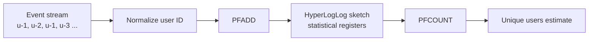
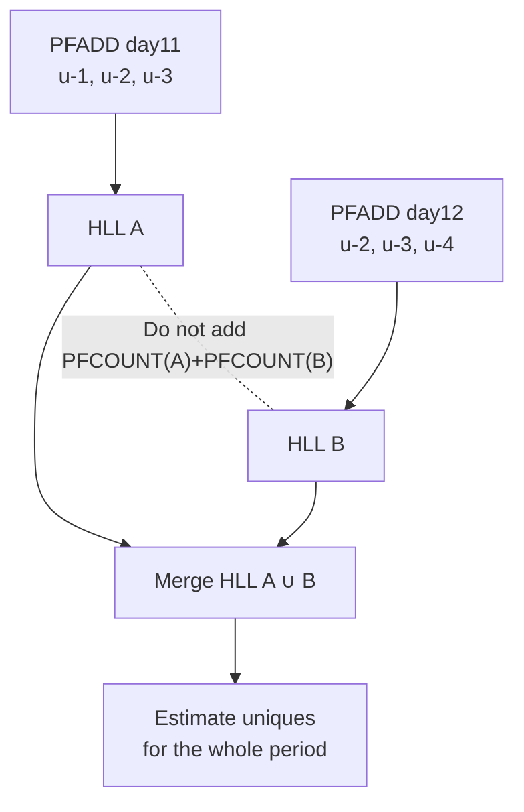
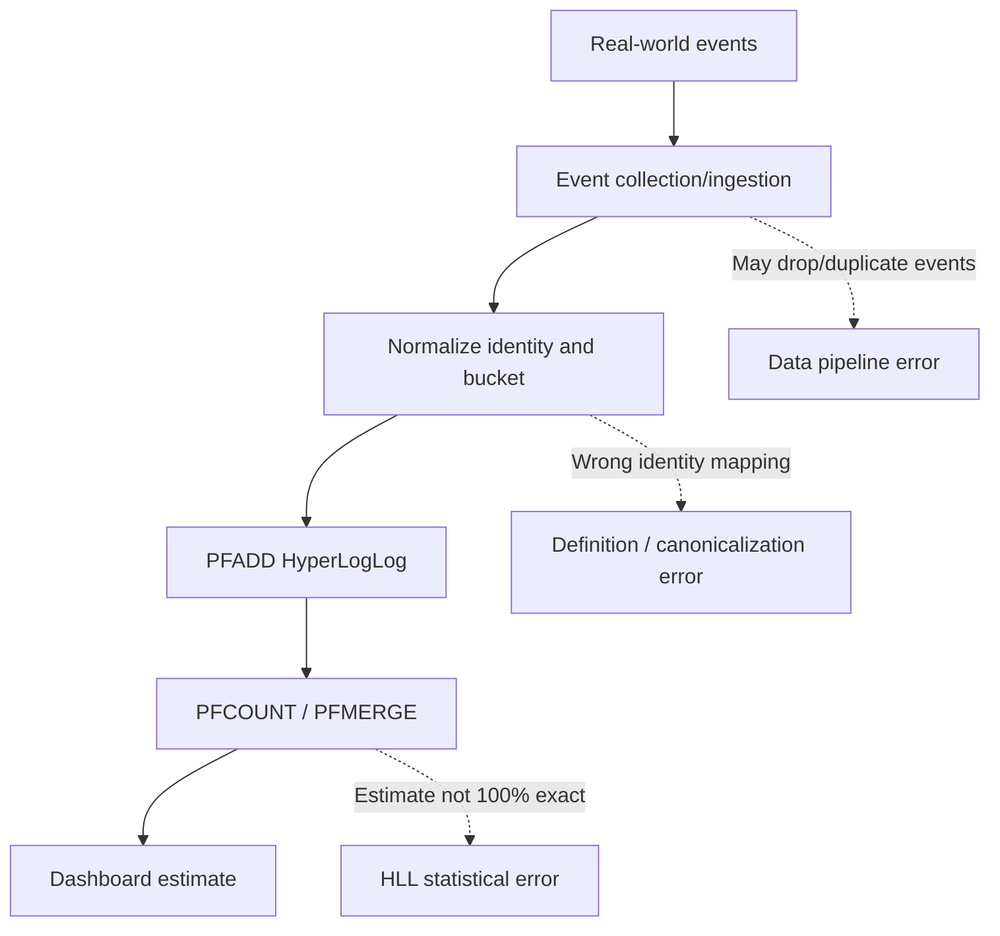
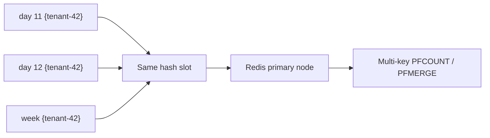

# Merging HyperLogLogs and Evaluating Error in Spring Data Redis

An analytics system often needs to answer: **"How many distinct users visited today, all week, or across an entire campaign?"** If all user IDs are stored in a Redis Set, the count is exact, but memory grows with the number of unique users. When data scales to millions or hundreds of millions of identifiers, this approach can become expensive.

**HyperLogLog (HLL)** is a probabilistic data structure used to **estimate the number of distinct elements** (*approximate distinct count/cardinality*) with a small memory footprint that barely grows with the number of observed identifiers. Redis provides three main commands:

- `PFADD`: records elements into a HyperLogLog.
- `PFCOUNT`: retrieves an **estimate** of the distinct element count; can compute over one or multiple HyperLogLogs.
- `PFMERGE`: **merges** multiple HyperLogLogs into a destination HyperLogLog that can be stored and reused.

Spring Data Redis exposes the corresponding API via `HyperLogLogOperations<K, V>`, obtained from `RedisTemplate.opsForHyperLogLog()`. This lesson focuses on **merging HyperLogLogs and evaluating error**: why individual counts cannot simply be added, how to maintain daily HLLs to compute weekly unique users, how to measure error against ground truth, and limitations around correctness, latency, TTL, and Redis Cluster.

The examples target Spring Boot 3.x and Spring Data Redis 3.x; verify APIs against your project's versions during implementation.

## 1. When Should You Use HyperLogLog?

Suppose a page receives the following visits:

```text
Day 11:
    u-1, u-2, u-3, u-2, u-1

Day 12:
    u-2, u-3, u-4, u-4
```

Total visits across the two days is 9, whereas the **distinct** user IDs are:

```text
Day 11: {u-1, u-2, u-3}             = 3
Day 12: {u-2, u-3, u-4}             = 3
Both:   {u-1, u-2, u-3, u-4}        = 4
```

Simply adding 3 + 3 = 6 **double-counts** `u-2` and `u-3`. You need a way to compute the **cardinality of the set union**, rather than the sum of two cardinalities.

With Redis Set, you can store each ID and compute an exact set union. With Redis HyperLogLog, you can estimate the distinct count after **merging statistical sketches** without retaining individual user IDs.

| Criterion | Redis Set | Redis HyperLogLog |
|---|---|---|
| Primary goal | Store members and check membership | Estimate distinct member count |
| Cardinality result | Exact for stored members | **Estimated**, with statistical error |
| Memory footprint | Grows with member count and member size | Small, bounded in typical dense form |
| Check if user `u-7` belongs | `SISMEMBER` | **Not supported** |
| List users | `SMEMBERS` or `SSCAN` | **Not supported** |
| Remove a user | `SREM` | **Not supported** |
| Merge multiple sets | `SUNION` / `SUNIONSTORE`, yields full set | `PFCOUNT key1 key2 ...` or `PFMERGE`, keeps only sketch |
| Suitable use cases | Membership, permissions, exact lists | Unique visitors, unique devices, distinct IDs with acceptable error |

Redis HLL typically uses **at most around 12 KiB in dense representation** for a sketch with 16,384 registers; sparse representation can use less memory. This is an attractive property when cardinality grows very large. Actual Redis key size also depends on overhead, encoding, and server version.

**Do not use HLL** if the business requires absolute exactness, needs to retrieve member lists, needs to remove specific members, or uses the data for authorization. HLL solves *approximate distinct counting*, not general replacement of Redis Set.

## 2. Execution Model: From Identifiers to Sketch

HyperLogLog does not store a Set of user IDs. When receiving an identifier, the algorithm hashes it and updates statistical information in its registers; it then estimates the distinct element count from register states.



Key consequences:

1. Re-adding the same **byte representation** of an identifier does not cause the HLL to record an additional user statistically.
2. HLL can have **error even when all input events are completely accurate**.
3. You cannot query a sketch to retrieve the list of user IDs previously added.
4. You cannot "`SREM` a user" from an HLL to update the count.
5. Merging HLLs can estimate the union's cardinality, but cannot recover the members.

In short: **Set stores members; HyperLogLog stores just enough state to estimate the distinct member count.**

## 3. Redis CLI: PFADD, PFCOUNT, PFMERGE

Let's start with two daily HLLs:

```bash
# Day 11: three distinct IDs.
redis-cli PFADD analytics:uv:day:2026-11-11 u-1 u-2 u-3

# Day 12: two IDs overlapping the prior day, one new ID.
redis-cli PFADD analytics:uv:day:2026-11-12 u-2 u-3 u-4
```

Counting separately:

```bash
redis-cli PFCOUNT analytics:uv:day:2026-11-11
redis-cli PFCOUNT analytics:uv:day:2026-11-12
```

On this tiny dataset, Redis may return the exact value `3` for each key, but remember **that is still the output of an approximate structure**, not an exactness guarantee for all inputs.

### 3.1. Multi-Key PFCOUNT Computes Union, Not Sum

```bash
redis-cli PFCOUNT \
  analytics:uv:day:2026-11-11 \
  analytics:uv:day:2026-11-12
```

Redis estimates the number of distinct IDs in the **union** of the two HLLs. For this small sample dataset, the expected result is close to `4`, **not 6**.

Common point of confusion:

```text
PFCOUNT(day11) + PFCOUNT(day12)
    → sum of two independent daily estimates
    → double-counts users active on both days

PFCOUNT(day11, day12)
    → cardinality estimate of union(day11, day12)
    → avoids double-counting users across days via HLL mechanics
```

This is the difference between **sum of daily uniques** and **unique users across the entire period**. Both metrics can be useful, but they answer different questions.

### 3.2. PFMERGE Stores the Merged Result in a Destination Key

```bash
redis-cli PFMERGE \
  analytics:uv:period:2026-11-11_12 \
  analytics:uv:day:2026-11-11 \
  analytics:uv:day:2026-11-12

redis-cli PFCOUNT analytics:uv:period:2026-11-11_12
```

`PFMERGE` creates or updates a **destination HyperLogLog** by merging the sketches. Afterward, you can call `PFCOUNT` on the destination key repeatedly without passing all source keys every time a report is read.

| Command | Function | Stores a new/destination sketch? |
|---|---|---|
| `PFADD hll id...` | Updates sketch with IDs | Updates key `hll` |
| `PFCOUNT hll` | Estimates uniques of one HLL | Creates no new report key |
| `PFCOUNT hll1 hll2` | Estimates uniques of HLL union | Stores no long-lived destination HLL |
| `PFMERGE dest hll1 hll2` | Merges source sketches into `dest` | **Yes**, writes to destination key |

**Note:** `PFCOUNT` caches the estimate inside the HLL representation, so even on a single key it may update internal cache/metadata; saying "stores no destination sketch" here means **it does not create a merged key for the application to keep long-term**, not that the command never performs internal writes.

### 3.3. PFADD Return Value Is Not the New-User Count

`PFADD` returns `1` if the HyperLogLog state changed, or `0` if no register changed. Redis **does not return the count of newly added distinct identifiers** like Set's `SADD`.

Example you might encounter:

```text
PFADD hll new-user-id → 0
```

This **does not prove `new-user-id` was written previously**. A new ID may leave registers unchanged because its hash does not raise the maximum rank recorded in the sketch.

Therefore, never use `PFADD`'s return value to decide "user just registered for the first time", grant new-user rewards, or count exact new users at the event level. HLL is only meant for aggregate counts.

## 4. Spring Data Redis: HyperLogLogOperations

### 4.1. Dependency and Redis Configuration

Gradle:

```groovy
dependencies {
    implementation 'org.springframework.boot:spring-boot-starter-data-redis'
}
```

Example standalone Redis config in `application.yml`:

```yaml
spring:
  data:
    redis:
      host: localhost
      port: 6379
      connect-timeout: 2s
      timeout: 3s
```

These properties configure the **connection**, not HyperLogLog accuracy. In standard Redis HLL, algorithmic error is governed by Redis's HLL design, not a property like `spring.data.redis.hyperloglog.error`.

Spring Data Redis exposes the API via:

```java
import org.springframework.data.redis.core.HyperLogLogOperations;
import org.springframework.data.redis.core.StringRedisTemplate;

HyperLogLogOperations<String, String> hll =
    stringRedisTemplate.opsForHyperLogLog();
```

`StringRedisTemplate` fits well when identifiers are represented as stable strings. With `RedisTemplate<K,V>` using a custom serializer, keys and members must be serialized consistently across writers, days, and application versions.

### 4.2. API Mapping Table

| Redis command | Spring Data Redis | Meaning |
|---|---|---|
| `PFADD key item ...` | `hll.add(key, values...)` | Update a sketch |
| `PFCOUNT key` | `hll.size(key)` | Estimate one sketch |
| `PFCOUNT key1 key2 ...` | `hll.size(keys...)` | Estimate union of multiple sketches without creating destination |
| `PFMERGE dest source1 source2 ...` | `hll.union(destination, sources...)` | Merge and store destination sketch |
| `DEL key` on HLL key | `hll.delete(key)` or `redis.delete(key)` | Delete the **entire sketch**, not individual members |

The name `union` in `HyperLogLogOperations` means merging HLLs. It does not return a Java `Set` of observed users.

### 4.3. Example Service: Daily and Multi-Period Unique Users

```java
import java.util.Objects;
import org.springframework.data.redis.core.HyperLogLogOperations;
import org.springframework.data.redis.core.StringRedisTemplate;
import org.springframework.stereotype.Service;

@Service
public class UniqueUserCounter {
    private final HyperLogLogOperations<String, String> hll;

    public UniqueUserCounter(StringRedisTemplate redis) {
        this.hll = redis.opsForHyperLogLog();
    }

    public void recordUser(String dateIso, String userId) {
        validateDate(dateIso);
        validateUserId(userId);
        hll.add(dayKey(dateIso), userId);
    }

    public long dailyUnique(String dateIso) {
        return requiredEstimate(hll.size(dayKey(dateIso)));
    }

    public long uniqueAcrossDays(String... datesIso) {
        if (datesIso == null || datesIso.length == 0) {
            throw new IllegalArgumentException("No dates supplied");
        }
        String[] keys = new String[datesIso.length];
        for (int i = 0; i < datesIso.length; i++) {
            keys[i] = dayKey(datesIso[i]);
        }
        return requiredEstimate(hll.size(keys));
    }

    public long mergeAndCount(String destinationKey,
                              String... datesIso) {
        if (datesIso == null || datesIso.length == 0) {
            throw new IllegalArgumentException("No dates supplied");
        }
        String[] keys = new String[datesIso.length];
        for (int i = 0; i < datesIso.length; i++) {
            keys[i] = dayKey(datesIso[i]);
        }
        // Only call with a destinationKey managed/initialized
        // according to the system's migration protocol.
        hll.union(destinationKey, keys);
        return requiredEstimate(hll.size(destinationKey));
    }

    private static String dayKey(String dateIso) {
        validateDate(dateIso);
        return "analytics:uv:day:" + dateIso;
    }

    private static void validateDate(String dateIso) {
        if (dateIso == null
                || !dateIso.matches("\\d{4}-\\d{2}-\\d{2}")) {
            throw new IllegalArgumentException("Invalid date format");
        }
    }

    private static void validateUserId(String userId) {
        if (userId == null || userId.isBlank()) {
            throw new IllegalArgumentException("User ID is required");
        }
    }

    private static long requiredEstimate(Long estimate) {
        return Objects.requireNonNull(
            estimate, "Unexpected deferred Redis result"
        );
    }
}
```

Example usage:

```java
counter.recordUser("2026-11-11", "u-1");
counter.recordUser("2026-11-11", "u-2");
counter.recordUser("2026-11-11", "u-3");

counter.recordUser("2026-11-12", "u-2");
counter.recordUser("2026-11-12", "u-3");
counter.recordUser("2026-11-12", "u-4");

long day11 = counter.dailyUnique("2026-11-11");
long day12 = counter.dailyUnique("2026-11-12");

long bothDaysWithoutStorage = counter.uniqueAcrossDays(
    "2026-11-11", "2026-11-12"
);

long bothDaysStored = counter.mergeAndCount(
    "analytics:uv:period:2026-11-11_12:version1",
    "2026-11-11", "2026-11-12"
);
```

This code illustrates HLL commands; if run multiple times against the same Redis instance, previously created sketches persist. For clean measurements, use a **dedicated test namespace** or properly clean up test keys before running. Never delete production HLL keys just to rerun an example.

The `add()` and `size()` methods return values according to Redis/driver semantics. When using pipelines or Redis transactions, some Spring Data Redis methods return `null` at command queueing time; the service above assumes standard synchronous execution, outside pipeline callbacks.

## 5. Why Cannot HLL Counts Simply Be Added Together?

User sets across two days:

```text
A = {u-1, u-2, u-3}
B = {u-2, u-3, u-4}
```

By set theory:

\[
|A \cup B| = |A| + |B| - |A \cap B|
\]

We have:

\[
|A \cup B| = 3 + 3 - 2 = 4
\]

In practice, HLL **does not retain individual members**, so you cannot take only `PFCOUNT(A)` and `PFCOUNT(B)` and deduce the union without additional data. Two HLLs can have vastly different overlaps even if each individually estimates 1 million.

The correct approach is to **merge sketches first and then compute cardinality on the merged sketch**. Redis performs this via `PFCOUNT A B`, or `PFMERGE dest A B` followed by `PFCOUNT dest`.



HLL supports merging because each register holds statistical state from seen elements; the union combines register states (by taking the appropriate maximum per register) **without needing to inspect the original IDs**.

Merging **does not turn an estimate into an exact number**. It yields an estimate of the union set, still subject to HyperLogLog's statistical error.

## 6. Two Ways to Merge: Multi-Source PFCOUNT and PFMERGE

### 6.1. Multi-Key PFCOUNT — Compute on Read

```java
Long estimate = hll.size(
    "analytics:uv:day:2026-11-11",
    "analytics:uv:day:2026-11-12"
);
```

Advantages:

- No destination key required for each reporting period.
- Easy to run exploratory queries over arbitrary date subsets.
- No lifecycle management needed for a new aggregated sketch.

Trade-off: on every multi-source query, Redis must compute the union estimate across the requested sketches. With large key counts or high query rates, measure CPU/latency cost and consider materializing the result.

### 6.2. PFMERGE — Store a Merged Sketch

```java
String destination = "analytics:uv:week:2026-W46:v1";

hll.union(
    destination,
    "analytics:uv:day:2026-11-09",
    "analytics:uv:day:2026-11-10",
    "analytics:uv:day:2026-11-11",
    "analytics:uv:day:2026-11-12"
);

Long weeklyUnique = hll.size(destination);
```

Advantages:

- Retains the merged sketch for subsequent queries.
- Can be merged hierarchically across levels, e.g., day → week → month.
- Prevents reports from repeatedly reading all daily sketches.

Trade-offs:

- Adds another Redis key needing namespace/TTL management.
- Must track **which periods are finalized** to avoid reports missing late-arriving events.
- Must manage re-merging, snapshot replacement, and cleanup when source data changes.

### 6.3. Important Detail: Existing Destination Also Participates in the Merge

For Redis `PFMERGE`, an existing destination key is **treated as one of the sources** in the union. This implication is critical for scheduled jobs.

Suppose:

```text
Prior HLL D contained data from {u-1, u-2, u-3}
Current HLL A contains data from {u-1}
Current HLL B contains data from {u-2}
```

Executing:

```redis
PFMERGE D A B
```

**Do not assume D is recomputed strictly from A and B.** The old D is also an input, so contributions from `u-3` can remain in the resulting sketch. Changing sources A/B or rebuilding sources without old IDs **does not erase old information from D**.

Therefore, to recompute a snapshot cleanly from the current source set:

- Use a **new destination key with a version/run ID**, guaranteed not to exist before merging.
- Once ready, switch readers to the new key via an appropriate cutover mechanism.
- Clean up old keys only after no consumers depend on them.

Do not blindly run `DEL destination` followed by `PFMERGE destination sources` while readers are actively querying `destination`; between the two commands there can be a gap or inconsistent reads. Key replacement protocols must account for concurrency, TTL, and Redis Cluster.

## 7. Key Structure for Time-Based HLL Merging

An illustrative convention:

```text
analytics:uv:tenant:42:day:2026-11-11
analytics:uv:tenant:42:day:2026-11-12
analytics:uv:tenant:42:week:2026-W46:v1
analytics:uv:tenant:42:month:2026-11:v1
```

Dimensions:

| Key segment | Example | Meaning |
|---|---|---|
| Namespace | `analytics:uv` | Unique visitor counting; keeps HLL separate from regular Redis Strings |
| Tenant/site | `tenant:42` | Isolates customer/site data |
| Time bucket | `day:2026-11-11` | Day the events belong to |
| Aggregate bucket | `week:2026-W46` | Report for a period |
| Version | `v1` | Changes to event definition or ID convention; supports migration |

### 7.1. Defining "Day" and "Unique User"

Before writing to HLL, decide:

- Is a day determined in **UTC** or the customer's business time zone?
- Is a user identified by account ID, anonymous cookie, device ID, or another identifier?
- Should duplicate events from message retries be counted again? With the same normalized ID, HLL does not double-count them in cardinality.
- Are pre-login anonymous users merged with accounts after login?
- Are bots/crawlers, internal traffic, and error events included?
- Are events arriving 2 days late written to the bucket by **event time** or **processing time**?

HLL only estimates cardinality from the byte strings fed into it; it **cannot fix unstable identifier definitions or pipelines dropping events**.

### 7.2. Per-Tenant/Site HLLs Prevent Mixing Data

If you need unique users for a site, ensure all events for that site use the same key convention and serializer. Merging HLLs across two different tenants may collide on raw ID strings and yield **globally distinct byte identities**, not the sum of tenant-specific uniques.

For example, if both tenant 42 and tenant 43 have user ID `u-1` representing two different people, merging raw IDs treats them as one. When global cardinality of tenant-scoped identities is needed, normalize them as:

```text
tenant-42:user-u-1
tenant-43:user-u-1
```

Conversely, if you want global uniques across all sites for a logged-in user with a global ID, prefixing tenant into the ID causes overcounting. **Choose the ID convention based on the analytical question**, not purely from Redis key naming.

## 8. Nature of HyperLogLog Error

### 8.1. What Does ~0.81% Error Mean?

Standard Redis HyperLogLog uses 16,384 registers. The relative standard error (*RSE*) is approximated as:

\[
\operatorname{RSE} \approx \frac{1.04}{\sqrt{m}}
\]

With \(m=16\,384\):

\[
\operatorname{RSE} \approx \frac{1.04}{128}
=0.008125 \approx 0.81\%.
\]

This measures **statistical dispersion of the estimator**, not a rule that every estimate falls strictly within ±0.81% of truth.

For example, if there are actually \(N=1\,000\,000\) distinct users:

\[
0.0081 \times 1\,000\,000 \approx 8\,100
\]

The figure of roughly 8,100 illustrates a **typical relative standard deviation scale**, not a "maximum error of 8,100 users". A single measurement can still deviate further; error also varies across cardinality regimes and estimator details.

Assuming an approximately normal error distribution and appropriate statistical assumptions, ranges near two standard deviations can help reason about probability. However, **never treat it as a hard SLA guarantee**. When legal reporting, financial reconciliation, billing, or auditing requires 100% exact figures, use an exact counting source or proper reconciliation.

### 8.2. Absolute Error and Relative Error

Let:

- \(N\): true cardinality, from an exact ground-truth source.
- \(\widehat{N}\): `PFCOUNT` result.

**Signed error**:

\[
e = \widehat{N} - N
\]

**Absolute error**:

\[
|e| = |\widehat{N} - N|
\]

**Relative error** for \(N>0\):

\[
r = \frac{\widehat{N} - N}{N}
\]

**Absolute percentage error**:

\[
\operatorname{APE} =
\frac{|\widehat{N} - N|}{N}\times100\%.
\]

Example:

```text
Exact unique count:           15,000
PFCOUNT after merge:          14,910
Signed error:                    -90
Absolute error:                   90
Relative error:                -0.6%
Absolute percentage error:      0.6%
```

A single trial like this shows one concrete estimate; **it does not prove Redis always stays under 0.6% error**.

If \(N=0\), relative percentage error is **undefined** because the denominator is 0. In that case, report `N=0` and the observed result separately (typically `PFCOUNT` on an empty/nonexistent key is 0) instead of dividing by zero.

### 8.3. Error of Merging

Merging valid HLLs built with identical identifier semantics yields a sketch representing the **union of the data**. The union estimate still carries HLL error; do not naively add source errors together.

Do not calculate:

```text
day A estimate ± 0.81%
+ day B estimate ± 0.81%
= two-day estimate ± 1.62%
```

That reasoning is wrong in both **the central count** (due to overlap) and **the error model** (since the merged sketch has its own estimation error). Evaluate the estimate of **`PFCOUNT A B`** or `PFCOUNT dest` after `PFMERGE` directly against the exact cardinality of **union(A,B)**.

## 9. Experiment to Evaluate Error Against Ground Truth

To evaluate HLL, you need ground truth on a sample dataset where the **exact distinct ID count is known**. A sound experiment should:

1. Construct two ID sets with controlled overlap.
2. Compute the exact union in Java using `HashSet`/`Set`.
3. Write the IDs into two independent HLLs.
4. Read each HLL's estimate.
5. Read the non-stored union estimate via `size(keyA, keyB)`.
6. Merge into a clean destination via `union(dest, keyA, keyB)`.
7. Compare `size(dest)` against the exact union.
8. Repeat across **different datasets**, rather than calling `PFCOUNT` repeatedly on one static HLL and treating each call as an independent trial.

### 9.1. Simple Dataset with Known Overlap

Choose:

```text
A = {user-0, user-1, ..., user-9999}
B = {user-5000, user-5001, ..., user-14999}

|A|             = 10,000
|B|             = 10,000
|A intersect B| = 5,000
|A union B|     = 15,000
```

This dataset works well for illustration because we control the overlap and can compute the exact answer prior to calling Redis. Do not mistake the combined unique count of the two HLLs for 20,000 just because each holds 10,000 items.

### 9.2. Java Code to Generate Data and Measure Error

The code below is an experiment **explicitly triggered in a development environment**, not logic that should auto-run on every production startup. Test keys use a dedicated namespace; separate runs use distinct `runId` values to avoid mixing old sketches.

```java
import java.util.ArrayList;
import java.util.HashSet;
import java.util.List;
import java.util.Objects;
import java.util.Set;
import java.util.UUID;
import org.springframework.data.redis.core.HyperLogLogOperations;
import org.springframework.data.redis.core.StringRedisTemplate;
import org.springframework.stereotype.Component;

@Component
public class HyperLogLogExperiment {
    private static final int BATCH_SIZE = 500;
    private final HyperLogLogOperations<String, String> hll;

    public HyperLogLogExperiment(StringRedisTemplate redis) {
        this.hll = redis.opsForHyperLogLog();
    }

    public void runExample() {
        String runId = UUID.randomUUID().toString();
        String aKey = "experiment:hll:" + runId + ":a";
        String bKey = "experiment:hll:" + runId + ":b";
        String mergedKey = "experiment:hll:" + runId + ":union";

        Set<String> a = new HashSet<>();
        Set<String> b = new HashSet<>();

        for (int i = 0; i < 10_000; i++) {
            a.add("user-" + i);
        }
        for (int i = 5_000; i < 15_000; i++) {
            b.add("user-" + i);
        }

        Set<String> exactUnion = new HashSet<>(a);
        exactUnion.addAll(b);

        addInBatches(aKey, a);
        addInBatches(bKey, b);

        long estimateA = require(hll.size(aKey));
        long estimateB = require(hll.size(bKey));
        long estimateUnion = require(hll.size(aKey, bKey));

        // mergedKey uses a fresh runId, so it holds no data from prior runs.
        hll.union(mergedKey, aKey, bKey);
        long estimateStoredUnion = require(hll.size(mergedKey));

        long exact = exactUnion.size();
        double relativeErrorPercent =
            (estimateUnion - exact) * 100.0 / exact;

        System.out.println("Exact A: " + a.size());
        System.out.println("Exact B: " + b.size());
        System.out.println("Exact union: " + exact);
        System.out.println("Estimated A: " + estimateA);
        System.out.println("Estimated B: " + estimateB);
        System.out.println("PFCOUNT(A,B): " + estimateUnion);
        System.out.println("PFMERGE then PFCOUNT: " + estimateStoredUnion);
        System.out.printf("Relative error: %.3f%%%n",
                          relativeErrorPercent);

        // Clean up the three experiment keys per environment policy.
        // Never delete production keys or delete while observers are reading.
    }

    private void addInBatches(String key, Set<String> ids) {
        List<String> batch = new ArrayList<>(BATCH_SIZE);

        for (String id : ids) {
            batch.add(id);
            if (batch.size() == BATCH_SIZE) {
                hll.add(key, batch.toArray(String[]::new));
                batch.clear();
            }
        }

        if (!batch.isEmpty()) {
            hll.add(key, batch.toArray(String[]::new));
        }
    }

    private static long require(Long estimate) {
        return Objects.requireNonNull(
            estimate, "Unexpected deferred Redis result"
        );
    }
}
```

In this example:

- `HashSet` holds the exact ground truth in Java.
- `PFADD` is batched in groups of 500 IDs to avoid sending an unnecessarily huge single request.
- `size(aKey, bKey)` computes the union estimate **without materializing** a new sketch.
- `union(mergedKey, aKey, bKey)` materializes a merged HLL.
- `estimateUnion` and `estimateStoredUnion` should reflect the same sketch union if sources do not change during measurement; if concurrent writers run, results may differ.
- No server-side `Redis Set` is required for ground truth: the Java test computes the exact union in memory. On very large datasets, the exact source can be a `COUNT(DISTINCT ...)` database query, an exact batch pipeline, or a verified sample dataset.

Note: using `UUID.randomUUID()` here only creates a **fresh test namespace**. It does not turn a single run into a meaningful statistical validation if the member data stays identical; to study error distributions, vary ID sets/seeds and input sizes across trials.

### 9.3. Ensuring Data-Independent Trials

Suppose you run `PFCOUNT` 100 times on the same immutable HLL and get 14,910 all 100 times. Those are **not** 100 independent estimates: given the exact same sketch, Redis generally returns the same estimate.

To study error across scenarios:

- Generate **multiple distinct ID sets**, e.g., using separate random seeds or cohorts.
- Record the true cardinality of each set and each union.
- Vary set sizes, overlap ratios, and ID distributions.
- Use fresh test keys or ensure sketches are properly reset between runs.
- Record seeds, ID definitions, and Redis version for reproducibility.

Example experiment matrix:

| Cohort | Unique A | Unique B | Exact overlap | Unique union |
|---|---:|---:|---:|---:|
| Small set | 100 | 100 | 20 | 180 |
| Medium set | 10,000 | 10,000 | 5,000 | 15,000 |
| Large set | 1,000,000 | 1,000,000 | 200,000 | 1,800,000 |
| High overlap | 50,000 | 50,000 | 49,000 | 51,000 |
| Disjoint | 50,000 | 50,000 | 0 | 100,000 |

In practice, generate multiple randomized cohorts within each group to observe the error distribution. Never cite a sizing table alone to claim a specific error rate; HLL results must be measured on real data.

## 10. Aggregating Error Across Multiple Trials

For trial \(i\), let:

- \(N_i\): exact cardinality of the union.
- \(\widehat{N}_i\): Redis estimated cardinality.
- \(r_i=(\widehat{N}_i-N_i)/N_i\): relative error (for \(N_i>0\)).

You can compute the following metrics:

### 10.1. Bias — Directional Skew

\[
\operatorname{MeanRelativeError}
=\frac{1}{T}\sum_{i=1}^{T}r_i
\]

If the mean signed error is strongly positive, estimates tend to overcount; if strongly negative, they tend to undercount. Do not confuse **bias** with absolute error: positive and negative errors can cancel out in a mean.

### 10.2. MAPE on Datasets with Positive Ground Truth

\[
\operatorname{MAPE}
=\frac{100\%}{T}\sum_{i=1}^{T}|r_i|
\]

MAPE expresses the mean absolute percentage error. When cohorts vary widely in cardinality, this formula weights every cohort equally; sometimes you should also report size-weighted metrics or group by cardinality bucket.

### 10.3. RMSE and Dispersion

\[
\operatorname{RMSE}
=\sqrt{\frac{1}{T}
\sum_{i=1}^{T}(\widehat{N}_i-N_i)^2}
\]

RMSE is in **user count** units. To compare across scales, you can compute RMSE on relative errors or report per cardinality bucket.

### 10.4. Error Percentiles

Inspect p50/p95/p99 of **absolute relative error** across trials, for instance:

```text
absoluteRelativeErrorPercent =
    abs(estimate - exact) / exact * 100
```

The p95 error percentage illustrates the **error level for most tested trials**. However, p95 on a test suite does not automatically become a p95 guarantee for all production users/timeframes, especially if test data is unrepresentative.

### 10.5. Business-Level Error Evaluation

An acceptance threshold may be defined by product/analytics, such as:

```text
Product objectives:
  - Traffic trend reports do not need exact counts
  - Observed p95 error in realistic cohorts should be below 2%
  - Monitor event ingestion quality in parallel
```

This is merely an **example acceptance criterion set by a product team**, not a built-in Redis guarantee. If numbers drive billing, rewards, entitlements, or audits, prefer exact counting systems and reconciliation rather than relying solely on HLL sketches.

## 11. Algorithmic Error vs. Data Pipeline Bugs

In real systems, "dashboard numbers are off" is not necessarily due to HLL's 0.81% error. There are two distinct sources of discrepancy:

### 11.1. HLL Statistical Error

Given the exact same set of input identifiers, the HLL estimate may deviate from exact cardinality because it is a probabilistic structure. This is **approximation error**.

### 11.2. Event and Identity Errors

For example:

- The system drops 5% of events due to a failing message consumer.
- One person has two account IDs and gets treated as two people.
- Multiple people share one ID and get conflated.
- Events from yesterday arrive late after the report bucket closed.
- Bot traffic is included in one report but excluded from the reconciliation source.
- One application writes trimmed/lowercased user IDs while another writes them verbatim.
- One application writes UTF-8 Strings while another writes JDK-serialized objects for the same logical ID.

These errors belong to **data quality/identity resolution**, not HLL statistical bounds, and **cannot be fixed by applying a 0.81% correction factor**.

An observability model:



To attribute discrepancies properly, compare on **the exact same normalized event stream** before measuring HLL error. If the exact query uses a different event source or identity rule, differences can be much larger and do not measure HLL error alone.

## 12. HyperLogLog Does Not Support Removing Individual Members

Unlike Redis Set:

```redis
SREM myset user-42
```

HyperLogLog **has no equivalent operation to "remove user-42 from the sketch"**. Because HLL does not retain individual members to trace one ID's contribution, it cannot cleanly undo a `PFADD`.

This matters when:

- Bots need to be stripped out after detection.
- Events must be deleted for business reasons.
- Data policies require removing an identity from aggregates.
- A source is discovered to have sent wrong IDs or wrong buckets.

Architectural options:

1. Retain a **rebuildable event data source** and recompute a fresh HLL after filtering.
2. Store multiple HLLs across small partitions (day, cohort, channel) so valid partitions can be re-selected when computing unions; this only removes **entire partitions**, not single members.
3. For use cases needing individual add/remove and exact results, use a Set or a database supporting membership management.
4. To replace a bad sketch, build a **new** destination from clean sources and cut over, rather than trying to "subtract" sketches.

**There is no general "HLL A minus HLL B" operation** that recovers exact cardinality or a difference sketch by subtracting registers. Correcting a polluted source requires rebuilding from complete source data.

### 12.1. Why Should You Not Infer Set Intersection from Three Estimates?

In theory:

\[
|A\cap B|=|A|+|B|-|A\cup B|.
\]

If each term is replaced by an **HLL estimate**, estimation differences can amplify error dramatically, especially when the intersection is small relative to two large sets. Hence, deriving intersection via that formula may be explored with strict error analysis, but **does not provide reliable results for small intersections**.

If your primary problem is intersection, difference, or membership, choose a data structure that supports it directly or another analytics engine.

## 13. Planning Daily, Weekly, and Monthly Merges

A reporting system may produce daily HLLs:

```text
analytics:uv:day:2026-11-09
analytics:uv:day:2026-11-10
analytics:uv:day:2026-11-11
analytics:uv:day:2026-11-12
...
```

When weekly uniques are needed:

```text
PFCOUNT day09 day10 day11 day12 ...
        |
        v
Estimate unique visitors for the week
```

Or materialize:

```text
PFMERGE weekly-v1 day09 day10 day11 day12 ...
PFCOUNT weekly-v1
```

### 13.1. Late Events: Can Merged Reports Become Stale?

Yes. If the weekly merge runs at `00:00` and an event for the previous day arrives at `00:05`, the **daily** sketch updates, yet the **already-merged weekly** key does not automatically sync with its sources.

Policies to consider:

- Materialize only after sources have **closed their bucket** per a watermark/event-time policy.
- Periodically re-merge newly added days into the aggregate sketch; remember the existing destination participates in the union, so this only fits append-only sources with no edits/deletes or "subtractions".
- When corrections, bot filtering, or source rebuilds occur, create a **new destination version from corrected sources** and switch readers to that version.
- Store metadata like `sourceWindow`, `watermark`, `generation`, and `generatedAt` in a **separate** key so dashboards know data freshness.

### 13.2. Do Weekly HLLs Replace Daily HLLs?

It depends. If you keep only weekly HLLs, you can read weekly uniques and merge weeks into months. Once daily HLLs are deleted, however, **you cannot reconstruct an arbitrary 3-day window** from weekly HLLs alone because sub-week granularity is gone.

Retention design:

| HLL type | Example retention | Used for |
|---|---|---|
| Daily | 45 days | Daily dashboards, arbitrary recent date ranges |
| Weekly | 18 months | Weekly reports, monthly/campaign merges |
| Monthly | 3 years | Long-term trends |

These durations are **business examples only**; there is no universal default TTL for all HLLs. Choose retention based on re-query needs, storage cost, privacy, and event lateness.

### 13.3. TTL When Adding/Merging HyperLogLogs

`PFADD` does not attach a TTL to a new key. `PFMERGE` is likewise not a "merge and set TTL" API accepting a duration in Spring's `union()` call. If expiration is required:

```java
import java.time.Duration;

String destination = "analytics:uv:week:2026-W46:v2";
hll.union(destination, sourceDay1, sourceDay2);

Boolean ttlApplied = stringRedisTemplate.expire(
    destination,
    Duration.ofDays(90)
);
```

These are two separate operations; if the application crashes after `union` and before `expire`, the expiry will not be applied as intended. Furthermore, **verify TTL behavior on an existing destination** when calling `PFMERGE`, rather than assuming it preserves or resets expiry the way you expect.

When TTL is a strict requirement, combine an appropriate transaction/script, post-verification check, or reconciliation job. In Redis Cluster, multi-key operations must satisfy hash-slot constraints.

## 14. Redis Cluster: Merging Multiple HLLs Requires Hash-Slot Planning

`PFADD` and single-key `PFCOUNT` are single-key operations. However, `PFCOUNT key1 key2 ...` and `PFMERGE destination source...` involve **multiple Redis keys**. In Redis Cluster, keys in multi-key commands generally must share the **same hash slot**.

Example keys:

```text
analytics:uv:tenant:42:day:2026-11-11
analytics:uv:tenant:42:day:2026-11-12
analytics:uv:tenant:42:week:2026-W46
```

Similar prefixes do not guarantee the same slot. To merge per tenant in Redis Cluster, use a hash tag:

```text
analytics:uv:{tenant-42}:day:2026-11-11
analytics:uv:{tenant-42}:day:2026-11-12
analytics:uv:{tenant-42}:week:2026-W46:v1
```

Keys containing `{tenant-42}` map to the same slot:



Notes:

- The destination key must **also** share the slot with sources in supported Cluster merges.
- Do not put the same hash tag `{all-tenants}` on every tenant, as it forces all keys onto one slot/node and defeats sharding.
- Merging tenants into a global HLL in Redis Cluster may require another aggregation strategy, such as co-locating appropriately or aggregating in an external analytics system; do not expect `PFMERGE` to execute atomically across shards.
- To merge keys across independent clusters/nodes, Redis has no cross-server `PFMERGE`; you must export/import sketches in compatible format or aggregate externally while verifying compatibility.

### 14.1. An Overly "Hot" HLL

A single global HLL for all events can become a hot spot because every `PFADD` hits one key/slot. You can split keys by tenant, channel, day, or logical shard to distribute writes, and design a corresponding union workflow. Yet sharding introduces constraints for Cluster merges; balance write throughput, latency, key count, and aggregation cost.

## 15. Serializers, Identity, and Storage Format

Spring Data Redis serializes **keys and values** before sending commands to Redis. For HLL, an identity deduplicates only if its **byte representation** passed to `PFADD` is consistent.

```text
Java "user-42" with StringRedisSerializer
    → UTF-8 bytes of "user-42"
    → PFADD sketch <bytes>

Java "user-42" with another binary serializer
    → different byte[]
    → Redis treats it as a different element
```

If one service writes `"u-7"` and another writes `"U-7"`, HLL treats them as two different byte strings. The system must enforce a **canonical identity** before writing:

- Use a stable user ID instead of mutable display names/emails.
- Normalize encoding and ID formatting.
- Do not blindly lowercase identifiers if the domain treats uppercase/lowercase as distinct.
- Handle anonymous visitors and logged-in users consistently.
- When changing canonicalization logic, consider a new key namespace/version so two definitions of "unique" are never mixed.

### 15.1. HyperLogLog's `TYPE` Is String

Redis HyperLogLog uses a **Redis String** representation at the storage layer:

```bash
redis-cli TYPE analytics:uv:day:2026-11-11
# string
```

Yet this is **not** a plain String containing JSON or CSV user IDs. Key contents carry HLL encoding. Do not call `GET` to search for user IDs in the bytes, and never `SET` JSON onto an HLL key.

Running `PFADD` on a Redis String without valid HyperLogLog encoding can cause Redis to return a format error. Isolate namespaces like `analytics:hll:*` from business String keys to avoid accidental overwrites.

### 15.2. Protecting Identity and Privacy

Even though HLL does not let you enumerate added IDs, sending identities through pipelines or printing them in debug logs can still expose data. Choose pseudonymized IDs per policy where needed, avoid logging raw `userId`s, secure Redis with network ACLs/TLS/authentication, and enforce retention.

Never assume that because HLL cannot list members, all privacy requirements are automatically satisfied. Architecture must account for **raw event sources**, HLL keys, and derived aggregates.

## 16. Concurrency and Consistency When Merging

A `PFADD` command updates a sketch with Redis per-command atomicity. A `PFMERGE` over co-located keys runs as a single Redis command. Still, a reporting pipeline involves multiple stages:

```text
1. Workers continuously PFADD into daily HLLs.
2. Job runs PFMERGE of daily A/B into weekly HLL.
3. Dashboard calls PFCOUNT on weekly HLL.
4. Worker sends a late event into daily A.
```

The weekly estimate at step 3 **excludes** the late event from step 4 until another merge runs. One atomic `PFMERGE` does not make the entire event-to-dashboard pipeline consistent.

### 16.1. Is Re-Merging Repeatedly Always Safe?

If all sources are **strictly append-only** and the destination only accumulates sources sharing the same identity definition, re-merging can refresh the estimate without losing prior data. However, this breaks if:

- A source HLL was rebuilt after filtering bad events.
- You want to drop a day from the reporting range.
- The definition of unique visitor changed.
- A tenant/site moved to a new key namespace.
- You want to reuse the destination for a different time window.

In those cases, build a **new destination generation** from the exact set of valid sources, then cut over.

### 16.2. Error from Unrecorded Events

If event ingestion is asynchronous, dashboards should indicate a watermark: up to which timestamp data is considered complete. HLL counts reflect IDs **successfully recorded via `PFADD`**, not unrecorded events. Distinguish between "estimated unique users as of watermark" and "final unique users for the period".

## 17. Monitoring Performance and Memory Usage

HyperLogLog is chosen for its small memory footprint when only cardinality is needed. Still, do not focus solely on "~12 KiB" and overlook operations:

- **HLL key counts** still grow across thousands of tenants, days, campaigns, or versions.
- Multi-source `PFCOUNT` and `PFMERGE` must process every source sketch; large source counts increase cost.
- Redis Cluster imposes multi-key routing constraints.
- Very high `PFADD` rates on a single key can create a hot key.
- Storing daily, weekly, and monthly HLLs carries metadata and TTL overhead.
- Excessive ad-hoc reporting can trigger repeated merge load.

Useful metrics:

| Metric | Purpose |
|---|---|
| `PFADD` success/failure counts | Track event ingestion reliability |
| Event ingest lag/watermark | Separate missing events from HLL error |
| Latency of `PFCOUNT`/`PFMERGE` | Track aggregation cost |
| HLL key count per tenant/bucket | Observe namespace growth |
| `MEMORY USAGE key` in appropriate environments | Measure actual sketch footprint |
| Sampled exact distinct vs. HLL comparison | Monitor error/quality |
| Missing/expired source key counts | Prevent reports missing entire buckets |
| Merged sketch version/generation | Identify source and materialization time |

CLI inspection examples:

```bash
redis-cli TYPE analytics:uv:day:2026-11-11
redis-cli PFCOUNT analytics:uv:day:2026-11-11
redis-cli TTL analytics:uv:day:2026-11-11
redis-cli MEMORY USAGE analytics:uv:day:2026-11-11
```

`MEMORY USAGE` may return nil if the key does not exist and may require appropriate permissions. Do not run `KEYS *` to count HLLs on large production Redis instances; use prefix-scoped, rate-limited `SCAN`, noting that Redis Cluster requires scanning across all primary nodes.

## 18. Common Mistakes When Merging HyperLogLogs

| Mistake | Why it is wrong | Fix |
|---|---|---|
| Summing `PFCOUNT(day1) + PFCOUNT(day2)` for two-day uniques | Users active across days are double-counted | Use multi-key `PFCOUNT day1 day2` or `PFMERGE` |
| Treating `PFADD` return value as new-user count | Return value only reflects register changes | Use `PFCOUNT` to estimate; if exact first-time membership is needed, HLL is unsuitable |
| Assuming error never exceeds ±0.81% | 0.81% is approximately the relative standard error, not a max bound | Test across cohorts and define explicit SLAs |
| Measuring error by calling `PFCOUNT` 100 times on one key | Same input yields same estimate, not independent trials | Use distinct ID datasets with separate ground truth |
| Merging back into an old destination expecting old contributions to vanish | Existing destination also acts as a `PFMERGE` input | Create a new generation when rebuilding |
| Using HLL to check if a specific user has appeared | Sketch stores no exact membership | Use Set/DB if membership is needed |
| Replacing Redis Set with HLL when single-user removal is needed | Cannot `SREM` an ID from HLL | Keep event source or an exact structure |
| Setting Redis TTL misaligned with retention | Daily sketches expire before merging or before rebuilds | Align retention and watermark policies |
| Different services use different ID serializers | Same user becomes different byte values | Standardize identity and serializer |
| Merging on Redis Cluster across different slots | Multi-key commands fail with `CROSSSLOT` | Design hash tags matching merge scope |
| Blaming a 5% dashboard discrepancy entirely on HLL | May be dropped events, bad identity, bots, or window skew | Compare exact vs. HLL on identical normalized input; audit pipeline |
| Writing JSON to an HLL key because `TYPE` is String | Breaks HLL encoding, causing HLL commands to fail | Isolate namespaces; never use HLL keys as business Strings |

## 19. Three Design Scenarios

### 19.1. Daily and Weekly Unique Visitors

An application wants daily and weekly visitor statistics and tolerates small statistical error.

Design:

1. On a valid event, extract the normalized ID and event-time date.
2. `PFADD` into the day's HLL.
3. Daily reports query `PFCOUNT dailyKey`.
4. Weekly reports can query `PFCOUNT dailyKey1 ... dailyKey7`.
5. Once the week closes and the watermark is trustworthy, materialize a weekly HLL via `PFMERGE` into a versioned key.
6. Periodically compare against sampled exact user counts to catch anomalies from pipeline drops or ID policy changes.

This is a great fit for HLL because the goal is **trends and cardinality**, not listing individual visitors.

### 19.2. Finding Exact Users Who Have Not Claimed a Reward

An application wants to compare users who completed a task against users who claimed a reward and distribute unclaimed rewards.

**Do not use HyperLogLog as the sole source.** You need actual member lists or a structure supporting membership and set difference. A Redis Set or a database with unique constraints/transactions is usually far better suited. HLL can only estimate the approximate distinct sizes of each group, not answer "who hasn't claimed yet?".

### 19.3. Recomputing Reports After Filtering Bots

Initially, a day's HLL included bot traffic. Later, the system identifies a set of events to exclude.

You cannot take the existing daily HLL and "subtract bot IDs" to get a clean new sketch. You must:

- Filter the exact event source.
- Rebuild affected daily sketches under a new key version.
- Build a **new** weekly/monthly destination HLL from the corrected sources.
- Switch dashboards to the new generation and retire the old generation per plan.

If raw event logs were discarded, the HLL alone lacks the information required to perform this exact correction.

## 20. Questions to Answer Before Using HLL in Production

1. **Does the metric need to be approximate or exact?** Unique traffic often allows approximation; billing and entitlements often do not.
2. **How is "one user" defined?** Stable identity, canonicalization, and anonymous/logged-in handling.
3. **Do you need unions across multiple periods?** Use multi-key `PFCOUNT` or `PFMERGE`; never sum estimates.
4. **Can source HLLs ever be corrected or rebuilt?** If yes, old destinations cannot subtract data; use versioning.
5. **When is a period considered complete?** Event-time buckets, watermarks, and late events.
6. **What error is acceptable?** Compare against ground truth and measure mean/bias/p95 on representative cohorts; never treat 0.81% as a max bound.
7. **Are member-level operations needed?** HLL does not support lookup, enumeration, or single-ID deletion.
8. **Is Redis standalone or Cluster?** Multi-key merges require slot-locality design.
9. **What are the TTL, retention, privacy, and rollback plans?** Do not let daily sketches expire while rebuilds are still needed.
10. **Can the application detect corrupted data?** Monitor ingest lag, quality, sampled estimate-vs-exact checks, and Redis errors.

**Conclusion:** `PFADD` records identifiers into a sketch, `PFCOUNT` returns an estimated cardinality, and `PFMERGE` merges sketches so unique counts across multiple sources do not double-count shared IDs. Spring Data Redis exposes these three behaviors via `HyperLogLogOperations.add()`, `size()`, and `union()`. HLL's greatest value is memory efficiency for distinct-count analytics where small error is acceptable; using it correctly requires understanding **set-union semantics**, **statistical error around 0.81% at the relative standard deviation level**, **the inability to delete or query individual members**, and maintaining the ability to rebuild and verify against an exact source when needed.
