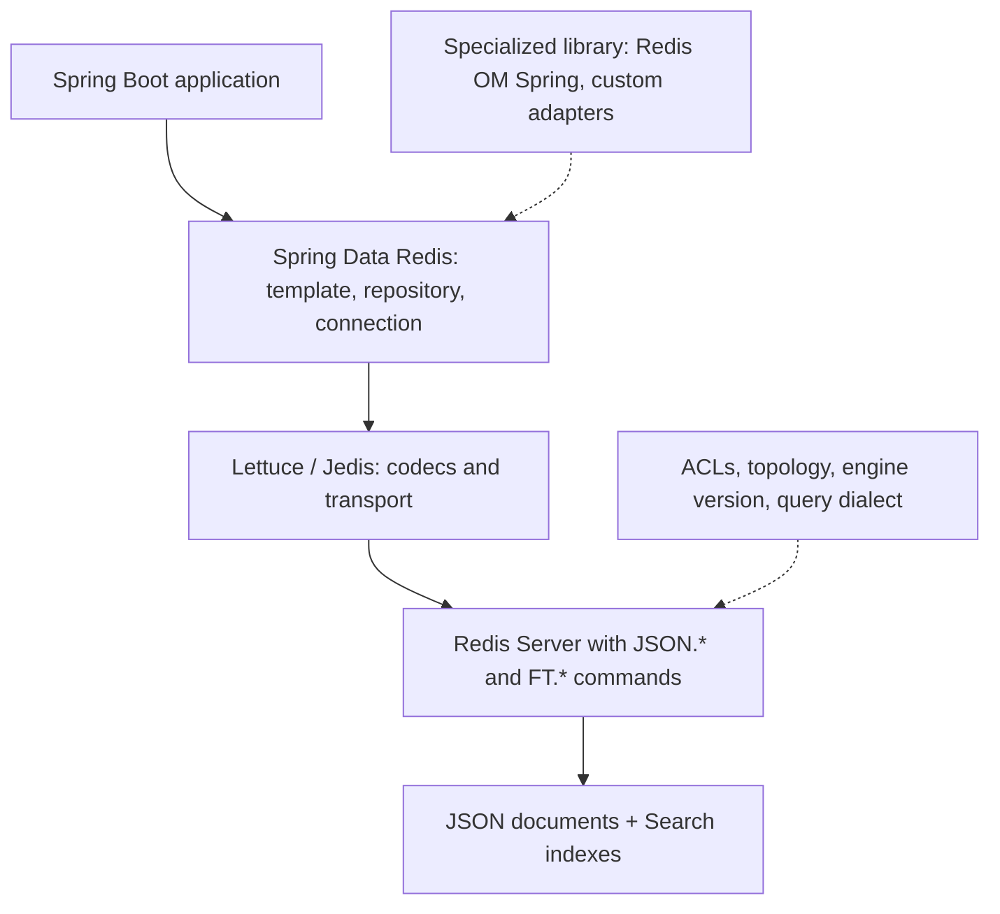
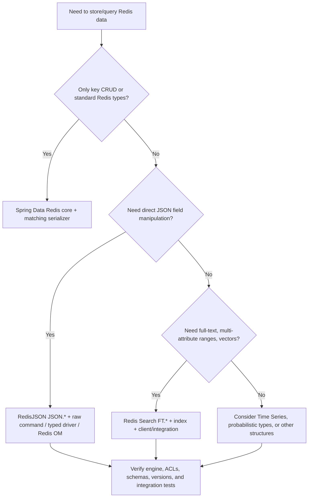

# Support Boundaries for RedisJSON, Search, and Other Extensions

Redis offers more than String, Hash, List, Set, Sorted Set, Stream, Bitmap, HyperLogLog, and Geo. Capabilities such as **JSON documents**, **full-text search**, **multi-attribute queries**, **vector search**, **Time Series**, and **Bloom Filters** further expand how data is stored and queried. In the Spring ecosystem, the critical question is not merely "Does Redis Server have that command?" but also **how far Spring Data Redis supports it directly, what the driver supports, and what integration layer the application must provide**.

This lesson clarifies the boundary of responsibilities across:

1. **Spring Data Redis core**: `RedisTemplate`, `ReactiveRedisTemplate`, `*Operations`, and standard Redis Repositories.
2. **Redis Server**: commands and features actually available on the running engine or distribution.
3. **Redis client/driver**: Lettuce, Jedis, and mechanisms for sending extended commands.
4. **Add-on libraries**: Redis OM Spring, Spring AI Redis Vector Store, or project-chosen adapters.
5. **Application**: schemas, indexes, data mapping, security, error handling, consistency, and operations.

**Goal:** know when to use built-in Spring Data Redis APIs, when to invoke raw Redis commands, when to adopt a specialized library, and which guarantees cannot be inferred merely from connecting successfully.

> **Version context:** Redis 8 integrates Redis Search, JSON, Time Series, and several probabilistic structures that were previously commonly deployed via extension modules in older Redis Stack setups. Even so, **availability in a given environment still depends on the Redis build, distribution, managed service, and configuration/ACLs**. Having a feature in Redis 8 does not mean Spring Data Redis automatically generates high-level APIs for all of its commands.

## 1. Three Layers of "Support" Must Not Be Conflated

Suppose an application wants to store a JSON document and search documents with `price` from 100 to 500.



Redis Server may understand both `JSON.SET` and `FT.SEARCH`, yet current Spring Data Redis code only declares `RedisTemplate`. That **does not turn `opsForValue().set(...)` into `JSON.SET`**, nor does it magically add `ftSearch(...)` onto `ValueOperations`.

| Layer | Question | Example check |
|---|---|---|
| **Engine / server** | Does the running Redis instance recognize the command? | `COMMAND INFO JSON.SET`, `COMMAND INFO FT.SEARCH` when permitted. |
| **Execution permissions** | Is the Redis user allowed to run the command and touch keys/indexes? | ACLs, `NOPERM`, testing safe read commands. |
| **Driver** | Does the Lettuce/Jedis version have a typed API or raw command execution? | Driver version docs, capabilities, and response parsers. |
| **Spring Data Redis** | Does the core module offer matching `Operations`/Repository support? | Javadoc for `RedisTemplate`, `RedisConnection`, `RedisRepository`. |
| **Integration library** | Do you need Redis OM Spring / Spring AI / custom adapter? | Documentation and version compatibility matrix of add-on libraries. |
| **Business layer** | Are JSON schemas, Search indexes, pagination, and consistency designed properly? | Integration tests against the target Redis Server. |

Only when **all required layers** align does a feature work in the application. A successful Maven/Gradle build only proves dependencies resolved and Java compiled; it does not prove the server has a search index.

## 2. What Does Spring Data Redis Core Support?

### 2.1. Typical Built-In APIs

Spring Data Redis provides abstractions centered on common Redis data types and behaviors:

| Common Redis capability | Typical Spring Data Redis API |
|---|---|
| Keys, TTL, scan | `RedisTemplate`, `RedisOperations`, `keys()`, `scan()`, `expire()` |
| String | `ValueOperations` |
| Hash | `HashOperations` |
| List | `ListOperations` |
| Set | `SetOperations` |
| Sorted Set | `ZSetOperations` |
| Stream | `StreamOperations` |
| Pub/Sub | Message listeners and connections |
| Geo | `GeoOperations` |
| Bitmap | `ValueOperations` bit operations |
| HyperLogLog | `HyperLogLogOperations` |
| Redis Repositories | Entity mapping to Redis Hashes, queries via repository index capabilities |
| Reactive | `ReactiveRedisTemplate`, `ReactiveStringRedisTemplate`, and corresponding reactive operations |

These abstractions carry concrete contracts, not automatic coverage of every newly added Redis command.

Example:

```java
StringRedisTemplate redis = ...;

redis.opsForValue().set("demo:name", "Redis");
redis.opsForHash().put("demo:user:1", "name", "Alice");
redis.opsForZSet().add("demo:leaderboard", "user:1", 125.0);
```

Each call uses its corresponding Redis type. None of these APIs **create a JSON document type or full-text index**.

### 2.2. What Does "Spring Data Redis Has a JSON Serializer" Mean?

An application can configure a JSON serializer for values:

```java
// Conceptual illustration, not a complete bean configuration:
redisTemplate.opsForValue().set("product:1", productObject);
```

With a JSON `valueSerializer`, the bytes stored by Redis are normally a **Redis String containing JSON text**:

```text
Redis key: product:1
Redis TYPE: string
Value bytes: {"id":"1","name":"Keyboard","price":199.0}
```

Redis can return that JSON via `GET product:1`; however, **you cannot run `JSON.GET product:1 $.price` merely because a String's bytes happen to be valid JSON**. Likewise, an `FT.CREATE ... ON JSON` index will not index a Redis String.

Accurate distinction:

> **JSON serialization** is how Spring converts objects into bytes to store inside an existing Redis type. **RedisJSON** is a server-side data type/capability with `JSON.*` commands enabling JSONPath operations and Search integration.

The two concepts are not interchangeable.

### 2.3. Spring Data Redis Repository Is Not Redis Search

Default Spring Data Redis repositories typically map entities to **Redis Hashes** along with keyspaces and secondary indexes managed by Spring Data Redis itself.

Java example:

```java
import org.springframework.data.annotation.Id;
import org.springframework.data.redis.core.RedisHash;
import org.springframework.data.redis.core.index.Indexed;

@RedisHash("customers")
public class Customer {

    @Id
    private String id;

    @Indexed
    private String email;

    private String name;

    // Constructors, getters, setters...
}
```

A repository:

```java
import org.springframework.data.repository.CrudRepository;

public interface CustomerRepository
        extends CrudRepository<Customer, String> {

    Iterable<Customer> findByEmail(String email);
}
```

This `@Indexed` mechanism enables simple queries by indexed attributes, yet **does not mean Redis Server created an `FT.CREATE` index**. It does not automatically provide full-text stemming, phrase matching, vector KNN, complex geo-filters, or Redis Search aggregations.

Distinguish clearly:

| Approach | Storage | Index | Queries |
|---|---|---|---|
| Standard Spring Data Redis Repository | Usually Redis Hash | Secondary index managed by mapping/repository | Query derivation limited to repository capabilities |
| Redis Search on Hash | Redis Hash | Redis Search index `ON HASH` | `FT.SEARCH`, `FT.AGGREGATE`, TAG/TEXT/NUMERIC/GEO/VECTOR |
| Redis Search on JSON | RedisJSON document | Redis Search index `ON JSON` | `FT.SEARCH`, `FT.AGGREGATE` via JSONPath |
| Redis OM Spring | Hash or JSON per annotations/library config | Redis Search and Redis OM mapping mechanics | Extended query derivation/DSL provided by the library |

Even though all use the word "index", storage mechanics, updates, permissions, and query semantics differ substantially.

## 3. RedisJSON: Server Data Type/Capability, Not Just a Format

### 3.1. What Does RedisJSON Provide?

RedisJSON supports creating, reading, and updating **JSON documents** directly on the server via commands prefixed with `JSON.`, such as:

| Command | Function |
|---|---|
| `JSON.SET` | Sets a JSON value at a JSONPath, creating the root document if the key does not exist yet. |
| `JSON.GET` | Reads a JSON document or selected paths. |
| `JSON.DEL` | Deletes a JSON value at a path or the entire document. |
| `JSON.NUMINCRBY` | Increments a numeric value inside the document. |
| `JSON.ARRAPPEND` | Appends elements to a JSON array. |
| `JSON.OBJKEYS` / `JSON.OBJLEN` | Inspects keys or member count of a JSON object. |
| `JSON.TYPE` | Gets the JSON type at a specific path. |

Updating a field via `JSON.SET key $.price 200` differs from `GET`ting the entire JSON string, editing a Java object, and `SET`ting the whole string back; the latter can suffer **lost updates** when concurrent clients edit different fields in the same document.

### 3.2. Operating with Redis CLI

On a Redis Server **with RedisJSON**:

```redis
JSON.SET shop:item:1 $ '{"name":"Mechanical keyboard","price":199,"stock":12,"category":"peripherals"}'
JSON.GET shop:item:1 $
JSON.GET shop:item:1 $.price
JSON.SET shop:item:1 $.price 179
JSON.NUMINCRBY shop:item:1 $.stock -1
JSON.GET shop:item:1 $
```

With JSONPaths starting with `$`, responses can be an **array of matched values**, even when querying a single path, because JSONPath expressions can match multiple nodes. Applications must not assume `JSON.GET key $.price` always returns a scalar like `179`.

If the key does not exist yet, initialize the document at root path `$` or `.`. Calling `JSON.SET key $.price 179` on a completely missing key does not automatically create parent objects; initialize the root first.

### 3.3. NX/XX Conditions on JSON.SET Are Not Identical to SET NX/XX

Redis String has:

```redis
SET key value NX
SET key value XX
```

Whereas RedisJSON has:

```redis
JSON.SET key path json NX
JSON.SET key path json XX
```

In `JSON.SET`, `NX` and `XX` are evaluated against the **targeted JSON path**, not strictly whole-key creation/update like Redis String. For instance, if the object already exists but `$.description` does not, `NX` can add that field when path conditions apply. Do not mechanically port `ValueOperations.setIfAbsent` logic to `JSON.SET` without checking path-level semantics.

### 3.4. Redis Type and Serializer Are Real Boundaries

Compare two distinct keys:

```redis
SET shop:plain:1 '{"price":199}'
JSON.SET shop:json:1 $ '{"price":199}'

TYPE shop:plain:1
TYPE shop:json:1

GET shop:plain:1
JSON.GET shop:json:1 $.price
```

`shop:plain:1` is a Redis String; `shop:json:1` is RedisJSON data. The displayed text may look like the same JSON object, yet **valid commands differ per key**. `GET` is not the interface for reading RedisJSON documents, and `JSON.GET` does not turn a Redis String into a JSON document.

### 3.5. Document TTL vs. Path TTL

Standard Redis TTL applies to the **key**:

```redis
JSON.SET shop:json:1 $ '{"price":199,"stock":12}'
EXPIRE shop:json:1 600
TTL shop:json:1
```

Do not assume individual fields like `$.price` have independent TTLs simply because they sit in a document. If per-field expiration is required, adjust schema design or evaluate specialized features offered by your specific engine.

Mutating a JSON path differs from replacing an entire Redis String. Check expiration behavior after JSON updates for your exact Redis Server/distribution. Never let cache contracts rely on an assumption that `JSON.*` commands automatically refresh TTLs.

## 4. Redis Search: Indexing and Querying Beyond Key Lookups

### 4.1. What Problem Does Redis Search Solve?

Spring Data Redis can read a Hash when you know its key. Redis Search lets you search **across many documents by content and attributes**:

- Full-text search with tokenization, phrases, stemming, and query-dependent scoring.
- Numeric range filtering via `NUMERIC`.
- Exact label filtering via `TAG`.
- Geospatial filtering/queries when indexed.
- Sorting and pagination by indexed fields.
- Aggregations/grouping via `FT.AGGREGATE`.
- Vector search for embeddings via appropriate vector schemas.

A Redis Search index can cover either **Redis Hashes** or **RedisJSON** when the server supports them. **Search over Hashes does not require RedisJSON.**

### 4.2. Example: Creating a Search Index for JSON Documents

Using documents under prefix `shop:item:`:

```redis
JSON.SET shop:item:1 $ '{"name":"Mechanical keyboard","price":199,"stock":12,"category":"peripherals"}'
JSON.SET shop:item:2 $ '{"name":"Wireless mouse","price":49,"stock":20,"category":"peripherals"}'
JSON.SET shop:item:3 $ '{"name":"Office chair","price":230,"stock":4,"category":"furniture"}'
```

Create the index:

```redis
FT.CREATE idx:shop:item ON JSON PREFIX 1 shop:item: SCHEMA
    $.name AS name TEXT
    $.price AS price NUMERIC
    $.category AS category TAG
```

This is formatted across multiple lines for readability; in interactive `redis-cli`, enter it as **a single command** or use proper shell quoting.

Breakdown:

- `idx:shop:item`: index name, not an individual JSON key.
- `ON JSON`: indexes RedisJSON data; **does not index Redis Strings containing JSON**.
- `PREFIX 1 shop:item:`: watches only keys starting with this prefix.
- `$.name AS name TEXT`: full-text indexes by JSONPath.
- `$.price AS price NUMERIC`: enables price range filters.
- `$.category AS category TAG`: enables exact category tag filters.

Documents can be added or updated via `JSON.SET`, and the index stays synchronized via the engine's query subsystem. The application does not need to scan every `shop:item:*` key on each search.

### 4.3. Querying with FT.SEARCH

```redis
FT.SEARCH idx:shop:item '@name:keyboard'
FT.SEARCH idx:shop:item '@price:[100 250]'
FT.SEARCH idx:shop:item '@category:{peripherals}'
FT.SEARCH idx:shop:item '@category:{peripherals} @price:[40 220]'
```

These queries search respectively for names matching tokens related to `keyboard`, prices between 100 and 250, category tag `peripherals`, and a combination of both filters.

**Important:** `FT.SEARCH` has its own query syntax. Never concatenate raw user input into a query string assuming it acts as a literal: characters like `@`, `{`, `}`, `[`, `]`, `-`, or spaces alter query structure. Use proper escaping or parameterization suited to the Redis Search dialect and client API.

### 4.4. FT.AGGREGATE Is a Distinct Capability

`FT.SEARCH` fits selecting/returning documents. When you need grouping and summarization across matches, Redis offers `FT.AGGREGATE` with stages like `GROUPBY` and `REDUCE`.

Business example: group products by category and compute average price. Avoid downloading every document to Java just to aggregate when Search supports the aggregation natively. Still, evaluate index size, memory, CPU load, and managed service limits.

### 4.5. Query Indexes and Data Are Two Artifacts to Manage

When an application adds a new field to JSON, existing indexes **do not automatically update their schemas** merely because a Java class gained a field. A Search index has explicit field definitions, types, tokenizers, and options.

When evolving a schema, you may need to:

1. Version the index definition.
2. Create a new index or alter it via mechanisms supported by Redis.
3. Wait for/coordinate backfill and monitor indexing progress.
4. Switch queries to the new index.
5. Drop the old index once no consumers rely on it.

Do not blindly run `FT.CREATE` on every Spring Boot startup: an existing index throws errors, rebuilding consumes resources, and multiple replicas starting simultaneously cause contention. Establish an intentional schema/index management workflow.

## 5. Redis 7.x, Redis Stack, Redis 8, and Managed Services

### 5.1. Do Not Infer Features Solely from "Redis" in a Service Name

Deployment history varies:

| Environment | How JSON/Search capabilities typically appear |
|---|---|
| Older Redis Open Source / Redis 6.x–7.x | Needs a build/config with RedisJSON, RediSearch, or Redis Stack / modules. |
| Redis Stack in pre-Redis 8 setups | Bundles JSON, Search, Time Series, and additional structures for applications. |
| Redis Open Source 8+ | Integrates JSON, Search, Time Series, and probabilistic structures into the release; still verify specific commands. |
| Redis Cloud / Redis Software / managed services | Features, engine versions, commands, ACLs, and index policies depend on product/tier/deployment. |

As of 2026, Redis 8 integrates many features previously known as "Redis Stack modules". That still **does not justify assuming every endpoint labeled Redis 8 enables every command**. Vendor documentation and the actual endpoint determine availability.

### 5.2. Verify Capabilities Against the Target Endpoint

Diagnostic commands:

```redis
INFO server
COMMAND INFO JSON.SET
COMMAND INFO JSON.GET
COMMAND INFO FT.SEARCH
COMMAND INFO FT.CREATE
COMMAND INFO TS.ADD
COMMAND INFO BF.ADD
```

When permitted and supported by Redis Server, `COMMAND INFO` returns command metadata. If a command does not exist, RESP returns an empty/nil entry. If admin/introspection commands are restricted, you cannot conclude a feature is definitely absent.

You can probe cautiously with read-only commands or inside a **lab namespace**:

```redis
JSON.GET lab:missing $
FT._LIST
```

`JSON.GET` on a missing key normally returns nil if the command exists and the user has permission. `FT._LIST` may be restricted on managed services, so never rely on a single command alone to determine overall capabilities.

On older Redis releases, `MODULE LIST` helped show loaded modules. **On Redis 8 with built-in features, `MODULE LIST` must not be treated as the sole source** for checking whether RedisJSON/Search is present.

### 5.3. "Unknown command" vs. "NOPERM" and "WRONGTYPE"

| Response | Diagnostic meaning |
|---|---|
| `ERR unknown command 'JSON.SET'` | Server or endpoint lacks the command, or the command was renamed/disabled by config. |
| `NOPERM this user has no permissions...` | Command likely exists, yet the Redis user lacks command or key/index permissions. |
| `WRONGTYPE Operation against a key holding the wrong kind of value` | Command targeted a key holding an incompatible data type. |
| `Unknown index name` / index not found | Search may be available, yet the index has not been created or is misspelled. |
| `ERR syntax error` | Invalid syntax/options or option unsupported in this command version. |
| Timeout / connection refused | Connectivity/infrastructure issue; insufficient evidence of missing features. |

Thus, never jump to "Spring Data Redis doesn't support JSON" just because a Redis container lacks `JSON.SET`. Separate **server capability**, **ACLs**, and **Java client API**.

### 5.4. ACL Changes When Upgrading to Redis 8

Redis 8 expands ACL categories, covering Search, JSON, Time Series, and probabilistic data types. Broad rules like `+@read` or `+@write` may grant access to more commands than before the engine upgrade.

Review ACLs following the **principle of least privilege**; scope command categories, key prefixes, and indexes explicitly. An app that only needs `JSON.GET` and `FT.SEARCH` generally should not hold `FT.DROPINDEX` or `FLUSHALL`.

Search commands can return documents across any keys matching an index prefix. When sharing Redis across tenants, design index prefixes, key permissions, and isolation levels appropriately; do not assume querying an index automatically enforces tenant boundaries.

## 6. Three Ways to Integrate RedisJSON/Search from Spring

### 6.1. Option A — Spring Data Redis Core + Low-Level Commands

When an application only needs a few simple `JSON.GET`, `JSON.SET`, or `FT.SEARCH` calls, you can use `RedisTemplate.execute(RedisCallback)` and `RedisConnection` raw commands.

Advantages:

- Keeps Spring Data Redis connection factory, timeouts, TLS/ACLs, and connection monitoring.
- Avoids pulling in a new mapping framework just for a handful of commands.
- Gives direct control over syntax and server capabilities.

Limitations:

- You must serialize arguments and parse RESP responses manually.
- No built-in Repositories, typed DTOs, or query builders for JSON/Search.
- Response shapes and types can differ across RESP2/RESP3 or drivers.
- Requires custom error handling, testing, and command migration code.

### 6.2. Option B — Typed APIs in Lettuce or Jedis

Lettuce supports RedisJSON directly starting in **6.5**, providing ways to work with JSON documents via configurable codecs/parsers. Modern drivers also offer dedicated APIs for Search, JSON, and extensions, with **support varying by version**.

Advantages:

- Expresses commands more cleanly than byte-array `execute("JSON.GET", ...)`.
- Can supply typed response models or query helpers.
- Often a good fit when advanced module capabilities are needed.

Limitations:

- Code becomes tied to a specific driver.
- Obtaining a **native connection** from Spring's ConnectionFactory requires understanding lifecycle/thread-safety, connection release, and transactions.
- The driver version managed by Spring Boot might not expose the desired API yet; overriding versions requires system-wide compatibility testing.

In applications with extensive JSON/Search usage, consider using **official client APIs** behind a clean design rather than scattering raw commands and `Object` return types across services.

### 6.3. Option C — Redis OM Spring or Specialized Abstractions

**Redis OM Spring** is an add-on library built on Spring Data Redis to map objects onto Redis JSON/Hash, manage indexes, and query via Redis Search in Spring style. It introduces abstractions like `@Document`, `@EnableRedisDocumentRepositories`, and search-oriented annotations per Redis OM Spring documentation.

Do not confuse:

- `@RedisHash` from Spring Data Redis core.
- `@Document` from Redis OM Spring.
- Simple query derivation in Spring Data Repositories.
- Full-text/vector queries in Redis Search.

These are distinct contracts even though they share repository and annotation terminology.

When adopting Redis OM Spring:

1. Verify the **exact version** of Redis OM Spring matches your Spring Boot, Spring Data Redis, and JDK versions.
2. Verify Redis Server and Redis Search/JSON requirements.
3. Understand how the library creates, migrates, and manages indexes on startup.
4. Inspect generated keys, serializers, type metadata, and existing schemas.
5. Evaluate maintenance and suitability in CI/production.

Never add Redis OM Spring assuming every core Spring Data Redis method automatically switches to JSON or FT indexes. It is an **explicitly added separate abstraction**.

### 6.4. Integration Selection Matrix

| Requirement | Initial choice |
|---|---|
| Cache objects as JSON strings, read by key | `RedisTemplate` with JSON serializer or `StringRedisTemplate`, **no RedisJSON needed**. |
| Read/modify individual JSON fields directly in Redis | RedisJSON commands via raw `RedisConnection.execute` or driver typed API. |
| Full-text search over Hash/JSON | Redis Search index + matching query client/adapter. |
| Repository with simple single-field queries | Evaluate Spring Data Redis core `@Indexed` first. |
| JSON object mapping + rich search/indexing | Evaluate Redis OM Spring and version matrix. |
| Vector similarity, semantic retrieval | Redis Search vector index + Redis client, or an AI framework's Redis Vector Store integration. |
| High-throughput Time Series / probabilistic structures | Redis `TS.*`, `BF.*`, ... APIs via suitable client/adapter, after checking server support. |

## 7. Java Example: Calling RedisJSON via RedisConnection.execute

### 7.1. Spring Boot Dependency

In a Boot app already configured for Redis:

```groovy
dependencies {
    implementation 'org.springframework.boot:spring-boot-starter-data-redis'
}
```

**The starter does not install RedisJSON or Redis Search onto the server.** The Redis endpoint must support the invoked commands.

### 7.2. Minimal Adapter Class

A Java example executing raw commands with explicit UTF-8 Strings:

```java
import java.nio.charset.StandardCharsets;
import java.util.Objects;

import org.springframework.data.redis.core.RedisCallback;
import org.springframework.data.redis.core.StringRedisTemplate;
import org.springframework.stereotype.Component;

@Component
public class RedisJsonCommandAdapter {

    private final StringRedisTemplate redis;

    public RedisJsonCommandAdapter(StringRedisTemplate redis) {
        this.redis = redis;
    }

    public void putDocument(String key, String validatedJson) {
        Objects.requireNonNull(key, "key");
        Objects.requireNonNull(validatedJson, "validatedJson");

        Object result = redis.execute((RedisCallback<Object>) connection ->
                connection.execute(
                        "JSON.SET",
                        utf8(key),
                        utf8("$"),
                        utf8(validatedJson)
                )
        );

        // JSON.SET normally returns status OK on success.
        // Do not assume the Object type is always String/Boolean.
        if (result == null) {
            throw new IllegalStateException(
                    "JSON.SET did not return a completed response");
        }
    }

    public String getDocument(String key) {
        Objects.requireNonNull(key, "key");

        Object result = redis.execute((RedisCallback<Object>) connection ->
                connection.execute(
                        "JSON.GET",
                        utf8(key),
                        utf8("$")
                )
        );

        if (result == null) {
            return null;  // Missing document/path under normal response behavior.
        }

        if (result instanceof byte[] bytes) {
            return new String(bytes, StandardCharsets.UTF_8);
        }

        if (result instanceof String value) {
            return value;
        }

        throw new IllegalStateException(
                "Unexpected JSON.GET response type: "
                        + result.getClass().getName());
    }

    private static byte[] utf8(String text) {
        return text.getBytes(StandardCharsets.UTF_8);
    }
}
```

**Example limitations:** this snippet shows raw command invocation and handling `JSON.GET` in common bulk-string reply mode. When RESP3, drivers, or pipelining change return shapes, the adapter must parse according to the **actual API/driver contract** rather than unsafe casting.

`validatedJson` must be JSON **produced by a trusted serializer or validated beforehand**, never concatenated straight from user input. If JSON is invalid, Redis returns an error that Spring translates into an exception. `JSON.GET` with path `$` normally returns a JSON array of matched path values, so callers must parse that shape properly.

This snippet does not handle:
- Java object ↔ JSON mapping.
- JSON schema validation.
- Search indexing or querying.
- Distinguishing pipeline/transaction response modes.
- Retries/idempotency for conditional updates.

Similarly, an `FT.SEARCH` adapter could call `connection.execute("FT.SEARCH", ...)`. However, `FT.SEARCH` returns a **complex nested response** (total count, keys, fields/values, cursors, or optional metadata), so never blindly run `new String((byte[]) response)`. Use a parser tailored to the response format, or a driver's dedicated Search API.

### 7.3. Using the Adapter with a Java Mapper

Suppose a service uses Jackson to serialize a DTO and invoke the adapter:

```java
// Pseudocode at the application boundary:
// String json = mapper.writeValueAsString(productDto);
// redisJsonAdapter.putDocument("shop:item:" + productDto.id(), json);
//
// String raw = redisJsonAdapter.getDocument("shop:item:" + productId);
// if (raw != null) {
//     // Parse JSON.GET "$": usually an array of matching values.
//     // Validate schema and reconstruct ProductDto per contract.
// }
```

Do not "double-serialize" a JSON string by letting a `JsonRedisSerializer` re-encode a `String` that already contains JSON before sending `JSON.SET`. When invoking raw `JSON.SET`, the `value` argument must be **valid JSON text** as bytes.

## 8. Integrating Redis Search from Java: Data, Queries, Responses

### 8.1. FT.SEARCH Does Not Simply Return List<String>

Example:

```redis
FT.SEARCH idx:shop:item '@price:[100 250]' LIMIT 0 10
```

The reply contains at least the total match count and document IDs, optionally accompanied by field/value payloads. Options like `NOCONTENT`, `RETURN`, `WITHSCORES`, `DIALECT`, or RESP3 mode alter the response structure.

Therefore, a Java adapter needs to:

1. **Encode queries** per dialect and sanitize inputs.
2. **Send commands** to Redis using the chosen driver.
3. **Parse responses** accurately for RESP2/RESP3.
4. **Map document IDs and fields** onto target DTOs.
5. **Return total count and page** matching Search semantics.
6. **Handle index errors** when an index is missing/not ready or lacks permissions.
7. **Monitor latency and cardinality** of queries.

A misparsed response may not only throw an exception—it can misalign document IDs with fields, silently corrupting business data.

### 8.2. Protecting Query Parameters

Never do:

```java
String query = "@name:" + userInput;
// Then send the query straight into FT.SEARCH.
```

User input containing Search syntax characters can alter query structure. Use a query builder with escaping, or strict validation and parameter binding suited to your Redis Search version and dialect.

Example numeric query with pre-parsed inputs:

```java
public String priceRangeQuery(long min, long max) {
    if (min < 0 || max < min) {
        throw new IllegalArgumentException("Invalid price interval");
    }

    return "@price:[" + min + " " + max + "]";
}
```

This reduces risk because **inputs are already validated integers**, not arbitrary Search query text. For text/tags, apply proper escaping rules rather than copying the numeric pattern blindly onto strings.

### 8.3. An Index Is Not Created Just Because Spring Has a DTO Class

Example class:

```java
public record ProductDocument(
        String id,
        String name,
        String category,
        double price
) {}
```

This class describes a Java structure. It is **not equivalent** to running:

```redis
FT.CREATE idx:shop:item ON JSON PREFIX 1 shop:item: SCHEMA
    $.name AS name TEXT
    $.category AS category TAG
    $.price AS price NUMERIC
```

Some explicit component must manage indexes—whether deployment/migration scripts, a dedicated adapter, or Redis OM Spring, depending on architecture. Never confuse Java reflection with FT schema provisioning.

## 9. Vector Search: Not Equivalent to ZSet or GeoOperations

### 9.1. Vector Indexes Serve Similarity Queries

Vector search stores embeddings as vectors and finds vectors nearest to a query vector using distance metrics like cosine, L2, or inner product, depending on index configuration. Redis Search can define `VECTOR` fields and run KNN queries with corresponding syntax/APIs.

Conceptually:

```text
Text / images
    ↓ embedding model
d-dimensional float vector
    ↓ encode per configured vector type/dimension
Redis Hash or JSON document
    ↓ Redis Search VECTOR index
KNN query / vector similarity
    ↓
Document IDs + score/distance
```

You cannot replace vector KNN with `zSetOps.rangeByScore(...)` because ZSet supports only **one scalar score per member**, whereas vectors have many dimensions and dedicated metrics. Redis `GeoOperations` likewise does not provide semantic similarity over embeddings.

### 9.2. Integration Layer for AI Workloads

When building RAG or semantic search with Spring AI, you can use Spring AI's **Redis Vector Store integration** if your Spring AI version supports and aligns with your target Spring Boot/Redis Search stack.

Keep responsibilities distinct:

- Spring Data Redis core connects and handles standard Redis data types.
- Spring AI manages embedding models and its vector store interface.
- Redis Search executes server-side vector indexing and KNN queries.
- The application owns chunking, embedding models, dimensions, metrics, index refreshes, and document access-control filtering.

Do not assume `spring-boot-starter-data-redis` includes Spring AI's Redis Vector Store.

### 9.3. Three Common Vector Design Pitfalls

1. **Dimension mismatch:** index defines 768-dimensional vectors while the app sends 1,536-dimensional embeddings; writes/queries fail.
2. **Embedding model drift:** switching embedding models while keeping vectors from the old model in the same index breaks distance comparability.
3. **Missing access-control filtering:** KNN finds nearest documents without restricting by tenant/permissions, leaking unauthorized content.

Also check vector element type, binary byte ordering, query dialect, memory footprint, and accuracy-vs-speed trade-offs of the chosen index algorithm.

## 10. Other Extensions: Time Series, Bloom Filter, Cuckoo, Top-K

Redis 8 integrates many capabilities previously offered via Redis Stack/modules. They **do not automatically appear as methods on `RedisTemplate.opsForValue()`** just because they run on the same Redis server.

| Need | Representative Redis commands | Important semantics |
|---|---|---|
| **Time Series** | `TS.ADD`, `TS.RANGE`, `TS.MRANGE` | Timestamped samples, retention, labels, and duplicate-timestamp policies. |
| **Bloom Filter** | `BF.ADD`, `BF.EXISTS` | Approximate membership with possible false positives; never guarantees "definitely exists". |
| **Cuckoo Filter** | `CF.ADD`, `CF.EXISTS` | Probabilistic membership with different deletion/eviction behavior than Bloom. |
| **Count-Min Sketch** | `CMS.INCRBY`, `CMS.QUERY` | Frequency estimation subject to statistical error. |
| **TopK** | `TOPK.ADD`, `TOPK.LIST` | Approximate tracking of highest-frequency items. |
| **t-digest** | `TDIGEST.ADD`, `TDIGEST.QUANTILE` | Quantile/distribution estimation. |

### 10.1. Time Series vs. Timestamp-Scored Sorted Sets

To store timestamped events, an application might use a ZSet:

```redis
ZADD sensor:timeline 1700000000000 "23.1"
```

Yet ZSet enforces **unique members**: adding another sample with value `23.1` updates the score instead of storing a separate sample. Redis Time Series `TS.ADD` provides a dedicated timestamp/value model supporting retention, labels, and aggregation/compaction features.

Example:

```redis
TS.ADD lab:sensor:temperature 1700000000000 23.1
TS.ADD lab:sensor:temperature 1700000060000 23.2
TS.RANGE lab:sensor:temperature 1700000000000 1700000060000
```

To run this, the endpoint must support Time Series and the Redis user must have permission. Do not assume `opsForZSet()` manages Redis Time Series retention or downsampling.

### 10.2. Bloom Filters Have False Positives

Example:

```redis
BF.ADD lab:seen:ids order-123
BF.EXISTS lab:seen:ids order-123
BF.EXISTS lab:seen:ids order-999
```

`BF.EXISTS` returning 1 means "may have been added"; false positives are inherent to Bloom Filters. Returning 0 normally means "not added" assuming the filter was maintained properly.

**Never rely on a Bloom Filter alone to reject user registrations, check permissions, or block duplicate payments** when absolute accuracy is required. Use it to reduce database reads, then verify positives against the authoritative source.

### 10.3. Server Command Availability Does Not Guarantee a Java API

`TS.*`, `BF.*`, `CF.*`, and `FT.*` commands can be issued from Java via raw commands or driver APIs, yet result mapping and error semantics vary widely. For example, `TS.RANGE` returns timestamp/value pairs whereas `BF.EXISTS` returns a Boolean/integer depending on RESP and version. Never share one naive response parser across every command.

## 11. Selecting Dependencies, Versions, and Integration Ownership

### 11.1. Do Not Confuse Java Dependencies with Redis Server Capabilities

```groovy
dependencies {
    implementation 'org.springframework.boot:spring-boot-starter-data-redis'
}
```

This dependency brings in Java client libraries to talk to Redis. **It does not install RedisJSON, create FT indexes, or grant Search ACLs.**

Conversely, running a Redis Server with JSON/Search does not magically give Spring Data Redis a JSON repository or full-text search engine.

With Redis OM Spring or Spring AI Redis Vector Store, dependency versions **must be verified separately**. Never force newer Spring Data modules into an older Boot project solely to access one Redis feature.

### 11.2. Pre-Deployment Checklist Matrix

| Question | Example acceptable answer |
|---|---|
| Which Redis Server edition? | Redis 8.x Open Source or managed Redis with Search/JSON enabled. |
| Which features are required? | `JSON.SET/GET`, `FT.CREATE/SEARCH`, `TS.ADD`, `BF.EXISTS`... |
| What permissions does the Redis user have? | Scoped to required commands/categories and business key prefixes. |
| Which Java driver? | BOM-managed Lettuce/Jedis or tested override. |
| Which abstraction? | Spring core + raw adapter, driver typed API, Redis OM Spring... |
| Document format? | RedisJSON documents, or indexed Hash fields; not confused with JSON Strings. |
| Where are indexes created? | Explicit migration scripts or managed library lifecycle. |
| Which query dialect? | Locked down across Redis Search/server/client and covered by sample tests. |
| Compatibility tests? | Document write/read and search tested against a production-equivalent endpoint. |
| Rollback plan? | Covers schemas/indexes and drivers, not merely rolling back a Java dependency. |

### 11.3. Where Should Custom Abstractions Live?

Isolate extended commands on the Java side inside a **dedicated adapter/repository**, e.g.:

```text
application/
  ProductService
       |
domain/
  ProductSearchPort
  ProductDocumentPort
       |
infrastructure/redis/
  RedisJsonProductAdapter
  RedisSearchProductAdapter
       |
  RedisConnectionFactory / Lettuce
```

Define interfaces in business terms, such as:

```java
public interface ProductSearchPort {
    java.util.List<String> findProductIds(
            String text, long minPrice, long maxPrice, int limit);
}
```

The interface avoids leaking `FT.SEARCH` or RESP details into the domain layer. If you later switch from raw commands to Redis OM Spring or another search engine, you swap only the adapter while preserving the business contract.

### 11.4. When to Avoid Hand-Rolled Wrappers?

A few simple JSON commands can be wrapped via small raw-command adapters. However, if the application needs:

- Complex query builders with escaping and dialects.
- Vector KNN and bulk result parsing.
- Pagination, aggregations, sorting, and profiling.
- Multi-index lifecycle and migrations.
- Polymorphic DTO mapping, schema versioning, and retries.
- Reactive APIs with proper backpressure and connection lifecycles.

then adopting a proper client/integration library lowers risk compared to rebuilding an entire protocol layer yourself. **Evaluate the library's actual capabilities** rather than picking it simply because its name mentions Redis.

## 12. Production Behaviors and Limits to Remember

### 12.1. Redis Search Indexes and Memory Cost

A Search index is an **additional** data structure alongside the stored documents/Hashes. Adding many TEXT/TAG/NUMERIC/VECTOR fields increases Redis RAM usage to maintain the index. Adding a field to JSON does not automatically make queries fast if that field is not indexed.

Measure:

- Document footprint and index count.
- Ingest/update throughput and index maintenance cost.
- `FT.SEARCH` and `FT.AGGREGATE` latencies.
- Heavy vector queries and embedding dimensions.
- Index build/rebuild duration and impact on cluster load.

Search indexes are powerful, not free; balance query speed against RAM/CPU and managed Redis plan limits.

### 12.2. Managing Schemas and Namespaces

Example namespaces:

```text
shop:json:v1:<id>        → RedisJSON document
shop:hash:v1:<id>        → Redis Hash
shop:cache:v1:<id>       → Redis String with serialized JSON
idx:shop:json:v1         → Redis Search index
```

Never mix incompatible data types under a prefix watched by a Search index. Version keys or documents when making breaking schema changes.

For instance, `FT.CREATE ... PREFIX 1 shop:json:v1:` indexes only documents under that prefix. If searches appear to miss documents, verify prefixes and paths before blaming the Search engine.

### 12.3. Multi-Command Consistency

Suppose an app writes a Redis Hash and manually updates a Redis Set as a secondary index via two commands. Crashing in between leaves data and manual index out of sync.

Redis Search updates its indexes automatically alongside document mutations within its engine mechanism, unlike **manual `SET`/`SADD` secondary indexes**. Still, it does not turn a multi-key workflow with external side effects into an atomic distributed transaction.

When reading via Search immediately after writes, verify indexing update behavior, replication lag, and topology. If querying replicas or proxies, consistency depends on replication and service policies.

### 12.4. Backup, Restore, and Migration

JSON documents, Search indexes, and Time Series can alter backup, persistence, version compatibility, and restore procedures compared to plain Redis Strings/Hashes.

Verify separately:

- Snapshot/AOF behavior and restore compatibility on the exact Redis version.
- Data format compatibility of built-in features/modules across major upgrades.
- Whether Search indexes require rebuilds or migrations.
- Whether older app versions can read updated JSON paths/fields.
- Rollback feasibility after a Redis Server upgrade.
- Which export/import tools and admin commands a managed service allows.

Do not assume rolling back simply means changing a Docker image tag once data and indexes have been written by a newer engine.

### 12.5. Security and Multi-Tenant Authorization

A single Search index can span many keys. If queries omit tenant filters or ACLs permit cross-access, Search can leak documents an API should never return.

Controls:

- Separate namespaces and indexes per tenant policy.
- Configure ACLs for commands and key/index prefixes.
- Audit Redis user permissions for index creation and reads.
- Never allow APIs to pass arbitrary raw queries or index names.
- Enforce tenant filters in queries in a way user input cannot override.
- Keep PII out of logs when logging Search payloads.

Redis ACLs and authentication do not replace **end-user authorization**. A backend Redis user may read across tenants; Spring code must still enforce business authorization before returning data.

## 13. Hands-On Verification: From CLI to Java

### 13.1. Preparing Redis with JSON and Search

Use Redis Open Source 8.x or a Redis endpoint supporting both RedisJSON and Redis Search. Verify:

```redis
PING
COMMAND INFO JSON.SET
COMMAND INFO FT.CREATE
COMMAND INFO FT.SEARCH
```

If any command is missing, switch to a Redis build/distribution with those features or enable the corresponding service. If `NOPERM` occurs, grant appropriate permissions to a lab account rather than testing with an all-powerful production credential.

### 13.2. Initializing JSON Documents in a Lab Namespace

```redis
JSON.SET lab:docs:item:1 $ '{"name":"Redis handbook","price":120,"category":"books"}'
JSON.SET lab:docs:item:2 $ '{"name":"Spring guide","price":80,"category":"books"}'
JSON.SET lab:docs:item:3 $ '{"name":"Desk lamp","price":150,"category":"lighting"}'
JSON.GET lab:docs:item:1 $
```

### 13.3. Creating a JSONPath Index

```redis
FT.CREATE idx:lab:docs ON JSON PREFIX 1 lab:docs:item: SCHEMA $.name AS name TEXT $.price AS price NUMERIC $.category AS category TAG
```

Run once per index name, or drop the lab index deliberately before recreating. **Never run `FT.DROPINDEX` carelessly on production indexes**, especially given options that can also drop underlying documents.

### 13.4. Querying and Comparing

```redis
FT.SEARCH idx:lab:docs '@name:Redis'
FT.SEARCH idx:lab:docs '@price:[100 200]'
FT.SEARCH idx:lab:docs '@category:{books}'
FT.INFO idx:lab:docs
```

Verify:

- First command matches documents whose name contains `Redis`.
- Second finds documents priced 100–200 via the index.
- Third filters by tag `books`.
- `FT.INFO` inspects index metadata, depending on permissions.

Next, test an update:

```redis
JSON.SET lab:docs:item:2 $.price 130
FT.SEARCH idx:lab:docs '@price:[100 200]'
```

The results should now include the second document after updating its price. This demonstrates how **JSON documents** and **Search indexes** stay linked without maintaining manual Redis Set indexes in Spring.

### 13.5. Reading from Spring Data Redis via Raw Command

Use `RedisJsonCommandAdapter` from section 7 and call:

```java
String document =
        redisJsonCommandAdapter.getDocument("lab:docs:item:1");

System.out.println(document);
```

If the document exists and the adapter matches the driver's reply type, the output is a JSON string representing path `$`. Parse it appropriately rather than forcing a JSON array straight into a Java record without unwrapping the shape.

Only after JSON smoke tests pass should you build a dedicated Search adapter and response parser. **Never treat a working `JSON.GET` as proof that `FT.SEARCH` is also permitted.**

## 14. Scenarios and Technology Choices

### Scenario A: Only Caching Spring Boot Objects

The app has `ProductDto`, knows the product key, and only needs ID-based `get/set`.

**No RedisJSON or Search needed.** `RedisTemplate` with a JSON serializer or `StringRedisTemplate` plus `ObjectMapper` suffices with a clear serialization contract. Here JSON is simply the byte payload of a Redis String.

### Scenario B: Incrementing Stock Inside a Document Without Downloading JSON

Multiple instances update stock concurrently and need to minimize lost updates.

**Consider RedisJSON** with `JSON.NUMINCRBY` on a numeric field. Verify field type, command support, TTLs, and rules preventing negative stock. If "decrement only when stock suffices" is a multi-step invariant, use an appropriate atomic check-and-update mechanism.

### Scenario C: Searching Products by Name and Price Range

The app needs full-text `name` search and `NUMERIC` range filtering on `price`.

**Redis Search** indexing Redis Hashes or RedisJSON fits far better than running `KEYS product:*` and filtering every value in Java. If you want a Java Repository DSL, evaluate Redis OM Spring; for a few queries, use a driver/adapter.

### Scenario D: Spring Repository Uses @Indexed Yet FT.SEARCH Reports Unknown Index

`@Indexed` in Spring Data Redis core does not create a Redis Search `FT.CREATE` index. Distinguish repository secondary indexes from the Search engine. To run `FT.SEARCH`, provision a Search index explicitly and confirm the server supports Redis Search.

### Scenario E: Using Redis 8, Yet Redis User Gets NOPERM on JSON.SET

Do not assume the command is missing. Redis 8 introduces ACL adjustments for JSON/Search, and permissions may block commands or keys. Review ACLs against Redis 8 docs and grant least-privilege access rather than enabling all permissions in production.

### Scenario F: Storing Embeddings and Finding Nearest Matches

A Redis Search vector index or Redis Vector Store integration may fit. Spring Data Redis `ZSetOperations` cannot replace multi-dimensional vector metrics. Check embedding dimensions, data types, Search dialect, and permission filtering.

### Scenario G: Checking "Maybe Seen This ID" to Shed Database Load

A Bloom Filter helps when false positives are tolerable and positive hits are verified afterward. If a false positive must never wrongly reject a valid ID, never use a Bloom Filter as the final authority.

## 15. Self-Check Questions

**1.** A key is written via `StringRedisTemplate.opsForValue().set(key, jsonString)`. Can you call `JSON.GET key $.price` on it?

**No.** The key is a Redis String containing JSON text, not a RedisJSON document.

**2.** Does `@Indexed` on a Spring Data Redis `@RedisHash` execute `FT.CREATE`?

**No.** That is Spring Data Redis Repository's secondary index mechanism. A Redis Search index must be created separately or via a dedicated integration library.

**3.** If Redis Server supports `FT.SEARCH`, does every Java driver have a typed `ftSearch` method?

**No.** Server command support, driver APIs, and Spring Data Redis abstractions are three distinct layers. You may need raw commands or an appropriate client.

**4.** Does Redis Search over Hashes require RedisJSON?

**No.** Redis Search can index Hashes. `ON JSON` is needed only when indexing RedisJSON documents.

**5.** On Redis 8, `MODULE LIST` does not list a JSON module. Can you conclude JSON support is definitely absent?

**No.** Redis 8 integrates many capabilities natively; check command capabilities, release docs, and actual endpoint permissions.

**6.** Should you build `FT.SEARCH` queries by directly concatenating raw user text?

**No.** Query DSL syntax has special characters; use escaping, validation, builders, or parameter binding.

**7.** Can Redis Search vectors be replaced with a ZSet score from 0..1 per document?

**Not equivalent.** A ZSet orders a single scalar score; vector KNN operates over multi-dimensional embeddings with dedicated indexes and metrics.

**8.** Why doesn't adding a new JSON field immediately let Redis Search filter by it?

**Because the index schema defines which JSONPaths and field types are indexed.** Index definitions and migrations must be managed explicitly.

**9.** Does the Spring Boot Redis starter automatically install RedisJSON on Redis Server?

**No.** The starter is a Java dependency; the server has its own lifecycle and features.

**10.** Does `BF.EXISTS` returning 1 prove the element was definitely added?

**No.** Bloom Filters allow false positives. Use them as a pre-filter, not absolute proof.

## 16. Architecture Summary

Summarize the decision flow with a diagram:



**Boundaries to remember:**

- **JSON serialization is not RedisJSON.** A Redis String containing JSON text lacks `JSON.GET` and is not indexed by `ON JSON`.
- **Spring Data Redis Repository is not a Redis Search repository.** `@Indexed` on Hash mappings does not run `FT.CREATE` or provide full-text/vector search.
- **Server command support does not imply a Java method exists.** Using `JSON.*`, `FT.*`, `TS.*`, or `BF.*` requires a matching driver, adapter, or library.
- **Redis 8 integrates many extended features**, yet availability still requires checking the actual endpoint, operational setup, ACLs, and managed service limits.
- **Place abstractions at the right layer.** Simple commands can use raw `RedisConnection.execute`; complex queries/mappings warrant typed driver APIs, Redis OM Spring, or dedicated integrations.
- **Schemas, indexes, and access controls are part of the product.** They require migrations, testing, monitoring, and security design—not merely adding a starter dependency.

### Official References

- [Spring Data Redis — RedisTemplate and serialization](https://docs.spring.io/spring-data/redis/reference/redis/template.html): core API, RedisTemplate, RedisSerializer, and byte data.
- [Spring Data Redis — Repositories](https://docs.spring.io/spring-data/redis/reference/redis/redis-repositories.html): Redis Hash mapping, repositories, and indexing.
- [Spring Data Redis — RedisCommands.execute](https://docs.spring.io/spring-data/redis/reference/api/java/org/springframework/data/redis/connection/RedisCommands.html): invoking raw commands on a connection.
- [Spring Data Redis — RedisOperations.execute](https://docs.spring.io/spring-data/redis/reference/api/java/org/springframework/data/redis/core/RedisOperations.html): RedisCallback and connection lifecycle rules.
- [Redis — JSON data type](https://redis.io/docs/latest/develop/data-types/json/): JSON documents and `JSON.*` commands.
- [Redis — JSON.SET](https://redis.io/docs/latest/commands/json.set/) and [JSON.GET](https://redis.io/docs/latest/commands/json.get/): JSONPath, response representation, NX/XX.
- [Redis — Search and Query](https://redis.io/docs/latest/develop/ai/search-and-query/): full-text, numeric, geo, vector, and aggregations.
- [Redis — Index/Search JSON documents](https://redis.io/docs/latest/develop/data-types/json/indexing_json/): `FT.CREATE ON JSON` and `FT.SEARCH`.
- [Redis — Redis 8 release notes](https://redis.io/docs/latest/operate/rc/changelog/version-release-notes/8-0/): integrated JSON/Search/Time Series and ACL changes.
- [Redis — Redis OM Spring tutorial](https://redis.io/tutorials/redis-om-spring-getting-started/): `@Document`, query derivation, and Search mapping.
- [Lettuce — RedisJSON support](https://redis.github.io/lettuce/user-guide/redis-json/): RedisJSON from Lettuce 6.5 and parsing modes.
- [Redis — Time Series](https://redis.io/docs/latest/develop/data-types/timeseries/): samples, retention, labels, and `TS.*`.
- [Redis — Bloom Filter](https://redis.io/docs/latest/develop/data-types/probabilistic/bloom-filter/): false positives and `BF.*`.
