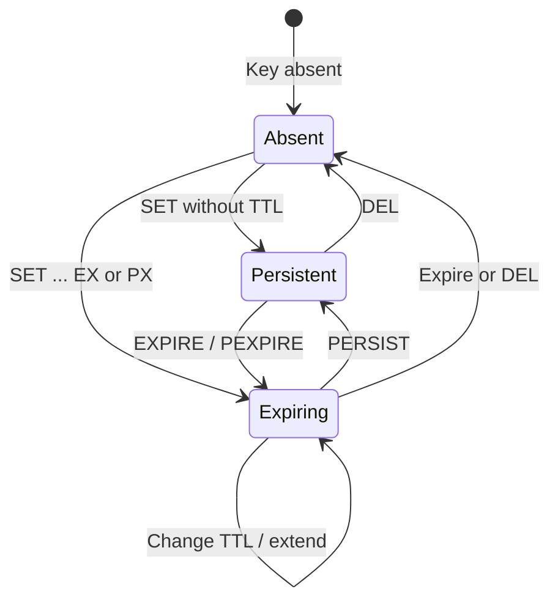

# Removing Expiration with PERSIST and Conditional Renewal

Redis is often used to store data that is valid only for a limited time: caches, verification codes, sessions, processing state, deduplication markers, or temporary locks. However, a key given a TTL does not always need to keep expiring. Some workflows want to **promote temporary data into non-expiring data**, or **extend a TTL only if the new deadline is later than the current one** so a delayed writer does not expire a key prematurely.

Redis provides two key groups of operations:

- **`PERSIST`:** removes the expiration metadata from an existing key while **keeping the key and its value intact**.
- **Conditional `EXPIRE` / `PEXPIRE`:** sets or updates expiration only when matching `NX`, `XX`, `GT`, or `LT`. Redis supports these options starting in Redis 7.0.

In Spring Data Redis, `RedisTemplate.persist(key)` removes expiration, while simple updates use `expire(key, Duration)`. For **conditional renewal**, choose an API compatible with your Spring Data Redis/Redis client version or issue the native Redis command through an appropriate supported mechanism. This lesson includes a short Lua script example solely to express the exact same conditional `EXPIRE` command, avoiding assumptions that a specific Java overload exists in every release.

The content covers TTL semantics, practicing PERSIST, distinguishing expiration options, designing deadlines, and handling concurrency in Spring Boot applications.

## 1. TTL is key state, not a data field

**TTL (Time To Live)** is the remaining time before Redis considers a key expired. Expiration attaches to the **Redis key**; it is not stored as a JSON field or separate value readable via `GET`.

Example:

```redis
SET profile:42 "draft" EX 600
GET profile:42
# "draft"

TTL profile:42
# Remaining seconds, usually near 600 right after writing
```

Calling `TTL` afterward produces one of the following:

| Result | Interpretation | Example situation |
| --- | --- | --- |
| Integer `>= 0` | Key exists and has an expiration; unit is **seconds** | `TTL profile:42` returns `421` |
| `-1` | Key exists but **has no expiration** | Written without TTL or `PERSIST` was called |
| `-2` | Key **does not exist** at check time | Never created, deleted, or expired |

`PTTL key` works similarly but returns remaining time in milliseconds. Use `PTTL` when observing short lifetimes or avoiding second-rounding resolution loss. For example, `PTTL` might return `250` while `TTL` already reads near 0.

### Basic states



**Do not confuse `PERSIST` with `DEL`.** `PERSIST` only removes the deadline; `DEL` removes the key and value themselves. After a successful `PERSIST`, `GET` / `HGET` / `SMEMBERS` can still read the key's data according to its Redis type.

### How does TTL differ across String, Hash, Set, and List?

`EXPIRE`, `PEXPIRE`, `TTL`, and `PERSIST` operate at the key level, applying across Redis Strings, Hashes, Sets, Sorted Sets, Lists, Streams, and other applicable types. For example, `PERSIST cart:42` removes the TTL of the **entire Hash** `cart:42`, not just one field inside it.

In newer Redis releases offering separate hash-field expiration APIs, those semantics belong to a distinct feature set with separate version requirements. `PERSIST key` in this lesson operates on **the entire key's expiration**.

## 2. PERSIST: removing TTL while preserving data

### Syntax and reply

```redis
PERSIST key
```

Redis returns:

- `1` if the key existed, previously had an expiration, and **its expiration was removed**.
- `0` if the key does not exist or exists **without any expiration already**.

Thus, `PERSIST` is an **atomic** command, though a `0` reply has two different causes. Never assume "`0` means the key does not exist."

### Walkthrough from scratch

```redis
SET lesson:persist "temporary" EX 120
# OK

TTL lesson:persist
# Positive seconds, near 120

PERSIST lesson:persist
# 1: expiration removed

TTL lesson:persist
# -1: key still exists without an expiration

GET lesson:persist
# "temporary": value unchanged

PERSIST lesson:persist
# 0: no TTL left to remove

DEL lesson:persist
# 1: key deleted

PERSIST lesson:persist
# 0: key no longer exists
```

State after a successful `PERSIST`:

```text
Before:
  key = lesson:persist
  value = "temporary"
  deadline = now + ~120 s

PERSIST lesson:persist

After:
  key = lesson:persist
  value = "temporary"
  deadline = none (-1)
```

Redis can still remove a key with no TTL due to **client delete commands, memory eviction policies, failover/persistence behavior, or other changes**. "No TTL" **does not mean** the key is guaranteed to survive forever under all infrastructure conditions.

### When is there a valid reason to use PERSIST?

| Scenario | Before | After PERSIST | What to watch out for |
| --- | --- | --- | --- |
| Draft approved into official config | `config:draft:42` has a TTL | Same key no longer expires automatically | Define approval permissions and authoritative source clearly |
| Data rescued from a temporary window | Record had an impending deadline | Keep record longer for inspection | Avoid keeping tokens/PII beyond policy limits |
| Fixing TTL on a key meant to persist | 10 seconds of TTL left | TTL becomes `-1` | Find and fix the producer that attached the wrong TTL |
| Key marking completed state | In-progress state had TTL | Completed state has no TTL | Consider storing in DB rather than Redis if durability is needed |

`PERSIST` alters data lifecycles. Keys kept indefinitely affect **memory cost, retention, privacy, security, and cleanup workflows**; therefore, never call PERSIST as a blanket fix for expiration bugs without understanding why the original deadline existed.

## 3. Using PERSIST in Spring Data Redis

A Spring Boot application needs the Redis starter dependency in its build configuration.

**Gradle Groovy DSL**

```groovy
dependencies {
    implementation 'org.springframework.boot:spring-boot-starter-data-redis'
}
```

**Maven**

```xml
<dependency>
    <groupId>org.springframework.boot</groupId>
    <artifactId>spring-boot-starter-data-redis</artifactId>
</dependency>
```

Projects using the Spring Boot parent/BOM generally omit explicit starter versions.

Example connection config for Spring Boot 3.x:

```yaml
spring:
  data:
    redis:
      host: localhost
      port: 6379
      timeout: 2s
```

If Spring Boot runs in one container and Redis in another, `localhost` will usually not point to Redis; configure the actual service hostname.

### Example service removing expiration

```java
import java.time.Duration;
import java.util.concurrent.TimeUnit;
import org.springframework.data.redis.core.StringRedisTemplate;
import org.springframework.stereotype.Service;

@Service
public class ProfileExpirationService {

    private final StringRedisTemplate redis;

    public ProfileExpirationService(StringRedisTemplate redis) {
        this.redis = redis;
    }

    public void saveDraft(String profileId, String json) {
        redis.opsForValue().set(
                keyFor(profileId),
                json,
                Duration.ofMinutes(30)
        );
    }

    public boolean keepPermanently(String profileId) {
        Boolean changed = redis.persist(keyFor(profileId));
        return Boolean.TRUE.equals(changed);
    }

    public Long remainingTtlSeconds(String profileId) {
        return redis.getExpire(
                keyFor(profileId),
                TimeUnit.SECONDS
        );
    }

    private String keyFor(String profileId) {
        if (profileId == null || !profileId.matches("[A-Za-z0-9_-]{1,64}")) {
            throw new IllegalArgumentException("Invalid profile ID");
        }
        return "profile:draft:" + profileId;
    }
}
```

In standard calls:

- `saveDraft(...)` uses `SET` with a 30-minute TTL in one Redis command.
- `keepPermanently(...)` invokes `PERSIST`. `true` only confirms an expiration was just removed; `false` **does not distinguish** between a missing key and an already non-expiring key.
- `remainingTtlSeconds(...)` returns a `Long`, typically remaining seconds or `-1`/`-2`. Contexts like pipelines/transactions can return `null` before results are collected; this example assumes direct calls.

**Business caveat:** this illustrates TTL operations, not a complete profile approval workflow. For critical state transitions, never call `PERSIST` and assume the primary source of truth is updated; Redis does not participate in distributed transactions with relational databases or external systems.

### Do not rely on two calls to build an atomic condition

The following code has a race condition:

```java
Long ttl = redis.getExpire("profile:draft:42");
if (ttl != null && ttl > 0) {
    redis.persist("profile:draft:42");
}
```

Another client can delete the key or change its value/TTL between `getExpire` and `persist`. If you just want to "remove TTL if present," **calling PERSIST directly** is already atomic. If you must check an owner/token or value state before removing TTL, match and PERSIST inside a script or another atomic mechanism.

## 4. Conditional EXPIRE: NX, XX, GT, LT

Basic command:

```redis
EXPIRE key seconds
```

sets a relative lifetime in seconds from when Redis processes the command. Starting with Redis **7.0**, conditions can be appended:

```redis
EXPIRE key seconds NX
EXPIRE key seconds XX
EXPIRE key seconds GT
EXPIRE key seconds LT
```

Millisecond and absolute-timestamp variants offer matching option sets—such as `PEXPIRE`, `EXPIREAT`, and `PEXPIREAT`—on supporting versions. When combining multiple options in one command, check your Redis version's combination rules; the examples below **use one option at a time** to keep each condition clear.

| Condition | Redis sets new TTL only when… | Key already has TTL? | Key exists without TTL? |
| --- | --- | --- | --- |
| No option | Key exists; overwrites current deadline | Resets TTL | Sets new TTL |
| **`NX`** | Key **has no expiration yet** | Unchanged | **Sets TTL** |
| **`XX`** | Key **already has an expiration** | **Updates TTL** | Unchanged |
| **`GT`** | New deadline is **later than** current deadline | Extends only, never shortens | Does not set TTL because no-TTL counts as infinite deadline |
| **`LT`** | New deadline is **earlier than** current deadline | Shortens only, never extends | **Sets TTL** because no-TTL counts as infinite deadline |

Across all four options, **a missing key is never created** by `EXPIRE`. They only modify expiration on an existing key. To create a key together with a TTL, use `SET key value EX/PX ...` or a matching write path.

**Watch out for `NX`:** `EXPIRE ... NX` differs from `SET ... NX`.

- `SET k v NX` writes a value if **the key does not exist**.
- `EXPIRE k 60 NX` sets expiration if **the key exists without an expiration**.

Confusing these two definitions leads to false assumptions about key creation or handling expired keys.

### Return values

`EXPIRE` returns:

- `1`: Redis applied the expiration per the condition.
- `0`: key does not exist or condition was not met.

Like `PERSIST`, a `0` reply alone does not state the exact reason. If business errors require distinguishing causes, evaluate state according to your app contract, keeping in mind that any separate inspection command can observe changed data.

## 5. Practicing NX: setting TTL only on existing non-expiring keys

Scenario: an import pipeline created data keys without attaching TTLs; a job wants to add a TTL **once**, without shortening or extending keys that already have a deadline.

```redis
SET lesson:nx "first"
# Key exists without expiration

TTL lesson:nx
# -1

EXPIRE lesson:nx 120 NX
# 1: key had no expiration; TTL is set

TTL lesson:nx
# Near 120

EXPIRE lesson:nx 600 NX
# 0: key already has expiration; unchanged

TTL lesson:nx
# Still counting down from original deadline
```

`NX` helps when multiple workers attempt to **initialize expiration once**. However:

- `NX` does not guarantee only one worker created the underlying key; it only inspects expiration metadata at execution time.
- If the key is deleted and recreated, `NX` can succeed again on the new key.
- If the key does not exist, `EXPIRE NX` returns `0` without creating a value.

When initializing both value and TTL for a new key, prefer:

```redis
SET lesson:created "payload" NX EX 120
```

That creates **value and TTL in the same command**, avoiding `SETNX` followed by `EXPIRE NX` across two round trips with a gap in between.

## 6. Practicing XX: updating only keys that already have a TTL

Scenario: temporary data may be extended, yet the application **must not accidentally convert a permanent key into an expiring one**.

```redis
SET lesson:xx "temporary" EX 60

EXPIRE lesson:xx 180 XX
# 1: key has TTL; resets deadline to 180 seconds from call time

TTL lesson:xx
# Near 180

PERSIST lesson:xx
# 1: key no longer has TTL

EXPIRE lesson:xx 300 XX
# 0: because key is now persistent

TTL lesson:xx
# -1
```

**Crucial distinction:** `XX` only checks that a TTL exists. It **does not ensure the new duration is longer** than the old one. For example:

```redis
SET lesson:xx-short "value" EX 600
EXPIRE lesson:xx-short 30 XX
# 1: even though this shortens TTL from ~600 down to ~30
```

If the rule is **extend only, never shorten**, you need `GT` instead of `XX` alone.

## 7. Practicing GT: extending only when the new deadline is later

`GT` stands for **greater than**: comparing the proposed expiration timestamp against the current expiration timestamp. With relative `EXPIRE`, the command succeeds only if the new deadline lies **further in the future**.

```redis
SET lesson:gt "active" EX 120
# Key has TTL near 120 seconds

EXPIRE lesson:gt 300 GT
# 1: new deadline is later than old deadline

EXPIRE lesson:gt 60 GT
# 0: would shorten, so rejected

TTL lesson:gt
# Continues counting down from the 300-second deadline
```

This fits situations where **late updates must never shorten a TTL**:

- A temporary lease extended if work is approved to continue.
- Multiple workers computing different TTLs while keeping only the furthest deadline.
- Cache or session monotonic extensions, preventing low-priority refreshes from shrinking an already-extended lifetime.

### GT on a key without expiration

```redis
SET lesson:gt-persistent "value"
EXPIRE lesson:gt-persistent 120 GT
# 0

TTL lesson:gt-persistent
# -1
```

Redis treats a key **with no expiration** as having an **infinite** deadline when evaluating `GT` / `LT`. No finite TTL is "greater than infinity," so `GT` cannot attach a TTL to a persistent key.

That is often desirable: if an earlier operation ran `PERSIST` to keep a key, a later worker running `EXPIRE GT` **will not revert it into an expiring key**.

### GT does not verify lease ownership

`EXPIRE key 300 GT` only checks deadlines; it does not know whether the writer holds a valid token. In distributed locks, a worker that lost ownership must not extend a new worker's lock just because `GT` passes. Verify the **owner token** and extend in the same atomic operation (e.g., Lua script) or use a lock library meeting system requirements.

## 8. Practicing LT: applying only an earlier deadline

`LT` stands for **less than**: sets expiration only when the new deadline is **earlier than** the current deadline.

```redis
SET lesson:lt "value" EX 600

EXPIRE lesson:lt 120 LT
# 1: shortens lifetime from ~600 down to ~120

EXPIRE lesson:lt 900 LT
# 0: 900 seconds would extend, so rejected

TTL lesson:lt
# Still counting down from the 120-second deadline
```

`LT` is particularly helpful for **enforcing an upper bound on deadlines**: for instance, a confirmation ticket must never outlive a business-mandated cutoff.

### LT on a persistent key

```redis
SET lesson:lt-persistent "value"

EXPIRE lesson:lt-persistent 90 LT
# 1

TTL lesson:lt-persistent
# Near 90
```

Because a key without TTL has an infinite deadline, any valid finite expiration is earlier than infinity—so `LT` converts a persistent key into an expiring key.

This is a **key difference** from `GT` and why you must never apply an expiration flag based on the word "renew" without knowing its exact comparison rules.

## 9. Summary table of initial states and option behavior

Assume the key exists and the command specifies a valid positive TTL:

| Key state before command | `EXPIRE 180 NX` | `EXPIRE 180 XX` | `EXPIRE 180 GT` | `EXPIRE 180 LT` |
| --- | --- | --- | --- | --- |
| No TTL (persistent) | **Applied** | Ignored | Ignored | **Applied** |
| ~60s TTL left | Ignored | **Applied** | **Applied** | Ignored |
| ~300s TTL left | Ignored | **Applied** | Ignored | **Applied** |
| Key missing | Ignored | Ignored | Ignored | Ignored |

"60" and "300" are illustrative numbers. Redis compares the **actual deadline at execution time**, not stale TTL values read by Java milliseconds earlier. Therefore, when the rule is "only extend," enforcing `GT` inside the Redis command itself is safer than reading TTL and deciding on the client.

### NX/XX/GT/LT semantics are not value checks

All four conditions inspect **key expiration metadata**. They do not verify:

- Whether the key's value equals an expected string.
- Whether the user is authorized to alter TTL.
- Whether the session was revoked in the primary database.
- Whether the new deadline exceeds a business maximum.

For business constraints, add explicit checks and combine them with the TTL change when races must be prevented.

## 10. Conditional renewal with absolute timestamps: EXPIREAT / PEXPIREAT

Relative TTLs like `EXPIRE key 300` anchor to **when Redis processes the command**. When two systems agree on an absolute deadline, use:

```redis
EXPIREAT key unixSeconds
PEXPIREAT key unixMilliseconds
```

On Redis versions supporting the matching condition options:

```redis
EXPIREAT token:42 1900000000 LT
PEXPIREAT token:43 1900000000000 GT
```

Numbers in this example are **illustrative Unix epochs**, not real production deadlines. In production, compute them from an `Instant` or reliable clock, ensuring seconds vs. milliseconds match.

`EXPIREAT ... LT` helps **cap a deadline so it is no later than a policy cutoff**. `PEXPIREAT ... GT` works when deadlines may only move later.

If the target timestamp is already in the past, a valid expiration command can trigger **immediate key deletion** per Redis semantics. Always validate deadlines before sending and never treat `EXPIREAT` as harmless "timestamp storage."

### Why can absolute deadlines beat repeated relative TTLs?

Suppose an OTP is generated at 10:00 with a **hard expiration at 10:05**. If every request calls `EXPIRE otp:42 300`, a request at 10:04 pushes the deadline to ~10:09, violating the original rule.

Instead, manage the absolute 10:05 deadline:

- Write the initial key with an expiration matching the deadline.
- If adjustments are ever needed, only pull the deadline **earlier** using the proper condition.
- At the business layer, verify the deadline on critical actions rather than relying solely on key presence.
- Prevent any worker using relative TTLs from unintentionally extending a business-fixed deadline.

## 11. Spring Data Redis: standard expiration calls

In Spring Data Redis, the standard way to set an expiration on an existing key is:

```java
import java.time.Duration;
import org.springframework.data.redis.core.StringRedisTemplate;

Boolean applied = stringRedisTemplate.expire(
        "profile:draft:42",
        Duration.ofMinutes(15)
);
```

`expire(key, Duration)` expresses a standard **unconditional** expiration. In direct calls, `true` generally means Redis applied the expiration, and `false` means it could not (e.g., key missing).

Keep in mind: if the key already had a TTL, this unconditional command can **replace a long TTL with a short one** or vice versa. If business requires extend-only, `expire(key, Duration)` does not enforce `GT` automatically.

### PERSIST on Redis Hash, Set, and String keys

Suppose:

```java
stringRedisTemplate.opsForHash().put("profile:42", "status", "ACTIVE");
stringRedisTemplate.expire("profile:42", Duration.ofHours(1));
stringRedisTemplate.persist("profile:42");
```

As a result, the **entire Hash key `profile:42`** loses its TTL. The same holds for Sets, Lists, and Sorted Sets: `persist` does not care about the inner data type because it modifies key-level expiration metadata.

Some Spring Boot apps also use automatic caching layers (`@Cacheable`, `RedisCacheManager`). Cache keys may be created with configured TTLs. Manually calling `persist` on those keys can break cache eviction rules; know key ownership and eviction policies before altering TTLs.

## 12. Executing conditional EXPIRE from Spring Data Redis

Depending on the Spring Data Redis version and Redis driver, Java APIs offer varying ways to express expiration conditions. `NX` / `XX` / `GT` / `LT` are **Redis server semantics since Redis 7.0**; avoid assuming a specific Java overload or enum name exists across every release.

A clean way to demonstrate this from `StringRedisTemplate` is a short **RedisScript** passing the option to the `EXPIRE` command itself. The script is not here to "make two commands atomic": **conditional EXPIRE is already a single atomic command**. The script simply acts as a portable bridge in environments supporting Lua and those Redis options.

### 12.1. Java service with fixed options

```java
import java.time.Duration;
import java.util.List;
import java.util.Objects;
import org.springframework.data.redis.core.StringRedisTemplate;
import org.springframework.data.redis.core.script.RedisScript;
import org.springframework.stereotype.Service;

@Service
public class ConditionalExpiryService {

    private static final RedisScript<Long> CONDITIONAL_EXPIRE =
            RedisScript.of(
                    """
                    return redis.call(
                        'EXPIRE',
                        KEYS[1],
                        tonumber(ARGV[1]),
                        ARGV[2]
                    )
                    """,
                    Long.class
            );

    private final StringRedisTemplate redis;

    public ConditionalExpiryService(StringRedisTemplate redis) {
        this.redis = redis;
    }

    public boolean setTtlIfAbsent(String key, Duration ttl) {
        return changeTtl(key, ttl, Mode.NX);
    }

    public boolean refreshOnlyIfExpiring(String key, Duration ttl) {
        return changeTtl(key, ttl, Mode.XX);
    }

    public boolean extendOnly(String key, Duration ttl) {
        return changeTtl(key, ttl, Mode.GT);
    }

    public boolean shortenOnly(String key, Duration ttl) {
        return changeTtl(key, ttl, Mode.LT);
    }

    private boolean changeTtl(String key, Duration ttl, Mode mode) {
        Objects.requireNonNull(key, "key");
        Objects.requireNonNull(ttl, "ttl");
        Objects.requireNonNull(mode, "mode");

        // This example uses EXPIRE with positive whole seconds.
        // Durations under 1 second are invalid for this method.
        long seconds = ttl.getSeconds();
        if (seconds <= 0 || key.isBlank()) {
            throw new IllegalArgumentException(
                    "key must be nonblank and TTL at least one second"
            );
        }

        Long changed = redis.execute(
                CONDITIONAL_EXPIRE,
                List.of(key),
                Long.toString(seconds),
                mode.name()
        );

        return Objects.requireNonNull(
                changed,
                "No Redis expiry result"
        ) == 1L;
    }

    private enum Mode {
        NX, XX, GT, LT
    }
}
```

This snippet uses Java 17+ (text blocks) with a Spring Data Redis version supporting `RedisScript.of`. The Redis server must support `NX/XX/GT/LT` on `EXPIRE` (Redis 7.0+). On older servers, the script's command will be rejected; do **not** silently fall back to `getExpire()` then `expire()` over two round trips if business correctness relies on atomicity.

In production implementations, `PEXPIRE` can be used when millisecond precision is needed and supported by your driver/API. This example deliberately requires a **TTL of at least one second** and uses `ttl.getSeconds()`; passing `Duration.ofMillis(500)` fails validation instead of accidentally sending TTL 0. For durations longer than one second with sub-second fractions, this code truncates to whole seconds; define rounding rules and use business-appropriate resolution.

### 12.2. Using the service

```java
// Attach TTL only if key exists without an expiration.
boolean initialized = conditionalExpiryService.setTtlIfAbsent(
        "profile:42",
        Duration.ofMinutes(15)
);

// Push deadline further out only.
boolean extended = conditionalExpiryService.extendOnly(
        "worker:lease:42",
        Duration.ofMinutes(10)
);

// Shorten deadline only; useful for hard time limits.
boolean shortened = conditionalExpiryService.shortenOnly(
        "token:verification:42",
        Duration.ofSeconds(30)
);

// Reset TTL only on keys that already have an expiration.
boolean refreshed = conditionalExpiryService.refreshOnlyIfExpiring(
        "session:42",
        Duration.ofMinutes(20)
);
```

`false` means **the conditional expiration was not applied**, not that Redis hit an error. If Redis is unreachable, the script is invalid, or options are unsupported, the call throws an exception; never swallow all exceptions into `false`.

### 12.3. Why not compare TTL in Java?

An unsafe approach:

```java
Long current = redis.getExpire("worker:lease:42");

if (current != null && current >= 0 && current < 600) {
    redis.expire("worker:lease:42", Duration.ofSeconds(600));
}
```

Between the two commands, another writer could have extended the TTL to 2,000 seconds. The subsequent `expire(..., 600)` **pulls the deadline back down**. By contrast, `EXPIRE key 600 GT` has Redis compare and update the expiration **in one command**, eliminating the check-then-act race for that step.

If the business also needs to validate a value token/version, `GT` alone is still insufficient; perform server-side matching before altering expiration.

## 13. How do PERSIST and other write commands affect TTL?

In practice, seeing a TTL "reappear right after removing it" usually points to **another writer** or code overwriting the value.

| Command/operation | Effect on key and TTL |
| --- | --- |
| `PERSIST key` | Keeps key/value, removes current expiration |
| `SET key value` | Overwrites String value and **usually clears old expiration** if no keep/set TTL option is given |
| `SET key value EX 300` | Writes new value and sets fresh 300-second TTL |
| `SET key value KEEPTTL` | Writes new value, intentionally keeping existing expiration if present |
| `HSET key field value` | Adds/updates Hash field; normally does not clear TTL on existing Hash key |
| `SADD key member` | Adds member to Set; normally does not clear existing key TTL |
| `INCR key` | Increments numeric String; normally does not clear existing TTL |
| `EXPIRE key seconds` | Overwrites expiration with new deadline when key exists |
| `EXPIRE key seconds NX/XX/GT/LT` | Conditionally updates expiration |
| `DEL key` | Deletes key along with expiration metadata |
| `GETEX key PERSIST` | Reads String value and removes TTL in one command, where Redis supports it |

**Note:** "Normally does not clear TTL" for `HSET`, `SADD`, `INCR` means that when updating an **existing key**, its expiration does not vanish. If the operation creates a brand-new key, that key gets no automatic TTL unless another command or mechanism sets one.

### Difference between GET then PERSIST and GETEX ... PERSIST

Redis supports:

```redis
GETEX session:42 PERSIST
```

for Redis Strings on compatible versions. This command both **reads the current value** and **removes the expiration** in one operation. If the application instead runs:

```redis
GET session:42
PERSIST session:42
```

another writer could replace the value or let the key expire between commands. `GETEX ... PERSIST` avoids the intermediate window for reading and persisting a Redis String, though business policy must still justify making a session non-expiring upon read.

In Spring Data Redis, certain versions expose APIs to read and clear TTL (such as `ValueOperations.getAndPersist`). Check the API in your **actual Spring Data Redis version** rather than assuming from another version's examples.

## 14. Value-conditional PERSIST: when only the owner may remove TTL

`PERSIST` itself has no option to compare values. To express "remove expiration only if the key still belongs to the current operation," a simple Lua pattern is:

```lua
-- KEYS[1]: String key
-- ARGV[1]: expected owner token/value

if redis.call('GET', KEYS[1]) == ARGV[1] then
    return redis.call('PERSIST', KEYS[1])
end

return 0
```

Within the same script execution:

1. Redis reads the current value.
2. Compares it with the expected token.
3. Calls `PERSIST` only if the token still matches.

This prevents a client holding a stale token from removing the expiration of a **new value** written by another writer, since no external command can interleave between the check and PERSIST.

However, **never use PERSIST to turn a distributed lock into a permanent lock** if the lock design requires automatic release on process crash. This script only illustrates atomic compare-and-persist. In production, account for caller authorization, unique tokens, auditing, and the impact of keys no longer expiring automatically.

If the key is a Hash or another data type, `GET` will fail; matching logic must use the corresponding read command—such as `HGET` on a token field—before calling `PERSIST` on the key.

## 15. Practical scenarios

### 15.1. Cache updated by multiple writers

Service A writes a cache with a 10-minute TTL; Service B decides to bump the TTL to 30 minutes because the data remains valid. If B runs an unconditional `EXPIRE 1800`, that works in the moment—yet a delayed Worker C could call `EXPIRE 300`, expiring the cache early.

If the rule is **deadlines may only be extended**, use `EXPIRE ... GT` across **every** writer participating in renewal. You cannot preserve monotonic deadlines if one writer uses GT while others still call unconditional `EXPIRE` or `SET` without matching expiration logic.

### 15.2. Promoting temporary data to official data

Workflow:

```text
Create draft with 30-minute TTL
    ↓
User confirms
    ↓
Write official state to authoritative data store
    ↓
Decide whether Redis data should be kept or deleted
    ↓
PERSIST key (only if policy permits indefinite retention)
```

If the official state truly requires durable storage, Redis `PERSIST` **cannot replace** database updates/transactions and backup processes. It is often cleaner to write to a canonical key namespace and delete the draft key rather than keeping a key named `draft` around forever.

### 15.3. Sessions with sliding expiration

Suppose each valid action extends a session by 15 minutes from that action. `EXPIRE session:42 900 XX` updates only sessions **that already have a TTL**; if you also must prevent late requests from shortening deadlines, `GT` is better. Yet `GT` alone does not verify whether the session was revoked or the user remains valid.

Safer session design considers:

- Whether the session also has a **hard deadline** that sliding TTL cannot cross.
- Whether sessions can be revoked immediately.
- Whether a refresh writer is allowed to resurrect a missing session.
- If Redis no longer holds the session, treating it as expired rather than recreating it via an expiration command.
- Ensuring only expiring keys get refreshed; abnormal persistent keys are left untouched because both GT and XX ignore them.

Never call `PERSIST` to "fix" an expired session if security policy mandates expiration. Doing so can create unexpectedly long-lived sessions.

### 15.4. Maximum deadline for verification codes

An OTP valid for 5 minutes from creation must never be extended:

- Store the business deadline explicitly.
- When TTL adjustments are needed, use `EXPIREAT ... LT` or an equivalent condition that only moves the deadline **earlier**.
- Never call `SET ... EX 300` again after failed code attempts.
- Once an OTP expires, reject it rather than reissuing the same value via a cache operation.

`LT` enforces "do not extend expiration" inside Redis, though it does not itself track attempt counts, used tokens, permissions, or OTP validity.

### 15.5. Background worker leases

A worker holds `job:42:lease` with a 60-second TTL. When more time is needed, `EXPIRE key 120 GT` extends only if the key still has a TTL and the new deadline is later. However, if the lease already passed to another worker, the old worker could still send GT unless renewal **simultaneously verifies the owner token**.

Lua pattern checking the token:

```lua
-- KEYS[1]: String key holding the owner token
-- ARGV[1]: owner token
-- ARGV[2]: extension seconds

if redis.call('GET', KEYS[1]) ~= ARGV[1] then
    return 0
end

return redis.call('EXPIRE', KEYS[1], tonumber(ARGV[2]), 'GT')
```

On Redis 7.0+, both the owner token must match and the new deadline must be later than the current one. If the old worker already lost the lease, the script stops it from extending. For workloads where a **stale worker** can write to systems outside Redis, you may also need fencing tokens and downstream coordination; renewing a Redis lease alone does not protect external resources.

## 16. What happens under multiple writers and timeouts?

### Not all operations observe the same ordering

Consider two tasks:

```text
Task A: PERSIST session:42
Task B: EXPIRE session:42 600
```

If A runs before B and B uses unconditional `EXPIRE`, the key gets a TTL again. If B runs before A, the key becomes persistent. The order in which Redis processes the commands determines the final state, not when the two Java requests started.

If business logic demands that once PERSIST succeeds no writer may re-attach a TTL, enforce **shared write rules** (e.g., renewing writers only use `GT`/`XX`) plus authorization/state versioning if needed. A one-off PERSIST call does not lock expiration metadata against other writers.

### Timeout does not mean Redis did not execute the command

A client sends `EXPIRE key 300 GT` or `PERSIST key`, and the reply is lost in transit. Java hits a timeout even though Redis **already applied** the operation. A retry may return `0` because:

- With `PERSIST`, the expiration was already removed on the first attempt.
- With `GT`, the new deadline is no longer greater than the newly set deadline.

Do not treat `0` on a retry as proof that the first attempt failed. Design idempotent APIs and current-state checks according to business needs.

### Atomicity differs from durability

Redis guarantees atomicity for individual commands and scripts on the executing server. That **does not guarantee** the command was replicated or persisted to disk before returning. Under crashes or failovers, final outcomes depend on persistence, replication, and deployment topology. For critical data, maintain an authoritative source of truth and dedicated recovery plan.

## 17. Observing expiration in operational environments

Useful diagnostic commands:

```redis
TYPE session:42
EXISTS session:42
TTL session:42
PTTL session:42
GET session:42
INFO stats
INFO commandstats
```

- `TYPE` prevents misreading the Redis data type.
- `EXISTS` checks whether the key currently exists, as a **snapshot** at command execution time.
- `TTL`/`PTTL` indicate whether the key currently has an expiration.
- `INFO stats` provides expiration and eviction counters depending on Redis version.
- `INFO commandstats` reveals command call counts and latency by command type, though it will not pinpoint "which writer called PERSIST on this specific key."

If the application sees "TTLs disappearing," trace the **write paths**:

1. Is anything calling `PERSIST`?
2. Is anything calling `SET key value` without TTL or `KEEPTTL`?
3. Is a cache layer or background job refreshing the key in another format?
4. Is a migration or hotfix task issuing unconditional commands?
5. Are multiple producers sharing a key namespace with conflicting retention policies?

If the application sees "TTLs growing longer":

1. Is `SET ... EX` or unconditional `EXPIRE` called on every refresh?
2. Is a writer calling `EXPIRE XX` when it actually needed `GT`?
3. Are seconds and milliseconds being mixed up?
4. Are deadlines computed from unsynchronized clocks across different services?

A single `TTL` reading captured during investigation does not prove key history; bounded event tracking, telemetry, and business logs are essential.

### Metrics worth watching

| Metric / event | Diagnostic meaning |
| --- | --- |
| Share of keys with `TTL=-1` in temporary namespaces | Keys losing deadlines or excessive `PERSIST` usage |
| Rate of `TTL=-2` when requests expect keys present | Early expiration, deletions, or wrong endpoint |
| Success/failure counts for `NX/XX/GT/LT` renewals | Evaluates writer logic and race conditions |
| Redis `expired_keys` | Expiration rate; interpret relative to workload |
| Redis `evicted_keys` | Keys dropped due to memory policy; **not equivalent** to TTL expiration |
| Redis command latency and client timeouts | Separates server slowness, network, pool, and Java execution issues |
| Growing persistent key count in cache namespaces | Risk of unbounded memory growth |

Never run `KEYS *` regularly in production to hunt for keys missing TTLs; full keyspace scans can stall Redis. If an inventory is necessary, use rate-limited batched `SCAN` and inspect metadata on representative samples. Even a scan is not a consistent snapshot while keys mutate.

## 18. Common misconceptions

| Misconception | Why it is wrong | Correct understanding |
| --- | --- | --- |
| "`PERSIST` deletes the key." | `PERSIST` only removes the deadline. | `DEL` deletes the key; `PERSIST` keeps the value and sets TTL to `-1` on success. |
| "`PERSIST` returning 0 means the key does not exist." | The key might exist without a TTL. | Check state as needed; separate reply code from cause. |
| "`EXPIRE NX` sets TTL if the key is missing." | `NX` on `EXPIRE` checks **no existing expiration**, not missing key. | The key must exist; persistent keys are where `NX` can succeed. |
| "`XX` only extends, never shortens." | `XX` only requires the key to have a TTL. | Use `GT` when the new deadline must be later. |
| "`GT` attaches TTL to persistent keys." | No-TTL counts as an infinite deadline. | `GT` skips persistent keys; `LT` can apply a finite TTL. |
| "`LT` cannot apply if a key has no TTL." | Infinite deadline is greater than any finite deadline. | `LT` converts a persistent key into an expiring one. |
| "Reading TTL and comparing in Java is atomic too." | Another writer can intervene between commands. | Use conditional options in the command itself or an atomic script. |
| "One `PERSIST` keeps a key alive forever." | Eviction, `DEL`, infra failures, or policies can still remove it. | Persistent only means no TTL. |
| "Overwriting with `SET` preserves the old TTL." | Plain `SET` removes old expiration. | Use `SET EX/PX` or `KEEPTTL` as intended. |
| "Updating a field with `HSET` always clears the Hash's TTL." | `HSET` on an existing key normally keeps the key's TTL. | Distinguish field updates from replacing a String with `SET`. |
| "Renewing a lease with `GT` proves ownership." | `GT` does not inspect value/owner tokens. | Match owner and extend atomically; consider fencing. |
| "Successful `expire` guarantees data stays until deadline." | `DEL`, eviction, or crash/failover can intervene. | TTL is not a durability guarantee. |

## 19. Comprehensive hands-on lab with the Redis CLI

These examples use dedicated `lesson:*` keys. Run only on a test Redis instance where writes and deletes are safe; `DEL` removes keys with those names.

### Exercise A — Removing TTL

```redis
DEL lesson:persist:a
SET lesson:persist:a "ready" EX 30
TTL lesson:persist:a
PERSIST lesson:persist:a
TTL lesson:persist:a
GET lesson:persist:a
```

Expected: `PERSIST` returns `1`; TTL afterward is `-1`; value remains `"ready"`.

### Exercise B — NX does not extend

```redis
DEL lesson:expire:nx
SET lesson:expire:nx "v"
EXPIRE lesson:expire:nx 60 NX
EXPIRE lesson:expire:nx 300 NX
TTL lesson:expire:nx
```

Expected: the two `EXPIRE` commands return `1` then `0`. The deadline comes from the first 60-second assignment.

### Exercise C — XX can shorten

```redis
DEL lesson:expire:xx
SET lesson:expire:xx "v" EX 600
EXPIRE lesson:expire:xx 30 XX
TTL lesson:expire:xx
```

Expected: `EXPIRE XX` returns `1`; TTL is near 30, not near 600.

### Exercise D — GT only increases

```redis
DEL lesson:expire:gt
SET lesson:expire:gt "v" EX 120
EXPIRE lesson:expire:gt 300 GT
EXPIRE lesson:expire:gt 30 GT
TTL lesson:expire:gt
```

Expected: the two `EXPIRE` commands return `1` and `0`; TTL continues counting from ~300 seconds.

### Exercise E — LT can apply TTL to a persistent key

```redis
DEL lesson:expire:lt
SET lesson:expire:lt "v"
EXPIRE lesson:expire:lt 90 LT
EXPIRE lesson:expire:lt 600 LT
TTL lesson:expire:lt
```

Expected: the first `LT` returns `1` because the old deadline was infinite; the second `LT` returns `0` because it would extend.

### Exercise F — Combining PERSIST with conditional renewal

```redis
DEL lesson:lifecycle
SET lesson:lifecycle "confirmed" EX 60
PERSIST lesson:lifecycle
EXPIRE lesson:lifecycle 300 GT
EXPIRE lesson:lifecycle 300 XX
TTL lesson:lifecycle
```

Expected: `PERSIST` returns `1`; both `GT` and `XX` return `0` because the key no longer has an expiration; TTL stays `-1`.

Finally, clean up the named `lesson:*` keys **explicitly** in your test environment. Do not combine `KEYS lesson:*` with bulk deletion carelessly on a shared Redis instance.

## 20. Thought exercises

**Question 1.** `PERSIST token:42` returns `0`. Can you conclude the key does not exist? What extra check distinguishes the cases?

*Hint:* the key may already be persistent; `TTL` distinguishes `-1` from `-2`.

**Question 2.** Two writers update the same key's TTL concurrently: writer A wants 900 seconds, writer B wants 60 seconds. If business rules only allow extending deadlines, which option should be used?

*Hint:* `GT`, and every participating writer must follow this rule.

**Question 3.** A key is currently persistent. How do `EXPIRE key 600 NX`, `EXPIRE key 600 XX`, `EXPIRE key 600 GT`, and `EXPIRE key 600 LT` behave differently?

*Hint:* NX/LT can set the TTL, while XX/GT skip it. If testing sequentially on the same key, the first command changes state for later ones; reset the initial state between trials.

**Question 4.** Why does `EXPIRE key 60 XX` fail to protect an existing deadline 600 seconds away?

*Hint:* `XX` only checks whether the key has an expiration, not whether it is longer or shorter.

**Question 5.** A token must strictly expire at 12:00 UTC. What bug can calling `EXPIRE token 300` on every request introduce?

*Hint:* relative TTL resets per request and can push past the hard cutoff; consider absolute expiration and non-extending policies.

**Question 6.** An application reads `getExpire` and if TTL is below 300, calls `expire(300)`. When does a race condition occur?

*Hint:* another writer can extend the key to a longer deadline between the two commands.

**Question 7.** An old worker holds token `A` with an expired lease; a new worker holds token `B`. The old worker sends `EXPIRE key 300 GT`. Why might Redis extend it for the wrong worker?

*Hint:* `GT` only compares TTLs, not owners; verify the token before extending.

**Question 8.** Redis enforces memory eviction; a key that succeeded `PERSIST` later vanishes. Is that necessarily a bug in `PERSIST`?

*Hint:* persistent means no TTL; keys can still be deleted or evicted under system policies.

**Question 9.** A Hash has a 60-second TTL; a service calls `HSET` to edit a field and sees the TTL remain. What differs if a service runs `SET` to write a String value to the same key name?

*Hint:* `HSET` updates a Hash field, whereas `SET` replaces a String value with different expiration semantics; using the wrong type command can also return `WRONGTYPE`.

**Question 10.** An API loops over thousands of keys applying `EXPIRE NX`. Does that guarantee all keys still exist with exact expirations by the time the API responds?

*Hint:* each command is atomic on its key, yet the overall loop is not a transaction or snapshot; keys can continue mutating.

## 21. Key takeaways

**`PERSIST key` removes expiration while keeping the key and value intact.** It returns `1` when an expiration was actually removed and `0` when the key does not exist or had no TTL. Once successful, `TTL` returns `-1`; that means **no deadline**, not an unconditional durability promise.

For Redis 7.0+, **conditional `EXPIRE`** enforces atomic deadline rules: **`NX`** sets only when no TTL exists; **`XX`** changes only when a TTL exists; **`GT`** only lengthens deadlines; **`LT`** only shortens deadlines. Persistent keys count as having an infinite deadline in `GT`/`LT` comparisons, so **`GT` does not attach TTL to persistent keys while `LT` can**.

In Spring Data Redis, `redisTemplate.persist(key)` directly removes expiration; `expire(key, Duration)` sets an unconditional expiration, while `NX`/`XX`/`GT`/`LT` require an approach compatible with your Redis/client version or explicitly executing the conditional native command. Never replace an atomic command with "read TTL then compare in Java" when multiple writers update concurrently. Finally, TTL metadata constraints **do not replace** owner authentication, business deadline bounds, retention policies, and data recovery plans.
