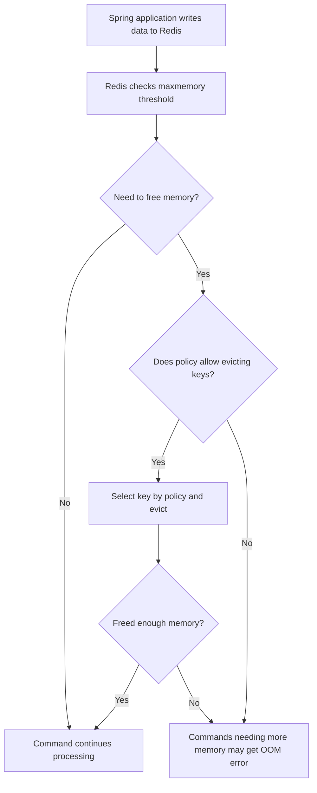

# `maxmemory` Policies and Eviction Groups in Redis

> **Context:** Spring Data Redis · **Chapter:** Expiration and Eviction  
> **Goal:** Understand how Redis decides which keys to delete when memory runs low, distinguish eviction from TTL expiration, configure the right policy for each type of data, and recognize the impact on Spring applications.

## 1. Why does Redis need an eviction policy?

Redis stores most of its data in RAM. In a Spring application, Redis can serve multiple roles: caching query results, storing login session data, rate limiting, leaderboards, or business data structures. These types of data have different tolerances for loss.

When Redis is used as a cache, an early key deletion may simply cause a **cache miss**: the application reads the data again from the source and populates a new cache entry. Conversely, if Redis holds business data that cannot be recreated, eviction can cause data loss even before a key's TTL expires.

Two mechanisms are easily confused:

- **Expiration:** A key with a TTL is deleted when its expiration timestamp arrives. The trigger is **time**, regardless of how much RAM Redis has free.
- **Eviction (removal due to memory pressure):** Redis actively removes keys according to `maxmemory-policy` to make room for data when memory is constrained. A key **whose TTL has not expired** can still be evicted.

`maxmemory` sets the memory threshold Redis uses to decide whether eviction is needed; `maxmemory-policy` determines **which keys are eligible** and **how keys are chosen**. Both settings belong to the **Redis server**, not to `RedisTemplate`, `RedisCacheManager`, or Spring Boot connection properties.

### High-level processing flow



This is a conceptual diagram; Redis actually enforces memory within the server's command-processing loop, so a single large command can temporarily push memory usage past the threshold.

## 2. Configuring `maxmemory` and `maxmemory-policy`

### 2.1. Setting limits in `redis.conf`

Example of a dedicated cache Redis instance limiting data and related memory to 512 MB, prioritizing frequently accessed keys:

```conf
maxmemory 512mb
maxmemory-policy allkeys-lfu
maxmemory-samples 5
```

- `maxmemory 512mb`: Redis begins handling memory pressure once usage exceeds this threshold.
- `maxmemory-policy allkeys-lfu`: Can evict any key, preferring keys with low access frequency based on LFU approximation.
- `maxmemory-samples 5`: Number of samples examined when selecting candidates in sampling algorithms. Increasing samples yields results closer to the ideal algorithm, at higher CPU cost.

Setting `maxmemory 0` means no data memory limit of this kind is imposed; this is the default on 64-bit Redis systems unless configured otherwise. **Do not treat `0` as a RAM safety guarantee**: the operating system or container still has its own limits.

In Redis Open Source, the typical default for `maxmemory-policy` is `noeviction`. Some managed Redis services may provide a different default; check your actual instance.

### 2.2. Changing settings while Redis is running

```bash
redis-cli CONFIG GET maxmemory
redis-cli CONFIG GET maxmemory-policy
redis-cli CONFIG GET maxmemory-samples

redis-cli CONFIG SET maxmemory 512mb
redis-cli CONFIG SET maxmemory-policy allkeys-lfu
```

`CONFIG SET` changes the running configuration. If Redis is managed via a config file and you want to persist dynamic changes back to the file, consider `CONFIG REWRITE` where permitted. With Redis Cloud or platform-managed Redis, policies are typically updated via the provider's console or API; `CONFIG SET` may be restricted.

Changing the policy affects the **entire keyspace of the Redis instance** (or each shard in Redis Cluster), not just a single cache name or a single Redis logical database. In Redis Cluster, each shard experiences memory pressure and performs eviction based on its own state.

### 2.3. `maxmemory` is not an absolute process RAM ceiling

When planning memory capacity, distinguish between:

- **Memory Redis counts toward eviction decisions:** memory tracked by Redis to compare against `maxmemory`.
- **Replication/AOF buffers:** a portion of RAM used for replication and persistence is excluded from eviction accounting to avoid an "evict -> generate more buffer data -> evict again" loop.
- **Memory fragmentation, allocator overhead, internal structures, large command payloads:** can push process or OS RAM usage above `maxmemory`.

`INFO memory` exposes `mem_not_counted_for_evict` to track memory excluded from eviction accounting, along with fields like `used_memory`, `used_memory_rss`, `used_memory_dataset`, and `maxmemory`. Therefore, setting `maxmemory` equal to the total RAM allocated to the container/host creates a risk of real out-of-memory failures. Leave headroom for non-dataset overhead and monitor actual load.

## 3. Categorizing all eviction policies

There are three groups to remember:

1. **`noeviction`:** does not automatically evict keys to make room.
2. **`allkeys-*`:** every key can become an eviction candidate, whether or not it has a TTL.
3. **`volatile-*`:** only keys that currently have an expiration are eligible for eviction. Here, `volatile` refers to **keys with a TTL**, not all in-memory data.

### 3.1. Summary table

| Policy | Eligible key set | Key selection rule | Characteristics |
|---|---|---|---|
| `noeviction` | No keys | Rejects write commands that require more memory when full | Useful if automatic key loss is unacceptable; app must handle write errors |
| `allkeys-lru` | All keys | Least Recently Used key | Common starting point for caches |
| `allkeys-lfu` | All keys | Least Frequently Used key | Suitable when "hot keys" are accessed repeatedly |
| `allkeys-random` | All keys | Random selection | Simple, does not prioritize by access history |
| `allkeys-lrm` | All keys | Least Recently Modified key | Available since **Redis 8.6**; prioritizes write recency over read recency |
| `volatile-lru` | Only keys with TTL | Least recently used among keys with a TTL | Keys without TTL are excluded from candidates |
| `volatile-lfu` | Only keys with TTL | Least frequently used among keys with a TTL | Retains more frequently accessed TTL keys |
| `volatile-random` | Only keys with TTL | Random selection among keys with a TTL | Does not use access history to prioritize |
| `volatile-ttl` | Only keys with TTL | Key with the shortest remaining time to expiration | Prefers removing keys about to expire |
| `volatile-lrm` | Only keys with TTL | Least recently modified among keys with a TTL | Available since **Redis 8.6** |

**Version note:** Redis prior to 8.6 does not support `allkeys-lrm` and `volatile-lrm`. Before applying those commands or examples, verify your running version with `INFO server` or `redis-cli INFO server`.

### 3.2. The decisive difference between `allkeys` and `volatile`

Suppose Redis currently holds:

```redis
SET app:feature-flags "v2"
SET cache:product:101 "{...}" EX 600
SET cache:product:102 "{...}" EX 120
```

- `app:feature-flags` has no TTL.
- `cache:product:101` has a 10-minute TTL.
- `cache:product:102` has a 2-minute TTL.

When `maxmemory` is exceeded:

- With `allkeys-lru`, all three keys can be evicted; access frequency and recency determine selection priority.
- With `volatile-lru`, only the two `cache:product:*` keys are candidates. `app:feature-flags`, having no TTL, will not be selected for eviction by this policy.
- With `volatile-ttl`, all else being equal, `cache:product:102` is preferred because it has less remaining lifetime.
- With `noeviction`, Redis selects no keys. Commands requiring additional memory allocation may fail.

Common failure mode: if the policy is `volatile-lru` but **there are no remaining evictable keys with a TTL**, Redis cannot free memory via eviction and may return an OOM error on new writes. It does not automatically fall back to evicting keys without a TTL.

Furthermore, when all keys are cache entries and all have TTLs, `allkeys-lru` is still often preferable to `volatile-lru` if you want Redis to actively choose across the entire keyspace; `volatile-*` is genuinely useful only when **excluding non-TTL keys from eviction candidates** is an intentional requirement.

## 4. Comparing LRU, LFU, LRM, Random, and TTL

These terms are **selection criteria**, independent of the `allkeys` or `volatile` scope.

### 4.1. LRU — focuses on recent access

LRU prioritizes keeping recently used keys. In a cache storing user data, if key A was accessed recently and key B has had no requests for a long time, B is more likely to be chosen.

Sequential example:

```text
t1: GET product:A
t2: GET product:B
t3: GET product:A
t4: Memory pressure
```

Under comparable conditions, `product:B` is more likely to be evicted because its last use was older.

Redis uses **approximated LRU**, not maintaining an exact LRU list over every key. The server samples keys and picks a suitable candidate to save memory and update overhead. Thus, a given eviction will not always pick the "strictly oldest key."

When suitable: time-local caches where recently accessed keys are likely to be accessed again soon, such as product page data, query results, or active page content.

### 4.2. LFU — focuses on access frequency

LFU prioritizes keeping frequently accessed keys. Suppose:

- Key A was read 500 times over a period.
- Key B was just read 1 time.
- Key C is rarely read.

With `allkeys-lfu`, A is much more likely to be retained than B and C, even if B was read more recently than A.

Redis does not store an unbounded exact counter. LFU is a **probabilistic approximation** using a small counter with a *decay* mechanism that reduces the influence of accesses far in the past. Redis exposes the parameters:

```bash
redis-cli CONFIG GET lfu-log-factor
redis-cli CONFIG GET lfu-decay-time
```

`lfu-log-factor` governs how quickly the counter saturates/grows; `lfu-decay-time` controls how quickly "hotness" decays over time. Do not tune these by guesswork: base adjustments on access distribution and cache hit ratio under real traffic.

When suitable: key sets where a small group is consistently heavily used, such as best-seller catalogs or frequently read configuration.

### 4.3. LRM — focuses on recent modification (Redis 8.6+)

LRM (*Least Recently Modified*) is based on when a key was **last modified**. Unlike LRU, a `GET` does not make a key "recently modified."

Example: key A is read constantly without its value changing for a long time; key B was just updated. Under LRM, A is more likely to be evicted than B despite A's many reads.

LRM was introduced in Redis Open Source **8.6** with `allkeys-lrm` and `volatile-lrm`. This is useful when data freshness is measured by **update recency**, such as content snapshots, continuously refreshed data, or caches prioritizing newly regenerated values. It is not synonymous with "business staleness": the latest Redis write time is purely a technical signal.

### 4.4. Random — history-agnostic

`allkeys-random` or `volatile-random` picks a candidate randomly from the eligible keys. When keys are roughly equal in value and LRU/LFU signals offer little benefit, random can be a simple choice. The trade-off is that it may evict a heavily used key.

### 4.5. `volatile-ttl` — prioritizes keys closest to expiring

`volatile-ttl` considers only keys with a TTL and picks those with the **shortest remaining lifetime**. This is not a way to "turn on TTL" for keys. TTLs must already be set via commands like `SET ... EX`, `EXPIRE`, or the corresponding Spring APIs.

Example:

| Key | Remaining TTL | Likely prioritized by `volatile-ttl`? |
|---|---:|---|
| `cache:offer:1` | 15 seconds | Yes, highest among the three |
| `cache:offer:2` | 10 minutes | Yes, but lower priority than the 15-second key |
| `config:global` | No TTL | Not eligible |

Early removal is still **memory-driven eviction**, even if the key is close to natural expiration.

## 5. Differences between expiration and eviction in the key lifecycle

Suppose the application writes:

```redis
SET cache:order:5001 "..." EX 900
TTL cache:order:5001
```

The key initially has a TTL of roughly 900 seconds. Afterwards, several outcomes are possible:

1. Redis has enough RAM and the key is not overwritten: after 900 seconds, Redis treats the key as expired and removes it via expiration.
2. Redis runs low on RAM and the policy picks this key: the key is evicted **before 900 seconds**.
3. The application calls `DEL cache:order:5001`: the key is explicitly deleted.
4. The application overwrites the key or updates its TTL: the expiration time may change depending on the command used.

`TTL key` reports three critical states:

- Positive value: remaining seconds before the key expires.
- `-1`: the key exists but has **no expiration timestamp**.
- `-2`: the key does not exist, whether never written, expired, evicted, or deleted otherwise.

`TTL = -2` alone **does not tell you why the key disappeared**. To distinguish expiration trends from eviction, combine Redis stats with logs and business flow telemetry.

### Why does TTL not guarantee data lives the full duration?

In a caching model, TTL should be viewed as **the desired maximum lifetime assuming nothing else removes the key**. Eviction has the authority to shorten this lifecycle if the policy permits. Therefore:

- Do not treat TTL as a guarantee that data remains available until the deadline.
- Do not use a Redis cache as the sole source of data that must survive.
- Read paths must gracefully handle a valid cache miss at any moment.

If data **must survive**, design appropriate durable storage or a dedicated Redis instance with matching data strategy, persistence, HA, and memory headroom. Choosing `noeviction` only prevents **automatic deletion due to maxmemory**; it does not replace persistence or data-loss safeguards.

## 6. Integrating with Spring Data Redis

### 6.1. Separating Spring-side and Redis server-side configuration

A Spring Boot application typically has connection settings like:

```yaml
spring:
  data:
    redis:
      host: localhost
      port: 6379
      timeout: 2s
```

These properties configure how the application connects to Redis. They **do not configure** `maxmemory` or `maxmemory-policy`. Those two policies must be configured on the Redis server or managed Redis service.

This is even more important when multiple Spring services share one Redis instance: one server configuration affects everyone, even services that do not use `RedisCacheManager`.

### 6.2. Redis Cache: configuring per-cache TTL

With the Spring Cache abstraction, you can specify TTL at the application layer using `RedisCacheConfiguration`. Java example:

```java
import java.time.Duration;
import java.util.Map;

import org.springframework.cache.annotation.EnableCaching;
import org.springframework.context.annotation.Bean;
import org.springframework.context.annotation.Configuration;
import org.springframework.data.redis.cache.RedisCacheConfiguration;
import org.springframework.data.redis.cache.RedisCacheManager;
import org.springframework.data.redis.connection.RedisConnectionFactory;

@Configuration
@EnableCaching
public class CacheConfiguration {

    @Bean
    RedisCacheManager cacheManager(RedisConnectionFactory connectionFactory) {
        RedisCacheConfiguration defaults =
                RedisCacheConfiguration.defaultCacheConfig()
                        .entryTtl(Duration.ofMinutes(15))
                        .disableCachingNullValues();

        RedisCacheConfiguration productCache =
                defaults.entryTtl(Duration.ofHours(2));

        return RedisCacheManager.builder(connectionFactory)
                .cacheDefaults(defaults)
                .withInitialCacheConfigurations(
                        Map.of("products", productCache))
                .build();
    }
}
```

When a method uses `@Cacheable(cacheNames = "products")`, entries written to the `products` cache get a 2-hour TTL under this configuration. Other caches use the 15-minute default.

**Key points to understand:**

- `entryTtl(...)` configures **expiration** for cache entries, not which keys get evicted under memory pressure.
- The Redis server still applies `maxmemory-policy` to all keys. A cache entry with a 2-hour TTL can still be evicted after a few minutes.
- `RedisCacheConfiguration.defaultCacheConfig()` has **no expiration** by default; without adding a TTL, entries can live indefinitely in time. Under a `volatile-*` policy, entries **without a TTL** are excluded from eviction candidates.
- TTL is generally set when creating/updating an entry. Plain cache reads do not reset the TTL back to its initial value. Supported versions of Spring Data Redis provide simulated time-to-idle via `enableTimeToIdle()` and `GETEX` when explicitly configured; that differs from standard TTL.

An application method illustrating reloading data after a cache miss:

```java
import org.springframework.cache.annotation.Cacheable;
import org.springframework.stereotype.Service;

@Service
public class ProductService {

    private final ProductRepository repository;

    public ProductService(ProductRepository repository) {
        this.repository = repository;
    }

    @Cacheable(cacheNames = "products", key = "#id")
    public Product findById(Long id) {
        return repository.findById(id)
                .orElseThrow();
    }
}
```

Here `Product` and `ProductRepository` are types from the application's domain/persistence layer. On a cache miss—whether from expiration **or** eviction—Spring Cache invokes the actual method to reload the data and may then store the result in the cache. If the method executes an expensive database query, aggressive eviction will increase backend load and latency.

### 6.3. `StringRedisTemplate`: attaching TTL directly

When direct key operations are needed, use `StringRedisTemplate`:

```java
import java.time.Duration;

import org.springframework.data.redis.core.StringRedisTemplate;
import org.springframework.stereotype.Service;

@Service
public class ProductSnapshotCache {

    private final StringRedisTemplate redis;

    public ProductSnapshotCache(StringRedisTemplate redis) {
        this.redis = redis;
    }

    public void put(String id, String json) {
        redis.opsForValue().set(
                "snapshot:product:" + id,
                json,
                Duration.ofMinutes(30));
    }

    public String get(String id) {
        return redis.opsForValue().get("snapshot:product:" + id);
    }
}
```

`put` creates or updates the key with a 30-minute TTL. If Redis uses `volatile-lru`, this key is part of the eviction candidate set; if Redis uses `allkeys-lru`, it is also a candidate alongside keys without a TTL.

Setting TTL via `StringRedisTemplate`, `RedisTemplate`, `@TimeToLive`, or Spring Cache is a **time-based data lifecycle** decision. Choosing `allkeys-*` vs. `volatile-*` is a **Redis server memory-pressure management** decision. The two mechanisms work together but do not replace each other.

### 6.4. An important note on Spring Data Redis repositories

Entities saved via Spring Data Redis repositories—such as entities annotated with `@RedisHash`—may represent business data rather than disposable cache copies. Whether they have a TTL depends on entity configuration and how the application saves them.

If the same instance runs `allkeys-lru`, a repository entity **without a TTL** can still be evicted. Under `volatile-lru`, non-TTL entities are excluded from candidates, but cache keys with TTLs may be evicted repeatedly and Redis can subsequently return OOM if no candidates remain. A more stable design is usually to **separate rebuildable caches from data that must be retained**, while clearly identifying the authoritative source of truth.

## 7. Choosing a policy for the problem

| Usage pattern | Policy to consider | Rationale and limitations |
|---|---|---|
| Redis only holds cache; most traffic hits recently used keys | `allkeys-lru` | Simple, keeps recently used keys; no need to add TTL solely to allow eviction |
| Redis only holds cache; a hot subset has very high read frequency | `allkeys-lfu` | Keeps frequently used keys; can outperform LRU on certain workloads |
| Cache prioritizes recently updated data, Redis 8.6+ | `allkeys-lrm` | Measures write recency instead of read recency |
| Cache has fairly uniform access; all keys have similar value | `allkeys-random` | Simple enough, though hit ratio should be measured to confirm |
| Same instance has non-TTL keys needing protection and TTL cache keys | `volatile-lru` / `volatile-lfu` | Selects only TTL cache keys; must accept OOM if no eligible keys remain |
| Intentionally prefer dropping keys closest to expiring | `volatile-ttl` | Effective when TTL reflects willingness to discard; not suited to every workload |
| Data cannot be lost to eviction; app handles memory pressure | `noeviction` | Blocks automatic eviction, but writes can fail with OOM; still needs headroom, persistence, and ops |
| Redis holds both critical sessions and rebuildable cache | Separate instances/keyspaces by reliability needs | One shared policy rarely satisfies conflicting retention rules; namespace prefixes do not isolate eviction |

No single policy is optimal for every system. LRU predicts based on **recency**, LFU predicts based on **popularity**, and LRM relies on **modification recency**. Measuring cache miss rate, source database load, and memory usage confirms which policy fits.

## 8. Hands-on lab on a dedicated learning Redis instance

Use a temporary Redis container on port `6380` to avoid impacting any instance with existing data:

```bash
docker run --rm --name redis-eviction-lab -p 6380:6379 redis:8.6 \
  redis-server --maxmemory 16mb --maxmemory-policy allkeys-lru

# In another terminal:
redis-cli -p 6380 CONFIG GET maxmemory
redis-cli -p 6380 CONFIG GET maxmemory-policy
redis-cli -p 6380 SET lab:no-ttl "permanent"
redis-cli -p 6380 SET lab:ttl-60 "short" EX 60
redis-cli -p 6380 TTL lab:no-ttl
redis-cli -p 6380 TTL lab:ttl-60
redis-cli -p 6380 INFO stats
```

Line continuation with `\` is written for Linux/macOS shells. On PowerShell, you can run `docker run` on a single line.

When storing only a few small keys, Redis has not reached the 16 MB threshold, so it has **no reason to evict**. To observe eviction, load enough data into the test instance and watch the delta in `evicted_keys`; never arbitrarily lower `maxmemory` on a Redis instance holding real data.

You can switch policies in the lab and see which keys are eligible:

```bash
redis-cli -p 6380 CONFIG SET maxmemory-policy volatile-lru
redis-cli -p 6380 CONFIG GET maxmemory-policy

redis-cli -p 6380 SET lab:ttl-600 "long" EX 600
redis-cli -p 6380 TTL lab:ttl-600
redis-cli -p 6380 TTL lab:no-ttl
```

Expected **candidate set**: `lab:no-ttl` has no TTL so `volatile-lru` does not select it; `lab:ttl-60` and `lab:ttl-600` are candidates while they exist and remain unexpired. This illustrates selection eligibility, **not a guarantee that a specific key will be deleted**, as Redis uses approximated algorithms and eviction also depends on memory usage and access timing.

## 9. Monitoring eviction in production applications

### 9.1. Essential inspection commands

```bash
redis-cli INFO memory
redis-cli INFO stats
redis-cli INFO keyspace
redis-cli INFO commandstats
redis-cli CONFIG GET maxmemory
redis-cli CONFIG GET maxmemory-policy
```

| Metric | What does it show? | How to interpret |
|---|---|---|
| `maxmemory` | Configured threshold triggering memory-pressure handling | Confirm the right value on each instance/shard |
| `maxmemory_policy` | Active eviction policy | Verify against actual data types |
| `used_memory` | Memory allocated by Redis per Redis stats | Track over time; do not use alone as process RAM |
| `used_memory_rss` | Resident set size of the process in OS RAM | Can diverge from `used_memory` due to fragmentation and other factors |
| `mem_not_counted_for_evict` | Memory excluded from eviction accounting | Important when using replication/AOF |
| `evicted_keys` | Total keys evicted since startup/stats reset | Watch the **rate of increase over time**, not just absolute total |
| `expired_keys` | Total keys deleted due to expiration | Distinguish natural expiration trends from eviction |
| `keyspace_hits` / `keyspace_misses` | Count of successful/failed key lookups | Evaluate cache effectiveness alongside application metrics |
| `current_eviction_exceeded_time` | Duration Redis has continuously been above threshold | Helps detect sustained memory pressure |

Reference hit ratio over the same measurement window:

```text
hit_ratio = delta(keyspace_hits) /
            (delta(keyspace_hits) + delta(keyspace_misses))
```

If the denominator is 0, there have not been enough lookups to compute it. Redis counters can include lookups across multiple apps sharing an instance and do not replace business-level cache hit/miss metrics.

### 9.2. Diagnostic scenarios

**Scenario A: `evicted_keys` rises rapidly, cache hit drops**

Redis is evicting many keys to make space. Data may have grown beyond limits, TTLs may be unreasonably long, the working set may exceed RAM, or the policy may mismatch the access pattern. Check source database load, latency, key-size distributions, and hit/miss trends before assuming you only need to raise `maxmemory`.

**Scenario B: Write commands fail with `OOM command not allowed when used memory > 'maxmemory'`**

Check `maxmemory-policy`. If it is `noeviction`, rejecting writes when full is expected. If it is `volatile-*`, check whether enough eligible keys **with a TTL** exist. Do not confuse a large key count with evictability: a million keys without TTLs provide zero candidates under `volatile-*`.

In Spring, Redis OOM errors are translated into exceptions by the driver and data-access layer. Redis call sites must handle errors appropriately: caches can fall back safely, whereas writes that must succeed must surface errors rather than silently dropping business outcomes.

**Scenario C: `expired_keys` is high while `evicted_keys` is low**

Many keys are expiring naturally via TTL, while memory-driven eviction pressure is not necessarily high. Check whether TTLs are too short relative to data re-read needs. Raising `maxmemory` may not fix cache misses caused by expiration.

**Scenario D: Redis runs out of RAM even with `maxmemory` set**

Check `used_memory_rss`, `mem_not_counted_for_evict`, allocator/fragmentation, buffers, persistence overhead, and container resource limits. `maxmemory` regulates dataset memory, not the entire process RAM footprint.

## 10. Common mistakes

### 10.1. Assuming keys with a TTL will not be deleted early

False. TTL does not grant immunity from eviction. Under `allkeys-*` or `volatile-*`, a key with a TTL can still vanish early. When the app reads data, every valid cache miss must be handled.

### 10.2. Assuming `volatile-lru` selects any key in memory

False. It only selects keys that currently have a TTL. Keys written via `SET key value` without `EX`/`PX` or `EXPIRE` are ineligible, even if written days ago.

### 10.3. Assuming `allkeys-lru` only evicts keys with a TTL

False. `allkeys-*` treats non-TTL keys as candidates too. Sessions, job state, or domain entities without a TTL can disappear if stored on the same instance.

### 10.4. Trying to use `noeviction` to fix all out-of-memory errors

`noeviction` prevents automatic key removal but shifts the pressure into **write command failures**. Systems that cannot tolerate write errors require capacity planning, alerting, trimming unnecessary data, and recovery procedures; changing the policy alone is insufficient.

### 10.5. Changing TTL to alter `allkeys-lru` eviction order

Expiration time and access history are two separate signals. `allkeys-lru` evicts by least recent access, not shortest TTL; selecting by remaining TTL is specifically `volatile-ttl`.

### 10.6. Confusing Spring Cache namespaces with policy scope

`products::123` and `users::456` are purely application-level key naming conventions. Redis does not apply separate policies per prefix. `maxmemory-policy` is scoped to the instance/shard. If you need separate memory budgets or loss tolerances, separate the infrastructure or design appropriate partitioning.

## 11. Decision summary

Start with the question: **Which data can be recreated if deleted?** If all keys are cache entries, `allkeys-lru` is a straightforward choice; consider `allkeys-lfu` when access frequency skews heavily, or `allkeys-lrm` on Redis 8.6+ when modification recency matters. If you intentionally keep non-TTL keys out of eviction scope, `volatile-*` policies serve that purpose at the risk of OOM when candidates run out. If no automatic key removal is acceptable, `noeviction` makes capacity management and write-error handling mandatory responsibilities for the app and operations.

In Spring Data Redis, design **TTL at the cache layer** with `RedisCacheConfiguration`, `RedisTemplate`, or equivalent mechanisms, and design **eviction on the Redis server** with `maxmemory` and `maxmemory-policy`. Combine monitoring of `evicted_keys`, `expired_keys`, hit ratio, latency, and RAM to tune based on real workload behavior.

## References

- Redis — [Key eviction](https://redis.io/docs/latest/reference/eviction/): `maxmemory`, policy groups, approximated LRU/LFU, memory not counted for eviction.
- Redis — [Redis 8.6](https://redis.io/docs/latest/develop/whats-new/8-6/): `allkeys-lrm` and `volatile-lrm` policies.
- Redis — [INFO command](https://redis.io/docs/latest/commands/info/): memory, eviction, expiration, and keyspace hit/miss statistics.
- Spring Data Redis — [Redis Cache](https://docs.spring.io/spring-data/redis/reference/redis/redis-cache.html): `RedisCacheManager`, TTL, and TTI of cache entries.
