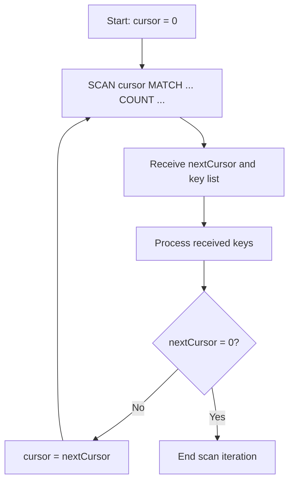

# Scanning Keys with SCAN and Managing Cursors in Spring Data Redis

When Redis holds hundreds of thousands or millions of keys, applications often need to find keys sharing a common prefix for statistics, data inspection, or cache cleanup. Spring Data Redis provides the `scan()` API based on Redis's `SCAN` command to iterate incrementally over a set of keys, along with a `Cursor` object to manage the iteration process and connection resources.

This lesson focuses on **scanning keys in the keyspace with `SCAN`**, accurately understanding cursor state, configuring `MATCH`/`COUNT`/`TYPE`, using `StringRedisTemplate`, and closing `Cursor` properly. At the end, it also distinguishes `SCAN` from `HSCAN`, `SSCAN`, and `ZSCAN`, and highlights practical limitations to account for when running real workloads.

## 1. Why Shouldn't You Use KEYS to Scan Large Numbers of Keys?

Redis supports the command:

```redis
KEYS session:*
```

`KEYS` finds all keys matching the pattern and returns the result in a single call. On a large keyspace, this operation can occupy Redis CPU for a significant amount of time, increasing latency for other requests. In addition, the application must receive the entire key list at once.

`SCAN` splits the traversal into many small calls:

```redis
SCAN 0 MATCH session:* COUNT 100
```

Each call processes part of the keyspace and returns **the next cursor** along with the keys found in that batch. The application continues calling until Redis returns cursor `0`.

| Criterion | `KEYS` | `SCAN` |
|---|---|---|
| How data is fetched | Returns all matching keys in one shot | Incrementally fetches elements across multiple calls |
| Impact on a large keyspace | A single command can keep Redis busy for a long time | Work per call can be tuned |
| Application-side memory | Easily holds all results in RAM | Can process key by key or in batches |
| Duplicate results | List from a single command | May encounter the same key again |
| Consistent keyspace snapshot | Not a transactional snapshot | Not a transactional snapshot |
| Suitable use cases | Diagnostics on small datasets, controlled environments | Incremental traversal, admin jobs, batch processing |

**Note:** `SCAN` reduces how long Redis is occupied *per call*, but it does not make the overall work O(1). A full keyspace scan still has an overall complexity of approximately O(N), where N is the number of elements traversed.

## 2. How Does Redis SCAN Work?

### 2.1. Syntax and Cursor Lifecycle

```text
SCAN cursor [MATCH pattern] [COUNT count] [TYPE type]
```

Suppose Redis has keys `session:1`, `session:2`, `session:3` along with many other keys. An *illustrative* session might look like this:

```text
> SCAN 0 MATCH session:* COUNT 2
1) "14"                         # Cursor to continue
2) 1) "session:2"               # Keys returned this round
   2) "session:1"

> SCAN 14 MATCH session:* COUNT 2
1) "0"                          # Iteration has finished
2) 1) "session:3"
```

The cursor values and key counts per call are only examples; actual results depend on the data and Redis's internal structure.

Traversal rules:

1. **Start with `0`** to open a new scan iteration.
2. Send back **the exact cursor Redis just returned** on the next call.
3. Process the received key list, even when the list is empty.
4. **Stop only when the returned cursor equals `0`**.



The most common mistake is that a `SCAN` call can return **0 keys while the cursor is non-zero**. This happens frequently when the `MATCH` pattern matches very few keys. Never use an "empty list" condition to terminate the loop.

### 2.2. What Is a Cursor?

At the Redis command level, a cursor is a value returned by Redis to identify how to continue the iteration. It is **not a page number**, not a stable position in a sorted list, and does not represent a fixed snapshot.

At the Spring Data Redis level, `Cursor<T>` is a closeable Java `Iterator`-style traverser:

```java
try (Cursor<String> cursor = redisTemplate.scan(options)) {
    while (cursor.hasNext()) {
        String key = cursor.next();
        // Process key.
    }
}
```

Spring Data Redis automatically invokes subsequent `SCAN` batches during iteration instead of forcing the programmer to pass numeric cursors manually. A `Cursor` object may hold resources tied to a Redis connection; therefore, it must be closed even when only part of the results are read or an exception occurs.

An iteration can stop early. Redis does not require a server-side "cancel cursor" notification because `SCAN` does not maintain a stateful result session on the server; however, **Spring's Cursor object still requires `close()`** to release client-side resources.

## 3. MATCH, COUNT, and TYPE Options

### MATCH — Pattern Filtering

```redis
SCAN 0 MATCH user:profile:* COUNT 200
```

`MATCH` uses Redis glob syntax, for example:

| Pattern | Meaning |
|---|---|
| `session:*` | Keys starting with `session:` |
| `order:2026:*` | Keys in the `order:2026:` namespace |
| `cache:user:?` | Any single character after `cache:user:` |
| `item:[abc]*` | Starts with `item:a`, `item:b`, or `item:c` |

`MATCH` **filters results after Redis has visited slots in the keyspace**. It does not turn a prefix lookup into an indexed query, so a very narrow pattern may still have to traverse most of the keyspace. Redis may return empty batches even when many slots remain to be scanned.

### COUNT — Work Hint per Call

```redis
SCAN 0 MATCH session:* COUNT 500
```

`COUNT 500` is a **hint**, not "fetch exactly 500 keys", "at most 500 keys", or `LIMIT 500`. A round can return fewer, more, or zero keys. By default, Redis uses a `COUNT 10` hint if unspecified.

There is no single optimal `COUNT` value for every system. You can start testing with a few hundred for admin tasks and then tune based on Redis latency, data size, round-trip count, and production traffic. Too high a value can create a heavy command and large response; too low a value can cause excessive network round trips.

### TYPE — Data Type Filtering

Redis has supported `TYPE` for the keyspace-wide `SCAN` command since Redis 6.0:

```redis
SCAN 0 MATCH cache:* COUNT 200 TYPE string
```

In Spring Data Redis, you can declare:

```java
import org.springframework.data.redis.connection.DataType;
import org.springframework.data.redis.core.ScanOptions;

ScanOptions options = ScanOptions.scanOptions()
        .match("cache:*")
        .count(200)
        .type(DataType.STRING)
        .build();
```

This option depends on the Redis and driver versions. `TYPE` applies only to keyspace `SCAN`, not equivalently to `HSCAN`/`SSCAN`/`ZSCAN`. Redis filters by the underlying storage type; for example, bitmap data is also stored under the `string` type.

## 4. Scanning Keys with Spring Data Redis

### 4.1. Using StringRedisTemplate and try-with-resources

For text keys such as `session:123` or `cache:product:42`, `StringRedisTemplate` is a convenient choice because it uses string serializers for keys and values.

Example of a service that incrementally processes session keys:

```java
import java.util.function.Consumer;

import org.springframework.data.redis.core.Cursor;
import org.springframework.data.redis.core.ScanOptions;
import org.springframework.data.redis.core.StringRedisTemplate;
import org.springframework.stereotype.Service;

@Service
public class SessionKeyScanner {

    private final StringRedisTemplate redisTemplate;

    public SessionKeyScanner(StringRedisTemplate redisTemplate) {
        this.redisTemplate = redisTemplate;
    }

    public long forEachSessionKey(Consumer<String> action) {
        ScanOptions options = ScanOptions.scanOptions()
                .match("session:*")
                .count(500)
                .build();

        long visits = 0;

        try (Cursor<String> cursor = redisTemplate.scan(options)) {
            while (cursor.hasNext()) {
                String key = cursor.next();
                action.accept(key);
                visits++;
            }
        }

        return visits;
    }
}
```

Example usage:

```java
long visits = scanner.forEachSessionKey(key -> {
    // For example: inspect metadata or send key to a batch processor.
    processKey(key);
});
```

In the code above:

- `ScanOptions` controls the key pattern and work hint.
- `redisTemplate.scan(options)` creates a `Cursor<String>` for Spring to fetch data incrementally.
- `hasNext()`/`next()` iterate over the keys; Spring may issue additional `SCAN` commands as needed.
- `try-with-resources` ensures the `Cursor` is closed even if `action.accept(key)` throws an exception.
- `visits` counts **how many times keys appeared in results**, not guaranteed to equal the number of distinct keys because `SCAN` can return duplicates.

The example fits a Spring Boot application with Redis connectivity already configured. If you only need to walk through keys and process each one, this avoids building a `List<String>` containing the entire keyspace.

### 4.2. When Using a General RedisTemplate<K, V>

With `RedisTemplate<String, MyValue>`, the return type of `scan()` is still `Cursor<String>` if the key type is `String`. However, **the Java type of the key does not determine how Redis stores bytes**: the `keySerializer` does.

If the template uses JDK serialization for keys, the pattern `session:*` may not match keys stored as serialized bytes, even though Java sees the key name as a string. For text-based key namespaces, use `StringRedisTemplate` or configure `StringRedisSerializer` consistently from write time through scan time.

### 4.3. ReactiveRedisTemplate

In Reactive applications, `ReactiveRedisTemplate` provides `scan(options)` returning `Flux<K>`. It can be combined with a non-blocking processing pipeline:

```java
import reactor.core.publisher.Mono;
import org.springframework.data.redis.core.ScanOptions;
import org.springframework.data.redis.core.ReactiveStringRedisTemplate;

public class ReactiveSessionScanner {
    private final ReactiveStringRedisTemplate redis;
    private final SessionHandler handler;

    public ReactiveSessionScanner(
            ReactiveStringRedisTemplate redis,
            SessionHandler handler) {
        this.redis = redis;
        this.handler = handler;
    }

    public Mono<Void> processSessions() {
        ScanOptions options = ScanOptions.scanOptions()
                .match("session:*")
                .count(200)
                .build();

        return redis.scan(options)
                .concatMap(handler::handle) // handle(String) returns Mono<Void>
                .then();
    }
}
```

Here `SessionHandler` is an application-defined example abstraction. `concatMap` preserves element processing order and bounds handler concurrency in the example. In reactive code, avoid calling `block()` inside the pipeline; manage lifecycle via subscription, completion, and cancellation.

## 5. Safe Cursor Lifecycle Management

In Java applications, managing `Cursor` is just as important as choosing `MATCH`/`COUNT`.

### Rule 1: Close Cursor on Every Execution Path

**Correct:**

```java
try (Cursor<String> cursor = redisTemplate.scan(options)) {
    while (cursor.hasNext()) {
        String key = cursor.next();
        if (shouldStop(key)) {
            break; // Cursor is still closed automatically.
        }
    }
}
```

**Avoid:**

```java
Cursor<String> cursor = redisTemplate.scan(options);
while (cursor.hasNext()) {
    processKey(cursor.next());
}
// Missing close(): risks holding onto connection resources.
```

Likewise, do not return an unclosed `Cursor` out of a service or store it in a singleton for later processing. A cursor belongs to a short-lived scope with clear ownership and resource cleanup.

### Rule 2: Distinguish Redis-Side Cursor from Spring-Side Cursor

| Concept | Meaning |
|---|---|
| Cursor in `SCAN 0` | Value returned by Redis to send back in the next call |
| Spring's `Cursor<T>` | Java-side iterator that hides subsequent calls and manages resources |
| `cursor.hasNext()` | Checks and may fetch more elements from Redis |
| `cursor.close()` | Releases resources associated with the scan |
| Cursor `0` returned from Redis | Signal that the Redis iteration has finished |

Do not use `0` as "page 0" in a user interface. At the protocol level, it serves both as the starting value and the termination value depending on where it appears.

### Rule 3: Do Not Share One Cursor Concurrently Across Multiple Threads

A `Cursor` is a stateful iterator, not a thread-safe queue. If multiple workers need to run independently, split the work by explicit key sets or partitions; calling `next()` concurrently on the same cursor can corrupt iteration state and connection management.

### Rule 4: Limit Lifetime and Workload

Slow per-key processing keeps the cursor open for a long time and can hold a connection from the pool for the entire scan. Administrative tasks should have time limits, cancellation mechanisms, and rate control; if the work takes long, consider decoupling key discovery from execution using a queue/job worker.

## 6. Scanning Hash, Set, and Sorted Set

The `SCAN` command family consists of four commands, each scanning a different scope:

| Redis Command | Spring Data Redis API | Items Returned |
|---|---|---|
| `SCAN` | `redisTemplate.scan(options)` | **Key names** in the database |
| `HSCAN` | `redisTemplate.opsForHash().scan(key, options)` | **Field/value** pairs of a Hash |
| `SSCAN` | `redisTemplate.opsForSet().scan(key, options)` | **Members** of a Set |
| `ZSCAN` | `redisTemplate.opsForZSet().scan(key, options)` | **Members and scores** of a Sorted Set |

Example scanning fields of Hash `user:42`:

```java
import java.util.Map;
import org.springframework.data.redis.core.Cursor;
import org.springframework.data.redis.core.ScanOptions;

ScanOptions options = ScanOptions.scanOptions()
        .match("pref:*")
        .count(100)
        .build();

try (Cursor<Map.Entry<Object, Object>> cursor =
        stringRedisTemplate.opsForHash().scan("user:42", options)) {
    while (cursor.hasNext()) {
        Map.Entry<Object, Object> entry = cursor.next();
        System.out.println(entry.getKey() + " = " + entry.getValue());
    }
}
```

Example scanning members of a Set:

```java
try (Cursor<String> cursor = stringRedisTemplate.opsForSet()
        .scan("tags:popular", ScanOptions.scanOptions().count(100).build())) {
    while (cursor.hasNext()) {
        String member = cursor.next();
        processTag(member);
    }
}
```

Example scanning members and scores of a Sorted Set:

```java
import org.springframework.data.redis.core.ZSetOperations;

try (Cursor<ZSetOperations.TypedTuple<String>> cursor =
        stringRedisTemplate.opsForZSet()
                .scan("leaderboard:weekly", ScanOptions.scanOptions().count(100).build())) {
    while (cursor.hasNext()) {
        ZSetOperations.TypedTuple<String> tuple = cursor.next();
        System.out.println(tuple.getValue() + ": " + tuple.getScore());
    }
}
```

All of these commands have consistency limitations when data mutates; `COUNT` remains a hint. In particular, `ZSCAN` **does not return members in score order**. If you need ordered leaderboard pages, use rank/score range queries such as `ZRANGE` with explicit bounds.

## 7. Processing Keys in Batches and Avoiding Holding All Results

A common mistake is scanning with `SCAN` only to collect everything into a single list:

```java
List<String> allKeys = new ArrayList<>();
try (Cursor<String> cursor = redisTemplate.scan(options)) {
    cursor.forEachRemaining(allKeys::add);
}
// allKeys can still consume a huge amount of RAM when the keyspace is large.
```

If the goal is to apply an operation to each key, process it directly inside the loop or collect into **fixed-size batches**.

The example below illustrates a cleanup job for the `demo:cleanup:` namespace using `UNLINK`. `UNLINK` separates value memory reclamation from the Redis command execution path, so it is usually more suitable than `DEL` when deleting large values; scanning and deleting still place load on Redis.

```java
import java.util.ArrayList;
import java.util.List;

import org.springframework.data.redis.core.Cursor;
import org.springframework.data.redis.core.ScanOptions;
import org.springframework.data.redis.core.StringRedisTemplate;

public class DemoCleanupJob {

    private static final String PREFIX = "demo:cleanup:";
    private static final int BATCH_SIZE = 100;

    private final StringRedisTemplate redis;

    public DemoCleanupJob(StringRedisTemplate redis) {
        this.redis = redis;
    }

    public long unlinkMatchingKeys() {
        ScanOptions options = ScanOptions.scanOptions()
                .match(PREFIX + "*")
                .count(300)
                .build();

        long deleted = 0;
        List<String> batch = new ArrayList<>(BATCH_SIZE);

        try (Cursor<String> cursor = redis.scan(options)) {
            while (cursor.hasNext()) {
                String key = cursor.next();

                // Enforce the namespace check again before deleting.
                if (!key.startsWith(PREFIX)) {
                    continue;
                }

                batch.add(key);
                if (batch.size() >= BATCH_SIZE) {
                    deleted += unlinkBatch(batch);
                    batch.clear();
                }
            }
        }

        if (!batch.isEmpty()) {
            deleted += unlinkBatch(batch);
        }

        return deleted;
    }

    private long unlinkBatch(List<String> keys) {
        Long removed = redis.unlink(keys);
        return removed == null ? 0 : removed;
    }
}
```

Key takeaways from the example:

- Application memory is proportional to `BATCH_SIZE`, not to the total number of keys.
- Already-seen keys may appear again; `UNLINK` on a key that no longer exists typically does not increment the removed count.
- **Scanning while deleting mutates the keyspace.** Redis does not guarantee that a single scan pass will find every key added, modified, or deleted in the meantime; `deleted` is only the count Redis actually reported as unlinked across the calls.
- When cleaning important data, enforce a sufficiently narrow namespace, execution permissions, runtime window, post-run remaining checks, and a rerun policy if needed.
- If deletion must guarantee zero missed keys, design a stateful workflow or control the key-creation source rather than treating a single `SCAN` pass as proof that the key set is permanently empty.

In production systems, a batch processing pipeline typically looks like:

```text
SCAN by namespace
    ↓
Enqueue chunks of keys into batch/queue
    ↓
Idempotent worker processing
    ↓
Record success/failure counts, bounded retries
```

## 8. Consistency: When Can SCAN Miss or Return Duplicates?

Redis provides guarantees for a **full iteration** (starting at `0` and continuing until Redis returns `0`):

1. An element **continuously present from start to finish** of the iteration will be returned at least once.
2. An element **not present at any time during the iteration** will not be returned.
3. An element **added, deleted, expired, or modified** during the scan may or may not be returned; behavior is not guaranteed.
4. An element may appear **multiple times** in the results.

This has three major implications:

**First, processing must tolerate duplicates.** For example, "check current state" or "set state to X" is usually easier to make idempotent than "increment a counter by 1 for each key," because the increment could be applied twice if a key appears twice.

**Second, do not use `SCAN` for exact point-in-time counts.** The number of keys counted does not necessarily equal the number of distinct keys or keys existing at any single instant. If exact results are required, choose a data design and synchronization mechanism aligned with business requirements.

**Third, do not treat `SCAN` as stable pagination.** Redis does not provide ordering, page indices, total record counts, or an immutable snapshot for scanning. A cursor is meaningful only for continuing its corresponding call sequence; it does not replace `page=2&size=20`.

Specifically, if the keyspace grows continuously without an upper bound, Redis does not guarantee that the iteration will finish in finite time.

## 9. Should You Store the Cursor to Resume in a Later Request?

At the Redis protocol level, an application can receive a cursor from one `SCAN` call and pass it back on the next call. This fits a short control loop managed by the application with full awareness that data may change.

However, **you should not use a SCAN cursor as a long-lived pagination token** for public APIs because:

- A page may contain few elements, many elements, or zero elements.
- Keys may be returned multiple times or omitted if the keyspace mutates.
- There is no stable order to promise that the "next page" will not repeat data.
- A cursor is not a durable checkpoint for exact recovery after a failure.
- Spring's `Cursor<T>` is tied to an iterator lifecycle and client resources; do not serialize this Java object across requests.

If the business requires **consistent pagination**, maintain an ordered index (such as a Sorted Set with appropriate scores), use a database supporting ordered queries, or materialize a bounded snapshot of IDs. If you need **recoverable jobs**, checkpoint by stable application-defined work units and support idempotent retries.

## 10. Running on Redis Cluster

In Redis Cluster, the keyspace is partitioned across hash slots and nodes. Do not assume that a single `SCAN` command on one node connection will scan every key in the entire cluster.

Implementation depends on the driver, cluster connection, and Spring Data Redis API used. For tasks that must cover the entire cluster, choose an appropriate per-master/primary scanning mechanism or cluster-aware API, and verify behavior after failover/rebalance. Points to keep in mind:

- Each node may have its own cursor space; never pass one node's cursor into a command sent to another node.
- Rebalancing, key additions/deletions, and slot migrations can alter the result set mid-scan.
- Do not directly sum key visit counts across multiple nodes as a distinct key count.
- If you need exact coverage of a business dataset, rely on an ID source/index with clear consistency rules.

## 11. Performance and Operations

| Situation | How to Handle |
|---|---|
| Too many Redis round trips | Increase `COUNT` incrementally and re-measure, while rate-limiting the job |
| Single scan causes latency spikes | Lower `COUNT`, reduce concurrent jobs, move task to off-peak hours |
| Very narrow `MATCH`, many empty rounds | Continue until Redis returns cursor `0`; consider maintaining a business index |
| Application memory keeps growing | Do not collect all keys into a `List`/`Set`; process incrementally or in fixed batches |
| Redis connections held too long | Close cursors in tight scope and split large jobs into bounded units |
| Connection fails mid-scan | Close resources, restart with an idempotent retry strategy; do not assume exact resumption |
| Duplicate results | Design idempotent tasks or use bounded deduplication |
| API returns unstable pages | Use an ordered data source with proper pagination support |

Metrics worth observing include total job runtime, keys visited, actually succeeded operations, retry counts, connection errors, Redis latency, and connection pool pressure. Separate **keys observed** from **keys successfully processed** to avoid misinterpretation due to duplicates.

In environments with heavy online traffic, avoid running large scans inside regular HTTP requests. Move scanning to administrative jobs, cap concurrency, support cancellation, and report progress by work completed rather than an unreliable percentage of "total keys."

## 12. Common Mistakes

### Mistake 1: Using KEYS in Production Because the Code Is Shorter

```java
Set<String> keys = redisTemplate.keys("session:*");
```

This call can trigger `KEYS` and cause high latency when the keyspace has many keys. When incremental traversal is needed, prefer `scan(options)`.

### Mistake 2: Treating COUNT as a Fixed Page Size

```java
ScanOptions options = ScanOptions.scanOptions().count(20).build();
```

There is no guarantee `cursor.next()` returns batches of exactly 20 items; Spring's `Cursor` also abstracts the underlying SCAN calls. If an API must return exactly 20 items, the application needs a separate pagination strategy.

### Mistake 3: Stopping on an Empty Batch

```text
SCAN 200 MATCH extremely:rare:* COUNT 10
=> nextCursor = 340, keys = []
```

This is **not the end yet**. Only a `nextCursor` value of `0` signals completion of the scan.

### Mistake 4: Forgetting to Close the Cursor

Failing to close `Cursor` can leak or hold onto client/connection resources. Use `try-with-resources` by default, covering `break`, `return`, and exception paths.

### Mistake 5: Using SCAN as a Consistent Snapshot

A key with a TTL may expire mid-scan; another newly created key may or may not appear. Design business logic around this limitation rather than assuming the result set represents "all keys at time T."

### Mistake 6: Ignoring the Serializer

`StringRedisTemplate` and a `RedisTemplate` configured with a different serializer can see the same Java key name yet write different bytes into Redis. Standardize key naming and serializers, especially when using prefix `MATCH`.

## 13. Hands-On Exercise to Verify How SCAN Works

You can test this on a dedicated learning Redis instance:

```redis
SET demo:scan:1 "a"
SET demo:scan:2 "b"
SET demo:scan:3 "c"
SET other:key "x"
SCAN 0 MATCH demo:scan:* COUNT 1
```

Take the cursor from the output, send `SCAN <cursor> MATCH demo:scan:* COUNT 1`, and continue until you receive cursor `0`. Observe:

1. Is the number of keys per round always equal to `COUNT 1`?
2. Is there any round returning zero keys while the cursor is still non-zero?
3. When adding or deleting a key mid-scan, are the results always as expected?
4. When increasing `COUNT`, how do the number of calls and response sizes change?

Next, write a Java snippet using `StringRedisTemplate.scan` with `try-with-resources`, print each key one by one, and then replace printing with an idempotent operation. This exercise helps distinguish "visited a key" from "processed a distinct key" during a scan.

## 14. Takeaways for Practice

- `SCAN` is an **incremental** keyspace traversal tool; a full scan still does O(N) work.
- Start with Redis cursor `0` and stop only when **the returned cursor is `0`**; an empty batch does not necessarily mean completion.
- `MATCH` is a glob filter, `COUNT` is a workload hint, and `TYPE` filters key types when supported by Redis/the driver.
- With Spring Data Redis, use `Cursor<K>` and **always close it** with `try-with-resources`.
- Design jobs to tolerate duplicates, mutating data, retries, and resource limits.
- Do not use `SCAN` in place of ordered pagination or exact snapshot counting; choose data structures and consistency mechanisms suited to your requirements.

### References

- [Redis — SCAN, guarantees, MATCH, COUNT, and TYPE](https://redis.io/docs/latest/commands/scan/)
- [Spring Data Redis — RedisTemplate.scan(ScanOptions)](https://docs.spring.io/spring-data/redis/reference/api/java/org/springframework/data/redis/core/RedisTemplate.html)
- [Spring Data Redis — ScanOptions](https://docs.spring.io/spring-data/redis/reference/api/java/org/springframework/data/redis/core/ScanOptions.html)
- [Spring Data Redis — HashOperations.scan](https://docs.spring.io/spring-data/redis/reference/api/java/org/springframework/data/redis/core/HashOperations.html)
- [Spring Data Redis — SetOperations.scan](https://docs.spring.io/spring-data/redis/reference/api/java/org/springframework/data/redis/core/SetOperations.html)
