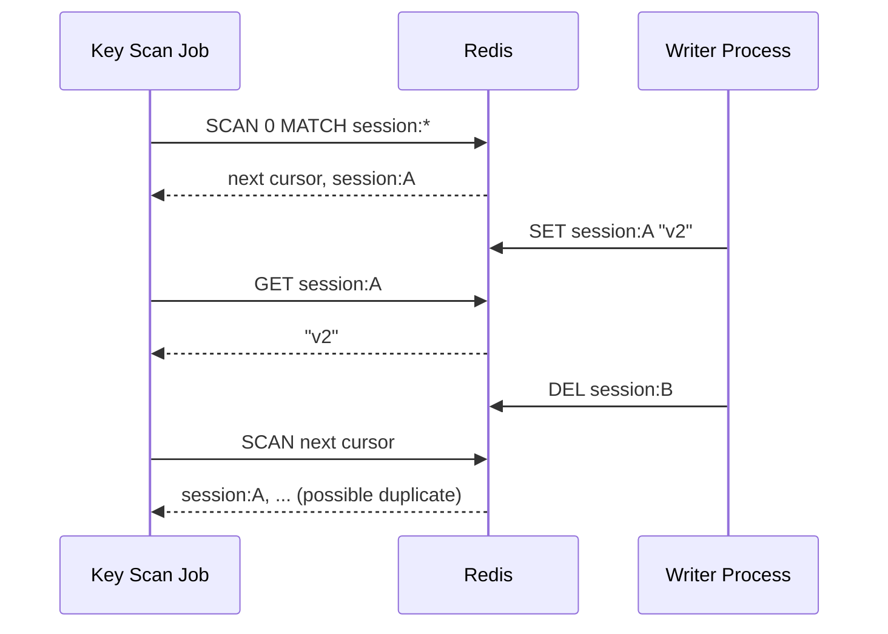
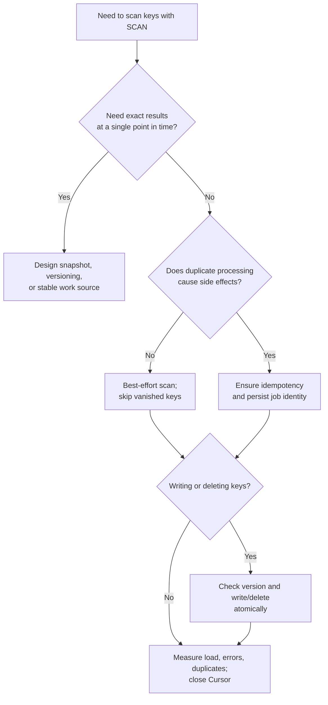

# Handling Duplicate or Changing Results During SCAN

In Spring Data Redis, `SCAN` is commonly used to iterate through many keys in batches without asking Redis to return the entire keyspace in a single command. For example, an application needs to find `session:*` keys for statistics, expiration checks, or old-data cleanup. The complication arises when the application itself and other processes continue creating, modifying, deleting, or expiring keys during the scan.

**Core point:** `SCAN` is an incremental traversal over a mutable dataset, **not a snapshot** at the start time. The same key may be returned multiple times; a key added or deleted mid-scan may or may not appear; and the data inside a key may have already changed by the time the application reads or processes it. Therefore, you must design your handling to match the level of accuracy the business actually requires.

## 1. Traversal Mechanism and Guarantee Scope

The basic Redis command has the form:

```redis
SCAN 0 MATCH session:* COUNT 500
```

Redis returns two parts: **the next cursor** and **the list of keys for the current batch**. The client passes the received cursor into the next call, repeating until Redis returns cursor `0` again. A batch may return a few items, many items, or zero items; **an empty list does not mean the traversal has ended**.

```text
SCAN 0    -> cursor 42, keys [session:A, session:C]
SCAN 42   -> cursor 91, keys [session:B, session:A]
SCAN 91   -> cursor 0,  keys [session:D]
                         ^
                         session:A appears twice
```

This is only an illustrative example: the cursors, order, and key counts per batch are not fixed.

For a **complete iteration** (starting with cursor `0`, following the cursors returned by Redis, and ending with cursor `0`), Redis documents the following guarantees:

| Element State Throughout the Iteration | What Does Redis `SCAN` Guarantee? |
| --- | --- |
| Key is continuously present from start to finish | The key is returned **at least once**. |
| Key is continuously absent from start to finish | The key is **not** returned. |
| Key appears, is deleted, or expires mid-scan | The key **may or may not** be returned; coverage is not guaranteed. |
| Key was returned in an earlier batch | The key **may still** be returned again in a later batch. |
| Key exists but its value changes | `SCAN` reports only the key name; it **does not guarantee** value version or contents. |

An iteration is guaranteed to finish only when the size of the scanned set has an upper bound during execution. If the keyspace grows continuously without bound, the application cannot assume the iteration will always finish promptly.

`COUNT 500` is a **workload hint** to Redis, not a commitment to return exactly 500 keys. `MATCH session:*` filters key names by pattern, but it does not turn `SCAN` into an indexed prefix query and does not let you infer how many keys must be scanned from how many keys are returned.

## 2. Why Do Duplicate and Changing Results Occur?

Redis organizes keys in hash structures. When data grows, shrinks, or the structure is reorganized (rehashed), a cursor-based iteration can encounter the same element again. This is valid `SCAN` behavior, not necessarily a bug in Spring Data Redis.

At the same time, an iteration can span multiple commands while other write operations continue running:



In the diagram, `session:A` is discovered before its value changes but read after the update, so the application receives `v2`. If `session:B` disappears between calls, it might not be returned. If `session:A` appears twice, the application could accidentally run the same task twice.

Three concepts must be distinguished:

1. **Duplicate key name:** the same string `session:A` is returned multiple times by `SCAN` within one pass.
2. **Value mutation:** the same key name still exists, but its content, TTL, or metadata has changed.
3. **Delete and recreate:** a key disappears and is recreated with the same name. From a business standpoint, this may be an entirely new entity or generation. Deduplicating solely by key name merges the two together.

Calling `hasKey()` before `get()` also does not eliminate the case where a value disappears between the two commands. This is a *time-of-check/time-of-use* (TOCTOU) bug.

## 3. Choosing a Strategy by Business Requirement

Before processing results, determine what accuracy the job requires:

| Requirement | Approach |
| --- | --- |
| Approximate statistics, operational observation, cache review | Accept mutating data; skip vanished keys and record duplicate counts. |
| Each **key name** is processed only once **within a single run** | Use a `Set` to track key names already seen. |
| Repeated processing must not cause side effects | Design **idempotent** actions: running again yields the same business outcome. |
| Multiple workers, job may crash and restart | Persist task identity and processing status durably, with unique keys and retry mechanisms. |
| Modify/delete only if the value still matches the inspected version | Use an **atomic** version-check and write/delete operation, typically a Lua script or appropriate optimistic locking. |
| Need an exact list at a point in time, or must not miss any update | Build an application-managed snapshot/index and change log; `SCAN` alone does not satisfy this contract. |

In-memory deduplication is a useful option, but it **does not by itself solve data mutation**. Preventing duplicate execution is a different problem from whether the data is still current at execution time.

## 4. Spring Data Redis Example: Deduplicating by Key Name

When Redis stores sessions as **strings**, you can use `StringRedisTemplate.scan(ScanOptions)` and a `HashSet`. The following example serves a best-effort inspection job: reading existing values, skipping keys that just disappeared, and passing key/value pairs to a handler function. The handler is assumed to be safe to rerun across different job runs.

```java
import java.util.HashSet;
import java.util.Set;
import java.util.function.Consumer;

import org.springframework.data.redis.core.Cursor;
import org.springframework.data.redis.core.ScanOptions;
import org.springframework.data.redis.core.StringRedisTemplate;
import org.springframework.stereotype.Service;

@Service
public class SessionScanService {

    private final StringRedisTemplate redis;

    public SessionScanService(StringRedisTemplate redis) {
        this.redis = redis;
    }

    public ScanStats scanSessions(Consumer<SessionEntry> handler) {
        ScanOptions options = ScanOptions.scanOptions()
                .match("session:*")
                .count(500)
                .build();

        Set<String> visited = new HashSet<>();
        long duplicates = 0;
        long missingOnRead = 0;
        long handled = 0;

        // Cursor must be closed to release connection resources.
        try (Cursor<String> cursor = redis.scan(options)) {
            while (cursor.hasNext()) {
                String key = cursor.next();

                if (!visited.add(key)) {
                    duplicates++;
                    continue;
                }

                // Value may have expired/been deleted since SCAN saw the key.
                String value = redis.opsForValue().get(key);
                if (value == null) {
                    missingOnRead++;
                    continue;
                }

                handler.accept(new SessionEntry(key, value));
                handled++;
            }
        }

        return new ScanStats(
                visited.size(), duplicates, missingOnRead, handled);
    }

    public record SessionEntry(String key, String value) {}

    public record ScanStats(
            long uniqueKeys,
            long duplicateReturns,
            long missingOnRead,
            long handled) {}
}
```

Example usage:

```java
ScanStats stats = sessionScanService.scanSessions(entry -> {
    // Example: feed data into a read-only report.
    // If writing to DB, calling APIs, or deleting keys, handle idempotency separately.
    System.out.println(entry.key() + " = " + entry.value());
});
System.out.println(stats);
```

Limitations and practical meaning of the example:

- `visited.add(key)` returns `false` from the second encounter of the same key name onward, avoiding duplicate processing **within the same run**. It does not distinguish an old key from a key deleted and recreated with the same name.
- `HashSet` uses **O(U)** memory where `U` is the number of distinct key names seen. If there are tens of millions of keys, do not treat this as a constant-cost technique.
- `GET` retrieves the value at **read time**, not when `SCAN` discovered the key. The value can still change immediately after `GET`.
- If `session:*` includes keys of a data type other than `string`, `GET` may return a `WRONGTYPE` error. The example assumes key naming guarantees the data type; mixed applications must categorize by schema/type.
- An exception from Redis or `handler` aborts the scan; the example does not treat it as a successful completion. `try-with-resources` still closes the cursor on exit.

In Spring Data Redis, `RedisTemplate.scan(...)` returns a `Cursor<K>`, and this resource must be closed. Do not call `keys("session:*")` as a substitute on a large keyspace: `keys()` uses Redis `KEYS`, which can cause significant latency by scanning the entire keyspace in one command.

## 5. If the Key Count Is Too Large to Hold a `HashSet`

There are three common approaches, depending on required guarantees:

**To keep duplicate processing safe:** you do not need to retain every key name if the business operation itself is idempotent. For instance, setting an entity's current status to the same value is usually easier to make idempotent than incrementing a counter, sending an email, or debiting funds every time a key is seen. In particular, for side effects outside Redis, idempotency must be enforced where the side effect occurs.

**To deduplicate across multiple workers:** persist a record keyed by `jobId` and `key` (or `key` + `version`) in a store with a unique constraint. For example, a results table in a database with unique key `(job_id, redis_key, version)`. Workers racing on the same item cannot create two duplicate logical results. If the job updates that same database, record status and perform the update in the same transaction.

**To keep a temporary seen set in Redis:** you can use `SADD scan:seen:<jobId> <key>`: returning `1` means newly added, `0` means already present. Choose a `scan:seen:` prefix outside `MATCH session:*`, set an appropriate cleanup/TTL policy, and account for memory cost, RTT, and business atomicity. `SADD` only marks seen: **marking first then failing processing** can cause retries to be skipped; **processing first then marking** can cause double execution. Never treat standalone `SADD` as an exactly-once mechanism.

For jobs with critical side effects, the pattern typically needs `PENDING` → `PROCESSING` (with lease) → `COMPLETED`, combining durable state, retries, and idempotent operations. When a lease expires, another worker may reprocess the item, so the business function must still tolerate duplicate execution.

## 6. Handling Keys That Changed or Were Just Deleted

A returned key is not guaranteed to still exist when used. For example:

```text
T1: SCAN returns session:42
T2: Another worker runs DEL session:42
T3: GET session:42 -> null
T4: Another worker runs SET session:42 "new session"
```

The application must choose one clear policy:

- **Skip when the value is gone:** suitable for cache inspection or approximate stats. Do not treat `null` as a global error, and avoid concluding the key never existed.
- **Re-read current state and compute:** suitable when only the latest state matters. Even so, data may change again right after the read.
- **Write/delete only if the version still matches:** suitable when cleaning stale data or transitioning state without affecting a freshly replaced object.

Dangerous example:

```java
String value = redis.opsForValue().get(key);
if (isExpiredBusinessValue(value)) {
    redis.delete(key); // May delete a NEW value that was just written to the key.
}
```

Two separate `GET` and `DEL` operations do not form an atomic check-and-delete. If Redis stores each session as a **hash** with a `version` field, a Lua script can compare the version and delete within the same Redis execution:

```lua
-- KEYS[1] = session:42
-- ARGV[1] = version that was read and marked for deletion
if redis.call('HGET', KEYS[1], 'version') == ARGV[1] then
    return redis.call('UNLINK', KEYS[1])
end
return 0
```

In Spring Data Redis, a script like this can be executed via `RedisTemplate.execute(RedisScript, keys, args...)`. If the key was deleted, expired, or updated to a new version, the script will not delete it because the condition no longer matches. `UNLINK` separates memory freeing from the main execution path; `DEL` can be used when appropriate for requirements.

**Condition for version comparison to be meaningful:** every creation or update must assign a distinct `version` without reusing old versions. If a key is deleted and recreated with the exact same old version (the *ABA* problem), version comparison still cannot distinguish the two generations of data. With hashes, ensure hash creation/update and version updates follow the same contract; do not mix string-key conventions with hash-key conventions in this example.

Another option is `WATCH` + `MULTI`/`EXEC` to check for modifications before committing; if the transaction aborts, re-read and retry. Whichever mechanism you choose, the atomic scope must include **both the guard condition and the action**, not just the initial read.

## 7. When Stronger Consistency Than `SCAN` Is Required

If the requirement is "every key present at the exact start time must be processed based on **its value at that exact moment**," simply running `SCAN` followed by `GET` cannot satisfy it: keys can change value, expire, or be recreated between the two operations. Deduplicating with a `Set` does not turn the scan into a snapshot either.

Several viable designs when the business genuinely requires high accuracy:

1. **Stable work list:** the application writes the IDs to process into a dedicated list/queue when locking in the job scope. Each ID has an identifier and status, enabling retries. To snapshot values, also store the corresponding version or immutable data.
2. **Application-maintained index:** instead of scanning the entire keyspace by prefix, manage an ID set or sorted set by time/version and update the index alongside data via atomic operations when needed. Fetching a list of IDs does not freeze values on its own; a version contract is still required.
3. **Change event stream:** the application emits create/update/delete events to Redis Streams or a durable event log, and consumers read by offset and handle retries. You must design consistency between data updates and event emission; do not treat Pub/Sub or keyspace notifications as a durable, replayable log.
4. **Snapshot/transactional data store:** for reconciliation or financial reporting, keep the source of truth in a system with suitable transactional/snapshot properties, and use Redis as a supporting cache or index.

None of these options automatically provide "exactly once" across multiple systems. When side effects exist, combine task identifiers, durable deduplication, transactions where possible, and failure recovery.

## 8. Safe Operations: Cursor, Load, Retries, and Redis Cluster

**Cursors and connections.** Always use `try-with-resources` or close `Cursor` in `finally`; never keep a cursor open indefinitely across web requests. For very long scans, implement them as jobs with time/load bounds, proper permissions, and rerun capability. A Redis cursor is state to continue **one traversal pass**, not a frozen snapshot identifier.

**Mid-run failures.** When a connection drops or a process crashes, a simple recovery strategy is starting a new `SCAN` pass and relying on idempotency or completion markers to avoid duplicate side effects. Do not treat saving a cursor number and reusing it after a long delay as a guaranteed-accurate business checkpoint, especially while the keyspace is mutating.

**Tuning `COUNT`.** Start with a moderate batch size (e.g., `500` in the code snippet) and observe latency, command count, Redis CPU, and network load. Increasing `COUNT` can reduce round trips but raises per-command work and latency. `MATCH` does not replace load control; each processed key may also trigger a `GET` or other command.

**Multiple scan passes.** Periodic scanning increases the chance of catching short-lived keys, but does not guarantee capturing every key that ever existed. If you need to capture all changes, use an event log or job work queue rather than expecting faster scans to suffice.

**Redis Cluster.** The keyspace is distributed across multiple nodes; one node's cursor does not represent a cluster-wide snapshot. Cluster scanning approaches and support levels depend on Spring Data Redis version, Redis driver, and connection configuration. When you need to scan the whole cluster, use the client's appropriate master/node scanning mechanism and apply global deduplication and job state tracking.

**Metrics to record:** `keysReturned`, `uniqueKeys`, `duplicateReturns`, `missingOnRead`, `processed`, `failed`, runtime duration, retry count, and Redis command count. These help distinguish mutating data from job errors; `uniqueKeys` is not the exact key count at any single point in time.

## 9. Walkthrough of Common Scenarios

Suppose at the start there are `session:A`, `session:B`, and `session:C`.

| Event During Traversal | Possible Observation | Appropriate Handling |
| --- | --- | --- |
| `session:A` exists continuously but is returned twice | `A, ..., A` | `visited.add(A)` deduplicates within the same job; the task must still be idempotent on retries. |
| `session:B` is deleted before `GET` | `SCAN` may return `B`; `GET` returns `null` | Skip and increment `missingOnRead`; do not assume the value still exists. |
| `session:C` changes from `v1` to `v2` before read | `SCAN` returns `C`, `GET` returns `v2` | Accept the new value or check version if the job requires old data. |
| `session:D` is created after the job starts | May or may not be seen | Do not rely on one `SCAN` pass to detect all keys created during the run window. |
| `session:A` is deleted and recreated with the same name | Name `A` may be returned; `HashSet` sees only one name | Use `version`/generation if you must distinguish two key lifecycles. |
| Job crashes after calling an external service | Next run may repeat the same work | Send an idempotency key and persist durable state; controlled recovery/retry. |

### Implementation Decision Flow



## 10. Takeaways

`SCAN` is suitable for **exploring and incrementally traversing** Redis keys while the system remains live. It guarantees returning keys that exist continuously throughout a complete pass at least once, but **does not guarantee once-only delivery**, **does not provide a snapshot**, and **does not freeze values** during the process. With Spring Data Redis, close `Cursor`, handle keys that may vanish, deduplicate when appropriate, and build idempotency for operations with side effects. When you must write or delete based on observed state, guard the operation with versioning and an atomic mechanism. When you need change history or point-in-time accuracy, design a stable data source rather than relying on a single `SCAN` pass.

### References

- [Redis Documentation — SCAN](https://redis.io/docs/latest/commands/scan/): syntax, guarantees, duplicates, `MATCH`, and `COUNT`.
- [Spring Data Redis — RedisTemplate API](https://docs.spring.io/spring-data/redis/reference/api/java/org/springframework/data/redis/core/RedisTemplate.html): `scan(ScanOptions)` method and obligation to close `Cursor`.
- [Redis Documentation — Keys and values](https://redis.io/docs/latest/develop/using-commands/keyspace/): notes on using `KEYS` and `SCAN` on the keyspace.
