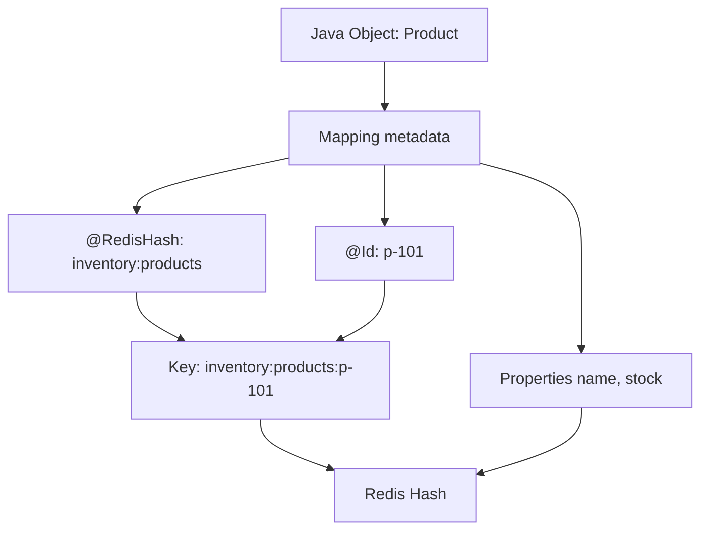

# Defining Keyspaces with `@RedisHash` in Spring Data Redis

## 1. What Problem Does a Keyspace Solve?

Redis stores data as **key → value** pairs. If an application only uses simple keys like `42`, `100`, or `admin`, it becomes very difficult to tell what type of data a key belongs to, and there is a risk that two data groups will use the same key name.

For example, the same identifier `42` could be used for both a customer and an order:

```text
customer:42   -> customer number 42
order:42      -> order number 42
```

The `customer` and `order` parts act as a **keyspace**: a namespace for grouping keys by entity type. For entities mapped with **Spring Data Redis Repositories**, the `@RedisHash` annotation lets you declare the keyspace directly on the Java class.

```java
import org.springframework.data.annotation.Id;
import org.springframework.data.redis.core.RedisHash;

@RedisHash("customers")
public class Customer {
    @Id
    private String id;
    private String name;

    // Constructor, getters, and setters are shown in the full example section.
}
```

For a `Customer` with `id = "42"`, Spring Data Redis typically stores the object's data at the key:

```text
customers:42
```

This is the **`<keyspace>:<id>`** convention. Redis does not inherently understand the concept of a Java `Customer` class; Spring Data Redis's mapping layer decides how to convert the object into a Redis Hash and construct the key name.

After this lesson, you should be able to distinguish:

- **Keyspace**: the key name prefix for grouping entities.
- **ID**: the identifier of an entity within a keyspace.
- **Redis Hash**: the Redis data type storing the entity's fields.
- **Redis Repository**: the Java-side API coordinating mapping, saving, finding, and deleting entities.
- **TTL**: the key's expiration lifetime, which can also be configured via `@RedisHash`.

## 2. How `@RedisHash` Defines the Keyspace

The `@RedisHash` annotation resides in the package:

```java
import org.springframework.data.redis.core.RedisHash;
```

It is placed **on the entity class** to declare that this type is stored as a Redis Hash in Spring Data Redis's mapping mechanism.

### 2.1. Explicitly Declaring the Keyspace Name

```java
@RedisHash("customers")
public class Customer {
    // ...
}
```

`"customers"` is the keyspace name. With ID `42`, the object's key takes the form `customers:42`.

You can explicitly write the `value` attribute:

```java
@RedisHash(value = "customers")
public class Customer {
    // ...
}
```

Both forms are equivalent. The keyspace name is a string chosen by the application; it should be **stable, distinguishable, and reflect the domain**.

### 2.2. When No Name Is Specified

Spring Data Redis has a mechanism to derive a default keyspace from the class's mapping metadata and can accept custom keyspace configurations. However, if the keyspace name is part of a long-term storage contract, **explicitly declaring `@RedisHash("...")`** avoids depending on default naming rules or class name changes during refactoring.

Example:

```java
@RedisHash
public class Customer {
    // ...
}
```

In this case, no explicit keyspace name is written in the annotation. So that operators can easily locate data and different application versions recognize the same set of keys, it is usually best to explicitly choose `value` rather than relying on the default name.

### 2.3. Keyspace Is Not an Independent Redis Structure

Redis has no `CREATE KEYSPACE customers` command. Here, the keyspace concept is **a naming convention and mapping metadata in Spring Data Redis**, manifested through the keys stored in Redis.

Therefore:

| Concept | Role | Example |
|---|---|---|
| Redis database | Key space within a Redis database, typically selected by DB index | Database `0` |
| Entity keyspace | Group of keys sharing a prefix managed by the app/framework | `customers` |
| Entity Redis key | Exact address of a record | `customers:42` |
| Redis Hash | Data type storing field/value contents | `name` → `Lan` |
| Entity ID | Java identifier used to look up the record | `42` |

Do not confuse **the keyspace declared via `@RedisHash`** with **Redis keyspace notifications**. Keyspace notifications are a mechanism for emitting events when keys change or expire, not a way of prefixing entities.

## 3. Relationship Between `@RedisHash`, `@Id`, and Redis Hash

Consider the following entity:

```java
import org.springframework.data.annotation.Id;
import org.springframework.data.redis.core.RedisHash;

@RedisHash("inventory:products")
public class Product {

    @Id
    private String id;

    private String name;
    private Integer stock;

    public Product() {
    }

    public Product(String id, String name, Integer stock) {
        this.id = id;
        this.name = name;
        this.stock = stock;
    }

    public String getId() {
        return id;
    }

    public void setId(String id) {
        this.id = id;
    }

    public String getName() {
        return name;
    }

    public void setName(String name) {
        this.name = name;
    }

    public Integer getStock() {
        return stock;
    }

    public void setStock(Integer stock) {
        this.stock = stock;
    }
}
```

There are three important parts:

1. `@RedisHash("inventory:products")` declares the **keyspace**.
2. `@Id` marks the property used as the **identifier**.
3. The remaining properties are data converted by Spring Data Redis into a **Redis Hash** representation.

With:

```java
Product product = new Product("p-101", "Mechanical Keyboard", 25);
```

The entity key takes the form:

```text
inventory:products:p-101
```

Data flow diagram:



The Redis Hash content includes fields representing properties, and the framework may also store **object type metadata** (such as `_class`) for mapping on read. The exact set of fields depends on property types, converters, and serialization configuration. Do not treat a simple `HGETALL` example as an immutable contract for every entity type.

**Note:** The `@Id` annotation here is imported from `org.springframework.data.annotation.Id`. Do not mistakenly use `jakarta.persistence.Id` and assume Redis mapping will behave like JPA.

## 4. Full Example: Saving an Entity by Keyspace

### 4.1. Required Components

With Spring Boot 3.x, an application using Spring Data Redis can declare the dependency:

```groovy
dependencies {
    implementation 'org.springframework.boot:spring-boot-starter-data-redis'
}
```

Simple Redis connection configuration in `application.yml`:

```yaml
spring:
  data:
    redis:
      host: localhost
      port: 6379
```

This is an example for local Redis without authentication. For real deployment environments, connection details must match the system's infrastructure, TLS, and secrets management mechanisms.

### 4.2. Declaring the Entity

```java
package com.example.demo.customer;

import org.springframework.data.annotation.Id;
import org.springframework.data.redis.core.RedisHash;

@RedisHash("shop:v1:customers")
public class Customer {

    @Id
    private String id;

    private String fullName;

    private String phone;

    public Customer() {
    }

    public Customer(String id, String fullName, String phone) {
        this.id = id;
        this.fullName = fullName;
        this.phone = phone;
    }

    public String getId() {
        return id;
    }

    public void setId(String id) {
        this.id = id;
    }

    public String getFullName() {
        return fullName;
    }

    public void setFullName(String fullName) {
        this.fullName = fullName;
    }

    public String getPhone() {
        return phone;
    }

    public void setPhone(String phone) {
        this.phone = phone;
    }
}
```

The name `shop:v1:customers` expresses the application, naming convention version, and entity type. With ID `c-1001`, the expected key is:

```text
shop:v1:customers:c-1001
```

The colon `:` is just a character in the key name, commonly used as a human-readable separator. Redis does not automatically create directory levels or hierarchical structures from colons.

### 4.3. Declaring the Repository

```java
package com.example.demo.customer;

import org.springframework.data.repository.CrudRepository;

public interface CustomerRepository
        extends CrudRepository<Customer, String> {
}
```

`CrudRepository<Customer, String>` tells the framework the entity is `Customer` and the ID has type `String`. When the repository saves an object, it uses `Customer`'s mapping information, including `@RedisHash("shop:v1:customers")`.

With Spring Boot, auto-configuration can enable Redis repositories when the required dependencies and conditions are met. If you want to explicitly declare the repository scan scope:

```java
package com.example.demo;

import com.example.demo.customer.CustomerRepository;
import org.springframework.boot.SpringApplication;
import org.springframework.boot.autoconfigure.SpringBootApplication;
import org.springframework.data.redis.repository.configuration.EnableRedisRepositories;

@SpringBootApplication
@EnableRedisRepositories(basePackageClasses = CustomerRepository.class)
public class DemoApplication {
    public static void main(String[] args) {
        SpringApplication.run(DemoApplication.class, args);
    }
}
```

There is no need to repeat scan configuration if the application already auto-enables the right repositories. The purpose of `@EnableRedisRepositories` in the example is to make clear which repository belongs to the Redis mechanism.

### 4.4. Saving, Finding, and Deleting by ID

```java
package com.example.demo.customer;

import java.util.Optional;

import org.springframework.stereotype.Service;

@Service
public class CustomerService {

    private final CustomerRepository repository;

    public CustomerService(CustomerRepository repository) {
        this.repository = repository;
    }

    public Customer createExample() {
        Customer customer =
                new Customer("c-1001", "Nguyen Lan", "0900000000");
        return repository.save(customer);
    }

    public Optional<Customer> getById(String id) {
        return repository.findById(id);
    }

    public void remove(String id) {
        repository.deleteById(id);
    }
}
```

When calling:

```java
Customer customer = service.createExample();
Optional<Customer> found = service.getById("c-1001");
```

The framework operates on mapped data in the `shop:v1:customers` keyspace. Most business code only needs to know **the entity type and ID**, without manually concatenating `"shop:v1:customers:" + id` in every method.

This benefit applies when working through **Spring Data Redis repository/mapping**. If code calls `StringRedisTemplate.opsForValue().set("x", "...")` or `RedisTemplate.opsForHash().put(...)` directly, those commands **do not automatically read `@RedisHash` from a class not passed through the mapper**.

## 5. Inspecting the Real Record in redis-cli

After the repository saves `Customer` with ID `c-1001`, you can inspect it in Redis:

```redis
TYPE shop:v1:customers:c-1001
HGETALL shop:v1:customers:c-1001
TTL shop:v1:customers:c-1001
```

Expected meaning:

- `TYPE` returns `hash` when the entity key exists.
- `HGETALL` shows the fields/values written by the mapper, potentially including `_class` metadata.
- `TTL` returns `-1` if the key has no expiration configured and still exists.

An illustrative structural output might look like this; actual field names and encoding depend on the converter:

```text
> TYPE shop:v1:customers:c-1001
hash
> HGETALL shop:v1:customers:c-1001
1) "_class"
2) "com.example.demo.customer.Customer"
3) "id"
4) "c-1001"
5) "fullName"
6) "Nguyen Lan"
7) "phone"
8) "0900000000"
> TTL shop:v1:customers:c-1001
(integer) -1
```

You can find keys matching a prefix in a test environment:

```redis
SCAN 0 MATCH shop:v1:customers:* COUNT 100
```

`SCAN` returns a cursor and a partial batch of results. If the cursor is not `0`, you must iterate using the returned cursor to continue scanning; `COUNT` is a batch-size hint and is not guaranteed to return that exact number in a single call. Redis repositories may also maintain auxiliary keys for entity tracking and indexing. Therefore, **do not count `SCAN` results and equate them with the number of entities**.

Because the record is a Redis Hash, do not use `GET shop:v1:customers:c-1001` as with a String; `GET` on a Hash key returns a wrong-type error (`WRONGTYPE`).

## 6. Keyspace Naming Rules in Applications

The keyspace name should be treated as part of the data design because it directly affects the ability to locate and read previously written records.

### 6.1. Consistency by Business Domain

For example, an e-commerce system might choose:

| Entity | Declaration | Illustrative Key |
|---|---|---|
| `Customer` | `@RedisHash("shop:customers")` | `shop:customers:c-1` |
| `Order` | `@RedisHash("shop:orders")` | `shop:orders:o-1` |
| `Cart` | `@RedisHash("shop:carts")` | `shop:carts:c-1` |
| `InventoryItem` | `@RedisHash("shop:inventory")` | `shop:inventory:p-1` |

The ID `c-1` can appear across multiple entities without key collisions if the keyspaces differ.

### 6.2. Adding an Application Prefix or Schema Version

```java
@RedisHash("learning:v1:student-profiles")
public class StudentProfile {
    // ...
}
```

The `learning` prefix identifies the application domain; `v1` separates data groups when a major storage contract change is needed. However, only add a version when the application has an appropriate read/write and data migration process; bumping `v1` to `v2` makes the repository look at **a new set of keys**.

Some practical rules:

1. Use meaningful names with consistent singular/plural conventions across the system.
2. Standardize separator and letter-casing conventions because Redis keys are **case-sensitive**.
3. Avoid sharing the same keyspace across incompatible entity types.
4. Avoid placing sensitive data directly in the keyspace or ID; key names frequently appear in logs, monitoring tools, and operational commands.
5. Avoid renaming a keyspace just to make code look nicer if data is already stored.

### 6.3. Keyspace Collisions Have Real Consequences

Consider two classes:

```java
@RedisHash("records")
public class CustomerRecord {
    @Id private String id;
    // ...
}

@RedisHash("records")
public class OrderRecord {
    @Id private String id;
    // ...
}
```

If both write ID `42`, the same Redis key `records:42` can be overwritten or the data may become incompatible with the entity type the repository expects. Having object type metadata does not create a separate namespace to resolve this conflict.

They should be separated:

```java
@RedisHash("customers")
public class CustomerRecord {
    @Id private String id;
}

@RedisHash("orders")
public class OrderRecord {
    @Id private String id;
}
```

When multiple applications share a Redis database, they must agree on keyspace conventions to avoid accidentally affecting each other's keys. **A prefix is not an authorization or security mechanism**; Redis access policies must be implemented separately.

## 7. Keyspace and ID: Two Independent Parts

With `@RedisHash("customers")`:

```text
customers:c-1
│         │
│         └── ID of an entity
└──────────── Keyspace
```

Two entities in the same keyspace with different IDs produce two different keys:

```text
customers:c-1
customers:c-2
```

Conversely, two different keyspaces can use the same ID:

```text
customers:42
orders:42
```

`@RedisHash` does not replace `@Id`. The first annotation decides **where to group objects**; the second tells the mapper **how to identify a single object** within that group.

When providing IDs manually, ensure the ID is stable over the entity's lifecycle and does not collide within the same keyspace. If relying on Spring Data Redis's ID generation, understand how the framework generates and returns IDs in the version you use. Do not confuse a Redis entity ID with an auto-incrementing ID of a SQL table.

## 8. Keyspace and Expiration Time: `timeToLive`

The `@RedisHash` annotation also has a `timeToLive` attribute to provide a default lifetime for entities in that keyspace.

### 8.1. Fixed TTL Declared on the Class

```java
import org.springframework.data.annotation.Id;
import org.springframework.data.redis.core.RedisHash;

@RedisHash(value = "auth:verification-codes", timeToLive = 300)
public class VerificationCode {

    @Id
    private String id;

    private String code;

    public VerificationCode() {
    }

    public VerificationCode(String id, String code) {
        this.id = id;
        this.code = code;
    }

    public String getId() {
        return id;
    }

    public void setId(String id) {
        this.id = id;
    }

    public String getCode() {
        return code;
    }

    public void setCode(String code) {
        this.code = code;
    }
}
```

`timeToLive = 300` means a lifetime of **300 seconds**. When the entity is saved via the repository mechanism, Spring Data Redis can attach the corresponding expiration to the key `auth:verification-codes:<id>`.

Example:

```redis
TTL auth:verification-codes:verify-1
```

Immediately after a successful save, the expected TTL is near 300 seconds; the observed number depends on execution timing. After expiration, the key may disappear and `findById` returns empty.

Importantly, `@RedisHash("auth:verification-codes")` still specifies the **keyspace**, while `timeToLive` specifies the **expiration policy**. The two concepts are related but not identical.

### 8.2. Per-Entity Variable TTL

When each entity needs a different duration, Spring Data Redis supports `@TimeToLive` on an appropriate property or method. Example:

```java
import org.springframework.data.annotation.Id;
import org.springframework.data.redis.core.RedisHash;
import org.springframework.data.redis.core.TimeToLive;

@RedisHash("auth:tokens")
public class AccessTokenRecord {

    @Id
    private String id;

    private String ownerId;

    @TimeToLive
    private Long remainingSeconds;

    public AccessTokenRecord() {
    }

    public AccessTokenRecord(String id, String ownerId, Long remainingSeconds) {
        this.id = id;
        this.ownerId = ownerId;
        this.remainingSeconds = remainingSeconds;
    }

    public String getId() { return id; }
    public void setId(String id) { this.id = id; }

    public String getOwnerId() { return ownerId; }
    public void setOwnerId(String ownerId) { this.ownerId = ownerId; }

    public Long getRemainingSeconds() { return remainingSeconds; }
    public void setRemainingSeconds(Long remainingSeconds) {
        this.remainingSeconds = remainingSeconds;
    }
}
```

When saving:

```java
AccessTokenRecord shortToken =
        new AccessTokenRecord("t-1", "user-42", 60L);

AccessTokenRecord longToken =
        new AccessTokenRecord("t-2", "user-42", 1800L);
```

Both objects share **the same keyspace** but can have TTLs of 60 and 1,800 seconds. When both an entity-level TTL and a default TTL on `@RedisHash` exist, understand mapping precedence; `@TimeToLive` on the entity is used to specify a custom TTL.

The TTL value read back from Redis may be **the remaining time**, not the original duration declared at creation. Do not treat a `@TimeToLive` property after reading an entity as an immutable lifecycle configuration.

### 8.3. Re-saving an Entity Is Not Simply Calling `HSET`

A Repository may execute multiple commands to write data and manage the aggregate's lifetime. When calling `repository.save(entity)` again, the expiration may be re-applied according to the entity's TTL metadata. Therefore, do not infer that every `save` preserves the existing TTL just because Redis Hash commands like `HSET` preserve an existing key's TTL.

If business logic strictly requires keeping **the old deadline** across updates, explicitly design and verify the repository's TTL policy or use appropriate Redis operations. Choose `@RedisHash(timeToLive = ...)` when you want a TTL policy tied to the entity save lifecycle managed by the framework.

## 9. Keyspace Does Not Automatically Create Query Indexes

Declaring:

```java
@RedisHash("customers")
public class Customer {
    @Id private String id;
    private String email;
}
```

allows the repository to find an entity by ID, such as `findById("c-1")`. However, **a keyspace is not an index over every property**. If you want to query by `email` using a repository query method, a secondary index is usually required.

Example:

```java
import org.springframework.data.annotation.Id;
import org.springframework.data.redis.core.RedisHash;
import org.springframework.data.redis.core.index.Indexed;

@RedisHash("customers")
public class Customer {

    @Id
    private String id;

    @Indexed
    private String email;

    public Customer() {
    }

    public Customer(String id, String email) {
        this.id = id;
        this.email = email;
    }

    public String getId() { return id; }
    public void setId(String id) { this.id = id; }

    public String getEmail() { return email; }
    public void setEmail(String email) { this.email = email; }
}
```

Repository:

```java
import java.util.Optional;
import org.springframework.data.repository.CrudRepository;

public interface CustomerRepository
        extends CrudRepository<Customer, String> {

    Optional<Customer> findByEmail(String email);
}
```

In this example:

- `@RedisHash` identifies **the group of keys containing the entity**.
- `@Id` identifies **each individual entity's key**.
- `@Indexed` lets Spring Data Redis maintain an index to resolve queries on the `email` property.

Redis repositories may store Redis Sets and auxiliary keys for indexing or managing entity sets. That explains why the application may create keys other than the `customers:<id>` Hash. Do not arbitrarily delete auxiliary keys because the repository may rely on them for queries.

Redis repository indexes have limitations compared to relational database systems: you cannot assume all JPA query expressions, JOINs, or complex queries work equivalently here. A keyspace alone does not provide SQL querying capabilities.

## 10. How Do `@RedisHash` and `RedisTemplate` Differ?

Both approaches below can create a Redis Hash, but the level of mapping differs.

### 10.1. Using a Repository and `@RedisHash`

```java
@RedisHash("customers")
public class Customer {
    @Id private String id;
    private String name;
    // ...
}
```

```java
repository.save(customer);
repository.findById("c-1");
```

The framework relies on the entity's mapping to determine the keyspace, ID, fields, metadata, and related repository operations.

### 10.2. Using `RedisTemplate` Directly

```java
String key = "customers:c-1";
redisTemplate.opsForHash().put(key, "name", "Lan");
```

Here **the code explicitly constructs the key name**. `opsForHash().put(...)` does not automatically infer `customers` from `@RedisHash` on another entity type. The application must also decide how fields are represented, manage TTL, and enforce key conventions.

| Criterion | Redis Repository + `@RedisHash` | Direct `RedisTemplate` |
|---|---|---|
| Determining keyspace | From entity mapping metadata | Constructed by code or a helper class |
| Java ↔ Redis Hash conversion | Handled by mapping framework | Handled by code or custom converter |
| Access by ID | `findById`, `save`, `deleteById` | Using corresponding Redis operations |
| TTL | Configurable via `timeToLive` or `@TimeToLive` | Explicitly specified expiration |
| Secondary index management | Repository has its own indexing mechanism | Managed manually if needed |

There is no single right choice for every scenario. For Java aggregates with clear IDs and CRUD, `@RedisHash` helps the source code express data structure. For counters, locks, queues, String caches, or specialized Redis operations, `RedisTemplate` may be a better fit.

## 11. Differences Between `@RedisHash` and Common Annotations

| Annotation / API | Meaning | Thing to Remember |
|---|---|---|
| `@RedisHash("customers")` | Declares a Redis entity type and keyspace | Bound to a class mapped by Spring Data Redis |
| `@Id` | Identifies the ID property | The `<id>` part of the entity key |
| `@TimeToLive` | Dynamic TTL of the entity | Property/method representing lifetime |
| `@Indexed` | Participates in a secondary index | Supports querying by field in the repository |
| `@Cacheable("customers")` | Names a cache in Spring Cache abstraction | Not synonymous with a Redis repository keyspace |
| `@Entity` in JPA | Maps an entity to a relational database | Cannot be used in place of `@RedisHash` for Redis repositories |

For example, the same string `"customers"` appearing in `@Cacheable("customers")` and `@RedisHash("customers")` **does not guarantee** they use the same physical keys or the same serialization mechanism. Spring Cache Redis typically has its own key prefix and serialization strategy, whereas Redis repositories store Hashes according to entity mapping.

If an application uses both Spring Cache and Redis repositories on the same Redis server, proactively separate namespaces to prevent key collisions.

## 12. When Changing Keyspace: Think About Existing Data

Suppose the first version declared:

```java
@RedisHash("customers")
public class Customer {
    @Id private String id;
}
```

After a rename:

```java
@RedisHash("crm:customers")
public class Customer {
    @Id private String id;
}
```

Before the change:

```text
customers:c-1001
```

After the change, the repository uses:

```text
crm:customers:c-1001
```

**The new annotation does not automatically migrate old keys.** Thus, a `findById("c-1001")` call after deployment may fail to find the old record even though `customers:c-1001` still exists in Redis.

This is a **storage contract change**. A migration plan typically needs to:

1. Identify the old and new key groups, along with ID formats and index structures used by the repository.
2. Choose a data migration strategy, temporary compatible reading, or cutover at deployment time.
3. Preserve remaining TTL if the data has an expiration.
4. Synchronize related metadata and indexes; simply running `RENAME` on Hashes may not suffice for data managed by Redis repositories.
5. Verify that old records can be read via the new repository before retiring support for the old keyspace.

Similarly, **renaming a Java package or class** can impact stored object type metadata. Keeping the keyspace name unchanged only covers the key name; mapping/class metadata changes still require separate consideration.

## 13. Common Mistakes

### Mistake 1: Thinking `@RedisHash` Is a Per-Field Annotation

`@RedisHash` is used to declare mapping at the **entity class level**, not to pick a specific field to become the keyspace. The identifier field needs `@Id`; secondary query fields can use `@Indexed`.

### Mistake 2: Just Adding `@RedisHash` and Expecting Data to Be Saved Automatically

Annotations are **metadata**. Data only appears when the application actually invokes the repository/mapper or Redis operations to write. Declaring an entity does not pre-create keys in Redis.

### Mistake 3: Assuming Every Key with the Same Prefix Is a Hash Entity

Repositories may create auxiliary keys under names related to the keyspace, and other parts of the application may use the same prefix for other data types. Check `TYPE key` before assuming a key returned by `SCAN` is a Hash readable with `HGETALL`.

### Mistake 4: Assuming `@RedisHash` Sets a TTL by Default

Declaring `@RedisHash("customers")` **does not specify an expiration lifetime**. If policy requires objects to be auto-deleted after some duration, configure `timeToLive`, `@TimeToLive`, or an appropriate expiration mechanism.

### Mistake 5: Sharing a Keyspace Across Multiple Domain Models

Different repositories sharing the same keyspace and IDs can contend over the same key, causing overwrites or type-mismatch errors on read. Keyspaces should be designed consistently as part of the data contract.

### Mistake 6: Confusing Keyspace with a Redis Database or Access Control

`@RedisHash("tenant-a:customers")` prefixes the key; it does not switch to a different Redis database and does not restrict other clients from accessing the data. Multi-tenant systems require real isolation and access control mechanisms aligned with security architecture.

### Mistake 7: Changing `@RedisHash("old")` to `@RedisHash("new")` and Assuming Old Data Is Migrated

The repository starts looking up keys under the new prefix. Prior data remains in the old keyspace until the application executes a migration or compatible-read process.

## 14. Guided Practice Exercise

**Goal:** Save two entity types with overlapping IDs and observe how keyspaces prevent Redis key collisions.

Declare two entities:

```java
import org.springframework.data.annotation.Id;
import org.springframework.data.redis.core.RedisHash;

@RedisHash("demo:customers")
class DemoCustomer {
    @Id String id;
    String name;
}

@RedisHash("demo:orders")
class DemoOrder {
    @Id String id;
    String status;
}
```

After configuring the appropriate repository for each entity, save:

```text
DemoCustomer(id="42", name="Lan")
DemoOrder(id="42", status="NEW")
```

The two corresponding keys:

```text
demo:customers:42
demo:orders:42
```

Inspect using redis-cli:

```redis
TYPE demo:customers:42
HGETALL demo:customers:42
TYPE demo:orders:42
HGETALL demo:orders:42
```

The two keys can share the same ID without overlapping because they belong to two different keyspaces. Continue experimenting:

- Attach `timeToLive = 120` to an entity, save it, and observe `TTL` on **that entity's key**.
- Add `@Indexed` to a field, save data, and use a repository query method to see the role of secondary indexes.
- Temporarily rename the keyspace in your practice environment, try `findById` with the same ID, and observe why old data is not found under the new prefix.

Practice on a dedicated Redis instance/database for testing; when finished, you can delete the test keys by their known IDs or use your test environment's cleanup mechanism.

## 15. Summary of `@RedisHash`'s Responsibilities

In Spring Data Redis's entity mapping mechanism, you can picture the structure as:

```text
@RedisHash("shop:customers")
          │
          ├── Keyspace: shop:customers
          │
          └── @Id = c-1001
                    │
                    ▼
          shop:customers:c-1001
                    │
                    ▼
             Customer's Redis Hash
```

`@RedisHash` tells Spring Data Redis **which keyspace an entity belongs to** and can declare **a default TTL** for the entity. `@Id` identifies the specific record, while the repository applies mapping during writes and reads. As a system grows, keyspace names must be managed as part of the data contract: establish clear conventions, avoid conflicts, do not rename arbitrarily, and know how to verify actual keys in Redis.

## References

- [Spring Data Redis Reference — Redis Repositories](https://docs.spring.io/spring-data/redis/reference/redis/redis-repositories.html)
- [Spring Data Redis Reference — Object-to-Hash Mapping](https://docs.spring.io/spring-data/redis/reference/redis/redis-repositories/mapping.html)
- [Spring Data Redis Reference — Keyspaces](https://docs.spring.io/spring-data/redis/reference/redis/redis-repositories/keyspaces.html)
- [Spring Data Redis Reference — Time To Live](https://docs.spring.io/spring-data/redis/reference/redis/redis-repositories/expirations.html)
- [Spring Data Redis Reference — Secondary Indexes](https://docs.spring.io/spring-data/redis/reference/redis/redis-repositories/indexes.html)
- [Spring Data Redis — `@RedisHash` API](https://docs.spring.io/spring-data/redis/docs/3.3.7/api/org/springframework/data/redis/core/RedisHash.html)
- [Redis Documentation — Hashes](https://redis.io/docs/latest/develop/data-types/hashes/)
