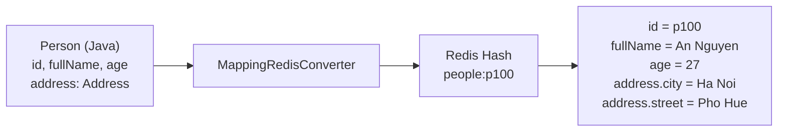
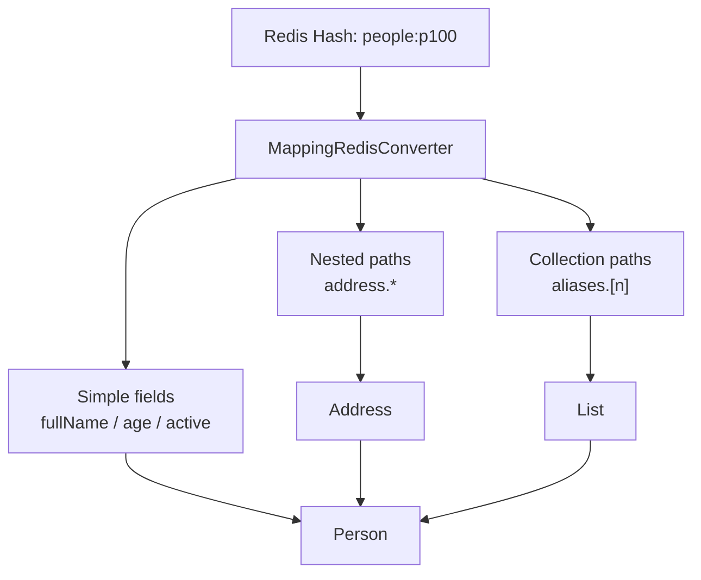

# Mapping Simple Properties and Nested Objects in Spring Data Redis

> **Module:** Spring Data Redis  
> **Chapter:** Entity Mapping  
> **Content:** How Spring Data Redis converts a Java object into fields in a Redis Hash, how it reconstructs the object on read, rules for handling simple properties, nested objects, collections, and cases where mapping needs adjustment.

## 1. From Java Entity to Redis Hash

When using **Spring Data Redis Repositories**, the application works with Java entities through familiar operations such as `save`, `findById`, and `deleteById`. Spring Data Redis handles converting between the object model and Redis's storage structure.

Example of a Java entity:

```java
@RedisHash("people")
public class Person {

    @Id
    private String id;

    private String fullName;
    private Integer age;
    private Address address;
}
```

The application sees `Person` with an `address` property of type `Address`. Redis sees a key representing the entity, typically `people:<id>`, with a **hash** value containing field-name and value pairs.

If `address` is a normal nested object, its properties can be *flattened* into hash fields such as `address.city` and `address.street`. Therefore, a Java entity **does not necessarily correspond to a JSON string**, and a nested object **does not necessarily create a separate Redis key**.

### Mapping Diagram



Spring Data Redis uses the mapping infrastructure, including `RedisMappingContext` and `MappingRedisConverter`, to determine which properties to store, convert data types, and reconstruct objects. Type information such as `_class` may also be stored to help restore the exact Java type.

The scope of this lesson is **entity mapping via Redis Repositories/Redis Mapping**. This differs from an application directly calling `StringRedisTemplate.opsForValue().set(key, json)` to store an entire JSON string as a Redis String.

## 2. Setting Up a Complete Example

Suppose an application manages customer profiles. Each customer has simple properties and a nested address.

### 2.1. `Address` Class: Nested Object

```java
package com.example.redis.domain;

public class Address {

    private String street;
    private String district;
    private String city;

    public Address() {
    }

    public Address(String street, String district, String city) {
        this.street = street;
        this.district = district;
        this.city = city;
    }

    public String getStreet() {
        return street;
    }

    public void setStreet(String street) {
        this.street = street;
    }

    public String getDistrict() {
        return district;
    }

    public void setDistrict(String district) {
        this.district = district;
    }

    public String getCity() {
        return city;
    }

    public void setCity(String city) {
        this.city = city;
    }
}
```

`Address` is a plain Java object. In this example, it has no `@Id`, does not declare `@RedisHash`, and is not managed as an independent entity. It is part of `Person`'s data.

### 2.2. `Person` Class: Root Entity

```java
package com.example.redis.domain;

import java.util.ArrayList;
import java.util.List;

import org.springframework.data.annotation.Id;
import org.springframework.data.redis.core.RedisHash;

@RedisHash("people")
public class Person {

    @Id
    private String id;

    private String fullName;
    private Integer age;
    private Boolean active;
    private Address address;
    private List<String> aliases = new ArrayList<>();

    public Person() {
    }

    public Person(
            String id,
            String fullName,
            Integer age,
            Boolean active,
            Address address,
            List<String> aliases) {
        this.id = id;
        this.fullName = fullName;
        this.age = age;
        this.active = active;
        this.address = address;
        this.aliases = aliases;
    }

    public String getId() {
        return id;
    }

    public void setId(String id) {
        this.id = id;
    }

    public String getFullName() {
        return fullName;
    }

    public void setFullName(String fullName) {
        this.fullName = fullName;
    }

    public Integer getAge() {
        return age;
    }

    public void setAge(Integer age) {
        this.age = age;
    }

    public Boolean getActive() {
        return active;
    }

    public void setActive(Boolean active) {
        this.active = active;
    }

    public Address getAddress() {
        return address;
    }

    public void setAddress(Address address) {
        this.address = address;
    }

    public List<String> getAliases() {
        return aliases;
    }

    public void setAliases(List<String> aliases) {
        this.aliases = aliases;
    }
}
```

Each annotation and property has a distinct role:

| Component | Role |
|---|---|
| `@RedisHash("people")` | Declares an entity managed by Redis mapping, with a keyspace named `people` |
| `@Id` | Identifies the identifier key used in the entity's Redis key |
| `fullName` | Simple property of type `String` |
| `age` | Simple property of type `Integer` |
| `active` | Simple property of type `Boolean` |
| `address` | Composite object nested inside `Person` |
| `aliases` | Collection containing simple values |

The example explicitly sets `id` when instantiating the object to make observing the Redis key easier. In some configurations, Spring Data can generate IDs if absent; this lesson uses a predetermined ID to separate mapping from ID generation strategies.

### 2.3. Repository

```java
package com.example.redis.repository;

import com.example.redis.domain.Person;
import org.springframework.data.repository.CrudRepository;

public interface PersonRepository extends CrudRepository<Person, String> {
}
```

The Repository provides save/read operations for the entity. There is no need to manually construct `HSET` commands for each property.

With Spring Boot, add the `spring-boot-starter-data-redis` dependency, configure the connection accordingly, and enable Redis repositories if the application has not already enabled them via auto-configuration:

```java
package com.example.redis;

import org.springframework.boot.SpringApplication;
import org.springframework.boot.autoconfigure.SpringBootApplication;
import org.springframework.data.redis.repository.configuration.EnableRedisRepositories;

@SpringBootApplication
@EnableRedisRepositories
public class RedisApplication {

    public static void main(String[] args) {
        SpringApplication.run(RedisApplication.class, args);
    }
}
```

```yaml
spring:
  data:
    redis:
      host: localhost
      port: 6379
```

The example uses modern Spring Boot configuration conventions. If the project already configures repository scanning or has multiple data stores, specify an appropriate package scope rather than enabling redundant scans.

### 2.4. Saving and Reading an Object

Suppose an application component has `PersonRepository` injected:

```java
Address address = new Address(
        "12 Pho Hue",
        "Hai Ba Trung",
        "Ha Noi");

Person person = new Person(
        "p100",
        "An Nguyen",
        27,
        true,
        address,
        List.of("An", "Anna"));

personRepository.save(person);

Person restored = personRepository.findById("p100")
        .orElseThrow();

System.out.println(restored.getFullName());        // An Nguyen
System.out.println(restored.getAddress().getCity()); // Ha Noi
System.out.println(restored.getAliases().get(0));   // An
```

During `save`, the framework inspects `Person`'s properties and creates corresponding hash fields. During `findById`, the framework reads the hash and converts the data back into a `Person`, including `Address` and the `aliases` list.

This is **bidirectional** mapping: it must not only write data, but also know how to reconstruct the Java object graph when reading.

## 3. How Are Simple Properties Mapped?

A *simple property* is a property treated by the conversion system as a single value that can be represented directly in one Redis Hash field, rather than expanding into multiple child properties.

Familiar examples:

- `String`, `char`/`Character`: text or character.
- Numeric types such as `int`/`Integer`, `long`/`Long`, `double`/`Double`.
- `boolean`/`Boolean`.
- `enum` and certain temporal/value types supported by the conversion system in the version used.
- Custom types with an appropriate converter to turn them into a single value.

For example, `Person` has:

```java
private String fullName = "An Nguyen";
private Integer age = 27;
private Boolean active = true;
```

In hash form, this can be visualized as:

```text
Redis key: people:p100
Redis type: hash

Field          Value
-------------  ---------
fullName       An Nguyen
age            27
active         true
```

A Redis Hash stores data as byte sequences for both fields and values. Numbers or booleans shown by `redis-cli` are representations processed by serializers/converters; Redis **does not inherently know** that `age` was declared as `Integer` in Java. On read, Spring Data Redis relies on property metadata and the conversion mechanism to restore the required type.

### 3.1. Difference Between Primitives and Wrappers

In Java:

```java
private int score;
private Integer optionalScore;
```

`int` cannot be `null`; its default value is `0` if an object is instantiated without assigning it. `Integer` can be `null` to represent "no score yet."

When a wrapper property has no value, the corresponding field is usually not written to the hash under standard mapping. Therefore, the distinction between **missing field**, **empty value**, and **default value** must be clearly modeled in the domain.

For example:

- `age = 0` is a meaningful value and is not equivalent to `age = null`.
- `fullName = ""` is an empty string, different from not having a `fullName` property in the hash.
- Do not assume a field's absence in the hash means the user actively deleted the data; it could also indicate an older record written before that field existed.

### 3.2. `@Transient` Excludes a Property from Mapping

Not every field in a Java class needs to be stored.

```java
import org.springframework.data.annotation.Transient;

@Transient
private String displayLabel;
```

`displayLabel` might be a computed value for the UI. Spring Data's `@Transient` tells the mapping framework not to persist this field as a persistent property of the entity.

Be careful to distinguish `org.springframework.data.annotation.Transient` from similar annotations in other serialization libraries. Annotations from other libraries may not carry the same meaning in Redis repository mapping.

### 3.3. Enum Types

Example:

```java
public enum MembershipLevel {
    BASIC, SILVER, GOLD
}

private MembershipLevel level;
```

An enum is typically converted into a single representation that can be stored in the hash and read back into the enum. If you rename an enum constant after data has already been stored, old records may no longer map to the new enum.

Thus, for long-lived data, enum names and related converters should be treated as part of the data contract.

## 4. Nested Objects: Property Flattening Mechanism

A property is treated as a composite object when the framework needs to descend into its child properties to produce the Redis record.

Suppose:

```java
public class Address {
    private String street;
    private String district;
    private String city;
}
```

And:

```java
private Address address;
```

When `address` is present and contains:

```text
street   = "12 Pho Hue"
district = "Hai Ba Trung"
city     = "Ha Noi"
```

Redis mapping can flatten it into:

```text
address.street   = "12 Pho Hue"
address.district = "Hai Ba Trung"
address.city     = "Ha Noi"
```

**The dot** in the field name represents the property path. `address.city` means accessing the `city` property inside `Person`'s `address`.

### 4.1. Inspecting Data Directly with `redis-cli`

For the `p100` object in the example:

```bash
redis-cli TYPE people:p100
redis-cli --raw HGETALL people:p100
redis-cli --raw HGET people:p100 address.city
```

The expected `TYPE` is `hash`. An illustrative data layout might be:

```text
Redis key: people:p100

_class          com.example.redis.domain.Person
id              p100
fullName        An Nguyen
age             27
active          true
address.street  12 Pho Hue
address.district Hai Ba Trung
address.city    Ha Noi
aliases.[0]     An
aliases.[1]     Anna
```

The keyspace name and property paths above illustrate common mapping behavior. Byte representation, metadata fields such as `_class`, field ordering, and map/collection details can vary by converter configuration or Spring Data Redis version. `HGETALL` does not guarantee result order.

### 4.2. Does Not Automatically Create a Redis Key for `Address`

In the example above, Redis does not need an `address:<some-id>` key. The address fields live in the same `people:p100` Redis Hash.

Consequences:

- Deleting `people:p100` also removes that hash's `address.*` fields.
- The TTL of `people:p100`, if any, applies to **the entire key** holding both the Person and the address.
- You cannot use `PersonRepository.findById(...)` to query an `Address` separately as an independent aggregate root.
- Address changes are typically saved along with `Person`, rather than existing automatically as a separate entity.

This is the **embedded/nested value object** model. It fits data that only makes sense alongside the root entity, such as a shipping address at order creation time, account display preferences, or product-specific technical specifications.

### 4.3. Multiple Nesting Levels

Suppose `Address` also has `GeoLocation`:

```java
public class GeoLocation {
    private Double latitude;
    private Double longitude;
}

public class Address {
    private String city;
    private GeoLocation location;
}
```

Java structure:

```text
Person
└── address
    ├── city
    └── location
        ├── latitude
        └── longitude
```

This can be represented by paths:

```text
address.city
address.location.latitude
address.location.longitude
```

The Java property names themselves form the path, so renaming `address`, `location`, or `latitude` can affect how old records are read. When data already exists, renaming a property should be accompanied by a compatibility or data migration strategy.

### 4.4. Nested Objects with `null`

If:

```java
person.setAddress(null);
personRepository.save(person);
```

Then under standard mapping, there will no longer be populated fields belonging to `address` in the saved record. On read, the framework lacks child property data to construct a complete address.

A `new Address()` object whose child properties are all `null` is also a case to consider: if no fields are saved, the application may not be able to distinguish "an empty object was created" from "no object exists." If the two states carry different business meanings, store an explicit status flag or use custom conversion.

## 5. Nested Collections, Lists, and Maps

Property mapping does not apply only to a single child object. A collection can be flattened into multiple hash fields with an index or map key in the path.

### 5.1. `List<String>`

In `Person`:

```java
private List<String> aliases;
```

Value:

```java
person.setAliases(List.of("An", "Anna", "An Nguyen"));
```

Can be stored in the form:

```text
aliases.[0]  = An
aliases.[1]  = Anna
aliases.[2]  = An Nguyen
```

The numbers in `[0]`, `[1]`, `[2]` represent positions in the list. When reading back, the converter reconstructs the collection and elements according to the corresponding mapping.

Do not directly edit the `aliases.[1]` field and assume all repository rules, secondary indexes, and other data structures are synchronized. If using a repository to manage the entity, update through repository APIs or an appropriately designed partial update mechanism.

### 5.2. `List<Address>`

Suppose a person has multiple addresses:

```java
private List<Address> deliveryAddresses;
```

With two elements, the property paths can be represented as:

```text
deliveryAddresses.[0].street
deliveryAddresses.[0].city
deliveryAddresses.[1].street
deliveryAddresses.[1].city
```

The key point is that **objects inside the list remain nested objects**, while the list position becomes part of the property path. Reordering the list can cause multiple fields to be rewritten even though the address data itself did not change.

### 5.3. `Map<String, String>`

Example:

```java
private Map<String, String> preferences;
```

Value:

```java
Map.of(
    "language", "vi",
    "timezone", "Asia/Ho_Chi_Minh"
);
```

Can be flattened into field names containing the map key, such as:

```text
preferences.[language] = vi
preferences.[timezone] = Asia/Ho_Chi_Minh
```

For maps containing composite objects, the path also includes the properties of those objects.

Exact field names depend on mapper configuration and the map's key type. When designing maps with dynamic keys, watch out for characters that carry structural meaning in field names (dots, square brackets), and verify the mapping behavior of the version in use rather than guessing field names.

### 5.4. `Set` and Element Ordering

`Set` does not guarantee ordering like `List`. If the framework uses positions in the hash structure to reconstruct collection elements, physical position is not a business contract for `Set`.

If the problem requires stable ordering (such as step order, priority levels, or schedules), use `List` or explicitly store an `order` field on each element.

### 5.5. Empty Collections

An empty collection has no elements to flatten. Therefore, in some mapping forms, an empty collection and a `null` property can produce identical or indistinguishable stored representations. If that distinction matters, consider a separate property to record status or a custom converter.

## 6. How Reading Back an Entity Works

When calling:

```java
personRepository.findById("p100");
```

You can picture the process as:

1. The Repository determines keyspace `people` and ID `p100` to locate the Redis key.
2. Redis returns the hash fields.
3. `MappingRedisConverter` identifies entity metadata, property types, and conversion rules.
4. `fullName`, `age`, and `active` fields are populated back into their corresponding Java types.
5. Paths `address.street` and `address.city` are assembled into an `Address` object.
6. Elements `aliases.[n]` are reconstructed into `List<String>`.
7. Spring Data Redis returns `Person` to the application.



The converter needs to know how to instantiate the object. For ordinary Java POJOs, a no-arg constructor and accessible properties are straightforward. Spring Data also supports constructor selection strategies and mapping into immutable objects depending on version; when using records, parameterized constructors, or custom types, ensure object instantiation matches what the framework expects in practice.

## 7. When to Use Embedded Objects vs. `@Reference`?

A nested object **flattened inside the hash** and an object stored **separately via reference** are two different models.

### 7.1. Embedded Object: Data Owned by the Parent Entity

```java
@RedisHash("people")
public class Person {

    @Id
    private String id;

    private Address address;
}
```

Structure:

```text
people:p100  (Redis Hash)
  id = p100
  address.city = Ha Noi
  address.street = 12 Pho Hue
```

`Address` depends on `Person`'s data lifecycle. When reading Person, Spring Data Redis reconstructs Address from fields in the same hash.

Use when: the address is that person's own copy of data, with little need to access it as an independent aggregate root.

### 7.2. `@Reference`: Referencing Another Entity

If a property points to an independently managed entity, Spring Data Redis supports `@Reference`:

```java
import org.springframework.data.redis.core.index.Indexed;
import org.springframework.data.redis.core.RedisHash;
import org.springframework.data.annotation.Id;
import org.springframework.data.annotation.Reference;

@RedisHash("departments")
public class Department {
    @Id
    private String id;
    private String name;
    // Constructors and accessors as needed.
}

@RedisHash("employees")
public class Employee {
    @Id
    private String id;

    @Reference
    private Department department;
    // Constructors and accessors as needed.
}
```

Storage concept:

```text
departments:d10
  id = d10
  name = Engineering

employees:e20
  id = e20
  department = [reference to departments:d10]
```

Instead of flattening `department.name` inside the `employees:e20` hash, the framework can store sufficient reference info to locate the corresponding `Department` entity on read.

**Very important point:** `@Reference` does not imply automatic cascading saves (*cascade save*). If you modify `Department` and only save `Employee`, do not expect the `Department` record to be updated automatically. Likewise, deleting a referenced entity does not mean the framework automatically ensures all references pointing to it remain valid.

The choice between embedded and reference should stem from **data ownership boundaries**:

| Criterion | Nested/embedded | `@Reference` |
|---|---|---|
| Storage style | Flattened into root entity's hash | Stores reference to a separate entity |
| Separate key for child object | Not required | Yes, target entity is stored independently |
| Reading parent entity | Builds child object from same hash | May require reading target entity via reference |
| Lifecycle | Tied to parent entity | Independent lifecycle |
| Best suited for | Value objects, copied addresses, personal settings | Departments, shared categories, objects shared across many entities |
| Cascading save | Saving parent saves nested fields | Do not assume cascade save |

For complex relationships or strict consistency across multiple aggregates, Redis repositories are not a full relational ORM. Design update and synchronization strategies explicitly.

## 8. Related Annotations and Mechanisms

### 8.1. `@RedisHash`

`@RedisHash("people")` declares the keyspace. The typical key pattern is:

```text
people:<id>
```

For example `people:p100`. Besides the primary hash, Spring Data Redis may create auxiliary keys to manage keyspaces, indexes, and expiration depending on repository features.

Do not rely on "only a single key is created" when designing direct Redis scan/delete logic.

### 8.2. `@Id`

`@Id` helps the framework identify the entity.

```java
@Id
private String id;
```

When the ID changes, the entity's identity in Redis changes too. Do not arbitrarily mutate the `id` of a saved object expecting it to behave like updating a normal property.

### 8.3. `@Indexed` and Querying by Nested Property

Redis does not automatically index every hash field. Repository queries on a property must be backed by a suitable indexing mechanism.

For example, marking the `city` field inside `Address`:

```java
import org.springframework.data.redis.core.index.Indexed;

public class Address {

    @Indexed
    private String city;

    // Other properties and accessors.
}
```

The Repository can define a method querying by the nested path:

```java
import java.util.List;

public interface PersonRepository extends CrudRepository<Person, String> {

    List<Person> findByAddress_City(String city);
}
```

The underscore in the method name helps separate the `address.city` path when the property-name parser needs to disambiguate segments.

With Spring Data Redis, indexed fields can be mapped to Redis Sets holding the IDs of matching entities. This supports lookups by indexed property values. It also incurs update and memory overhead: each entity save/delete may have to manage additional index data.

Do not confuse `@Indexed` with creating a separate Redis Hash for the child property; indexing is a structure for **lookup**, while the underlying data remains stored according to the entity's mapping.

### 8.4. `@TimeToLive` / `@RedisHash(timeToLive = ...)`

TTL applies to **the entity's Redis key**, not individually to each `address.*` field by default.

Example:

```java
@RedisHash(value = "short-lived-people", timeToLive = 3600)
public class TemporaryPerson {

    @Id
    private String id;

    private Address address;
}
```

Here TTL is declared in seconds. When `TemporaryPerson`'s Redis key expires, the entire hash disappears, including all simple and nested properties stored inside it.

Some Redis versions support expiration operations at the hash-field level, but that is a separate Redis feature and is not synonymous with Spring Data Redis repositories' default entity TTL behavior.

### 8.5. `@TypeAlias` and Type Metadata

Spring Data Redis may store Java type metadata, such as `_class`, to restore the exact entity or polymorphic object types.

When refactoring packages/classes, Java names already stored in Redis may no longer be valid. For long-lived data, consider `@TypeAlias` and a backward-compatible migration strategy.

Example:

```java
import org.springframework.data.annotation.TypeAlias;

@TypeAlias("person")
@RedisHash("people")
public class Person {
    // ...
}
```

Exact metadata configuration depends on the mapping context and version. `@TypeAlias` does not automatically migrate old records containing different type names; plan a migration when existing data is present.

## 9. When a Java Type Needs a Custom Converter

Default mapping does not necessarily know how to store every custom value object. Two common approaches exist:

- **Let the framework flatten it:** a type with clear child properties, such as `GeoLocation(latitude, longitude)`, can be mapped to `location.latitude` and `location.longitude`.
- **Define a converter:** store the custom object as a single value in a controlled format, such as `"21.0285,105.8542"`, and parse it back on read.

Model example:

```java
public class GeoLocation {
    private double latitude;
    private double longitude;
    // Constructors and accessors.
}
```

If handled by nested mapping:

```text
address.location.latitude  = 21.0285
address.location.longitude = 105.8542
```

If needed as a simple value:

```text
address.location = 21.0285,105.8542
```

You can register a converter pair using Spring's `Converter<S, T>` with `@WritingConverter` and `@ReadingConverter` annotations, then include them in `RedisCustomConversions`.

Core conversion example:

```java
import org.springframework.core.convert.converter.Converter;
import org.springframework.data.convert.ReadingConverter;
import org.springframework.data.convert.WritingConverter;

@WritingConverter
public class GeoLocationToString
        implements Converter<GeoLocation, String> {

    @Override
    public String convert(GeoLocation source) {
        return source.getLatitude() + "," + source.getLongitude();
    }
}

@ReadingConverter
public class StringToGeoLocation
        implements Converter<String, GeoLocation> {

    @Override
    public GeoLocation convert(String source) {
        String[] parts = source.split(",", -1);
        if (parts.length != 2) {
            throw new IllegalArgumentException("Invalid coordinates: " + source);
        }
        return new GeoLocation(
                Double.parseDouble(parts[0]),
                Double.parseDouble(parts[1]));
    }
}
```

The snippet requires `GeoLocation` to have the constructor and getters used above. For the converters to take effect, register them in the application's `RedisCustomConversions`; simply declaring the converter classes does not guarantee the repository will automatically use them.

Guidelines when designing converters:

1. **Symmetric read and write:** data written by the converter must be read back accurately by its counterpart.
2. **Stable format:** if you change delimiters, numeric precision, or date/time formats, account for legacy data.
3. **Clear error handling:** corrupted or malformed values must be handled intentionally.
4. **Avoid conversion conflicts:** overly broad converters (e.g., between common types) can affect properties unexpectedly.
5. **Determine query needs:** a property packed into a single string will no longer expose sub-paths like `address.location.latitude` for default nested mapping indexes.

## 10. Saving Updates to Nested Objects

Suppose a `Person` already exists with `address.city = "Ha Noi"`. To modify it:

```java
Person person = personRepository.findById("p100")
        .orElseThrow();

person.getAddress().setCity("Da Nang");

personRepository.save(person);
```

The entity's Redis record is updated according to the saved object's state. An important note is that `CrudRepository.save` operates at the **entity** level and the mapping mechanism may rewrite multiple hash fields; do not assume this emits only a single `HSET address.city ...` command.

### 10.1. Why Update Mechanics Matter

Suppose two threads process `people:p100` concurrently:

```text
Thread A reads Person (age=27, city=Ha Noi)
Thread B reads Person (age=27, city=Ha Noi)

Thread A changes city=Da Nang and calls save
Thread B changes age=28 and calls save based on stale read
```

If each thread writes back its own stale entity state, Thread A's update may be overwritten by Thread B, depending on the actual update and coordination mechanism.

Possible remedies include:

- Synchronizing or redesigning update operations around aggregate boundaries.
- Using optimistic locking/versioning if the repository type and version in use provide appropriate support.
- Using Redis operations specifically designed for single-field updates when field-level atomicity is truly required.
- For stricter requirements, considering Redis Lua scripts/transactions and corresponding business invariants.

Do not recommend a repository operation as an absolute concurrency-safe solution across competing writes without verifying the guarantees of your Spring Data Redis version and data model.

### 10.2. Partial Update

Spring Data Redis provides `PartialUpdate` for scenarios where you need to update part of a mapped object without supplying the entire new object.

Conceptual example with `RedisKeyValueTemplate`:

```java
import org.springframework.data.redis.core.PartialUpdate;

PartialUpdate<Person> update =
        new PartialUpdate<>("p100", Person.class)
                .set("address.city", "Da Nang");

redisKeyValueTemplate.update(update);
```

Here `redisKeyValueTemplate` is the `RedisKeyValueTemplate` bean injected in the application. Syntax and nested-path update capabilities depend on property types and the Spring Data Redis version used.

**Do not blindly replace** every `save` with `PartialUpdate`. Modifying properties with indexes, TTLs, or collections may require the framework to update related structures. Choose the API that matches your application's metadata/index management needs.

## 11. Distinguishing Redis Repository Mapping from Other Redis Storage Styles

Spring Data Redis provides several ways to write data. The same Java object can have very different representations in Redis.

| Access Method | Typical Stored Data Format | Meaning of Nested Object |
|---|---|---|
| Redis Repositories with `@RedisHash` | Redis Hash and property-path mapping | Can be flattened into `address.city`, `address.street` |
| `RedisTemplate.opsForHash()` | Redis Hash with app-specified fields/values | Application decides field names and serializers; does not default to repository mapping |
| `StringRedisTemplate.opsForValue()` | Redis String | Application converts object to string itself if needed |
| `RedisTemplate.opsForValue()` with JSON serializer | Redis String containing JSON or JSON bytes | Nested object is typically a JSON structure inside a single value |
| RedisJSON (if corresponding module/feature is deployed) | Redis JSON document | Can operate with JSON paths via RedisJSON API; not the default for `@RedisHash` |

Example storing raw JSON with `StringRedisTemplate`:

```java
String json = """
        {
          "id": "p100",
          "fullName": "An Nguyen",
          "address": {
            "city": "Ha Noi",
            "street": "12 Pho Hue"
          }
        }
        """;

stringRedisTemplate.opsForValue()
        .set("person-json:p100", json);
```

Reading `person-json:p100` requires `GET`, because the key is a Redis String. Conversely, `people:p100` created by the repository is read as a Redis Hash with `HGETALL` or `HGET`.

One of the most common mistakes is running `GET people:p100` and hitting `WRONGTYPE`. Repository keys are stored as hashes, so use commands matching the data type—or better yet, read through the repository.

## 12. Practice: Inspecting the Mapping Structure

Have Redis running, along with the Spring Data Redis application and the example repository.

### Step 1: Save the Entity

```java
Person person = new Person(
        "p200",
        "Binh Tran",
        31,
        true,
        new Address("5 Nguyen Trai", "Thanh Xuan", "Ha Noi"),
        List.of("Binh", "BT"));

personRepository.save(person);
```

### Step 2: Inspect Data Type and Fields

```bash
redis-cli TYPE people:p200
redis-cli --raw HGETALL people:p200
redis-cli --raw HGET people:p200 fullName
redis-cli --raw HGET people:p200 address.city
```

Expected output:

```text
TYPE people:p200
hash

HGET people:p200 fullName
Binh Tran

HGET people:p200 address.city
Ha Noi
```

### Step 3: Modify the Nested Object

```java
Person found = personRepository.findById("p200")
        .orElseThrow();

found.getAddress().setCity("Hue");
personRepository.save(found);
```

Verify again:

```bash
redis-cli --raw HGET people:p200 address.city
```

Expected output:

```text
Hue
```

### Step 4: Inspect the Collection

```bash
redis-cli --raw HGETALL people:p200
```

Observe the path-based fields corresponding to elements in `aliases`. Do not rely on the line order from `HGETALL`.

### Step 5: Delete the Entire Entity

```java
personRepository.deleteById("p200");
```

```bash
redis-cli EXISTS people:p200
```

Expected result is `0` assuming no concurrent operation recreated the key. When deleting via the repository, the framework also has the chance to clean up metadata/indexes it manages; deleting directly with `DEL` may bypass part of that management work depending on configuration.

## 13. Common Design Mistakes

### 13.1. Thinking Nested Objects Are Always JSON

`@RedisHash` uses Redis Hash mapping with path-based fields by default. If you want to store an intact JSON document, explicitly choose a different serializer/storage mechanism.

### 13.2. Thinking Every Nested Object Creates an Extra Redis Key

Nesting `Address` inside `Person` does not automatically create an `addresses:<id>` key. Separate keys only exist when you design an independent entity and save it through its own repository, or use references.

### 13.3. Editing Individual Fields Directly and Bypassing the Repository

Using `HSET` directly can modify the hash, but the framework may also manage indexes, expirations, and other metadata. If `@Indexed` is present or domain invariants must be maintained, direct writes outside the repository can leave related structures out of sync.

### 13.4. Renaming Java Fields Without Accounting for Old Data

If `fullName` is renamed to `displayName`, previously written hash fields are not automatically renamed. Old records may lack the new field and reads will not match expectations. Plan a migration or multi-version schema-compatible reading.

### 13.5. Confusing `null` with Default Values

An absent field does not always mean the same thing as `0`, `false`, or an empty string. Especially when reading legacy records or nullable child objects, define defaults explicitly in the domain layer.

### 13.6. Assuming Every Property Is Queryable via the Repository

Redis Hashes do not automatically create query indexes for every property. For non-ID lookup methods, use a supported indexing mechanism such as `@Indexed` on the appropriate property, and understand the memory and index-update costs.

### 13.7. Failing to Distinguish "Child Value" from "Shared Entity"

If multiple Persons share one Department and the Department changes centrally, copying the entire Department as a nested object inside each Person creates multiple copies that easily drift out of sync. Consider `@Reference` or a separate access model, while managing saves and updates of the target entity.

### 13.8. Treating Repository `save` as Concurrency-Safe for Every Field

Objects read, modified, and written back via `save` are vulnerable to lost updates when multiple requests update concurrently. Design consistency according to business requirements; automatic mapping does not resolve all data-race issues.

## 14. How to Choose a Mapping Style for Your Project

When designing an entity using Spring Data Redis, make decisions in the following order:

1. **Identify the aggregate root:** Which object has an independent identity and lifecycle? Apply `@RedisHash` and `@Id` to entities accessed by ID.
2. **Classify properties:** Single values like `String`, `Integer`, and `Boolean` are simple properties; objects describing detailed sub-structures usually suit nested mapping.
3. **Choose embedded vs. reference:** Data dependent on the parent entity should be stored nested; data with its own identity and broad sharing warrants considering an independent entity.
4. **Evaluate collections:** Use `List` when order matters; use `Map` when elements are keyed; pay attention to path representation and empty/null cases.
5. **Identify query needs:** If lookups by non-ID properties are needed, design specific indexes; do not assume every Redis Hash field is queryable via derived repository methods.
6. **Define lifecycle:** TTL operates at the entity key level; expiration removes both simple and nested fields within the same hash.
7. **Plan schema evolution:** Adding/removing/renaming properties and changing converters all affect existing data.
8. **Decide update mechanics:** Saving the whole entity via repository versus partial updates must consider consistency, indexes, and how the application handles concurrent writes.

The key takeaway of this lesson is: **Spring Data Redis can map a Java object tree into a Redis Hash with fields describing property paths.** Simple properties become single values; nested objects are flattened by property name; collections append positions or keys to the path. Understanding this structure helps you inspect real data in Redis, design clear domains, and avoid confusing embedded objects, references, and JSON serialization.

## Further Reading

- Spring Data Redis Reference — [Object Mapping](https://docs.spring.io/spring-data/redis/reference/redis/redis-repositories/mapping.html).
- Spring Data Redis Reference — [Redis Repositories](https://docs.spring.io/spring-data/redis/reference/redis/redis-repositories.html).
- Spring Data Redis Reference — [Indexing](https://docs.spring.io/spring-data/redis/reference/redis/redis-repositories/indexes.html).
- Spring Data Redis Reference — [Keyspaces](https://docs.spring.io/spring-data/redis/reference/redis/redis-repositories/keyspaces.html).
- Spring Data Redis Reference — [Custom Conversions](https://docs.spring.io/spring-data/redis/reference/redis/redis-repositories/mapping.html#redis.repositories.mapping.custom-conversions).
