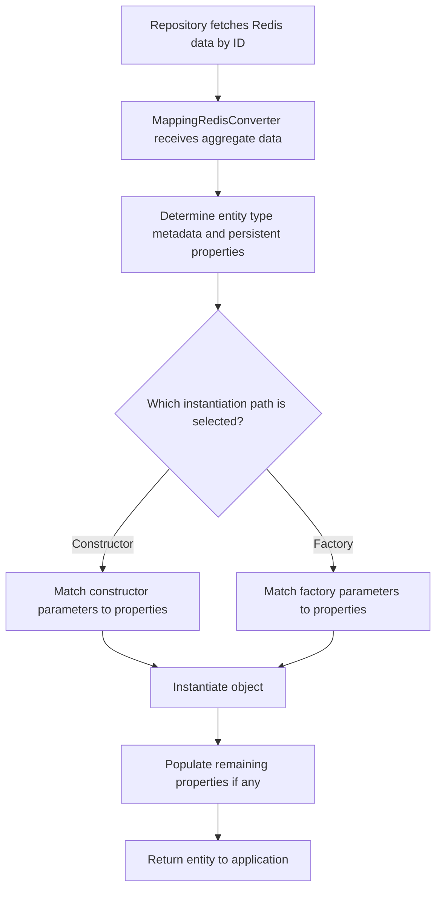
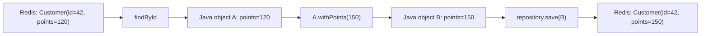

# Constructor Selection and Immutable Object Instantiation in Spring Data Redis

## 1. Context: Redis Stores Data, Spring Data Reconstructs Java Objects

When an application saves an entity using a **Spring Data Redis Repository**, the entity's data is mapped into Redis structures. When reading it back, Spring Data Redis must perform the reverse step: identify the entity type, retrieve the stored properties, and **instantiate a Java object** with the matching state.

With ordinary Java objects, the application might instantiate using a no-arg constructor and populate fields via setters. However, with an **immutable entity**, fields are typically `final`, there are no setters, and all required state must be supplied at instantiation time. Spring Data must choose the right constructor or factory method to pass the read values into the object.

For example, a user entity with three properties:

```text
Redis
  customers:42  ->  id = "42"
                    displayName = "Mai"
                    points = 120
                         |
                         v
             Spring Data Redis mapping
                         |
                         v
     new Customer("42", "Mai", 120)
```

Redis does not always store fields in the exact text format shown above; this is a conceptual diagram of the mapping step. Actual property encoding depends on converter configuration and data types.

The goal of this lesson is to understand **constructor selection**, how to design **immutable entities that Spring Data Redis can read and write**, and common errors caused by multiple constructors, missing parameter-name metadata, or entity structural changes.

## 2. Scope: Entity Mapping Differs from Serializing an Object Manually

Distinguish two ways of using Redis in Spring:

| Approach | Who Instantiates the Object on Read? | Role of Constructors in Spring Data Mapping |
|---|---|---|
| `CrudRepository<Customer, String>` with `@RedisHash` | Spring Data Redis mapping infrastructure | Applies persistence constructor / factory selection rules |
| `RedisTemplate` with `MappingRedisConverter` or equivalent mapping path | Spring Data Redis mapping infrastructure | Also uses the entity mapping mechanism |
| `RedisTemplate` writing JSON via a JSON serializer | Configured JSON serializer/deserializer, e.g., Jackson | Follows the JSON serializer's rules; `@PersistenceCreator` is not Jackson's general instantiation mechanism |
| `StringRedisTemplate` writing a single string | String serializer | No Java entity materialization from a Redis Hash needed |

Therefore, this lesson covers **entity mapping managed by Spring Data Redis**. Do not assume adding `@PersistenceCreator` changes how an arbitrary JSON serializer instantiates objects.

A Redis Repository entity typically has:

- `@RedisHash`: defines this as an aggregate stored in a Redis keyspace.
- `@Id`: specifies the identifier property.
- Persistent properties: data to map into and out of Redis.
- A suitable constructor or factory for Spring Data to recreate instances.

## 3. How Does Constructor Selection Work?

Spring Data uses Spring Data Commons' *object creation* mechanism to determine how to instantiate a persistent object. In Java, typical options include:

| Class Structure | Recommended Design |
|---|---|
| Only one constructor | Spring Data typically uses that sole constructor |
| Multiple constructors, one marked `@PersistenceCreator` | The annotated constructor is the persistence instantiation path |
| A static factory marked `@PersistenceCreator` | Spring Data can create instances via that factory |
| Java `record` | The record's canonical constructor restores components, unless an explicit persistence creator is specified appropriately |
| Mutable class with no-arg constructor and setters / field access | Can instantiate via no-arg constructor and then populate state |
| Multiple instantiation paths with no clear choice | Risks unintended selection or instantiation failure; redesign or annotate explicitly |

There are specific precedence rules among single constructors, annotated factories, records, and no-arg constructors; therefore, the **least ambiguous** approach when multiple constructors exist is to designate one persistence path with `@PersistenceCreator`. For plain Java records, the canonical constructor is the natural choice.

`@PersistenceCreator` resides in the package:

```java
import org.springframework.data.annotation.PersistenceCreator;
```

Do not confuse this annotation with `@Autowired` (which selects a constructor for Spring bean dependency injection) or `@JsonCreator` (which guides certain JSON serializers). A Redis entity is typically a **domain data object**, not a bean created and injected by the container.

### Execution Flow When Reading an Entity



*Object instantiation* and *populating remaining properties* are two separate responsibilities. If a `final` property is omitted from the constructor and has no suitable copy/wither mechanism, Spring Data may have no valid way to populate that value.

## 4. Basic Example: Immutable Entity with a Single Constructor

Suppose an application has a customer entity with a business-assigned ID, display name, and point balance. All properties are supplied upon creation.

```java
package com.example.demo.customer;

import java.util.Objects;
import org.springframework.data.annotation.Id;
import org.springframework.data.redis.core.RedisHash;

@RedisHash("customers")
public class Customer {

    @Id
    private final String id;
    private final String displayName;
    private final int points;

    public Customer(String id, String displayName, int points) {
        this.id = Objects.requireNonNull(id, "id");
        this.displayName = Objects.requireNonNull(displayName, "displayName");
        if (points < 0) {
            throw new IllegalArgumentException("points must be non-negative");
        }
        this.points = points;
    }

    public String getId() {
        return id;
    }

    public String getDisplayName() {
        return displayName;
    }

    public int getPoints() {
        return points;
    }

    public Customer withPoints(int newPoints) {
        return new Customer(id, displayName, newPoints);
    }

    public Customer withDisplayName(String newName) {
        return new Customer(id, newName, points);
    }
}
```

Because this class has only one constructor taking all properties, Spring Data can use that constructor to recreate the entity on read. Both `withPoints` and `withDisplayName` return **a new instance**, avoiding any need to mutate `final` fields externally.

Repository:

```java
package com.example.demo.customer;

import org.springframework.data.repository.CrudRepository;

public interface CustomerRepository extends CrudRepository<Customer, String> {
}
```

Service demonstrating read, transform, and save:

```java
package com.example.demo.customer;

import org.springframework.stereotype.Service;

@Service
public class CustomerService {

    private final CustomerRepository repository;

    public CustomerService(CustomerRepository repository) {
        this.repository = repository;
    }

    public Customer create(String id, String displayName) {
        return repository.save(new Customer(id, displayName, 0));
    }

    public Customer addPoints(String id, int amount) {
        if (amount <= 0) {
            throw new IllegalArgumentException("amount must be positive");
        }

        Customer existing = repository.findById(id)
                .orElseThrow(() -> new IllegalArgumentException("Customer not found"));

        Customer updated = existing.withPoints(
                Math.addExact(existing.getPoints(), amount)
        );
        return repository.save(updated);
    }
}
```

In this example, immutability belongs to **the Java object**: `existing` stays unchanged after calling `withPoints`. Redis remains a mutable data store; `save(updated)` persists the new state. Read → compute → save using separate commands **does not prevent lost updates under concurrent tasks**. A loyalty-points application with strict correctness requirements needs additional coordination or appropriate atomic update operations.

### Why Supply the ID Upfront?

If the ID is supplied when calling `new Customer(...)`, the constructor already has every needed value. Conversely, if relying on ID generation during `save` while `id` is `final`, Spring Data needs a strategy to apply the generated ID to the object, such as a *wither* producing a new instance with that ID. Exact support depends on entity type and mapping configuration. For an introductory immutable entity example, **explicitly supplying the ID** makes the creation flow straightforward to follow.

## 5. When Multiple Constructors Exist: Designate Explicitly with @PersistenceCreator

A common need is adding a convenience constructor for business code. If a class has multiple constructors, avoid forcing Spring Data to guess which one restores persisted data.

```java
package com.example.demo.customer;

import java.util.Objects;
import org.springframework.data.annotation.Id;
import org.springframework.data.annotation.PersistenceCreator;
import org.springframework.data.redis.core.RedisHash;

@RedisHash("customers")
public class Customer {

    @Id
    private final String id;
    private final String displayName;
    private final int points;

    // Convenience constructor for creating new customers.
    public Customer(String id, String displayName) {
        this(id, displayName, 0);
    }

    // Constructor used by Spring Data when reading saved data.
    @PersistenceCreator
    public Customer(String id, String displayName, int points) {
        this.id = Objects.requireNonNull(id, "id");
        this.displayName = Objects.requireNonNull(displayName, "displayName");
        if (points < 0) {
            throw new IllegalArgumentException("points must be non-negative");
        }
        this.points = points;
    }

    public String getId() {
        return id;
    }

    public String getDisplayName() {
        return displayName;
    }

    public int getPoints() {
        return points;
    }

    public Customer withPoints(int value) {
        return new Customer(id, displayName, value);
    }
}
```

Here there are two distinct purposes:

1. `Customer(id, displayName)` lets business code create a customer with `points = 0`.
2. `Customer(id, displayName, points)` is the full constructor for Spring Data to restore persistent state, including saved points.

The `@PersistenceCreator` annotation directly resolves that choice. The persistence constructor should accept all values needed to establish the entity's invariants. If the constructor omits an immutable field that holds persisted data, there must be a valid copy mechanism for that field; the simpler choice is usually to include it in the constructor.

### Parameter Names Are Part of the Mapping Contract

Spring Data must match constructor parameter names to corresponding persistent property names. For example:

```java
@PersistenceCreator
public Customer(String id, String displayName, int points) {
    // id          -> id property
    // displayName -> displayName property
    // points      -> points property
}
```

If you rename parameter `displayName` to `name` while the persistent property remains `displayName`, Spring Data will not automatically infer those two names mean the same thing. Depending on metadata and mapping, the application may throw an error when instantiating or populating the entity.

For Java classes, ensure parameter names are retained in bytecode via the `-parameters` compiler flag, or supply parameter-name metadata in a way Spring Data supports, such as `@ConstructorProperties` where appropriate:

```java
import java.beans.ConstructorProperties;

@PersistenceCreator
@ConstructorProperties({"id", "displayName", "points"})
public Customer(String id, String displayName, int points) {
    this.id = id;
    this.displayName = displayName;
    this.points = points;
}
```

The `@ConstructorProperties` example illustrates how to declare property names; in real code, keep your validation and invariants intact. For a Gradle Java project, the compile option can be configured as follows if the current build does not already retain parameter names:

```groovy
tasks.withType(JavaCompile).configureEach {
    options.compilerArgs += '-parameters'
}
```

Some Spring Boot setups already configure this flag; add it only when needed, avoiding unnecessary build modifications. Renaming fields, constructor parameters, or changing Redis schemas must be done consistently.

## 6. Using Java Records for Immutable Entities

Java `record` offers concise syntax for a data type with fixed components. Every record has a canonical constructor matching its components. With Spring Data mapping, the canonical constructor restores instances without needing setters.

```java
package com.example.demo.customer;

import org.springframework.data.annotation.Id;
import org.springframework.data.redis.core.RedisHash;

@RedisHash("customerProfiles")
public record CustomerProfile(
        @Id String id,
        String displayName,
        String email
) {
    public CustomerProfile {
        if (id == null || id.isBlank()) {
            throw new IllegalArgumentException("id must not be blank");
        }
        if (displayName == null || displayName.isBlank()) {
            throw new IllegalArgumentException("displayName must not be blank");
        }
    }

    public CustomerProfile withEmail(String newEmail) {
        return new CustomerProfile(id, displayName, newEmail);
    }
}
```

The `public CustomerProfile { ... }` block is a **compact canonical constructor**. Java automatically assigns the components after the constructor body completes; Spring Data can use the canonical constructor to recreate the record.

```java
public interface CustomerProfileRepository
        extends CrudRepository<CustomerProfile, String> {
}
```

Usage example:

```java
CustomerProfile initial =
        new CustomerProfile("42", "Mai", "mai@example.test");

repository.save(initial);

CustomerProfile saved = repository.findById("42")
        .orElseThrow();

CustomerProfile changed = saved.withEmail("mai.new@example.test");
repository.save(changed);

// saved.email() is still "mai@example.test"
```

Records come with `equals`, `hashCode`, and `toString` derived from their components. However, record immutability is **shallow** (*shallow immutability*): if a component points to a mutable `List` or mutable object, the record does not freeze its internal contents. Use immutable values, defensive copies, or non-mutation conventions when designing aggregates.

Not every domain model fits a record: if there are complex associations, long-lived lifecycle state, or specialized copy patterns, a `final` class with explicit constructors may be easier to maintain.

## 7. Static Factory with @PersistenceCreator

Besides constructors, Spring Data Commons can use a **static factory method** annotated with `@PersistenceCreator` as the path to instantiate a persistent entity. This is useful when you want to hide constructors or give state restoration a meaningful name.

```java
package com.example.demo.customer;

import java.util.Objects;
import org.springframework.data.annotation.Id;
import org.springframework.data.annotation.PersistenceCreator;
import org.springframework.data.redis.core.RedisHash;

@RedisHash("memberships")
public class Membership {

    @Id
    private final String id;
    private final String tier;

    private Membership(String id, String tier) {
        this.id = Objects.requireNonNull(id);
        this.tier = Objects.requireNonNull(tier);
    }

    public static Membership newBasic(String id) {
        return new Membership(id, "BASIC");
    }

    @PersistenceCreator
    public static Membership restore(String id, String tier) {
        return new Membership(id, tier);
    }

    public String getId() {
        return id;
    }

    public String getTier() {
        return tier;
    }
}
```

`newBasic(...)` is used for creating new memberships in business logic; `restore(...)` accepts full state from persisted data. Once a class designates an instantiation path, avoid defining a competing persistence constructor or factory. Factory parameter names must also map to properties, just like constructor parameters.

Do not use a persistence factory to call external services, generate random data, or perform side effects. Spring Data may invoke it on every read; the factory should deterministically construct the object from its inputs.

## 8. Immutable Instantiation Does Not Mean Never Updating

Think of an immutable entity as a **state snapshot**. Updating the entity in Redis means creating a new snapshot and saving it:



This design brings clear benefits:

- The state of a freshly read object cannot be unexpectedly mutated by code elsewhere.
- Invariants can be validated directly inside the constructor.
- Domain code explicitly expresses creating a new version, aiding reasoning and testing.

However, avoid three misconceptions:

**Misconception 1: `final` guarantees concurrency safety for the whole update operation.** Incorrect. Two requests can both read `points = 120`, compute different new totals, and save sequentially; one update can be overwritten. That is a data-update coordination issue, not a constructor issue.

**Misconception 2: immutability means Redis forbids modifying data.** Incorrect. Redis always holds state that can be replaced or updated. Immutability is a property of the Java instance constructed in memory.

**Misconception 3: having no setters means Spring Data can always instantiate it.** Incorrect. Spring Data still needs a path to pass persisted values into a constructor/factory or a valid copy mechanism.

## 9. ID Generation and Withers for `final` Fields

A new entity sometimes does not yet know its ID:

```java
new Item(null, "Keyboard");
```

With a mutable entity, a framework might assign the generated ID after creation. With an entity having `final id`, there is no setter to mutate the original instance. One pattern is a **wither**:

```java
@RedisHash("items")
public class Item {

    @Id
    private final String id;
    private final String name;

    public Item(String id, String name) {
        this.id = id;
        this.name = name;
    }

    public Item withId(String newId) {
        return new Item(newId, name);
    }

    public String getId() {
        return id;
    }

    public String getName() {
        return name;
    }
}
```

Spring Data has mechanisms to handle updating immutable properties by creating a copy in supported cases. For entities needing an ID generated on save, check your module's ID strategy, wither support, and the return value of `save(...)`. Do not assume the original `Item original` variable is mutated in place after calling `save(original)`.

```java
Item original = new Item(null, "Keyboard");
Item persisted = repository.save(original);

// Use persisted for subsequent steps, especially when an ID is assigned
// and save returns a new instance.
```

If the business layer assigns IDs upfront, you can avoid some of the complexity of updating immutable IDs. Either way, maintain a consistent model across constructors, identifiers, and how the repository returns saved objects.

## 10. When Adding a New Property to an Immutable Entity

Suppose the initial version stored:

```java
public Member(String id, String displayName) {
    this.id = id;
    this.displayName = displayName;
}
```

The next version adds `status`. Legacy Redis records may lack this field. If the new constructor requires a non-null value, reading old data may fail.

One strategy is accepting potentially missing values and applying a clear default:

```java
@RedisHash("members")
public class Member {

    @Id
    private final String id;
    private final String displayName;
    private final String status;

    @PersistenceCreator
    public Member(String id, String displayName, String status) {
        this.id = java.util.Objects.requireNonNull(id);
        this.displayName =
                java.util.Objects.requireNonNull(displayName);
        this.status = status == null ? "ACTIVE" : status;
    }

    public Member(String id, String displayName) {
        this(id, displayName, "ACTIVE");
    }

    public String getId() { return id; }

    public String getDisplayName() { return displayName; }

    public String getStatus() { return status; }
}
```

The default `"ACTIVE"` is just **an example of a business policy**. In a real system, decide whether old data genuinely corresponds to that state. Do not use arbitrary defaults to mask schema bugs or corrupted data.

When evolving schemas, consider:

1. **Property names:** what name was stored previously; does the new constructor still accept that exact name?
2. **Null / missing fields:** how does the constructor handle them; should reference types or primitives be used?
3. **Invariants:** does new validation accept data produced by older versions?
4. **Data types:** can the converter convert stored data to the new constructor parameter type?
5. **Instantiation path:** did you accidentally add a constructor that alters the framework's previous selection?

A constructor enforcing invariants is great, but if legacy data is no longer valid, decide on migration and backward compatibility before deploying.

## 11. Kotlin Data Classes and Primary Constructors

If the project uses Kotlin, `data class` is usually the natural way to express an immutable entity. Spring Data supports recognizing Kotlin's primary constructor to materialize entities, given appropriate Kotlin metadata and runtime dependencies.

```kotlin
import org.springframework.data.annotation.Id
import org.springframework.data.redis.core.RedisHash

@RedisHash("customers")
data class Customer(
    @Id val id: String,
    val displayName: String,
    val points: Int = 0
) {
    fun withPoints(newPoints: Int): Customer =
        copy(points = newPoints)
}
```

Kotlin's `copy(...)` creates a new object while preserving unchanged properties. Whether default parameters apply during materialization depends on whether the parameter is supplied or omitted during mapping; do not assume every `null` in stored data automatically becomes the default. In particular, a property declared as non-nullable `String` must receive a valid value.

In Java, records are typically the concise equivalent. In Kotlin, data classes provide `copy` directly in the language.

## 12. Performance: Constructor Invocation and Property Population

Spring Data can use an optimized instantiation mechanism (such as generating helpers to invoke constructors/factories) when type visibility permits; otherwise, the framework may fall back to reflection or alternative mechanisms. This does not change the data contract: the constructor must still accept the right persistent properties.

Good design principles usually matter more than premature optimization:

- Use types with clear visibility and accessible constructors/factories.
- Avoid non-static inner classes as entities because they require an enclosing instance to instantiate.
- Prefer constructors receiving all necessary state, hiding no side effects.
- Avoid constructing entities from global variables, request contexts, or the current clock inside a persistence constructor.
- Do not scatter `final`-field initialization across faux setters.

To verify which instantiation path is used in a project, inspect the entity structure and actual metadata; do not guess based on code "working" when only saving without reading back.

## 13. Diagnosing Entity Materialization Errors

| Symptom | Common Cause | Resolution |
|---|---|---|
| Entity read fails after adding a new constructor | Spring Data picked the wrong instantiation path or could not resolve a constructor | Keep a clear persistence constructor, annotate with `@PersistenceCreator` when needed |
| Value not found for constructor parameter | Parameter name mismatches persistent property or lacks parameter-name metadata | Align property names, verify `-parameters` / `@ConstructorProperties` |
| Failure populating a `final` property | Property is not supplied via constructor/factory and lacks a suitable copy path | Include the property in the constructor or provide a suitable wither strategy |
| `NullPointerException` / validation exception reading legacy records | Data is missing fields or violates new invariants | Design intentional fallbacks or data migration |
| Wrong data type in constructor | Converter cannot convert stored data to new Java type | Review storage schema and conversion rules |
| Saved successfully but original object still lacks ID | Immutable object is not mutated in place | Use the object returned by `save` |
| `@JsonCreator` present yet Spring Data Redis Repository still fails | Confusing JSON deserialization with Spring Data mapping | Pick the annotation matching the actual read path |
| Constructor succeeds yet properties are missing | Some persistent properties were neither in the creator nor populated properly | Cross-check property list against constructor/factory parameters |

When mapping errors occur, read the **root cause** of the exception (`MappingInstantiationException`, conversion issues, constructor failures, or property-binding errors) to distinguish creator selection errors from invalid legacy data. Do not just look at a "Could not instantiate" message and assume adding a no-arg constructor is the answer.

A practical checklist for a new entity:

1. Confirm the object is read through Spring Data Redis entity mapping rather than a standalone JSON serializer.
2. Identify the constructor, factory, or record canonical constructor Spring Data will use.
3. Ensure parameter names and types map accurately to persistent properties.
4. Include immutable fields in the creator or prepare a suitable copy mechanism.
5. Ensure an instance can be constructed from stored data, including fields that might be absent in legacy versions.
6. When updating, create a new object and save it; handle IDs and write contention at the storage/application layer.

## 14. Conclusion

**Constructor selection** determines how Spring Data Redis turns persisted data back into a Java aggregate. For classes with a single full constructor, the framework can usually pick it naturally; with multiple constructors or static factories, `@PersistenceCreator` designates the restoration path. Java records and Kotlin data classes provide concise syntax for immutable models, while withers and `copy` produce new state snapshots.

Good immutable entity design satisfies three conditions simultaneously: **instantiable from Redis data**, **enforces domain invariants**, and **provides an explicit update path without mutating the current instance**. These principles keep entities easier to reason about as systems grow and persistent schemas evolve over time.
