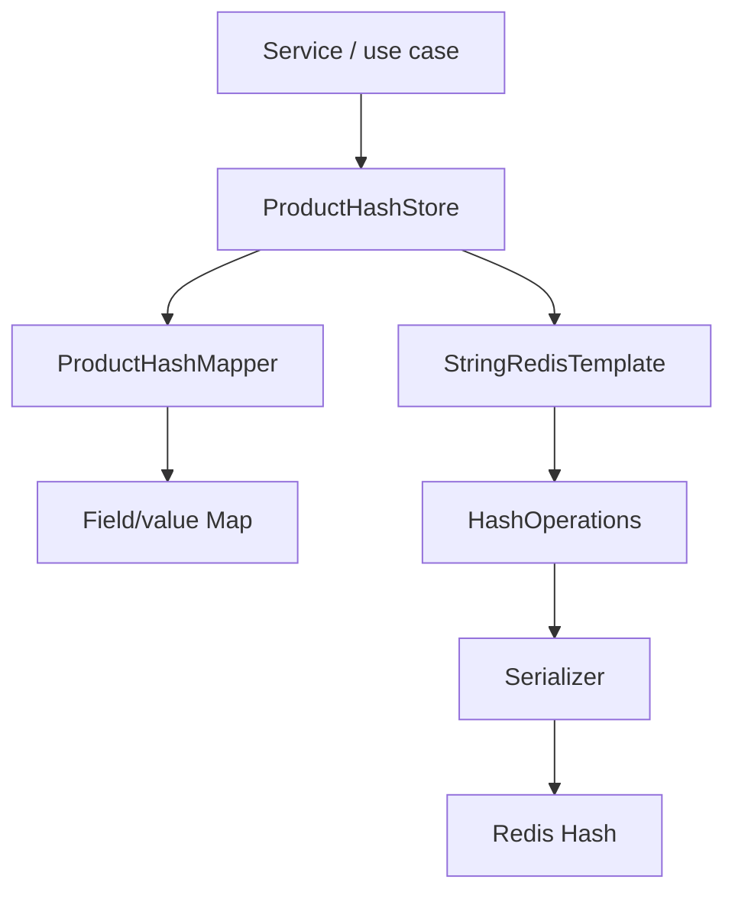

# HashMapper and Non-Repository Object Mapping Options in Spring Data Redis

Redis stores data in several different structures; with a **Redis Hash**, a key holds a collection of *field → value* pairs. When a Java application needs to store objects in a Hash without using Spring Data Redis's `CrudRepository`, the developer must decide how to name keys, turn Java properties into fields, serialize values, and reconstruct objects. `HashMapper` is a Spring Data Redis abstraction specifically supporting the **conversion between objects and the Map structure representing a Redis Hash**.

This lesson covers the `HashMapper` mechanism, options including `BeanUtilsHashMapper`, `Jackson2HashMapper`, `ObjectHashMapper`, and custom mappers, and then builds a complete example using `StringRedisTemplate` and `HashOperations`. The focus is on understanding when to use each approach, especially in services managing caches, session data, temporary data, or when the application needs direct control over Redis commands.

## 1. How Does a Redis Hash Differ from a Java Object?

Suppose an application has a product:

```java
public record Product(
        String id,
        String name,
        long priceCents,
        boolean active
) {}
```

One way to store this object in Redis is using **one Redis Hash per product**:

```text
Redis key: catalog:product:p-42

field           value
--------------------------
schemaVersion   "1"
id              "p-42"
name            "Notebook"
priceCents      "159000"
active          "true"
```

The corresponding Redis CLI operations might be:

```redis
HSET catalog:product:p-42 schemaVersion 1 id p-42 name Notebook priceCents 159000 active true
HGETALL catalog:product:p-42
HGET catalog:product:p-42 priceCents
HSET catalog:product:p-42 active false
```

Redis only stores byte data; in this example we choose to represent each field and value as UTF-8 strings. Redis **does not inherently know** that `priceCents` is a `long`, `active` is a `boolean`, or which Java class the product uses. A bidirectional conversion rule is needed:

```text
Product (Java)
    |
    | toHash(product)
    v
Map<String, String>
    |
    | Redis serializer and HSET/HMSET
    v
Redis Hash under key "catalog:product:p-42"
    |
    | HGETALL and Redis deserializer
    v
Map<String, String>
    |
    | fromHash(fields)
    v
Product (Java)
```

Key point: **mapping and storage are two separate concerns**. `HashMapper` handles converting an object into a `Map` and back. `HashOperations` or low-level Redis code actually sends `HSET`, `HGETALL`, `HDEL`, and `EXPIRE` to the server.

## 2. How Does the HashMapper Interface Work?

Spring Data Redis defines an abstraction of the form:

```java
import org.springframework.data.redis.hash.HashMapper;

public interface HashMapper<T, HK, HV> {
    Map<HK, HV> toHash(T object);
    T fromHash(Map<HK, HV> hash);
}
```

This describes the core signature to convey the idea: `T` is the Java object type; `HK` is the *hash field* type; `HV` is the *hash value* type. Two methods handle the two mapping directions.

| Component | Role | Example |
|---|---|---|
| `T` | Source and target object type | `Product` |
| `HK` | Hash field name type | `String` or `byte[]` |
| `HV` | Java-side field value type | `String`, `Object`, or `byte[]` |
| `toHash(T)` | Converts object into field/value data | `Product → Map<String, String>` |
| `fromHash(Map)` | Reconstructs object from read data | `Map<String, String> → Product` |

`HashMapper` does not decide:

- The Redis key name containing the Hash, e.g., `catalog:product:p-42`.
- How to connect to Redis, retry policies, timeouts, or clustering.
- Which Redis serializers are used for keys, hash fields, and hash values.
- Key TTL, deletion rules, or cache invalidation policies.
- Secondary indexes, property queries, entity relationships, or repository management.
- Schema versioning policies and legacy data migration strategies.

Thus, you can reuse the same mapper across multiple storage setups, provided you keep **the data format contract** consistent among the mapper, serializers, and readers/writers.

## 3. Non-Repository Mapping Options

Spring Data Redis provides built-in mappers and lets you implement `HashMapper` yourself.

| Option | Characteristics | Best Suited When | Points to Consider |
|---|---|---|---|
| `BeanUtilsHashMapper<T>` | Based on Spring's JavaBean property mechanism | Simple beans with clear property conventions | Limited with complex structures, type conversions, and bean shapes |
| `Jackson2HashMapper` | Uses Jackson to convert objects to fields; supports normal and flatten modes | Already using Jackson and need to handle many properties/nested objects | Requires compatible `ObjectMapper`, serializer, and type metadata config |
| `ObjectHashMapper` | Maps objects into binary fields/values | Want Spring Data Redis object mapping at the Hash level | Binary data is hard to inspect manually; consider schema evolution |
| **Custom HashMapper** | You explicitly decide exact field names and formats | Stable schema, cross-service/cross-language compatibility, tight control | Must manually handle nulls, validation, versioning, and legacy data |
| **No HashMapper** | Call `HashOperations.put/get/entries` directly and convert at call sites | Very few fields or operating on a single independent field | Mapping becomes duplicated and scattered if objects have many properties |

There is no single best mapper for every case. The choice depends first on **the data format you want stored in Redis**, and only secondarily on convenience when writing Java code.

If the Hash is read by multiple services, an explicit mapper with string fields and values is usually easier to govern. If all data is strictly internal to one application, a built-in mapper can reduce boilerplate code.

## 4. Complete Example: Writing a Custom HashMapper for Product

Let's build a concrete scenario:

- Each product is stored at key `catalog:product:{id}`.
- All Redis Hash values are strings, compatible with `StringRedisTemplate`.
- `schemaVersion` is stored to detect incompatible records.
- If the key does not exist, reading returns `Optional.empty()`.
- Required fields are validated on both read and write.

### 4.1. Defining the Model

```java
package com.example.redis.hash;

public record Product(
        String id,
        String name,
        long priceCents,
        boolean active
) {
    public Product {
        if (id == null || id.isBlank()) {
            throw new IllegalArgumentException("Product id is required");
        }
        if (name == null || name.isBlank()) {
            throw new IllegalArgumentException("Product name is required");
        }
        if (priceCents < 0) {
            throw new IllegalArgumentException("Price cannot be negative");
        }
    }
}
```

Using `long` for the smallest currency unit avoids floating-point rounding errors in the example. In domains involving multiple currencies, exchange rates, or varying decimal places, the application should still design appropriate money types and storage conventions.

### 4.2. Writing ProductHashMapper

```java
package com.example.redis.hash;

import java.util.Map;
import org.springframework.data.redis.hash.HashMapper;

public final class ProductHashMapper
        implements HashMapper<Product, String, String> {

    private static final String VERSION = "1";

    @Override
    public Map<String, String> toHash(Product product) {
        return Map.of(
                "schemaVersion", VERSION,
                "id", product.id(),
                "name", product.name(),
                "priceCents", Long.toString(product.priceCents()),
                "active", Boolean.toString(product.active())
        );
    }

    @Override
    public Product fromHash(Map<String, String> hash) {
        String version = required(hash, "schemaVersion");
        if (!VERSION.equals(version)) {
            throw new IllegalArgumentException(
                    "Unsupported product schemaVersion: " + version);
        }

        String rawPrice = required(hash, "priceCents");
        long price;
        try {
            price = Long.parseLong(rawPrice);
        } catch (NumberFormatException ex) {
            throw new IllegalArgumentException(
                    "Invalid priceCents: " + rawPrice, ex);
        }

        String rawActive = required(hash, "active");
        if (!"true".equals(rawActive) && !"false".equals(rawActive)) {
            throw new IllegalArgumentException(
                    "Invalid boolean active: " + rawActive);
        }

        return new Product(
                required(hash, "id"),
                required(hash, "name"),
                price,
                Boolean.parseBoolean(rawActive)
        );
    }

    private static String required(Map<String, String> hash, String field) {
        String value = hash.get(field);
        if (value == null || value.isBlank()) {
            throw new IllegalArgumentException(
                    "Missing required hash field: " + field);
        }
        return value;
    }
}
```

With these rules, calling:

```java
Product product = new Product("p-42", "Notebook", 159000, true);
ProductHashMapper mapper = new ProductHashMapper();

Map<String, String> fields = mapper.toHash(product);
// {
//   schemaVersion=1,
//   id=p-42,
//   name=Notebook,
//   priceCents=159000,
//   active=true
// }

Product restored = mapper.fromHash(fields);
```

Iteration order of `Map.of(...)` is not guaranteed and **does not affect** the Redis Hash format. Note that the mapper explicitly rejects data missing required fields or carrying an unsupported version, instead of silently constructing an invalid object.

The advantage of this approach is a human-readable storage contract that requires no Java class names in Redis and is easy to share with services written in other languages.

### 4.3. Using StringRedisTemplate to Write and Read the Hash

```java
package com.example.redis.hash;

import java.time.Duration;
import java.util.Map;
import java.util.Optional;

import org.springframework.data.redis.core.HashOperations;
import org.springframework.data.redis.core.StringRedisTemplate;
import org.springframework.stereotype.Service;

@Service
public class ProductHashStore {

    private static final String PREFIX = "catalog:product:";
    private static final Duration TTL = Duration.ofHours(12);

    private final StringRedisTemplate redis;
    private final HashOperations<String, String, String> hashes;
    private final ProductHashMapper mapper = new ProductHashMapper();

    public ProductHashStore(StringRedisTemplate redis) {
        this.redis = redis;
        this.hashes = redis.opsForHash();
    }

    public void save(Product product) {
        String key = key(product.id());
        hashes.putAll(key, mapper.toHash(product));
        redis.expire(key, TTL);
    }

    public Optional<Product> findById(String id) {
        Map<String, String> fields = hashes.entries(key(id));
        if (fields.isEmpty()) {
            return Optional.empty();
        }
        return Optional.of(mapper.fromHash(fields));
    }

    public void updatePriceCents(String id, long newPriceCents) {
        if (newPriceCents < 0) {
            throw new IllegalArgumentException("Price cannot be negative");
        }
        hashes.put(key(id), "priceCents", Long.toString(newPriceCents));
    }

    public boolean deleteById(String id) {
        return Boolean.TRUE.equals(redis.delete(key(id)));
    }

    private static String key(String id) {
        if (id == null || id.isBlank()) {
            throw new IllegalArgumentException("Product id is required");
        }
        return PREFIX + id;
    }
}
```

Here:

- `hashes.putAll(key, mapper.toHash(product))` sends the fields to be written to the Redis Hash.
- `hashes.entries(key)` reads all fields/values, then `mapper.fromHash(...)` reconstructs the object.
- `redis.expire(key, TTL)` sets the lifetime for **the entire Redis key holding the Hash**.
- `hashes.put(key, "priceCents", ...)` updates a single field without needing to read the whole object first.
- `redis.delete(key)` removes the whole Hash when no longer needed.

Usage example:

```java
store.save(new Product("p-42", "Notebook", 159000, true));

Product product = store.findById("p-42")
        .orElseThrow();

store.updatePriceCents("p-42", 149000);

boolean removed = store.deleteById("p-42");
```

**Limitations that must be handled explicitly:**

1. `putAll` only overwrites or adds the supplied fields; old fields no longer in the schema can still remain. If you need to replace the entire Hash, design an explicit replacement operation, avoiding delete-then-write without proper protection.
2. `putAll` and `expire` above are **two separate commands**. If the application fails between them, the key may be written without a TTL. When atomicity across the whole sequence is required, use `MULTI/EXEC` or a Lua script matching your needs.
3. `updatePriceCents` can create a brand-new Hash containing only `priceCents` if the key did not previously exist. If business rules require "update only an existing product," check and update atomically, such as via Lua; calling `hasKey` followed by a separate `HSET` still has a race condition.
4. When a single field is updated directly, validation in `ProductHashMapper.toHash` **is not invoked**. Every field-level update API must enforce business constraints itself.
5. `findById` treats an empty Hash as a non-existent key. If the key exists yet lacks required fields, `fromHash` throws an error so the application detects corrupted data or incompatible schemas.

## 5. Serializers Must Match the Mapper's Data Types

This is the most common source of bugs when using `HashMapper` outside a Repository.

Redis stores bytes, while `HashMapper` returns Java types. `RedisTemplate` handles converting Java objects to bytes using serializers, typically across four slots:

| RedisTemplate Component | Data | Example Serializer |
|---|---|---|
| `keySerializer` | Redis key | `StringRedisSerializer` |
| `valueSerializer` | Plain String values | Case-dependent |
| `hashKeySerializer` | Hash field names | `StringRedisSerializer` |
| `hashValueSerializer` | Hash field values | String, JSON, or binary |

In the `ProductHashMapper` example, both fields and values are `String`. `StringRedisTemplate` fits because the relevant components use string serializers. On the Redis side, we can read:

```redis
HGETALL catalog:product:p-42
HGET catalog:product:p-42 active
TTL catalog:product:p-42
```

However, if you switch to a mapper returning `Map<String, Object>` with `Long`, `Boolean`, or nested object values, **you cannot assume** `StringRedisTemplate` will automatically convert every type into the desired string. String serializers may reject non-String Java types. In that case, choose appropriate serializers or perform explicit conversion to String.

Similarly, `Map<byte[], byte[]>` needs hash serializers that preserve raw bytes intact; applying `StringRedisSerializer` to arbitrary binary data can corrupt formats or fail.

Rule to follow: **design storage format → choose HashMapper → configure compatible serializers → lock down the read/write contract**. Do not treat changing a serializer later as a harmless internal refactor: the bytes in Redis for previously stored records may be completely incompatible after switching.

## 6. BeanUtilsHashMapper: JavaBean-Style Mapping

`BeanUtilsHashMapper<T>` uses Spring's JavaBean property mechanism to map objects and Hashes. It is a convenient option for simple models with standard getters, setters, and clear properties.

Example of a suitably shaped model:

```java
public class Profile {
    private String displayName;
    private String city;

    public Profile() {}

    public String getDisplayName() {
        return displayName;
    }

    public void setDisplayName(String displayName) {
        this.displayName = displayName;
    }

    public String getCity() {
        return city;
    }

    public void setCity(String city) {
        this.city = city;
    }
}
```

Instantiating the mapper:

```java
import org.springframework.data.redis.hash.BeanUtilsHashMapper;

BeanUtilsHashMapper<Profile> mapper =
        new BeanUtilsHashMapper<>(Profile.class);

Map<String, Object> fields = mapper.toHash(profile);
Profile restored = mapper.fromHash(fields);
```

The advantage is avoiding manual per-property assignments as in `ProductHashMapper`. However, if the DTO is a Java `record`, contains deeply nested structures, special value types, or requires backward-compatibility rules for legacy data, JavaBean-based mapping may not meet expectations.

In particular, this mapper's field values are not necessarily `String`s. Before writing to Redis, determine which serializer converts those values to bytes and how decoding returns the right types to `fromHash`. Do not assume merely swapping `ProductHashMapper` for `BeanUtilsHashMapper` will work out of the box with `StringRedisTemplate`.

## 7. Jackson2HashMapper: Converting Objects with Jackson

`Jackson2HashMapper` uses Jackson to convert objects into Hashes, which is helpful when classes have many properties, nested structures, or existing Jackson rules like `@JsonProperty`, date formatting, and enum conversion.

This mapper has two modes:

```java
import org.springframework.data.redis.hash.Jackson2HashMapper;

Jackson2HashMapper normalMapper = new Jackson2HashMapper(false);
Jackson2HashMapper flatMapper   = new Jackson2HashMapper(true);
```

### 7.1. Non-Flattened Mode

For an object:

```json
{
  "id": "u-7",
  "name": "Lan",
  "address": {
    "city": "Hanoi",
    "country": "VN"
  }
}
```

Normal mode preserves nested structure within the corresponding field value instead of splitting every property into independent fields. Conceptually, the Hash has top-level fields such as `id`, `name`, and `address`.

If saving with `HashOperations`, nested values must be supported by the serializer. A serializer accepting only `String` will not automatically guarantee storing Java structures like `Map` or child objects.

### 7.2. Flattened Mode

Flattened mode flattens nested properties into field names reflecting property paths. Illustrative layout:

```text
id               -> "u-7"
name             -> "Lan"
address.city     -> "Hanoi"
address.country  -> "VN"
```

This allows a nested field to become an individual entry in the Redis Hash. However, be cautious:

- Separators in field names can conflict with property names or Map keys containing dots or special characters.
- Collections, arrays, dynamic maps, and null values do not always represent or reconstruct the way you might expect.
- Property naming conventions and Jackson strategies affect keys in Redis.
- Round-trip conversion must be tested against **real models**; do not assume every Java graph round-trips cleanly.
- If class structure or property names change in a later version, previously stored fields need a compatibility policy.

You can pass a configured `ObjectMapper` into the constructor to apply desired Jackson modules and annotations:

```java
import com.fasterxml.jackson.databind.ObjectMapper;
import org.springframework.data.redis.hash.Jackson2HashMapper;

ObjectMapper objectMapper = new ObjectMapper();
// Configure modules, naming strategies, or data types if needed.

Jackson2HashMapper mapper = new Jackson2HashMapper(objectMapper, true);
Map<String, Object> fields = mapper.toHash(someObject);
```

An important distinction: `Jackson2HashMapper` produces Jackson-mapped data, yet **whether `fromHash` reconstructs your exact class** depends on stored type info and Jackson configuration. Without appropriate type metadata, the result may come back as a generic map/object instead of the original class. Do not cast the returned object blindly on assumptions.

When data only needs to be read as a fixed class, the application can design a custom mapper, or run a conversion step to the explicit target type using Jackson's `convertValue(..., Target.class)` on appropriate data. Do not enable broad Jackson default typing for untrusted data; if using polymorphic typing, restrict allowed types for deserialization.

**Flatten or not?** Flattened mode can be handy when updating individual simple fields; normal mode expresses nested objects more cleanly. If the primary need is independently mutating multiple sub-properties under a stable schema, design explicit field names directly rather than relying entirely on auto-generated object layouts.

## 8. ObjectHashMapper: Binary-Style Mapping

`ObjectHashMapper` maps objects to binary field/value pairs:

```java
import org.springframework.data.redis.hash.HashMapper;
import org.springframework.data.redis.hash.ObjectHashMapper;

HashMapper<Object, byte[], byte[]> mapper = new ObjectHashMapper();

Map<byte[], byte[]> hash = mapper.toHash(someObject);
Object restored = mapper.fromHash(hash);
```

The biggest practical difference is that **field names and values on the Java side have type `byte[]`**. Consequently, Redis data is not necessarily human-readable in the CLI like a string-based Hash.

This brings several implications:

1. Serializers for `hashKey` and `hashValue` must preserve raw binary bytes faithfully.
2. When using `byte[]` as keys in a Java `Map`, remember arrays use reference identity by default; do not assume two arrays with identical bytes behave as the same key like `String`.
3. Troubleshooting via Redis CLI, cross-language integration, and schema evolution must be considered early.
4. Do not mix encodings from `ObjectHashMapper` and `StringRedisTemplate` on the same Redis key.

`ObjectHashMapper` can fit when the application wants Spring Data's binary object mapping and controls the entire data lifecycle. Conversely, if the Hash is an integration contract across services or requires manual inspection, a human-readable, explicitly versioned format is usually better.

## 9. Without Repository, What Is the Application Responsible For?

Spring Data Redis Repository typically pairs with `@RedisHash`, `@Id`, repository interfaces, and mapping/repository infrastructure. It is convenient for entity CRUD and features tied to indexes, TTL, and metadata.

Example of the Repository approach:

```java
import org.springframework.data.annotation.Id;
import org.springframework.data.redis.core.RedisHash;

@RedisHash("catalog:product")
public class ProductEntity {
    @Id
    private String id;
    private String name;
    // getters/setters ...
}
```

If you skip Repositories and call `HashOperations` directly, you gain finer control over keys and commands, but you do not automatically get Repository-managed behaviors:

| Need | Using Repository | Using HashMapper + HashOperations |
|---|---|---|
| CRUD by ID | Repository abstraction included | Write key builders and Redis operations manually |
| Object-to-Hash conversion | Repository mapping | Choose `HashMapper` and serializers |
| Keyspace, naming | Based on Repository metadata/config | Defined completely manually |
| TTL | Built-in mechanisms depending on config | Manually send `EXPIRE` and define renewal rules |
| Secondary indexes | Can use Repository indexing | Must maintain indexes manually if needed |
| Query by property | Depends on index/repository support | Manually design Sets/ZSets/indexes or another query source |
| Schema migration | Still needs compatibility strategy | Managed explicitly |
| Pipeline, transaction, Lua | May require additional low-level code | Direct, explicit control |

A very common pitfall: **putting `@RedisHash` or `@Indexed` on a class does not make `hashes.putAll(...)` automatically create indexes or apply TTLs**. Those annotations are processed inside the repository/mapping flow; going straight through `HashOperations` bypasses that flow.

### When to Choose Which?

**Prefer Repository** when entities have an ID-based CRUD lifecycle, you want the repository abstraction, and you accept the mapping layer's data conventions.

**Prefer HashMapper + HashOperations** when only storing caches/DTOs, needing `HGET` or `HSET` on single fields, requiring exact Redis keys, interacting with fixed-schema Hashes from external systems, or combining pipelines/Lua with specialized Redis commands.

**Use HashOperations directly without a mapper** when handling just a couple of fields, such as a status flag or counter:

```java
hashes.put("job:status:17", "state", "RUNNING");
String state = hashes.get("job:status:17", "state");
```

As field counts grow and full objects must be reconstructed in multiple places, a shared `HashMapper` avoids scattering conversion logic.

## 10. Designing a Redis Hash Schema to Survive Multiple Versions

A Hash stored outside a Repository often outlives a single application deployment. Schema should therefore not be treated as an accidental side effect of a Java class.

### 10.1. Keep Field Names Stable

Initial schema example:

```text
schemaVersion = "1"
id            = "p-42"
name          = "Notebook"
priceCents    = "159000"
active        = "true"
```

In a later version, the app wants to add `currency` and rename `priceCents` to `amountMinor`. Old application instances still read Redis data, so renaming the field immediately would break their reads.

Some strategies:

- **Backward-compatible reader:** new mapper accepts both old and new fields during the transition.
- **Controlled dual-write:** temporarily write both old and new fields, then drop old fields once all readers are upgraded.
- **Lazy migration:** when reading an old-version record, convert it to the new model and write it back safely.
- **Versioned key:** include the version in the namespace for truly breaking format changes, e.g., `catalog:v2:product:p-42`.

Do not treat `schemaVersion` as a magic fix. It only helps detect and route conversion logic. Application code still needs rules for legacy data, future data, and corrupted records.

### 10.2. Conventions for Null, Missing, and Empty Values

Redis Hash distinguishes **a missing field** from a field whose value is an empty string. Java `null` cannot be passed straight into every serializer/HashMapper as a valid Redis value.

A practical convention:

| Business State | Recommended Representation |
|---|---|
| Valid required field | Field with an explicit value |
| Unset optional field | Omit writing the field |
| Empty string is valid data | Write value `""` |
| Need to distinguish "explicit null" from "missing" | Design a dedicated marker or status field and document it |
| Field renamed | Read with fallback based on schema version |

The `required(...)` helper above treats empty strings as invalid for all required fields; that is **this lesson's business rule**, not a mandatory Redis rule.

### 10.3. Numeric and Date/Time Types

Simple, cross-language representations:

- Integers: decimal strings without separators, e.g., `"159000"`.
- Booleans: accept only `"true"` or `"false"`; do not treat any non-empty string as true.
- Timestamps: ISO-8601 strings with timezone/offset or epoch milliseconds—pick a single standard.
- Money: smallest currency unit plus currency code; avoid `double` for exact amounts.
- Enums: stable code strings with a rename strategy, not relying solely on Java class names.

Choosing clean representations reduces risk when upgrading libraries, switching serializers, or sharing Redis across systems.

## 11. Per-Field Updates, TTL, and Atomicity

Redis Hashes shine when an object has many properties yet the application only needs to read or modify a few fields.

### Updating a Field

```java
hashes.put("catalog:product:p-42", "active", "false");
String active = hashes.get("catalog:product:p-42", "active");
```

`HSET` updates the specified field without replacing other fields. That also means **a single-field update can bypass invariants of the full model**. If `active=false` requires also setting `disabledAt`, design both updates to occur atomically together.

### Key-Level TTL

```java
redis.expire("catalog:product:p-42", Duration.ofMinutes(30));
```

Standard TTL applies to the entire Redis key, covering every field in the Hash. Calling `HSET` on a field of a key that already has a TTL normally preserves the key's existing TTL; calling `EXPIRE` resets or extends lifetime according to the duration passed.

Do not confuse key-level TTL with field-level expiration features that may exist in certain newer Redis/client versions; the examples and APIs in this lesson use **Hash-key TTL**.

### Writing Multiple Related Commands

Suppose the application must:

1. Save the entire Hash.
2. Set the Hash's TTL.
3. Add the product ID to an index Set.

If you issue three separate commands and a network error occurs mid-way, the final state can become inconsistent. Depending on requirements, consider:

- `MULTI/EXEC` so commands execute consecutively as a Redis transaction (without relational-database rollback).
- Lua scripts to bundle conditional checks and updates into a single atomic execution.
- Periodic reconciliation or event logging to recover when high durability is required.

With Redis Cluster, multi-key operations in Lua/transactions must respect **hash slots**: keys touched by the same script or multi-key operation usually must reside in the same slot. Hash tags like `catalog:{product:p-42}:data` and `catalog:{product:p-42}:index` can co-locate related keys, provided you also account for slot distribution and query patterns.

Do not assume that just because a mapper converted an object cleanly, writing across multiple keys is atomic.

## 12. Performance: Redis Hash vs. a JSON String?

There are two ways to store the same object:

**Approach A — Redis Hash:**

```text
key = catalog:product:p-42
HSET key name "Notebook" priceCents "159000" active "true"
```

**Approach B — Redis String containing JSON:**

```text
key = catalog:product:p-42
SET key '{"name":"Notebook","priceCents":159000,"active":true}'
```

| Need | Redis Hash | JSON String |
|---|---|---|
| Reading one field | `HGET` | Usually must read/decode the entire JSON |
| Updating one field | `HSET` | Usually must replace the entire value or use another mechanism |
| Reading whole object | `HGETALL` then map | `GET` then deserialize JSON |
| Nested object structures | Must design flattening/serialization | JSON represents nesting naturally |
| Inspecting individual fields via CLI | Easy if fields/values are strings | JSON is readable, yet stored as one value |
| Mapping, serializers | Must align at field level | Must align JSON schema |
| Object TTL | Key TTL | Key TTL |

Neither option is universally faster. Performance depends on object size, field count, per-field update frequency, query patterns, payload size, and Redis internal encodings.

If a Hash has very many fields and the application always calls `HGETALL`, network and memory overhead can still be substantial. When only a few fields are needed, prefer `HGET`/`HMGET` via `HashOperations.get` or `multiGet`. When objects are tiny and always read whole, a JSON String can be simpler.

In either approach, if a query needs "all products with `active=true`," Redis Hashes **do not automatically create secondary indexes**. You must maintain a separate search structure or use another suitable data store.

## 13. Common Mistakes When Mapping Outside Repositories

### Mistake 1: Mapper and Serializer Mismatch

```text
HashMapper.toHash() -> Map<String, Object> (Long, Boolean, Map)
StringRedisTemplate  -> serializer handles String only
```

The application may fail serialization or read back unexpected types. Clearly verify `HK`/`HV` types and actual serializers before storing data.

### Mistake 2: Assuming HashMapper Picks the Key Name

`HashMapper` only produces a `Map`; it does not decide the keyspace. Key names must be constructed and governed by the storage layer, usually via a helper to prevent collisions or namespace drift.

### Mistake 3: Calling HGETALL for Every Small Lookup

If you only need `active`, use `hashes.get(key, "active")`. Reading all fields and calling `fromHash` wastes resources when the full object isn't needed.

### Mistake 4: Overly Permissive Boolean Parsing

`Boolean.parseBoolean("yes")` returns `false`, as do many strings other than `"true"`. When accuracy matters, validate the allowed value set before converting.

### Mistake 5: Reading Objects Without Version Metadata

Renaming fields or switching from integers to decimals without legacy-reading logic can cause different instances during a rolling deploy to interpret the Redis Hash differently.

### Mistake 6: Thinking HSET Replaces the Entire Entity

`putAll` does not remove fields absent from the new map. If you remove a property from a model, the corresponding field remains in Redis until `HDEL`, key deletion, or TTL expiration.

### Mistake 7: Relying on Repository Annotations with RedisTemplate

`@RedisHash`, `@Id`, or `@Indexed` on an entity do not give low-level `RedisTemplate` commands full Redis Repository behavior.

### Mistake 8: Assuming Check-Then-Update Is Atomic

`hasKey` and `HSET` are two commands. A key can expire after the check and before the update; `HSET` can then create a partial Hash missing required fields. Use an appropriate script/conditional operation when "update only if exists" is required.

### Mistake 9: Mixing Storage Formats Under the Same Namespace

One service writing a JSON string to `catalog:product:p-42` while another expects a Redis Hash at the same key causes `WRONGTYPE` errors. Namespaces must define both **Redis data type** and schema so services do not overwrite each other's semantics.

## 14. Process for Choosing a Mapper in a Real Application

When designing non-Repository mapping, ask these questions in order:

1. **Does the app mutate individual fields or always read/write the whole object?** If frequently calling `HGET`/`HSET`, Hash is a strong choice; if always reading nested objects whole, consider a JSON String.
2. **Do other systems read the same Redis?** If yes, favor a Java-independent, explicitly versioned field/value contract.
3. **Is the model simple or deeply nested?** Simple JavaBeans can use `BeanUtilsHashMapper`; Jackson-based models can use `Jackson2HashMapper`; strict schemas benefit from a custom mapper.
4. **Does data need to be CLI-readable?** Manual operations usually favor String fields/values; binary mappers require specialized inspection tools.
5. **Does data survive across multiple deployments?** If yes, plan schema evolution and serializer formats from day one.
6. **Are indexes, TTL, or atomic multi-key updates required?** `HashMapper` alone does not solve these; design them at the storage layer.

A maintainable architecture:



Here `ProductHashStore` owns key naming, TTL, and Redis commands; `ProductHashMapper` owns field/value mapping rules; the `Product` model describes application data. Separating responsibilities lets you change storage policies without scattering Redis commands across use cases.

## 15. Practice Exercises

**Exercise 1 — Create a stable schema.** Design a `ShoppingCartItem` object containing `sku`, `quantity`, `unitPriceCents`, and `updatedAt`. Choose Redis data types, field names, and timestamp representation.

**Exercise 2 — Write a bidirectional mapper.** Implement `HashMapper<ShoppingCartItem, String, String>`. Define how to handle negative quantities, missing fields, invalid numeric strings, and unsupported `schemaVersion` values.

**Exercise 3 — Build a Store.** Use `StringRedisTemplate` to write items to `cart:item:{cartId}:{sku}`, read them back, and update `quantity` independently. Design a way to avoid creating partial records when an item has already expired.

**Exercise 4 — Test serializers.** Compare saving the same JavaBean with a custom mapper versus `Jackson2HashMapper`. Observe field names, value types, Redis CLI readability, and restoring the original Java class.

**Exercise 5 — Evolve the schema.** Add a `currency` field in version 2 of the mapper. Design a way to read both version 1 and version 2 Hashes, and explain when version 1 support can be retired.

In each exercise, distinguish three layers of output: **the Map produced by the mapper**, **the bytes saved by the serializer**, and **the object reconstructed after reading Redis**. This is the clearest way to isolate whether an issue lies in mapping, serialization, or Redis operations.

## 16. Summary of Key Concepts

- `HashMapper<T, HK, HV>` handles **object ↔ field/value Map** conversion; it does not perform CRUD, TTL, or indexing on its own.
- `BeanUtilsHashMapper` is handy for simple JavaBeans; `Jackson2HashMapper` fits Jackson-based models (mind flattening behavior); `ObjectHashMapper` uses binary data; custom mappers offer the tightest schema control.
- The storage layer such as `StringRedisTemplate`/`HashOperations` owns Redis keys, commands, and TTLs. The mapper's `HK`/`HV` types must match the serializers.
- When bypassing Repositories, the application must handle namespaces, indexes, TTL management, schema migration, validation, atomicity, and missing/corrupted data.
- Redis Hashes suit single-field updates; JSON Strings suit nested objects. Choose based on access patterns and storage contracts, not just mapper line count.

### References

- [Spring Data Redis — Object-to-Hash Mapping](https://docs.spring.io/spring-data/redis/reference/redis/redis-repositories/mapping.html)
- [Spring Data Redis — RedisTemplate and Serializers](https://docs.spring.io/spring-data/redis/reference/redis/template.html)
- [Spring Data Redis — Redis Repositories](https://docs.spring.io/spring-data/redis/reference/redis/redis-repositories.html)
- [Redis — Hashes](https://redis.io/docs/latest/develop/data-types/hashes/)
- [Redis — HSET](https://redis.io/docs/latest/commands/hset/)
- [Redis — HGETALL](https://redis.io/docs/latest/commands/hgetall/)
