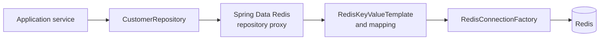

# Enabling and Configuring `@EnableRedisRepositories`

`@EnableRedisRepositories` is an annotation in **Spring Data Redis** used to enable and configure the bean creation mechanism for **Redis Repositories**. A repository allows an application to save, find, update, and delete Java objects in Redis following the familiar Spring Data model, such as `CrudRepository<Customer, String>`.

This lesson focuses on enabling Redis Repositories, choosing the proper repository interface scanning scope, wiring them to the Redis connection, configuring key options, and recognizing when manual configuration is needed in Spring Boot.

## 1. What Does `@EnableRedisRepositories` Do?

When Spring processes the annotation, Spring Data Redis scans for repository interfaces within the configured scope, creates beans implementing them, and connects repository operations to the **Redis Key-Value** infrastructure. With an entity mapped via `@RedisHash` and an `@Id` identifier, you can use operations such as:

```java
repository.save(customer);
repository.findById("c-101");
repository.deleteById("c-101");
```

Conceptual flow:



This annotation handles **repository registration**. It does not start a Redis Server itself, does not turn Redis into a relational database, and is not the annotation used to enable Spring Cache. If the application needs `@Cacheable`, that is a separate mechanism, typically enabled with `@EnableCaching` together with an appropriate `CacheManager`.

## 2. Is Declaring the Annotation Always Necessary?

**Not necessarily.** In a Spring Boot application that includes the Redis starter, has a valid Redis connection, and places repositories within Boot's component scan scope, **auto-configuration** can enable Redis repositories automatically. Therefore, a small application often runs without explicitly writing `@EnableRedisRepositories`.

Declaring `@EnableRedisRepositories` is useful when you need to:

- Scan repository packages located outside the application's automatic scan scope.
- Explicitly restrict which repositories belong to Redis, especially when using JPA, MongoDB, or multiple Spring Data modules simultaneously.
- Customize the `RedisTemplate` or `RedisKeyValueTemplate` bean names used by the repositories.
- Adjust the key expiration event listener mechanism for repositories and related options.

| Approach | Who registers the repository? | When is it suitable? |
| --- | --- | --- |
| Spring Boot auto-configuration | Boot/Spring Data auto-detects repositories with default settings | Small applications, clear package layout, Redis-only or default config is sufficient |
| Explicit `@EnableRedisRepositories` | Spring Data Redis configuration is explicitly declared | Precise scanning needed, multiple data stores, or infrastructure customization |

For Spring Boot 3.x, you can control **automatic registration** of Redis repositories using the property:

```yaml
spring:
  data:
    redis:
      repositories:
        enabled: true
```

The typical default value is enabled when the auto-configuration conditions are met. Set `enabled: false` to **disable Boot's auto-registration branch**; if the application itself still declares `@EnableRedisRepositories`, that explicit configuration continues to act as a separate repository registration mechanism. Overlapping scan configurations should not be declared unless necessary.

Note: the Redis connection configuration property prefix varies across Spring Boot generations. The examples below use the **Spring Boot 3.x** convention: `spring.data.redis.*`.

## 3. Preparing a Spring Boot Project

### 3.1. Dependency

With Gradle, add the Spring Data Redis starter:

```groovy
dependencies {
    implementation 'org.springframework.boot:spring-boot-starter-data-redis'
}
```

The starter provides the Spring Data Redis libraries and Spring Boot's default Redis client components. For the example to work, a running Redis Server that the application can connect to is required.

For local Redis on the default port:

```yaml
# src/main/resources/application.yml
spring:
  data:
    redis:
      host: localhost
      port: 6379
```

In real environments, details such as host, port, authentication, TLS, timeouts, and Redis topology must match the deployment configuration. `@EnableRedisRepositories` does not replace these connection properties.

### 3.2. Creating an Entity Using `@RedisHash`

Example of a customer management application in package `com.example.shop.redis`:

```java
package com.example.shop.redis;

import org.springframework.data.annotation.Id;
import org.springframework.data.redis.core.RedisHash;
import org.springframework.data.redis.core.index.Indexed;

@RedisHash("customers")
public class Customer {

    @Id
    private String id;

    @Indexed
    private String email;

    private String displayName;

    public Customer() {
    }

    public Customer(String id, String email, String displayName) {
        this.id = id;
        this.email = email;
        this.displayName = displayName;
    }

    public String getId() {
        return id;
    }

    public void setId(String id) {
        this.id = id;
    }

    public String getEmail() {
        return email;
    }

    public void setEmail(String email) {
        this.email = email;
    }

    public String getDisplayName() {
        return displayName;
    }

    public void setDisplayName(String displayName) {
        this.displayName = displayName;
    }
}
```

Meaning of the annotations:

- `@RedisHash("customers")`: marks an aggregate stored via the Redis hash mechanism and selects the logical keyspace/prefix `customers`.
- `@Id`: identifier field used by the repository to construct the key for the object.
- `@Indexed`: instructs Spring Data Redis to maintain a secondary index for the `email` property, supporting lookup methods by email.

An illustrative example of the data key name is `customers:c-101`. The actual Redis structure may also include keyspace management and index keys. **Do not treat that internal key list as a stable data API for manual modification.**

### 3.3. Creating the Repository Interface

```java
package com.example.shop.redis;

import java.util.Optional;
import org.springframework.data.repository.CrudRepository;

public interface CustomerRepository
        extends CrudRepository<Customer, String> {

    Optional<Customer> findByEmail(String email);
}
```

There is no need to write a `CustomerRepositoryImpl` class manually for basic CRUD operations and query methods supported by Spring Data Redis. Spring generates the implementation at runtime. The `email` field has `@Indexed` because a Redis Repository **is not a SQL engine** capable of arbitrarily scanning and filtering any property with any query expression.

### 3.4. Explicitly Enabling Repositories

In the application configuration class:

```java
package com.example.shop;

import com.example.shop.redis.CustomerRepository;
import org.springframework.boot.SpringApplication;
import org.springframework.boot.autoconfigure.SpringBootApplication;
import org.springframework.data.redis.repository.configuration.EnableRedisRepositories;

@SpringBootApplication
@EnableRedisRepositories(basePackageClasses = CustomerRepository.class)
public class ShopApplication {

    public static void main(String[] args) {
        SpringApplication.run(ShopApplication.class, args);
    }
}
```

`basePackageClasses = CustomerRepository.class` specifies the package to scan via a Java type, helping avoid typos in string package names and making refactoring easier to track. If you use Boot's auto-configuration and the repository is already within a valid scan scope, the explicit annotation can be omitted.

Example of calling the repository from a service:

```java
package com.example.shop;

import com.example.shop.redis.Customer;
import com.example.shop.redis.CustomerRepository;
import java.util.Optional;
import org.springframework.stereotype.Service;

@Service
public class CustomerService {

    private final CustomerRepository customers;

    public CustomerService(CustomerRepository customers) {
        this.customers = customers;
    }

    public Customer register(String id, String email, String name) {
        return customers.save(new Customer(id, email, name));
    }

    public Optional<Customer> findByEmail(String email) {
        return customers.findByEmail(email);
    }
}
```

At runtime, the service is injected with the repository proxy bean. If Redis is unreachable, Redis access operations will fail; successful creation of the Spring bean does not prove that the Redis Server is ready.

## 4. Configuring the Repository Scan Scope

Commonly used attributes of `@EnableRedisRepositories`:

| Attribute | Effect | Usage recommendation |
| --- | --- | --- |
| `basePackages` | Selects one or more packages by string name | Suitable when the scope is provided from static configuration |
| `basePackageClasses` | Selects packages via declared Java types | Preferred for safety against package renames |
| `value` | Shorthand alias for `basePackages` | Only use for a single simple package |
| `includeFilters` / `excludeFilters` | Adjusts which interfaces are allowed to participate in scanning | Only use when module structure requires special filtering |
| `redisTemplateRef` | Bean name of the `RedisTemplate` referenced by the Redis repository infrastructure | Useful when the application has multiple templates |
| `keyValueTemplateRef` | Bean name of the `RedisKeyValueTemplate` used for the Key-Value store | Must match the right bean when manually configuring repository infrastructure |
| `enableKeyspaceEvents` | Policy for enabling the listener that processes keyspace events | Important when using TTL and updating indexes upon key expiration |
| `keyspaceNotificationsConfigParameter` | Redis configuration value for keyspace notifications when the listener is enabled | Watch out for `CONFIG` permissions on managed Redis |
| `shadowCopy` | Controls the copy mechanism used for expiration events | Only change when you understand event requirements and memory overhead |

Example of specifying multiple packages:

```java
@Configuration
@EnableRedisRepositories(basePackages = {
    "com.example.shop.redis.customer",
    "com.example.shop.redis.session"
})
public class RedisRepositoryConfig {
}
```

Or using marker classes to avoid string dependencies:

```java
@Configuration
@EnableRedisRepositories(basePackageClasses = {
    CustomerRepository.class,
    SessionRepository.class
})
public class RedisRepositoryConfig {
}
```

The second example assumes `SessionRepository` exists in the target package to be scanned.

**If both `basePackages` and `basePackageClasses` are omitted, the default scan scope relates to the package containing the class annotated with `@EnableRedisRepositories`.** This easily causes errors if `RedisRepositoryConfig` is placed in `com.example.shop.config` while the repositories live in `com.example.shop.redis`: the two packages are siblings, so the repositories may not be found. Explicitly specifying the scan scope is clearer in multi-module projects.

## 5. Distinguishing `RedisTemplate` and `RedisKeyValueTemplate`

The two templates serve different levels of abstraction:

**`RedisTemplate<K, V>`** provides direct Redis operation APIs such as `opsForValue()`, `opsForHash()`, and `opsForSet()`, and manages serialization for those commands. `StringRedisTemplate` is a convenient variant when keys and values are strings.

**`RedisKeyValueTemplate`** provides the infrastructure to store aggregates according to Spring Data Key-Value mapping, used by Redis Repositories to work with `@RedisHash` objects, IDs, and secondary indexes.

An explicit configuration can reference bean names:

```java
@Configuration
@EnableRedisRepositories(
    basePackageClasses = CustomerRepository.class,
    redisTemplateRef = "redisTemplate",
    keyValueTemplateRef = "redisKeyValueTemplate"
)
public class RedisRepositoryConfig {
}
```

The names in the example are standard infrastructure bean names. Only change them to other names when corresponding beans actually exist in the Spring context and those beans are consistently configured with the intended `RedisConnectionFactory`, mapping, and Redis database.

When an application uses multiple Redis connections or multiple logical databases, **changing only `redisTemplateRef` does not automatically guarantee that the entire repository switches to another connection**: the underlying `RedisKeyValueTemplate` and adapter must also use the right connection. If configuring multiple repository groups, clearly control the scan scope and infrastructure beans for each group.

In addition, changing the serializer of a `RedisTemplate` used to call `opsForValue()` does not mean all Redis Repository data immediately switches to JSON under that serializer. Redis Repository maps aggregates as Redis hashes with its own mapping mechanism; arbitrarily changing serializers can make existing data unreadable.

## 6. Using Alongside JPA or Multiple Spring Data Modules

An application can simultaneously use PostgreSQL via Spring Data JPA and Redis via Spring Data Redis. In that case, separate repositories by package and aggregate type:

```text
com.example.shop
├── jpa
│   ├── JpaOrder.java          (@Entity)
│   └── JpaOrderRepository.java
├── redis
│   ├── Customer.java          (@RedisHash)
│   └── CustomerRepository.java
└── config
    └── PersistenceConfig.java
```

Example configuration:

```java
package com.example.shop.config;

import com.example.shop.jpa.JpaOrderRepository;
import com.example.shop.redis.CustomerRepository;
import org.springframework.context.annotation.Configuration;
import org.springframework.data.jpa.repository.config.EnableJpaRepositories;
import org.springframework.data.redis.repository.configuration.EnableRedisRepositories;

@Configuration
@EnableJpaRepositories(basePackageClasses = JpaOrderRepository.class)
@EnableRedisRepositories(basePackageClasses = CustomerRepository.class)
public class PersistenceConfig {
}
```

This example assumes the application has declared JPA dependencies, a DataSource, and the corresponding JPA entities. The goal is for each Spring Data module to claim its own repositories. Spring Data has mechanisms to distinguish repositories by store, but clear package organization avoids errors where the target data store cannot be determined for a generic repository interface.

Avoid ambiguously annotating the same aggregate for multiple stores and relying on auto-scanning to guess where to store the data. With Redis Repositories, declaring `@RedisHash` on the aggregate and scanning a dedicated package is a transparent choice.

## 7. TTL and Keyspace Events

Redis Repositories support time-to-live for aggregates. You can declare a default TTL on the entity:

```java
import org.springframework.data.annotation.Id;
import org.springframework.data.redis.core.RedisHash;

@RedisHash(value = "sessions", timeToLive = 1800)
public class Session {

    @Id
    private String id;

    private String accountId;

    public Session() {
    }

    // Constructors, getters, setters...
}
```

`timeToLive = 1800` in the example means a TTL of 1,800 seconds. When Redis expires a key, the key itself disappears; however, if the repository maintains secondary indexes pointing to that key, the application needs to understand how expired events are handled to avoid stale metadata/indexes.

### 7.1. Configuring the Listener

```java
import org.springframework.context.annotation.Configuration;
import org.springframework.data.redis.core.RedisKeyValueAdapter.EnableKeyspaceEvents;
import org.springframework.data.redis.repository.configuration.EnableRedisRepositories;

@Configuration
@EnableRedisRepositories(
    basePackageClasses = SessionRepository.class,
    enableKeyspaceEvents = EnableKeyspaceEvents.ON_STARTUP
)
public class RedisSessionRepositoryConfig {
}
```

This example assumes `SessionRepository` is already declared as a `CrudRepository<Session, String>`. The options for `enableKeyspaceEvents` include:

| Mode | Meaning |
| --- | --- |
| `OFF` | Does not enable the keyspace events listener via this configuration |
| `ON_STARTUP` | Initializes the listener when the application starts |
| `ON_DEMAND` | Initializes the listener on demand according to the Redis repository mechanism |

When the listener is activated, Spring Data Redis can use expiration notifications to publish events and clean up related indexes. **Redis keyspace notifications are based on Pub/Sub and have no guaranteed replay**: expiration events can be missed while the application is down, disconnected, or before the listener is initialized. They should not be used as the sole source of truth for business logic that requires recording every expiration.

### 7.2. When Redis Does Not Allow the Application to Call `CONFIG SET`

Some managed Redis services restrict the `CONFIG` command. When enabling the listener, Spring Data Redis may attempt to set the `notify-keyspace-events` parameter; that operation can be rejected.

You can let infrastructure manage Redis Server notification configuration while instructing the application not to set this value itself:

```java
@Configuration
@EnableRedisRepositories(
    basePackageClasses = SessionRepository.class,
    enableKeyspaceEvents = EnableKeyspaceEvents.ON_STARTUP,
    keyspaceNotificationsConfigParameter = ""
)
public class RedisSessionRepositoryConfig {
}
```

In that case, **compatible notifications must be enabled on the Redis Server via external configuration**. In self-managed Redis, an example configuration is:

```redis
CONFIG SET notify-keyspace-events Ex
```

`E` enables keyevent channel notifications, and `x` enables expired events. On managed Redis, use the parameter configuration mechanism supported by the provider rather than assuming permission to run `CONFIG`. Setting `keyspaceNotificationsConfigParameter = ""` only skips the parameter-setting step from Spring Data; **it does not enable notifications on Redis itself**.

### 7.3. Shadow Copies for Expiration Events

When it is necessary to publish expiration events containing aggregate information, Redis Repositories can use a **shadow copy** (also called phantom copy) mechanism to retain a temporary copy beyond the moment the original key expires. This incurs additional memory cost and relates to the `shadowCopy` option.

If the application does not need the aggregate payload when handling expired events, you can consider disabling shadow copies; however, be aware that events and index cleanup capabilities may no longer carry the same information as before. Choosing `OFF`, `ON_DEMAND`, or `ON_STARTUP` for the listener, as well as shadow copy settings, should be based on TTL characteristics and application processing requirements.

## 8. Common Configuration Mistakes

### Unable to Inject the Repository

A common message is a missing bean of type `CustomerRepository`.

Check:

1. The `spring-boot-starter-data-redis` dependency is present.
2. The interface extends an appropriate repository interface such as `CrudRepository`.
3. The package containing the interface is within the scan scope of `@EnableRedisRepositories` or Boot's automatic scan scope.
4. The application has Redis connection configuration and required infrastructure beans.
5. Auto-configuration was not accidentally disabled without enabling manual repository registration.

A typical cause: `@EnableRedisRepositories` is placed in the `config` package without declaring `basePackages`, while the repository is in a sibling `redis` package.

### Missing `redisTemplate` or `redisKeyValueTemplate` Error

This is usually caused by a missing infrastructure bean or a bean name mismatch in `redisTemplateRef`/`keyValueTemplateRef`. Verify that dependencies, `RedisConnectionFactory`, templates, and scan configuration are initialized properly. When multiple Redis connections coexist, determine which beans belong to the repository group being configured.

### `findByEmail` Query Does Not Return Expected Results

Redis Repositories do not execute SQL queries. Property lookup methods must follow Spring Data Redis's query/indexing capabilities. In the example above, `@Indexed` on `email` is essential to have the corresponding secondary index.

Adding `@Indexed` to previously saved data **does not automatically rebuild accurate indexes for all existing data**. A reindexing plan or controlled repository reload is required, especially on a live system.

### TTL Expires but Indexes or Event Handling Do Not Behave as Expected

Check `@RedisHash(timeToLive = ...)`/`@TimeToLive`, the `enableKeyspaceEvents` mode, Redis notification settings, `CONFIG` permissions, listener startup timing, and the risk of missed Pub/Sub events. Do not assume an event was published simply because a key expired.

### Duplicate Repository Beans or Multi-Store Conflicts

Check `@EnableRedisRepositories` classes, Spring Boot's scan scope, and `@EnableJpaRepositories`/`@EnableMongoRepositories` configurations. Narrow the scan scope, avoid registering the same repository from multiple configurations, and ensure entities of each store have the proper annotations.

### Data Exists in Redis but the Repository Cannot Read It

A JSON value written via `StringRedisTemplate.opsForValue()` is not automatically a valid Redis aggregate hash for `@RedisHash`. Similarly, data written directly to keys under the repository prefix may lack metadata/indexes managed by the repository. Storage model, identifiers, serialization, and data creation paths must be consistent.

## 9. Practical Deployment Notes

**Identifiers and keyspaces.** Choose clear Redis hash prefixes, separate from keys managed by caches, rate limiters, or other jobs. IDs should be stable and fit the domain. Do not reuse the same prefix for incompatible aggregate types.

**Index cost.** `@Indexed` enables supported queries but increases write operations and the number of index keys to maintain. Only index properties that genuinely need lookup support. If using TTL, consider the listener cost and index cleanup behavior upon expiration.

**Limits of the repository abstraction.** `findAll()` operations on a large keyspace can be very expensive; do not treat Redis Repositories as an ORM supporting arbitrary joins, sorting, and multi-condition queries. When business logic requires complex queries, consider a dedicated index design, Redis Stack/RediSearch if appropriate, or another query-oriented database.

**Consistency.** Calling `save()` on an aggregate in Redis does not create a distributed transaction with external databases or systems. Synchronizing multiple data stores requires its own business contract and recovery mechanism.

**Security and operations.** Supply connection configurations from the deployment environment, manage secrets outside source code, and control required Redis permissions. When using keyspace events in managed environments, coordinate server configuration before enabling the listener in the application.

## 10. Example Configurations for Three Scenarios

| Scenario | Starting configuration |
| --- | --- |
| Boot app with Redis only, repositories under the application package | Use the starter, connection properties, and auto-configuration; `@EnableRedisRepositories` is not strictly needed |
| Boot app with both JPA and Redis | Explicitly declare `@EnableRedisRepositories(basePackageClasses = ...)` and `@EnableJpaRepositories(...)` with separate packages |
| Redis Repository data with TTL needing expiration handling | Consider `enableKeyspaceEvents`, server `notify-keyspace-events`, `shadowCopy` options, and a plan for missed events |

Example consolidated configuration for a simple Redis Repository group:

```java
package com.example.shop.config;

import com.example.shop.redis.CustomerRepository;
import org.springframework.context.annotation.Configuration;
import org.springframework.data.redis.repository.configuration.EnableRedisRepositories;

@Configuration
@EnableRedisRepositories(
    basePackageClasses = CustomerRepository.class,
    redisTemplateRef = "redisTemplate",
    keyValueTemplateRef = "redisKeyValueTemplate"
)
public class RedisRepositoryConfig {
}
```

You do not need to copy every option into every application: defaults are sufficient when there is a single Redis connection and repository packages are properly detected. Add options when there is a real need, such as multiple data stores, TTL events, or module layout constraints.

## Conclusion

`@EnableRedisRepositories` is the configuration entry point for Spring Data Redis to locate repository interfaces, create beans, and bind them to the Redis Key-Value infrastructure. In Spring Boot, you can leverage auto-configuration; when finer control is needed, use `basePackageClasses` or `basePackages`, specify the appropriate templates, and consider keyspace events if aggregates have TTLs. A properly working repository requires the dependency, Redis connection, a `@RedisHash` entity with `@Id`, a repository interface, and an appropriate scan scope.

### References

- [Spring Data Redis — Repositories](https://docs.spring.io/spring-data/redis/reference/redis/redis-repositories.html): Redis Repository concepts, mapping, secondary indexes, and TTL.
- [Spring Data Redis — `@EnableRedisRepositories` API](https://docs.spring.io/spring-data/redis/reference/api/java/org/springframework/data/redis/repository/configuration/EnableRedisRepositories.html): annotation configuration attributes.
- [Spring Boot — Redis](https://docs.spring.io/spring-boot/reference/data/nosql.html#data.nosql.redis): Redis connections and auto-configuration in Spring Boot.
- [Redis Documentation — Keyspace notifications](https://redis.io/docs/latest/develop/pubsub/keyspace-notifications/): how to enable notifications and limitations of the Pub/Sub mechanism.
