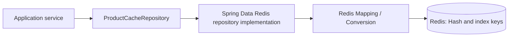

# Declaring `CrudRepository` for Redis Entities in Spring Data Redis

## 1. Objectives

When using Redis in a Spring application, you can interact directly with commands such as `GET`, `SET`, and `HSET` or through `RedisTemplate`. However, when the data to store has the structure of a **business entity**, manually assembling key names, converting properties, and writing individual save/read/delete operations leads to repetitive application code.

**Spring Data Redis Repository** lets you work with Java objects through a repository interface. You declare the Redis entity, mark the identifier property, and create an interface extending `CrudRepository`. Spring Data generates the implementation for basic CRUD operations.

After this lesson, you will be able to:

- Identify the components of an entity stored in Redis.
- Declare `@RedisHash`, `@Id`, and a properly typed `CrudRepository`.
- Configure Spring to discover repositories and connect to Redis.
- Call `save`, `findById`, `findAll`, `existsById`, `count`, and `deleteById`.
- Distinguish ID-based lookups from queries on indexed properties.
- Understand how Redis Repositories store data, the impact of TTL, and practical limitations to consider in real applications.

## 2. How Does a Redis Repository Work?

Unlike repositories for relational databases, a Redis Repository operates on Redis's key–value structure. Typically, an object is mapped to a **Redis Hash** with a key name of the form:

```text
<keyspace>:<id>
```

For example, a product entity with `keyspace` `catalog:product` and ID `p-1001` is stored under the key:

```text
catalog:product:p-1001
```

Properties such as `name`, `category`, and `priceInCents` are mapped to fields inside the hash. Spring Data Redis may also manage auxiliary keys to track entities in the keyspace and support indexed queries.

Typical data flow:



From the Java code's perspective, the application calls methods on the interface like `repository.save(product)` without writing manual `HSET` commands. Nevertheless, Redis is still Redis: the repository does not turn it into a relational database and does not provide SQL or foreign key relationships.

### Which Problems Are Repositories Suitable For?

Common use cases include structured cached data, temporary drafts, processing state, fast ID-based lookups, or entity groups that need read/write via a CRUD API. For business data requiring complex transactions, arbitrary queries, relational constraints, and strict integrity, evaluate whether Redis is truly suitable as the primary store or should serve as a supplementary storage layer.

## 3. Preparing the Project and Redis Connection

The example uses a Spring Boot application with Spring Data Redis.

If the project uses Gradle:

```kotlin
dependencies {
    implementation("org.springframework.boot:spring-boot-starter-data-redis")
}
```

If the project uses Maven:

```xml
<dependency>
    <groupId>org.springframework.boot</groupId>
    <artifactId>spring-boot-starter-data-redis</artifactId>
</dependency>
```

Dependency versions are typically managed by Spring Boot dependency management; there is no need to manually specify the starter version when using Boot's standard setup.

Configure the Redis connection in `application.yml`:

```yaml
spring:
  data:
    redis:
      host: localhost
      port: 6379
```

This is an illustrative configuration for local Redis. Real environments must use the host, authentication mechanism, TLS, topology, and secret management appropriate for the infrastructure. Do not place real passwords directly in source code.

Spring Boot typically auto-configures `RedisConnectionFactory`, `RedisTemplate`, and Redis Repositories when the starter and corresponding auto-configuration conditions apply. Importantly, the repository interface must reside in a package scanned by Spring.

Example package structure:

```text
com.example.shop
├── ShopApplication.java
├── redis
│   ├── ProductCacheEntry.java
│   └── ProductCacheRepository.java
└── service
    └── ProductCacheService.java
```

The `ShopApplication` class should live in the root package `com.example.shop` so that component and repository scanning can discover subpackages.

## 4. Declaring a Redis Entity with `@RedisHash` and `@Id`

We build the `ProductCacheEntry` entity representing product data that needs fast access.

**File: `com/example/shop/redis/ProductCacheEntry.java`**

```java
package com.example.shop.redis;

import org.springframework.data.annotation.Id;
import org.springframework.data.redis.core.RedisHash;
import org.springframework.data.redis.core.index.Indexed;

@RedisHash("catalog:product")
public class ProductCacheEntry {

    @Id
    private String id;

    private String name;

    @Indexed
    private String category;

    private long priceInCents;

    public ProductCacheEntry() {
    }

    public ProductCacheEntry(
            String id,
            String name,
            String category,
            long priceInCents
    ) {
        this.id = id;
        this.name = name;
        this.category = category;
        this.priceInCents = priceInCents;
    }

    public String getId() {
        return id;
    }

    public void setId(String id) {
        this.id = id;
    }

    public String getName() {
        return name;
    }

    public void setName(String name) {
        this.name = name;
    }

    public String getCategory() {
        return category;
    }

    public void setCategory(String category) {
        this.category = category;
    }

    public long getPriceInCents() {
        return priceInCents;
    }

    public void setPriceInCents(long priceInCents) {
        this.priceInCents = priceInCents;
    }
}
```

### Meaning of the Annotations

| Annotation | Role |
|---|---|
| `@RedisHash("catalog:product")` | Marks the object to be mapped as a Redis Hash and specifies the keyspace for the entity |
| `@Id` | Marks the identifier property; combined with the keyspace to determine the Redis key |
| `@Indexed` | Instructs Spring Data Redis to manage a secondary index for the property; required when querying the repository by that property |

**Note on imports:** `@Id` is `org.springframework.data.annotation.Id`; `@RedisHash` is `org.springframework.data.redis.core.RedisHash`; `@Indexed` is `org.springframework.data.redis.core.index.Indexed`. Do not mistakenly use JPA's `jakarta.persistence.Entity` or `jakarta.persistence.Id` in this Redis example.

If the ID is `p-1001`, the primary key of the object has the form:

```text
catalog:product:p-1001
```

The ID value can be supplied by the application as in the example to stay synchronized with product identifiers in other systems. Spring Data Redis also supports ID generation when the `@Id` property has no value under supported mapping configurations; explicitly providing the ID makes examples easier to describe and trace.

### Why Are There a No-Arg Constructor and Getters/Setters?

Spring Data needs to instantiate Java objects from data stored in Redis. A no-arg constructor and accessors make the example easy to understand and use with standard Java. Spring Data also supports several other instantiation/mapping strategies, though they are not needed to declare a basic repository.

The `priceInCents` field stores the smallest currency unit as a `long` to avoid rounding errors associated with floating-point numbers. This is simply a modeling choice in the example, not a requirement of Redis Repositories.

## 5. Declaring an Interface Extending `CrudRepository`

After defining the entity, create the corresponding repository.

**File: `com/example/shop/redis/ProductCacheRepository.java`**

```java
package com.example.shop.redis;

import java.util.List;

import org.springframework.data.repository.CrudRepository;

public interface ProductCacheRepository
        extends CrudRepository<ProductCacheEntry, String> {

    List<ProductCacheEntry> findByCategory(String category);
}
```

This is the most important declaration:

```java
CrudRepository<ProductCacheEntry, String>
```

Where:

- `ProductCacheEntry` is the **entity type** managed by the repository.
- `String` is the **data type of the `@Id` property** in the entity.

If the ID is declared as `Long`, the second generic parameter must be `Long`. The ID type in the repository and entity must match.

There is no need to write `ProductCacheRepositoryImpl` manually for CRUD operations supported by Spring Data. When the repository is successfully registered, Spring creates a bean implementing the interface; services can inject that bean directly.

### Built-in Methods in `CrudRepository`

| Method | Meaning |
|---|---|
| `save(entity)` | Saves an entity, updating the data of an entity with the same ID according to repository mapping |
| `saveAll(entities)` | Saves multiple entities |
| `findById(id)` | Returns an `Optional<T>` with the matching entity if it exists |
| `existsById(id)` | Checks whether an entity with that ID exists |
| `findAll()` | Returns all entities belonging to the repository |
| `findAllById(ids)` | Finds entities matching the provided collection of IDs |
| `count()` | Counts the entities belonging to the repository |
| `deleteById(id)` | Deletes the entity with the corresponding ID |
| `delete(entity)` | Deletes the passed-in entity |
| `deleteAll()` | Deletes all entities belonging to the repository |

**Distinction when using:** `save` is not an insert-only operation; for an existing ID, the data may be updated. Overwrite rules must be managed if multiple processes modify the same entity concurrently. `deleteAll()` has a very broad scope and is unsuitable to expose through uncontrolled public functionality.

### Derived Queries from Method Names

The declaration:

```java
List<ProductCacheEntry> findByCategory(String category);
```

tells Spring Data to find objects by the `category` property. With Redis Repositories, property-based queries typically rely on a **secondary index**, which is why `category` on the entity is annotated with `@Indexed`.

This differs from common assumptions when using JPA: you cannot arbitrarily add any `findBy...` style method and assume Redis will scan all data or evaluate SQL-like comparisons.

For example:

```java
List<ProductCacheEntry> books = repository.findByCategory("BOOKS");
```

Objects properly saved through the repository with category `BOOKS` will be indexed for querying. Data written directly via Redis CLI or `RedisTemplate` without updating the index may not appear in this query's results.

## 6. Using the Repository in a Service

The service layer expresses business operations, while the repository handles data access.

**File: `com/example/shop/service/ProductCacheService.java`**

```java
package com.example.shop.service;

import java.util.List;
import java.util.Optional;

import org.springframework.stereotype.Service;

import com.example.shop.redis.ProductCacheEntry;
import com.example.shop.redis.ProductCacheRepository;

@Service
public class ProductCacheService {

    private final ProductCacheRepository repository;

    public ProductCacheService(ProductCacheRepository repository) {
        this.repository = repository;
    }

    public ProductCacheEntry saveProduct(
            String id,
            String name,
            String category,
            long priceInCents
    ) {
        ProductCacheEntry entry = new ProductCacheEntry(
                id,
                name,
                category,
                priceInCents
        );

        return repository.save(entry);
    }

    public Optional<ProductCacheEntry> getProduct(String id) {
        return repository.findById(id);
    }

    public boolean containsProduct(String id) {
        return repository.existsById(id);
    }

    public List<ProductCacheEntry> findByCategory(String category) {
        return repository.findByCategory(category);
    }

    public void removeProduct(String id) {
        repository.deleteById(id);
    }
}
```

The service is injected via constructor; this is the natural way to use a Spring-managed repository bean. The service does not need to know which specific Redis hash fields the product data is split into.

Example calls from another component in the application:

```java
ProductCacheEntry saved = productCacheService.saveProduct(
        "p-1001",
        "Java Basics Book",
        "BOOKS",
        125_000
);

System.out.println(saved.getId()); // p-1001

Optional<ProductCacheEntry> found =
        productCacheService.getProduct("p-1001");

found.ifPresent(product ->
        System.out.println(product.getName())
);

List<ProductCacheEntry> books =
        productCacheService.findByCategory("BOOKS");

boolean exists =
        productCacheService.containsProduct("p-1001");

productCacheService.removeProduct("p-1001");
```

When `findById` finds no data, it returns `Optional.empty()`. Do not call `get()` without checking for a value; `orElseThrow` can be used when business logic requires raising a not-found error.

The snippet above illustrates how to call the service. In a real program, the code may reside in a controller, command handler, scheduled task, or development-only initialization code.

## 7. Registering the Redis Repository with Spring

With a standard Spring Boot structure and `spring-boot-starter-data-redis`, repositories can be discovered through auto-configuration when the relevant conditions are satisfied.

Example main application class:

**File: `com/example/shop/ShopApplication.java`**

```java
package com.example.shop;

import org.springframework.boot.SpringApplication;
import org.springframework.boot.autoconfigure.SpringBootApplication;

@SpringBootApplication
public class ShopApplication {

    public static void main(String[] args) {
        SpringApplication.run(ShopApplication.class, args);
    }
}
```

Spring Boot scans components in package `com.example.shop` and its subpackages. When using default repository auto-configuration, this layout allows Spring to find `ProductCacheRepository`.

If the project does not use repository auto-configuration or needs to explicitly restrict the scan scope, you can enable Redis Repositories with explicit configuration:

```java
package com.example.shop.config;

import com.example.shop.redis.ProductCacheRepository;

import org.springframework.context.annotation.Configuration;
import org.springframework.data.redis.repository.configuration.EnableRedisRepositories;

@Configuration
@EnableRedisRepositories(
        basePackageClasses = ProductCacheRepository.class
)
public class RedisRepositoryConfig {
}
```

This configuration snippet is an **alternative when manual configuration is needed**, not a mandatory class to add to every Spring Boot project. If the application is already auto-configured properly, avoid stacking duplicate repository scan configurations.

### Situations to Check

**Unable to inject `ProductCacheRepository`:** verify whether the repository lies within the scan scope, whether the Redis starter is included, whether Redis Repositories are disabled in configuration, and whether the application has a valid `RedisConnectionFactory` bean.

**Projects with multiple database types:** if using both JPA and Redis, organize packages and repository configurations clearly per store. Interfaces and entities must carry the annotations specific to their respective technology so Spring Data detects each repository properly. Do not place a Redis Repository interface in a shared package and mix it with JPA Repositories without controlling the scan scope.

**Applications with multiple Redis connections:** repository configuration must point to the appropriate beans; do not assume the repository always connects to the Redis instance used by a custom `RedisTemplate` declared elsewhere in the project.

## 8. Observing Actual Data in Redis

After saving:

```java
repository.save(
        new ProductCacheEntry(
                "p-1001",
                "Java Basics Book",
                "BOOKS",
                125_000
        )
);
```

You can inspect Redis using the CLI in a test environment:

```redis
TYPE catalog:product:p-1001
HGETALL catalog:product:p-1001
```

`TYPE` typically indicates the key is a `hash`. `HGETALL` shows the fields mapped by Spring Data Redis. The exact names and values of metadata fields, especially Java type metadata, may vary depending on the model and converter configuration.

To view auxiliary keys, you can use `SCAN` in a test environment. Redis Repositories may manage additional keyspace sets and secondary indexes, so **do not assume each entity occupies only a single Redis key**.

An important note: if you run `SET catalog:product:p-1001 "..."` manually, you can change the key's data type from hash to string, causing the repository to fail to read it properly. Mixing Redis CLI commands, `RedisTemplate`, and repositories within the same namespace must adhere to the same mapping model.

## 9. TTL: Setting a Lifespan for Redis Entities

Many Redis entities should only exist for a limited duration, such as drafts or temporary cached data. `@RedisHash` supports a default time-to-live for the entire entity type.

Example of declaring another entity type with a 30-minute TTL:

```java
package com.example.shop.redis;

import org.springframework.data.annotation.Id;
import org.springframework.data.redis.core.RedisHash;

@RedisHash(value = "catalog:product-preview", timeToLive = 1800)
public class ProductPreview {

    @Id
    private String id;

    private String previewText;

    public ProductPreview() {
    }

    public ProductPreview(String id, String previewText) {
        this.id = id;
        this.previewText = previewText;
    }

    public String getId() {
        return id;
    }

    public void setId(String id) {
        this.id = id;
    }

    public String getPreviewText() {
        return previewText;
    }

    public void setPreviewText(String previewText) {
        this.previewText = previewText;
    }
}
```

Here `timeToLive = 1800` is measured in **seconds**—that is, 30 minutes. The repository for this entity type can be declared similarly:

```java
public interface ProductPreviewRepository
        extends CrudRepository<ProductPreview, String> {
}
```

If the lifespan varies per object, Spring Data Redis also supports a property annotated with `@TimeToLive`:

```java
import java.util.concurrent.TimeUnit;

import org.springframework.data.redis.core.TimeToLive;

// Inside a @RedisHash-annotated entity class:
@TimeToLive(unit = TimeUnit.SECONDS)
private Long ttlSeconds;
```

Choose either **class-level default TTL** or **property-level dynamic TTL** based on the entity's lifecycle policy. There is no need to add both if there is only a single fixed expiration rule.

### How Does TTL Affect the Repository?

After the key expires, `findById` no longer returns that entity. Redis manages key expiration itself, while Spring Data Redis provides keyspace event listeners to handle related work such as cleaning up index data when properly configured.

Understand that:

- Redis expiration events depend on keyspace notification configuration, process state, and when Redis actually processes expiration; they are not millisecond-exact timers.
- Cleaning up secondary indexes upon TTL expiration may require a properly functioning repository key expiration listener. On some managed Redis infrastructures, the application lacks permission to modify `notify-keyspace-events`.
- If data is deleted using raw Redis commands rather than through the repository, repository-managed indexes can be left behind or become stale.
- TTL does not automatically resolve concurrent update rules or consistency between Redis and another database.

Do not rely on an expired event as the sole mechanism for business logic that must execute exactly once; if high reliability is required, use an appropriate queue/job mechanism or business state tracking.

## 10. Querying by Property and Secondary Indexes

In the main entity, the `category` property was marked:

```java
@Indexed
private String category;
```

When the repository saves an entity, Spring Data Redis updates index structures to support:

```java
List<ProductCacheEntry> findByCategory(String category);
```

Suppose the following have been saved:

| ID | Name | Category |
|---|---|---|
| `p-1001` | Java Book | `BOOKS` |
| `p-1002` | Redis Book | `BOOKS` |
| `p-1003` | Keyboard | `ACCESSORIES` |

Calling `findByCategory("BOOKS")` is expected to retrieve the two objects with IDs `p-1001` and `p-1002`, provided the objects were properly managed and indexed through the repository and no concurrent updates or deletes altered the state.

### Why Not Add `findByPriceInCentsGreaterThan` Immediately?

Redis Repositories do not support all query expressions and operators like a relational database management system. Derived query execution capability depends on the indexing mechanism and the operators supported by Spring Data Redis. In particular, do not assume that adding `@Indexed` implies support for range filtering on price, sorting, or combining arbitrary SQL-like conditions.

If business requirements demand rich property-based queries, review the query model, organize appropriate indexes, or choose a storage/search solution that supports those query patterns.

### Indexes Have a Cost

Secondary indexes provide query convenience but increase the number of Redis keys/data structures that must be updated whenever an entity is added, modified, or deleted. For fields whose values change frequently, maintaining indexes also adds overhead.

Do not add `@Indexed` to every property out of habit. Only index fields that are actually queried, and monitor impacts on memory, write load, TTL, and index cleanup.

## 11. Distinguishing `CrudRepository`, `RedisTemplate`, and Other Abstractions

| Tool | How it works | Suitable scenarios |
|---|---|---|
| `CrudRepository<Entity, ID>` | Entity- and ID-based CRUD, integrated with repository mapping and indexes | Clearly modeled objects; repetitive CRUD operations |
| `RedisTemplate<K, V>` | Sends Redis operations via template API | Need explicit control over keys, hashes, lists, sets, sorted sets, or pipelines |
| `StringRedisTemplate` | Template specialized for string keys/values | Simple string caching, convention-based counters/locks, direct Redis commands |
| Spring Cache (`@Cacheable`, `@CacheEvict`) | Annotation-level caching of method results | Optimizing reads around method calls without defining repository entities |

Not all data in Redis needs a repository. If you only store string values by key or use specialized structures such as sorted sets or streams, `RedisTemplate` and specialized APIs are usually clearer.

On the other hand, a repository is a good choice when you want to represent a set of objects as entities with IDs, lifecycles, and uniform CRUD methods.

## 12. Operational Limitations to Keep in Mind

### Do Not Treat Redis Repository as JPA

Data lives in Redis; there are no SQL tables, foreign keys, or join relationships. Spring Data's `@RedisHash` and `@Id` do not carry the semantics of JPA's `@Entity` and `@Id`. A repository may expose familiar method names, but execution, querying, and data guarantees follow Redis's capabilities.

### `findAll`, `count`, and `deleteAll` Can Be Expensive on Large Datasets

`findAll()` may pull back many entities and mapped data, making it unsuitable as a user-facing API returning all data when the keyspace is large. `count()` and `deleteAll()` can also involve reading/iterating over structures used to manage entities in the repository.

For very large datasets, design scoped queries, limit returned data, and use dedicated batch cleanup processes rather than calling `deleteAll()` indiscriminately.

### Concurrent Writes and Atomicity

A single `save` call may involve multiple Redis operations: writing the hash, updating metadata, and updating secondary indexes. Do not assume every entity save is an atomic transaction spanning all related keys.

If two processes read and modify an entity using a "read–modify–write" pattern, the later write may overwrite the earlier update. Spring's `@Transactional` also does not automatically provide JPA-like transaction guarantees unless an appropriate Redis transaction model is configured and chosen.

Stronger concurrency requirements must be designed explicitly: coordinating writers, atomic Redis commands, version checks, or a data store suited to the consistency requirements.

### Namespaces and Serializer Management

The `keyspace` name in `@RedisHash` should reflect the domain and avoid colliding with key ranges managed by other components. If multiple services store data in the same Redis instance, define clear namespace boundaries.

Do not arbitrarily change ID types, mapping approaches, entity structure, or Java type metadata while existing data is present. Changing the model may require backward-compatibility strategies or data migration.

### Redis Cluster, TTL, and Auxiliary Data

In Redis Cluster, keys can reside across multiple hash slots. Redis Repositories may manage additional keyspace/index keys beyond the primary key; therefore, the capabilities and behavior of each operation must be evaluated against the cluster configuration, mapping, and driver in use.

Do not assume every repository operation is a single Redis command or that all dependent keys live in the same slot.

## 13. Common Errors When Declaring `CrudRepository`

| Symptom | Typical cause | How to resolve |
|---|---|---|
| `No qualifying bean` for repository | Interface is outside the scan scope or Redis Repositories are not enabled | Check root package, starter, auto-configuration, and `@EnableRedisRepositories` if needed |
| Unable to connect to Redis | Incorrect host/port, authentication, TLS, or topology | Check `spring.data.redis.*` settings and connectivity to the right environment |
| `findById` does not find a newly saved entity | ID changed, different Redis DB used, or keyspace mismatch | Check the ID returned from `save`, mapping, and connection settings |
| `findByCategory` finds no data | Missing `@Indexed` or data written manually bypassing the repository | Index the proper field and ensure writes maintain indexes |
| Mapping error on read | Missing type config, incompatible constructor, or incompatible legacy structure | Check entity class, converters, and existing data |
| Key expires early | Entity TTL or cache eviction configuration differs from expectations | Check `@RedisHash(timeToLive = ...)`, `@TimeToLive`, and `TTL` in Redis |
| Auxiliary keys remain after deletion/expiration | Index structure or asynchronous expiration handling | Check how data is deleted and keyspace notifications configuration |
| Unintended overwrites | Same ID updated by multiple threads | Design concurrency control according to business requirements |

## 14. Minimal Checklist for Adding a New Redis Repository

1. **Identify the object and keyspace.** For example: `ProductCacheEntry` and `catalog:product`.
2. **Declare the entity.** Add `@RedisHash`, the `@Id` property, and the fields to store.
3. **Add indexes intentionally.** Use `@Indexed` only on properties that need repository query support.
4. **Create the interface.** Extend `CrudRepository<ProductCacheEntry, String>`; add Redis-supported derived queries if needed.
5. **Ensure Spring registers the repository.** Use Boot auto-configuration or `@EnableRedisRepositories` for manual configuration.
6. **Inject into a service.** Call CRUD methods; handle `Optional` and connection errors appropriately.
7. **Choose the data lifecycle.** Consider TTL, concurrent updates, namespace management, indexes, and dataset scale.

The core of declaring a repository is consistency among **entity type, `@Id` property, `@RedisHash` keyspace, and `CrudRepository` generic parameters**. When those four elements are clear, Spring Data Redis can handle standard CRUD operations, allowing service code to focus on business logic.

## 15. References

- [Spring Data Redis — Redis Repositories](https://docs.spring.io/spring-data/redis/reference/redis/redis-repositories.html)
- [Spring Data Redis — Redis Repositories: Object Mapping](https://docs.spring.io/spring-data/redis/reference/redis/redis-repositories/mapping.html)
- [Spring Data Commons — CrudRepository API](https://docs.spring.io/spring-data/commons/docs/current/api/org/springframework/data/repository/CrudRepository.html)
- [Spring Data Redis — RedisHash API](https://docs.spring.io/spring-data/redis/reference/api/java/org/springframework/data/redis/core/RedisHash.html)
