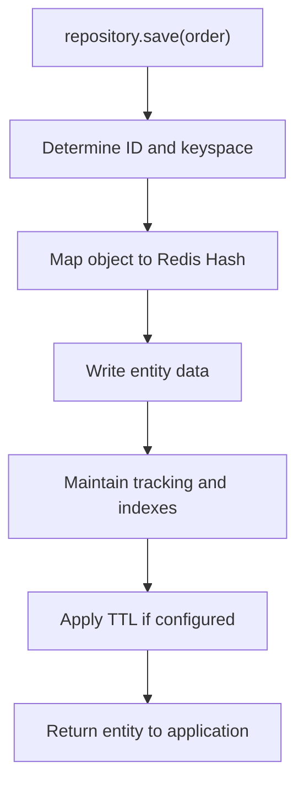
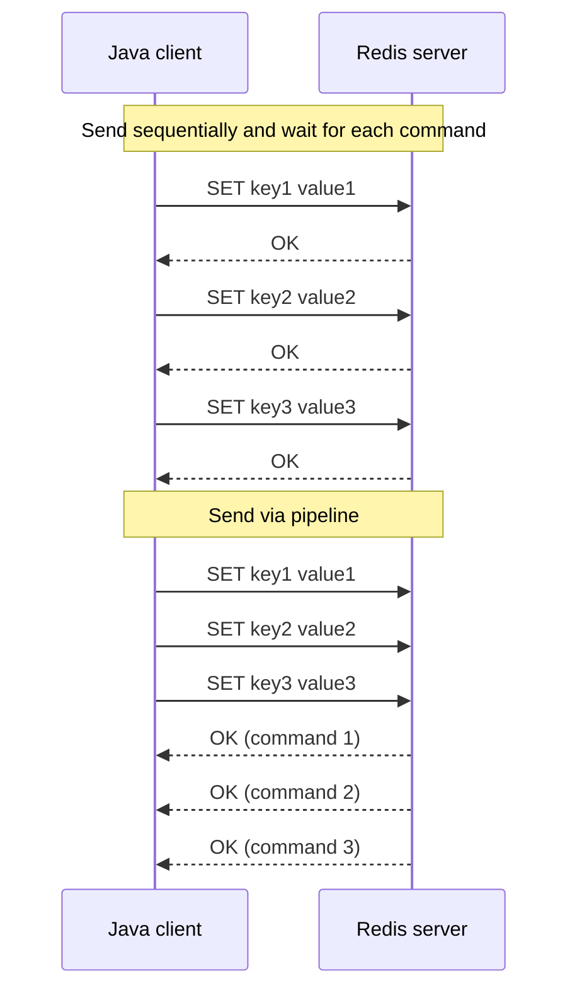
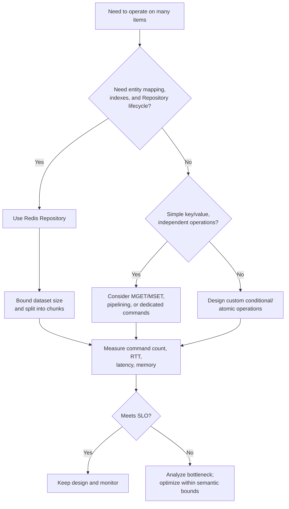

# Multi-Entity Operations and Redis Access Costs in Spring Data Redis Repositories

## 1. Why Do Batch Operations Need Dedicated Design?

Suppose an e-commerce application stores orders in Redis using Spring Data Redis Repository. For a single order, the following looks simple:

```java
orderRepository.save(order);
```

When saving 5,000 orders, you might switch to:

```java
orderRepository.saveAll(orders);
```

However, **`saveAll` does not equate to a single Redis command**, nor does it automatically guarantee that the application waits for only one network round trip. The Repository is responsible for mapping Java objects into Redis Hashes, managing IDs, keyspaces, secondary indexes, and expiration times when configured. One high-level repository call can emit **many Redis commands**.

As the number of entities grows, total cost consists of:

- **Network cost:** number of request/response round trips, latency to Redis, and payload size transmitted.
- **Redis-side cost:** executing commands, mutating data structures, and maintaining keyspaces and indexes.
- **Java-side cost:** object conversion, serializers, memory allocation, iterating inputs, and processing results.
- **Consistency cost:** part of a batch may succeed before a failure occurs; you must know how to retry safely.

This lesson focuses on **multi-entity operations with Redis Repositories** in Spring Data Redis: `saveAll`, `findAllById`, `deleteAllById`, `findAll`, the impact of indexes/TTLs, and when to use `RedisTemplate`, multi-key commands, or pipelining.

## 2. What Does the Repository Do When Saving One Entity?

Consider an order entity:

```java
import org.springframework.data.annotation.Id;
import org.springframework.data.redis.core.RedisHash;
import org.springframework.data.redis.core.index.Indexed;

@RedisHash("shop:orders")
public class OrderRecord {

    @Id
    private String id;

    @Indexed
    private String customerId;

    private String status;

    public OrderRecord() {
    }

    public OrderRecord(String id, String customerId, String status) {
        this.id = id;
        this.customerId = customerId;
        this.status = status;
    }

    public String getId() {
        return id;
    }

    public void setId(String id) {
        this.id = id;
    }

    public String getCustomerId() {
        return customerId;
    }

    public void setCustomerId(String customerId) {
        this.customerId = customerId;
    }

    public String getStatus() {
        return status;
    }

    public void setStatus(String status) {
        this.status = status;
    }
}
```

Corresponding repository:

```java
import java.util.List;
import org.springframework.data.repository.CrudRepository;

public interface OrderRepository
        extends CrudRepository<OrderRecord, String> {

    List<OrderRecord> findByCustomerId(String customerId);
}
```

When calling:

```java
repository.save(new OrderRecord("o-101", "c-42", "NEW"));
```

Spring Data Redis uses `@RedisHash("shop:orders")` to determine the keyspace and `@Id` to identify the record, typically producing a key named:

```text
shop:orders:o-101
```

Object fields are converted into a Redis Hash. At the same time, the repository may maintain a keyspace identifier set, secondary indexes for `@Indexed`, TTL management data, and required metadata.

A *conceptual illustrative* processing flow:



This diagram is not a trace of exact commands. **The number of commands, their order, and execution strategy depend on the Spring Data Redis version, mapping, operation type, and configuration.** Keep in mind that a single `save` can be more expensive than a hand-written Redis `HSET` command.

## 3. Multi-Entity Operation APIs

Spring Data provides common methods via `CrudRepository<T, ID>`:

| API | Purpose | What not to assume |
|---|---|---|
| `saveAll(Iterable<S> entities)` | Save or update multiple entities | Does not guarantee one Redis command, one round trip, or an atomic transaction. |
| `findAllById(Iterable<ID> ids)` | Find entities whose IDs are in the input collection | Does not guarantee placeholders for missing IDs; does not preserve input order by default. |
| `deleteAllById(Iterable<? extends ID> ids)` | Delete multiple entities by ID | Does not guarantee a single server-side delete; may need to update metadata/indexes. |
| `findAll()` | Retrieve all entities managed by the repository | Can consume substantial memory and many reads on large datasets. |
| `deleteAll(Iterable<? extends T> entities)` | Delete the specified entities | Not equivalent to deleting a single Redis key. |
| `deleteAll()` | Delete all entities within the repository scope | Risks heavy load; use with caution in data-heavy systems. |
| `count()` | Count entities according to the repository mechanism | Do not assume its cost or point-in-time exactness under concurrency solely from the API name. |

These CRUD methods define **business semantics**, not a promise of an optimal data-transport strategy. To know the actual round-trip count, measure against your specific configuration and Spring Data Redis/driver version.

### 3.1. `saveAll`: Convenient, Not Necessarily a Bulk Insert

```java
List<OrderRecord> orders = List.of(
    new OrderRecord("o-101", "c-42", "NEW"),
    new OrderRecord("o-102", "c-42", "NEW"),
    new OrderRecord("o-103", "c-43", "NEW")
);

Iterable<OrderRecord> saved = repository.saveAll(orders);
```

What is expected at the repository layer is that entities are processed according to the `saveAll` contract. **Do not treat the three entities as an atomic commit:** if a step fails after saving a subset, earlier data may remain in Redis. Redis Repository does not turn every `saveAll` into a transaction merely because the API accepts a collection.

Furthermore, `saveAll` does not mean a single `MSET` command. Entities are stored as Hashes and may require operations across multiple auxiliary keys.

### 3.2. `findAllById`: Input Is a Set of IDs, Output Contains Only Found Records

```java
List<String> requestedIds = List.of("o-101", "o-999", "o-102");

Iterable<OrderRecord> found = repository.findAllById(requestedIds);

for (OrderRecord order : found) {
    System.out.println(order.getId() + " -> " + order.getStatus());
}
```

If `o-999` does not exist, the repository does not return a placeholder object for that ID. Nor does the API contract require results to match the order of input IDs.

When you need to return results in the requested order or detect missing IDs, build a map keyed by ID yourself:

```java
Map<String, OrderRecord> byId = new HashMap<>();
repository.findAllById(requestedIds)
          .forEach(order -> byId.put(order.getId(), order));

for (String id : requestedIds) {
    OrderRecord order = byId.get(id);
    if (order == null) {
        System.out.println(id + " -> NOT_FOUND");
    } else {
        System.out.println(id + " -> " + order.getStatus());
    }
}
```

The snippet above assumes `java.util.Map` and `java.util.HashMap` are imported; each found record is identified via `getId()`, rather than relying on its position in the `Iterable`.

### 3.3. `deleteAllById`: Multiple IDs Are Not Necessarily Equivalent to `DEL key1 key2 ...`

```java
repository.deleteAllById(List.of("o-101", "o-102", "o-103"));
```

Redis supports a multi-key `DEL` command, but the Redis Repository may also have to update secondary indexes or entity tracking structures. Directly calling `DEL shop:orders:o-101` instead of the repository can leave behind stale metadata/indexes.

A large delete batch also increases multi-key access overhead and risks unnecessary load. Choose deletion scopes carefully, especially when using `deleteAll()`.

## 4. Cost Model: Command Count Differs from Round-Trip Count

Three quantities are often confused:

1. **Number of entities (N):** number of business records to process.
2. **Number of Redis commands (C):** number of Redis operations actually sent, which can exceed N due to tracking, indexes, and TTLs.
3. **Number of network round trips waited (R):** how many times the application waits for a response to continue. With pipelining or multi-key commands, R can be smaller than C.

An intuitive formula for processing time:

```text
T ≈ R × RTT
    + command execution time on Redis
    + Java encode/decode and mapping time
    + payload transfer and result processing time
    + queueing, contention, and infrastructure overhead
```

Here **RTT (Round-Trip Time)** is the round-trip network time between the client and Redis. This is only an explanatory model, not an exact production latency predictor.

Suppose for illustration:

- There are `500` entities.
- Each entity requires an average of `3` Redis commands.
- Each network wait has an RTT of roughly `2 ms`.
- If all `1,500` commands are executed and awaited **sequentially**, RTT alone takes roughly `1,500 × 2 ms = 3 seconds`.

If independent commands are pipelined into batches, the client can cut down network waits dramatically. **Redis still must process the actual commands**; pipelining does not turn 1,500 operations into a single compute operation.

This example is a theoretical calculation showing RTT's impact, **not a benchmark of `saveAll`**. An application using connection pooling, asynchronous I/O, command batching, or transactions will exhibit different network wait profiles.

### 4.1. For the Same Data Volume, Network Latency Can Dominate

| Situation | Characteristics | Possible consequences |
|---|---|---|
| Redis and app on same host/nearby network | Low RTT | Serialization, command count, and Redis CPU easily become major bottlenecks. |
| Redis across regions/high-latency network | High RTT | Many sequential operations cause total duration to spike sharply. |
| Entities with many fields or large payloads | Higher bytes transferred and mapping work | Even with few round trips, total time can remain high. |
| `@Indexed` on many fields | Extra index maintenance work | Writes/deletes are heavier than a single Hash write. |
| Entities with TTL/references | May involve extra commands and supporting data | Must account for time and memory beyond the primary Hash. |

Therefore, **"fewer Java method calls" does not mean "fewer Redis commands"**. To optimize the right bottleneck, observe the client, Redis, and the network path together.

## 5. Example Service Operating on Multiple Orders

The following service preserves repository semantics. It is suitable when the application needs entity lifecycles, indexes, and repository queries.

```java
import java.util.ArrayList;
import java.util.Collection;
import java.util.HashMap;
import java.util.List;
import java.util.Map;

import org.springframework.stereotype.Service;

@Service
public class OrderBatchService {

    private final OrderRepository repository;

    public OrderBatchService(OrderRepository repository) {
        this.repository = repository;
    }

    public List<OrderRecord> saveMany(Collection<OrderRecord> orders) {
        List<OrderRecord> result = new ArrayList<>();
        repository.saveAll(orders).forEach(result::add);
        return result;
    }

    public Map<String, OrderRecord> findMany(Collection<String> ids) {
        Map<String, OrderRecord> byId = new HashMap<>();
        repository.findAllById(ids)
                  .forEach(order -> byId.put(order.getId(), order));
        return byId;
    }

    public void deleteMany(Collection<String> ids) {
        repository.deleteAllById(ids);
    }

    public long countOrders() {
        return repository.count();
    }
}
```

Notes:

- `saveMany` builds a result `List`, so memory consumption scales with the number of returned entities; avoid accidentally accumulating millions of objects.
- `findMany` returns a `Map` containing only the IDs found; callers must handle missing IDs.
- `deleteMany` relies on the repository to keep its managed structures consistent per its contract.
- All three methods may complete **partially** before an exception occurs; they do not implicitly guarantee all-or-nothing execution.

### 5.1. Chunking to Bound In-Flight Data Size

If the input data is already in a large list, you can process it in chunks:

```java
import java.util.List;

public void saveInChunks(List<OrderRecord> orders, int chunkSize) {
    if (chunkSize <= 0) {
        throw new IllegalArgumentException("chunkSize must be positive");
    }

    for (int from = 0; from < orders.size(); from += chunkSize) {
        int to = Math.min(from + chunkSize, orders.size());
        List<OrderRecord> chunk = orders.subList(from, to);
        repository.saveAll(chunk);
    }
}
```

For example, with 20,000 entities and `chunkSize = 250`, the loop makes 80 `saveAll` calls. This helps the application bound failure scope, log progress, and avoid holding a huge result list. However, because the initial `orders` list remains in RAM, `subList` **does not eliminate the memory footprint of the full input dataset**. To truly save RAM when importing very large datasets, fetch records from the source page by page and keep only one batch in memory at a time.

**Chunking does not automatically enable Redis pipelining** and does not by itself reduce round trips. Its main purpose here is to control workload, failure scope, and memory usage.

### 5.2. Should Multiple `saveAll` Calls Run in Parallel?

Concurrency can improve throughput when the bottleneck is I/O wait time, but adding threads does not automatically make Redis faster. Too many concurrent tasks can exhaust the connection pool, create large queues, or increase contention on Redis.

If concurrent batches modify the same ID, there is a risk of **overwriting one another**. For each ID, define a versioning/synchronization strategy per business requirements before running parallel updates.

Limit concurrency, measure p95/p99 latency and Redis CPU, and tune according to real system capacity.

## 6. Why Can `findAll()` Be Expensive?

`findAll()` is convenient on sample data:

```java
Iterable<OrderRecord> allOrders = repository.findAll();
```

However, in a system holding hundreds of thousands of orders, this operation may need to:

1. Resolve the set of IDs belonging to the repository keyspace.
2. Read the data corresponding to many IDs.
3. Convert each Redis Hash into a Java object.
4. Return the result collection to the application.

Exact steps and query execution depend on the implementation, but **reading an entire large dataset** places heavy pressure on the network, Redis, and Java memory.

Compare:

```java
// Only need three specific orders:
repository.findAllById(List.of("o-101", "o-102", "o-103"));

// Only need one order:
repository.findById("o-101");

// Avoid loading all orders by default just to look up a few IDs:
repository.findAll();
```

When iterating through a very large dataset, consider a narrowly scoped retrieval API, an appropriate cursor/`SCAN` mechanism, or a dedicated read model. Do not assume familiar JPA/SQL pagination features share the same contract in Redis Repositories.

### 6.1. Can You Read Only from a Secondary Index?

If business logic frequently looks up orders for a customer, you can add:

```java
@Indexed
private String customerId;
```

and declare:

```java
List<OrderRecord> findByCustomerId(String customerId);
```

This avoids loading the **entire** keyspace and filtering in Java. In exchange, Redis Repository must maintain the secondary index on writes, updates, and deletes.

In other words, you trade some **write and memory cost** for **field-based lookup** capability. If a field is rarely queried or changes constantly, evaluate whether the index is worthwhile.

## 7. Impact of `@Indexed`, TTL, and Metadata on Bulk Operations

### 7.1. Secondary Indexes Add Work on Writes and Deletes

Example:

```java
@RedisHash("shop:orders")
public class OrderRecord {
    @Id
    private String id;

    @Indexed
    private String customerId;

    private String status;
}
```

When saving thousands of entities, each `customerId` value may create or update index membership entries. If `customerId` changes, the system must also handle the association between the old and new values.

Therefore, benchmarking an entity **with only an ID and one String field** does not reflect the true cost of entities with multiple `@Indexed` fields, TTLs, or references.

### 7.2. TTL Can Trigger Extra Activity

Example:

```java
import org.springframework.data.redis.core.RedisHash;

@RedisHash(value = "shop:draft-orders", timeToLive = 3600)
public class DraftOrder {
    // @Id and other properties
}
```

`timeToLive = 3600` declares a TTL in seconds. The Repository must apply expiration when saving entities, and some expiration management mechanisms may involve extra metadata or shadow copies for expiration events depending on configuration.

Do not conclude that a `saveAll` of N entities with TTL still costs only N Redis commands. When re-saving entities, expiration timestamps may also be affected by mapping rules; choose a TTL policy aligned with the business lifecycle.

### 7.3. Do Not Delete Hashes Directly and Assume Indexes Automatically Match

If an entity is managed by a Redis Repository, running:

```redis
DEL shop:orders:o-101
```

removes the primary data without executing all the index cleanup work the repository normally performs. As a consequence, index-based queries can yield IDs whose data no longer exists.

Do not replace `repository.deleteAllById(...)` with a hand-written batch `DEL` when the application still relies on repository indexes, tracking, and semantics. Switching to manual writes/deletes means taking over maintenance of all auxiliary data as well.

## 8. Multi-Key Commands: Fewer Round Trips for Simple Data

Redis supports commands like `MGET`, `MSET`, and multi-key `DEL`. They are very useful when data is stored as **simple String keys/values** and does not require full repository entity mapping semantics.

### 8.1. Reading Multiple Strings with `multiGet`

```java
import java.util.List;
import org.springframework.data.redis.core.StringRedisTemplate;

public class StatusReader {

    private final StringRedisTemplate redis;

    public StatusReader(StringRedisTemplate redis) {
        this.redis = redis;
    }

    public List<String> readStatuses() {
        List<String> keys = List.of(
            "order-status:o-101",
            "order-status:o-102",
            "order-status:o-103"
        );
        return redis.opsForValue().multiGet(keys);
    }
}
```

`multiGet` corresponds to reading multiple String keys via `MGET`. Results typically align positionally with the input key list; missing keys yield `null` elements. Reading this way **does not automatically return `OrderRecord`** mapped via `@RedisHash`.

### 8.2. Writing Multiple Strings with `multiSet`

```java
import java.util.LinkedHashMap;
import java.util.Map;

Map<String, String> statuses = new LinkedHashMap<>();
statuses.put("order-status:o-101", "PAID");
statuses.put("order-status:o-102", "PACKED");
statuses.put("order-status:o-103", "SHIPPED");

redis.opsForValue().multiSet(statuses);
```

`multiSet` typically uses the `MSET` command. It can reduce the overhead of many individual `SET` calls.

However, keep in mind:

- `MSET` writes **Strings**; it does not replace the steps that map an entity into a Redis Hash.
- Standard Redis `MSET` **clears the old TTL** of overwritten keys and does not accept per-key TTLs like `SET ... EX`.
- When running Redis Cluster, server-side multi-key commands normally require keys to reside in the **same hash slot**; drivers may apply their own optimizations, so do not assume every key combination is valid.
- If indexes, TTLs, or repository callbacks are needed, writing your own `multiSet` can violate the entity's storage contract.

### 8.3. Multi-Key `DEL` Does Not Fully Replace `deleteAllById` Either

```redis
DEL order-status:o-101 order-status:o-102 order-status:o-103
```

This command fits when the application directly owns three String keys with no auxiliary metadata. For Hash entities managed by a Redis Repository, follow the appropriate deletion rules so indexes are not left behind.

## 9. Pipelining: Reducing Network Waits for Independent Commands

**Redis pipelining** lets a client send a series of commands without waiting for each command's response before sending the next. After the server processes them, the client reads the corresponding responses.



The major advantage is **reducing how many times the client waits on the network**. A pipeline of 100 commands is still 100 Redis commands to execute.

**Pipelining does not create a transaction.** If command 40 fails, earlier commands may already have completed and subsequent commands can still be processed. If business logic requires all-or-nothing semantics, consider transactions, Lua, or an appropriate data design; plain pipelining provides no rollback.

### 9.1. Spring Data Redis Example: Pipelining `SET` Commands

This example uses `StringRedisTemplate` to write **application-managed String keys**, bypassing Redis Repositories. Each key receives a 5-minute TTL within the same `SET` command.

```java
import java.nio.charset.StandardCharsets;
import java.util.List;
import java.util.Map;

import org.springframework.data.redis.connection.RedisStringCommands;
import org.springframework.data.redis.core.RedisCallback;
import org.springframework.data.redis.core.StringRedisTemplate;
import org.springframework.data.redis.core.types.Expiration;
import org.springframework.stereotype.Service;

@Service
public class StatusPipelineWriter {

    private final StringRedisTemplate redis;

    public StatusPipelineWriter(StringRedisTemplate redis) {
        this.redis = redis;
    }

    public void writeBatch(Map<String, String> statuses) {
        redis.executePipelined((RedisCallback<Object>) connection -> {
            for (Map.Entry<String, String> entry : statuses.entrySet()) {
                byte[] key = ("order-status:" + entry.getKey())
                    .getBytes(StandardCharsets.UTF_8);
                byte[] value = entry.getValue()
                    .getBytes(StandardCharsets.UTF_8);

                connection.stringCommands().set(
                    key,
                    value,
                    Expiration.seconds(300),
                    RedisStringCommands.SetOption.upsert()
                );
            }
            return null;
        });
    }
}
```

In this example:

- `executePipelined` opens a pipeline context, sends commands, and receives the list of responses upon completion.
- The callback must return `null`; individual command results while queued are not handled as already executed results.
- `Expiration.seconds(300)` sets the new TTL alongside the value, avoiding a separate `EXPIRE` command.
- The code uses UTF-8 bytes matching `StringRedisTemplate`'s default string serialization. If the application uses a different serializer configuration, align key/value encoding accordingly.
- To keep memory bounded, do not send millions of commands in one pipeline. Split them into measurably sized chunks.

With `StringRedisTemplate`, `executePipelined` can return a `List<Object>` of decoded responses. If the application needs to verify each command, capture and inspect this list; the illustrative code above uses pipelining for fire-and-forget batch writing without inspecting individual responses.

### 9.2. Splitting Pipelines into Chunks

```java
import java.util.ArrayList;
import java.util.List;
import java.util.Map;

public void writeInChunks(Map<String, String> statuses, int chunkSize) {
    if (chunkSize <= 0) {
        throw new IllegalArgumentException("chunkSize must be positive");
    }

    List<Map.Entry<String, String>> entries =
        new ArrayList<>(statuses.entrySet());

    for (int from = 0; from < entries.size(); from += chunkSize) {
        int to = Math.min(from + chunkSize, entries.size());
        Map<String, String> chunk = new java.util.LinkedHashMap<>();
        for (Map.Entry<String, String> entry : entries.subList(from, to)) {
            chunk.put(entry.getKey(), entry.getValue());
        }
        writeBatch(chunk);
    }
}
```

This supplements `StatusPipelineWriter` above. Chunk size should be chosen based on payload size, memory, latency, and driver behavior. Numbers like 100, 500, or 1,000 are merely **starting points for measurement**, not a universal "optimal" threshold for all systems.

### 9.3. Pipelining with Repository Entities: Preserve the Mapping Contract

A common misguided optimization is taking a list of `OrderRecord` objects and pipelining `HSET` commands directly into `shop:orders:<id>`. That may reduce RTT, but it **skips**:

- Keyspace entity tracking.
- Secondary indexes such as `@Indexed`.
- TTLs, entity type metadata, and conversions for complex fields.
- Associated delete/update steps required by the repository.

If the requirement is **entity CRUD with Redis Repository**, start with the repository and measure actual costs. If you need higher throughput than that mechanism delivers, design a dedicated write layer using `RedisTemplate`, pipelining, or scripts **together with a strategy for keeping auxiliary data consistent**. Do not inject low-level shortcuts into the repository keyspace without considering side effects.

## 10. How Do Pipelining, Transactions, and Lua Differ?

| Mechanism | Primary purpose | Guarantees all-or-nothing automatically? | Reduces Redis command count automatically? |
|---|---|---|---|
| Repository `saveAll` | Multi-entity CRUD API, preserving mapping | **Not by default** | **Not guaranteed** |
| Redis `MSET` / `MGET` | Multi-key commands for String data | Single server command has corresponding atomic semantics; cluster hash-slot limits apply | Can replace multiple single commands with one |
| Pipelining | Reduce wait time across multiple commands | **No** | **No**, only reduces network waits |
| `MULTI` / `EXEC` | Queue commands for sequential execution as a Redis transaction | Redis has no SQL-style rollback on command errors | Does not reduce business commands |
| Lua script | Move multi-step logic to the server for atomic execution | Script runs atomically relative to other commands; not equivalent to SQL transaction rollback | Can reduce round trips and some client-side work |

Do not call a pipeline a "batch transaction". A batch can be **network-efficient** while still carrying per-command failure risks.

For multi-key business flows on **Redis Cluster**, transactions and scripts also have hash-slot restrictions; do not assume keys on different nodes can be processed atomically together.

## 11. How Does Redis Cluster Affect Multi-Key Operations?

Redis Cluster distributes keys across **hash slots**. Multi-key commands require participating keys to reside in the same slot when executed on a node. For example:

```text
MGET order-status:o-101 order-status:o-102
```

In a cluster, two keys can reside in different slots. Sending an invalid multi-key command directly to a node can cause Redis to return `CROSSSLOT`.

Redis supports **hash tag** syntax to force keys sharing the same substring inside braces into the same slot:

```text
order:{o-101}:status
order:{o-101}:payment
order:{o-101}:shipping
```

All three keys sharing tag `{o-101}` are hashed by that tag and can land in the same slot. However, do not assign a large dataset to **a single hash tag**, as that concentrates load onto one shard and defeats Cluster distribution.

With pipelining, a cluster-aware driver can dispatch independent commands to their respective nodes/slots, though support and response-ordering guarantees depend on the driver/API. **Do not infer that pipelining solves cross-slot multi-key commands**. When optimizing Redis Repositories on Cluster, examine keyspace naming rules, secondary indexes, and multi-key operations alike.

## 12. Choosing the Right Approach by Workload

| Task | Typically reasonable approach | Reason |
|---|---|---|
| Create or update a small group of indexed entities | `repository.saveAll` | Preserves mapping, lifecycle, and repository semantics. |
| Look up a set of entities with known IDs | `repository.findAllById` | Avoids loading the full keyspace via `findAll`. |
| Delete repository-managed entities | `repository.deleteAllById` | Keeps auxiliary structures aligned with repository mechanics. |
| Fetch String status of multiple keys | `StringRedisTemplate.opsForValue().multiGet` | Uses multi-key command when topology permits. |
| Write many String keys with identical TTL rules | Pipeline `SET ... EX` commands | Cuts round trips while controlling per-key TTL. |
| High-frequency counters/hit tracking | Dedicated Redis commands like `INCR`, paired with safe TTL handling | Avoids entity mapping overhead for a single number. |
| Multi-step update requiring atomicity | Lua or appropriate transaction | Business invariants outweigh Java call count. |
| Import millions of entities from an external source | Read by page, write in chunks, measure load | Bounds memory and controls error handling. |
| Batch lookup by a field | Repository query with `@Indexed` when appropriate | Trades write/index overhead for faster queries. |

These choices serve as design directions. Final decisions depend on real Redis cost, data semantics, and deployment topology.

## 13. Handling Failures When a Batch Is Incomplete

### 13.1. Batches Do Not Roll Back by Default

Suppose:

```text
Batch 1: save o-001 .. o-250 -> succeeded
Batch 2: save o-251 .. o-500 -> failed mid-way
Batch 3: not executed
```

You cannot conclude all 500 records failed. Part of batch 2 may have been persisted before the exception reached the application.

If the system retries the entire batch, determine:

- Can the **same ID be written multiple times** without breaking business logic?
- Is the command writing absolute state, or could incrementing a counter or emitting events cause duplicates?
- Is version information or conditional updating needed to prevent overwriting newer data?
- Do indexes and TTLs maintain their contract after a retry?

For entities saved by a stable ID, re-running `save` can work in many scenarios, yet it is **not automatically safe for every use case**. For instance, saving a stale object after another client updated it can overwrite the newer version.

### 13.2. Using Stable IDs and Recording Progress

For a data ingestion pipeline:

```text
Read a page of data
    ↓
Convert to entities with stable IDs
    ↓
Write in chunks
    ↓
Mark chunk complete only after successful processing
    ↓
Read next page
```

If the system requires high accuracy, you may need source checkpoints, acknowledged queues, or dedicated deduplication. Simply logging "called `saveAll`" is not proof that all data was persisted.

### 13.3. Handling Missing Data When Reading Multiple IDs

Redis keys can expire during a batch read, or be deleted by another client. Therefore, the application must treat `findAllById` results as **the subset of records found at execution time**, not a consistent snapshot of the entire ID list.

If business logic requires "all records must exist simultaneously" (for example, validating every order in a settlement batch), standalone Redis Repository CRUD is insufficient to guarantee that; design a dedicated consistency strategy.

## 14. Optimizing Memory and Payload Size

### 14.1. Do Not Materialize Copies Unnecessarily

The following snippet multiplies data in RAM:

```java
List<OrderRecord> source = loadAllOrders();
List<OrderRecord> copied = new ArrayList<>(source);
List<OrderRecord> saved = new ArrayList<>();
repository.saveAll(copied).forEach(saved::add);
```

If you do not need three copies of the dataset, design a streaming page or chunk workflow. A `List` itself holds only object references, yet still consumes memory; byte arrays from serialization and intermediate conversion objects can also increase heap usage.

### 14.2. Controlling Entity Size

An entity with many large text fields or nested structures can:

- Increase object conversion overhead.
- Increase bytes transferred over the network.
- Increase Redis CPU and response time.
- Cause heavy writes when rewriting the entire object just to change one small attribute.

For high-frequency access to a small status value, consider a separate smaller String or Hash key, provided data ownership and consistency are clearly defined.

### 14.3. Avoid Unbounded Pipelines

Pipelining requires buffering pending responses in Redis and the client. Sending hundreds of thousands of commands in a single pipeline can spike memory usage, block latency for other requests, and increase blast radius on connection drops. **Chunked pipelining** is usually an easier operational strategy to control.

## 15. Observability and Performance Measurement

Optimize based on real metrics rather than API names alone. Within a consistent environment, measure:

- **Throughput:** entities processed per second.
- **Latency:** total batch time and p50/p95/p99 request latencies.
- **Redis command rate:** commands executed compared against entity count.
- **Network:** RTT, bandwidth, request/response byte sizes.
- **Memory:** Java heap, Redis memory, pipeline buffers.
- **Metadata cost:** difference with indexes and TTL enabled vs. disabled on representative entities.
- **Errors:** timeouts, pool exhaustion, retries, concurrent updates, and partial reads.

### 15.1. Measuring End-to-End in the Service

Example batch timing:

```java
import java.util.List;
import java.util.concurrent.TimeUnit;

public long measureSaveMillis(
        OrderRepository repository,
        List<OrderRecord> batch) {

    long started = System.nanoTime();
    repository.saveAll(batch);
    return TimeUnit.NANOSECONDS.toMillis(
        System.nanoTime() - started
    );
}
```

This measures **Java call duration at the service layer**. It can include serialization, command construction, I/O wait, and other overhead; it is not an isolated measurement of Redis CPU time. If `saveAll` returns a lazily evaluated result in a given implementation, include consuming the result in the measurement.

For reliable comparisons, measure multiple runs after warm-up, using identical entity sizes, serializer/index/TTL settings, and Redis topology. A single faster run is not enough to validate an optimization.

### 15.2. Observing Directly on Redis

Useful commands:

```redis
INFO commandstats
INFO stats
SLOWLOG GET 10
```

`INFO commandstats` provides per-command statistics; `SLOWLOG` records server commands exceeding the configured execution threshold. **Slow log does not capture network transit or client-side queueing**, so Redis may report fast commands while the application still sees high latency due to RTT or connection-pool contention.

`MONITOR` can reveal live command streams in test environments, but adds overhead and can expose sensitive data; do not enable it by default in high-load production. For production investigations, prefer bounded telemetry and application/driver metrics.

### 15.3. Suggested Measurement Matrix

| Configuration | 100 entities | 1,000 entities | 10,000 entities |
|---|---|---|---|
| Repository `saveAll`, no index, no TTL | Measure | Measure | Measure |
| Repository `saveAll`, with `@Indexed` | Measure | Measure | Measure |
| Repository `saveAll`, with TTL | Measure | Measure | Measure |
| Pipeline `SET` for independent String keys | Measure | Measure | Measure |
| Multi-key read via `multiGet` | Measure | Measure | Measure |

These options do not share equivalent data semantics; the goal is to observe the **incremental cost of each operation type**. Do not conclude from "String pipelining is faster than Repository Hash" that you can drop all repository mapping without changing your data contract.

## 16. Common Pitfalls

### Pitfall 1: "`saveAll` definitely calls Redis only once"

No such guarantee exists from the API name. The Repository may process each entity along with several auxiliary steps. Measure actual command and round-trip counts.

### Pitfall 2: "Pipelining turns a batch into a transaction"

Pipelining optimizes network transport; it **provides no rollback** and does not prevent other clients from interleaving operations.

### Pitfall 3: "`findAll` is an easy way to filter a few records"

Reading the entire keyspace and filtering in Java can be very expensive. When you have IDs, use `findById` / `findAllById`; when querying by property, design indexes thoughtfully.

### Pitfall 4: "Calling batch `DEL` directly is equivalent to `deleteAllById`"

This bypasses Redis Repository maintenance of indexes and auxiliary keys. Only use low-level deletion when the application owns all storage semantics.

### Pitfall 5: "Increasing batch size indefinitely always makes it faster"

Oversized batches increase RAM, payload size, wait times, failure recovery difficulty, and Redis pressure. Proper batch sizes must be measured under real load.

### Pitfall 6: "Splitting into chunks already reduces round trips"

Chunking bounds processing volume; reducing network waits usually requires an API or driver that truly uses batching, pipelining, or multi-key commands.

### Pitfall 7: "Retrying once is always safe"

For non-idempotent operations like incrementing counters, publishing events, or ordered updates, retries can yield wrong results. With `save`, re-writing a stale object can also overwrite newer state.

### Pitfall 8: "Fewer Redis commands always means better business performance"

A single large command can still incur high server time and payload size, or lack the indexing/TTL support your application needs. Compare **end-to-end latency and correctness**, not just method counts.

## 17. Reasoning Exercise

A system manages 10,000 shopping carts stored via Redis Repository:

```java
@RedisHash(value = "carts", timeToLive = 900)
class Cart {
    @Id String id;
    @Indexed String userId;
    // ...
}
```

The application needs to perform four tasks:

1. Import 2,000 new carts.
2. Read the state of 20 carts with known IDs.
3. Delete 100 old carts.
4. Record one million per-user counter increments.

Reasonable approaches to consider:

| Requirement | Approach | What to check |
|---|---|---|
| Import 2,000 carts | `saveAll` in reasonable chunks | Cost of creating Hashes, `userId` index, TTLs, and partial failures. |
| Read 20 IDs | `findAllById` | Handle missing/expired IDs; do not assume return ordering. |
| Delete 100 IDs | `deleteAllById` | Index and TTL metadata update mechanism; do not manually delete Hashes. |
| Increment one million counters | Dedicated `INCR` command, possibly pipelined/batched | Increment atomicity, TTL on key creation, and load limits. |

Follow-up question: if the counter must expire 60 seconds after the first increment, calling `INCR` alone is not enough; key creation must coordinate with expiration safely under contention. If carts must preserve a 15-minute lifespan measured from creation time, you need to understand how saving an update to an entity affects its TTL.

## 18. Design Principles as Data Grows

A useful decision workflow:



When working with multiple entities, distinguish **API convenience** from **actual execution cost**. `saveAll`, `findAllById`, and `deleteAllById` express entity-level business logic cleanly, without promising a single network trip or transaction. Multi-key commands and pipelining can boost throughput for suitable workloads, but they do not preserve Repository-managed mappings, secondary indexes, or TTLs automatically. Good design picks the right abstraction level, measures real load, and preserves data semantics during optimization.

## References

- [Spring Data Redis Reference — Redis Repositories](https://docs.spring.io/spring-data/redis/reference/redis/redis-repositories.html)
- [Spring Data Redis Reference — Mapping](https://docs.spring.io/spring-data/redis/reference/redis/redis-repositories/mapping.html)
- [Spring Data Redis Reference — Secondary Indexes](https://docs.spring.io/spring-data/redis/reference/redis/redis-repositories/indexes.html)
- [Spring Data Redis Reference — Time To Live](https://docs.spring.io/spring-data/redis/reference/redis/redis-repositories/expirations.html)
- [Spring Data Redis Reference — Pipelining](https://docs.spring.io/spring-data/redis/reference/redis/pipelining.html)
- [Spring Data Commons Reference — Core Repository Concepts](https://docs.spring.io/spring-data/commons/reference/repositories/core-concepts.html)
- [Redis Documentation — Pipelining](https://redis.io/docs/latest/develop/using-commands/pipelining/)
- [Redis Documentation — MGET](https://redis.io/docs/latest/commands/mget/)
- [Redis Documentation — MSET](https://redis.io/docs/latest/commands/mset/)
- [Redis Documentation — SCAN](https://redis.io/docs/latest/commands/scan/)
