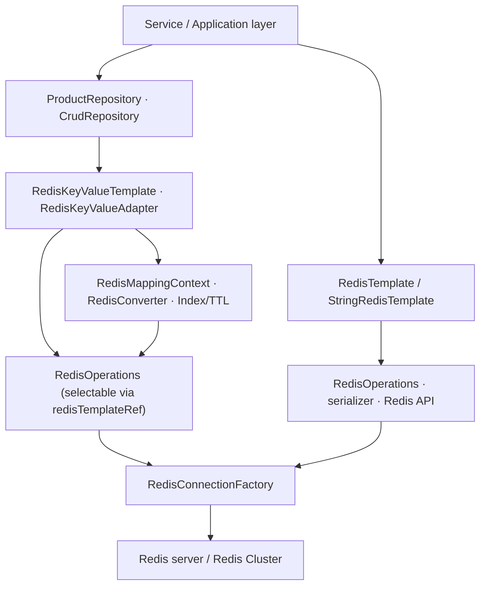

# Distinguishing Repository Configuration from `RedisTemplate` Configuration in Spring Data Redis

> **Module:** Spring Data Redis  
> **Chapter:** Redis Repository  
> **Focus:** Distinguishing configuration for *domain repositories* from configuration for direct Redis operations via `RedisTemplate`, while understanding how both mechanisms cooperate on the same Redis server.

## 1. Two Ways to Use Redis in a Spring Application

Spring Data Redis provides two common approaches for working with data:

1. **`RedisTemplate` and `StringRedisTemplate`:** operate on native Redis data types — String, Hash, List, Set, Sorted Set, Stream, Pub/Sub... — using operation APIs such as `opsForValue()`, `opsForHash()`, and `opsForSet()`. The application chooses key names, data types, serialization formats, TTLs, and commands directly.
2. **Redis Repository:** models data as **entities** accessed via repository interfaces such as `CrudRepository<Product, String>`. Spring Data Redis manages converting entities into Redis Hashes, keyspaces, secondary indexes, and convention-based read/write operations.

For the same goal of "storing a product in Redis":

- With a template, the application might call `SET cache:product:101 "<json>" EX 600`.
- With a repository, the application calls `productRepository.save(product)`; the Redis Repository can store the entity as a **Hash** `products:101` and maintain Sets supporting lookups on properties marked with `@Indexed`.

Both can share the **same Redis server and same `RedisConnectionFactory`**. However, connecting to the same server does not mean their data is automatically compatible in terms of keys, values, Redis types, or conversion rules.

### 1.1. Architecture Diagram



The diagram above represents **configuration responsibilities**, not a class diagram or a claim that every implementation follows the exact same internal call chain. Key takeaways:

- A Repository **is not merely a renamed `RedisTemplate`**. It includes entity metadata, mapping, and repository proxy layers.
- A Repository **can use an underlying `RedisOperations`/`RedisTemplate` bean**. `@EnableRedisRepositories(redisTemplateRef = "...")` lets you specify that bean.
- When you define a new template for direct application calls, the repository **does not automatically switch to the new bean**. Selecting the template for a repository depends on wiring configuration and the referenced bean name.

## 2. Quick Comparison Table

| Aspect | Redis Repository | `RedisTemplate` / `StringRedisTemplate` |
|---|---|---|
| Programming unit | Entity, aggregate, repository interface | Key, value, and native Redis data structure |
| Typical API | `save`, `findById`, `findAll`, `deleteById`, property finders | `opsForValue`, `opsForHash`, `opsForSet`, `expire`, `execute` |
| Initialization mechanism | Scan repository interfaces, create proxies, build KeyValue infrastructure | Declare or auto-configure a template bean |
| Primary data representation | Entity mapped into a **Redis Hash** | Chosen by application: String, Hash, List, Set, ZSet… |
| Identifiers/keyspace | `@RedisHash`, `@Id`, keyspace configuration | Keys built manually in code |
| Type conversion | `RedisConverter`, `RedisMappingContext`, `RedisCustomConversions` | `RedisSerializer` for key/value/hash key/hash value; depends on API |
| Field queries | Finders backed by secondary indexes, typically using `@Indexed` | Application designs indexes, Redis commands, or RediSearch if used |
| TTL | `@RedisHash(timeToLive = …)`, `@TimeToLive`, keyspace settings | `set(..., Duration)`, `expire(...)`, commands with TTL |
| Transaction behavior | Redis Repositories do not support JPA-style repository transactions | Template has limited Redis transaction support, requiring explicit config |
| Operating scope | Entities belonging to scanned repositories | Any key/data structure the application is authorized to access |
| Native Redis flexibility | Specialized for entity CRUD and supported query patterns | Suited for Redis-specific tasks, pipelining, Lua, and native data structures |
| Relationship between the two | Can reference a template bean via `redisTemplateRef` | Declaring a custom template does not enable/alter Repositories |

**Primary distinction:** *Repository* configuration describes **how entities are managed and how the repository mechanism operates**; *template* configuration describes **how a `RedisOperations` bean communicates with Redis and converts data**. There is an overlap because a repository can be wired to a specific template.

## 3. Configuration Layers to Distinguish

### 3.1. Connection Configuration (`RedisConnectionFactory`)

Both repositories and templates require a connection to Redis. In a Spring Boot application using the Redis starter, you can configure:

```yaml
spring:
  data:
    redis:
      host: localhost
      port: 6379
      database: 0
      timeout: 2s
```

With the corresponding Spring Boot setup, the starter typically provides a Lettuce-based `RedisConnectionFactory` and may auto-configure default templates.

- Changing host/port/credentials/SSL in a connection factory affects all components **using that factory**.
- An application can define multiple connection factories, in which case you must reference the appropriate beans explicitly instead of assuming every component picks the right target.
- `database: 0` only applies in Redis topologies supporting logical database selection. Redis Cluster typically uses only database 0.
- Server settings such as `maxmemory`, `maxmemory-policy`, persistence, or ACLs belong to the **Redis server**; they are not enabled by repository annotations or `setValueSerializer()`.

### 3.2. Repository Configuration

Important components of Repository setup:

- **`@EnableRedisRepositories`:** enables scanning repository interfaces, defines package scope, and configures infrastructure wiring. In some Spring Boot projects, auto-configuration already enables repositories when conditions match; explicit annotations help control scope or options.
- **`@RedisHash("products")`:** marks an entity and specifies its keyspace, typically producing keys of the form `products:<id>`.
- **`@Id`:** marks the entity identifier.
- **`@Indexed`:** creates a secondary index for a field that needs querying.
- **`@TimeToLive` or `@RedisHash(timeToLive = …)`:** configures entity time-to-live.
- **`RedisMappingContext`, `RedisConverter`, and `RedisCustomConversions`:** rules for converting objects to Redis Hashes, managing metadata, and custom converters.
- **`RedisKeyValueAdapter` and `RedisKeyValueTemplate`:** infrastructure coordinating repository operations, mapping, persistence, and entity queries.

When writing `productRepository.findByCategory("desk")`, Spring Data Redis relies on repository infrastructure and indexes to locate matching entities. A `valueSerializer` setting alone cannot create secondary indexes or turn `StringRedisTemplate` into a repository.

### 3.3. `RedisTemplate` Configuration

A `RedisTemplate<K, V>` bean typically needs:

- `setConnectionFactory(...)`: Redis connection;
- `setKeySerializer(...)`: converts Java keys to bytes;
- `setValueSerializer(...)`: converts values to bytes;
- `setHashKeySerializer(...)` and `setHashValueSerializer(...)`: convert Redis Hash fields/values when using standard hash operations;
- behavioral configuration as needed, such as transaction support when required.

Example creating a **string** template with a dedicated bean name:

```java
import org.springframework.beans.factory.annotation.Qualifier;
import org.springframework.context.annotation.Bean;
import org.springframework.context.annotation.Configuration;
import org.springframework.data.redis.connection.RedisConnectionFactory;
import org.springframework.data.redis.core.RedisTemplate;
import org.springframework.data.redis.serializer.StringRedisSerializer;

@Configuration
public class ManualRedisTemplateConfiguration {

    @Bean("manualStringTemplate")
    public RedisTemplate<String, String> manualStringTemplate(
            RedisConnectionFactory connectionFactory) {

        StringRedisSerializer serializer = new StringRedisSerializer();

        RedisTemplate<String, String> template = new RedisTemplate<>();
        template.setConnectionFactory(connectionFactory);
        template.setKeySerializer(serializer);
        template.setValueSerializer(serializer);
        template.setHashKeySerializer(serializer);
        template.setHashValueSerializer(serializer);
        template.afterPropertiesSet();

        return template;
    }
}
```

Usage code:

```java
import java.time.Duration;
import org.springframework.beans.factory.annotation.Qualifier;
import org.springframework.data.redis.core.RedisTemplate;
import org.springframework.stereotype.Service;

@Service
public class GreetingCache {

    private final RedisTemplate<String, String> template;

    public GreetingCache(
            @Qualifier("manualStringTemplate")
            RedisTemplate<String, String> template) {
        this.template = template;
    }

    public void save(String userId, String greeting) {
        template.opsForValue().set(
                "greeting:" + userId, greeting, Duration.ofMinutes(10));
    }

    public String read(String userId) {
        return template.opsForValue().get("greeting:" + userId);
    }
}
```

This template directly controls a Redis String, using key `greeting:<userId>`, a 10-minute TTL, and UTF-8 String serialization. **There is no `@RedisHash`, repository proxy, secondary index, or entity mapping** in this flow.

`StringRedisTemplate` provides a built-in option specialized for String keys/values, typically available as a bean via Spring Boot auto-configuration. The `manualStringTemplate` bean in the example clearly illustrates where serializers are configured and how beans are selected with a qualifier.

## 4. Full Repository Example on the Same Redis Server

Building a module to store a product catalog. The entity has an id, name, category, and TTL:

### 4.1. `CatalogProduct` Entity

```java
import org.springframework.data.annotation.Id;
import org.springframework.data.redis.core.index.Indexed;
import org.springframework.data.redis.core.RedisHash;

@RedisHash(value = "products", timeToLive = 3600L)
public class CatalogProduct {

    @Id
    private String id;

    private String name;

    @Indexed
    private String category;

    protected CatalogProduct() {
    }

    public CatalogProduct(String id, String name, String category) {
        this.id = id;
        this.name = name;
        this.category = category;
    }

    public String getId() {
        return id;
    }

    public String getName() {
        return name;
    }

    public String getCategory() {
        return category;
    }
}
```

Explanation:

- `@RedisHash(value = "products")` defines the `products` keyspace; the Redis Hash for an entity with ID `p-101` typically has key `products:p-101`.
- `@Id` specifies the identifier portion of the key.
- `@Indexed` instructs the repository to manage a secondary index for `category`; this is required for field-based finders to work via the index model.
- `timeToLive = 3600L` is the default lifespan **in seconds** of the entity (1 hour), not a TTL for the entire Redis server and not a TTL for `manualStringTemplate`.
- This entity uses constructors, getters, and metadata so the repository can convert the object. An application can add setters, constructors, or constructor mapping according to its domain strategy.

### 4.2. Repository Interface

```java
import java.util.List;
import org.springframework.data.repository.CrudRepository;

public interface CatalogProductRepository
        extends CrudRepository<CatalogProduct, String> {

    List<CatalogProduct> findByCategory(String category);
}
```

Spring Data generates a repository implementation to handle `save`, `findById`, `deleteById`, and the `findByCategory` finder. Redis does not provide SQL or arbitrary field queries by default; the repository uses secondary indexes maintained by Spring Data Redis.

### 4.3. Enabling the Repository and Selecting the Underlying Template

Assume Spring Boot already created the default `redisTemplate` bean. To explicitly configure the scan scope and bind the repository to that template:

```java
import org.springframework.context.annotation.Configuration;
import org.springframework.data.redis.repository.configuration.EnableRedisRepositories;

@Configuration
@EnableRedisRepositories(
        basePackageClasses = CatalogProductRepository.class,
        redisTemplateRef = "redisTemplate"
)
public class RedisRepositoryConfiguration {
}
```

`basePackageClasses` limits repository scanning via the specified interface's package. `redisTemplateRef` points to the **bean name of the `RedisOperations` used by the Redis Repository infrastructure**.

Suppose you also have the `manualStringTemplate` bean from earlier:

- `CatalogProductRepository` uses the bean named `redisTemplate` via explicit wiring.
- `GreetingCache` uses `manualStringTemplate` because its constructor has `@Qualifier`.
- Changing serializers on `manualStringTemplate` **does not alter** `redisTemplate`'s serialization, nor does it alter repository mapping.

If you want the repository to use a different `RedisOperations` bean, you must declare and configure that bean compatibly and update `redisTemplateRef`. Do not blindly switch it to a String/JSON-only template without checking how the repository handles Redis Hashes and secondary indexes.

### 4.4. Service Calling the Repository

```java
import java.util.List;
import org.springframework.stereotype.Service;

@Service
public class ProductCatalogService {

    private final CatalogProductRepository products;

    public ProductCatalogService(CatalogProductRepository products) {
        this.products = products;
    }

    public CatalogProduct create() {
        return products.save(
                new CatalogProduct("p-101", "Office Desk", "desk"));
    }

    public CatalogProduct get(String id) {
        return products.findById(id)
                .orElseThrow(() ->
                        new IllegalArgumentException("Product not found: " + id));
    }

    public List<CatalogProduct> findDesks() {
        return products.findByCategory("desk");
    }
}
```

Note: this is a structural example for a Spring Boot application with the Redis starter and classes placed in scannable packages. The execution sequence is **call repository -> convert entity to Redis Hash -> access Redis**, rather than the application manually issuing `SET`/`HSET` for individual fields.

## 5. How Does Stored Data Actually Differ?

Suppose the service runs:

```java
productRepository.save(
        new CatalogProduct("p-101", "Office Desk", "desk"));

manualStringTemplate.opsForValue().set(
        "greeting:u-1", "Hello", Duration.ofMinutes(10));
```

Typical keys:

| Key | Redis type | Created by? | Mechanism |
|---|---|---|---|
| `products:p-101` | Hash | Repository | Fields converted from entity |
| `products` | Set | Repository | Set of entity identifiers belonging to the keyspace |
| `products:category:desk` | Set | Repository | Secondary index serving `findByCategory` |
| `greeting:u-1` | String | Template | String value and TTL set by the application |

Exact names and structures of supporting keys may vary across mapping, index, and library versions; the table shows common data types and conventions to explain how things work.

Manual inspection via Redis CLI in a test environment:

```bash
redis-cli TYPE products:p-101
redis-cli HGETALL products:p-101
redis-cli TTL products:p-101

redis-cli TYPE products:category:desk
redis-cli SMEMBERS products:category:desk

redis-cli TYPE greeting:u-1
redis-cli GET greeting:u-1
redis-cli TTL greeting:u-1
```

Command results depend on whether the keys exist at inspection time, whether corresponding indexes exist, and whether the same logical database is selected.

### 5.1. Why Can't `template.opsForValue().get("products:p-101")` Read the Entity?

Repositories typically store `products:p-101` as a Redis **Hash**. `opsForValue().get(...)` corresponds to `GET` on a Redis String. Running `GET` on a key holding a Hash causes Redis to return `WRONGTYPE Operation against a key holding the wrong kind of value`.

Even when the Redis type matches, if keys/values were serialized with different configurations (JDK serialization, JSON, String...), the application can read incompatible data.

To read a Repository entity, use:

```java
CatalogProduct product = productRepository.findById("p-101")
        .orElseThrow();
```

To read a Redis Hash via a template, use `opsForHash()`, though mapping fields manually also requires understanding the Repository's serialization/mapping conventions. Do not assume you can cast a Hash directly into an entity.

### 5.2. Why Doesn't `opsForHash().put(...)` Replace `repository.save(...)`?

Redis Repositories maintain several related structures: the entity Hash, keyspace Set, index Sets, and required metadata. If the application modifies a field directly via `opsForHash().put("products:p-101", "category", "lamp")`:

- the Redis Hash changes;
- the `products:category:desk` and `products:category:lamp` indexes **are not automatically updated**;
- `findByCategory(...)` queries may return stale, missing, or inconsistent results.

Moreover, under entity-saving semantics, a repository `save` may delete and recreate the mapped Hash contents. Any fields added directly via a template that are outside the mapping can be lost when the repository re-saves the entity.

**Operational principle:** For keys owned by a Repository, use the Repository to create/update/delete entities. When efficient field-level updates or specialized Redis commands are required, design a separate template flow and a consistent index/TTL maintenance strategy.

## 6. `redisTemplateRef` and `keyValueTemplateRef`: Where the Two Configurations Meet

These are two distinct attributes of `@EnableRedisRepositories`:

| Attribute | Referenced bean type | Common default | Role |
|---|---|---|---|
| `redisTemplateRef` | `RedisOperations`, usually `RedisTemplate` | `redisTemplate` | Selects the `RedisOperations` used at the adapter layer |
| `keyValueTemplateRef` | `KeyValueOperations`, usually `RedisKeyValueTemplate` | `redisKeyValueTemplate` | Selects the `KeyValueOperations` infrastructure used by repository proxies |

In simple setups, the framework configures compatible supporting infrastructure. When customizing multiple repository groups, multiple Redis backends, mappers, or converters, you may need to declare beans and references explicitly to avoid miswiring.

**Easily confused example:**

```java
@Bean("reportsTemplate")
RedisTemplate<String, String> reportsTemplate(RedisConnectionFactory factory) {
    // Configuration dedicated to operations on reports:* keys.
    // ...
}
```

Merely declaring this bean **does not** instruct `CatalogProductRepository` to use `reportsTemplate`; the repository continues with its selected wiring. Even if you set `redisTemplateRef = "reportsTemplate"`, the repository uses that `RedisOperations` yet **still operates via the entity-to-Hash mechanism**, rather than switching to storing entire entities as JSON Strings.

Repository configuration such as `@RedisHash`, `@Indexed`, and `RedisConverter` is not replaced simply by swapping `valueSerializer`. Conversely, the template and connection referenced by the repository are real runtime infrastructure components; the two configurations cannot be called completely independent at runtime.

### 6.1. Layers of "Serialization" to Distinguish

1. **`RedisTemplate` serialization:** how keys, values, hash fields, and hash values are converted to bytes when executing `RedisOperations`.
2. **Repository mapping and conversions:** how entities and entity properties are converted into fields/values inside a Redis Hash using `RedisConverter` and `RedisCustomConversions`.
3. **JSON serializer in `RedisCacheManager`:** typically used for the Spring Cache abstraction; yet another separate configuration.

For example, configuring a `RedisTemplate<String, Object>` with a JSON value serializer ensures that `opsForValue().set(key, object)` calls on that template store values as JSON. It **does not turn `ProductRepository.save(product)` into `SET products:id <json>`**. The Repository still uses Redis Hashes and Repository mapping.

To customize how a complex domain property is persisted by a repository, look into `RedisCustomConversions` or a custom `RedisConverter`. Changing a serializer does not change entity-mapping structure.

## 7. Query Configuration: How Does `@Indexed` Differ from Manual Search?

Suppose you have:

```java
List<CatalogProduct> findByCategory(String category);
```

Repositories typically rely on **secondary indexes that they build and update**. Adding `@Indexed` to `category` creates Sets for equality lookups; queries combining certain conditions can leverage Redis Set operations.

If `@Indexed` is omitted or indexes have not been built for previously saved entities, you cannot expect finder methods to automatically scan all Hashes by field like a relational database.

With a template, you can build a manual index yourself:

```java
template.opsForSet().add("idx:category:desk", "p-101");
```

From that point on, **the application is responsible** for keeping the index synchronized across creates, updates, deletes, expirations, and evictions. Redis Repositories already handle part of this lifecycle internally; a manual index is not automatically managed by a Repository just because key prefixes look similar.

Also distinguish Redis Repository secondary indexes from extended Redis search/query engines (such as Redis Query Engine/RediSearch). Those are separate technologies with different configuration models.

## 8. Configuring TTL and Expiration Events

### 8.1. TTL in Repositories

TTL can be declared in entity metadata:

```java
@RedisHash(value = "sessions", timeToLive = 1800L)
public class SessionEntry {
    @Id
    private String id;
    private String accountId;
    // Constructor, getters, setters, or constructor mapping.
}
```

`timeToLive` on `@RedisHash` is interpreted in **seconds**. Or use `@TimeToLive` for flexible per-entity lifespans:

```java
import org.springframework.data.annotation.Id;
import org.springframework.data.redis.core.RedisHash;
import org.springframework.data.redis.core.TimeToLive;

@RedisHash("loginTokens")
public class LoginToken {

    @Id
    private String id;

    @TimeToLive
    private Long secondsToLive;

    protected LoginToken() {}

    public LoginToken(String id, Long secondsToLive) {
        this.id = id;
        this.secondsToLive = secondsToLive;
    }

    public String getId() {
        return id;
    }

    public Long getSecondsToLive() {
        return secondsToLive;
    }
}
```

A `@TimeToLive` field lets you specify TTL per entity instance. With repositories, keyspace notifications and `RedisKeyExpiredEvent` may be involved when handling expiration events; listener configuration, permissions to modify `notify-keyspace-events`, and retaining temporary copies (*shadow copies*) each carry operational costs.

### 8.2. TTL in Templates

```java
template.opsForValue().set(
        "login:otp:u-1", "123456", Duration.ofMinutes(5));

template.expire("some:key", Duration.ofMinutes(5));
```

Here, TTL is controlled directly on the key by Redis commands. It does not reference `@TimeToLive` on any entity.

### 8.3. Expiration Events and Secondary Indexes

Repositories have an expiration-handling mechanism using Redis keyspace notifications. Depending on configuration, the framework may retain phantom copies and publish `RedisKeyExpiredEvent`. Redis Pub/Sub notifications are **not durable**: if the application misses events while offline, index reference cleanup can be incomplete.

Do not assume that simply adding `@TimeToLive` guarantees every application receives reliable, durable expiration events. Plan operational handling accordingly, especially on managed Redis services restricting `CONFIG`.

## 9. Configuration When Using Both Redis Repository and `RedisTemplate`

A common architecture:

- **Repository:** stores lightweight domain entities with IDs, using queries over indexed fields.
- **Dedicated template:** stores caches, counters, distributed locks with proper safety mechanisms, rate limits, Sets/ZSets/Streams, and Redis-specific commands.
- **Connection factory:** shared if they truly use the same Redis instance; separated when workload, data sensitivity, or risk requires separate Redis instances.
- **Namespace prefixes:** for example `products:*` owned by Repository and `cache:*` owned by template. Prefixes prevent key collisions, but **do not create resource isolation or separate eviction policies**.

### 9.1. Example Combined Spring Configuration

```java
import org.springframework.context.annotation.Bean;
import org.springframework.context.annotation.Configuration;
import org.springframework.data.redis.connection.RedisConnectionFactory;
import org.springframework.data.redis.core.RedisTemplate;
import org.springframework.data.redis.repository.configuration.EnableRedisRepositories;
import org.springframework.data.redis.serializer.StringRedisSerializer;

@Configuration
@EnableRedisRepositories(
        basePackageClasses = CatalogProductRepository.class,
        redisTemplateRef = "redisTemplate")
public class AppRedisConfiguration {

    @Bean("cacheStringTemplate")
    RedisTemplate<String, String> cacheStringTemplate(
            RedisConnectionFactory factory) {

        RedisTemplate<String, String> template = new RedisTemplate<>();
        template.setConnectionFactory(factory);

        StringRedisSerializer stringSerializer = new StringRedisSerializer();
        template.setKeySerializer(stringSerializer);
        template.setValueSerializer(stringSerializer);
        template.setHashKeySerializer(stringSerializer);
        template.setHashValueSerializer(stringSerializer);
        template.afterPropertiesSet();

        return template;
    }
}
```

The class above assumes Spring Boot **already auto-configured the `redisTemplate` and `RedisConnectionFactory` beans**. It adds `cacheStringTemplate` and explicitly instructs the Repository to use `redisTemplate`. If the application lacks Redis auto-configuration, you must declare the connection factory and underlying template beans yourself.

Each service should inject according to **intent**:

```java
public ProductApplicationService(
        CatalogProductRepository repository,
        @Qualifier("cacheStringTemplate")
        RedisTemplate<String, String> cacheTemplate) {
    this.repository = repository;
    this.cacheTemplate = cacheTemplate;
}
```

Avoid naming multiple beans identically. When multiple `RedisTemplate` beans exist, use `@Qualifier`, bean names, or explicit selection configuration to avoid `NoUniqueBeanDefinitionException` and unintended wiring.

### 9.2. Is `@EnableRedisRepositories` Needed Every Time?

Depending on Spring Boot configuration and active modules, repositories may be auto-configured. Do not add the annotation just because you use `RedisTemplate` — templates **do not require** repository scanning. Conversely, if you need repositories scanned in a specific package or wired to a non-default template, `@EnableRedisRepositories` is the official configuration point.

Check the repository package, auto-configuration conditions, bean names, and existing annotations before adding explicit configuration. If the application uses multiple Spring Data modules, ensure each repository interface is assigned to the right store.

### 9.3. Multiple Redis Instances: Configuration Must Be Consistent End-to-End

If you have Redis A for cache and Redis B for domain entities:

- Declare two distinct `RedisConnectionFactory` beans;
- point the template for A to factory A;
- point the `RedisOperations` used by the Repository to factory B;
- wire `redisTemplateRef`/`keyValueTemplateRef` and mapping beans to the right targets;
- manage TTLs, monitoring, access permissions, and operations separately.

Merely changing `@RedisHash("domain")` to another prefix **does not route the Repository to Redis B**. A prefix is a key-naming convention, not a connection setting.

## 10. Common Configuration Mistakes

| Symptom | Common cause | What to check |
|---|---|---|
| `NoSuchBeanDefinitionException` for `CatalogProductRepository` | Repository scanning disabled, wrong base package, or auto-config mismatch | Check `@EnableRedisRepositories`, dependencies, Boot auto-config conditions |
| `NoUniqueBeanDefinitionException` for `RedisTemplate` | Multiple template beans of the same type exist | Use `@Qualifier` or bean names; check `redisTemplateRef` |
| Repository still hits old Redis despite creating a new template | Repository does not reference the new bean | Check `redisTemplateRef`, connection factory, and KeyValue wiring |
| `findByCategory` fails to find entities | Missing `@Indexed` or legacy data lacks indexes | Check index configuration and corresponding Redis Sets |
| `GET products:p-101` fails with `WRONGTYPE` | Repository entity is a Redis Hash, but app issued a Redis String command | Use `HGETALL` to inspect or `repository.findById` to load the entity |
| Template reads garbled bytes for values | Write and read template serializers do not match | Check key/value/hash serializers and stored data |
| Repository key disappears early | Entity TTL, Redis eviction, or deletion | Check `TTL`, `evicted_keys`, `expired_keys` stats, and write/delete code |
| Query returns stale data after manual Hash edit | Bypassed secondary index updates | Edit entities through Repository or maintain all indexes consistently |
| Repository behaves unexpectedly with Redis transactions | Repository does not support transactions in that manner | Avoid wiring a transaction-enabled template to Repository; design consistency appropriately |
| Entity expiration events not received | Keyspace notifications/listener misconfigured or app offline | Check event listener, Redis config, and non-durability of Pub/Sub |

### 10.1. Simple Diagnostic Commands

```bash
redis-cli PING
redis-cli INFO server
redis-cli TYPE products:p-101
redis-cli TTL products:p-101
redis-cli HGETALL products:p-101
redis-cli SMEMBERS products:category:desk
redis-cli TYPE greeting:u-1
```

If keys were created by a `RedisTemplate` using a different serializer, key names in raw bytes might not appear as readable strings; inspect the **actual serializer**, rather than guessing from Java key strings.

If using Redis Cluster, inspect the proper shard/connection and account for multi-key operation limits.

## 11. Choosing Repository or `RedisTemplate`?

| Requirement | Typically suitable tool |
|---|---|
| ID-based entity CRUD with clear domain types | **Redis Repository** |
| Simple finders over indexed attributes | **Redis Repository** with `@Indexed` |
| Direct List/Set/ZSet/Stream operations | **RedisTemplate** |
| `INCR` counters, quotas/rate limits, custom atomic ops | **RedisTemplate** or dedicated Redis APIs |
| String/JSON cache with TTL and custom keys | **StringRedisTemplate** or template with configured serializer |
| Full control over Lua scripts, pipelining, Redis transaction semantics | **RedisTemplate** and corresponding command APIs |
| Custom annotation-driven object-to-Hash entity mapping | **Repository** with appropriate converters/mapping |
| Same dataset needing both entity CRUD and native operations | **Controlled coordination**; avoid bypassing repository when modifying its Hashes/indexes |

Questions to ask before designing:

1. Is the data an entity requiring domain-model mapping and CRUD?
2. Do you need full control over key names, TTLs, serializers, or native Redis operations?
3. Do you need property-based queries? If so, how will data be indexed?
4. Will both mechanisms write to the same key? If so, who keeps mappings/indexes consistent?
5. When sharing a Redis instance, are durability, eviction, and performance requirements compatible?

Choosing Repositories does not excuse you from understanding Redis. Each entity operation may issue multiple writes across Hashes, Sets, and indexes, so consider throughput, memory, and TTL management. Choosing templates gives greater direct control while shifting schema and index maintenance onto application code.

## 12. Key Takeaways

- **`RedisConnectionFactory`** determines which Redis connection is used.
- **`RedisTemplate`** determines how a `RedisOperations` bean dispatches commands and serializes keys/values.
- **Redis Repository** determines how entities are recognized, mapped, indexed, TTL-managed, and accessed via interfaces.
- **`@EnableRedisRepositories(redisTemplateRef = "...")`** is the bridge between the two layers: a repository can use a specific template, yet **entity mapping remains Repository mapping**.
- **`@RedisHash` and `@Indexed` do not replace `setValueSerializer()`**, and **`setValueSerializer()` does not replace `RedisConverter`/secondary indexes**.
- Never use the same key simultaneously as a template JSON Redis String and a Repository Redis Hash. When coordinating both, establish clear ownership and data boundaries.

## References

- Spring Data Redis — [Redis Repositories: Usage](https://docs.spring.io/spring-data/redis/reference/redis/redis-repositories/usage.html): entities, repository interfaces, and configuration.
- Spring Data Redis — [Redis Repositories: Object-to-Hash Mapping](https://docs.spring.io/spring-data/redis/reference/redis/redis-repositories/mapping.html): `RedisConverter` and entity conversion.
- Spring Data Redis — [Secondary Indexes](https://docs.spring.io/spring-data/redis/reference/redis/redis-repositories/indexes.html): `@Indexed` and index structures.
- Spring Data Redis — [Time To Live](https://docs.spring.io/spring-data/redis/reference/redis/redis-repositories/expirations.html): `@TimeToLive` and expiration events.
- Spring Data Redis — [`@EnableRedisRepositories` API](https://docs.spring.io/spring-data-redis/reference/api/java/org/springframework/data/redis/repository/configuration/EnableRedisRepositories.html): `redisTemplateRef` and `keyValueTemplateRef`.
- Spring Data Redis — [Hash Mapping](https://docs.spring.io/spring-data/redis/reference/redis/hash-mappers.html): Hash operations via templates and mappers.
