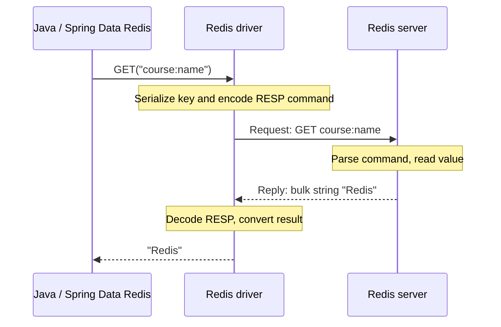
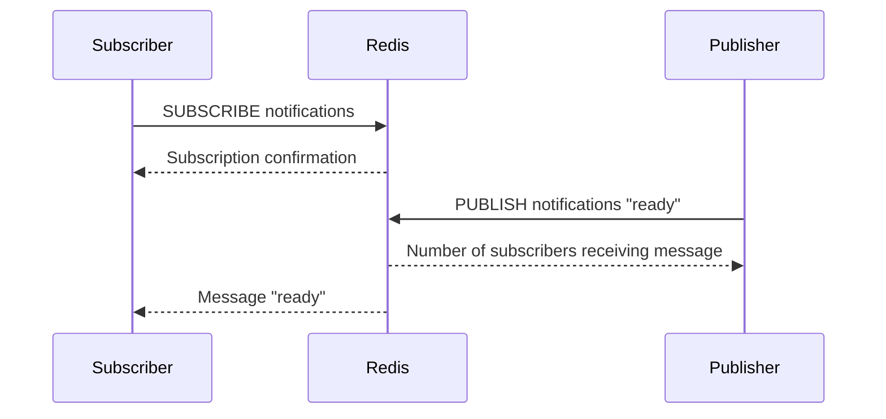

# Request–Response Cycle and the Redis Protocol

Redis is often described as an in-memory database, yet for a Java application, most interactions with Redis are **network communication**: the client encodes a command, sends it to the server, waits for or collects the reply, and decodes the result. Understanding this cycle helps separate command execution time from network latency, know when pipelining is useful, and explain common errors in Spring Data Redis.

This lesson focuses on the path of **a Redis command from application to reply**, how **RESP (Redis Serialization Protocol)** represents data on the wire, and variations on the basic cycle such as pipelining, transactions, Pub/Sub, and Redis Cluster.

## 1. How Does Redis Communicate with the Application?

### 1.1. Components in a Single Call

For example, a Spring application calls:

```java
String value = stringRedisTemplate.opsForValue().get("course:name");
```

At a high level, the call passes through these layers:

```text
Java application code
    ↓
Spring Data Redis (RedisTemplate / StringRedisTemplate)
    ↓
Redis driver (e.g., Lettuce or Jedis)
    ↓
TCP/TLS or Unix domain socket; data framed with RESP
    ↓
Redis server
    ↓
Command result → RESP → driver decodes → Spring Data Redis → Java
```

Each component has a distinct responsibility:

| Component | Responsibility |
|---|---|
| Business code | Chooses the operation to perform, such as fetching a value, incrementing a counter, or setting a TTL. |
| Spring Data Redis | Provides the data-access API, converts Java types into appropriate representations, and coordinates with the driver. |
| Redis driver | Manages connections, sends commands using RESP, receives and decodes replies, and handles async execution or routing when configured. |
| Network connection | Transports a bidirectional byte stream; TCP preserves byte order within **one** connection, while TLS can protect data in transit. |
| Redis server | Parses the command, executes the operation, and produces the reply; when running in cluster mode, the receiving node may instruct redirection to another node. |

**RESP is not HTTP.** A `GET` command is not sent like an HTTP `GET /...` with headers and a status code; it is a Redis command and its arguments encoded into bytes according to RESP rules.

### 1.2. A Typical Request–Response Cycle

Suppose the key `course:name` currently holds the string `Redis`.



In order:

1. **Command preparation:** Spring Data Redis uses serializers to convert keys/values from Java objects into bytes. The driver constructs a RESP frame from the command name and arguments.
2. **Sending the command:** the client writes bytes to an existing connection or opens a new connection when needed. Connection management and reuse depend on client configuration.
3. **Receiving and executing:** Redis reads the data, identifies a complete command, validates syntax/permissions/relevant state, and executes the command.
4. **Returning the reply:** Redis encodes the result as a RESP value, such as a string, integer, array, or error.
5. **Decoding:** the driver reads the reply and matches it to the corresponding call; Spring Data Redis converts the data into the API's return type.

A single command normally produces **one reply**, even if that reply is an error. This behavior is the baseline, though exceptions exist such as Pub/Sub messages or RESP3 Push frames.

### 1.3. What Makes Up Latency?

The time observed from the application side is not just the time Redis spends looking up a key:

```text
Client-observed time
≈ preparation / encoding time
+ send wait and network transit time
+ server queueing / wait time at Redis
+ command execution time
+ reply transit time back to client
+ decoding / type conversion time
```

**RTT (round-trip time)** is the time it takes for a signal to travel from client to server and for the reply to come back, often used to conceptualize communication overhead. Even when `GET` consumes very little CPU on Redis, a sequence of commands sent one by one can still be slow because each command has to wait for another network round trip.

Distinguish three concepts:

- **Latency:** the time an operation takes from a specific observation point.
- **Throughput:** the number of operations completed per unit of time.
- **Server execution time:** the time Redis actually spends processing the command; it is only one component of end-to-end latency.

A fast Redis command does not mean the Java call is always fast, especially when network distance is high, connections are busy, or the client has to wait for resources.

## 2. The RESP Protocol: Representing Commands and Replies

### 2.1. What Problem Does RESP Solve?

TCP only transports a **byte stream**. It does not know which byte starts a `SET`, where a value ends, or how many elements a reply contains. RESP defines framing rules so both sides can parse commands and data even when a single socket read receives only part of a frame or multiple consecutive frames.

RESP uses:

- **A leading type byte** indicating the kind of value.
- **CRLF** (two bytes `\r\n`) to terminate control sections and certain simple values.
- **Byte-counted length** for bulk data, allowing binary payloads including newlines or `0` bytes.

Standard Redis commands are sent by the client as an **array of bulk strings**: the first element is the command name, and the remaining elements are the arguments. Replies have types determined by the command and the RESP version in use on the connection.

### 2.2. Basic RESP2 Data Types

| Prefix | RESP2 Type | Wire Example (`\r\n` shown for readability) | Meaning |
|---|---|---|---|
| `+` | Simple String | `+OK\r\n` | Status or simple string. |
| `-` | Simple Error | `-WRONGTYPE ...\r\n` | Command error; clients typically convert this into a corresponding exception. |
| `:` | Integer | `:42\r\n` | An integer, e.g., the result of `INCR`. |
| `$` | Bulk String | `$5\r\nRedis\r\n` | Length-prefixed string/byte sequence. |
| `*` | Array | `*2\r\n:1\r\n:2\r\n` | Ordered collection of elements, nestable. |

In RESP2, **there is no standalone null type**. A non-existent key is represented as a *null bulk string* `$-1\r\n` when a command returns a bulk string. Do not confuse this with an empty string `$0\r\n\r\n`.

For arrays, `*0\r\n` is an empty array, whereas `*-1\r\n` is a null array. These are distinct states and can directly affect Java logic.

### 2.3. Byte-by-Byte Decoding of `SET` and `GET`

Suppose the client sends:

```redis
SET course:1 Redis
```

On a connection using standard RESP command encoding, the wire payload is:

```text
*3\r\n
$3\r\n
SET\r\n
$8\r\n
course:1\r\n
$5\r\n
Redis\r\n
```

Reading the frame layer by layer:

1. `*3`: an array with three elements.
2. `$3` followed by `SET`: the first element is 3 bytes long, the command name.
3. `$8` followed by `course:1`: an 8-byte key.
4. `$5` followed by `Redis`: a 5-byte value.

If it succeeds, the server replies:

```text
+OK\r\n
```

Next, the command:

```redis
GET course:1
```

is encoded as:

```text
*2\r\n
$3\r\n
GET\r\n
$8\r\n
course:1\r\n
```

Reply:

```text
$5\r\n
Redis\r\n
```

**Display note:** the blocks above split each section onto a new line for readability. On the wire, `\r\n` represents the **two bytes CR and LF**, not a four-character literal printed on screen. UTF-8 text with accented characters can occupy more bytes than the visible character count. Therefore, do not use Java's `String.length()` to infer RESP length for arbitrary Unicode strings.

### 2.4. Replies from Different Commands

```text
PING                → +PONG\r\n
SET x hello         → +OK\r\n
GET x               → $5\r\nhello\r\n
GET nonexistent     → $-1\r\n                  (RESP2)
INCR count          → :1\r\n                    (if count did not exist initially)
```

Note that **the reply type does not have to match the data type stored in Redis**. `INCR` operates on a string key holding an integer, yet the command's reply is a RESP integer. Conversely, `GET` normally returns a bulk string. The driver relies on the command specification and RESP framing to provide a convenient return type for Java.

### 2.5. How Does RESP3 Extend RESP2?

RESP3 was introduced to express reply types more explicitly. Redis 6 added opt-in support for RESP3; both versions coexist. New connections start in RESP2 by default; a client can negotiate with `HELLO 3` if the server supports it.

Additional types worth remembering:

| Prefix | RESP3 Type | Practical Meaning |
|---|---|---|
| `_` | Null | Explicit null value, e.g., `_\r\n`. |
| `#` | Boolean | `#t\r\n` or `#f\r\n`. |
| `,` | Double | Floating-point number. |
| `(` | Big Number | Large integer. |
| `%` | Map | Key/value pair structure. |
| `~` | Set | Unordered set of elements. |
| `>` | Push | Out-of-band message pushed from server to client. |
| `|` | Attribute | Auxiliary metadata attached to another value. |
| `!`, `=` | Bulk Error, Verbatim String | Additional representations for errors and text. |

For example, a key/value result can be represented as a **map** in RESP3 instead of a flat array in RESP2. Higher-level programming layers may still expose the same `Map`, so you cannot deduce the RESP version solely by looking at the Java return type.

The protocol version is **per-connection state**, not a global property across all clients. Calling `HELLO 3` on one connection does not automatically switch other connections to RESP3.

```redis
HELLO 3
```

This command asks the server to switch the connection's session to RESP3 and returns handshake details. In Spring applications, let the driver negotiate the protocol version and manage replies; do not manually inject `HELLO` in the middle of business operations.

## 3. Request–Response Ordering and Pipelining

### 3.1. Sequential Sending: Wait for Previous Command Before Sending Next

When code executes three synchronous commands in order:

```text
Client                 Redis
  |--- INCR visits ---->|
  |<------ :1 ----------|
  |--- INCR visits ---->|
  |<------ :2 ----------|
  |--- INCR visits ---->|
  |<------ :3 ----------|
```

Each call must wait for a reply before the application proceeds. If each network round trip takes significant time, total elapsed time is dominated by the number of round-trip waits.

This model is easy to reason about and makes step-by-step error handling straightforward. It is also necessary when a later command **depends on the result** of an earlier command—for example, reading a value before deciding what command to send next.

### 3.2. Pipeline: Send First, Read Replies Later

With pipelining, the client writes multiple commands onto the connection **without waiting for a reply after each command**:

```text
Client                 Redis
  |--- INCR visits ---->|
  |--- INCR visits ---->|
  |--- INCR visits ---->|
  |<------ :1 ----------|
  |<------ :2 ----------|
  |<------ :3 ----------|
```

In the standard request–response model on a single connection, replies for commands sent in order arrive in that same order. The driver matches each reply to its corresponding call/position. In RESP3, Push messages can arrive *between complete replies*, so the driver must recognize Push frames separately and not mistake them for the next command's reply.

Pipelining improves performance by:

- Eliminating the client's RTT wait after every individual command.
- Making better use of socket reads/writes and reducing I/O syscall overhead.
- Increasing throughput when there are many independent commands or commands that can be batched.

An intuitive approximation for `N` small commands, ignoring many other factors:

```text
Send and wait per command:  roughly N × RTT + total processing time
Single pipeline batch:      nearly one send/receive round + total processing time
```

This is an **explanatory model**, not a guarantee that a pipeline always takes exactly one RTT: payload size, driver flushing behavior, server load, and real network conditions all matter.

### 3.3. A Pipeline Is Not a Transaction

| Criterion | Sequential Commands | Pipelining | `MULTI/EXEC` Transaction |
|---|---|---|---|
| Primary purpose | Execute one command at a time; easy to branch on results | Reduce wait/I/O overhead across multiple commands | Execute a group of commands without interleaving during `EXEC` |
| When do replies arrive? | After each command, before sending the next | Collected after sending a batch | `QUEUED` when queued; execution results returned by `EXEC` |
| Atomic as a whole group? | No | **No** | Sequential execution without other clients interleaving; **no SQL-style rollback** if a command fails at execution time |
| Can they be combined? | — | Can pipeline other commands, including transaction commands if client supports it | Can be combined with pipelining when the client supports the semantics properly |

If client A pipelines `SET x 1` followed by `GET x`, client B's commands may be processed by Redis between them depending on scheduling; **do not** rely on pipelining to protect a multi-command read–modify–write sequence from race conditions.

### 3.4. Choosing Pipeline Batch Size

Sending millions of commands and reading all results only at the end can force Redis to buffer too many replies in memory, while the client also holds a huge list of pending operations/results. Split work into reasonable batches and benchmark them. Redis documentation cites batches of around **10,000 commands** as an illustrative example of bounding queued replies, not an optimal size for every system.

Do not place blocking commands, Pub/Sub, or chains requiring immediate intermediate results into a pipeline without understanding how your driver and connection handle them.

## 4. How Do Transactions Change the Reply Cycle?

Redis provides `MULTI`, `EXEC`, `DISCARD`, and `WATCH` to handle groups of commands with consistency requirements. Example on a single connection:

```text
Client → MULTI          Server → +OK
Client → INCR a         Server → +QUEUED
Client → INCR b         Server → +QUEUED
Client → EXEC           Server → *2 ... (results of INCR a and INCR b)
```

`QUEUED` indicates that the command has been queued into the transaction; **it is not yet the execution result**. Only at `EXEC` does Redis execute the queued commands consecutively without interleaving commands from other clients.

Key points:

- `DISCARD` drops the queued commands before `EXEC`.
- `WATCH` provides optimistic locking: if a watched key is modified before `EXEC`, the transaction is aborted; the client must decide whether to retry.
- If a queued command encounters a data-type error during `EXEC`, Redis **does not automatically undo** the other commands like a full relational database rollback.
- `MULTI` and `WATCH` state are bound to **the connection**. In Spring Data Redis, you must use the proper callback/transaction mechanism so related commands run within the appropriate connection context.

Example tool selection:

- Safely incrementing a counter across concurrent clients: prefer **`INCR`**, because the increment command itself is atomic.
- Reducing RTT when writing 1,000 independent keys: consider a **pipeline**.
- Checking a condition and updating under concurrency control: consider **`WATCH`/`MULTI`/`EXEC`** or an appropriate Redis script.

## 5. Connections Are Not Always Plain Request-Then-Reply

### 5.1. A Connection Is a Stateful Session

Certain state exists per connection, such as authentication, RESP version, selected database (where supported), transaction state, Pub/Sub subscriptions, and blocking operations. This explains why drivers and connection pools cannot be replaced by arbitrary socket open/close calls while preserving identical behavior.

When a connection is established, the client may authenticate (`AUTH` or via `HELLO`), select the protocol, synchronize state, and verify readiness. Not every `GET` opens a new TCP connection; drivers normally manage and reuse connections according to their pooling/multiplexing strategy.

TCP preserves **byte order on a single connection**, but it does not guarantee a one-to-one mapping between a request and a TCP packet. One command can span multiple socket reads, and multiple commands can arrive in a single read. RESP lets the parser locate command/reply boundaries.

### 5.2. Pub/Sub and Server-Pushed Messages

In standard request–response, the client initiates a command and receives a result. In Pub/Sub, after subscribing to a channel, the server can actively push messages whenever a publisher sends matching content.



In RESP2, a connection that enters Pub/Sub mode has restricted command semantics; RESP3 provides the **Push (`>`)** type for server-initiated messages. For subscriptions, use the appropriate Spring Data Redis listener/connection API, such as `RedisMessageListenerContainer`; do not read Pub/Sub messages as replies to a subsequent `GET` command.

### 5.3. Blocking Commands

A command such as `BLPOP` can wait until data arrives or a timeout expires. In that case, a sent command without an immediate reply does not necessarily indicate a dropped connection: **the server is waiting for the command's condition**. Clients must distinguish Redis command timeouts from socket/driver timeouts and account for the impact on the occupied connection.

### 5.4. Redis Cluster and Redirect Replies

In Redis Cluster, a client sending a command to a node when the key belongs to another node's slot can receive redirect errors such as `MOVED` or `ASK`. Cluster-aware drivers update or use routing metadata to send the command to the right node. These extra steps can add network round trips.

Multi-key commands in a cluster must obey slot rules. For example, using the same hash tag `{account:7}` in `{account:7}:name` and `{account:7}:balance` places both keys in the same hash slot. This **does not** automatically make every multi-key command valid; check command and driver support.

## 6. Connecting RESP with Spring Data Redis APIs

### 6.1. Synchronous Commands via `StringRedisTemplate`

`StringRedisTemplate` is well suited when working with string keys/values and observing behavior close to raw Redis commands. Example service:

```java
import java.time.Duration;

import org.springframework.data.redis.core.StringRedisTemplate;
import org.springframework.stereotype.Service;

@Service
public class RedisRequestReplyDemo {

    private final StringRedisTemplate redis;

    public RedisRequestReplyDemo(StringRedisTemplate redis) {
        this.redis = redis;
    }

    public String saveAndRead() {
        redis.opsForValue().set("demo:course", "Redis", Duration.ofMinutes(5));

        String value = redis.opsForValue().get("demo:course");

        Long visits = redis.opsForValue().increment("demo:visits");

        // value: "Redis"; visits: incremented count returned by Redis.
        return value + " / visits=" + visits;
    }
}
```

In normal synchronous execution, the snippet above produces three Redis operations in order: **`SET`, `GET`, `INCR`** (excluding any connection setup commands that may occur). Each method returns after receiving and processing its reply. The `Duration` passed to `set` is translated into the corresponding expiration option in the outgoing command.

A few common mappings:

| Spring Data Redis API | Redis Command Equivalent | Java Return Value |
|---|---|---|
| `opsForValue().get(key)` | `GET key` | String or `null` when key has no value. |
| `opsForValue().set(key, value)` | `SET key value` | Operation method may return `void` without exposing `OK` to caller. |
| `opsForValue().increment(key)` | `INCR key` | `Long` containing the incremented value. |
| `hasKey(key)` | `EXISTS key` | `Boolean`. |
| `getExpire(key)` | `TTL key` | Remaining time in the unit matching the overload called. |

The Java API is a **higher-level abstraction** over RESP. Java does not directly receive `+OK\r\n` or `:3\r\n`; the driver and Spring Data Redis translate the reply into the API's return type.

### 6.2. Pipeline Example in Spring Data Redis

When commands are data-independent or can be sent consecutively without reading each reply immediately, use `executePipelined`:

```java
import java.nio.charset.StandardCharsets;
import java.util.List;

import org.springframework.data.redis.core.RedisCallback;
import org.springframework.data.redis.core.StringRedisTemplate;

public class RedisPipelineDemo {

    private final StringRedisTemplate redis;

    public RedisPipelineDemo(StringRedisTemplate redis) {
        this.redis = redis;
    }

    public List<Object> setThenGet() {
        return redis.executePipelined((RedisCallback<Object>) connection -> {
            byte[] key = "demo:pipeline".getBytes(StandardCharsets.UTF_8);
            byte[] value = "hello".getBytes(StandardCharsets.UTF_8);

            connection.stringCommands().set(key, value);
            connection.stringCommands().get(key);

            // Callback must return null; actual results are collected in List<Object>.
            return null;
        });
    }
}
```

When executed, Spring Data Redis sends the operations in a pipeline and collects replies into an ordered list. `SET` is sent before `GET`, so `GET` reads the value just written when commands execute successfully in the same Redis context. Element types inside `List<Object>` depend on the command and serializer; do not cast based on assumptions about raw RESP bytes.

Distinguish **what a method invoked inside the callback may return while pipelined** from **the final result of `executePipelined`**. The callback must return `null` because `executePipelined` itself collects the decoded replies.

Do not use pipelining merely because there are multiple lines of code: if the second command needs to make a decision based on the first command's result, a normal pipeline cannot synchronously supply that result between the two sends.

### 6.3. Which Bytes Does a Serializer Affect?

Suppose Java creates a user object and stores it in Redis. Spring Data Redis may use a string serializer, JSON serializer, or another mechanism depending on how `RedisTemplate` is configured. RESP **only transports the bytes produced by the serializer**:

```text
User Java object
   ↓ application-configured serializer
byte[] (e.g., UTF-8 JSON)
   ↓ driver wraps inside RESP bulk string
Redis stores that byte sequence
   ↓ GET returns a bulk string containing those bytes
serializer deserializes
   ↓
User Java object
```

Two different encoding layers:

- **Spring serialization:** converts objects/keys into `byte[]`.
- **RESP serialization:** encodes commands, arguments, and replies into wire protocol frames on the connection.

If one application writes with a JSON serializer and another reads with a different serializer, the Redis reply may still be completely valid RESP yet the application fails to deserialize the object. That is a data compatibility error, not a RESP framing error.

### 6.4. Synchronous, Asynchronous, and Reactive

With Lettuce, the driver is capable of asynchronous I/O; the Spring Data Redis API your application chooses determines how results are consumed. `RedisTemplate` provides a common synchronous-style API, while `ReactiveRedisTemplate` provides publishers to compose in reactive pipelines.

**Reactive does not mean every command is automatically grouped into an atomic pipeline.** Wire transmission, dispatch timing, concurrency, and result ordering depend on the reactive operator chain, connection, and driver. Whether the Java API is synchronous or reactive, the underlying Redis connection still operates over the request–response protocol or its supported exceptions.

## 7. Errors, Timeouts, and Retry Behavior

### 7.1. Redis Errors vs. Connection Errors

Suppose `demo:key` currently stores a string, and the client sends `LPUSH demo:key x`. Redis can return:

```text
-WRONGTYPE Operation against a key holding the wrong kind of value\r\n
```

This is a **valid RESP error reply**: the connection can remain open and healthy. The driver converts that reply into an exception for Java code to handle.

Conversely, connection timeouts, dropped sockets, TLS failures, or DNS errors can occur when the client fails to receive a complete reply. They do not mean Redis sent a RESP error reply.

| Scenario | What to Check | How to Handle |
|---|---|---|
| `WRONGTYPE` / invalid command syntax | Redis received the command and returned a protocol-level error | Fix the operation or data type. |
| `NOAUTH` / `NOPERM` | Check authentication/ACL configuration | Configure proper credentials and permissions. |
| Long wait for reply | Could be network, busy server, blocking command, or client issue | Measure and break down each latency component. |
| Socket closes mid-execution | Uncertain whether the command already ran | Evaluate idempotency before retrying. |
| `MOVED` / `ASK` in cluster | Key needs routing to the appropriate node | Use a cluster-aware client and proper topology configuration. |

### 7.2. Why a Timeout Does Not Prove a Command Did Not Run

Consider two cases:

```text
Scenario A:
Client -- INCR counter --> Redis executes INCR
Client <-- reply lost / connection dropped

Scenario B:
Client -- connection fails before reaching Redis
Client receives no reply
```

Both can manifest as a timeout in Java, yet in A the counter **has already been incremented**, whereas in B it has not. Automatically resending `INCR` in A can increment the counter twice.

Therefore:

- Retrying reads or writes can be safe when **idempotent**, aligned with business requirements, and consistent with data guarantees.
- Be cautious with commands that have cumulative side effects such as `INCR`, `LPUSH`, `PUBLISH`, or operations that mutate state on every invocation.
- When duplicate business effects must be prevented, design application-level idempotency / request IDs; simply raising timeouts or retrying unconditionally is not enough.

### 7.3. Observation and Diagnostics

Useful diagnostic commands and metrics:

- `PING`: verify basic server responsiveness on the connection in use.
- `INFO commandstats`: inspect command statistics recorded by Redis.
- `SLOWLOG GET`: view commands whose server-side execution time exceeded the configured threshold; this metric excludes full network latency.
- `CLIENT LIST`: inspect client connection states.
- `LATENCY LATEST`: inspect latency events if latency monitoring is enabled/populated.
- `MONITOR`: streams live commands for short investigations; can incur significant overhead and expose command payloads, so do not enable casually on high-load systems.

Beyond the server, measure connection counts, pending commands, pool wait time, timeouts, RTT, pipeline sizes, and serializer time on the application side to avoid blaming Redis for all latency.

## 8. Hands-On Practice with `redis-cli`

You need a running Redis instance and `redis-cli` able to connect to the right host/port—for example, a default local Redis at `127.0.0.1:6379`. Practice inside an isolated key namespace `lab:resp:...` to avoid touching other data.

Run each command:

```bash
redis-cli PING
redis-cli SET lab:resp:name Redis
redis-cli GET lab:resp:name
redis-cli DEL lab:resp:counter
redis-cli INCR lab:resp:counter
redis-cli INCR lab:resp:counter
redis-cli GET lab:resp:counter
redis-cli TTL lab:resp:name
```

If all commands succeed and nothing else modifies those keys between steps, you will observe:

- `PING` returns `PONG`.
- `SET` returns `OK`.
- `GET lab:resp:name` prints `Redis`.
- The two `INCR` calls after `DEL` return integers `1` and `2` respectively.
- `GET lab:resp:counter` returns the string `"2"`.
- `TTL lab:resp:name` usually returns `-1`, because `SET` in the example did not attach an expiration.

Try attaching a TTL:

```bash
redis-cli EXPIRE lab:resp:name 30
redis-cli TTL lab:resp:name
```

When `EXPIRE` succeeds, `TTL` returns the remaining seconds, counting down over time. After the key expires, `GET` returns nil/null according to the CLI display mode.

To request RESP3 when running `redis-cli` on a CLI version that supports it:

```bash
redis-cli -3 PING
```

You can also open an interactive `redis-cli` session and run `HELLO 3` to inspect the handshake output. **What `redis-cli` prints is its presentation UI**, not necessarily raw RESP bytes. For instance, `(integer) 2` on screen is how the CLI renders a `:2\r\n` reply.

### Short Reasoning Exercises

1. A `GET` command returns null in Java: is the reply necessarily a RESP error?
2. For 100 independent `SET` commands, why can pipelining be faster than sending and waiting for each command individually?
3. If you send `INCR`, lose the connection, and retry, what could happen?
4. `MULTI` returns `OK` and a command inside the transaction returns `QUEUED`: has the actual value been updated yet?
5. Why can't byte length in RESP always be inferred from the character count of a Java string?

**Answer hints:** (1) No, it can be a valid null when the key does not exist; (2) it reduces RTT waits and I/O overhead; (3) it may increment twice if the first command already ran; (4) not yet—the transaction executes on `EXEC`; (5) because Unicode and UTF-8 can use multiple bytes per character, while bulk strings declare byte length.

## 9. Common Misconceptions to Avoid

| Misconception | Accurate Understanding |
|---|---|
| “Redis is in RAM, so there is no network cost.” | Redis may process fast, but application calls still incur network transit, queueing, and serialization. |
| “Each command maps to exactly one TCP packet.” | TCP is a byte stream; boundaries are determined by RESP. |
| “Pipelining makes all commands execute atomically.” | Pipelining optimizes send/receive batching; transactions or single atomic commands handle corresponding atomicity needs. |
| “`QUEUED` is the result of `INCR`.” | `QUEUED` only confirms the command was queued in the transaction. |
| “A Redis error always means the connection dropped.” | Redis can return a valid RESP error frame without closing the connection. |
| “Seeing no reply means the command didn't run.” | The reply may have been lost after Redis already executed the command. |
| “JSON data stored in Redis is the RESP format.” | JSON is how a serializer represents values; RESP is the wire protocol framing commands and replies. |
| “RESP3 is just RESP2 renamed.” | RESP3 adds new types, notably explicit null, map, set, and Push messages. |

## 10. Technical Summary

For a typical call, **Spring Data Redis prepares the data → the driver encodes a RESP request → Redis executes it → the server returns RESP → the driver/Spring converts it into a Java result**. Understanding that cycle helps you ask the right questions when facing latency, errors, or unexpected outputs:

- Was the command actually sent to Redis?
- Are we waiting on the network, waiting on Redis execution, or waiting on the reply?
- What RESP type is returned and what Java type does Spring decode it to?
- Does a group of commands need pipelining to cut RTT, or a transaction/atomic command for consistency?
- If a timeout occurs, would retrying duplicate a business side effect?

### Official Documentation References

- [Redis Serialization Protocol (RESP) specification](https://redis.io/docs/latest/reference/protocol-spec/) — RESP2/RESP3 data types, framing, and handshake.
- [Redis pipelining](https://redis.io/docs/latest/develop/using-commands/pipelining/) — request/response, RTT, and command batching.
- [Redis transactions](https://redis.io/docs/latest/develop/using-commands/transactions/) — `MULTI`, `EXEC`, `WATCH`, and error handling.
- [Spring Data Redis — Pipelining](https://docs.spring.io/spring-data/redis/reference/redis/pipelining.html) — using `executePipelined`, callbacks, and serializers.
