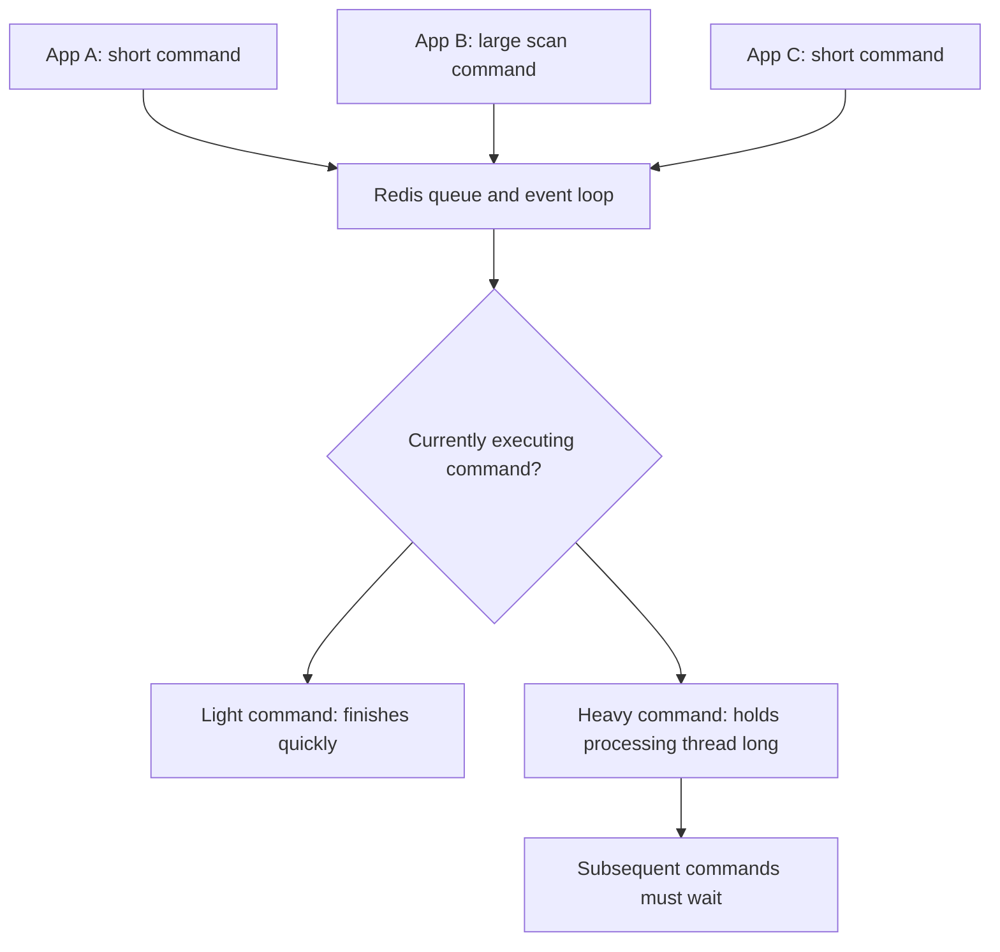

# Redis Command Complexity and the Impact of Long-Running Operations

In Redis, a command can run very fast on small datasets yet introduce noticeable latency as element counts grow. What matters is not just that Redis stores data in memory, but **how much work each command must perform**, which thread executes that work, and how other requests are affected. This is the foundation for designing efficient Redis access patterns in Spring Data Redis applications.

## 1. What Does Command Complexity Tell Us?

Time complexity describes how an algorithm's work scales as input size grows. Redis publishes complexity for each command, typically using **Big O** notation:

| Notation | Approximate Meaning | Redis Examples |
| --- | --- | --- |
| `O(1)` | Processing steps are nearly independent of dataset size | `HGET`, `SISMEMBER`, `SCARD` under normal conditions |
| `O(log N)` | Work grows slowly as `N` increases | Sorted set operations such as `ZADD` for a single element |
| `O(N)` | Work scales linearly with element count | `HGETALL`, `SMEMBERS`, `KEYS` |
| `O(N + M)` | Depends on multiple input sizes | Certain list traversals or set/data combinations |
| `O(N log N)` | Work grows faster than linear due to sorting/processing | Algorithms sorting an entire dataset; exact complexity depends on the command |

In the tables below, symbols must be understood **per command**, without assuming `N` is always the total number of keys in Redis:

- `K`: total number of keys in the scanned keyspace.
- `N`: number of elements in a collection, such as fields in a hash or members in a set.
- `M`: number of elements actually requested or returned.
- `S`: distance traversed from the head or tail of a list to reach the starting index.
- `B`: data size in bytes.

For example, `HGETALL user:123` has complexity `O(N)` where `N` is the **number of fields in hash `user:123`**, whereas `KEYS user:*` has complexity `O(K)` where `K` is the **number of Redis keys examined**. Both are loosely called `O(N)` in general docs, yet their input sizes are completely different.

### Complexity Does Not Equal Response Time

A useful mental model for a request passing through Spring Data Redis is:

```text
Application-observed time
 ≈ network / round-trip time
 + connection wait and queueing time
 + Redis command execution time
 + response payload transfer time
 + Java-side decoding / object mapping time
```

Big O primarily describes **algorithmic work**. It does not directly capture wire byte counts, CPU speed, memory pressure, connection pool wait time, or serialization/deserialization overhead. Therefore:

- `GET` is documented by Redis as `O(1)` for lookup, yet reading a string tens of MBs in size still incurs heavy network transfer and client memory allocation.
- `HGETALL` on a 5-field hash is usually very fast; the same command on a 500,000-field hash produces a huge reply and long processing time.
- 1,000 small commands sent sequentially over the network can be slow due to many round trips, even though each command is `O(1)`.

Statements about `O(1)` generally refer to typical or average/amortized complexity; internal encodings and hash-table resizing can cause variance at specific moments.

## 2. How Redis Processes Commands

Redis is designed around an efficient event loop, and **most command execution on a single shard/instance occurs sequentially on the main processing thread**. Modern Redis also includes multi-threaded I/O and background tasks, but those do not turn a heavy command on the main execution path into work that runs arbitrarily in parallel with other commands.



Suppose one command takes 150 ms on the main execution path. During that interval, many lightweight commands arriving afterward have to wait. Under high concurrency, queueing and **p95/p99** response times can spike sharply even while average per-lookup execution time stays low.

Consequences of long-running operations:

1. **Cascading latency:** other requests queue behind a CPU-heavy operation or synchronous memory deallocation.
2. **Increased timeouts and retries:** clients may time out; uncontrolled retries add even more load to Redis.
3. **Reduced effective throughput:** a large share of time is consumed by a few expensive operations.
4. **Higher network and client memory pressure:** large replies increase wire bytes, application heap usage, and JSON/Java object processing time.
5. **Shard-local impact:** in Redis Cluster, a heavy command primarily degrades the node/shard owning that key; clustering does not eliminate hot keys or oversized values.

A distinction to keep clear: commands like `BLPOP`/`BRPOP` or `XREAD ... BLOCK` **block the calling client waiting for data**, while Redis can still serve other clients. They are not equivalent to a CPU-heavy command locking the event loop for the entire wait duration. The real concern is occupied client connections and potential connection-pool exhaustion if configured poorly.

## 3. Command Groups Where Cost Is Easily Misjudged

### 3.1. Fetching One Element vs. Fetching an Entire Collection

| Requirement | Command | Typical Complexity | What to Watch Out For |
| --- | --- | --- | --- |
| Read one string by key | `GET key` | `O(1)` | Huge payloads still increase transfer and client processing time |
| Write one string | `SET key value` | `O(1)` for lookup/update | Value size still affects transfer and allocation |
| Fetch one hash field | `HGET key field` | `O(1)` | Ideal when only one field is needed |
| Fetch several hash fields | `HMGET key field...` | `O(M)` | Cost scales with requested field count |
| Fetch entire hash | `HGETALL key` | `O(N)` | Returns all fields and values; reply can be huge |
| Check set membership | `SISMEMBER key member` | `O(1)` | Ideal for “does it exist?” checks |
| Fetch entire set | `SMEMBERS key` | `O(N)` | Easily produces huge replies on large sets |
| Count set elements | `SCARD key` | `O(1)` | No need to read all members just to count |
| Read multiple string keys | `MGET key...` | `O(M)` | Individual keys may be small, yet total reply can still be large |

An anti-pattern is fetching an entire hash just to pick one field in Java:

```java
// Fetches every field of the hash even though only email is needed.
Map<Object, Object> profile = redisTemplate.opsForHash().entries("user:123");
Object email = profile.get("email");
```

Bounded access pattern:

```java
Object email = redisTemplate.opsForHash().get("user:123", "email");
```

When a hash has hundreds of thousands of fields, the difference is not just Redis CPU but also the bytes Redis must send and Java must allocate. In Spring Data Redis, `opsForHash().entries(key)` essentially corresponds to fetching the entire hash; API convenience does not change the underlying Redis command complexity.

### 3.2. Lists and Sorted Sets: Cost Also Depends on Offset and Result Count

| Command | Typical Complexity | Why Care? |
| --- | --- | --- |
| `LPUSH` / `RPUSH` | `O(1)` for one element | Pushing multiple elements in one command scales with added count |
| `LLEN` | `O(1)` | Faster than reading the whole list to count |
| `LINDEX` | `O(N)` in the general case | Redis may have to traverse elements to reach the index |
| `LRANGE key start stop` | `O(S + M)` | `S` is distance to start position, `M` is elements returned |
| `ZADD` | `O(log N)` for one element | Adding many members multiplies total work |
| `ZSCORE` | `O(1)` | Good for looking up a known member's score |
| `ZRANGE` | `O(log N + M)` | Bound returned members to avoid huge replies |

On a leaderboard of 2 million users, `ZRANGE leaderboard 0 49 REV WITHSCORES` reads only the top 50, which differs dramatically from `ZRANGE leaderboard 0 -1 WITHSCORES` fetching everyone. Any command capable of returning an entire collection should be treated as an API design decision, not a minor library detail.

Pagination example via Spring Data Redis:

```java
int page = 0;
int pageSize = 50;
long from = (long) page * pageSize;
long to = from + pageSize - 1;

Set<String> members = stringRedisTemplate.opsForZSet()
    .reverseRange("leaderboard", from, to);
```

As `page` increases, also consider rank stability across reads. If scores change continuously, offset-based pages can show duplicates or shifted ordering; that is a data-consistency concern independent of complexity.

### 3.3. Key Scanning: How Do `KEYS` and `SCAN` Differ?

Suppose Redis holds 4 million keys and the application wants to find `session:*`.

```redis
KEYS session:*
```

`KEYS` must inspect the target keyspace; its complexity is `O(K)` where `K` is the number of keys in the database, **not the number of matching keys**. It tries to complete the entire search before returning, so it can stall command processing for a long time and generate a massive reply. On production systems with many keys, avoid it on regular request paths.

Instead, use cursor-based `SCAN`:

```redis
SCAN 0 MATCH session:* COUNT 200
# Example reply: new cursor and list of matching keys found.
SCAN 914 MATCH session:* COUNT 200
# Repeat with the cursor returned by Redis until cursor reaches 0.
```

`SCAN` breaks iteration into multiple calls, allowing the application to **spread work over time**. However, it has important limitations:

- `COUNT 200` is only a **hint** for work per call; it does not guarantee returning 200 keys each time, nor that every call is equally cheap.
- A single `SCAN` call can return 0 keys even when the cursor is not finished. Keep following the cursor until `0`.
- Total cost across a full scan still scales with the number of keys inspected, typically `O(K)`; splitting into steps does not turn total work into `O(1)`.
- There is no fixed snapshot when keys are added/deleted during a scan. You may see duplicates or miss concurrent changes; processing logic must be **idempotent** if correctness requires it.
- `MATCH` is a post-filter, not a prefix lookup index. A pattern matching only a few keys can still scan a huge keyspace.
- `HSCAN`, `SSCAN`, and `ZSCAN` work similarly for collections; collections using compact internal encodings may return many elements in one pass regardless of `COUNT`.

Merely replacing `KEYS` with `SCAN` and immediately scanning millions of keys inside a single HTTP request still puts heavy pressure on CPU, network, and connection pools. To control impact, **bound work per batch**, move long cleanups to background jobs, and leave breathing room for normal requests.

### 3.4. Deleting Large Keys: `DEL` vs. `UNLINK`

```redis
DEL huge:hash
UNLINK huge:hash
```

`DEL` removes the key and performs the corresponding memory reclamation. For a key holding a very large collection, freeing memory can take time proportional to internal element count; simple strings are typically lighter. `UNLINK` detaches the key from the keyspace on the main thread and **offloads value deallocation to background work**, keeping foreground cost close to `O(1)` per key. The total memory-freeing work still exists and can exert background resource pressure.

```java
// Spring Data Redis: asynchronously reclaim value memory in Redis.
Long deleted = stringRedisTemplate.unlink("huge:hash");
```

`UNLINK` is worth considering when deleting large keys. It does not mean the full deletion lifecycle costs zero, nor does it guarantee other commands are immune to CPU/memory pressure from background cleanup.

## 4. Common Long-Running Operation Scenarios

### Scenario A — Admin Screen Reads an Entire Dataset

An API renders 20 rows yet calls `SMEMBERS` on a set of 1 million members and paginates in Java.

```text
HTTP request
  -> SMEMBERS product:ids
  -> Redis builds reply for the entire set
  -> Network transfers a massive payload
  -> Java deserializes everything
  -> Java keeps only 20 items for the current page
```

Consequence: response time and memory grow with the entire dataset, even though the UI displays 20 items. When pagination and deterministic ordering are required, choose a suitable structure like a sorted set with bounded range queries, or design an index specifically for that query. `SSCAN` can iterate incrementally, but does not provide stable pagination order.

### Scenario B — Prefix Cleanup Inside a User Request

A logout API executes `KEYS session:*` and then `DEL` on thousands of keys. One user's logout becomes a global operation over a massive keyspace, and can even delete other users' sessions if the pattern is too broad.

A better design derives keys directly from session IDs, attaches TTL at write time, and deletes only the exact key needed. If group cleanup is required, maintain a group index at write time or run a rate-limited job using `SCAN` and `UNLINK`.

### Scenario C — Oversized Lua Scripts or Transactions

`EVAL` runs a Lua script on Redis with script-execution atomicity; a script iterating over or processing a large amount of data can monopolize the execution thread too long. Likewise, a huge batch inside `MULTI`/`EXEC` still takes time to execute every command, while other clients wait during execution.

```redis
MULTI
HGETALL account:large
SMEMBERS order:ids
EXEC
```

Transactions group commands under Redis semantics; they **do not make heavy algorithms cheaper**. Lua is also not an automatic accelerator for full-dataset scans. Bound work size, touched data, and script duration before shipping to production.

### Scenario D — Oversized Pipelines

Pipelining reduces network round trips when an application needs to send many commands. For example, 100 `HGET` commands in a pipeline typically beat 100 sequential requests on network overhead, yet Redis still executes all 100 commands. Building a pipeline with hundreds of thousands of commands forces both sides to buffer massive request/response data, raising temporary memory use and delaying other clients.

Practical rule: **pipeline in bounded batches**, choosing batch size from payload sizes, latency targets, and measured resource usage. Do not treat pipelining as a fix for an inherently expensive `O(N)` command.

## 5. Illustrating Safer Spring Data Redis Usage

For periodic maintenance to clean up a group of keys sharing a prefix such as `cache:legacy:`, you can combine `StringRedisTemplate.scan(...)` with batched `unlink(...)`. This is a **background/maintenance pattern**, not something to embed as a full scan inside short-deadline user requests.

```java
import java.util.ArrayList;
import java.util.List;

import org.springframework.data.redis.core.Cursor;
import org.springframework.data.redis.core.ScanOptions;
import org.springframework.data.redis.core.StringRedisTemplate;
import org.springframework.stereotype.Service;

@Service
public class RedisCacheCleanupService {
    private final StringRedisTemplate redis;

    public RedisCacheCleanupService(StringRedisTemplate redis) {
        this.redis = redis;
    }

    public long removeLegacyCacheBatchwise() {
        final int batchSize = 200;
        ScanOptions options = ScanOptions.scanOptions()
                .match("cache:legacy:*")
                .count(batchSize)
                .build();

        long removed = 0;
        List<String> batch = new ArrayList<>(batchSize);

        try (Cursor<String> cursor = redis.scan(options)) {
            while (cursor.hasNext()) {
                batch.add(cursor.next());

                if (batch.size() >= batchSize) {
                    Long count = redis.unlink(batch);
                    removed += count == null ? 0 : count;
                    batch.clear();
                }
            }
        }

        if (!batch.isEmpty()) {
            Long count = redis.unlink(batch);
            removed += count == null ? 0 : count;
        }

        return removed;
    }
}
```

Design decisions explained:

1. `scan(options)` iterates via a cursor without materializing a list of all database keys upfront.
2. `count(batchSize)` tunes the **desired** work per `SCAN` round; it is not a hard cap.
3. `unlink(batch)` deletes keys in batches instead of collecting every key before deleting.
4. `try`-with-resources closes the `Cursor`/connection resources on completion or exception.
5. `removed` reflects how many keys the unlink calls reported as detached, which need not match the exact count seen by `SCAN` since keys may expire by TTL or be modified/deleted concurrently.

This example still needs time budgets, error handling, progress tracking, and pause/resume controls when operating on large datasets. For Redis Cluster, verify which scan API targets which node and organize iteration according to actual topology; do not assume a single scan automatically covers all cluster nodes. If the business requires an exact point-in-time snapshot, `SCAN` over mutating data does not provide that automatically.

### Good Design Starts with Key Structure

Design choices to avoid scanning the entire keyspace:

| Business Requirement | Design to Consider | Reason |
| --- | --- | --- |
| Read one user's info | Direct key `user:{id}` or known hash field | Direct access by specific identifier |
| Auto-expiring sessions | `SET ... EX ...` or TTL on session key | Redis manages lifecycle, reducing prefix-cleanup jobs |
| Fetch top 50 leaderboard members | Sorted set with bounded range query | Avoids loading the full result set |
| List of keys by business group | Maintain group index on write | Avoids `KEYS group:*` on every request |
| Huge hash with independent updates | Consider splitting by domain or bucket | Bounds single-operation scope, avoids returning/deleting huge collections |

Maintaining custom indexes incurs write overhead, memory cost, and synchronization work. Only adopt them after clarifying frequent query patterns, data lifecycles, and consistency requirements.

## 6. Observing and Finding Why Redis Feels Slow

Seeing a slow Spring Boot API is not enough to conclude Redis command execution is slow. Separate server-side time, network time, and Java-side time.

### 6.1. `SLOWLOG`: Which Commands Took Long to Execute?

```redis
CONFIG GET slowlog-log-slower-than
CONFIG GET slowlog-max-len
SLOWLOG GET 10
SLOWLOG LEN
```

`SLOWLOG` records commands whose **internal Redis execution time** exceeded the configured threshold. Network transit and client receive time are excluded from this measurement. For example, `HGETALL` might not trigger slowlog while the API is still slow because the reply is huge or Java deserialization is expensive. Conversely, a command appearing in slowlog is concrete evidence to investigate work inside Redis.

The slowlog threshold is in **microseconds**; changing it in production should follow observability policies and logging overhead budgets. `SLOWLOG` stores command names and arguments, so restrict read access when payloads contain sensitive data.

### 6.2. Command Statistics and Server Latency

```redis
INFO commandstats
INFO stats
INFO cpu
INFO memory
INFO clients
LATENCY LATEST
LATENCY DOCTOR
```

- `INFO commandstats` aggregates call counts and CPU time per command type; useful for spotting overly frequent commands or high cumulative execution cost.
- `INFO stats`, `INFO cpu`, `INFO memory`, and `INFO clients` help correlate command load, resource pressure, connections, and anomalies.
- `LATENCY LATEST` / `LATENCY DOCTOR` use data from Redis latency monitoring if enabled/configured; seeing no events does not prove the system has no problems.
- `redis-cli --latency` and external probes measure latency from the client perspective, which includes network conditions and client load.

In Spring Boot applications, also record per-operation Redis timing, timeouts, connection pool utilization, commands per request, payload sizes, and **p50/p95/p99** percentiles. A request can be slow due to Redis, waiting for a pooled connection, or deserializing large payloads.

### 6.3. Finding Big Keys and Hot Keys

A key holding many elements (**big key**) differs from a key accessed relentlessly (**hot key**):

- Big keys easily make `HGETALL`, `SMEMBERS`, `LRANGE 0 -1`, or `DEL` expensive.
- Hot keys may hold only a tiny value yet become a bottleneck due to extreme access frequency, especially in Redis Cluster.
- A single key can be both big and hot at the same time.

Tools like `redis-cli --bigkeys` help spot notable objects by scanning the keyspace. Even though it scans incrementally, it still generates load; schedule it deliberately and monitor impact. Also measure value size, data type, TTL, and access rate before choosing remediation.

## 7. Design Principles for Bounding Latency

### Bound Work Per Command

Prefer targeted reads (`HGET`, `HMGET`, bounded ranges) instead of fetching entire collections. Enforce item limits, maximum payload sizes, and batch bounds on APIs whose data can grow over time. When designing a new key, ask what happens if data grows 100x or 1,000x.

### Scan Incrementally and Run Maintenance in the Background

Use `SCAN`/`HSCAN`/`SSCAN`/`ZSCAN` when iterating large datasets; move long jobs to checkpointable, batched background workers. A single scan pass can return more items than the `COUNT` hint, so also cap processing batches and command rate. Design handlers to be idempotent against duplicate entries.

### Delete with Awareness of Size

For large keys, consider `UNLINK`; for keys with clear lifetimes, attach TTL at creation time and use predictable key names when explicit cancellation is needed. Never build a `KEYS`-based deletion flow as a normal application path.

### Bound Pipelines, Concurrency, and Retries

Small batches reduce round trips while keeping scheduling fair. Excessive parallel tasks can queue at Redis and degrade p99; unbounded retries multiply load when the server is already struggling. Tune timeouts, backoff, connection counts, and concurrency limits using real measurements.

### Do Not Trade Operational Safety for API Convenience

Java calls such as `keys(pattern)`, `opsForSet().members(key)`, and `opsForHash().entries(key)` read cleanly in code, yet can trigger full keyspace scans or full-collection loads. Before calling one, answer: **which Redis command does it emit, what is the maximum element count, how big can the reply get, and how long will it run in the worst-case data state?**

## 8. Example Latency Incident Analysis

Suppose a service normally serves `GET cart:{id}` in 2–5 ms. After deploying a statistics page, p99 jumps to hundreds of milliseconds. A sound investigation workflow:

1. **Correlate timestamps:** check whether p99 spikes coincide with calls to the statistics page.
2. **Inspect commands:** tracing logs reveal the statistics page calls `SMEMBERS all:orders` on every page load.
3. **Assess scale:** the set contains hundreds of thousands of order IDs. `SMEMBERS` work and reply size scale linearly with member count.
4. **Check server/client signals:** compare `SLOWLOG`, `INFO commandstats`, CPU/network metrics, and bytes returned to the app. Even if slowlog shows low server execution time, inspect reply size and deserialization cost.
5. **Redesign the query:** to count items, use `SCARD`; to fetch 20 ordered items, maintain a structure supporting bounded range queries; for offline iteration, use batched `SSCAN`.
6. **Re-measure with realistic data:** verify p50/p95/p99 and response byte sizes under load, confirming no request pulls the entire set.

The key takeaway is to fix **the query pattern and work size**, rather than merely increasing timeouts or connection counts when a single command can occupy execution for a long time.

## 9. Self-Check Questions

**Question 1.** A hash has 10 fields today and could grow to 1 million fields next year. An API only needs the `status` field. Should you choose `HGET` or `HGETALL`? Why?

**Hint:** consider the number of fields Redis must read, bytes returned over the network, and memory Spring Boot must allocate.

**Question 2.** A job calls `SCAN` with `COUNT 100`, and one iteration returns 0 keys with a non-zero cursor. Should the job stop?

**Hint:** `COUNT` is a hint; the loop termination condition is cursor equal to `0`.

**Question 3.** Why is `UNLINK` helpful when deleting a very large sorted set, yet it does not eliminate all deletion cost?

**Hint:** distinguish main-thread key unlinking from background memory reclamation.

**Question 4.** A pipeline of 50,000 small commands runs slowly and affects other requests. Will increasing the pipeline to 100,000 commands reduce Redis CPU usage?

**Hint:** pipelining optimizes round trips; Redis still executes the same total number of commands.

**Question 5.** `SLOWLOG` has no slow entries, yet a Redis read API still takes 500 ms. What factors could be checked?

**Hint:** network, response size, connection pool, deserialization, Java processing, and how many commands one request issues.

## Key Takeaways

Redis is very fast when operations operate on bounded data. However, in-memory storage does not make full-scan or full-collection commands free. `KEYS`, `HGETALL`, `SMEMBERS`, unbounded ranges, `DEL` on large collections, and long-running scripts/transactions can all trigger cascading latency. When using Spring Data Redis, understand the underlying Redis command behind each Java API, bound data returned per call, measure both server and client latency, and design keys/indexes around real access patterns.
