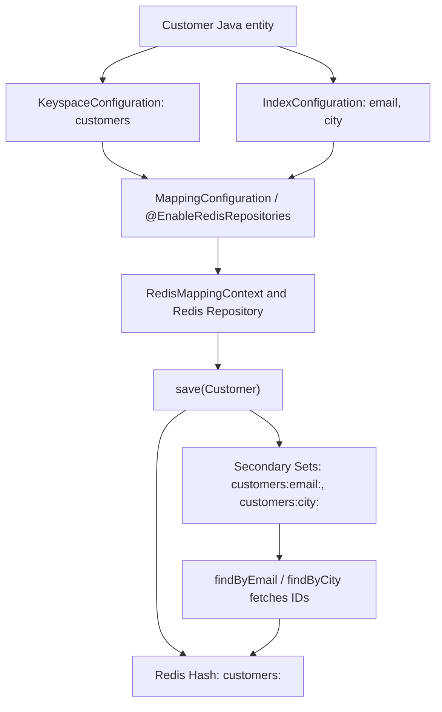

# Programmatic Configuration of Indexes and Keyspaces in Spring Data Redis

## 1. Goals and Context

Spring Data Redis can store a Java entity as a Redis Hash and allow looking up entities by properties other than ID through **secondary indexes**. When an application prefers not to place all configuration into domain class annotations, Spring Data Redis provides an API to declare **keyspaces**, **indexes**, and **time-to-live (TTL)** in Java code.

For example, a customer management system stores the fields `id`, `email`, and `city`. We want to:

- Store each customer under the `customers` keyspace, producing entity keys like `customers:<id>`.
- Find customers by email and city through a Redis Repository.
- Declare keyspace names and indexed fields in one centralized location.
- When needed, set a default TTL for entities belonging to the keyspace.
- Understand the generated Redis structures and how to change configuration when data already exists.

There are two distinct but related mechanisms:

| Mechanism | Responsibility | Example |
|---|---|---|
| **Keyspace** | Sets the prefix for Redis entity keys | `customers:42` |
| **Secondary index** | Stores the relationship between **property values** and entity IDs for queries | `customers:city:DaNang` contains ID `42` |

Keyspace partitions data names by entity type; secondary indexes help Repositories locate IDs when query criteria use an indexed property. They are not the same thing.

> Lesson scope: **Spring Data Redis Repository / MappingRedisConverter**. These indexes are managed by the Repository mapping mechanism, not Redis Search/RediSearch full-text indexes. A direct `StringRedisTemplate.opsForValue().set(...)` or `redis-cli HSET` operation does not automatically update secondary indexes maintained by the Repository.

## 2. How Does Annotation-Based Configuration Differ from Programmatic Configuration?

The shortest approach for an entity is usually:

```java
@RedisHash("customers")
public class Customer {
    @Id
    private String id;

    @Indexed
    private String email;
}
```

Here, `@RedisHash("customers")` declares the keyspace; `@Indexed` marks a property for Spring Data Redis to maintain a secondary index.

When an entity resides in a library you cannot modify, or when you want to separate index configuration from the domain model, you can declare the equivalent using these components:

- `KeyspaceConfiguration` with `KeyspaceConfiguration.KeyspaceSettings`: maps **Java type → keyspace**, and can configure TTL.
- `IndexConfiguration` with `SimpleIndexDefinition`: declares **keyspace + property path to index**.
- `@EnableRedisRepositories`: accepts both configuration classes via `keyspaceConfiguration` and `indexConfiguration`.
- `MappingConfiguration` and `RedisMappingContext`: combines both configurations inside a mapping context bean.

A note on precedence: if a class already has `@RedisHash("someName")`, the keyspace name in the annotation **takes precedence over** programmatic keyspace configuration. Therefore, for the program to actually use the keyspace configured in code, the example below **omits `@RedisHash` on the entity**.

### Do Not Confuse Indexes with Redis Key Scans

In a Repository query based on an indexed property, Spring Data Redis uses secondary index data to retrieve matching IDs and then loads the entities. There is no need to scan the entire Redis keyset using `KEYS customers:*`. The `KEYS` command can be slow on large systems and is not an appropriate foundation for functional queries.

## 3. Domain and Repository Example Used Throughout

Assume a Spring Boot project with the Redis Repository dependency:

```groovy
dependencies {
    implementation 'org.springframework.boot:spring-boot-starter-data-redis'
}
```

Example connection configuration:

```yaml
spring:
  data:
    redis:
      host: localhost
      port: 6379
```

An entity without keyspace or index annotations; metadata will be configured separately:

```java
package com.example.demo.customer;

import org.springframework.data.annotation.Id;

public class Customer {

    @Id
    private String id;
    private String email;
    private String city;

    protected Customer() {
        // For materialization when needed.
    }

    public Customer(String id, String email, String city) {
        this.id = id;
        this.email = email;
        this.city = city;
    }

    public String getId() {
        return id;
    }

    public String getEmail() {
        return email;
    }

    public String getCity() {
        return city;
    }

    public void setEmail(String email) {
        this.email = email;
    }

    public void setCity(String city) {
        this.city = city;
    }
}
```

Repository declaring property lookup methods:

```java
package com.example.demo.customer;

import java.util.List;
import org.springframework.data.repository.CrudRepository;

public interface CustomerRepository extends CrudRepository<Customer, String> {

    List<Customer> findByEmail(String email);

    List<Customer> findByCity(String city);
}
```

`findByEmail` and `findByCity` can only be fulfilled properly by the Redis Repository query mechanism when the corresponding indexes have been configured and index data exists. Declaring a method in an interface does not mean every property is automatically indexed.

Each field in the example is a **property** of the Java class: `email` and `city`. In index configuration, you must use the exact property name recognized by Spring Data mapping, not a SQL column name or an arbitrary display name.

## 4. Approach 1: Centralized Declaration via @EnableRedisRepositories

This approach is concise, direct, and useful when you want configuration to remain immutable at application startup.

### 4.1. Keyspace Configuration

Create a class extending `KeyspaceConfiguration`:

```java
package com.example.demo.customer;

import java.util.List;
import org.springframework.data.redis.core.convert.KeyspaceConfiguration;
import org.springframework.data.redis.core.convert.KeyspaceConfiguration.KeyspaceSettings;

public class CustomerKeyspaces extends KeyspaceConfiguration {

    @Override
    protected Iterable<KeyspaceSettings> initialConfiguration() {
        return List.of(
                new KeyspaceSettings(Customer.class, "customers")
        );
    }
}
```

Explanation:

- `Customer.class` is the Java type to which the configuration applies.
- `"customers"` is the keyspace name, meaning the prefix for entity keys.
- `initialConfiguration()` provides the list of `KeyspaceSettings` when the mapping configuration is initialized.
- Multiple `KeyspaceSettings` can be declared for multiple entity types, each with its own keyspace.

For example, when saving `new Customer("42", ..., ...)`, the entity key typically takes the form `customers:42`. The keyspace name does not have to match the Java class name, but it should remain consistent across deployment versions so saved data remains findable.

### 4.2. Secondary Index Configuration

Create a class extending `IndexConfiguration`:

```java
package com.example.demo.customer;

import java.util.List;
import org.springframework.data.redis.core.index.IndexConfiguration;
import org.springframework.data.redis.core.index.IndexDefinition;
import org.springframework.data.redis.core.index.SimpleIndexDefinition;

public class CustomerIndexes extends IndexConfiguration {

    @Override
    protected Iterable<IndexDefinition> initialConfiguration() {
        return List.of(
                new SimpleIndexDefinition("customers", "email"),
                new SimpleIndexDefinition("customers", "city")
        );
    }
}
```

The two parameters of `SimpleIndexDefinition` are:

1. **Keyspace**: `"customers"`, matching the name declared in `CustomerKeyspaces`.
2. **Property path**: `"email"` or `"city"`, matching the mapped field name of the entity.

This declares **two independent indexes**, not a composite index combining email and city. Querying with multiple conditions relies on the actual capabilities of the Redis Repository query mechanism; do not infer SQL-style composite index support from adding two `SimpleIndexDefinition`s.

### 4.3. Registering Both Configurations When Enabling Repositories

```java
package com.example.demo.customer;

import org.springframework.context.annotation.Configuration;
import org.springframework.data.redis.repository.configuration.EnableRedisRepositories;

@Configuration
@EnableRedisRepositories(
        basePackageClasses = CustomerRepository.class,
        keyspaceConfiguration = CustomerKeyspaces.class,
        indexConfiguration = CustomerIndexes.class
)
public class CustomerRedisRepositoryConfig {
}
```

Meaning of the attributes:

| Attribute | Responsibility |
|---|---|
| `basePackageClasses` | Locates the package to scan for Redis repositories |
| `keyspaceConfiguration` | Specifies the class containing Java type → keyspace mappings |
| `indexConfiguration` | Specifies the class containing secondary index definitions |

To avoid confusion with other Redis repository configurations in a project, ensure scan scopes and repository names are managed in the right configuration. With Spring Boot, if Redis repositories are already enabled via auto-configuration or another `@EnableRedisRepositories`, verify how the actual context is constructed to avoid duplicate bean registration.

After saving an entity via the Repository, you can call the finders:

```java
Customer saved = repository.save(
        new Customer("42", "mai@example.test", "DaNang")
);

List<Customer> byEmail =
        repository.findByEmail("mai@example.test");

List<Customer> byCity =
        repository.findByCity("DaNang");
```

With indexes properly maintained, these calls return the entity with the corresponding ID. If multiple customers share the same city, an index on `city` can contain multiple IDs.

## 5. Approach 2: Configuring via a RedisMappingContext Bean

Another approach is to create `RedisMappingContext` manually and pass `MappingConfiguration` to it. This is suitable when an application needs a centralized place to build the mapping context, such as integrating multiple configuration classes constructed in code.

```java
package com.example.demo.customer;

import org.springframework.context.annotation.Bean;
import org.springframework.context.annotation.Configuration;
import org.springframework.data.redis.core.convert.MappingConfiguration;
import org.springframework.data.redis.core.mapping.RedisMappingContext;
import org.springframework.data.redis.repository.configuration.EnableRedisRepositories;

@Configuration
@EnableRedisRepositories(basePackageClasses = CustomerRepository.class)
public class RedisMappingContextConfig {

    @Bean
    public RedisMappingContext keyValueMappingContext() {
        return new RedisMappingContext(
                new MappingConfiguration(
                        new CustomerIndexes(),
                        new CustomerKeyspaces()
                )
        );
    }
}
```

**The parameter order of `MappingConfiguration` is critical:**

```java
new MappingConfiguration(indexConfiguration, keyspaceConfiguration);
```

The first parameter is `ConfigurableIndexDefinitionProvider` (for example, `IndexConfiguration`), and the second is `KeyspaceConfiguration`. Some older snippets on the Internet show the order reversed; verify the constructor signature of the Spring Data Redis version your application actually uses.

In the configuration example above, `CustomerIndexes` and `CustomerKeyspaces` are the same two classes defined in Section 4. Creating the mapping context as a Bean lets Spring Data use the same metadata set when mapping entities and managing indexes.

**Choose only one registration approach for this example**: either pass `keyspaceConfiguration` / `indexConfiguration` via `@EnableRedisRepositories` as in Section 4, or provide an appropriate `RedisMappingContext` as in Section 5. Do not copy both `@Configuration` classes into the same application and accidentally create competing mapping contexts.

If the application already has a custom `RedisMappingContext` provided by another library, combine the index/keyspace definitions inside the **mapping context currently used by Redis Repositories**, rather than creating an extra Bean while Repositories still reference the old one.

## 6. Adding TTL via KeyspaceSettings

`KeyspaceSettings` does not only hold the keyspace. Spring Data Redis also supports a default TTL for entities, measured in seconds.

Example for customer session records lasting 30 minutes:

```java
@Override
protected Iterable<KeyspaceSettings> initialConfiguration() {
    KeyspaceSettings settings =
            new KeyspaceSettings(Customer.class, "customers");

    settings.setTimeToLive(30 * 60L); // 1800 seconds

    return List.of(settings);
}
```

When a Repository saves an entity, the TTL configuration is applied according to Spring Data Redis's mechanism for that aggregate. If the entity has its own TTL annotation or property, determine the precedence rules and avoid declaring two conflicting expiration policies.

TTL is not an index. TTL governs the entity key's lifetime; secondary indexes store links to find IDs by property. To clean up index links when an entity expires, Spring Data Redis provides keyspace event and expiration handling. In real systems, check Redis keyspace notifications policies, expiration listeners, and Redis operations—especially when Redis does not emit notifications or the application is down when a key expires. Do not assume every index entry is always cleaned up synchronously the exact second TTL hits 0.

If you only need to configure the keyspace without a TTL, keep `new KeyspaceSettings(Customer.class, "customers")` as before.

## 7. How Does Spring Data Redis Store Indexes?

Spring Data Redis typically uses **Redis Sets** to associate a property value with entity IDs.

Given the data:

```java
repository.save(new Customer("42", "mai@example.test", "DaNang"));
repository.save(new Customer("51", "linh@example.test", "DaNang"));
```

In Redis, keys can be conceptually represented as follows:

```text
Entity keys:
  customers:42
  customers:51

Email index:
  customers:email:mai@example.test  -> Set {"42"}
  customers:email:linh@example.test -> Set {"51"}

City index:
  customers:city:DaNang             -> Set {"42", "51"}
```

Key names are illustrated following common Spring Data Redis conventions; serializers, mapping metadata, and library versions can affect the actual byte representation. You can inspect them in an **isolated development environment** with `redis-cli`:

```redis
TYPE customers:42
# hash

HGETALL customers:42
# Fields mapped by Spring Data Redis

TYPE customers:city:DaNang
# set

SMEMBERS customers:city:DaNang
# "42" and "51", order is not guaranteed

SMEMBERS customers:email:mai@example.test
# "42"
```

In practice, Spring Data Redis also maintains metadata to know which indexes an entity is linked to. That way, when an indexed property's value changes, the framework can remove the old link and add the new link.

Example:

```java
Customer customer = repository.findById("42").orElseThrow();
customer.setCity("Hue");
repository.save(customer);

List<Customer> inDaNang = repository.findByCity("DaNang");
List<Customer> inHue = repository.findByCity("Hue");
```

After `save` completes and the index is properly updated, ID `42` is found under `Hue` and no longer under the old value `DaNang`. Note that `city` is modified on the Java object by the setter, whereas updating Redis and the index occurs when `save` is called.

### Why Can Direct Redis Operations Cause Index Drift?

Consider:

```redis
HSET customers:42 city "CanTho"
```

This command changes the Redis Hash content, but **does not make Spring Data Redis update the index Set** `customers:city:...`. If you subsequently call `repository.findByCity("CanTho")`, the index may be missing ID `42`; if you query the old city, the index Set may still contain links inconsistent with the primary data.

Therefore, for entities owned by a Repository, update them through the same Repository/mapping mechanism or have a proactive index re-sync process. Likewise, do not run `DEL customers:42` directly and assume the index will be cleaned up just as when deleting through the repository.

## 8. Nested Property Indexes and Data Structures

`SimpleIndexDefinition` takes a **property path**, not just a root-level field. For example, an entity with an address object:

```java
public class Address {
    private String city;

    public Address() {}

    public Address(String city) {
        this.city = city;
    }

    public String getCity() {
        return city;
    }

    public void setCity(String city) {
        this.city = city;
    }
}
```

If a `Person` entity has an `address` property of type `Address`, you can declare:

```java
new SimpleIndexDefinition("people", "address.city")
```

The corresponding index may be stored under a key like `people:address.city:DaNang`. Index declarations on nested paths must match the structure mapped by Spring Data Redis and the actual property types.

Spring Data Redis documentation also describes indexes for list/map elements by property path. However, a nested property index does not turn Redis Repository into an arbitrary expression query engine. Define indexes only for query conditions that Repositories actually support. In particular, indexes cannot automatically resolve across properties marked with **`@Reference`** the way they do for normal embedded properties.

## 9. Changing Keyspaces or Adding Indexes When Data Already Exists

This must be treated as a **data schema change**, even though Redis does not enforce table schemas like an RDBMS.

### 9.1. Renaming a Keyspace

Suppose existing data lives at `customers:42` and the new configuration renames the keyspace to `clients`. After deployment:

```text
Old config: Customer.class -> "customers"
Old key:    customers:42

New config: Customer.class -> "clients"
New key:    clients:42
```

Repositories under the new configuration will look for `clients:42`. The `customers:42` data may still exist, but it does not automatically move to the new keyspace just because you changed `KeyspaceSettings`. Secondary indexes are also tied to the keyspace name; therefore, you cannot merely rename the entity key prefix while ignoring related indexes and metadata.

When forced to change a keyspace, consider a data migration process:

1. Inventory the entity set and how IDs are identified in the old namespace.
2. Plan to read using the old mapping/schema and write back using the new mapping/schema, preserving IDs and TTLs where needed.
3. Let the new configuration build indexes from records saved through the Repository.
4. Verify data consistency and queries before cleaning up the old namespace per your deployment procedure.
5. Determine how the application handles concurrent writes during the cutover (write freeze, controlled dual-write, or another sync mechanism).

Using Redis `RENAME` key-by-key is not a complete Spring Data Repository migration because of auxiliary metadata and secondary indexes.

### 9.2. Adding a New Index

Suppose the system already saved many customers via the Repository before declaring `new SimpleIndexDefinition("customers", "city")`. The configuration change causes **new writes** to build the corresponding index; it **does not automatically scan and backfill all existing records** in Redis.

For existing data, plan a safe reindex, typically by reading each entity by ID and saving it again using a Repository with the new configuration (with controls for TTL, concurrent updates, and load impact). Do not arbitrarily run `KEYS customers:*` in production to iterate over all data. You can use a reliable ID source, appropriate scan/batch schedules, or a dedicated migration job.

If you rename a property from `city` to `locationCity`, you must handle both the entity schema and the new index path. Changing only the string in `SimpleIndexDefinition` does not migrate fields already stored.

## 10. Choosing Between Annotations and Programmatic Configuration

| Criterion | Entity Annotations | Programmatic Configuration |
|---|---|---|
| Keyspace declaration | `@RedisHash("customers")` | `new KeyspaceSettings(Customer.class, "customers")` |
| Single index declaration | `@Indexed` on property | `new SimpleIndexDefinition("customers", "email")` |
| Where config lives | Alongside domain model | Separate configuration class |
| Library entity you cannot modify | Difficult or impossible to add annotations | Usable if mapping has enough information |
| Readability of property-index link at field | Clear | Requires checking mapping config |
| Defining shared rules across entities | Scattered across classes | Convenient for centralized control |
| Risk of keyspace/property name typos | Lower with annotations on fields | Must keep string names synced with entity and Repository |

When using both, remember that `@RedisHash` on an entity can override the intended keyspace name from `KeyspaceConfiguration`. Choose one clear source of truth for keyspace declarations and document why programmatic configuration was chosen, especially when data already exists.

## 11. Common Failure Scenarios

| Symptom | Causes to Check | Resolution |
|---|---|---|
| `findByEmail` does not return saved entity | Missing email index, un-backfilled legacy index, or writes bypassed Repository | Check `CustomerIndexes`, write path, and rebuild indexes appropriately |
| Repository cannot find an ID that exists in Redis | Old keyspace differs from new keyspace, or serializer mismatch | Check `KeyspaceSettings`, `@RedisHash`, ID format, and actual data |
| Declared index is not being used | Config class not registered, or Repository uses a different mapping context | Check `@EnableRedisRepositories` and the `RedisMappingContext` bean used by the repository |
| Indexes exist with unexpected prefix | Keyspace string in `SimpleIndexDefinition` does not match actual keyspace | Use the same keyspace in both type and index configs |
| Some older IDs cannot be queried via new index | Indexes are not automatically rebuilt on historical records | Plan a controlled backfill/re-save |
| Nested property query does not work | Incorrect property path, or `@Reference` relation is not indexed like an embedded object | Check model mapping and indexable paths |
| Index data does not match Hash | Redis Hash modified/deleted directly outside Repository | Unify write path; repair/reindex if needed |
| Index has leftover entries after entity TTL expires | Expiration notifications/listener config or index lifecycle issue | Check Redis key expiration events, deployment settings, and cleanup process |
| Mapping context bean conflict | Multiple overlapping Redis repository/mapping context configs enabled | Consolidate configs, clearly define owner and scan scope |

### A Useful Technical Verification Sequence

On an isolated Redis instance for development, first call `repository.save(...)` through the application's normal mechanism. Then:

```redis
TYPE customers:42
HGETALL customers:42

TYPE customers:email:mai@example.test
SMEMBERS customers:email:mai@example.test

TYPE customers:city:DaNang
SMEMBERS customers:city:DaNang
```

If results differ from expectations, verify the actual keyspace name, key serializer, entity mapping, and the Redis database/cluster being connected to. Do not conclude an index is broken simply because `redis-cli` queries an assumed key name while the application serializes differently.

## 12. Design and Operational Principles

- **Centralized, yet unambiguous declarations:** An entity should have one clear owner for its keyspace/index configuration. Avoid multiple `@EnableRedisRepositories` scanning the same repository.
- **Keep keyspaces stable:** The prefix is part of how Repositories locate data. Changing it is equivalent to changing the storage address and may require migration.
- **Add indexes for real needs:** Indexing every field increases memory and write costs; only index properties needed by queries.
- **Unify the write path:** Repositories cannot maintain accurate indexes if other applications arbitrarily modify Hashes directly.
- **Distinguish configuration from data:** Defining an index does not automatically create index entries for historical data.
- **Understand secondary index limits:** Redis Set indexes support queries on mapped properties; full-text search, ranking, complex queries, or large-scale analytics may require dedicated mechanisms.
- **Consider TTL alongside cleanup strategy:** Expiration events and Redis operational policies can affect index consistency.
- **Avoid whole-keyspace scans with `KEYS`:** On large systems, this hurts performance and is no substitute for proper indexing.

## 13. Configuration Flow Summary



**Keyspace determines where entities live; indexes determine how to find IDs by property values.** In Spring Data Redis, both can be configured programmatically in Java via `KeyspaceConfiguration` and `IndexConfiguration`, registered directly on `@EnableRedisRepositories` or passed to `RedisMappingContext`. During deployment, ensure keyspace names are consistent between entities and indexes, all write paths are controlled, and any changes over existing data have proper backfill/migration plans.

### References

- [Spring Data Redis — Keyspaces](https://docs.spring.io/spring-data/redis/reference/redis/redis-repositories/keyspaces.html)
- [Spring Data Redis — Secondary Indexes](https://docs.spring.io/spring-data/redis/reference/redis/redis-repositories/indexes.html)
- [API: MappingConfiguration](https://docs.spring.io/spring-data/redis/docs/3.5.x/api/org/springframework/data/redis/core/convert/MappingConfiguration.html)
- [API: KeyspaceConfiguration.KeyspaceSettings](https://docs.spring.io/spring-data/redis/docs/3.5.x/api/org/springframework/data/redis/core/convert/KeyspaceConfiguration.KeyspaceSettings.html)
