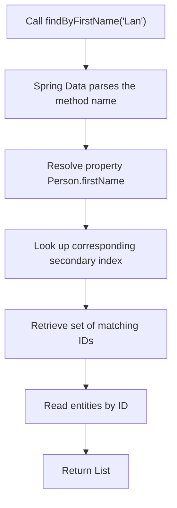
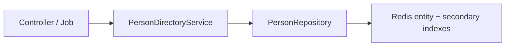

# Query Derivation from Repository Method Names in Spring Data Redis

When using Spring Data Redis Repositories, we often need to find multiple entities by a property instead of only reading by ID. For example: finding all customers named `Lan`, finding employees whose `department` is `IT`, or filtering users by two properties at once. Spring Data provides a **query derivation** mechanism: simply declare a method name following a convention, and the framework parses that name to build the corresponding query without writing Redis commands manually for each method.

However, Spring Data Redis **does not derive queries in the exact same way as JPA**. Redis is a key-value data store; property-based queries in Redis Repositories rely primarily on **secondary indexes** created and maintained when entities are saved. Therefore, understanding method names is only half the problem: for a query to work, the relevant property must be appropriately indexed and data must be written through a path that manages indexes.

This lesson explains how method names become queries, how to prepare entities with `@RedisHash`, `@Id`, and `@Indexed`, how to write `findBy...` methods and combine conditions, the limitations of query derivation in Redis, and common pitfalls when data or indexes become out of sync.

## 1. What Is Query Derivation?

Consider a Repository:

```java
public interface PersonRepository
        extends CrudRepository<Person, String> {

    List<Person> findByFirstName(String firstName);
}
```

The name `findByFirstName` is parsed by Spring Data into two parts:

- `find...By` indicates a query method that retrieves data.
- `FirstName` denotes the Java property path `firstName` on the entity.

The `String firstName` parameter provides the **value to match** at execution time, while the `List<Person>` return type specifies how results are represented. The application can call:

```java
List<Person> people = personRepository.findByFirstName("Lan");
```

The application does not have to construct index keys manually in the call above. Spring Data Repository builds the query plan from the method name and the mapping metadata of `Person`.

For Redis, it is important to understand that looking up by `firstName` **does not mean Redis iterates through every key to open Hashes and compare the `firstName` field**. Spring Data Redis relies on the appropriate index to know the IDs of the entities to fetch.



**Key takeaway:** method naming syntax is shared across many Spring Data modules, but **the supported operators and execution strategy belong to each datastore**. You cannot take a JPA query, blindly swap `JpaRepository` for a Redis Repository, and expect every operator to work.

## 2. Configuring Entities So Redis Repositories Can Query Them

### 2.1. Declaring the Entity and Indexed Properties

A typical entity:

```java
package com.example.redis.people;

import org.springframework.data.annotation.Id;
import org.springframework.data.redis.core.RedisHash;
import org.springframework.data.redis.core.index.Indexed;

@RedisHash("people")
public class Person {

    @Id
    private String id;

    @Indexed
    private String firstName;

    @Indexed
    private String lastName;

    private int age;

    private Address address;

    public Person() {
    }

    public Person(
            String id,
            String firstName,
            String lastName,
            int age,
            Address address) {
        this.id = id;
        this.firstName = firstName;
        this.lastName = lastName;
        this.age = age;
        this.address = address;
    }

    public String getId() {
        return id;
    }

    public void setId(String id) {
        this.id = id;
    }

    public String getFirstName() {
        return firstName;
    }

    public void setFirstName(String firstName) {
        this.firstName = firstName;
    }

    public String getLastName() {
        return lastName;
    }

    public void setLastName(String lastName) {
        this.lastName = lastName;
    }

    public int getAge() {
        return age;
    }

    public void setAge(int age) {
        this.age = age;
    }

    public Address getAddress() {
        return address;
    }

    public void setAddress(Address address) {
        this.address = address;
    }
}
```

Address class:

```java
package com.example.redis.people;

import org.springframework.data.redis.core.index.Indexed;

public class Address {

    @Indexed
    private String city;

    private String street;

    public Address() {
    }

    public Address(String city, String street) {
        this.city = city;
        this.street = street;
    }

    public String getCity() {
        return city;
    }

    public void setCity(String city) {
        this.city = city;
    }

    public String getStreet() {
        return street;
    }

    public void setStreet(String street) {
        this.street = street;
    }
}
```

Role of each annotation:

| Annotation | Role |
|---|---|
| `@RedisHash("people")` | Marks a Redis aggregate and specifies the keyspace used to store entities |
| `@Id` | Uniquely identifies each entity within the keyspace |
| `@Indexed` | Instructs Spring Data Redis to maintain a secondary index for the property |
| `@Indexed` on `Address.city` | Enables lookups via a nested property path |

In this example, `age` is not indexed. That means even though a method name like `findByAge(...)` looks valid under Spring Data conventions, **it lacks the index backing required** to query by age like the `firstName` lookup does.

### 2.2. Declaring the Repository

```java
package com.example.redis.people;

import java.util.List;
import org.springframework.data.repository.CrudRepository;

public interface PersonRepository
        extends CrudRepository<Person, String> {

    List<Person> findByFirstName(String firstName);

    List<Person> findByLastName(String lastName);

    List<Person> findByFirstNameAndLastName(
            String firstName, String lastName);

    List<Person> findByFirstNameOrLastName(
            String firstName, String lastName);

    List<Person> findByAddress_City(String city);
}
```

You only **declare the interface**—you do not write method bodies for these five queries. The repository infrastructure parses the names and uses entity metadata to execute the queries.

A Spring Boot application needs Spring Data Redis, Redis connection configuration, and proper repository scanning. For example, when configuring explicitly:

```java
package com.example.redis;

import org.springframework.context.annotation.Configuration;
import org.springframework.data.redis.repository.configuration.EnableRedisRepositories;

@Configuration
@EnableRedisRepositories(basePackages = "com.example.redis.people")
public class RedisRepositoryConfiguration {
}
```

In Spring Boot applications, auto-configuration may already enable Redis Repositories from existing starters and configuration; avoid accidentally declaring overlapping scans if the project already has an equivalent setup.

### 2.3. Saving Sample Data

```java
personRepository.save(new Person(
        "p-1", "Lan", "Nguyen", 28,
        new Address("Ha Noi", "Cau Giay")));

personRepository.save(new Person(
        "p-2", "Lan", "Tran", 31,
        new Address("Da Nang", "Hai Chau")));

personRepository.save(new Person(
        "p-3", "Minh", "Nguyen", 25,
        new Address("Ha Noi", "Ba Dinh")));
```

Then query:

```java
List<Person> lan = personRepository.findByFirstName("Lan");
// Results by ID: p-1, p-2 (order is not guaranteed)

List<Person> lanNguyen =
        personRepository.findByFirstNameAndLastName("Lan", "Nguyen");
// Results by ID: p-1

List<Person> fromHaNoi =
        personRepository.findByAddress_City("Ha Noi");
// Results by ID: p-1, p-3
```

The comments above describe the **set of matching IDs**, without implying that Redis returns them in insertion order. If the UI requires explicit ordering, design and apply a dedicated sorting mechanism.

## 3. Secondary Indexes Are the Foundation of Derived Queries

A Redis Hash stores an entity's data by ID, for example:

```text
people:p-1
  id        = "p-1"
  firstName = "Lan"
  lastName  = "Nguyen"
  age       = 28
  address.city = "Ha Noi"
```

To find all entities with `firstName=Lan`, Redis has no general Hash command like `SELECT * WHERE firstName='Lan'`. Spring Data Redis can use a **secondary Redis Set** holding the IDs corresponding to the indexed value.

Visualize the logical relationships below (actual Redis key names are details of the version and mapping; this is only an illustrative diagram):

```text
index for firstName = "Lan"         -> {p-1, p-2}
index for firstName = "Minh"        -> {p-3}
index for lastName  = "Nguyen"      -> {p-1, p-3}
index for lastName  = "Tran"        -> {p-2}
index for address.city = "Ha Noi"  -> {p-1, p-3}
```

When calling `findByFirstName("Lan")`, the repository can retrieve the ID set from the `firstName=Lan` index and load the corresponding records. When calling `findByFirstNameAndLastName("Lan", "Nguyen")`, in set terms, the result is the **intersection** of the two ID sets:

```text
firstName = Lan       { p-1, p-2 }
lastName  = Nguyen    { p-1, p-3 }
                         |
                         v
AND                    { p-1 }
```

When calling `findByFirstNameOrLastName("Lan", "Nguyen")`, in set terms, the result is the **union**:

```text
firstName = Lan       { p-1, p-2 }
lastName  = Nguyen    { p-1, p-3 }
                         |
                         v
OR                 { p-1, p-2, p-3 }
```

This is why `AND` and `OR` over indexed properties fit naturally in Redis Repositories. It also explains why Redis Repositories cannot support every kind of condition that SQL supports by default.

**An index does not mean uniqueness.** `@Indexed` typically creates a mapping from one value to **many IDs**. There is no guarantee that only one person has `firstName=Lan`. If business logic requires a unique `username` or `email`, you must build separate atomic allocation and update rules, or use a store that supports appropriate unique constraints.

## 4. How Spring Data Parses Method Names

Consider the name:

```java
List<Person> findByFirstNameAndLastName(
        String firstName,
        String lastName
);
```

Conceptual structure:

```text
find              By        FirstName      And       LastName
 ^                 ^             ^           ^            ^
 lookup          start      property      combine      property
 action        criteria     firstName     criteria     lastName
```

Spring Data relies on the Java property name on the entity—here `firstName`, not necessarily the field name a serializer writes into the Redis Hash. The property condition must be backed by metadata usable for querying.

### 4.1. Naming Rules and Parameters

| Method | Meaning |
|---|---|
| `findByFirstName("Lan")` | Find entities with `firstName` equal to `Lan` |
| `findByLastName("Nguyen")` | Find entities with `lastName` equal to `Nguyen` |
| `findByFirstNameAndLastName("Lan", "Nguyen")` | Satisfies both conditions simultaneously |
| `findByFirstNameOrLastName("Lan", "Nguyen")` | Satisfies at least one of the two conditions |
| `findByAddress_City("Ha Noi")` | Matches `city` inside `address` |

The two parameters of `findByFirstNameAndLastName` are bound in the order of the properties in the method name. If you swap the arguments without changing the signature or call site, the query still runs but searches for the wrong values.

Naming rules are not case-insensitive in terms of business value interpretation. Java property names are recognized by the parser; the **string value** used for indexing is the data the application saves. For instance, `"Lan"` and `"lan"` can lead to two different index values. Case-insensitive matching is not enabled by default.

### 4.2. Querying Nested Properties

Entity structure:

```java
class Person {
    Address address;
}

class Address {
    @Indexed
    String city;
}
```

Method name:

```java
List<Person> findByAddress_City(String city);
```

The underscore `_` separates property path segments for the parser: `address.city`. In some cases, `findByAddressCity(...)` can also be resolved correctly by the parser; using `_` clearly marks the boundary between two properties, especially when model names could be ambiguous.

A nested path does not mean Redis supports joins between entities. This example still finds `Person` elements based on mapped and indexed property values within the same aggregate.

### 4.3. Descriptive Prefix and Query Subject

Spring Data has common prefixes such as `find...By`, `read...By`, or `get...By` in its general query method naming convention. However, with Redis Repositories, **parser recognition of syntax is not enough to conclude that a query is supported by the Redis datastore**. Only use combinations of operators, parameter types, and return types supported by Redis Repositories in your project's version.

Writing a longer method name does not give Redis additional index types. For example, `findByAgeGreaterThan(30)` looks natural if you are used to JPA, but Redis Repositories do not automatically create a range index just from the word `GreaterThan`. If range queries are needed, choose an appropriate storage/index model.

## 5. Querying with AND and OR

### 5.1. AND Condition

Declaration:

```java
List<Person> findByFirstNameAndLastName(
        String firstName,
        String lastName);
```

Invocation:

```java
List<Person> matches =
        personRepository.findByFirstNameAndLastName(
                "Lan", "Nguyen");
```

Each property used in the condition requires an appropriate index. At the set-model level, `AND` takes the IDs present in both index sets. If one condition is rare, the result set is usually small, though actual cost still depends on the size of the index sets and the strategy used by Redis/Spring Data.

### 5.2. OR Condition

Declaration:

```java
List<Person> findByFirstNameOrLastName(
        String firstName,
        String lastName);
```

Invocation:

```java
List<Person> matches =
        personRepository.findByFirstNameOrLastName(
                "Lan", "Nguyen");
```

The result is based on the union of the two conditions. An entity satisfying both conditions still corresponds to the same ID in the set union; do not rely on any ordering returned by this query.

### 5.3. When Do Method Names Become Hard to Reason About?

Example:

```java
List<Person> findByFirstNameAndLastNameOrAddress_City(
        String firstName,
        String lastName,
        String city);
```

Such a name can produce non-intuitive logical interpretation for readers; do not assume the framework supports arbitrary parenthesization. When business logic requires complex conditions, multiple branches with custom precedence, or more than one index type, choose repository methods with well-defined semantics, or build a dedicated query layer instead of cramming expressions into one long method name.

A simple approach in a service is to split supported queries into clear operations and combine them by **unique ID** when genuinely appropriate:

```java
Set<String> ids = new LinkedHashSet<>();

for (Person person : repository.findByFirstName("Lan")) {
    ids.add(person.getId());
}
for (Person person : repository.findByLastName("Nguyen")) {
    ids.add(person.getId());
}
```

Combining on the Java side is only suitable for **small or strictly bounded result sets**; if both index sets are large, pulling full entities into the application to union/intersect wastes network bandwidth and memory. For large sets, design corresponding queries/indexes and consider server-side processing.

## 6. Query Types Supported by Redis Repositories and Key Limitations

### 6.1. Equality Conditions on Indexed Properties

The core case is querying by exact value:

```java
List<Person> findByFirstName(String firstName);
```

This is a form of **equality lookup**: look up the index representing a specific value and fetch entities with the corresponding IDs.

If you want to search by a new property such as `department`, first add the property with `@Indexed` and save data through an index-managed write path. Simply adding `findByDepartment(...)` does not guarantee existing records can be found.

### 6.2. Combining Conditions on Indexes

Equality conditions on indexed properties can be combined using `And` or `Or` where supported by Redis Repositories. Do not extrapolate from this that SQL operators such as `NOT`, `BETWEEN`, `LIKE`, `IN`, `REGEXP`, or arbitrary numeric comparisons are also guaranteed to be supported by Redis Repositories.

A practical decision table:

| Requirement | Approach |
|---|---|
| Find entity by ID | `findById(id)` |
| Find all entities with a property equal to a value | `findByProperty(value)` with `@Indexed` |
| Find by two required values | `findByAAndB(...)` when both properties are indexed |
| Find by either of two values | `findByAOrB(...)` when both properties are indexed |
| Find by nested property | Use a path like `findByAddress_City(...)` and a matching index |
| Find by numeric range or sort by score | Design a suitable Sorted Set/index or use a store supporting range queries |
| Full-text search, fuzzy search, complex filtering | Use dedicated search/index technology if genuinely required |
| JOIN multiple entity types | Structure aggregates/indexes around the query or use a join-capable database |

The documentation for the **exact Spring Data Redis version** you are using is the authoritative source for supported keywords. The table above highlights foundational cases and design choices; it does not claim every Spring Data Commons query derivation keyword works with Redis.

### 6.3. Geo Queries Are a Specialized Case

Spring Data Redis can also support geographic queries based on a geo index, using `@GeoIndexed` and appropriate coordinate types. This is a **different** index mechanism from standard equality indexes.

Model illustration:

```java
import org.springframework.data.geo.Point;
import org.springframework.data.redis.core.index.GeoIndexed;

public class StoreLocation {
    @GeoIndexed
    private Point coordinates;

    // constructors, getters and setters ...
}
```

For geographic queries, method names, `Point`/`Distance` parameter types, and return types must follow the variants supported by Redis Repositories. Do not substitute `@Indexed` with `@GeoIndexed` arbitrarily: each annotation serves a distinct query mode and index structure.

### 6.4. Sorting and Pagination

Results from a Redis Set have no inherent order. Therefore, do not expect:

```java
findByFirstNameOrderByAgeDesc(...)
```

to behave like JPA or produce an optimized sort from equality indexes. Even within Spring Data, `Sort`, `Pageable`, `OrderBy` keywords, and Redis Repository pagination capabilities depend on actual support in the version used and the underlying index structure.

For paginated APIs requiring stable ordering—especially over large datasets—maintain an ordered ID source (for example, a Sorted Set by score/timestamp) and read entities by ID in batches. Rather than fetching all `findBy...` results to sort in the JVM, designing an ordered index keeps costs under control.

## 7. Comparing Derived Methods with `RedisTemplate` Operations

Let's compare two ways to solve "find all `Person` with `firstName=Lan`".

**Repository approach:**

```java
List<Person> people = repository.findByFirstName("Lan");
```

**`RedisTemplate` approach with a self-managed index (illustration):**

```java
Set<String> ids = stringRedisTemplate.opsForSet()
        .members("person-index:firstName:Lan");

if (ids != null) {
    for (String id : ids) {
        Map<Object, Object> fields = stringRedisTemplate
                .opsForHash()
                .entries("person-data:" + id);

        // Manually decode fields into Person according to the designed schema.
    }
}
```

This `RedisTemplate` example uses a **custom namespace**, completely independent of Spring Data Redis Repository internal indexes. Do not treat assumed Repository index keys as a public interface: internal index names and formats are not a long-term contract for other services to write to.

Comparison:

| Aspect | Repository Derived Query | Self-Managed via `RedisTemplate` |
|---|---|---|
| Query declaration | Method name like `findByFirstName` | Manually write Redis/index operations |
| Index creation | Mapping and `@Indexed` in Repository infrastructure | Manually create, update, and delete indexes |
| Index sync on updates | Managed by Repository within its mechanism | Application must handle proactively |
| Control over Redis keys and commands | Follows Repository contract and implementation | More direct control |
| Complex, specialized queries | Limited to supported keywords/indexes | Can design Sets, Sorted Sets, Lua, or other solutions |
| Development overhead | Less code for CRUD/equality queries | More code and consistency responsibility |

Repositories are especially useful when operating on cleanly modeled entities, querying by indexed properties, and avoiding fine-grained Redis command management. `RedisTemplate` fits better when query algorithms or key lifecycles do not match the Repository model.

## 8. Why Is Data in Redis Not Returned by `findBy...`?

This is the most common situation encountered when learning Redis Repositories.

Suppose a Redis Hash exists:

```redis
HSET people:p-9 id p-9 firstName Lan lastName Le
```

Then you call:

```java
personRepository.findByFirstName("Lan");
```

`p-9` might not be found, even though the `people:p-9` key exists. The reason is that a manual `HSET` **does not automatically update secondary indexes managed by the Repository**.

### 8.1. Writing Through the Repository Creates and Manages Indexes

When calling:

```java
personRepository.save(new Person(
        "p-9", "Lan", "Le", 35,
        new Address("Hue", "Le Loi")));
```

Spring Data Redis handles entity mapping and declared indexes. Operations related to saving the entity and its indexes are executed by the Repository infrastructure.

Do not equate `@Indexed` with an index automatically built over every Hash that happens to have the same field. The annotation only takes effect in **data paths that go through Spring Data Redis mapping**.

### 8.2. Modifying an Indexed Field via `RedisTemplate` Can Cause Index Drift

Suppose an entity was saved with:

```text
id = p-1
firstName = Lan
```

If you use `RedisTemplate`:

```java
stringRedisTemplate.opsForHash()
        .put("people:p-1", "firstName", "Minh");
```

The physical Hash now has `Minh`, while the Repository-managed index set still considers ID `p-1` part of the `Lan` group. Results from `findByFirstName("Minh")` and `findByFirstName("Lan")` may not reflect the true data.

If the Repository is meant to remain the owner of the entity/index, update through the entity and `repository.save(...)`; if a field must be updated very frequently, reconsider ownership or design an explicit index-sync flow instead of mixing two write paths without a contract.

### 8.3. Adding `@Indexed` After Data Already Exists

Adding:

```java
@Indexed
private String department;
```

to an entity **does not mean all existing data in Redis is immediately backfilled into the index**. Spring Data Redis has no reason to scan the entire keyspace of every object merely because new code was deployed.

Before using a new query on legacy data, plan an index rebuild. You can read entities from a known list of IDs, verify the schema, and re-save them via the Repository, or run a controlled migration process. Account for TTL, throughput, duplicates, mid-flight failures, and concurrent updates.

Do not manually edit internal index Redis Sets in application code without fully understanding how the Repository maintains index metadata.

### 8.4. Keyspace and Mapping Configuration Changes

Changing `@RedisHash("people")` to `@RedisHash("persons")` can also change the entity keyspace and related indexes. Reading old IDs or running derived queries may fail to find data stored under the previous keyspace.

Therefore, changing keyspace names, serializers, or property names is a **schema migration**, not just a class rename.

## 9. Secondary Index Lifecycle: Save, Update, Delete, Expire

### 9.1. Creating a New Entity

Typically, when saving through a Repository, the system needs to:

1. Store entity data in Redis by ID.
2. Add the ID to relevant secondary indexes.
3. Store metadata needed to manage indexes when the entity changes or is deleted.

These steps are shown logically; exact Redis commands, internal keys, and atomicity depend on the Spring Data Redis implementation and version.

### 9.2. Updating an Indexed Property

If `Person.firstName` changes from `Lan` to `Minh`, the system must move the ID out of the old index and into the new index. A direct `HSET` command does not perform that full workflow.

```java
Person person = personRepository.findById("p-1")
        .orElseThrow();

person.setFirstName("Minh");
personRepository.save(person);
```

After this operation, name queries reflect the new value according to the Repository's index management mechanism. With multiple concurrent writers, you still need to handle update conflicts and specific consistency requirements.

### 9.3. Deleting an Entity

```java
personRepository.deleteById("p-1");
```

Deleting via the Repository allows the mapping layer to clean up the auxiliary structures it owns. If you delete the Hash key with `DEL` via `RedisTemplate` or CLI, you risk leaving stale members in indexes.

### 9.4. Entity TTL Expiration

Example configuring TTL for an entity:

```java
import org.springframework.data.redis.core.RedisHash;

@RedisHash(value = "people", timeToLive = 3600)
public class Person {
    // ID, properties, getters/setters...
}
```

TTL causes the data key to expire after the specified duration. Cleaning up secondary indexes upon key expiration may rely on **Redis keyspace notifications** and Spring Data Redis listeners.

Operational points to watch:

- Redis must be configured to emit appropriate events if the application relies on expiration events.
- Not every managed Redis service allows customizing all server settings.
- Notifications are **fire-and-forget**, not a durable event log that replays every event.
- If the listener is not running when the key expires, the event may be missed; indexes may require cleanup or rebuilding.
- Stale index members may cause queries to encounter IDs whose actual data no longer exists.

Do not treat `findBy...` on TTL-bound entities as a strictly consistent snapshot at all times. For applications requiring high accuracy, reconsider Redis's role and index management strategy.

## 10. Diagnosing Queries That Return Unexpected Results

A practical investigation should separate **syntax**, **metadata**, **data**, and **index** issues.

| Symptom | Possibilities to Check | Resolution |
|---|---|---|
| Startup error: property not found | Name after `By` does not match Java property, or parser split wrongly | Check field/getter names; use `_` to clarify nested paths |
| Startup or runtime error: query not supported | Keyword/operator has no corresponding Redis implementation | Use supported conditions or design a specialized query |
| Hash exists, but `findBy...` returns empty | Missing `@Indexed`, un-backfilled data, or direct writes | Check write-path ownership and plan index rebuild |
| Searching by old value still finds ID | Index was not updated during direct writes | Route updates through Repository or re-sync indexes |
| ID found, but entity cannot be materialized | Hash expired, deleted, or incompatible serializer/schema | Check primary data and expiration/migration mechanism |
| `"lan"` does not match `"Lan"` | Index stores raw string values without desired normalization | Normalize before saving and before querying |
| Entities missing after changing `@RedisHash` | Keyspace changed | Plan migration for keyspace and related indexes |
| Results not in desired order | Equality indexes are set-based, not business-ordered | Use a dedicated ordered structure |
| Query latency grows as data grows | Index value has too many IDs, requiring many entity loads | Bound dataset, add selective criteria, or redesign query |

Do not start by hand-editing internal index keys in Redis. First verify which write path saved the entity, the actual property values, active annotations, and the Spring Data Redis version in use.

## 11. Optimizing Index Design for Real Queries

### 11.1. Only Index Properties That Will Be Queried

Each `@Indexed` adds storage and update overhead. For example, if an application has millions of `Person` records but only queries by `firstName` and `department`, there is no need to index every field on the entity.

An equality index on `status` with a few values like `ACTIVE` and `INACTIVE` can create very large ID sets. A derived query could end up loading a huge number of entities at once. Thus "indexed" does not automatically mean "every query is lightweight".

### 11.2. Normalize Before Saving and Before Querying

Suppose email is a searchable property:

```java
@Indexed
private String emailNormalized;
```

The service can proactively normalize input according to business rules:

```java
import java.util.Locale;

static String normalizeEmailForLookup(String email) {
    if (email == null || email.isBlank()) {
        throw new IllegalArgumentException("Email is required");
    }
    return email.trim().toLowerCase(Locale.ROOT);
}
```

For real-world emails, normalization should follow application rules with awareness of email local-part matching nuances. This snippet illustrates using **a normalized lookup value**, not redefining email address standards.

The normalized value must be used **consistently at both save time and query time**. Normalizing only the query parameter while leaving stored data unnormalized creates two incompatible value domains.

### 11.3. Separate Read Models from Write Entities for Complex Queries

Suppose a business requirement asks for:

> Find 20 products with `category=BOOK`, `price` within a given range, sorted by sales descending with stable pagination.

The name `findByCategoryAndPriceBetweenOrderBySalesDesc` does not make Redis Repositories automatically provide all those capabilities. Options include:

- Using Repositories for ID-based CRUD and simple equality queries.
- Maintaining auxiliary Sorted Sets/indexes keyed by category with the sort score.
- Using Redis Search/RediSearch when supported by the environment and search requirements genuinely need filtering/ranges/full-text.
- Routing complex queries to a database with suitable indexes and query capabilities.

If auxiliary indexes are maintained by the application, explicitly design update paths, transactions/atomicity, rebuilds, TTLs, retries, and handling of source/index desynchronization.

## 12. Role of Return Types and Semantic Limits

Spring Data Repositories support many return types across the ecosystem, but Redis does not automatically inherit SQL semantics. Choosing a return type should match expected result counts and implementation capabilities.

### Returning Multiple Entities

```java
List<Person> findByFirstName(String firstName);
```

This is the natural choice when values are not unique. It can return an empty list when nothing matches and can contain multiple elements.

### Returning a Single Entity or Optional

If a property is designed to be unique by business logic, some APIs may prefer:

```java
Optional<Person> findByExternalId(String externalId);
```

However, simply annotating `externalId` with `@Indexed` **does not enforce uniqueness**. If two entities share the same value, a single-result return type can fail or behave unexpectedly. Enforce uniqueness separately, and only declare single-result methods when result cardinality is guaranteed by design.

### Pagination over Large Result Sets

Even when a signature using `Pageable`/`Sort` looks valid in Spring Data Commons, Redis Repositories may not fully support features the same way other datastores do. When a problem genuinely requires multiple ordered pages, choose a query mechanism with deterministic ordering and limit how many IDs are read per request.

Define API contracts around data that can be served reliably, avoiding promises of total page counts or orderings that equality indexes do not guarantee.

## 13. Do Not Use Method Names to Simulate Joins, `LIKE`, or Full-Text Search

The examples below are **expectations to be cautious about**, not methods guaranteed by this lesson to work:

```java
// Do not assume Redis derived queries behave like JPA:
List<Person> findByFirstNameContaining(String keyword);
List<Person> findByAgeGreaterThan(int age);
List<Person> findByLastNameIgnoreCase(String lastName);
List<Person> findByFirstNameOrderByAgeDesc(String firstName);
```

Why?

1. Equality secondary indexes map **exact property values → ID sets**; they do not provide substring, range, or collation indexes.
2. There is no general SQL engine behind Redis Repositories to build `WHERE`, `LIKE`, `ORDER BY`, and `JOIN`.
3. The parser may recognize part of a method name at the Spring Data Commons syntax level, while the Redis module only supports operators suited to its backend.
4. Simulating these conditions by loading every entity into Java is typically unsuitable for large datasets.

If a new requirement can only be met by scanning the entire entity set, decide whether it is a bounded administrative job or an online query needing index redesign. Never expose an API that calls `findAll()` and filters freely in memory when record counts can grow without bound.

## 14. Consistency and Concurrency Considerations

Indexes are typically **auxiliary data maintained alongside entities**. When a system has multiple writers, TTLs, asynchronous updates, or direct Redis operations, windows can occur where entities and indexes are inconsistent.

Example of a search flow:

```text
T1: entity "p-1" has firstName = "Lan"
T2: another worker changes it to "Minh"
T3: a request searching for "Lan" reads the index
T4: entity is loaded by ID
```

Between reading the index and reading the Hash, the data may have changed. Distinguish:

- **Index query result:** IDs matching the condition according to the index state that was read.
- **Loaded entity data:** values at the moment the Hash was read.
- **Consistent snapshot:** a point-in-time guarantee spanning both criteria and entity; Redis derived queries do not promise this like relational database transaction isolation.

If business logic needs to ensure the found person still satisfies the condition when performing an important action, **re-verify the condition at the update step** and use appropriate atomicity mechanisms. With Redis, checking the condition and updating inside the same Lua script or synchronized workflow may be more appropriate depending on the case.

For caches or UI search assistance, eventual consistency may be acceptable; for financial records, access control, or reservations, stronger data models and transactions are required.

## 15. Example Service Using Derived Queries

The service layer should express business logic while letting the Repository handle lookups:

```java
package com.example.redis.people;

import java.util.List;
import java.util.Objects;

import org.springframework.stereotype.Service;

@Service
public class PersonDirectoryService {

    private final PersonRepository repository;

    public PersonDirectoryService(PersonRepository repository) {
        this.repository = repository;
    }

    public List<Person> findByExactName(
            String firstName, String lastName) {
        Objects.requireNonNull(firstName, "firstName");
        Objects.requireNonNull(lastName, "lastName");
        return repository.findByFirstNameAndLastName(
                firstName, lastName);
    }

    public List<Person> findByCity(String city) {
        Objects.requireNonNull(city, "city");
        return repository.findByAddress_City(city);
    }

    public Person rename(String id, String newFirstName) {
        Person person = repository.findById(id)
                .orElseThrow(() -> new IllegalArgumentException(
                        "Unknown person id: " + id));

        person.setFirstName(newFirstName);
        return repository.save(person);
    }
}
```

Usage flow:



When `rename(...)` uses `repository.save(person)`, the write continues to flow through the mapping/index mechanism. This example has no optimistic locking or CAS protection; if concurrent rename requests happen and overwrites must be prevented, the service must add appropriate concurrency controls.

A good practice is keeping normalization, validation, and business error handling in the service while keeping the Repository interface focused on simple, genuinely indexed queries.

## 16. Practice Exercises

### Exercise 1 — Designing Indexes and Methods

Create a `Device` entity containing:

```java
@RedisHash("devices")
public class Device {
    @Id
    private String id;

    @Indexed
    private String ownerId;

    @Indexed
    private String status;

    private long lastSeenEpochMillis;

    // constructors, getters, setters...
}
```

Write `DeviceRepository` with these methods:

```java
List<Device> findByOwnerId(String ownerId);

List<Device> findByOwnerIdAndStatus(
        String ownerId,
        String status);

List<Device> findByOwnerIdOrStatus(
        String ownerId,
        String status);
```

Describe the ID sets returned after saving three devices with these values:

| ID | ownerId | status |
|---|---|---|
| `d1` | `u1` | `ONLINE` |
| `d2` | `u1` | `OFFLINE` |
| `d3` | `u2` | `ONLINE` |

Set answers:

- `findByOwnerId("u1")` → `{d1, d2}`.
- `findByOwnerIdAndStatus("u1", "ONLINE")` → `{d1}`.
- `findByOwnerIdOrStatus("u1", "ONLINE")` → `{d1, d2, d3}`.

Do not rely on element ordering in the returned lists.

### Exercise 2 — What Happens on Direct Writes?

After `repository.save(device)` with `status=ONLINE`, try updating the `status` field via Redis CLI or `RedisTemplate`. Observe the discrepancy between the Hash data and derived query results. Explain why updates need a path consistent with indexes.

### Exercise 3 — Adding a New Query to Existing Data

Add `@Indexed` to `Device.lastSeenDate`. Propose a migration procedure so existing devices are added to the index, specifying how to handle missing fields, TTL-expired keys, and ongoing writes during migration.

### Exercise 4 — Solving a Problem Unsuited to Equality Indexes

Design an API to "get the 20 devices with the most recent `lastSeenEpochMillis` per owner". Explain why you cannot expect `findByOwnerIdOrderByLastSeenEpochMillisDesc` to work like JPA, then propose a per-owner Sorted Set structure and how to maintain it as devices change.

### Exercise 5 — Enforcing Uniqueness

Suppose `Device.serialNumber` must be globally unique. Is adding `@Indexed` enough? Propose a reservation/atomic-check mechanism or a datastore with unique constraints, and explain how to release the reservation when a device is deleted.

These exercises highlight the difference between *naming a method correctly* and *designing the data and indexes properly so that the method returns reliable results*.

## 17. Checklist for Designing Derived Queries in Redis

Before introducing a `findBy...` method into an application, be able to answer these questions:

1. Does the entity have `@RedisHash` and `@Id`, and is the Repository configured and scanned in the right package?
2. Does the property in the method name exist along a valid Java path?
3. Does every property queried by value have `@Indexed` or the appropriate index annotation?
4. Are the operator and return type supported by Redis Repositories in the version being used?
5. Have records created before adding the index been migrated/backfilled?
6. Do any writers use `RedisTemplate`, Redis CLI, or scripts that bypass the index update path?
7. Is the index cleanup plan clear for updates, deletions, and TTL expirations?
8. Does the data require ordering, ranges, text search, or uniqueness beyond what equality indexes provide?
9. Could results be too large to return in one request? If so, design another read model/index.
10. If data is updated concurrently, what consistency behavior does business logic require?

## 18. Conclusion

In Spring Data Redis, **query derivation from Repository method names** lets you write methods such as `findByFirstName`, `findByFirstNameAndLastName`, `findByFirstNameOrLastName`, and `findByAddress_City` cleanly. However, their effectiveness relies on **secondary indexes** and Redis Repository mapping mechanics, not a SQL query engine.

Therefore, a valid derived query requires three conditions simultaneously: **a method name describing valid properties**, **properties backed by supported indexes**, and **all data write paths obeying the index management workflow**. For range queries, complex sorting, full-text search, or high-consistency requirements, design appropriate index structures or datastores instead of trying to stretch method names.

### References

- [Spring Data Redis — Queries and Query Methods](https://docs.spring.io/spring-data/redis/reference/redis/redis-repositories/queries-and-query-methods.html)
- [Spring Data Redis — Indexes](https://docs.spring.io/spring-data/redis/reference/redis/redis-repositories/indexes.html)
- [Spring Data Redis — Keyspaces](https://docs.spring.io/spring-data/redis/reference/redis/redis-repositories/keyspaces.html)
- [Spring Data Redis — Time To Live](https://docs.spring.io/spring-data/redis/reference/redis/redis-repositories/expirations.html)
- [Spring Data Commons — Defining Query Methods](https://docs.spring.io/spring-data/commons/reference/repositories/query-methods-details.html)
- [Redis — Sets](https://redis.io/docs/latest/develop/data-types/sets/)
- [Redis — SINTER](https://redis.io/docs/latest/commands/sinter/)
- [Redis — SUNION](https://redis.io/docs/latest/commands/sunion/)
