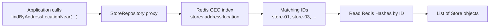

# Geospatial Queries with Repositories

**Spring Data Redis Repositories** not only support saving and finding objects by ID or regular property indexes, they can also find objects by **geographic distance**. For example, a store management application can find branches within a 3 km radius around a user's coordinates while the business layer still works with the familiar `StoreRepository` interface.

To achieve this, Spring Data Redis uses Redis's **geospatial index**. The application annotates a coordinate property with `@GeoIndexed`, saves aggregates through the repository, and declares query methods with the `Near` or `Within` suffix. Redis performs location filtering; Spring Data Redis maps the matching IDs back to Java objects.

## 1. How It Works

Suppose each store has a name, a status, and an address containing coordinates:

```text
Store
├── id: "store-01"
├── name: "Branch A"
├── active: true
└── address
    ├── label: "Central district"
    └── location: Point(longitude=106.7000, latitude=10.7800)
```

When the object is saved using a Redis Repository, the data can be represented by two groups of structures:

| Redis Structure | Example Key Name | Purpose |
| --- | --- | --- |
| Aggregate Hash | `stores:store-01` | Stores the store's fields |
| Geospatial index (sorted set) | `stores:address:location` | Stores locations, with the store ID as member |
| Repository support structures | Metadata/index keys created by Spring Data | Manages keyspace and index updates/deletions |

Example of how Redis writes a point into a geo index:

```redis
GEOADD stores:address:location 106.7000 10.7800 store-01
```

Redis stores geospatial data using a **sorted set** structure and uses `GEO`-family commands to find members near a coordinate. The repository combines geo index results with aggregate Hash data.



**Note:** key names are illustrated for the `stores` keyspace and the `address.location` property path. With different keyspace, converter, or naming strategy configurations, actual keys may differ. Let Spring Data Redis manage repository index structures.

## 2. Points, Distances, and Search Areas

Core Spring Data types:

- `Point`: a point with `x` and `y` coordinates. For Redis GEO, **`x` is longitude and `y` is latitude**.
- `Distance`: a length paired with a unit of measurement, such as `new Distance(3, Metrics.KILOMETERS)`.
- `Circle`: a circular area defined by a center `Point` and a radius `Distance`.
- `Metrics`: selects units such as meters, kilometers, or miles depending on Redis and API support.

Example:

```java
import org.springframework.data.geo.Circle;
import org.springframework.data.geo.Distance;
import org.springframework.data.geo.Metrics;
import org.springframework.data.geo.Point;

Point center = new Point(106.7000, 10.7800);
Distance radius = new Distance(3, Metrics.KILOMETERS);
Circle area = new Circle(center, radius);
```

This search means retrieving points located at most **3 km from the center by geographic distance**. That is an approximate distance across the Earth's surface, **not** driving distance or travel time.

Avoid swapping coordinate order: `new Point(10.7800, 106.7000)` is wrong because latitude is placed in the longitude slot, and the `y` coordinate exceeds the range supported by Redis.

## 3. Preparing the Spring Boot Application

With Spring Boot, declare the starter:

```groovy
// build.gradle
dependencies {
    implementation 'org.springframework.boot:spring-boot-starter-data-redis'
}
```

Configure the Redis Server, for example Redis running locally in development:

```yaml
# src/main/resources/application.yml
spring:
  data:
    redis:
      host: localhost
      port: 6379
```

Examples follow Spring Boot 3.x configuration conventions. In real deployments, host, credentials, TLS, and timeouts should come from environment-appropriate configuration.

Spring Boot can automatically activate Redis Repositories if auto-configuration conditions and scan scopes are met. To specify the repository package explicitly:

```java
package com.example.store;

import com.example.store.redis.StoreRepository;
import org.springframework.boot.SpringApplication;
import org.springframework.boot.autoconfigure.SpringBootApplication;
import org.springframework.data.redis.repository.configuration.EnableRedisRepositories;

@SpringBootApplication
@EnableRedisRepositories(basePackageClasses = StoreRepository.class)
public class StoreApplication {

    public static void main(String[] args) {
        SpringApplication.run(StoreApplication.class, args);
    }
}
```

`@EnableRedisRepositories` registers and configures repositories. The annotation itself **does not create a geospatial index** for any field: for Spring Data Redis to manage a geo index, the coordinate property must be annotated with `@GeoIndexed` and the aggregate must be saved via the Redis Repository mechanism.

## 4. Mapping an Aggregate with `@GeoIndexed`

Let's choose a `Store` model with an embedded `Address`. The `address.location` path will be used in query method names.

```java
// com/example/store/redis/Store.java
package com.example.store.redis;

import org.springframework.data.annotation.Id;
import org.springframework.data.geo.Point;
import org.springframework.data.redis.core.RedisHash;
import org.springframework.data.redis.core.index.GeoIndexed;

@RedisHash("stores")
public class Store {

    @Id
    private String id;

    private String name;
    private boolean active;
    private Address address;

    public Store() {
    }

    public Store(String id, String name, boolean active, Address address) {
        this.id = id;
        this.name = name;
        this.active = active;
        this.address = address;
    }

    public String getId() {
        return id;
    }

    public void setId(String id) {
        this.id = id;
    }

    public String getName() {
        return name;
    }

    public void setName(String name) {
        this.name = name;
    }

    public boolean isActive() {
        return active;
    }

    public void setActive(boolean active) {
        this.active = active;
    }

    public Address getAddress() {
        return address;
    }

    public void setAddress(Address address) {
        this.address = address;
    }

    public static class Address {

        private String label;

        @GeoIndexed
        private Point location;

        public Address() {
        }

        public Address(String label, Point location) {
            this.label = label;
            this.location = location;
        }

        public String getLabel() {
            return label;
        }

        public void setLabel(String label) {
            this.label = label;
        }

        public Point getLocation() {
            return location;
        }

        public void setLocation(Point location) {
            this.location = location;
        }
    }
}
```

Key elements to note:

| Element | Role |
| --- | --- |
| `@RedisHash("stores")` | Declares an aggregate stored as a Redis Hash, with keyspace `stores` |
| `@Id` on `id` | Identifies the object and its corresponding member in the geo index |
| `Point location` | Holds longitude and latitude |
| `@GeoIndexed` | Instructs Redis Repository to maintain a geospatial index for `address.location` |
| `Address` as nested object | Shows that repositories can index nested property paths |

Do not replace `@GeoIndexed` with `@Indexed` expecting radius queries: `@Indexed` serves standard secondary indexes, whereas geographic queries require a geospatial index.

A store without valid coordinates cannot satisfy location queries. Applications should validate coordinates before saving, especially when values arrive from external APIs.

## 5. Declaring Query Methods on the Repository

```java
// com/example/store/redis/StoreRepository.java
package com.example.store.redis;

import java.util.List;
import org.springframework.data.geo.Circle;
import org.springframework.data.geo.Distance;
import org.springframework.data.geo.Point;
import org.springframework.data.repository.CrudRepository;

public interface StoreRepository extends CrudRepository<Store, String> {

    List<Store> findByAddressLocationNear(
            Point center, Distance radius);

    List<Store> findByAddressLocationWithin(Circle area);
}
```

Spring Data Redis parses the method names:

```text
findByAddressLocationNear
       └──────┬─────┘└─┬─┘
         address.location
                 geo filter by point + radius

findByAddressLocationWithin
       └──────┬─────┘└──┬──┘
         address.location
                 geo filter by Circle
```

`AddressLocation` is the path to `Store.address.location`; the keywords `Near` and `Within` indicate the query operation type. They operate on the geo index created by Spring Data Redis when saving aggregates.

Two geometrically equivalent expressions:

```java
Point center = new Point(106.7000, 10.7800);
Distance threeKm = new Distance(3, Metrics.KILOMETERS);

List<Store> byNear =
        repository.findByAddressLocationNear(center, threeKm);

List<Store> byCircle =
        repository.findByAddressLocationWithin(new Circle(center, threeKm));
```

Given the same center point and radius, both methods search for objects within that circle. `Near` **does not mean** "return exactly one nearest object" by default; the `List<Store>` return type can hold multiple results. Also do not assume the list is sorted by distance if the API gives no ordering guarantee.

### Important Query Derivation Limitation

Redis Repositories **do not support combining `Near`/`Within` conditions with other query criteria inside the same derived query method**. Therefore, do not write and expect a declaration like this to work:

```java
// Not a combination supported by Redis Repositories:
List<Store> findByAddressLocationNearAndActiveTrue(
        Point center, Distance radius);
```

If you only want to display active stores, the application can filter in the service layer after the geo search, provided the result set size is small enough. If data volume is large or strict filtering/pagination is needed, a custom query or index design is required; do not treat Redis Repositories as an arbitrary SQL-like query engine.

## 6. Saving Data and Querying from a Service

The following service saves three sample stores and provides two search methods:

```java
// com/example/store/StoreLocatorService.java
package com.example.store;

import com.example.store.redis.Store;
import com.example.store.redis.StoreRepository;
import java.util.List;
import org.springframework.data.geo.Circle;
import org.springframework.data.geo.Distance;
import org.springframework.data.geo.Metrics;
import org.springframework.data.geo.Point;
import org.springframework.stereotype.Service;

@Service
public class StoreLocatorService {

    private final StoreRepository stores;

    public StoreLocatorService(StoreRepository stores) {
        this.stores = stores;
    }

    public void seedDemoData() {
        stores.save(new Store(
                "store-01",
                "Branch A",
                true,
                new Store.Address(
                        "Central area",
                        new Point(106.7000, 10.7800))));

        stores.save(new Store(
                "store-02",
                "Branch B",
                false,
                new Store.Address(
                        "Nearby area",
                        new Point(106.7100, 10.7850))));

        stores.save(new Store(
                "store-03",
                "Branch C",
                true,
                new Store.Address(
                        "Further area",
                        new Point(106.8000, 10.8500))));
    }

    public List<Store> findNearby(
            double longitude, double latitude, double radiusKm) {

        requireValidCoordinates(longitude, latitude);
        if (!Double.isFinite(radiusKm) || radiusKm <= 0) {
            throw new IllegalArgumentException("radiusKm must be positive");
        }

        Point center = new Point(longitude, latitude);
        Distance radius = new Distance(radiusKm, Metrics.KILOMETERS);
        return stores.findByAddressLocationNear(center, radius);
    }

    public List<Store> findActiveWithinCircle(
            Point center, Distance radius) {

        Circle area = new Circle(center, radius);
        return stores.findByAddressLocationWithin(area)
                .stream()
                .filter(Store::isActive)
                .toList();
    }

    private static void requireValidCoordinates(
            double longitude, double latitude) {
        if (!Double.isFinite(longitude) || longitude < -180 || longitude > 180
                || !Double.isFinite(latitude)
                || latitude < -85.05112878 || latitude > 85.05112878) {
            throw new IllegalArgumentException("Invalid Redis GEO coordinates");
        }
    }
}
```

The coordinates in the example are purely illustrative mock data; they do not represent any real store's location.

After calling `seedDemoData()`, you can query:

```java
List<Store> nearby = locator.findNearby(
        106.7000,  // longitude
        10.7800,   // latitude
        3.0        // radiusKm
);

for (Store store : nearby) {
    System.out.println(store.getId() + ": " + store.getName());
}
```

With the sample data above, `store-01` is at the center and `store-02` is nearby, whereas `store-03` is outside the 3 km radius. `store-02` has `active = false`, yet **still appears in the pure geo search results**; only `findActiveWithinCircle(...)` applies the `active` filter in Java.

Do not call `seedDemoData()` automatically on every production run. This is learning data, and writing fixed IDs overwrites existing objects with the same IDs.

## 7. How Does Spring Data Redis Translate Queries into Redis GEO?

When saving:

```java
stores.save(new Store(
    "store-01",
    "Branch A",
    true,
    new Store.Address(
        "Central area",
        new Point(106.7000, 10.7800))
));
```

Spring Data Redis saves the aggregate Hash while also writing and managing the member in the index:

```redis
# Illustrative command corresponding to the geo index.
GEOADD stores:address:location 106.7000 10.7800 store-01
```

When calling:

```java
stores.findByAddressLocationNear(
    new Point(106.7000, 10.7800),
    new Distance(3, Metrics.KILOMETERS)
);
```

Mechanically, Redis returns the IDs inside the geo index area, and Spring Data Redis fetches the corresponding Hashes to construct objects:

```redis
# Illustrative radius query mechanism:
GEORADIUS stores:address:location 106.7000 10.7800 3 km

# Then read aggregates by matching ID:
HGETALL stores:store-01
HGETALL stores:store-02
```

Actual command names and counts depend on the Spring Data Redis version, driver, and internal repository execution path. In modern Redis, `GEOSEARCH` supports circular or rectangular box queries and supersedes the older deprecated `GEORADIUS` commands.

From Redis CLI, an equivalent geospatial data query can be written as:

```redis
GEOSEARCH stores:address:location
  FROMLONLAT 106.7000 10.7800
  BYRADIUS 3 km
  ASC COUNT 10 WITHDIST
```

This syntax is split across lines for readability; when running in Redis CLI, it can be entered on **a single line**:

```redis
GEOSEARCH stores:address:location FROMLONLAT 106.7000 10.7800 BYRADIUS 3 km ASC COUNT 10 WITHDIST
```

The output from Redis CLI consists of **member IDs and distances**, not `Store` objects. The strength of a repository is rehydrating aggregates; if you need explicit distance sorting, distance measurements, and result limits, the lower-level GEO API fits better.

## 8. When Distance and Nearest Ordering Are Needed: Combining `GeoOperations`

Repository derived query methods are convenient for fetching a list of aggregates inside a circle, but map applications often also need:

- Distance from the search point to each store.
- Ordering from nearest to farthest.
- Capping how many results Redis returns.
- Querying by a bounding box or relative to an existing member's location.

`StringRedisTemplate.opsForGeo()` provides these operations. The example below uses `GEOSEARCH` via `GeoOperations.search(...)` (an API available in Spring Data Redis lines supporting Redis `GEOSEARCH`), then loads aggregates using the repository:

```java
package com.example.store;

import com.example.store.redis.Store;
import com.example.store.redis.StoreRepository;
import java.util.ArrayList;
import java.util.List;
import org.springframework.data.geo.Distance;
import org.springframework.data.geo.GeoResult;
import org.springframework.data.geo.GeoResults;
import org.springframework.data.geo.Metrics;
import org.springframework.data.redis.connection.RedisGeoCommands;
import org.springframework.data.redis.core.StringRedisTemplate;
import org.springframework.data.redis.domain.geo.GeoReference;
import org.springframework.stereotype.Service;

@Service
public class NearestStoreService {

    private static final String GEO_KEY = "stores:address:location";

    private final StringRedisTemplate redis;
    private final StoreRepository stores;

    public NearestStoreService(
            StringRedisTemplate redis, StoreRepository stores) {
        this.redis = redis;
        this.stores = stores;
    }

    public List<StoreDistance> nearest(
            double longitude, double latitude, double radiusKm, int limit) {

        if (limit <= 0 || limit > 100) {
            throw new IllegalArgumentException("limit must be between 1 and 100");
        }

        var args = RedisGeoCommands.GeoSearchCommandArgs
                .newGeoSearchArgs()
                .includeDistance()
                .sortAscending()
                .limit(limit);

        GeoResults<RedisGeoCommands.GeoLocation<String>> hits =
                redis.opsForGeo().search(
                        GEO_KEY,
                        GeoReference.fromCoordinate(longitude, latitude),
                        new Distance(radiusKm, Metrics.KILOMETERS),
                        args);

        List<StoreDistance> result = new ArrayList<>();
        if (hits == null) {
            return result;
        }

        for (GeoResult<RedisGeoCommands.GeoLocation<String>> hit
                : hits.getContent()) {
            String id = hit.getContent().getName();
            stores.findById(id).ifPresent(store ->
                    result.add(new StoreDistance(
                            store,
                            hit.getDistance())));
        }
        return result;
    }

    public record StoreDistance(Store store, Distance distance) {
    }
}
```

In this example:

1. `GEO_KEY` references the index created by Redis Repository from `@RedisHash("stores")` and `@GeoIndexed address.location`. For different keyspace configurations, update this name.
2. `GeoReference.fromCoordinate(longitude, latitude)` specifies the query center.
3. `includeDistance()` requests Redis to return distances; `sortAscending()` requests nearest-to-farthest sorting; `limit(limit)` caps how many matching entries are returned from the geo index.
4. Geo results contain only IDs and geographic data. `stores.findById(id)` loads the full aggregate. Any ID deleted between the search and the read is skipped.

This example illustrates combining two API layers. It assumes default keyspace/index naming and Redis support for `GEOSEARCH`; using `StringRedisTemplate` directly against a repository-managed index requires consistency in key and member configuration. When reused in multiple places, encapsulate the index key convention in one place rather than scattering manually concatenated strings across the codebase.

**Limitation of `limit`:** this is the number of geo entries Redis retrieves before the application reads aggregates or filters other properties. If some IDs have expired or are inactive, the final count may be smaller than `limit`. You cannot automatically guarantee "10 nearest active stores" just by fetching 10 geo hits and filtering in Java; you may need to fetch more candidates and design queries suited to the load.

## 9. Updating and Deleting Coordinates

A store's location can change. The approach consistent with Redis Repositories is to load the aggregate, update the `Point`, and save it back:

```java
public void relocate(
        StoreRepository stores,
        String storeId,
        double newLongitude,
        double newLatitude) {

    Store store = stores.findById(storeId)
            .orElseThrow(() ->
                    new IllegalArgumentException("Store not found: " + storeId));

    store.getAddress().setLocation(
            new Point(newLongitude, newLatitude));
    stores.save(store);
}
```

When re-saved through the repository, Spring Data Redis manages updating the index corresponding to the aggregate. Deleting via `repository.deleteById(id)` is also the proper path for cleaning up related indexes via the repository mechanism.

**Do not mix manually calling `GEOADD`/`ZREM` on a repository's index while managing those same aggregates via `save()` and `deleteById()`** without a clear synchronization contract. Redis Repositories also track index metadata; a direct GEO write can cause the index and Hash to drift out of sync.

Geo indexes are maintained across multiple Redis operations; during concurrent saves, deletions, or updates, the application should not assume a geo query sees an immutable snapshot across both the index and Hashes.

## 10. TTL, Stale Data, and Consistency

If an aggregate has a TTL (for example, via `@RedisHash(timeToLive = ...)`), store or location Hashes can expire. Redis Repositories include mechanisms to watch expiration events and clean up related indexes, though receiving keyspace notifications depends on Redis configuration, listener state, and application uptime.

Scenarios to plan for:

| Scenario | Possible Consequence | Resolution |
| --- | --- | --- |
| Geo index still holds an ID, but aggregate Hash was just deleted/expired | Geo query finds the ID; Hash read returns nothing | Skip results whose entity no longer exists; monitor index health |
| Store coordinates were just updated | Index scan and entity read do not necessarily observe the exact same moment | Accept appropriate consistency or use controlled update flows |
| Hash deleted directly via Redis CLI | Risks leaving behind repository indexes/metadata | Prefer deleting via repository; provide stale-data cleanup |
| Index added after data already existed | Legacy data may not yet be in the geo index | Plan a controlled backfill/reindex through the data path |
| Application loses connection to Redis | Queries can fail | Handle exceptions, timeouts, and business-appropriate retry policies |

If the problem requires exact current-location queries across continuous rapid updates (such as second-by-second GPS tracking), Redis Repositories may not be the optimal abstraction for all operations. In such cases, consider direct GEO APIs or location data managed by a dedicated component with explicit data versioning.

## 11. Limitations of Repository Location Queries

### 11.1. Not a Multi-Condition GIS Query Engine

Repositories support `Near`/`Within` patterns on geo indexes, but cannot generate every kind of GIS query. Requirements such as:

- Finding points inside an arbitrary polygon.
- Combining radius searches with multiple complex logical filters.
- Ranking by road distance, driving time, or traffic congestion.
- Returning exact top N after filtering multiple other attributes.

usually require mechanisms beyond Redis Repository derived queries. You can combine lower-level Redis GEO APIs, custom data indexes, or a dedicated spatial search system.

### 11.2. Distance Is Geographic Distance

Redis GEO relies on longitude/latitude coordinates and estimates surface distance across the Earth. Two places only 500 m apart as the crow flies may be separated by a river, bridge, one-way street, or terrain. Do not use Redis distance to directly infer delivery time or actual travel distance.

### 11.3. Coordinate Bounds

Redis GEO requires longitude within `[-180, 180]`; the latitude range supported by Redis is narrower than `[-90, 90]` due to how the geospatial index is encoded. Validate inputs, standardize `longitude`/`latitude` units, and be careful when mapping from DTOs that use a different coordinate order.

### 11.4. Ordering and Pagination

The name `Near` does not establish a contract to sort by distance. If the UI requires exact ordering and limits, ask Redis GEO to sort via the appropriate API. For large counts, offset/page-number pagination over a continuously changing list can yield unstable results; define search contracts and refresh strategies clearly.

### 11.5. Geospatial Indexes Consume Memory

`@GeoIndexed` creates and maintains auxiliary data in Redis. The more records or geo-indexed properties you have, the more you must weigh write costs, memory usage, and deletion/TTL maintenance. Only add geo indexes to properties that genuinely need location searches.

## 12. Common Pitfalls and How to Spot Them

| Symptom | Likely Causes to Check | Remedy |
| --- | --- | --- |
| Object saves, `findBy...Near` always returns empty | Missing `@GeoIndexed`; data written directly instead of via repository; legacy records not reindexed | Declare index, save via repository, and perform controlled reindexing |
| Query throws coordinate error | Swapped longitude/latitude, or values out of Redis GEO bounds | Use `new Point(longitude, latitude)`, validate finite numbers and bounds |
| Searched 3 km but results differ from expectations | Confused meters/km, or expected road distance | Use `new Distance(3, Metrics.KILOMETERS)`, distinguish straight-line vs actual route |
| Repository fails to initialize | Missing starter, wrong scan package, or mismatched repository config | Check `@EnableRedisRepositories`, entity, package, and Redis connection |
| Repository rejects `NearAndActiveTrue` | Limitation on combining geo conditions with other predicates | Separate filter steps or design specialized index/query |
| Member visible in geo index, but object not found | Hash deleted/expired, or index not maintained in sync | Check TTL, keyspace notifications, delete operations, and cleanup process |
| Results not sorted nearest-first | Redis was not asked to sort by distance | Use `GeoOperations.search()` with `sortAscending()` when needed |

When inspecting Redis via CLI, you can view a member's coordinates in the index:

```redis
GEOPOS stores:address:location store-01
```

Or test a radius directly:

```redis
GEOSEARCH stores:address:location FROMLONLAT 106.7000 10.7800 BYRADIUS 3 km WITHDIST
```

CLI results show the **geo index**. Repository results also depend on mapping IDs back to aggregates; therefore, the two outputs can differ if the index is stale.

## 13. When to Use Repositories vs. Direct GEO APIs?

| Criterion | Redis Repository + `@GeoIndexed` | `RedisTemplate.opsForGeo()` |
| --- | --- | --- |
| Data model | Java aggregate with `@RedisHash`, `@Id` | Member inside a geospatial sorted set |
| Invocation | `findByAddressLocationNear(...)`, `...Within(...)` | `search(...)`, `radius(...)`, `distance(...)`, and other GEO operations |
| Fetching Java objects | Repository automatically maps by ID | Application maps IDs/members to data manually |
| Sorting, returning distances, limiting results | Derived queries have narrow support | More explicit control via GEO arguments |
| Multi-condition queries | Cannot combine `Near`/`Within` with other predicates in derived queries | Can build custom filtering flows, with attention to performance and consistency |
| Aggregate geo index management | Managed by Spring Data Redis via repository mechanics | Application owns member/index lifecycle if writing manually |

In CRUD applications with a clear coordinate property and a common need for "records within radius", repositories keep business code simple. When advanced map handling, distance ranking, bounding boxes, or fine-grained Redis command control is needed, direct GEO APIs are usually better suited. Both approaches can be combined as long as index management and keyspace conventions remain consistent.

## 14. Summary

To perform geospatial queries with Spring Data Redis Repositories, **declare the aggregate with `@RedisHash`**, place `@GeoIndexed` on the `Point` property, save data through the repository, and use derived query methods such as `findByAddressLocationNear(Point, Distance)` or `findByAddressLocationWithin(Circle)`. `Point` always takes **longitude first, latitude second**.

The repository handles looking up the geo index and fetching aggregates, sparing most business code from writing manual Redis commands. Still, keep in mind limitations on combining conditions, result ordering, index overhead, and the possibility of data changing between ID lookup and entity loading. When exact unit distances, sorting, or result limits are required, `GeoOperations` can be used alongside manual ID-to-entity mapping.

### References

- [Spring Data Redis — Secondary Indexes / Geospatial Index](https://docs.spring.io/spring-data/redis/reference/redis/redis-repositories/indexes.html): `@GeoIndexed`, `Near`, `Within`, and index storage mechanics.
- [Spring Data Redis — Redis Repositories](https://docs.spring.io/spring-data/redis/reference/redis/redis-repositories.html): repository foundations, mapping, and indexing.
- [Spring Data Redis — GeoOperations API](https://docs.spring.io/spring-data/redis/reference/api/java/org/springframework/data/redis/core/GeoOperations.html): low-level geographic operations.
- [Redis — GEOSEARCH](https://redis.io/docs/latest/commands/geosearch/): syntax for radius/box queries, distances, and ordering.
- [Redis — GEOADD](https://redis.io/docs/latest/commands/geoadd/): storing coordinates in a geospatial sorted set.
