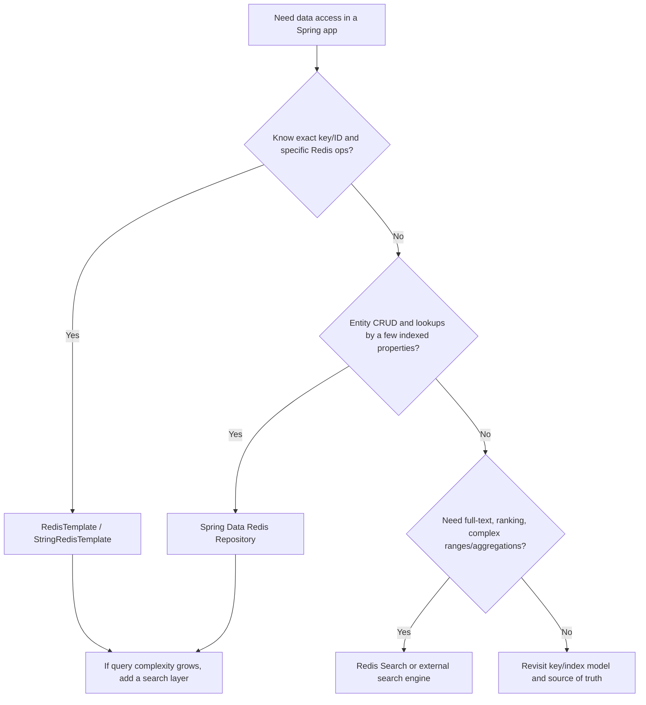
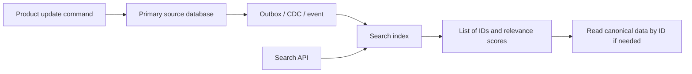

# Choosing Between Template, Repository, or a Dedicated Search Engine in Spring Data Redis

## 1. Why Must You Choose the Right Data Access Layer?

An application using Redis may start with very simple needs: reading a value by ID, storing short-lived verification codes, or incrementing a counter. Later, business requirements introduce more complex questions:

- "Get the product with ID **P100**."
- "Find all products in category **electronics**."
- "Find products whose names resemble **wireless keyboard**, within a given price range, sorted by relevance."
- "Filter by multiple criteria, paginate large results, and compute per-category statistics."

All of these can loosely be called "querying Redis", yet **no single API fits every case best**. In Spring Data Redis, the three main design directions are:

1. **Template**: `RedisTemplate`, `StringRedisTemplate`, or `ReactiveRedisTemplate` to work directly with Redis structures and commands.
2. **Repository**: declaring entities, keyspaces, indexes, and interfaces extending `CrudRepository` to manage aggregates and query by indexed properties.
3. **Dedicated search engine**: using Redis Search / Redis Query Engine or a search engine such as Elasticsearch or OpenSearch when full-text search, ranking, complex filtering, aggregations, or vector search are required per tool capabilities.

This choice impacts your **data model**, **how indexes are written and updated**, **query latency**, **memory cost**, and **consistency level**.

> In this lesson, "Redis Repository" refers to Spring Data Redis's mapping and secondary index features. It is **different** from Redis Search: the `@Indexed` annotation does not automatically create an `FT.CREATE` index, and `FT.SEARCH` is not a standard `CrudRepository` query method.

## 2. Quick Comparison of the Three Options

| Criterion | Template | Redis Repository | Dedicated Search |
|---|---|---|---|
| Primary unit of work | Redis keys and data structures | Mapped Java aggregates | Documents / records fed into search index |
| Typical APIs | `opsForValue()`, `opsForHash()`, `opsForSet()`, `execute()` | `save()`, `findById()`, `findByCategory()` | `FT.SEARCH`, `FT.AGGREGATE`, or search client |
| Finding one value by key | Very direct | Well suited for entities with IDs | Usually unnecessary to use search for this |
| Finding by property | Design indexes or access structures manually | Secondary indexes via `@Indexed` / index config | Indexes per search engine schema |
| Full-text search, relevance score | Must build most logic manually | Not a capability of standard secondary indexes | Built-in dedicated mechanisms |
| Numeric range filters, facets, analytics | Must design storage/query manually | Depends on supported query methods/indexes; not arbitrary SQL | Target problem space of search engines |
| Control over Redis commands | High | Partially abstracted by framework | Through specialized search interface |
| Object mapping | Full manual control of serializer/converter | Automatic aggregate mapping | Search engine mapping/index schema |
| Index maintenance cost | Your responsibility if building custom indexes | Framework manages secondary indexes on Repository writes | Engine manages search index; requires config and ops |
| Write consistency | Follows designed commands/transactions/scripts | Follows Repository entity write and index update flow | Inside Redis follows engine rules; external engines may lag |
| Best suited for | Caches, counters, TTLs, hashes, sets, sorted sets, atomic ops | Aggregate CRUD + lookup by a few indexed properties | Text search, ranking, complex filters/aggregations, vector search |

The table above describes **best fit**, not rigid boundaries: Template can invoke lower-level commands to build manual indexes, Repositories can be extended with custom implementations, and one application can use both Redis Repositories and a search engine for different tasks.

## 3. Start from Query Shape, Not from the API

Before choosing, describe each query with these questions:

- Is the **exact key or ID** known?
- Is the search condition an **exact value match** or **approximate / full-text matching**?
- Does it need **value ranges**, **sorting**, **deep pagination**, **aggregations**, or **ranking**?
- Are results a handful of elements or potentially hundreds of thousands of records?
- Does the data have a **TTL**, change frequently, or require read-your-writes consistency?
- Is Redis the **primary source of truth**, merely a **cache**, or a **search replica**?
- Does the system already run PostgreSQL, Elasticsearch/OpenSearch, or Redis Search?

Decision flow diagram:



**You do not have to pick one technology for the entire system.** For instance, `StringRedisTemplate` handles OTPs and counters, Repositories manage a simple group of Redis entities, and Elasticsearch/OpenSearch powers the product search page.

## 4. Template: When the Application Knows Exact Keys and Operations

### 4.1. Role of `RedisTemplate`

`RedisTemplate<K, V>` wraps connections, translates keys/values via serializers, and exposes operation groups matching Redis data types:

| Data Type / Action | Common Template API | Use Case |
|---|---|---|
| String | `opsForValue()` | Caching a single value, tokens, counters |
| Hash | `opsForHash()` | Storing multi-field snapshots under one ID |
| Set | `opsForSet()` | Group members, membership relations |
| Sorted Set | `opsForZSet()` | Leaderboards, score-ordered lists |
| List | `opsForList()` | Ordered lists, simple queues |
| Stream | `opsForStream()` | Event streams in Redis |
| Keyspace | `expire()`, `hasKey()`, `delete()` | TTL, existence, deletion |
| Composite commands | `execute(RedisScript, ...)` or `execute(RedisCallback)` | Atomic logic, connection-level operations |

When keys are strings and you want them readable in `redis-cli`, `StringRedisTemplate` is usually more convenient. With a generic `RedisTemplate`, writers and readers must agree on serializers; a JDK-serialized key does not match the raw bytes of `"cache:product:P100"`.

### 4.2. Example: Storing a Snapshot with TTL Using `StringRedisTemplate`

Dependency in a Spring Boot project:

```groovy
dependencies {
    implementation 'org.springframework.boot:spring-boot-starter-data-redis'
}
```

Development Redis connection:

```yaml
spring:
  data:
    redis:
      host: localhost
      port: 6379
```

Service operating directly on a Hash:

```java
package com.example.catalog.cache;

import java.time.Duration;
import java.util.Map;
import org.springframework.data.redis.core.StringRedisTemplate;
import org.springframework.stereotype.Service;

@Service
public class ProductSnapshotCache {

    private final StringRedisTemplate redis;

    public ProductSnapshotCache(StringRedisTemplate redis) {
        this.redis = redis;
    }

    private static String keyFor(String id) {
        if (id == null || id.isBlank()) {
            throw new IllegalArgumentException("Product ID is required");
        }
        return "cache:product:" + id;
    }

    public void put(
            String id, String title, String category,
            long priceInCents, Duration ttl) {

        if (ttl.isZero() || ttl.isNegative()) {
            throw new IllegalArgumentException("TTL must be positive");
        }

        String key = keyFor(id);
        redis.opsForHash().putAll(
                key,
                Map.of(
                        "title", title,
                        "category", category,
                        "priceInCents", Long.toString(priceInCents)
                )
        );
        redis.expire(key, ttl);
    }

    public Map<Object, Object> get(String id) {
        return redis.opsForHash().entries(keyFor(id));
    }

    public void evict(String id) {
        redis.delete(keyFor(id));
    }
}
```

When calling `get("P100")`, the application reads the single key `cache:product:P100`. No entity, repository, or secondary index is needed. This pattern fits caches looked up by ID.

**Limitation of the example:** `putAll` and `expire` are two separate commands. If the first succeeds and the second fails, the key may remain without a TTL. For data requiring strict operational invariants, design an atomic write path using suitable commands/scripts, or store a serialized value with an operation that sets TTL in the same command if the use case allows. Do not treat a multi-command illustrative snippet as a transaction.

### 4.3. Why Doesn't Template Automatically Provide Field Search?

Suppose there are 100,000 keys `cache:product:<id>`, each Hash containing `category`. Calling:

```java
redis.opsForHash().entries("cache:product:P100");
```

reads only the Hash for a **known ID**. Redis does not automatically build an index to execute the equivalent of:

```sql
SELECT * FROM products WHERE category = 'electronics';
```

A manual approach is maintaining a Set `cache:index:category:electronics` holding the ID list:

```redis
SADD cache:index:category:electronics P100
SADD cache:index:category:electronics P120
SMEMBERS cache:index:category:electronics
```

However, if product P100 changes category, the application must **remove the ID from the old Set, add it to the new Set, and update the primary Hash**. Under concurrent writes, TTLs, or failures between commands, manual indexes easily drift. Template gives lower-level control while forcing the application to solve consistency, reindexing, cleanup, and write races on its own.

Therefore, if the primary need is entity CRUD and lookups on a few fixed properties, Repositories usually cut down manual index-management code substantially.

### 4.4. Blocking or Reactive Template?

- `RedisTemplate` and `StringRedisTemplate` are synchronous (blocking) APIs.
- `ReactiveRedisTemplate` / `ReactiveStringRedisTemplate` fit reactive pipelines, returning types like `Mono` and `Flux` and using non-blocking Redis connections when supported by the driver.

Choose the API matching your application's actual architecture, not merely because "reactive" sounds faster. If the request chain uses Reactor, calling blocking APIs carelessly can stall event-loop threads; if the app is straightforward synchronous code, standard `RedisTemplate` is easier to use and reason about.

## 5. Repository: When Managing Aggregates and Simple Indexed Lookups

### 5.1. What Does a Redis Repository Do?

Spring Data Redis Repositories map Java objects into Redis Hashes by keyspace and ID. `@RedisHash` declares the namespace, `@Id` chooses the identifier, and `@Indexed` maintains secondary indexes by property value.

```java
package com.example.catalog.repository;

import org.springframework.data.annotation.Id;
import org.springframework.data.redis.core.RedisHash;
import org.springframework.data.redis.core.index.Indexed;

@RedisHash("catalogProducts")
public class Product {

    @Id
    private String id;

    private String title;

    @Indexed
    private String category;

    private long priceInCents;

    protected Product() {
    }

    public Product(
            String id, String title,
            String category, long priceInCents) {
        this.id = id;
        this.title = title;
        this.category = category;
        this.priceInCents = priceInCents;
    }

    public String getId() {
        return id;
    }

    public String getTitle() {
        return title;
    }

    public String getCategory() {
        return category;
    }

    public long getPriceInCents() {
        return priceInCents;
    }
}
```

Repository:

```java
package com.example.catalog.repository;

import java.util.List;
import org.springframework.data.repository.CrudRepository;

public interface ProductRepository extends CrudRepository<Product, String> {

    List<Product> findByCategory(String category);
}
```

Usage:

```java
repository.save(
        new Product("P100", "Mechanical Keyboard", "electronics", 12900)
);

Product byId = repository.findById("P100").orElseThrow();

List<Product> electronics =
        repository.findByCategory("electronics");
```

When `save` executes, Spring Data Redis stores the entity and updates declared secondary index structures. For the category index, Redis may hold a Set like:

```text
catalogProducts:category:electronics -> Set { "P100", ... }
```

The `findByCategory` finder uses this index to resolve IDs and then loads aggregates. Exact auxiliary key names and contents in Redis may vary depending on mapping, yet the essence is **Repository-managed indexes**.

### 5.2. How Many Query Types Do Repositories Support?

Repositories support query derivation for certain operators, typically:

- Equality comparisons on `@Indexed` properties, such as `findByCategory("electronics")`.
- Certain `And` and `Or` combinations using index Set intersections/unions.
- Some methods with limits, pagination, or sorting depending on the **Spring Data Redis version** in use.

Redis query methods are **not** a SQL engine. For instance, "title contains an arbitrary substring, with Vietnamese stemming, relevance ranking, and facets" does not magically work just by declaring `findByTitleContaining(...)`.

Even when a version supports sorting Repository results, check **whether sorting runs in Redis or after reading entities into Java**. Current Spring Data Redis documentation describes some forms of sorting via a `Comparator` over the result set; that can be costly in memory and time when result sizes are large.

For Query by Example, support usually centers on **exact, case-sensitive matches on indexed properties**; do not extrapolate support for every `StringMatcher` mode from other stores. Every field used in a lookup must be annotated or configured with an appropriate index.

### 5.3. Trade-Offs of Using Repositories

**Benefits:**

- Define data types and queries at the Java layer with minimal manual Redis commands.
- Readable aggregate CRUD code.
- Framework maintains Set indexes when entities are saved/deleted via the Repository.
- Can combine with custom repository implementations when specialized commands are needed.

**Limitations to watch out for:**

- Per-field indexes consume Redis memory and add work on writes.
- An **unindexed** field cannot naturally be queried by derived queries.
- Editing Hashes directly via CLI/Template can desynchronize Repository-managed indexes.
- Adding `@Indexed` to a field after data already exists does not automatically backfill historical entities.
- Changing keyspace, serializer, property names, or TTL directly impacts how Repositories locate data.
- Saving entities and updating indexes does not turn disparate datastores into a distributed transaction.

**When to choose?** When data naturally fits a Redis aggregate and queries are primarily ID lookups, a few exact-match values, or simple combinations of indexed fields.

## 6. Dedicated Search: When "Search" Is the Core Problem

A catalog system may need to:

- Search `"wireless keyboad"` and still find `"Wireless Keyboard"` via fuzzy/text analysis.
- Rank results by relevance, optionally boosting title weights.
- Filter products across multiple price ranges and attributes.
- Return facets such as counts per brand/category.
- Query by geographic location or vector similarity, if supported by the engine and deployment.
- Paginate, sort, and optimize queries across large document collections.

This is the domain of search engines, not simple Redis key lookups.

### 6.1. Redis Search / Redis Query Engine

Redis offers the `FT.CREATE`, `FT.SEARCH`, and `FT.AGGREGATE` command family for document search and querying. Availability depends on **Redis version and deployment**: newer Redis releases include the integrated Query Engine, while older versions or environments require the Redis Search module, Redis Stack, or managed service support. Verify directly that your running deployment supports `FT.*`.

The example below uses Redis Hashes in a **separate illustrative namespace** `search:product:`. It does not assume the same keyspace/serializer as the Repository in the previous section.

Create a search index:

```redis
FT.CREATE idx:products ON HASH PREFIX 1 search:product: SCHEMA
  title TEXT WEIGHT 5.0
  category TAG
  price NUMERIC SORTABLE
```

In Redis CLI, you can send the command on one line if your CLI environment does not support multi-line input. Field types serve different roles:

- `TEXT`: full-text indexing and keyword analysis.
- `TAG`: suited for categorical attributes and exact tag matching.
- `NUMERIC`: supports range conditions; `SORTABLE` enables sorting by that field.

Write sample data:

```redis
HSET search:product:P100 title "Wireless Keyboard" category "electronics" price 129
HSET search:product:P120 title "Gaming Mouse" category "electronics" price 89
HSET search:product:P130 title "Notebook" category "stationery" price 12
```

Run a combined full-text and filter query:

```redis
FT.SEARCH idx:products "@title:keyboard @category:{electronics} @price:[50 200]" SORTBY price ASC LIMIT 0 10
```

This query requires the word `"keyboard"` in `title`, tag category `electronics`, `price` between 50 and 200, sorted ascending by price, returning one page of results.

The `price` field in the example is an integer/number without currency unit; real systems must standardize currency and price representation to avoid comparison bugs.

One benefit of a search engine is that **indexes are built from the search index schema**, serving diverse query shapes over the same document set. One crucial difference: `FT.CREATE` **is not** Spring Data Redis Repository's `@Indexed` configuration. Using Redis Search requires a client/adapter supporting these commands and a separate lifecycle for search schemas.

Do not try to force every `FT.SEARCH` command into `CrudRepository` derived methods. You can define a search interface in your application and implement it with a Redis Search client compatible with your running Redis version.

### 6.2. Elasticsearch, OpenSearch, or External Search Systems

A standalone search engine is valuable when:

- Search infrastructure is already operated and you want unified schemas/indexes/observability.
- You need specialized tokenizers/analyzers, ranking, faceting, or rich query DSLs.
- Document volumes and search queries must scale or persist independently of Redis caches.
- You want Redis dedicated to low-latency key-value access while search handles content discovery.

Architecture example:



Key point to grasp: when primary data lives in a database and indexes live in another service, **the search index is usually a lagging replica**. A new document may commit to the DB yet not appear immediately in search results. The system must define lag SLAs, retry mechanisms, duplicate event handling, and index rebuild procedures.

Never promise "DB writes and search index updates are always atomic" simply because both calls sit in the same service method. A DB transaction does not automatically encompass an external search engine.

### 6.3. Does a Search Engine Replace Repository/Template?

Not necessarily. One application can combine:

- Redis Template for session caches and tasks needing specific Redis structures.
- Repositories for a group of aggregates stored wholly in Redis.
- Redis Search or Elasticsearch/OpenSearch for text/analytical queries.

However, **clearly designate data owners and write paths**. If a Repository manages its Hashes and secondary indexes while a search layer builds another index over the same data, those are **two separate indexing mechanisms**. Design synchronization explicitly; never assume an `@Indexed` annotation automatically fulfills full-text search queries.

## 7. Decision Matrix for Real-World Scenarios

| Scenario | Starting Choice | Why | When to Pivot |
|---|---|---|---|
| OTP needing `GET`/`SET` and TTL | `StringRedisTemplate` | Key-based operations, no entity/index needed | When non-key queries emerge |
| View counter | Template with atomic increment | `INCR` or `increment` reduces lost-update risk | If long-term analytics are needed, send data to analytics system |
| User profile cache by user ID | Template | Read/write by ID, explicit TTL | When managing entities as aggregates |
| Redis entity list with exact-match lookups on a few fields | Repository + `@Indexed` | Framework manages mapping and secondary indexes | When queries grow complex, results are huge, or full-text is needed |
| Top 100 leaderboard by score | Template + Sorted Set | `ZSET` fits fixed score/ranking | If ranking becomes dynamic text relevance |
| Product search by keyword, price, brand, and relevance | Redis Search / search engine | Dedicated indexes for text and ranges/filters | If only a few exact lookups are needed, use simpler tools |
| Document search with language analysis and synonyms | Dedicated search engine | Requires tokenizers, analyzers, ranking | Without these needs, avoid operating another system |
| Complex relational queries needing strict transactions | Consider SQL/document DB as primary source | Redis Repositories do not replace full relational querying | Use Redis as supplemental cache/search |
| Millions of historical records needing time-based analytics | Appropriate analytics system | Large aggregations and retention differ from caching | Store hot aggregated results in Redis if needed |

The "Starting Choice" column is driven by *query shape*. Next, factor in other constraints like Redis Cluster, TTLs, consistency SLAs, existing infrastructure, and operational cost.

## 8. Combining Template, Repository, and Search in One Application

### 8.1. Define the Source of Truth

Every record should have a clear answer to: **if data disagrees between two places, which one is right?**

Example design with a relational database as primary source:

```text
POST /products
       |
       v
Database transaction
       |
       +--> Outbox event / CDC --> Search index
       |
       +--> Invalidate / refresh Redis cache
       
GET /products/{id}
       |
       +--> Redis cache (Template)
       |        |
       |        +-- cache miss --> Database --> cache
       |
GET /products/search?q=keyboard
       |
       +--> Search index --> IDs --> canonical DB/cache when needed
```

In this diagram, the Redis cache can expire and be repopulated; the search index can be rebuilt from the database. Separation makes failure handling clean: a cache miss does not mean data loss, and search lag does not mean the write transaction failed.

Another option is making a Redis Repository the primary aggregate store. In that case, evaluate Redis backups, durability, TTLs, and how search indexes synchronize from Repository changes. Do not treat a Redis repository model as automatically equivalent to a strongly transactional relational table.

### 8.2. Design Interfaces Around Business Meaning

Business logic should depend on contracts expressing intent, for example:

```java
public interface ProductLookup {

    java.util.Optional<ProductView> findById(String id);

    java.util.List<ProductView> findByCategory(String category);
}
```

Advanced search contracts can stay separate:

```java
public interface ProductSearch {

    SearchPage search(ProductSearchCriteria criteria);
}
```

Here `ProductView`, `ProductSearchCriteria`, and `SearchPage` are application-defined types. The example illustrates **architectural boundaries**, not built-in Spring Data Redis APIs.

In the adapter layer, `ProductLookup` can use Template or a Redis Repository depending on the data store, while `ProductSearch` can use Redis Search or Elasticsearch/OpenSearch. If you later swap the underlying engine, business code can keep a stable contract.

### 8.3. Avoid Competing Write Paths on the Same Keys

Suppose a Repository manages:

```text
catalogProducts:P100
catalogProducts:category:electronics
```

If another service uses `StringRedisTemplate` to directly modify the `category` field of Hash `catalogProducts:P100`, the category index Set may keep pointing to the old value. Repository queries will then omit or erroneously include entities relative to real state.

Safer organization:

1. Designate one component owning aggregate and secondary index writes.
2. If special Redis-level operations are required, implement them inside a custom repository/adapter responsible for keeping all affected indexes in sync.
3. Avoid using Redis CLI or `opsForHash().put(...)` on Repository-managed entities unless an index-repair plan is in place.
4. If an external search engine exists, organize an ordered sync stream with failure recovery.

## 9. Technical Aspects That Often Decide the Choice

### 9.1. Query Complexity

A `findById` lookup rarely justifies routing through a search engine. Conversely, gluing together dozens of Sets in Template to implement ranges + full-text + relevance tends to create a fragile, hard-to-maintain homegrown search engine.

When there are only one or a few exact-match properties, Repositories can strike the right balance. If requirements combine text, tags, numbers, timestamps, and shifting rankings, a dedicated search engine usually saves effort long term.

### 9.2. Memory Cost and Write Amplification

Redis stores data primarily in memory; each secondary index can add Redis Sets and metadata. An entity indexed across many properties can substantially raise write overhead and memory usage.

Redis Search also incurs its own index, schema, maintenance, and rebuild costs. External search engines add infrastructure, network, and sync overhead. Estimate at least:

- Entity/document counts and average payload sizes.
- Indexed field count, cardinality, and update frequency.
- Write-to-read ratio and common query patterns.
- Index footprint relative to memory/disk limits.
- p95/p99 SLAs, scaling headroom, and reindexing duration.

Never decide solely based on fewer lines of Java code.

### 9.3. Read-Your-Writes and Consistency

Template operates directly on written keys, and individual Redis commands carry specific atomicity guarantees. Yet a flow spanning multiple commands, multiple keys, or multiple storage systems **is not automatically atomic**.

Repositories manage indexes through the framework write path, though you must understand the effects of TTL, keyspace events, external writes, and concurrent saves/updates.

External search indexes (outside Redis or the DB) typically follow asynchronous sync. If a screen **must** display the latest change immediately, consider reading the canonical entity by ID and explicitly modeling the "not yet indexed" state rather than assuming search results are always up to date.

### 9.4. TTL, Expiration, and Index Data

If data has short TTLs, a search engine keeping long-lived copies may display documents that already expired in Redis. With Redis Repositories, secondary indexes tie into Spring Data's save/delete/expiration handling, where receiving expiration events also depends on Redis keyspace notifications and listener configuration.

Align policies on:

- Does TTL apply to the entity/cached snapshot or also to the search document?
- When data expires, must it be removed from the search index?
- If an expiration event is missed, is there a periodic reconciliation mechanism?
- If an index is added after data already exists, will there be a backfill?

These questions matter far more than whether you use annotations or Template to query.

### 9.5. Redis Cluster and Multi-Key Commands

Redis Cluster distributes keys across hash slots. Scripts, transactions, and multi-key commands must respect slot boundaries and deployment rules. When maintaining secondary indexes manually with Template, the entity key and index keys may belong to different slots, rendering some atomic Lua or multi-key update designs unusable as originally conceived.

Repositories and search services each have distinct operating modes, topologies, and Cluster limitations. Pick an architecture and verify operational behavior in your real Redis environment rather than assuming standalone behavior translates identically to Cluster.

### 9.6. Query Pagination and Result Sorting

A list of 10 results and a list of 500,000 results call for different handling. Repository Set indexes suit bounded lookups; client-side filtering/sorting or materializing huge entity counts can become a major bottleneck.

Search engines usually provide pagination and sorting/relevance ranking via their schemas. Even there, very deep pagination can be expensive: consider cursor/search-after mechanisms supported by the backend when the workload demands it.

## 10. Approaches That Commonly Cause Problems

### 10.1. Using `KEYS` to "Search" in Production

```redis
KEYS catalogProducts:*
```

`KEYS` can cause service disruptions when scanning large key counts. It cannot filter by field values inside Hashes, and it is no substitute for indexes. `SCAN` works better for iterative maintenance tasks, yet it **still does not turn Hashes into a database with a secondary query engine**.

### 10.2. Assuming `@Indexed` Equals a Full-Text Index

Spring Data Redis's `@Indexed` supports exact property-value lookups via Repository-specific index structures. It does not configure analyzers, relevance ranking, or `FT.SEARCH`. If keyword search is needed, use an appropriate search engine and its schema.

### 10.3. Thinking Repositories Only Offer CRUD by ID

Repositories also offer secondary indexes, derived query methods, certain `And`/`Or` combinations, and version-dependent capabilities. Do not discard Repositories prematurely when simple category/email lookups arise. Conversely, do not assume Repository query APIs match the expressiveness of JPA or a search engine.

### 10.4. Building Manual Indexes Without Managing Updates

Using `SADD` to create an initial category index looks easy, until you have to handle `SREM` on category changes, deletions, TTLs, and concurrent update races. As index counts grow, the system accumulates brittle custom consistency code—a sign to evaluate Repositories or a search engine.

### 10.5. Writing to Database and Search Engine in One Method and Calling It a Transaction

`database.save(entity); searchIndex.save(entity);` spans at least two systems. If the database commits while the search index fails, data diverges. Use outbox/CDC, idempotent retries, and proper backfills rather than hoping both calls always succeed.

### 10.6. Mixing Two Serializers or Two Keyspaces Unknowingly

An application might configure a `RedisTemplate` with a different serializer than `StringRedisTemplate`. Even with identical Java strings, the key bytes in Redis can differ. Similarly, Repositories generate keys from `@RedisHash` and IDs, which may not match conventions used by another Template. Before sharing data across two APIs, standardize keyspace, serializer, value format, and ownership.

## 11. Three Decision Examples

### Example A: OTP Verification Service

Requirement: `SET` a code with a 5-minute TTL, `GET` by user/session key, delete after verification, limit retry attempts.

**Suitable direction:** Template. Data is accessed by deterministic keys and simple Redis operations. Marking a code used and enforcing attempt limits may need atomic commands/scripts so two concurrent requests cannot reuse the same code. Repositories or search engines do not help this access pattern.

### Example B: Meeting Room Directory Stored in Redis

Requirement: each room is an entity with ID, name, floor, and status; commonly queried by `buildingId` or `status`, mostly exact-match.

**Suitable direction:** Redis Repository with `@RedisHash` and `@Indexed` on queried fields; updates routed through the Repository. When entity counts and query criteria remain modest, this keeps the domain model clean without maintaining Set indexes by hand.

If requirements evolve to searching rooms with area between A and B, distance, multi-factor ranking, and complex availability schedules, revisit the data structures and consider a more suitable database/search tool.

### Example C: E-Commerce Product Search Page

Requirement: keyword search, typo tolerance, categories, price ranges, autocomplete suggestions, scoring, facets, sorting by price or relevance. Canonical product data lives in PostgreSQL.

**Suitable direction:** PostgreSQL as source of truth, Redis Template for ID-based caching, search engine for search functionality. Sync via outbox/CDC or a pipeline supporting retries and reindexing. Choose between Redis Search and Elasticsearch/OpenSearch based on analyzer needs, data scale, operational capacity, cost, and existing infrastructure.

There is no need to move the entire entity into Redis Repositories just because the app already uses Redis for caching.

## 12. Checklist to Finalize Your Design Choice

| Question | If the Answer Is "Yes" |
|---|---|
| Can exact keys be computed directly from input parameters? | Consider Template first |
| Do you need explicit control over Redis String/Hash/Set/ZSet commands? | Template is the right layer |
| Does the data model Java aggregates with a few exact-match indexed fields? | Redis Repository is a strong candidate |
| Do you need automatic secondary index maintenance for Redis entities? | Repository avoids custom index-sync code |
| Do you need keyword search, ranking, tags + numeric ranges, aggregations, or vectors? | Consider Redis Search / a dedicated search tool |
| Does a source of truth exist outside Redis? | Define cache invalidation and search sync strategies |
| Do multiple systems write the same entity? | Establish one write path responsible for keeping indexes consistent |
| Must users immediately see new writes in search? | Design read-after-write behavior and measure search lag explicitly |
| Are TTLs, Cluster, or large legacy datasets involved? | Evaluate cleanup, hash slots, migration, and reindexing |
| Do indexes noticeably raise resource cost? | Measure memory, write throughput, and p95/p99 before scaling |

A practical implementation process can start with **one representative query**: write down inputs, outputs, cardinality, target latency, and required consistency. Then design keys/indexes, pick the API to execute it, document the update lifecycle, and plan how auxiliary data is rebuilt. Only after establishing those facts should you standardize shared abstractions.

## 13. Conclusion

**Template** fits when the application needs direct control over keys and Redis structures/commands. **Repository** fits when Redis stores Java aggregates and queries rely mainly on IDs or a few properties with secondary indexes. **A dedicated search engine** fits when requirements shift toward content search, ranking, multi-dimensional filtering/aggregation, or complex query semantics.

What matters most is not just API syntax, but **how indexes stay maintained when data changes**, the **consistency** users expect, and the ability to **operate and rebuild** data. A design can combine all three layers, provided keyspaces, serializers, the primary source of truth, and ownership of every write path are clearly defined.

## References

- [Spring Data Redis — Redis Repositories](https://docs.spring.io/spring-data/redis/reference/redis/redis-repositories.html)
- [Spring Data Redis — Secondary Indexes](https://docs.spring.io/spring-data/redis/reference/redis/redis-repositories/indexes.html)
- [Spring Data Redis — Redis-specific Query Methods](https://docs.spring.io/spring-data/redis/reference/redis/redis-repositories/queries.html)
- [Spring Data Redis — Query by Example](https://docs.spring.io/spring-data/redis/reference/redis/redis-repositories/query-by-example.html)
- [Redis — FT.CREATE](https://redis.io/docs/latest/commands/ft.create/)
- [Redis — FT.SEARCH](https://redis.io/docs/latest/commands/ft.search/)
- [Redis — Querying data](https://redis.io/docs/latest/interact/search-and-query/query/)
