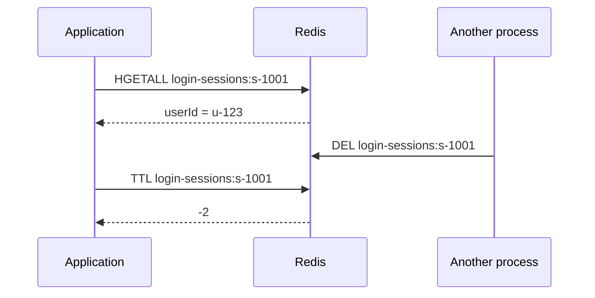

# Reading Remaining TTL and Distinguishing It from the Initially Configured Value

In **Spring Data Redis**, Time To Live (TTL) is commonly used to automatically remove sessions, verification codes, temporary shopping carts, or entities that are valid only for a limited period. For example, a login session is configured to live for **30 minutes**. Ten minutes after saving, the question "how much longer will this session live?" must be answered using the remaining time in Redis, not the **30 minutes** figure in configuration.

This is especially important when working with **Redis Repositories**: `@RedisHash(timeToLive = ...)` expresses the entity's TTL policy, whereas `@TimeToLive` placed on a **property** can be populated by Spring Data Redis with the actual TTL when reading the object. This lesson explains both kinds of values, how to query them, what special values mean, and how to avoid accidentally extending or losing TTL.

## 1. What are initially configured TTL and remaining TTL?

Suppose a `LoginSession` has a lifetime policy of `1800` seconds (30 minutes) and is saved into Redis at `10:00:00`.

| Time of read | Initially configured TTL | Remaining TTL observed in Redis | Meaning |
| --- | ---: | ---: | --- |
| Immediately after saving | 1800 seconds | Approximately 1800 seconds | Session was just created |
| After 5 minutes | 1800 seconds | Approximately 1500 seconds | TTL clock is counting down |
| After 20 minutes | 1800 seconds | Approximately 600 seconds | Session is closer to expiring |
| After expiration and key removal | 1800 seconds | `-2` from `TTL`/`PTTL` | No key remains to compute TTL |

**Configured TTL** answers the question: *"When writing/renewing, how long does the system intend for the object to live?"*

**Remaining TTL** answers the question: *"At the moment Redis responds to the command, how much time does the key have left before it expires?"*

```mermaid
timeline
    title Example lifecycle of a Redis key
    10:00 : SAVE session, apply TTL = 1800s
    10:05 : Remaining TTL around 1500s
    10:20 : Remaining TTL around 600s
    10:30 : Expected expiration time
```

The example above assumes no renewal, deletion, TTL change, or key overwrite occurs during that window. When an operation changes the lifetime, the remaining TTL may jump up, drop abruptly, or become unlimited.

Redis manages expiration on the **key**; the TTL value is metadata attached to the key rather than a countdown field continuously rewritten by Redis into the entity's hash.

## 2. Three concepts to keep separate

When designing a domain model or API, distinguish:

| Concept | Example | Typical data source | Changes over time? |
| --- | --- | --- | --- |
| **Configured duration** (*configured TTL*) | `1800s` | `@RedisHash`, application configuration, or a business field | Does not change merely because time passes; can change when policy updates |
| **Remaining duration** (*remaining TTL*) | `537s` | Redis `TTL`, `PTTL`, `RedisTemplate.getExpire(...)`, or a populated `@TimeToLive` property | Yes, decreases over time and changes when operations modify the key |
| **Expiration timestamp** (*expiresAt*) | `2030-01-01T10:30:00Z` | Session creation policy and timestamp, or reading the deadline from Redis | An absolute point in time; can change upon renewal |

Two sessions can have the same configured TTL of `1800s` yet different remaining TTLs because they were created at different times. Conversely, a renewed session can have a remaining TTL larger than the value the application read earlier.

Do not use `remainingTtl == configuredTtl` to decide whether a session is "new" or "old": command transit delays, second-level resolution, and renewals make that check unreliable.

## 3. Configuring TTL for a Redis Repository entity

Spring Data Redis offers several mechanisms to configure time to live. Each serves a distinct purpose.

### 3.1. `@RedisHash(timeToLive = ...)`: entity-type TTL

```java
package com.example.auth.redis;

import org.springframework.data.annotation.Id;
import org.springframework.data.redis.core.RedisHash;

@RedisHash(value = "login-sessions", timeToLive = 1800)
public class LoginSession {

    @Id
    private String id;

    private String userId;

    public LoginSession() {
    }

    public LoginSession(String id, String userId) {
        this.id = id;
        this.userId = userId;
    }

    public String getId() {
        return id;
    }

    public void setId(String id) {
        this.id = id;
    }

    public String getUserId() {
        return userId;
    }

    public void setUserId(String userId) {
        this.userId = userId;
    }
}
```

`timeToLive = 1800` represents **1800 seconds**. When saving an aggregate through Spring Data Redis Repository, the repository mechanism handles applying the lifetime to the entity's key.

```java
package com.example.auth.redis;

import org.springframework.data.repository.CrudRepository;

public interface LoginSessionRepository
        extends CrudRepository<LoginSession, String> {
}
```

```java
LoginSession session =
        repository.save(new LoginSession("s-1001", "u-123"));
```

With the default keyspace configuration, the data key takes the form `login-sessions:s-1001`. The value `1800` is the policy applied at save time, **not** a value that `findById()` automatically surfaces as a remaining-TTL counter.

### 3.2. `@TimeToLive` on a property: per-object TTL

When each entity has a different lifetime, place `@TimeToLive` on a numeric property:

```java
package com.example.auth.redis;

import org.springframework.data.annotation.Id;
import org.springframework.data.redis.core.RedisHash;
import org.springframework.data.redis.core.TimeToLive;

@RedisHash("access-tokens")
public class AccessToken {

    @Id
    private String id;

    private String ownerId;

    // Independent business data: duration granted when the token was created.
    private long configuredTtlSeconds;

    // Value set on save; populated with actual TTL on load.
    @TimeToLive
    private Long ttlSeconds;

    public AccessToken() {
    }

    public AccessToken(String id, String ownerId, long configuredTtlSeconds) {
        this.id = id;
        this.ownerId = ownerId;
        this.configuredTtlSeconds = configuredTtlSeconds;
        this.ttlSeconds = configuredTtlSeconds;
    }

    public String getId() {
        return id;
    }

    public void setId(String id) {
        this.id = id;
    }

    public String getOwnerId() {
        return ownerId;
    }

    public void setOwnerId(String ownerId) {
        this.ownerId = ownerId;
    }

    public long getConfiguredTtlSeconds() {
        return configuredTtlSeconds;
    }

    public void setConfiguredTtlSeconds(long configuredTtlSeconds) {
        this.configuredTtlSeconds = configuredTtlSeconds;
    }

    public Long getTtlSeconds() {
        return ttlSeconds;
    }

    public void setTtlSeconds(Long ttlSeconds) {
        this.ttlSeconds = ttlSeconds;
    }
}
```

In this example, `configuredTtlSeconds` is a regular domain field saved so you know the **originally granted duration**. `ttlSeconds` is the `@TimeToLive` property, carrying two operation-dependent meanings:

1. **Before `save()`**: the application sets the duration to apply. For example, `900` seconds to create a 15-minute token.
2. **After `findById()`**: Spring Data Redis reads `TTL`/`PTTL` from Redis and populates the **remaining** time into the annotated property in the declared unit. Thus, the value read after some time may be `830`, `600`, or `-1`.

This means **the same property can hold a configured duration on the write path and a counting-down value on the read path**. That is why the example keeps `configuredTtlSeconds` in a separate field. Do not design a field named `initialTtl`, annotate it with `@TimeToLive`, and then assume it always retains the initial value.

`@TimeToLive` defaults to `TimeUnit.SECONDS`. If you want milliseconds:

```java
@TimeToLive(unit = java.util.concurrent.TimeUnit.MILLISECONDS)
private Long ttlMillis;
```

All values set and read on this field by the application must then be interpreted as **milliseconds**. Pay attention to unit conversions when displaying or calculating; a number like `3000` can mean 3 seconds or 50 minutes depending on the unit.

**Precedence:** a property annotated with `@TimeToLive` configures TTL for the specific aggregate and takes precedence over keyspace lifetime configuration or `@RedisHash(timeToLive=...)`. To avoid confusion, use one primary mechanism per entity model.

### 3.3. `@TimeToLive` on a method

Spring Data Redis also lets you declare TTL via a method:

```java
@RedisHash("temporary-reports")
public class TemporaryReport {

    @Id
    private String id;

    private String content;

    @TimeToLive
    public long getTimeToLive() {
        return 600; // Grants a 10-minute TTL when the repository retrieves the value to save.
    }

    // Other constructors, getters/setters...
}
```

This fits when TTL is the result of computation logic inside the object. However, **Spring Data Redis's read-back of actual TTL is specifically documented for `@TimeToLive` placed on a property**; a method that always returns `600` should not be mistaken for a remaining-TTL query.

Do not declare `@TimeToLive` simultaneously on a property and a method within the same class.

## 4. Reading remaining TTL directly in Redis

Redis provides two main commands:

```redis
TTL login-sessions:s-1001
PTTL login-sessions:s-1001
```

| Command | Return unit | Purpose |
| --- | --- | --- |
| `TTL key` | Seconds | Shows remaining time at second-level resolution |
| `PTTL key` | Milliseconds | Shows remaining time at millisecond-level resolution |

Example using Redis CLI:

```redis
SET demo:ttl "hello" EX 60
TTL demo:ttl
# Example: (integer) 59

PTTL demo:ttl
# Example: (integer) 58970
```

The actual value varies with when the command is invoked. Returning `59` instead of `60` does not mean the initial configuration was wrong.

### 4.1. You must distinguish `-1`, `-2`, and `0`

`TTL` and `PTTL` return three categories of results:

| Value returned by Redis | Interpretation | What should the application do? |
| --- | --- | --- |
| `>= 0` | Key exists and has an expiration; the number is remaining time in the command's unit | Display remaining time; `0` is still a valid value |
| `-1` | Key exists but **has no expiration** | Display "no expiration", check if policy requires a TTL |
| `-2` | Key **does not exist** | Distinguish from an existing key with infinite life; treat as missing/not found |

`0` **does not mean** the key is gone: with `TTL`, a key can have a fraction of a second left and still exist when Redis returns `0`. Rely on `-2` to know Redis reports the key does not exist at query time.

Illustrative example:

```redis
SET demo:persistent "hello"
TTL demo:persistent
# (integer) -1

TTL demo:missing
# (integer) -2

EXPIRE demo:persistent 20
TTL demo:persistent
# Non-negative value, roughly 20

PERSIST demo:persistent
TTL demo:persistent
# (integer) -1
```

`PERSIST` removes the key's expiration without deleting its data. By contrast, `DEL` deletes the key completely; a subsequent `TTL` read will return `-2`.

### 4.2. TTL is not a fixed exact second count on every read

In practice, commands cross the network, take processing time, and Redis executes them in a specific order. Thus:

```text
10:00:00  EXPIRE key 1800
10:00:02  TTL key -> around 1798
10:00:03  PTTL key -> around 1797000
```

Do not write business assertions like `TTL must always equal 1800 right after save`, or require two consecutive `TTL` calls to differ by exactly one unit. Use reasonable range comparisons when displaying or verifying lifetimes.

## 5. Reading remaining TTL with Spring Data Redis

`RedisTemplate` and `StringRedisTemplate` provide:

```java
Long seconds = redisTemplate.getExpire(key);
Long milliseconds = redisTemplate.getExpire(
        key, java.util.concurrent.TimeUnit.MILLISECONDS);
```

The first returns remaining time to live in **seconds**; the second requests **milliseconds**. This value is read from Redis at execution time, completely independent of whatever initial configured duration the application remembers.

In the following example, `LoginSession` data is saved via the default Redis Repository, while `StringRedisTemplate` is used to inspect the TTL of the **aggregate key** `login-sessions:<id>`:

```java
package com.example.auth.redis;

import java.util.concurrent.TimeUnit;
import org.springframework.data.redis.core.StringRedisTemplate;
import org.springframework.stereotype.Service;

@Service
public class LoginSessionTtlService {

    private final StringRedisTemplate redis;

    public LoginSessionTtlService(StringRedisTemplate redis) {
        this.redis = redis;
    }

    public TtlInfo readTtl(String sessionId) {
        String key = "login-sessions:" + sessionId;
        Long ttlSeconds = redis.getExpire(key, TimeUnit.SECONDS);

        // Null may be returned in a pipeline/transaction.
        if (ttlSeconds == null) {
            throw new IllegalStateException(
                    "TTL result is unavailable in this execution context");
        }

        if (ttlSeconds == -2L) {
            return new TtlInfo(TtlState.MISSING, null);
        }
        if (ttlSeconds == -1L) {
            return new TtlInfo(TtlState.PERSISTENT, null);
        }
        return new TtlInfo(TtlState.EXPIRING, ttlSeconds);
    }

    public enum TtlState {
        MISSING,
        PERSISTENT,
        EXPIRING
    }

    public record TtlInfo(TtlState state, Long remainingSeconds) {
    }
}
```

Usage example:

```java
LoginSessionTtlService.TtlInfo ttl =
        ttlService.readTtl("s-1001");

switch (ttl.state()) {
    case MISSING -> System.out.println("Session does not exist");
    case PERSISTENT -> System.out.println("Session has no TTL");
    case EXPIRING -> System.out.println(
            ttl.remainingSeconds() + " seconds remaining");
}
```

Notable points:

- Do not take `1800` from `@RedisHash` and present it as the remaining TTL.
- `getExpire(...)` returns `Long`, which may be `-1` or `-2`; do not use `Duration.ofSeconds(-1)` to represent "no expiration," because it is a state, not a negative duration.
- A `null` result **does not mean the same thing** as `-2`. Within a pipeline or transaction, Spring Data Redis may not have the immediate result at the call site; handle it where pipeline/transaction results are collected.
- Under default repository configuration, the aggregate key usually takes the form `keyspace:id`; if the application customizes the keyspace, converter, or serializer, determine the **exact physical byte key** and use a compatible template. Reading the wrong key can return `-2` even when the aggregate exists under another key.
- Reading TTL does not lock the entity. Immediately after the command, the session could be renewed, deleted, or expired.

### 5.1. Combining Repository reads and `getExpire(...)`

Suppose the application needs to display session details alongside TTL:

```java
public record SessionView(
        String sessionId,
        String userId,
        LoginSessionTtlService.TtlInfo ttl) {
}

public Optional<SessionView> findSessionView(String id) {
    return repository.findById(id).map(session ->
            new SessionView(
                    session.getId(),
                    session.getUserId(),
                    ttlService.readTtl(session.getId())));
}
```

In the example above, `repository` is `LoginSessionRepository` and `ttlService` is `LoginSessionTtlService` injected into the service containing the method.

The two reads are **not atomic**. `findById` may see the entity while the subsequent `getExpire` call returns `MISSING` because the key just expired. This is a valid state in a concurrent system. An API requiring strict consistency between entity content and deadline must use an atomic read design or appropriate versioning/snapshot rather than assuming two independent calls observe the same point in time.

## 6. Reading TTL through a Repository `@TimeToLive` property

This is a key difference from `@RedisHash(timeToLive = ...)`: when a **property** is annotated with `@TimeToLive`, Spring Data Redis populates the actual TTL when loading the aggregate from Redis.

With the `AccessToken` class above:

```java
package com.example.auth.redis;

import org.springframework.data.repository.CrudRepository;

public interface AccessTokenRepository
        extends CrudRepository<AccessToken, String> {
}
```

Example creating a 15-minute token:

```java
AccessToken created = new AccessToken(
        "token-abc",
        "u-123",
        900
);
tokenRepository.save(created);
```

After some time, read it back using the repository:

```java
AccessToken loaded = tokenRepository.findById("token-abc")
        .orElseThrow();

System.out.println(loaded.getConfiguredTtlSeconds());
// 900: originally granted business duration

System.out.println(loaded.getTtlSeconds());
// e.g. 820: actual remaining TTL at load time
```

The number `820` is illustrative; the exact value cannot be known beforehand. The difference between the two fields is intentional:

```text
configuredTtlSeconds = 900       // does not automatically decrease over time
ttlSeconds           = 820       // populated with remaining TTL on load
```

**Not every `findById` produces an object with a positive TTL.** If the key still exists without an expiration, the `@TimeToLive` field may receive `-1` per Spring Data Redis's mapping contract. If the key has been deleted or expired, the repository usually returns `Optional.empty()`; there is no aggregate on which to set a TTL field to `-2`.

With `@TimeToLive(unit = TimeUnit.MILLISECONDS)`, the read value has millisecond resolution. Choose the unit according to business requirements and keep it consistent both when assigning before save and when displaying after read.

### 6.1. When only `@RedisHash` configured TTL is used

If the entity only has:

```java
@RedisHash(value = "login-sessions", timeToLive = 1800)
public class LoginSession {
    @Id
    private String id;
    // ...
}
```

then calling:

```java
LoginSession s = repository.findById("s-1001").orElseThrow();
```

retrieves the entity's data, but the class **does not automatically gain a `remainingTtlSeconds` property**. To know the remaining time, the application must read the Redis TTL via `getExpire(...)` or design the class with a `@TimeToLive` property and understand how that mechanism interacts with TTL configuration.

## 7. What happens when re-saving a read entity?

This is a common trap with dynamic TTL.

```text
10:00  Create token with @TimeToLive ttlSeconds = 900
10:05  findById(...) reads it back, ttlSeconds around 600
10:06  Application edits another field and calls save(loaded)
```

If `loaded.getTtlSeconds()` still holds the **remaining** time from when it was read, the repository uses that value to apply the lifetime on save. In this case, `save` **does not automatically know** that the initial TTL was `900` unless the application explicitly sets `900` again.

Decisions to make:

| Business requirement | How to manage TTL |
| --- | --- |
| Only want to read TTL for display | Read `getExpire` or the `@TimeToLive` property; do not re-save the entity just to "read TTL" |
| Want each renewal to grant a fresh 15 minutes | Explicitly set the desired duration before saving, e.g. `token.setTtlSeconds(900L)` |
| Want a fixed deadline from creation, not extended by updates | Store `expiresAt` independently and compute remaining duration at write time; do not automatically reuse initial TTL |
| Only want to edit a field without changing expiration | Design an update path that preserves expiration/deadline; avoid assuming repository `save()` always preserves an absolute deadline |

Example of explicit renewal:

```java
public AccessToken renewToken(
        AccessTokenRepository tokens,
        String id) {

    AccessToken token = tokens.findById(id)
            .orElseThrow(() ->
                    new IllegalArgumentException("Token not found: " + id));

    long grantedSeconds = token.getConfiguredTtlSeconds();
    if (grantedSeconds <= 0) {
        throw new IllegalStateException("Invalid configured token TTL");
    }

    // This is an intentional renewal action, not reading TTL.
    token.setTtlSeconds(grantedSeconds);
    return tokens.save(token);
}
```

Conversely, do not renew the entire TTL if policy requires that a token's expiration cannot be extended. Using a fixed expiration timestamp or an immutable token makes it easier to uphold that contract.

**Concurrency warning:** `findById` followed by `save` can suffer from race conditions if another process deletes, renews, or recreates the key with the same ID. For high-security sessions/tokens, use generation identifiers, version checks, and appropriate atomic operations before allowing renewal; do not use this simple snippet as a complete authentication mechanism.

## 8. Remaining TTL does not mean "age" or "configured value"

Suppose `configuredTtlSeconds = 1800` and the current TTL is `2000` seconds. Is that necessarily a bug?

No. There are several possibilities:

- A renewal operation set a longer lifetime than the original policy.
- Configuration changed from an earlier version.
- Redis was updated via another flow or with `EXPIRE`/`PEXPIRE`.
- The application read the wrong key or compared mismatched units.

Similarly, if the current TTL is `-1`, Redis is reporting **the key exists and has no expiration**; it does not mean "minus one second left." A TTL of `-2` means **the key does not exist** when the command ran; it does not tell you whether the key previously existed and expired or was never created.

A clear set of API fields might look like:

```json
{
  "sessionId": "s-1001",
  "configuredTtlSeconds": 1800,
  "ttlState": "EXPIRING",
  "remainingTtlSeconds": 742
}
```

When there is no expiration, return `ttlState: "PERSISTENT"` and `remainingTtlSeconds: null`. When not found, return `ttlState: "MISSING"` with a `null` duration or a `404` response per your API contract. This representation avoids forcing frontends to decode two magic negative numbers.

### 8.1. "Expiration timestamp" is a distinct case

If business requirements need to report "when will the session expire," an `expiresAt` field can be computed from `createdAt + configuredTtl` when granted. However, if the application allows renewals or administrators change TTL directly in Redis, a separately stored deadline can become **out of sync** with the actual TTL.

Modern Redis also provides `EXPIRETIME` and `PEXPIRETIME` to read a key's expiration timestamp. When using deadlines, still define the **source of truth**: business policy, the stored deadline, or the deadline currently held in Redis.

## 9. Redis operations that can change TTL

Reading TTL accurately also requires understanding which operations preserve, replace, or remove expiration.

| Operation | Effect on key's TTL |
| --- | --- |
| `EXPIRE key 600` | Sets a new 600-second TTL if the operation succeeds |
| `PEXPIRE key 1500` | Sets a new 1500-millisecond TTL |
| `PERSIST key` | Removes expiration; if the key still exists, `TTL` becomes `-1` |
| `DEL key` or key expiration | Key is gone; `TTL` returns `-2` |
| `SET key value` overwriting the value | Typically removes existing TTL unless an appropriate TTL-preserving option is used |
| `HSET key field value` on an existing hash | Updates a field in the hash; typically does not clear the key's TTL |
| `RENAME old new` | The TTL attached to the key moves along with the data to the new name |
| `repository.save(entity)` | Repository applies the entity's TTL/mapping rules on this save; watch out for dynamic vs. configured TTL |

Example illustrating the difference between replacing a value and updating a field:

```redis
SET demo:string "old" EX 60
TTL demo:string
# Positive value

SET demo:string "new"
TTL demo:string
# -1: SET replaced the value and removed the expiration
```

```redis
HSET demo:hash name "old"
EXPIRE demo:hash 60
HSET demo:hash name "new"
TTL demo:hash
# Typically still has a counting-down TTL
```

With Redis Repositories, avoid manually editing hashes and auxiliary keys unless you understand the repository's indexing and expiration mechanics. A direct Redis command is not equivalent to updating an aggregate through the repository.

## 10. Aggregate TTL differs from Repository auxiliary keys' TTL

Spring Data Redis Repository can create auxiliary keys to manage the keyspace, secondary indexes, or expiration notifications.

When an aggregate has a positive expiration, Spring Data Redis can create a **shadow/phantom copy** and keep it for an extra period after the original expires to serve `RedisKeyExpiredEvent`. This mechanism depends on repository configuration and can be adjusted when event payload data is unnecessary.

Therefore, when inspecting TTL:

1. Identify the exact **primary aggregate key**, such as `login-sessions:s-1001`.
2. Do not read the TTL of an index, metadata key, or shadow copy and conclude that it is the session's remaining time.
3. Once the primary key expires, `repository.findById(...)` may return empty even though Redis still contains auxiliary keys sharing a similar prefix.

`KEYS login-sessions:*` can return multiple keys and is not a reliable way to infer an entity's TTL. In production applications, prefer building the aggregate key according to mapping conventions or using a dedicated repository/service API; avoid scanning the entire keyspace just to check one ID.

TTL on the entire Redis key also differs from **per-field hash expiration** if a system uses hash-field expiration features in supported Redis versions. The `@RedisHash` examples in this lesson focus on the lifetime of the **aggregate key**, not separate TTLs per Java property.

## 11. Precision, read timing, and race conditions

### 11.1. TTL is a very brief snapshot

A response of `remainingTtlSeconds = 30` only means Redis returned 30 seconds when the command ran. By the time the HTTP response reaches the browser, the number may no longer be 30.

For countdown UIs, you can pass `remainingTtlMillis` along with `observedAt` or `expiresAt` aligned with a time source. The browser counts down locally to reduce server calls; when the user performs an important action, the server must still verify the real state.

### 11.2. Reading data and TTL are two separate commands



The application saw the entity when reading data, then saw `MISSING` when querying TTL. This is not necessarily a bug: the two commands observed Redis at two different instants.

When validating sessions or access rights, do not make decisions based on a TTL read many seconds earlier. Verify validity within the current business operation, or use an atomic mechanism when the decision must be synchronized with a data update.

### 11.3. Results from Redis are the source of truth for current TTL

Spring configuration or `configuredTtlSeconds` indicates the initial policy. If another operation ran `EXPIRE`, `PERSIST`, or replaced the key, Redis's state may be completely different. To know the **actual remaining** time, query Redis or use the `@TimeToLive` value just mapped from Redis, while accepting that this value continues changing over time.

## 12. Design choices by business requirement

| Requirement | Appropriate approach |
| --- | --- |
| Every entity shares a 30-minute lifetime | `@RedisHash(timeToLive = 1800)` |
| Each entity has a different lifetime | `@TimeToLive` property with per-entity duration |
| Need remaining lifetime when fetching entity via repository | `@TimeToLive` on a **property** or explicit `getExpire(...)` query |
| Need to preserve the history of granted duration | Separate `configuredTtlSeconds`/policy metadata property, not annotated with `@TimeToLive` |
| Need to check TTL without loading the whole entity | `RedisTemplate.getExpire(key)` |
| Need to distinguish missing key vs. non-expiring key | Decode `-2` and `-1` into two distinct states |
| Need high-resolution timing | `PTTL` or `getExpire(key, TimeUnit.MILLISECONDS)` |
| Need renewal based on user activity | Define an explicit sliding-expiration policy and apply new TTL deliberately |
| Need fixed expiration with no implicit renewal | Manage deadline/version and avoid re-save paths that automatically reset TTL |

No single annotation simultaneously preserves the initial configuration, provides a live remaining duration, and guarantees an immutable deadline across every write. Each requirement calls for an explicit data contract.

## 13. Common mistakes

### Mistake 1: Using `@RedisHash(timeToLive=...)` to display remaining seconds

```java
// Semantically wrong: this is the class's configured TTL.
long remaining = 1800;
```

`1800` describes policy, not elapsed time. To display remaining time, use `getExpire(...)` or a property mapped from Redis via `@TimeToLive`.

### Mistake 2: Treating `-1` as "expired"

In Redis, `-1` means **the key exists without an expiration**; `-2` means **the key does not exist**. If a system expects sessions to expire automatically yet sees `-1`, inspect TTL application policies, `SET`/`PERSIST` operations, serialization, and whether the right key is being read.

### Mistake 3: Treating TTL `0` as "key is gone"

TTL in seconds can return `0` when the key has a very short fraction of time left. Do not use `ttl <= 0` as a blanket check for "does not exist," as it conflates `0`, `-1`, and `-2` into one wrong state. Handle the special negative codes first, then handle `>= 0`.

### Mistake 4: Confusing seconds and milliseconds

```java
Long seconds = redis.getExpire(key); // Seconds
Long millis = redis.getExpire(key, TimeUnit.MILLISECONDS); // Milliseconds
```

Name variables after their units and avoid manual multiplication/division if the framework already converts. A TTL of `5000` with `@TimeToLive(unit = MILLISECONDS)` is only 5 seconds.

### Mistake 5: Reading `@TimeToLive` after load and assuming it is the creation-time duration

Spring Data Redis updates a `@TimeToLive` property with the actual TTL when loading. If you need to audit the original duration, store that information separately or record the policy/version in an appropriate store.

### Mistake 6: Saving a loaded entity without considering TTL

The `@TimeToLive` field may hold remaining seconds. On `save`, that is an active timeout value. Decide clearly whether to preserve a fixed deadline, renew per policy, or keep the existing TTL; never let expiration behavior become an unintended side effect of editing a name or metadata.

### Mistake 7: Seeing an auxiliary key and thinking the entity still exists

Repositories can maintain indexes and shadow copies for expiration events. TTL checks must target the primary aggregate key; the existence of an auxiliary key does not prove the object is still accessible through the repository.

### Mistake 8: `getExpire(...)` returns `null` and is interpreted like `-2`

In Spring Data Redis, `null` can occur when called inside a pipeline/transaction and is not a Redis status code. During normal execution, use `-1`/`-2` to interpret Redis's response; handle `null` according to the execution context.

## 14. Practice observing TTL changes

You can test directly on a learning Redis instance:

```redis
SET lesson:ttl "value" EX 15
TTL lesson:ttl
PTTL lesson:ttl
```

Wait a few seconds and run again:

```redis
TTL lesson:ttl
PTTL lesson:ttl
```

The results will decrease. Next, extend it:

```redis
EXPIRE lesson:ttl 60
TTL lesson:ttl
```

Remaining time jumps back near 60 seconds: Redis updated the current lifetime. Try removing the expiration:

```redis
PERSIST lesson:ttl
TTL lesson:ttl
# -1
```

Finally, delete the key:

```redis
DEL lesson:ttl
TTL lesson:ttl
# -2
```

These operations on a standalone key help build intuition for Redis TTL. When working with real Redis Repository entities, use the repository and entity TTL configuration to save/delete, avoiding direct edits to index keys or shadow copies.

## 15. Summary

**The initially configured value** is the duration chosen when creating or renewing an entity. **Remaining TTL** is the current state Redis returns at read time. With Spring Data Redis:

1. `@RedisHash(timeToLive = ...)` sets a default lifetime for the aggregate.
2. `@TimeToLive` on a property sets per-entity timeouts and is populated by Spring Data Redis with the remaining TTL when loading the entity.
3. `RedisTemplate.getExpire(...)` or Redis `TTL`/`PTTL` reads the current TTL without guessing from annotations.
4. `-1` means the key exists without expiration; `-2` means the key does not exist; `0` can still be a live key for a very brief moment.
5. If you need both the initial duration and the remaining time, manage them as two independent pieces of data and define clear rules for re-saving or renewing.

Understanding this difference helps applications render accurate countdowns, avoid unintended session renewals, and correctly explain cases where TTL differs from the declared value.

### References

- [Spring Data Redis — Time To Live](https://docs.spring.io/spring-data/redis/reference/redis/redis-repositories/expirations.html): `@RedisHash(timeToLive)`, `@TimeToLive`, and how actual TTL is read back.
- [Spring Data Redis — `@TimeToLive` API](https://docs.spring.io/spring-data/redis/reference/api/java/org/springframework/data/redis/core/TimeToLive.html): unit configuration and property TTL precedence.
- [Spring Data Redis — `RedisOperations` API](https://docs.spring.io/spring-data/redis/reference/api/java/org/springframework/data/redis/core/RedisOperations.html): `getExpire(key)` and `getExpire(key, TimeUnit)`.
- [Redis — TTL](https://redis.io/docs/latest/commands/ttl/): remaining time to live in seconds and special return codes.
- [Redis — PTTL](https://redis.io/docs/latest/commands/pttl/): remaining time to live in milliseconds.
- [Redis — EXPIRE](https://redis.io/docs/latest/commands/expire/): setting TTL, extending it, and the impact of key-modifying operations.
