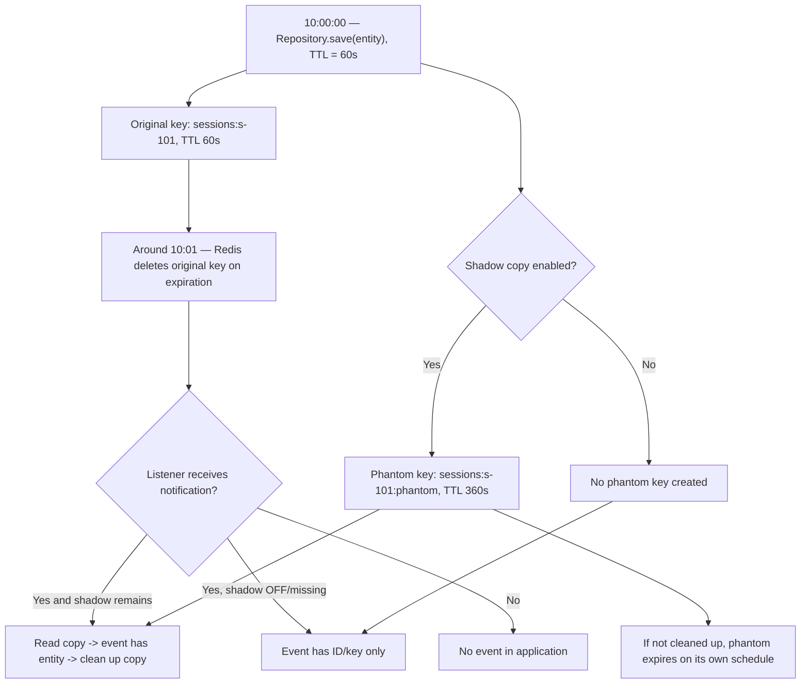

# Configuring Shadow Copies On or Off and Memory Trade-offs in Spring Data Redis

## 1. What is a shadow copy and why does it appear when an entity has a TTL?

In **Spring Data Redis Repositories**, an entity with a Time To Live (TTL) is typically mapped to a Redis Hash. Redis automatically expires the key when the TTL ends. By the time Redis emits the `expired` event, the original key's data has already been deleted, so the application can no longer call `HGETALL` to fetch the entity that just expired.

To allow publishing `RedisKeyExpiredEvent` along with **the expired entity's value**, Spring Data Redis provides the **shadow copy** mechanism, also called a **phantom copy**: storing an additional Redis Hash holding a representation of the entity with a lifetime **5 minutes (300 seconds)** longer than the original key. When the listener receives the expiration event for the original key, the repository reads this copy to recover the entity value for the event and cleans up the copy if it still exists.

Example of a session entity saved with a 60-second TTL:

```text
Time t = 0:
  sessions:s-101           TTL = 60 seconds   (original key)
  sessions:s-101:phantom   TTL = 360 seconds  (shadow copy if enabled)

Around t ≈ 60 seconds:
  Redis expires sessions:s-101.
  Redis emits expired notification for the original key.
  Active listener -> reads shadow copy -> publishes RedisKeyExpiredEvent.
  If the shadow copy is read, the listener deletes it right after reading.

If the listener does not process the event:
  the original key has expired;
  the shadow copy can continue existing until its own TTL ends,
  around t = 360 seconds from save time.
```

The `:phantom` suffix illustrates the key-naming convention in Spring Data Redis's implementation. **Do not treat the auxiliary key name as a business contract**: it is an internal detail that may change across versions and mapping strategies.

Crucially: a shadow copy **is not a backup for restoring business data**, does not replace backups, does not prevent the original key from expiring, and does not guarantee event delivery. Its sole purpose is to supply the **entity payload** to the expiration event when the listener still receives the notification from Redis.

## 2. Distinguishing three easily confused mechanisms

There are three independent factors to consider:

| Mechanism | Controlled by | Effect |
| --- | --- | --- |
| Entity TTL | `@RedisHash(timeToLive = ...)`, `@TimeToLive`, or keyspace configuration | Determines when the **original key** expires. |
| Expiration event listener | `enableKeyspaceEvents` in `@EnableRedisRepositories` | Determines whether the repository subscribes to keyspace notifications and publishes `RedisKeyExpiredEvent`. |
| Shadow copy | `shadowCopy` in `@EnableRedisRepositories` | Determines whether an extra copy of TTL entities is saved to serve as the event payload. |

From this follows:

- **Disabling `shadowCopy` does not disable TTL.** The original key still expires according to Redis policy.
- **Disabling `shadowCopy` does not necessarily disable events.** When the listener is enabled and receives a notification, `RedisKeyExpiredEvent` can still be published with the entity's ID, just without the full entity copy.
- **Enabling `shadowCopy` does not guarantee events arrive.** Redis must emit expiration notifications, the listener must be active, and the application must stay connected.
- **Enabling the listener does not require saving shadow copies.** You can enable event reception and disable shadow copies to reduce memory cost.

For instance, a system that only needs to know which session expired in order to clean up linked entries can work with the ID alone. By contrast, a handler that needs `userId`, `orderType`, or metadata stored in the expired entity may need the payload from the shadow copy unless that data is managed in another durable store.

## 3. Declaring an entity with TTL and its repository

Example temporary entity with a 60-second TTL:

```java
import org.springframework.data.annotation.Id;
import org.springframework.data.redis.core.RedisHash;

@RedisHash(value = "sessions", timeToLive = 60)
public class SessionRecord {

    @Id
    private String id;

    private String userId;
    private String deviceId;

    public SessionRecord() {}

    public SessionRecord(String id, String userId, String deviceId) {
        this.id = id;
        this.userId = userId;
        this.deviceId = deviceId;
    }

    public String getId() { return id; }
    public void setId(String id) { this.id = id; }

    public String getUserId() { return userId; }
    public void setUserId(String userId) { this.userId = userId; }

    public String getDeviceId() { return deviceId; }
    public void setDeviceId(String deviceId) { this.deviceId = deviceId; }
}
```

Repository:

```java
import org.springframework.data.repository.CrudRepository;

public interface SessionRecordRepository
        extends CrudRepository<SessionRecord, String> {
}
```

Saving the entity:

```java
repository.save(new SessionRecord("s-101", "u-42", "mobile"));
```

Under Redis Repository's TTL mechanism, the original key gets a 60-second TTL. **Whether a shadow copy appears depends on the `shadowCopy` and listener configuration.** Do not assume that merely setting `@RedisHash(timeToLive = 60)` guarantees a `:phantom` key will be created.

Besides a fixed TTL, you can use `@TimeToLive` per entity:

```java
@RedisHash("sessions")
public class SessionRecordWithVariableTtl {

    @Id
    private String id;

    private String userId;

    @TimeToLive
    private Long ttlSeconds;

    // Constructors, getters, and setters
}
```

When reading back a property annotated with `@TimeToLive`, Spring Data Redis can read the remaining `TTL`/`PTTL` from Redis. Thus, understand TTL on an entity as either the duration applied from a save operation or the remaining time at read time, depending on how it is declared and used.

## 4. Three values of `shadowCopy`: `DEFAULT`, `ON`, `OFF`

Spring Data Redis provides the `RedisKeyValueAdapter.ShadowCopy` enum:

| Value | Meaning | Best suited when |
| --- | --- | --- |
| `DEFAULT` | Automatically decides whether to store shadow copies based on the expiration listener's state. | You want the repository's default behavior, aligned with the listener mode. |
| `ON` | Requests storing shadow copies for entities with a positive TTL. | You need the entity payload after expiration and have an appropriate listener. |
| `OFF` | Does not create shadow copies for new writes. | Memory savings are a priority, and events only need the ID or no entity payload is needed. |

**Note on defaults:** `@EnableRedisRepositories` uses `shadowCopy = DEFAULT` and `enableKeyspaceEvents = OFF` by API default. Because `DEFAULT` depends on the listener, do not claim every entity with a TTL is always duplicated under completely default application settings.

Mechanically, `DEFAULT` keeps copies when the expiration event listener has been initialized. With `ON_STARTUP`, the listener initializes when the application starts; with `ON_DEMAND`, it initializes on the first save of an entity with a positive TTL. When the listener is `OFF`, `DEFAULT` has no reason to create copies to supply event payloads.

### Explicitly enabling shadow copies

```java
import org.springframework.context.annotation.Configuration;
import org.springframework.data.redis.core.RedisKeyValueAdapter;
import org.springframework.data.redis.repository.configuration.EnableRedisRepositories;

@Configuration
@EnableRedisRepositories(
    basePackages = "com.example.session",
    enableKeyspaceEvents = RedisKeyValueAdapter.EnableKeyspaceEvents.ON_STARTUP,
    shadowCopy = RedisKeyValueAdapter.ShadowCopy.ON
)
public class RedisRepositoryConfig {
}
```

With this configuration, the repository creates shadow copies for expiring entities and the listener is requested to run as soon as the application starts.

### Disabling shadow copies while still receiving expiration events

```java
@Configuration
@EnableRedisRepositories(
    basePackages = "com.example.session",
    enableKeyspaceEvents = RedisKeyValueAdapter.EnableKeyspaceEvents.ON_STARTUP,
    shadowCopy = RedisKeyValueAdapter.ShadowCopy.OFF
)
public class RedisRepositoryConfig {
}
```

Here Redis still expires the primary key as usual. If Redis keyspace notifications and the listener operate properly, the application still receives `RedisKeyExpiredEvent` with key/ID identification, but **the entity value from a shadow copy is no longer available**.

### Letting Spring decide automatically

```java
@Configuration
@EnableRedisRepositories(
    basePackages = "com.example.session",
    enableKeyspaceEvents = RedisKeyValueAdapter.EnableKeyspaceEvents.ON_DEMAND,
    shadowCopy = RedisKeyValueAdapter.ShadowCopy.DEFAULT
)
public class RedisRepositoryConfig {
}
```

`ON_DEMAND` only initializes the listener when an entity with a positive TTL is first saved, rather than right at startup. This can reduce startup work, yet it also leaves a window without a listener where events for previously created keys will be missed.

**Do not routinely combine `shadowCopy = ON` with the listener `OFF`:** extra data can consume memory while the repository publishes no events to consume those values. Keep that combination only if you have a specific reason and understand its impact.

## 5. Behavior matrix: combining listeners with shadow copies

`enableKeyspaceEvents` belongs to the `RedisKeyValueAdapter.EnableKeyspaceEvents` enum:

- `OFF`: do not enable the repository's expiration listener.
- `ON_STARTUP`: initialize the listener at application startup.
- `ON_DEMAND`: initialize the listener upon the first save of an entity with a positive TTL.

The table below describes expected behavior for typical combinations:

| Listener | Shadow copy | Creates shadow copy for positive-TTL entity? | `RedisKeyExpiredEvent` from repository? | Event payload |
| --- | --- | --- | --- | --- |
| `OFF` | `DEFAULT` | No, under normal adapter configuration | No | No event |
| `OFF` | `ON` | Yes | No | No event |
| `ON_STARTUP` | `ON` | Yes | Yes if Redis emits and listener receives | Can include full entity via phantom key |
| `ON_STARTUP` | `OFF` | No | Yes if Redis emits and listener receives | ID/key, no entity from shadow |
| `ON_STARTUP` | `DEFAULT` | Yes once listener is initialized | Yes if Redis emits and listener receives | Can include entity |
| `ON_DEMAND` | `DEFAULT` | Yes after listener initializes on first positive-TTL save | Yes once listener is active, if notification arrives | Can include entity |
| `ON_DEMAND` | `OFF` | No | Yes once listener is active, if notification arrives | ID/key |

"Yes" for events in the table **does not mean 100% guaranteed delivery**. Redis keyspace notifications use Pub/Sub; events can be lost if the application disconnects or the listener is not active. Nor is arrival guaranteed at the exact instant the TTL clock reaches 0: Redis emits notifications when expiration actually deletes the key.

Additionally, even when shadow copies are enabled, if the phantom key cannot be read (expired, deleted, or never created for an older record), the payload may still be absent. Handlers must always handle a missing value.

## 6. Lifecycle of the original key, shadow key, and event

Suppose `SessionRecord("s-101", ...)` is saved at 10:00:00 with TTL = 60 seconds:



Several rules to remember:

1. A shadow copy is a **separate Redis key**, usually carrying the same mapped Hash fields as at save time.
2. The shadow key's TTL is set to **original TTL + 300 seconds**, meaning its expected expiration is 5 minutes after the original key.
3. When the listener handles the original key's expiration and the phantom still exists, Spring Data Redis reads the data, deserializes the object, and deletes the phantom key. Hence, the shadow copy **does not necessarily stay around for a full 5 minutes after the original key expires**.
4. If the listener misses the event, the phantom can remain in Redis until its independent expiration. It does not re-emit the missed event for the original key.
5. When the repository re-saves a TTL entity, it can recreate the original key and refresh the phantom according to the new TTL. If modifying or deleting keys directly via `RedisTemplate` or `redis-cli`, understand how that differs from managing entities through the repository.

Example observation **in a test Redis instance**:

```redis
TYPE sessions:s-101
TTL sessions:s-101

TYPE sessions:s-101:phantom
TTL sessions:s-101:phantom
```

Right after saving with `shadowCopy = ON`, TTLs are typically around 60 and 360 seconds minus elapsed time. Once the listener processes the original key's event, the phantom may be deleted right away. Do not rely on `KEYS *` to list all keys on a Redis instance with large data; in environments requiring inspection, use `SCAN` with a narrow pattern and controlled scan pacing.

## 7. Memory trade-offs and operational costs

### 7.1. Why do shadow copies consume extra memory?

Every entity with a positive TTL can carry an extra Hash. The copy contains the mapped fields, Redis key metadata, hash table entries, and allocator structures. Depending on field counts and value sizes, total memory can increase significantly.

Suppose a Redis Repository stores **100,000 active sessions**, with each Hash taking roughly **2 KiB combined data and overhead**:

```text
Without shadow copies:
  100,000 × 2 KiB ≈ 195 MiB for primary Hashes

With shadow copies (assuming comparable size):
  Primary Hashes ≈ 195 MiB
  Shadow keys    ≈ 195 MiB
  Total          ≈ 390 MiB

Estimated increase ≈ 195 MiB
```

This is merely an **illustrative model**, not a fixed "exact 2x Redis RAM" factor. Actual memory also depends on:

- Value sizes and field counts, Hash encoding type, key lengths, and allocator metadata.
- The ratio of positive-TTL entities to non-TTL entities.
- Save/update/expire rates, listener notification processing latency, and phantom cleanup speed.
- Extra lingering phantoms when events are missed; if uncleaned, they can persist up to 300 seconds past the original key's expected expiration.
- Auxiliary Repository structures such as ID sets and secondary indexes, memory fragmentation, connection buffers, and Redis server overhead.

If entities only have a few small fields, fixed per-key overhead can represent a sizable share. If values are large, duplicating the payload dominates the cost. Shadow copies also increase write command count, network traffic, serialization CPU, keys tracked for expiration, and pressure on `maxmemory` policies.

### 7.2. Capacity estimation model

Notation:

- `λ`: new entities or independent lifecycles created per second.
- `T`: average TTL of the original key (seconds).
- `M`: average memory footprint of a Hash (bytes).
- `G = 300`: extra TTL window of the phantom key (seconds).
- `d`: duration the shadow remains after the original key expires before the listener cleans it up, ranging from near 0 up to roughly `G` in a simple model.

Under steady arrival rates without overwriting the same IDs:

```text
Active original keys            ≈ λ × T
Active shadows before expiry    ≈ λ × T

If listener receives events and cleans promptly:
  Primary + shadow Hash RAM ≈ 2 × λ × T × M

If events are frequently lost:
  Primary + shadow Hash RAM ≈ λ × (2T + d) × M
  where d can approach 300 seconds when shadows are not cleaned early
```

Example with a 60-second TTL, `λ = 100 entities/s`, and `M = 2 KiB`, assuming fast listener processing:

```text
Active original keys:     100 × 60 = 6,000
Active shadow copies:     roughly 6,000
Memory for both Hashes:   roughly 12,000 × 2 KiB ≈ 23.4 MiB
```

If the listener stops receiving events for an extended period, shadow counts can climb across the 360-second TTL window (until Redis expires each shadow), exceeding the immediate-cleanup case. This model does not replace measurement because real workloads involve overwriting keys, uneven TTL distributions, and auxiliary data overhead.

### 7.3. Impact when Redis nears memory limits

When Redis uses `maxmemory` and eviction policies, shadow copies add memory pressure:

- Competing for space with business keys that need to stay resident.
- Potentially increasing evictions, lowering cache hit rates or dropping sessions earlier than expected.
- Increasing the number of keys tracked for expiration and data transferred/persisted (with replication/persistence).
- Risking write errors when `noeviction` is active and Redis hits the limit.

**Pay special attention when TTLs are short and entity counts are high:** shadows are generated at the write rate, both increasing the live footprint and leaving a trailing tail of data after primary keys expire if the listener does not clean them up.

Enabling shadow copies should go hand-in-hand with RAM budgeting, monitoring expiration load, and evaluating event-loss risk.

## 8. Payload of `RedisKeyExpiredEvent` with shadow on vs. off

When the listener receives an expiration notification for an original key, Spring Data Redis publishes a Spring application event of type `RedisKeyExpiredEvent<?>`.

Example listener:

```java
import java.util.Arrays;
import org.springframework.context.event.EventListener;
import org.springframework.data.redis.core.RedisKeyExpiredEvent;
import org.springframework.stereotype.Component;

@Component
public class SessionExpirationListener {

    @EventListener
    public void onExpired(RedisKeyExpiredEvent<?> event) {
        byte[] id = event.getId();
        Object entity = event.getValue();

        if (entity instanceof SessionRecord session) {
            // Shadow copy is present and value was read.
            // Use userId/deviceId for logic that does not require guaranteed event delivery.
            System.out.println("Expired session for user " + session.getUserId());
        } else {
            // Shadow copy is OFF or payload is no longer available.
            System.out.println("Expired entity ID bytes: " + Arrays.toString(id));
        }
    }
}
```

This code illustrates the payload difference. `getId()` returns the ID as bytes; converting to `String` must respect the configured serializer/converter rather than assuming every ID uses the same encoding. If the application has multiple Redis entity types, the handler must inspect the keyspace/event type before applying session-specific logic.

When `shadowCopy = ON` and the auxiliary key still exists:

- The handler has a chance to receive the full mapped object.
- Information present only in the entity can be used for auditing, updating another cache, or low-criticality business notifications.
- You still must handle `event.getValue() == null` if the shadow is missing or reading it fails.

When `shadowCopy = OFF`:

- The event still carries key/ID identification if the listener is active.
- `event.getValue()` has no entity from a shadow copy, typically `null`.
- The handler cannot read the expired entity back from the original key because Redis already deleted it.
- If business logic needs `userId` or metadata, it must look it up from another data source or proactively record it before expiration.

**Do not build critical workflows solely on key-expiration Pub/Sub.** Redis does not store these notifications as a durable queue; when the application or connection stops, events can be lost. For billing, payments, permission revocation, or mandatory workflows, maintain a durable data source, reconciliation jobs, and retry/idempotency mechanisms.

## 9. Accompanying Redis keyspace notifications configuration

To receive expiration events, both the Spring side and the Redis side must be configured:

1. Redis emits the right keyspace notification type, typically configured via `notify-keyspace-events Ex` to emit **keyevent expired** notifications.
2. The Spring Data Redis listener is initialized (`ON_STARTUP` or `ON_DEMAND`).
3. The Pub/Sub connection is alive when Redis emits the event.

In a test Redis environment or self-managed Redis with admin permissions:

```redis
CONFIG GET notify-keyspace-events
CONFIG SET notify-keyspace-events Ex
```

`E` enables **keyevent** notifications; `x` enables **expired** event notifications. Do not run `CONFIG SET` on a shared Redis instance without checking existing settings: Redis may already need other notification flags. When modifying, merge required flags rather than accidentally turning off notifications used by other components.

In managed Redis environments—especially services restricting `CONFIG`—declare `notify-keyspace-events` via the platform's configuration / parameter group. To prevent Spring Data Redis from attempting to modify the setting via `CONFIG`, set:

```java
@Configuration
@EnableRedisRepositories(
    basePackages = "com.example.session",
    enableKeyspaceEvents = RedisKeyValueAdapter.EnableKeyspaceEvents.ON_STARTUP,
    shadowCopy = RedisKeyValueAdapter.ShadowCopy.OFF,
    keyspaceNotificationsConfigParameter = ""
)
public class RedisRepositoryConfig {
}
```

An empty string `""` tells the application **not to try to alter `notify-keyspace-events`**. It **does not turn notifications on in Redis**: operators must still ensure Redis is configured with `Ex` or compatible flags.

Keep in mind as well:

- Redis Pub/Sub does not buffer emitted notifications for late subscribers.
- When multiple application instances subscribe, one expiration can arrive at multiple listeners; handlers must safely tolerate duplicates or repeated deliveries.
- Redis Cluster distributes keys across nodes; do not assume a listener connected to a single node will see every event across the whole cluster.
- Redis expiration is lazy/active; events fire when the key is actually removed, so arrival can lag behind the TTL deadline.
- If the listener is disabled or events are lost, Repository secondary index cleanup may not run as expected and requires checking/reconciliation; disabling shadow copies alone does not equate to disabling ID-based index cleanup.

## 10. Measuring memory usage in a safe hands-on exercise

Practice only on a test Redis instance or a namespace you clearly own.

### Prepare two runs with different configurations

**Run A:**

```java
@EnableRedisRepositories(
    enableKeyspaceEvents = RedisKeyValueAdapter.EnableKeyspaceEvents.ON_STARTUP,
    shadowCopy = RedisKeyValueAdapter.ShadowCopy.ON
)
```

**Run B:**

```java
@EnableRedisRepositories(
    enableKeyspaceEvents = RedisKeyValueAdapter.EnableKeyspaceEvents.ON_STARTUP,
    shadowCopy = RedisKeyValueAdapter.ShadowCopy.OFF
)
```

These annotation snippets represent each run's configuration; place them on `@Configuration` classes as shown earlier, **without enabling two conflicting configurations on the same repository group simultaneously**.

In each run, create the same number of entities under separate test IDs/namespaces with a long enough TTL to observe, such as a few minutes. Do not mix leftover data from the first run into the second run's metrics.

### Inspect keys

Save a session with TTL = 60 seconds, then check:

```redis
TYPE sessions:s-101
TTL sessions:s-101
TYPE sessions:s-101:phantom
TTL sessions:s-101:phantom
MEMORY USAGE sessions:s-101
MEMORY USAGE sessions:s-101:phantom
```

`MEMORY USAGE` returns the estimated byte count of a specific key or `nil` if the key does not exist. In Run A, right after saving and before expiration, both the original key and the phantom normally exist. In Run B, no new phantom is created.

For an overall view of Redis:

```redis
INFO MEMORY
INFO STATS
DBSIZE
```

`used_memory`, `used_memory_peak`, `evicted_keys`, and `expired_keys` serve as reference metrics when comparing runs. `DBSIZE` counts every key in the logical database, including unrelated data, so it is only meaningful comparatively on an isolated test instance. For more accurate measurements, measure before and after a fixed batch of data, repeat under representative load, and record both payload size and write frequency.

### Observe events

Add a `RedisKeyExpiredEvent<?>` handler as shown above and compare:

| Observation | Run A: `ON` | Run B: `OFF` |
| --- | --- | --- |
| Original key has TTL | Yes | Yes |
| New shadow key stored | Yes | No |
| Expiration event, if listener receives it | Yes | Yes |
| `event.getValue()` | Can contain the expired entity | No entity from shadow |
| Memory overhead for phantoms | Yes | Reduced for entities saved after the config change |

**Do not infer from a missed event that shadow copies are off.** Events can be missed because the listener is inactive, Redis notifications are not enabled, the application disconnected, or expiration has not happened yet. Check both keys and configuration.

## 11. Switching from `ON` to `OFF` in a running system

Configuration changes only affect **new saves** after the application version with the new configuration becomes active. Previously stored phantom keys still carry their own TTL and may remain in Redis until an older listener processes the event or the key expires on its own.

A rollout process should include these steps:

1. **Identify why shadow was enabled:** which handlers use `event.getValue()`? Can they switch to handling by ID alone or querying another durable source?
2. **Update handlers first:** tolerate absent payloads, log by keyspace/ID, and never dereference an unchecked entity.
3. **Configure `shadowCopy = OFF`:** keep the listener enabled if you still need expired events and secondary index cleanup.
4. **Roll out carefully:** if multiple instances write to the same keyspace, evaluate the mixed ON/OFF transition window. Do not assume all writers switch to OFF at the exact same instant.
5. **Monitor after the change:** handler error counts, received event counts, lingering phantom keys, and memory over time.
6. **Let old phantoms expire naturally:** do not run bulk pattern deletions on production Redis without a reviewed procedure and namespace verification.

If a system previously enabled `ON` only to fetch entity data inside events and handlers no longer need it, turning shadow off is usually an easy way to cut RAM and extra writes. However, if a workflow still requires the full entity upon expiration, redesign the handler's data source before disabling it.

### Data retention considerations

Shadow copies can keep entity data alive after the original business key expires, especially if the listener misses events. For sensitive information or strict deletion deadlines, factor the extra TTL window into data retention design. Disabling shadow copies reduces secondary storage on new writes, yet does not replace controls over backups, replicas, persistence, and other places where data may reside.

## 12. Decision rules

| Scenario | Appropriate choice |
| --- | --- |
| Need `RedisKeyExpiredEvent` to contain the full expired entity for non-critical processing | `enableKeyspaceEvents = ON_STARTUP` and `shadowCopy = ON`; budget RAM and handle null payloads and missed events. |
| Only need the ID on expiration to clean links or record metrics | `enableKeyspaceEvents = ON_STARTUP` and `shadowCopy = OFF`; verify Redis-side notifications. |
| Application does not need TTL events | `enableKeyspaceEvents = OFF`, `shadowCopy = OFF` or `DEFAULT` with no listener; review secondary index cleanup requirements. |
| Very large volume of short-TTL entities, large payloads, tight RAM | Prefer `shadowCopy = OFF` and adapt handlers not to depend on expired entity payloads. |
| Need mandatory, accurate, retryable work when due | Use a durable store and reconciling scheduler/queue; treat Redis expired Pub/Sub only as a supplementary signal. |
| Managed Redis service blocks `CONFIG` | Configure notifications externally and set `keyspaceNotificationsConfigParameter = ""`. |

Questions to answer before deciding:

1. Does the handler genuinely need the entity's data after the original key expires, or only the ID?
2. Given current key counts and entity sizes, roughly how much RAM will an extra Hash per TTL entity consume?
3. Is the listener always connected? If an event is lost, how does the system recover or reconcile?
4. Does Redis have appropriate `notify-keyspace-events` enabled without breaking existing operational configuration?
5. When switching from `ON` to `OFF`, can handlers tolerate `getValue() == null`, and how long will existing phantoms linger?
6. Are there specific deletion-timing rules for sensitive data that phantom keys might affect?

**Key takeaway:** Redis Repository shadow copies trade **memory and write overhead** for the ability to include the **expired entity value** in `RedisKeyExpiredEvent`. Setting `shadowCopy = OFF` avoids creating new auxiliary copies while still allowing the listener to receive ID-bearing events. TTL, event listeners, and shadow copies should be configured and monitored as three separate decisions.

## References

- [Spring Data Redis Reference — Time To Live](https://docs.spring.io/spring-data/redis/reference/redis/redis-repositories/expirations.html): TTL, phantom copies, the extra 5 minutes, `RedisKeyExpiredEvent`, and Pub/Sub limitations.
- [EnableRedisRepositories API](https://docs.spring.io/spring-data/redis/reference/api/java/org/springframework/data/redis/repository/configuration/EnableRedisRepositories.html): `shadowCopy`, `enableKeyspaceEvents`, and `keyspaceNotificationsConfigParameter` attributes.
- [RedisKeyValueAdapter.ShadowCopy API](https://docs.spring.io/spring-data/redis/reference/api/java/org/springframework/data/redis/core/RedisKeyValueAdapter.ShadowCopy.html): meanings of `DEFAULT`, `ON`, and `OFF`.
- [Redis — Keyspace Notifications](https://redis.io/docs/latest/develop/pubsub/keyspace-notifications/): how to enable notifications, event channels, and the non-durable nature of Redis Pub/Sub.
