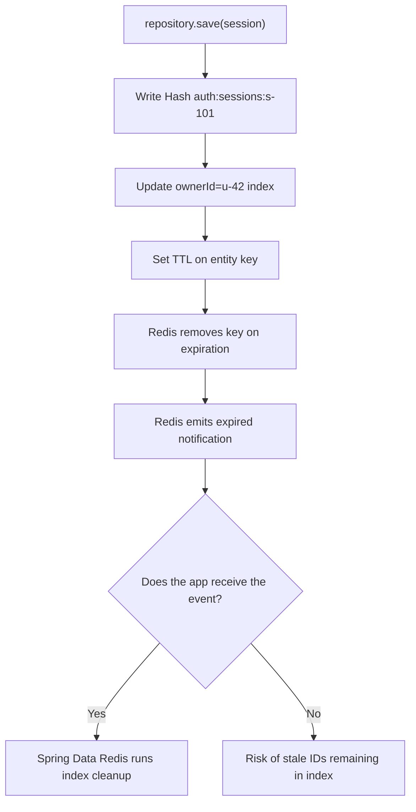

# Expiration Notifications, Secondary Indexes, and Stale Reference Risks in Spring Data Redis

## 1. The problem: the entity expired, yet reference lists still remain

Suppose an application manages login sessions using Spring Data Redis Repositories. Each session is stored in Redis as a Hash with a two-minute TTL. The application also needs to look up sessions by user ID, so the `ownerId` field is indexed using `@Indexed`.

```java
import org.springframework.data.annotation.Id;
import org.springframework.data.redis.core.RedisHash;
import org.springframework.data.redis.core.index.Indexed;

@RedisHash(value = "auth:sessions", timeToLive = 120)
public class LoginSession {

    @Id
    private String id;

    @Indexed
    private String ownerId;

    private String device;

    public LoginSession() {}

    public LoginSession(String id, String ownerId, String device) {
        this.id = id;
        this.ownerId = ownerId;
        this.device = device;
    }

    public String getId() { return id; }
    public void setId(String id) { this.id = id; }
    public String getOwnerId() { return ownerId; }
    public void setOwnerId(String ownerId) { this.ownerId = ownerId; }
    public String getDevice() { return device; }
    public void setDevice(String device) { this.device = device; }
}
```

When saving an object with ID `s-101` and owner `u-42`, the Redis Repository typically creates an entity key like:

```text
auth:sessions:s-101
```

To support queries by `ownerId`, the repository can create auxiliary Redis Sets holding session IDs. After 120 seconds, Redis deletes the **session Hash key** because its TTL expired. The critical question is: **are the IDs sitting in the secondary index removed in time?**

If expiration notification handling is disabled, not yet started, disconnected, or misses an event, the entity key may have vanished while the index still contains `s-101`. That is a **stale reference** (or *dangling reference*).

Consequences can include:

- Indexes contain IDs that no longer lead to valid entities.
- Index-based queries have to process missing records, potentially increasing Redis commands and latency.
- The cardinality of the index Redis Set exceeds the number of entities actually alive.
- Systems managing their own link lists can display "ghost" items if they do not re-verify the target key.
- Old reference data lingers, consuming memory and complicating maintenance.

This lesson distinguishes **Redis expiration**, **expiration notifications**, **Spring Data Redis's secondary index mechanism**, and strategies to mitigate stale reference risks.

## 2. Three distinct mechanisms that must be understood separately

When an entity has a TTL, at least three kinds of state are involved:

| Layer | Function | Managed by |
|---|---|---|
| **Entity key** | Stores the Hash data of a Java object | Spring Data Redis creates/maps it; Redis stores and expires the key |
| **Secondary index** | Maps an attribute value to entity IDs | Spring Data Redis Repository maintains auxiliary structures |
| **Expiration notification** | Signals that Redis deleted a key due to expiration | Redis emits notifications; the application/Spring Data Redis must subscribe |

These three mechanisms **do not form a single atomic operation by default**. Redis can process expiration on the primary key independently of a client waiting on events to clean up indexes.

Illustrative example:

```text
Entity key:
  auth:sessions:s-101       -> Redis Hash, TTL = 120s

Secondary index (conceptual illustration):
  ownerId = u-42            -> Redis Set containing s-101, s-102, ...

When the key expires:
  auth:sessions:s-101       -> no longer exists
  index ownerId = u-42      -> may still hold s-101 if cleanup has not run
```

The physical key names of indexes are determined by mapping/indexing mechanics; do not manually assemble index paths based on conceptual illustrations and treat them as stable Spring Data Redis APIs.

## 3. What does Redis actually do when TTL reaches 0?

### 3.1. TTL is a key property

When creating a key with a TTL:

```redis
SET demo:session:s-101 active EX 120
```

Redis records the key's deadline. You can inspect it:

```redis
TTL demo:session:s-101
PTTL demo:session:s-101
```

Return values of `TTL`:

| Result | Meaning |
|---|---|
| Non-negative integer | Remaining seconds, at second-level resolution |
| `-1` | Key exists but has no expiration |
| `-2` | Key does not exist; may have expired or been deleted |

Redis supports both **passive expiration** (detecting an expired key when it is accessed) and **active expiration** (checking/deleting expired keys periodically in the background). Therefore, when Redis **emits the expired event** must not be treated as a millisecond-accurate timer.

The application should not wait for an event at exact millisecond `120,000 ms` before treating a session as invalid. When checking access rights, **an expired key must be treated as invalid**, regardless of whether the listener has received the event yet.

### 3.2. Expiration differs from active deletion and eviction

The following operations are not the same event type:

```redis
EXPIRE demo:session:s-101 120
DEL demo:session:s-101
PERSIST demo:session:s-101
```

- `EXPIRE` sets a lifetime; Redis emits an **expired event** when the key is actually deleted due to expiration.
- `DEL` actively deletes the key; in notification terms, that is a **del** event, not expired.
- `PERSIST` removes the TTL while keeping the key.
- When Redis removes a key due to memory pressure (*eviction*), that is a distinct event type from expired.

In particular, setting `EXPIRE key 0` or a deadline in the past can delete the key immediately and emit **del**, not expired. Do not rely on an expired listener to catch every form of key removal.

## 4. Keyspace notifications: how Redis emits expiration events

Redis supports **keyspace notifications** via Pub/Sub. When a key expires and is removed by Redis, the server can publish a message to subscribed clients.

For database 0, the typical channel name is:

```text
__keyevent@0__:expired
```

The message on the channel carries the expired key's name, for example:

```text
auth:sessions:s-101
```

Note: Redis emits notifications according to configuration; this is not a durable event queue capable of replay.

### 4.1. Configuring `notify-keyspace-events`

To receive **keyevent expired notifications**, Redis must enable the corresponding event groups. A common configuration is:

```redis
CONFIG SET notify-keyspace-events Ex
```

Where:

- `E`: emits events as **keyevent notifications**.
- `x`: includes **expired events**.

In a test environment, you can inspect it:

```redis
CONFIG GET notify-keyspace-events
```

**Important:** configuring via `CONFIG SET` may be disallowed on managed Redis services, and replacing the current value with `Ex` can drop other notification flags already in use. In production, configure the required flag set through the Redis service's management interface and persist it across restarts.

Enabling only `Ex` does not mean the application will also receive `del` or `evicted` events; each event group has its own flag.

### 4.2. Testing notifications with redis-cli

In the first terminal:

```redis
PSUBSCRIBE __keyevent@0__:expired
```

In the second terminal:

```redis
SET demo:expire:one hello EX 3
```

Once Redis removes the key due to expiration, the subscriber can receive a message containing `demo:expire:one`.

This is an **observation tool**, not a guaranteed delivery mechanism. If the subscriber disconnects or subscribes only after the key has expired, notifications emitted in the interim are not replayed by Redis Pub/Sub.

## 5. How does Spring Data Redis Repository link expiration to indexes?

Spring Data Redis Repository does more than write a single Redis Hash. For an entity with `@Id`, `@Indexed`, and TTL, the framework can:

1. Store the object's fields in a Redis Hash by keyspace and ID.
2. Maintain the entity's ID membership in the keyspace.
3. Maintain secondary index sets for `@Indexed` fields.
4. Set the time to live on the entity key.
5. Register expiration event handling to clean up related index references when notifications arrive.

Logical flow:



This diagram illustrates the concept and does not guarantee exact Redis command ordering or counts across every Spring Data Redis version.

**Key point:** Redis only auto-deletes **keys that have a TTL**. It does not automatically know that another Redis Set holds the ID of a key that was just deleted. Cleaning up links between the primary key and indexes is the responsibility of the application or framework.

### 5.1. Why is `@Indexed` directly tied to this problem?

Given the entity:

```java
@RedisHash(value = "auth:sessions", timeToLive = 120)
public class LoginSession {
    @Id
    private String id;

    @Indexed
    private String ownerId;

    private String device;
    // ...
}
```

The Repository can declare:

```java
import java.util.List;
import org.springframework.data.repository.CrudRepository;

public interface SessionRepository
        extends CrudRepository<LoginSession, String> {

    List<LoginSession> findByOwnerId(String ownerId);
}
```

`findByOwnerId("u-42")` relies on the framework-maintained index to find matching IDs. If the index holds expired IDs, the query must traverse IDs that no longer have records. Depending on the implementation, symptoms can include missing results, higher processing overhead, or auxiliary data no longer reflecting live entities.

Do not conclude from an empty query result that Redis has removed all old members from the index Set. **Primary data state** and **reference data state** must be inspected separately.

## 6. Declaring entity TTL and repository configuration

### 6.1. Default TTL with `@RedisHash`

```java
@RedisHash(value = "auth:sessions", timeToLive = 120)
public class LoginSession {
    // Entity fields
}
```

`timeToLive = 120` expresses a default lifetime of **120 seconds** for entities saved through Redis repository mapping. When TTL ends, Redis deletes the entity key; index cleanup steps are not automatically part of the same atomic Redis action as TTL deletion.

### 6.2. Per-object TTL with `@TimeToLive`

```java
import org.springframework.data.annotation.Id;
import org.springframework.data.redis.core.RedisHash;
import org.springframework.data.redis.core.TimeToLive;

@RedisHash("auth:tokens")
public class TokenRecord {

    @Id
    private String id;

    private String ownerId;

    @TimeToLive
    private Long ttlSeconds;

    public TokenRecord() {}

    public TokenRecord(String id, String ownerId, Long ttlSeconds) {
        this.id = id;
        this.ownerId = ownerId;
        this.ttlSeconds = ttlSeconds;
    }

    public String getId() { return id; }
    public void setId(String id) { this.id = id; }
    public String getOwnerId() { return ownerId; }
    public void setOwnerId(String ownerId) { this.ownerId = ownerId; }
    public Long getTtlSeconds() { return ttlSeconds; }
    public void setTtlSeconds(Long ttlSeconds) {
        this.ttlSeconds = ttlSeconds;
    }
}
```

With `@TimeToLive`, each object can have its own duration. When the entity is read back, the TTL property can reflect **remaining time**, not necessarily the initial value. When re-saving the entity, understand the repository's expiration policy; do not assume the next `save` keeps the old deadline like a plain `HSET`.

## 7. Enabling expiration listening in Spring Data Redis

Spring Data Redis provides a mechanism to process Redis keyspace notifications and publish `RedisKeyExpiredEvent` when a TTL entity key expires.

An explicit configuration via `@EnableRedisRepositories`:

```java
import org.springframework.context.annotation.Configuration;
import org.springframework.data.redis.core.RedisKeyValueAdapter.EnableKeyspaceEvents;
import org.springframework.data.redis.repository.configuration.EnableRedisRepositories;

@Configuration
@EnableRedisRepositories(
    basePackageClasses = SessionRepository.class,
    enableKeyspaceEvents = EnableKeyspaceEvents.ON_STARTUP
)
public class RedisRepositoryConfig {
}
```

`EnableKeyspaceEvents.ON_STARTUP` instructs the repository's keyspace event listener to start when the application starts. This reduces the gap caused by initializing the listener late relative to when TTL entities are created.

However, **registering a listener does not replace enabling notifications on the Redis server**. Some environments allow the framework to attempt configuration via Redis `CONFIG`; managed Redis services may disallow that command.

### 7.1. Managed Redis services that disallow `CONFIG SET`

When a Redis provider blocks `CONFIG`, you can instruct Spring Data Redis **not to try changing notification settings on the server**:

```java
import org.springframework.context.annotation.Configuration;
import org.springframework.data.redis.core.RedisKeyValueAdapter.EnableKeyspaceEvents;
import org.springframework.data.redis.repository.configuration.EnableRedisRepositories;

@Configuration
@EnableRedisRepositories(
    basePackageClasses = SessionRepository.class,
    enableKeyspaceEvents = EnableKeyspaceEvents.ON_STARTUP,
    keyspaceNotificationsConfigParameter = ""
)
public class ManagedRedisRepositoryConfig {
}
```

With this configuration, administrators must **enable the needed notifications on the Redis service itself** (such as keyevent expired). If the server does not emit expired events, Spring cannot infer the complete list of expired keys merely by creating a listener.

The two configuration examples above are **alternatives**, not two `@EnableRedisRepositories` classes to declare at the same time.

### 7.2. Application-level listener

The application can listen for events:

```java
import org.slf4j.Logger;
import org.slf4j.LoggerFactory;
import org.springframework.context.event.EventListener;
import org.springframework.data.redis.core.RedisKeyExpiredEvent;
import org.springframework.stereotype.Component;

@Component
public class ExpiredSessionObserver {

    private static final Logger log =
        LoggerFactory.getLogger(ExpiredSessionObserver.class);

    @EventListener
    public void onRedisKeyExpired(RedisKeyExpiredEvent<?> event) {
        log.info("Observed Redis entity expiration event: {}", event);
    }
}
```

This is an **observational** listener. It adds no business deletion/transition logic and makes no claim of exactly-once delivery. The event may carry the key ID and, depending on shadow copy settings, may include the expired object. Do not assume that when the event arrives you can still read the object via `repository.findById(...)`: the primary key has already been removed by Redis.

**Operational note:** in multi-instance applications, a Redis Pub/Sub notification may be received by multiple subscribers. Never build non-idempotent side effects assuming an event has only one consumer.

## 8. Shadow copy: why might Spring Data Redis save an extra copy?

When an entity expires, the original Hash key is gone. Yet to handle expiration and publish an event with the entity value, the framework may need to know **the object's fields before expiration**, such as indexed fields.

Spring Data Redis Repository has a **shadow copy** (also called *phantom copy*) mechanism. When enabled, the framework can store an extra copy of TTL entities. This copy lives **about five minutes past the original key's expiration**, in order to supply the entity's data to `RedisKeyExpiredEvent`.

Conceptual diagram:

```text
Time:               t0                       t0 + 120s         t0 + 420s
                       |                          |                 |
Primary Hash key:      [======== TTL 120s ========] expires
Shadow copy:           [============== TTL ~420s ===================] expires
                                                  |
                                    primary key's expired event
                                    can carry old entity data
```

The shadow copy key name is a Spring Data Redis implementation detail; application code should not assume it can construct that name from the ID without using supported APIs.

### 8.1. Memory impact

Shadow copies allow events to carry entity data, while also increasing:

- Key count in Redis.
- Data retained during the window after the primary key expires.
- Write traffic and expiration maintenance overhead.

If a system has many short-TTL entities and a very high creation rate, saving extra shadow copies can significantly impact memory. Do not estimate memory solely from the number of currently active entities.

### 8.2. Disabling shadow copy when payloads are unneeded

Spring Data Redis supports a mode that does not store shadow copies:

```java
import org.springframework.context.annotation.Configuration;
import org.springframework.data.redis.core.RedisKeyValueAdapter.EnableKeyspaceEvents;
import org.springframework.data.redis.core.RedisKeyValueAdapter.ShadowCopy;
import org.springframework.data.redis.repository.configuration.EnableRedisRepositories;

@Configuration
@EnableRedisRepositories(
    basePackageClasses = SessionRepository.class,
    enableKeyspaceEvents = EnableKeyspaceEvents.ON_STARTUP,
    shadowCopy = ShadowCopy.OFF
)
public class RedisRepositoryWithoutShadowConfig {
}
```

When shadow copies are disabled, expiration events may still be emitted but **without the expired entity value** attached; only appropriate identification/event metadata remains. This affects any handler that reads object fields to clean up references or run business logic.

**Do not disable shadow copies solely to save memory if your cleanup mechanism or event handlers still depend on data from the copy.** Understand your Spring Data Redis version and test real index cleanup scenarios before changing it.

## 9. Why are expired notifications not as reliable as a message queue?

Redis Pub/Sub is designed to broadcast messages to currently connected subscribers, not to durably store events for later consumer processing. Hence it carries important limitations:

| Scenario | What can happen | Implication for indexes |
|---|---|---|
| App has not started the listener | Event fires before subscriber is ready | No signal received to clean auxiliary data |
| App restarts or loses network | Pub/Sub does not replay old notifications | Index cleanup can be missed |
| Redis lacks proper `notify-keyspace-events` | No expired messages emitted | Repository cannot rely on events for cleanup |
| Multi-node Redis Cluster | Events belong to the key-owning node; subscription/topology must match | May only see a subset of keys if listener config isn't comprehensive |
| Multiple instances subscribe | Multiple processes may observe the same event | Side effects outside Redis need deduplication |
| Key not actively accessed/deleted right at deadline | Event arrives after TTL elapsed | Index cleanup can be delayed |
| Key removed by `DEL` or eviction | Not a matching expired event | Handlers listening only to `expired` miss other removal types |

Consequently, expiration notifications should be treated as a **near-real-time cleanup helper signal**, not an absolute source of truth for access control, billing, releasing critical resources, or long-term data integrity.

### 9.1. When the listener starts matters

Spring Data Redis has listener activation modes for repositories. If the listener only starts when the application first saves a TTL entity, keys that already existed or expired beforehand may emit events the application misses.

`ON_STARTUP` reduces this risk during an instance's lifetime, yet **cannot bridge gaps when the entire application is stopped**. If long-term index accuracy is mandatory, an independent reconciliation mechanism is also required.

### 9.2. Expiration events do not equal an exact scheduler

A system sending an email right when a contract expires must not rely on `RedisKeyExpiredEvent` as a guaranteed-timing, once-only scheduler. Redis may notify late, notifications can be missed, or multiple instances may receive the same signal.

For critical business tasks, use a durable scheduler/queue with checkpoints, retries, and idempotency. Redis events can serve cache invalidation or auxiliary cleanup alongside a repair process for missed events.

## 10. What do stale references look like?

There are two categories of scenarios:

### 10.1. Secondary indexes managed by Spring Data Redis Repository

Suppose the `ownerId = u-42` index previously held ID `s-101`. Redis expires the key:

```text
auth:sessions:s-101  -> gone
index ownerId=u-42   -> may still contain member s-101
```

If Spring Data Redis receives the notification and completes cleanup successfully, the index updates per framework mechanics. Otherwise, it may retain the old member.

Framework-managed indexes **should not be hand-edited by guessing key names**, because beyond attribute-value indexes there may be additional data supporting mapping and relationship management.

### 10.2. Application-managed references

To see the root behavior without relying on internal repository keys, create an example using a Redis Set:

```redis
SADD demo:user:u-42:sessions s-101
SET demo:session:s-101 "active" EX 3
```

After `demo:session:s-101` expires:

```redis
EXISTS demo:session:s-101
SMEMBERS demo:user:u-42:sessions
```

Conceptual result:

```text
EXISTS demo:session:s-101
  -> 0

SMEMBERS demo:user:u-42:sessions
  -> s-101 may still appear
```

Because `demo:user:u-42:sessions` is an **independent Set key** without a matching TTL or member removal, Redis has no idea it should remove `s-101` from this Set when the String key `demo:session:s-101` expires.

This example illustrates why Spring Data Redis needs to manage secondary indexes and clean up references via events or supplementary mechanisms.

## 11. Reading data safely when indexes may be stale

The application should not assume an ID appearing in an index means the entity definitely still exists.

### 11.1. Principle: only live entity data is valid

If an index only returns IDs, safe processing steps are:

1. Retrieve the list of IDs to check.
2. Load entities from the primary key (via repository or the owning data API).
3. Accept only entities that are found and still valid.
4. Record missing IDs for reconciliation or background garbage collection via an appropriate workflow.

Example with a set of IDs provided by the application layer:

```java
import java.util.ArrayList;
import java.util.List;

public List<LoginSession> findExistingSessions(
        SessionRepository repository,
        List<String> candidateIds) {

    List<LoginSession> existing = new ArrayList<>();
    repository.findAllById(candidateIds).forEach(existing::add);
    return existing;
}
```

This snippet only returns entities the repository finds at read time; it does not clean the index itself, nor does it provide an atomic snapshot across the key set. If business logic demands strict synchronization, design dedicated conditional checks and race avoidance.

### 11.2. Be careful with counts based on `SCARD`

With an application-managed Redis Set:

```redis
SCARD demo:user:u-42:sessions
```

`SCARD` only counts **members in that Set**, without verifying whether the corresponding entity keys still exist. If the Set holds stale references, `SCARD` can exceed the number of live sessions.

Likewise, checking the member count of an internal secondary index does not give an accurate live entity count. To count active sessions, use a data source or operation matching the definition of "active."

### 11.3. Handling reused IDs

If an old ID expires and is later reused for a new entity, a delayed cleanup operation relying solely on ID can mistakenly delete a valid reference.

For example:

```text
t0:  s-101 belongs to owner u-42
t1:  s-101 expires; index cleanup event is delayed
t2:  new entity reuses s-101, belonging to owner u-99
t3:  old handler processes s-101 and deletes by ID without checking version
```

To mitigate this, use IDs that are not reused within any window where stale events/metadata could remain, or attach a version/generation to the entity and perform conditional cleanup. Systems needing high consistency must design garbage collection to avoid racing with new writes.

## 12. Strategies for dealing with stale references

### 12.1. Relying on expiration notifications for near-real-time cleanup

This fits when indexes should update after entities expire and occasional delays or missed events can be handled by other measures.

Operational conditions:

- Redis has appropriate keyspace notifications enabled.
- The Spring Data Redis listener is healthy and subscribed on the needed nodes.
- If cleanup logic needs expired values, shadow copy settings are configured accordingly.
- The application monitors errors, restarts, and disconnection windows.

**Limitation:** this is still Pub/Sub, with no replay for missed events.

### 12.2. Validating at read time

When querying through an index, always verify the primary entity. This prevents stale IDs from turning into valid sessions or trusted business records.

Drawback: queries may incur extra lookups; indexes still need cleanup to avoid unbounded growth.

### 12.3. Scheduled reconciliation

For **application-managed** indexes, you can run a reconciler:

```text
For each reference group within maintenance scope:
  fetch a batch of IDs
  check whether corresponding keys/entities still exist
  if an ID is genuinely invalid:
      remove the reference using concurrency-safe rules
  record checked, removed, and error counts
  continue with an appropriate cursor/chunk
```

For **Spring Data Redis Repository internal indexes**, do not directly apply a Set-trimming algorithm by guessing key names. Use mechanisms/APIs suited to your framework version, or design a repair procedure verified on a copy of the data.

Reconciliation must account for keys expiring between an `EXISTS` check and cleanup; checking then deleting in two separate commands is unsafe if IDs can be rewritten concurrently. When data requires consistency, use conditional operations, scripts, or versioning as part of the design.

### 12.4. Do not duplicate references unnecessarily

Every copy of a "user owns session" relationship increases the chance of drift after expiration. If the application only ever checks a session by ID, a TTL entity key alone may suffice without adding application-managed Sets.

If reverse lookup ("list all sessions of a user") is an essential requirement, you need an index. In that case, include **index maintenance and repair costs** in the data design.

### 12.5. Choose durable storage as the source of truth

Redis TTL works well for caches, temporary tokens, sessions, or short-lived data. If an index represents long-lived business relationships requiring strict accuracy and auditability, consider storing the authoritative relationship in a suitable durable datastore, treating Redis strictly as a cache or rebuildable projection.

Then, a lost expired event only causes temporary projection lag; rebuild/reconciliation workflows still have a reliable source of truth to recover from.

## 13. One maintenance pattern for application-managed indexes

This example **does not touch Spring Data Redis internal indexes**. It demonstrates how to design a separate reference list owned by the application.

Suppose:

```text
Entity key:             app:sessions:s-101        (String with TTL)
Self-managed index key: app:owners:u-42:sessions  (Set of session IDs)
```

We can provide an API to read currently existing sessions:

```java
import java.util.HashSet;
import java.util.Set;

import org.springframework.data.redis.core.StringRedisTemplate;

public class LiveSessionLookup {

    private final StringRedisTemplate redis;

    public LiveSessionLookup(StringRedisTemplate redis) {
        this.redis = redis;
    }

    public Set<String> liveSessionIds(String ownerId) {
        String indexKey = "app:owners:" + ownerId + ":sessions";
        Set<String> ids = redis.opsForSet().members(indexKey);
        if (ids == null || ids.isEmpty()) {
            return Set.of();
        }

        Set<String> live = new HashSet<>();
        for (String id : ids) {
            String entityKey = "app:sessions:" + id;
            if (Boolean.TRUE.equals(redis.hasKey(entityKey))) {
                live.add(id);
            }
        }
        return live;
    }
}
```

This method **filters references at read time**; it does not clean the old Set and is not optimized for round trips on large lists. For high ID counts, batch requests, use appropriate read commands, and bound time/memory instead of loading the whole Set at once.

In this example, the entity key could expire right after `hasKey` returns `true`. Thus, the method only gives a list of keys that "existed when checked," not proof that they still exist when the next operation executes.

If you plan to prune stale members, add race-safe reconciliation logic and do not mistakenly apply this algorithm to repository index Sets.

## 14. Observing failures and measuring risk in production

When unsure whether cleanup is running properly, do not inspect only a single key's `TTL`. Monitor both the event delivery path and index health.

Useful metrics:

| Metric | Meaning |
|---|---|
| Count of active entities with TTL | Scale of ephemeral data |
| Expiration events received by the application | Indicates listener activity; does not prove all events arrived |
| Delay between deadline and event handling | Reveals cleanup lag when sufficient data is tracked |
| IDs returned from index where entity is missing | Direct signal of stale references |
| Total size and cardinality of secondary indexes | Tracks abnormal growth trends |
| Redis memory used for TTL data and shadow copies | Helps evaluate copy retention costs |
| Redis connection/subscription errors | Detects Pub/Sub disconnects |
| Drift between durable source of truth and Redis index | Basis for reconciliation |

### 14.1. Redis commands for investigation

```redis
TTL auth:sessions:s-101
PTTL auth:sessions:s-101
EXISTS auth:sessions:s-101
TYPE auth:sessions:s-101
INFO stats
CONFIG GET notify-keyspace-events
```

`INFO stats` includes counters related to expired/evicted keys for observing Redis-level trends. They **do not equal the number of events Spring Data Redis received** and do not directly reflect how many index entries were cleaned.

When iterating keys in a large environment, use `SCAN` over an appropriate scope; avoid `KEYS *` in production just to count entities. For framework-managed index keys, verify your Spring Data Redis version's conventions before inspecting auxiliary sets.

### 14.2. Extra caution with Redis Cluster

In Redis Cluster, keys can live across multiple nodes. Keyspace notifications are tied to the node handling each key, so listener and Redis Pub/Sub configuration must match the topology. Verify in a real Cluster environment that events from **every relevant shard** are handled; do not assume receiving an event from one node means the entire cluster is covered.

Each node can have its own notification configuration. A cluster where `Ex` is enabled inconsistently across nodes can cause erratic cleanup behavior depending on hash slot.

## 15. Typical incidents and how to reason about them

### Incident A: Redis key expires properly, but `findByOwnerId` behaves unexpectedly

Possible chain of events:

```text
1. Session is saved; ownerId is indexed.
2. Redis expires the session Hash.
3. Expired notification is missed because the listener stopped.
4. Index still retains the old ID.
5. Query by ownerId encounters a reference to a missing record.
```

Investigation should verify the primary key's TTL, listener connection, Redis notifications config, and index data in a controlled environment. Do not conclude the framework is buggy merely from seeing one missing ID: check manual deletions, TTL, ID rewrites, and other processing steps.

### Incident B: Event handler lacks the expired object

One possible cause is that shadow copy is disabled or the copy value is unavailable. Raw Redis notifications carry mainly the **key name**, not the deleted Hash. If the handler needs `ownerId` for external cleanup, design appropriate metadata storage and check event values under the specific configuration.

Do not write:

```java
// Illustrating a flawed assumption: primary key already expired, so
// findById cannot be relied upon to retrieve prior data.
sessionRepository.findById(expiredId);
```

hoping to get all fields of the expired entity. If you need information after the primary key is gone, that data must live in another source or in a supported shadow copy mechanism.

### Incident C: Cleanup runs twice on two instances

If two instances both subscribe to Redis Pub/Sub, the same event can trigger handlers in both. Calling "send session expiry email," "issue refund," or "delete external data" without idempotency/ownership can cause duplicate side effects.

The right solution is to separate **expiration as a signal** from **durable business execution**, using idempotency keys, consumer ownership, or a queue/scheduler system offering the required guarantees.

### Incident D: Many unfamiliar keys outlive the original TTL

With Spring Data Redis, shadow copies and auxiliary keys can make the physical key count exceed live entities. Copies of TTL entities can remain roughly five minutes after the original key expires. This alone does not prove a memory leak.

However, if key/index counts grow without bound, distinguish shadow copies expiring on schedule from **stale indexes never getting cleaned up**.

### Incident E: Deleting a Hash directly with `DEL` leaves indexes out of sync

For example:

```redis
DEL auth:sessions:s-101
```

If the key is managed by a Redis Repository, a direct `DEL` bypasses the cleanup steps the repository performs when calling `deleteById(...)`. The event emitted by `DEL` is also not an expired event.

Prefer repository APIs when deleting repository-managed entities. If performing low-level Redis operations, the application takes responsibility for affected links.

## 16. Timeline illustration: what can be left behind?

Suppose an entity is saved at `10:00:00` with a 60-second TTL:

```text
10:00:00  repository.save()
          - Session Hash is created
          - ownerId index contains session ID
          - Redis sets 60s TTL

10:00:59  Primary Redis key may still exist

10:01:00  TTL deadline reached
          - Reads of expired key must not treat it as a valid session
          - Event might not emit at this exact moment

10:01:01  Redis detects and deletes expired key
          - Emits expired notification if configured

10:01:01+ Listener receives event (if connected)
          - Framework gets a chance to clean up the index

If listener misses it:
          - Primary key is gone
          - ID may remain in the index
          - Requires read-time verification and policy-based reconciliation
```

Second counts are illustrative. On real systems, events can arrive later, be missed, or be observed by multiple subscribers.

A very important design principle is: **entity validity relies on the primary key/data source at the time of use**, not on whether a listener has already processed an expiration notification.

## 17. Practice: observing expired events and stale references

Run this on a dedicated Redis environment for testing.

### Step 1: enable and observe notifications

When test Redis permits:

```redis
CONFIG SET notify-keyspace-events Ex
```

Open another terminal:

```redis
PSUBSCRIBE __keyevent@0__:expired
```

### Step 2: manually create a key and reference Set

```redis
SADD demo:links:u-42 s-101
SET demo:sessions:s-101 ACTIVE EX 5
TTL demo:sessions:s-101
SMEMBERS demo:links:u-42
```

### Step 3: observe after expiration

After more than five seconds:

```redis
EXISTS demo:sessions:s-101
SMEMBERS demo:links:u-42
```

Once the key expires, `EXISTS` returns `0`, yet the Set `demo:links:u-42` can still hold ID `s-101`. Redis Pub/Sub emitting an event **does not automatically edit** a Set we manage ourselves.

### Step 4: remove the reference intentionally

In this single-threaded exercise, you can clean it up manually:

```redis
SREM demo:links:u-42 s-101
SCARD demo:links:u-42
```

This example targets a **self-managed Set**, not instructions for editing repository internal index keys. If an entity can be recreated with the same ID during cleanup, a conditional procedure is needed instead of an unchecked delete.

### Step 5: test with Spring Data Redis Repository

Create a `LoginSession`, save via `SessionRepository`, and check:

```java
sessionRepository.save(
    new LoginSession("s-201", "u-42", "browser")
);

System.out.println(
    sessionRepository.findById("s-201").isPresent()
);

System.out.println(
    sessionRepository.findByOwnerId("u-42").size()
);
```

After the TTL ends, compare the ID lookup result, the `ownerId` query result, and `ExpiredSessionObserver` logs. Try reproducing a disabled-notification state in the test environment to understand missed-cleanup risk; restart and restore proper configuration before continuing to use a shared environment.

## 18. Common misconceptions

| Misconception | Accurate understanding |
|---|---|
| "Once a key expires, every index pointing to it disappears too." | Redis only auto-expires keys with TTL; links in other keys must be managed separately. |
| "`@Indexed` is a database index so Redis preserves referential integrity." | Spring Data Redis uses Redis structures and framework logic; there are no SQL-style foreign keys. |
| "When TTL hits 0, the expired event fires instantaneously." | Redis removes keys via active/passive expiration; notifications can lag. |
| "Missed events will be delivered after the app restarts." | Redis Pub/Sub does not persist missed events for replay. |
| "Having a listener means Redis has events enabled." | The server must have appropriate notification flags configured. |
| "`RedisKeyExpiredEvent` always holds the full entity." | Payload depends on configuration and whether shadow copy still exists. |
| "Disabling shadow copy has no side effects." | It saves memory, but you can lose event data needed by cleanup/handlers. |
| "One event goes to only one application." | Multiple subscribers can receive the same notification. |
| "`DEL` emits an expired event." | `DEL` is an active deletion; its event differs from natural expiration. |
| "An index's `SCARD` equals the number of live entities." | The Set can hold IDs whose entities are gone. |
| "Seeing an entity via an index guarantees the session is still valid." | Always validate state and expiration against the primary source when used. |

## 19. Architectural decisions by consistency requirement

| Need | Approach to consider | Trade-offs to accept |
|---|---|---|
| Ephemeral cache/session tolerating delayed cleanup | Redis TTL + repository events + key existence checks | Events are non-durable; monitor stale references |
| List entities by `@Indexed` property | Redis Repository + proper notification configuration | Extra keys and index maintenance overhead |
| Query returning only valid live entities | Filter results against primary data | Lookup cost and race window after checking |
| Very large volume of TTL entities | Measure shadow copy cost; review event payload policy | Disabling copies requires reviewing cleanup behavior |
| Self-healing reference data | Scheduled reconciliation from trusted source or verified API | Must bound load and handle concurrency |
| Business processing that must not be missed | Durable queue/scheduler/idempotency and durable storage | More complex than Pub/Sub, but supports retries |

When designing TTL for entities, ask two separate questions: **"When does the entity become invalid?"** and **"When are references to the entity cleaned up?"**. Redis TTL answers the first, while secondary indexes and expiration notifications relate to the second. If the application requires linked data to remain consistent even across restarts, disconnects, or network failures, add an independent verification/reconciliation mechanism rather than relying solely on Pub/Sub.

## References

- [Spring Data Redis Reference — Time To Live](https://docs.spring.io/spring-data/redis/reference/redis/redis-repositories/expirations.html)
- [Spring Data Redis Reference — Secondary Indexes](https://docs.spring.io/spring-data/redis/reference/redis/redis-repositories/indexes.html)
- [Spring Data Redis Reference — Redis Repositories](https://docs.spring.io/spring-data/redis/reference/redis/redis-repositories.html)
- [Spring Data Redis Reference — Object-to-Hash Mapping](https://docs.spring.io/spring-data/redis/reference/redis/redis-repositories/mapping.html)
- [Redis Documentation — Keyspace Notifications](https://redis.io/docs/latest/develop/pubsub/keyspace-notifications/)
- [Redis Documentation — EXPIRE](https://redis.io/docs/latest/commands/expire/)
- [Redis Documentation — TTL](https://redis.io/docs/latest/commands/ttl/)
- [Redis Documentation — Pub/Sub](https://redis.io/docs/latest/develop/pubsub/)
