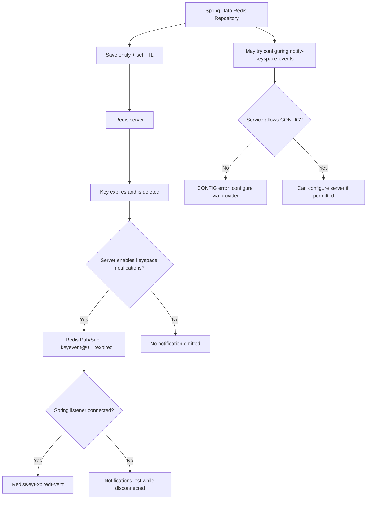

# Keyspace Notification Configuration Limits on Managed Redis Services

> **Module:** Spring Data Redis  
> **Chapter:** Entity TTL  
> **Topic:** Keyspace notification configuration limits on managed Redis services, consequences for Redis Repositories, and appropriate deployment approaches.

## 1. The problem: TTL still works, yet expiration events may not

In Spring Data Redis, an entity saved via a Redis Repository can carry a *Time To Live* (TTL). When TTL hits 0 and Redis removes the key, the application sometimes needs to receive an event to delete secondary indexes, update state, or trigger a follow-up workflow.

Example session entity:

```java
import org.springframework.data.annotation.Id;
import org.springframework.data.redis.core.RedisHash;
import org.springframework.data.redis.core.index.Indexed;

@RedisHash(value = "loginSessions", timeToLive = 900)
public class LoginSession {

    @Id
    private String id;

    @Indexed
    private String userId;

    private String deviceId;

    protected LoginSession() {}

    public LoginSession(String id, String userId, String deviceId) {
        this.id = id;
        this.userId = userId;
        this.deviceId = deviceId;
    }

    public String getId() { return id; }
    public String getUserId() { return userId; }
    public String getDeviceId() { return deviceId; }
}
```

`@RedisHash(timeToLive = 900)` sets a default 900-second TTL for the entity. Spring Data Redis Repository uses a Redis Hash and expiration commands to manage the key. When the key expires, **Redis removes the key automatically even if the application receives no keyspace notification**.

The confusion comes from three independent things:

1. **Attaching TTL:** creating a key with a lifetime, e.g. `EXPIRE loginSessions:s-1 900`.
2. **Redis emitting events:** the Redis server enables `notify-keyspace-events` to publish `expired` notifications over Pub/Sub.
3. **Spring listening for events:** Redis Repository initializes a listener, subscribes to notifications, and publishes `RedisKeyExpiredEvent` inside the application.

A managed Redis service may allow (1) while restricting configuration of (2) or not supporting (2) at all. Without (2), enabling (3) in Spring **does not generate expiration notifications on its own**.

### 1.1. Diagram of potential restriction points



In a managed environment, **never assume** that because `repository.save()` succeeded, the listener will definitely receive `RedisKeyExpiredEvent`.

## 2. What are keyspace notifications actually?

Redis provides *keyspace notifications* to publish events to special Pub/Sub channels whenever keys change or are deleted.

For example, when key `loginSessions:s-1` in database 0 actually expires:

- **Keyevent**-style channel: `__keyevent@0__:expired`; payload is the key name, e.g. `loginSessions:s-1`.
- **Keyspace**-style channel: `__keyspace@0__:loginSessions:s-1`; payload is the event type `expired`.

Configuration syntax:

```conf
notify-keyspace-events Ex
```

Relevant characters:

| Character | Meaning | When needed |
|---|---|---|
| `E` (uppercase) | Emits **keyevent** channel `__keyevent@<db>__:...` | Spring Redis Repository listens for key expired events via keyevent |
| `K` (uppercase) | Emits **keyspace** channel `__keyspace@<db>__:<key>` | Clients monitor events occurring on a specific key |
| `x` (lowercase) | Key **expired** events | Required to receive `expired` |
| `e` (lowercase) | Key **evicted** events due to memory limits | When observing eviction, distinct from TTL expiration |
| `g` | Generic commands like DEL/EXPIRE | Does not replace `x` for receiving keys that actually expired |
| `A` | Alias for a broad set of event types | Avoid enabling everything just to listen to TTL if unnecessary |

The combination `Ex` means **emit keyevents for expired keys**. This is the minimal suitable configuration for Spring Data Redis Repository's standard expiration event flow.

`x` alone **is not enough**, because at least `E` or `K` is required so Redis knows which channel type to publish on. `EX` with an uppercase `X` is also invalid: the flags are case-sensitive.

### 2.1. Distinguishing the `EXPIRE` command from the `expired` event

Setting a TTL does not mean the key expires immediately:

```redis
SET trial:key "value"
EXPIRE trial:key 20
```

Here `EXPIRE` sets a 20-second lifetime. When Redis **actually deletes the key** due to expiration, Redis emits the `expired` event (if notifications are enabled). Redis deletes expired keys in two main ways:

- **Passive expiration:** when a command accesses an already expired key.
- **Active expiration:** Redis's background cycle proactively samples and deletes expired keys.

Therefore, the `expired` event **is not guaranteed to appear at the exact millisecond TTL reaches 0**; it fires when Redis physically removes the expired key. Business tasks requiring exact deadlines must not use notifications as a precision timer.

### 2.2. Expiration and eviction are two different causes

- `expired`: key deleted because TTL ended; requires flag `x`.
- `evicted`: key removed due to `maxmemory-policy`; requires flag `e`.

If Redis runs short on memory and evicts a key early, the application cannot expect `expired` for that removal. A Repository's `RedisKeyExpiredEvent` is not a catch-all event for every way a key disappears. Separately define requirements for handling eviction, `DEL` operations, and application failures.

## 3. What does Redis Repository use notifications for?

### 3.1. Publishing events to the application

Spring Data Redis Repository can use `RedisMessageListenerContainer` to subscribe to events. When handling an expiration notification, the repository publishes `RedisKeyExpiredEvent` via Spring application events.

Because the key has already been deleted by Redis, Spring Data Redis can retain a **phantom copy** (or *shadow copy*) of the entity: an auxiliary key whose lifetime is roughly **5 minutes** longer than the primary key. Upon receiving the notification for the primary key, the repository can read the entity value back from the copy to populate the event.

Example with a session expiring after 15 minutes:

```text
t=0          Repository saves Hash loginSessions:s-1, TTL 900 seconds
             Also saves a phantom copy with a longer lifetime
t≈15 min     Redis deletes loginSessions:s-1 when key expires
             Redis emits __keyevent@0__:expired if Ex is enabled
             Spring listener creates RedisKeyExpiredEvent
t≈20 min     Phantom copy also expires
```

The phantom copy does not mean the primary key remains accessible after TTL. It is solely data supporting event publication, and it **increases memory usage** compared to storing the entity alone.

You can disable phantom copies if events only need the key identifier; in that case, the event no longer carries a full copy of the deleted entity. Disabling phantom copies **does not recover lost events**.

### 3.2. Cleaning up secondary indexes

Redis Repositories can create Sets to look up entities by `@Indexed` fields, such as the `userId` index in the `LoginSession` example. When the entity key expires, Redis deletes the Hash automatically yet **does not automatically know** to remove that ID from index Sets.

Spring Data Redis uses expiration events to help clean up leftover index references. If the event is not emitted or not received, an index Set can retain IDs of vanished entities.

Consequences:

- `repository.findById(id)` fails to find the entity, yet the ID remains in the index Set;
- index-based query results can encounter stale references before mapping to entities;
- indexes can grow over time under high session/token creation loads.

Do not treat Pub/Sub as a mechanism guaranteeing strictly consistent indexes: it is a non-durable event channel.

### 3.3. Three listener modes in Spring Data Redis

The `RedisKeyValueAdapter.EnableKeyspaceEvents` enum provides three choices:

| Value | Behavior | Consequence |
|---|---|---|
| `OFF` | Does not use the Repository expiration listener | Redis TTL still runs, but Repository does not receive `RedisKeyExpiredEvent` |
| `ON_DEMAND` | Initializes listener when the first entity with an expiration is saved | Events can be missed if the listener is not yet running |
| `ON_STARTUP` | Initializes listener at application startup | Closes the pre-first-save gap, yet cannot fix event loss during downtime/failover |

**The default of `enableKeyspaceEvents` on `@EnableRedisRepositories` is `OFF`**. When expiration events are needed, enable the appropriate mode explicitly.

## 4. Why does managed Redis commonly forbid `CONFIG`?

With self-hosted Redis, an administrator can run:

```bash
redis-cli CONFIG GET notify-keyspace-events
redis-cli CONFIG SET notify-keyspace-events Ex
```

On a managed Redis service, the provider operates Redis on the application's behalf: engine parameters, admin privileges, failover, replication, and clustering are governed through a control plane. Therefore:

- `CONFIG SET` may be rejected with `NOPERM`, `ERR unknown command`, or other provider-specific errors;
- even `CONFIG GET` may be disallowed or return restricted output;
- the provider may only allow modifying parameters in a supported allowlist;
- certain tiers/deployment types **do not support keyspace notifications** regardless of Spring code settings;
- behavior varies by engine version, instance type, cluster mode, SKU, and provisioning time.

Never resolve the error by demanding broader Redis admin permissions for the Spring app when the provider intentionally restricts them. The right solution is **configuring through the supported infrastructure interface/API** or adapting the application design.

### 4.1. Why might Spring hit a forbidden command?

Spring Data Redis Repository has a helper mechanism that configures `notify-keyspace-events` when starting the listener if Redis lacks the needed setting. The `keyspaceNotificationsConfigParameter` attribute on `@EnableRedisRepositories` defaults to `"Ex"`.

In self-managed environments this is often convenient. On a managed Redis blocking `CONFIG`, enabling the listener can cause startup or listener-initialization errors because the Redis configuration command fails.

Common error messages might look like:

```text
ERR unknown command 'CONFIG'
NOPERM this user has no permissions to run the 'config|get' command
ERR CONFIG SET ... is not allowed
```

These are **illustrative error examples**, not exact strings guaranteed across providers and driver versions.

Do not confuse:

- `keyspaceNotificationsConfigParameter = "Ex"`: allows Repository infrastructure **to attempt configuring** the server when needed.
- `keyspaceNotificationsConfigParameter = ""`: tells Spring Data Redis **not to call CONFIG to alter settings**; keep the server's existing configuration.

**Important:** Setting an empty string **does not enable notifications on Redis**. It merely delegates configuration responsibility to the server operator or Redis service.

## 5. Configuring Spring when the provider supports notifications but blocks `CONFIG`

This is a common scenario: the service can emit `expired` events, yet the application cannot modify `notify-keyspace-events` over the data connection.

### 5.1. Step 1: configure on the service side

In the provider's control plane, configure the engine parameter:

```text
notify-keyspace-events = Ex
```

If other subscribers in the system require other event types, preserve existing flags and append the needed ones per Redis syntax rather than accidentally overwriting notifications used by other applications.

For example, `Ex` covers only keyevent expirations; if another app previously needed Set/Hash keyspace notifications, align on the combined effective flag string for the instance.

### 5.2. Step 2: enable the listener while skipping `CONFIG` in Spring

```java
import org.springframework.context.annotation.Configuration;
import org.springframework.data.redis.core.RedisKeyValueAdapter;
import org.springframework.data.redis.repository.configuration.EnableRedisRepositories;

@Configuration
@EnableRedisRepositories(
        basePackages = "com.example.sessions.repository",
        enableKeyspaceEvents =
                RedisKeyValueAdapter.EnableKeyspaceEvents.ON_STARTUP,
        keyspaceNotificationsConfigParameter = ""
)
public class RedisRepositoriesConfiguration {
}
```

This class expresses three decisions:

1. Scan repositories in `com.example.sessions.repository` (replace with your actual package).
2. Initialize the listener at app startup via `ON_STARTUP`.
3. Let the server own enabling `Ex`, preventing Spring from changing `notify-keyspace-events` via `CONFIG`.

This configuration assumes the application has already set up `RedisConnectionFactory` / Redis Repositories (e.g., via the Spring Boot starter). If the project has multiple repository configurations, manage scan scopes and wiring to avoid bean conflicts.

**Mandatory check:** before deploying this configuration, confirm the provider actually enabled `Ex`. If the server still has `notify-keyspace-events = ""`, the listener may subscribe to Pub/Sub without error yet **receive zero `expired` notifications**.

### 5.3. Step 3: choose phantom copy behavior as needed

When only the key/ID is needed in events, consider:

```java
@Configuration
@EnableRedisRepositories(
        basePackages = "com.example.sessions.repository",
        enableKeyspaceEvents =
                RedisKeyValueAdapter.EnableKeyspaceEvents.ON_STARTUP,
        keyspaceNotificationsConfigParameter = "",
        shadowCopy = RedisKeyValueAdapter.ShadowCopy.OFF
)
public class LightweightRedisRepositoriesConfiguration {
}
```

This is an **alternative** to the previous configuration, not a second class to enable alongside it.

With `shadowCopy = OFF`, the Repository skips saving phantom copies for expiring entities, reducing memory and write cost. `RedisKeyExpiredEvent` then holds identifying metadata instead of the entire deleted entity value. Use this only when handler logic does not need the old payload.

However, events still depend on Redis notifications and the Pub/Sub connection. `shadowCopy = OFF` does not solve missed-event issues.

### 5.4. Step 4: ensure the listener binds to the right Redis

With multiple `RedisConnectionFactory` beans, multiple Redis Clusters, or multiple repositories, verify:

- which Redis instance the repository writes entities to;
- which Redis instance the listener subscribes to;
- which node/shard and database emit the events;
- whether the subscriber has `SUBSCRIBE`/`PSUBSCRIBE` permissions under active ACLs;
- that connection routing and SSL/TLS match the environment.

A listener subscribed to Redis A will never receive expirations for entities actually stored in Redis B.

## 6. When the provider does not support keyspace notifications at all

If a service tier or managed Redis product lacks this capability, even console access cannot enable `Ex`. The safe setup is to disable reliance on expiration events:

```java
import org.springframework.context.annotation.Configuration;
import org.springframework.data.redis.core.RedisKeyValueAdapter;
import org.springframework.data.redis.repository.configuration.EnableRedisRepositories;

@Configuration
@EnableRedisRepositories(
        basePackages = "com.example.sessions.repository",
        enableKeyspaceEvents = RedisKeyValueAdapter.EnableKeyspaceEvents.OFF,
        keyspaceNotificationsConfigParameter = "",
        shadowCopy = RedisKeyValueAdapter.ShadowCopy.OFF
)
public class RedisRepositoriesWithoutNotifications {
}
```

What still works?

- `@RedisHash(timeToLive = ...)`, `@TimeToLive`, and Redis `EXPIRE` still set lifetimes on entities.
- Redis still removes keys upon expiration according to Redis mechanics.
- `TTL` still reflects key lifetime (if permitted by the provider).
- `repository.findById(id)` returns absent once the key is gone.

What **no longer** happens?

- No `RedisKeyExpiredEvent` from the repository listener.
- No notification-driven secondary index cleanup.
- Cannot rely on events to run critical business logic after TTL ends.

For entities with `@Indexed` and TTL, design an **independent index maintenance mechanism** or choose a different data model. Otherwise, index Sets can accumulate members pointing to expired keys.

## 7. Comparing several managed Redis services

Actual capabilities depend on product/SKU/version; the summary below reflects configuration methods published by providers and does not replace verifying against your project's own instance.

| Service | Ability to configure `notify-keyspace-events` | Deployment notes |
|---|---|---|
| **Amazon ElastiCache Valkey/Redis OSS (node-based)** | Supports this parameter in the corresponding *parameter group*; usually empty by default | Change via parameter group / control plane. Spring should use `keyspaceNotificationsConfigParameter = ""` when app-side `CONFIG` is blocked. |
| **Amazon ElastiCache Serverless** | AWS documentation states keyspace notifications are currently **not supported** | Do not expect `RedisKeyExpiredEvent`; design without depending on notifications. |
| **Google Cloud Memorystore for Redis** | Includes `notify-keyspace-events` among supported Redis parameters | Update via instance config / Google Cloud API or CLI. Verify exact product/tier; do not assume data-plane `CONFIG SET`. |
| **Google Cloud Memorystore for Redis Cluster** | Lists notification configuration among supported parameters | Account for per-shard/node behavior on events; verify real subscriptions. |
| **Azure Cache for Redis (legacy service)** | Microsoft docs describe the feature in **Standard/Premium** tiers via Advanced settings | Basic or other products/tiers cannot be assumed equivalent. |
| **Azure Managed Redis** | Microsoft has documented the feature in **preview** via Advanced settings / ARM with `notifyKeyspaceEvents` | Check preview availability, region, SKU, and resource API version; avoid relying on outdated guides claiming all Azure Managed Redis lacks support. |
| **Other Redis services** | Depends on provider policy | Review parameter lists, command restrictions, Redis Pub/Sub/Cluster rules, and official support docs. |

### 7.1. Amazon ElastiCache: parameter groups and Serverless

For node-based ElastiCache, AWS documentation lists `notify-keyspace-events` as a modifiable parameter taking immediate effect on supported parameter groups. For instance:

```text
Parameter group:
    notify-keyspace-events = Ex
```

In this resource setup:

1. Locate the parameter group attached to the replication group/cluster.
2. Edit `notify-keyspace-events` through the AWS console/API.
3. Confirm the parameter took effect on the necessary nodes.
4. Let Spring subscribe while setting `keyspaceNotificationsConfigParameter = ""`.

AWS explicitly notes that `K` or `E` is required for notifications to emit; setting only `x` does nothing. Do not confuse parameter group configuration (supported) with client-side `CONFIG SET` (restricted in ElastiCache).

For **ElastiCache Serverless**, AWS states keyspace events are **not supported**. This is a **service-type** difference that cannot be fixed with a Spring annotation.

### 7.2. Google Cloud Memorystore

Google Cloud documentation lists `notify-keyspace-events` as a supported configuration parameter on Memorystore for Redis. Applications typically let Google Cloud manage the setting:

```text
Redis instance configuration:
    notify-keyspace-events = Ex
```

Operationally, use Memorystore configuration management; the `gcloud redis instances update` CLI provides `--update-redis-config` for eligible Memorystore for Redis instances. In learning materials, do not embed real project IDs or credentials.

If using Memorystore for Redis Cluster, check the Cluster-specific documentation for notification capabilities and per-shard publish/subscribe behavior.

### 7.3. Azure Cache for Redis and Azure Managed Redis

Microsoft offers multiple distinct product lines. **Azure Cache for Redis** documentation describes keyspace notifications under Advanced settings, restricted to Standard/Premium tiers.

For **Azure Managed Redis**, documentation updated in 2026 describes keyspace notifications as being in **preview**, configurable via the `notifyKeyspaceEvents` property on the database resource or through Advanced settings in supported environments.

Illustrative property snippet (not a complete ARM template):

```json
{
  "properties": {
    "notifyKeyspaceEvents": "Ex"
  }
}
```

Do not conflate legacy Azure Cache for Redis guidance with Azure Managed Redis. For a specific managed Redis instance, verify preview status, region, API version, and SKU documentation before building expiration events into your system design.

## 8. Process to verify support in a managed Redis environment

Do not run `CONFIG SET` directly on production just to see if the service blocks it. Recommended operational sequence:

1. **Identify the exact service:** provider, product, serverless/node-based, tier, region, engine version, cluster mode.
2. **Read the supported parameter list:** look for `notify-keyspace-events` or its corresponding property.
3. **Check the official configuration method:** parameter group, advanced settings, API, Infrastructure as Code.
4. **Verify Pub/Sub permissions for the app account:** check ability to subscribe to `__keyevent@...__:expired` channels.
5. **Align Spring settings:** `enableKeyspaceEvents` must not be `OFF`; disable Spring `CONFIG` calls with an empty string when the provider manages the server.
6. **Test in a non-production environment:** create a short-TTL key, subscribe, and observe the event.
7. **Test event loss:** disconnect the listener or trigger a failover in staging to evaluate compensation logic.

### 8.1. Checking configuration (if the service permits)

```bash
redis-cli CONFIG GET notify-keyspace-events
```

Example output when keyevent expiration is enabled:

```text
1) "notify-keyspace-events"
2) "Ex"
```

If `CONFIG GET` is denied, that is **not proof that the feature is unsupported**. Check the configured value in the control plane and verify via a Pub/Sub test.

### 8.2. Testing notifications with two Redis CLI sessions

In a test environment with server-side notifications enabled, connect using the auth/TLS required by your provider. In the **subscriber** terminal:

```redis
PSUBSCRIBE __keyevent@0__:expired
```

In the **writer** terminal connected to the same Redis instance and database:

```redis
SET tutorial:ttl:1 "hello" EX 3
TTL tutorial:ttl:1
```

Once Redis physically deletes the expired key, the subscriber can receive:

```text
pmessage
__keyevent@0__:expired
__keyevent@0__:expired
tutorial:ttl:1
```

CLI output formatting varies by client. What matters is receiving channel `__keyevent@0__:expired` with payload equal to the key name. Using `@RedisHash` without Redis notifications enabled will never make this test work.

**Latency:** do not assert the event must arrive after exactly three seconds. Redis notifies when the key is physically removed by expiration; this can lag behind the deadline.

**Cluster:** Redis keyspace notifications are per-node; subscribing to one node does not necessarily cover every shard. Check your client library and how it subscribes across all nodes storing TTL keys. Regular Redis Pub/Sub and keyspace notifications do not follow the same cross-node broadcast rules.

**Database:** Redis Cluster normally uses database 0; standalone Redis can use other databases. Adjust `@0` in the channel to match the Redis database actually in use.

### 8.3. End-to-end test with the Repository

After the CLI test succeeds:

1. Start the Spring application with `ON_STARTUP` and `keyspaceNotificationsConfigParameter = ""`.
2. Save a `@RedisHash` entity with a short TTL via the repository.
3. Observe the Redis key receiving its TTL and subsequently disappearing.
4. Observe the application publishing `RedisKeyExpiredEvent` from the repository listener.
5. If indexes are present, observe the Repository's index cleanup behavior per framework design.
6. Run a test while disconnecting the listener to observe event-loss behavior.

One event arriving successfully on the first try **does not prove durability** across restarts, network drops, failovers, or scaling.

## 9. Limitations that cannot be eliminated through configuration alone

### 9.1. Pub/Sub is not durable

Redis keyspace notifications use *fire-and-forget* Pub/Sub. If no subscriber is listening, the notification is lost. When the application comes back online, Redis has no queue to replay old notifications.

For example:

```text
09:00  Session s-1 has TTL, app A is running
09:10  App A loses network / restarts
09:15  Redis deletes s-1 due to TTL -> emits expired
09:16  App A reconnects
       No expired event for s-1 remains to be read
```

Enabling `ON_STARTUP` only initializes the listener early; it does not guarantee continuous uptime or replay.

### 9.2. Event latency

Expiration processing can lag due to Redis's periodic key scanning or lack of key access. Even with a connected subscriber, the event is not a timer with an exact SLA when TTL reaches 0.

Operations like locking accounts, revoking permissions, charging funds, transitioning order state, or initiating payments must determine validity from **current time and durable data state**, never relying exclusively on key-expiration events.

### 9.3. Multiple application replicas can receive the same event

If multiple Spring instances subscribe to `__keyevent@0__:expired`, a Pub/Sub event can be delivered to every listening instance. When each instance publishes `RedisKeyExpiredEvent` and triggers side effects, the work can execute multiple times.

Example with 3 replicas:

```text
                 Redis expired event
                          |
               +----------+----------+
               |          |          |
          Spring A     Spring B    Spring C
               |          |          |
          Handler A    Handler B   Handler C
```

If the handler sends emails or records a business change, enforce **idempotency**, safe claim/lock mechanics, or route events into a centrally coordinated task. With Pub/Sub, these guards only prevent duplicates; they do not restore lost events.

### 9.4. Redis Cluster and Redis failover

Redis Cluster shards keys across hash slots. Redis emits keyspace notifications **on the node owning the key**, without broadcasting across the entire cluster by default. Clients and subscriptions must be built to consume from all relevant nodes and handle topology changes.

Failovers or provider-initiated maintenance can interrupt Pub/Sub connections. Ensuring your Redis driver reconnects is essential, yet reconnecting **never replays** events emitted during the outage.

### 9.5. Performance and service quotas

Enabling broad notifications increases Pub/Sub traffic and Redis processing load. `KEA` can emit many event types beyond expiration; for apps needing only entity TTLs, `Ex` is generally better because its scope is smaller.

Additionally, repository phantom copies persist roughly 5 minutes past the original deadline and can increase memory footprint. With millions of short-lived sessions, that adds up. If your app does not need entity payloads in expiration events, consider `shadowCopy = OFF`.

## 10. Alternative designs when notifications cannot be relied upon

### 10.1. Use TTL as cache cleanup, not as a business trigger

For session caches or recomputable results, TTL can simply remove stale data. On reads:

```java
public SessionView findSession(String id) {
    return sessionRepository.findById(id)
            .map(SessionView::fromEntity)
            .orElseThrow(() ->
                    new SessionExpiredException("Session is missing or expired"));
}
```

Here `SessionView` and `SessionExpiredException` are application types shown to illustrate business behavior. You do not need an event to know a session is no longer usable. In exchange, handle keys disappearing due to expiration, eviction, or deletion.

### 10.2. Store deadlines in durable storage and sweep periodically

If work must execute when due, persist state and due timestamps in a durable store (such as a transactional database) rather than only in Redis:

```text
job_id        status      due_at_utc
job-1001      PENDING     2026-11-14T10:00:00Z
job-1002      DONE        2026-11-14T10:10:00Z
```

A periodic job queries `PENDING` records with `due_at <= now()`, claims records via atomic/transactional operations, executes idempotent work, and marks them complete.

Redis can still cache deadlines and statuses for fast reads, while the database or durable scheduler serves as the source confirming unfinished work.

This model can lag by up to one poll interval (plus processing time), yet it can **recover missed work**, which Pub/Sub keyspace notifications cannot guarantee.

### 10.3. Use a Redis Sorted Set as a scannable schedule

If business rules tolerate ephemeral state in Redis with suitable persistence/failover design, you can store deadlines in a Sorted Set:

```redis
ZADD pending:expirations 1794650400000 "job-1001"
ZADD pending:expirations 1794651000000 "job-1002"
ZRANGEBYSCORE pending:expirations -inf 1794650400000
```

Scores in this example are illustrative millisecond timestamps. Workers read due items, **claim atomically** before processing, and remove them from the schedule under a reliable protocol.

Never run plain `ZRANGEBYSCORE` followed by separate `ZREM` across multiple workers assuming duplicates cannot happen. Use Lua scripts, appropriate transactions, or a dedicated queue/scheduler paired with idempotency and retries.

Sorted Sets make stored deadlines **queryable again**, though they do not prevent data loss if Redis evicts keys or suffers outages. When high durability is required, the source of truth should still be a durable database or queue.

### 10.4. Use a scheduler/queue with persistence and retries

For workloads requiring high reliability, consider:

- a scheduler backed by a durable job store;
- a queue supporting message persistence, acknowledgments, and retries;
- a database outbox table ensuring business events commit in the same transaction;
- a workflow engine or delay queue with clear SLAs and semantics.

Then Redis expiration no longer bears business-guarantee responsibilities; it remains strictly cache lifecycle management.

### 10.5. Clean up indexes without relying on events

For TTL entities with `@Indexed` when notifications are unavailable:

- consider avoiding Redis Repository secondary indexes for very short-lived entities;
- store indexes in a datastore with better-suited TTL or cleanup support;
- periodically compare live keys against index members and prune orphaned references;
- design custom TTL-aware indexes with explicit update rules instead of using Repository indexes;
- avoid manually editing internal index Sets without understanding framework structure, transactions/concurrency, and versions.

Design sweeps with batching/`SCAN` to avoid load spikes, especially with large key or index counts. Never use `KEYS *` to scan broadly on production Redis. Cleanup jobs must also stay safe under concurrent repository saves/deletes.

## 11. Comparing configurations and their effects

| Configuration | Does Redis still delete keys by TTL? | Does Spring receive `RedisKeyExpiredEvent`? | Does Spring try to configure the server? | When to use |
|---|---|---|---|---|
| `enableKeyspaceEvents = OFF` | Yes | No | No, since expiration listener is off | No events needed or provider unsupported |
| `ON_STARTUP` + default `keyspaceNotificationsConfigParameter = "Ex"` | Yes | Yes if server/connection supports it and listener runs | Possibly | Self-managed Redis or environments allowing `CONFIG` |
| `ON_STARTUP` + `keyspaceNotificationsConfigParameter = ""` with server `Ex` enabled | Yes | Yes while listener is online | No | Managed Redis supporting events but restricting `CONFIG` |
| `ON_STARTUP` + `keyspaceNotificationsConfigParameter = ""` with server events off | Yes | No | No | Control plane misconfiguration; must fix server side |
| `ON_DEMAND` + server `Ex` enabled | Yes | Only after listener initializes and is online | Depends on config parameter | Late initialization is acceptable |

**Common misunderstanding:** `keyspaceNotificationsConfigParameter = ""` means **Spring leaves Redis's existing notification configuration untouched**—it does not mean "disable notifications" nor does it automatically "enable Ex." Actual event delivery depends on **both the Redis server and the Spring listener**.

Another frequent misconception: `spring.data.redis.*` settings in `application.yml` configure connections and Spring Boot properties, and do not grant permission to alter provider-restricted Redis admin parameters.

## 12. Diagnosing common failures

### 12.1. Application fails to start with `CONFIG SET` log errors

Likely causes:

- Spring started the expiration listener and tried modifying `notify-keyspace-events`;
- the provider blocks `CONFIG` in the data plane;
- the Redis user lacks the required permission.

Approach: confirm the provider supports notifications; set `Ex` via the supported admin tool; then set `keyspaceNotificationsConfigParameter = ""` in Spring. If the provider does not support notifications, switch to `enableKeyspaceEvents = OFF`.

### 12.2. Application starts normally, yet zero events arrive

Check in order:

1. Does the entity have a positive TTL? What does `@TimeToLive` return?
2. Did Redis actually remove the key due to expiration?
3. Does the server have `Ex` enabled? Does the provider support keyspace notifications?
4. Is the Repository listener `OFF`, `ON_DEMAND`, or `ON_STARTUP`?
5. Is Spring subscribed to the right Redis node, database, and channel?
6. Does the Redis user have Pub/Sub / ACL permissions on the required channels?
7. Did the event occur while the application was restarting or disconnected?

If `TTL key` returns `-2`, you only know the key does not exist; that alone does not prove expiration caused it. Compare `INFO stats` (if permitted) for `expired_keys` and `evicted_keys`, application logs, and explicit delete paths for more evidence.

### 12.3. Events work locally but fail in the cloud

Local Redis typically runs with full admin rights so `CONFIG SET` works; cloud managed services may block it. Moreover, local standalone has one node, whereas cloud setups often use Cluster with multiple shards and different endpoints.

Copying `application.yml` from local to cloud does not preserve the same event behavior. Configure the cloud control plane, verify subscription connectivity, and account for failovers.

### 12.4. Events do not arrive the moment TTL ends

Events emit when Redis physically deletes the key; active/passive expiration can lag. Do not treat "waited 3 seconds and saw no event" as proof of misconfiguration. Verify whether the key disappeared, observe longer, and check the subscription.

### 12.5. Events are processed two or more times

Multiple application replicas each run a listener. Redis Pub/Sub broadcasts messages to every eligible subscriber; Spring publishes `ApplicationEvent` inside each application context.

If a handler causes side effects that must happen once, route work through claim/idempotency controls or a centralized processor; never assume one Redis expiration event reaches only one instance.

### 12.6. Redis index retains IDs that no longer exist

Causes can include notifications lost during app downtime, a disabled listener, or an unsupported provider. Check both Spring Data Redis's internal cleanup and any template operations mutating entity Hashes directly. Plan index recovery/rebuilding as needed.

## 13. Recommended deployment workflows

### Case A: Need TTL only, no events needed

1. Set TTL via `@RedisHash` or `@TimeToLive`.
2. Keep `enableKeyspaceEvents = OFF` and consider `shadowCopy = OFF`.
3. Design reads to tolerate missing keys.
4. If entities use secondary indexes, proactively design index lifecycles and cleanup.
5. Monitor expiration/eviction with appropriate Redis metrics.

### Case B: Need notifications to support non-critical features

1. Choose a managed Redis supporting notifications on your SKU/region.
2. Enable `notify-keyspace-events = Ex` via the control plane.
3. Use `ON_STARTUP` and `keyspaceNotificationsConfigParameter = ""`.
4. Test via CLI and end-to-end `RedisKeyExpiredEvent` flows.
5. Make event handlers idempotent and accept eventual consistency.
6. Provide a catch-up path when events are lost or delayed.

### Case C: Need guaranteed business execution after deadline

1. Store deadlines and state in a durable datastore.
2. Use a scheduler/queue with retries and re-scanning capability.
3. Use Redis TTL strictly to trim redundant data or caches.
4. Never use Pub/Sub expiration as the sole source of truth.
5. Test restarts, failovers, multiple replicas, and handler re-runs.

## 14. Self-check questions

**Question 1:** If a provider blocks `CONFIG SET` but lets you enable notifications in its admin console, can you use Repository expiration events?

Yes, if the provider genuinely supports notifications: enable `Ex` via the control plane, set `keyspaceNotificationsConfigParameter = ""`, and choose `ON_STARTUP`/`ON_DEMAND` appropriately. Verify subscription from the app.

**Question 2:** If `keyspaceNotificationsConfigParameter = ""` is set yet `notify-keyspace-events` on the server remains empty, what happens?

TTL still expires keys; Redis emits no `expired` notifications. The Spring listener receives no `RedisKeyExpiredEvent` from that path.

**Question 3:** If the listener is completely disabled, does `@RedisHash(timeToLive = 300)` still work?

Yes. TTL is a Redis server mechanism and does not require Spring to receive events.

**Question 4:** With `@Indexed`, can notifications be ignored completely?

It works at runtime, but you must accept or mitigate the risk of indexes retaining references to expired entities. If clean, reliable query results are required, another index lifecycle solution is needed.

**Question 5:** If the app is offline when a key expires, can it read that event back after reconnecting?

Not through Redis keyspace Pub/Sub; notifications are non-durable and have no replay. An independent catch-up mechanism is needed.

**Question 6:** If a Redis Cluster has 3 shards, does subscribing to one node guarantee receiving all expiration events?

No. Redis keyspace events are scoped per node; verify subscription coverage across nodes in your client library.

**Question 7:** What does a phantom copy help with, and what does it not?

It gives Spring a copy of the entity value to attach to expiration events after the primary key is gone. It **does not** turn Pub/Sub into a durable queue, nor does it keep the primary key alive past its TTL.

## 15. Conclusion

When Redis is operated by a cloud provider, **the main constraint is not the `@TimeToLive` annotation**, but the permissions and capability to enable `notify-keyspace-events`, listener connectivity, and the non-durable nature of Redis Pub/Sub. Spring Data Redis can attach TTL to entities and Redis deletes keys without needing notifications. However, to receive `RedisKeyExpiredEvent` or clean up secondary indexes via expired events, a chain of conditions must hold: the server actually emits `Ex`, the listener is enabled, the subscription is properly connected, and no interruption occurs when the event fires.

With a managed Redis supporting notifications while blocking `CONFIG`, the standard configuration pattern is **enabling `Ex` in the control plane + `ON_STARTUP` + `keyspaceNotificationsConfigParameter = ""`**. If the service does not support notifications or the system requires high-reliability post-deadline processing, choose a data model/scheduler capable of re-scanning and retrying; treat keyspace notifications strictly as an auxiliary signal.

## References

- Spring Data Redis — [Time To Live](https://docs.spring.io/spring-data/redis/reference/redis/redis-repositories/expirations.html): entity TTL, phantom copies, listeners, and `CONFIG` restrictions on ElastiCache.
- Spring Data Redis — [`@EnableRedisRepositories` API](https://docs.spring.io/spring-data/redis/reference/api/java/org/springframework/data/redis/repository/configuration/EnableRedisRepositories.html): `enableKeyspaceEvents`, `keyspaceNotificationsConfigParameter`, and `shadowCopy`.
- Spring Data Redis — [`RedisKeyValueAdapter` API](https://docs.spring.io/spring-data/redis/reference/api/java/org/springframework/data/redis/core/RedisKeyValueAdapter.html): listener and shadow copy configuration.
- Redis — [Keyspace notifications](https://redis.io/docs/latest/develop/pubsub/keyspace-notifications/): `Ex`, Pub/Sub, timing, event types, and Redis Cluster limitations.
- AWS — [ElastiCache Engine-specific parameters](https://docs.aws.amazon.com/AmazonElastiCache/latest/dg/ParameterGroups.Engine.html): `notify-keyspace-events` in parameter groups.
- AWS — [ElastiCache Serverless configuration and limits](https://docs.aws.amazon.com/AmazonElastiCache/latest/dg/RedisConfiguration.html): serverless notification limitations.
- Google Cloud — [Memorystore for Redis supported configurations](https://cloud.google.com/memorystore/docs/redis/supported-redis-configurations): `notify-keyspace-events` parameter.
- Google Cloud — [Memorystore for Redis Cluster supported configurations](https://cloud.google.com/memorystore/docs/cluster/supported-instance-configurations): Redis Cluster configuration.
- Microsoft Learn — [Azure Cache for Redis configuration](https://learn.microsoft.com/en-us/azure/azure-cache-for-redis/cache-configure): keyspace notification limits by tier.
- Microsoft Learn — [Enable Redis keyspace notifications in Azure Managed Redis (preview)](https://learn.microsoft.com/en-us/azure/redis/enable-redis-keyspace-notifications): enabling `notifyKeyspaceEvents` via portal/ARM, preview status.
