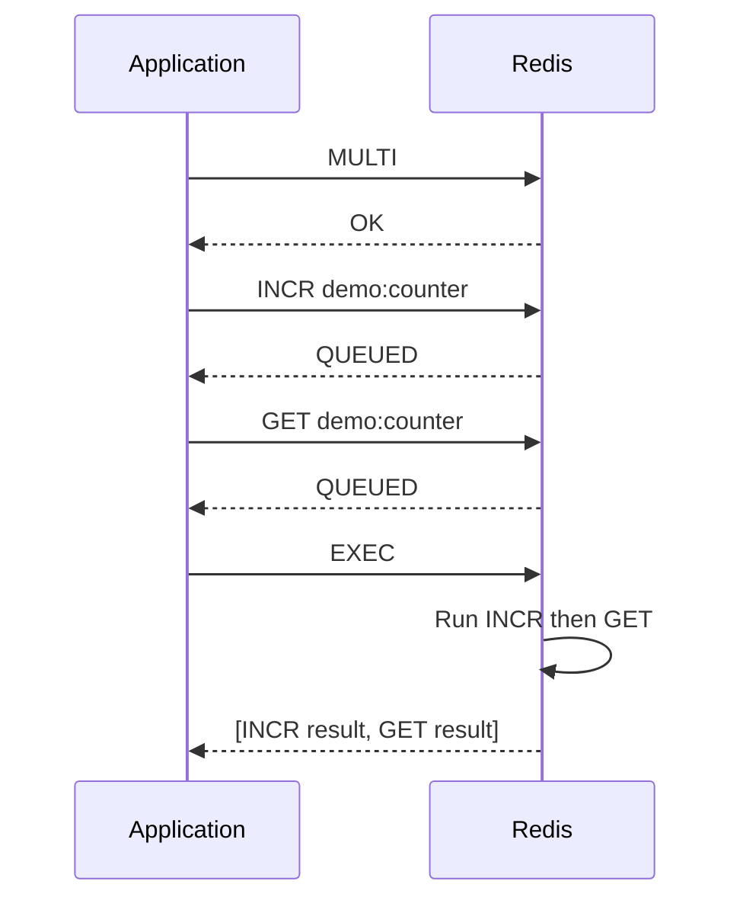
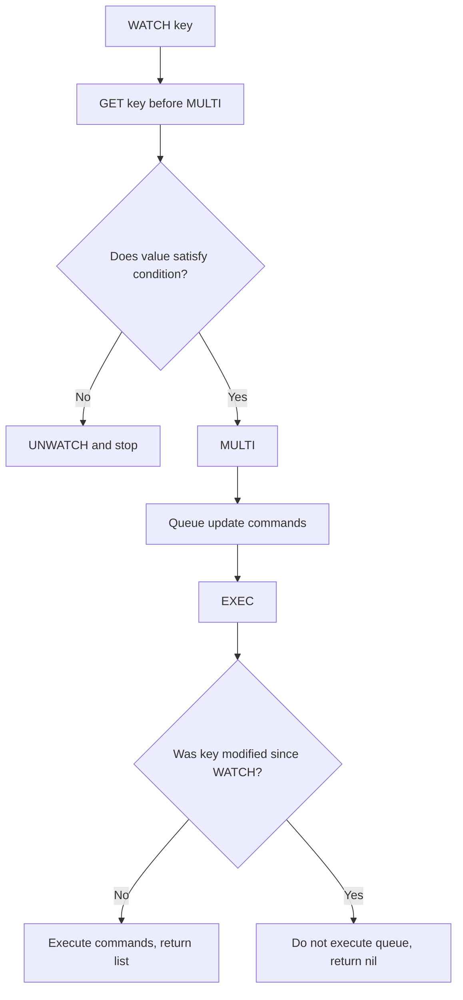

# Queuing Commands and Reading EXEC Results in Spring Data Redis

In Redis, a typical transaction begins with `MULTI`, accepts a sequence of commands that are **queued**, and then executes the entire sequence upon receiving `EXEC`. A common source of confusion when writing Spring Data Redis applications is that **the return value of a command call during the queuing phase is not the execution result of that command**. The actual results are returned after `EXEC`, in the order the commands were queued.

For example, suppose an application increments a counter and then reads it inside a transaction. If a developer directly reads the Java value returned by `increment(...)` or `get(...)` after `MULTI`, they may receive `null` and mistakenly conclude that Redis has no data or the command failed. In reality, Redis has only recorded the request in the queue. Only when `EXEC` runs do the results of `INCR` and `GET` appear.

This lesson walks from the Redis protocol to Spring Data Redis code: how `QUEUED` works, what `EXEC` means, how to use `SessionCallback` to hold the same connection, how to retrieve and decode `List<Object>`, how to handle `WATCH`/`DISCARD`, and important limits around atomicity, execution errors, serializers, and Spring transactions.

## 1. Three Phases of a Redis Transaction

A Redis transaction cycle looks like:

```redis
MULTI
INCR demo:counter
GET demo:counter
EXEC
```

You can view Redis as processing it in three phases:

1. **Start:** `MULTI` switches the connection into transactional state.
2. **Queuing:** subsequent commands are received and added to the transaction queue on that connection. Redis normally replies `QUEUED`, without running the data operation yet.
3. **Execution:** `EXEC` runs the queued commands in exact order and returns a list of results.



Redis CLI example when `demo:counter` does not initially exist:

```text
127.0.0.1:6379> MULTI
OK

127.0.0.1:6379(TX)> INCR demo:counter
QUEUED

127.0.0.1:6379(TX)> GET demo:counter
QUEUED

127.0.0.1:6379(TX)> EXEC
1) (integer) 1
2) "1"
```

The list from `EXEC` has **two elements** because two commands were queued. The first element is the numeric result of `INCR`; the second is the string value read by `GET` after `INCR` ran. The earlier `QUEUED` replies do not belong to the execution result list.

**Calling `MULTI` then `GET` does not let you read the new state immediately in Java code.** A Redis transaction behaves as a command queue, not like a Java block that can continuously observe intermediate results before commit time.

## 2. What Does Redis Guarantee When Running EXEC?

When `EXEC` starts running the queued commands, Redis executes them **in order** and does not interleave commands from other clients into the middle of that sequence. Within the scope of valid executable commands, the application can rely on the order of effects:

```redis
MULTI
SET order:17:status PROCESSING
INCR orders:processed
GET order:17:status
EXEC
```

At `EXEC` time, `GET` sees the value written by the preceding `SET` in the same transaction.

However, clearly distinguish **uninterrupted execution** from **rollback**:

| Property | Redis MULTI/EXEC transaction |
|---|---|
| Queue multiple commands for consecutive execution | Yes |
| Execution order matches queued order | Yes |
| Other clients interleave commands mid-`EXEC` | No |
| Read a command's result before calling `EXEC` | No |
| Automatically roll back all successful commands if one fails at runtime | No |
| Cancel and drop the queue before running via `DISCARD` | Yes |
| Conditionally abort if `WATCH`ed data changed | Yes |
| Distributed ACID transaction with another database | Not provided automatically |

Redis also has its own durability and recovery semantics depending on persistence configuration. The term “atomic” here primarily refers to **execution order and non-interleaving**; it does not mean all involved systems commit together or that a Redis transaction provides arbitrary rollback.

## 3. What Is Returned Before and After EXEC

Two layers of results should be kept distinct:

**Queuing reply:** Redis CLI prints `QUEUED` for a command accepted into the queue. In high-level Spring Data Redis APIs, the call at this point may return `null` or have no immediate result, depending on the method signature.

**Execution result:** `EXEC` returns an array containing the results of the commands in exact queued order. Spring Data Redis typically converts this into a `List<Object>` for Java to process.

Illustration:

```text
Queued command         Reply before EXEC       Result after EXEC
------------------------------------------------------------------
INCR demo:counter      QUEUED                 1
GET demo:counter       QUEUED                 "1"
EXISTS demo:counter    QUEUED                 1  (Redis protocol level)
------------------------------------------------------------------
EXEC                                        [1, "1", 1]
```

The Java types inside `List<Object>` depend on the command, serializer, and Spring Data Redis result conversion. For example, Redis integer replies may be converted to `Long`, while replies from `GET` are typically converted by the template's deserializer into the Java value type.

When reading `EXEC` in Java, **do not cast every result to String**: a counter command may return a number, an existence check may return a Boolean after Spring conversion, and a multi-value read command may produce a nested collection.

## 4. Running MULTI/EXEC with SessionCallback

### 4.1. Why Must the Same Connection Be Held?

The `MULTI` state and transaction queue belong to **the active Redis connection**. If you:

1. Send `MULTI` over connection A;
2. Send `SET` over connection B;
3. Send `EXEC` over connection C;

those three calls do not form a single transaction. Therefore, when using `RedisTemplate`, it is essential to keep the operations within **the same session/connection**.

Spring Data Redis provides `SessionCallback<T>` to group `RedisOperations` calls into one session:

```java
import org.springframework.data.redis.core.RedisOperations;
import org.springframework.data.redis.core.SessionCallback;

// General form:
redisTemplate.execute(new SessionCallback<>() {
    @Override
    public <K, V> /* result type */ execute(
            RedisOperations<K, V> operations) {
        operations.multi();
        // Redis operations are queued.
        return operations.exec();
    }
});
```

The snippet above shows the general form; the next section provides a complete Java example with concrete return types.

Inside a `SessionCallback`, invoke operations through the `operations` object passed into the callback. Avoid using another template while building the transaction, as it may acquire a different connection and operate outside the queue.

### 4.2. Complete Example with StringRedisTemplate

Suppose the application needs to increment a counter and read back the incremented value, ensuring both commands run consecutively:

```java
package com.example.redis.tx;

import java.util.List;

import org.springframework.data.redis.core.RedisOperations;
import org.springframework.data.redis.core.SessionCallback;
import org.springframework.data.redis.core.StringRedisTemplate;
import org.springframework.stereotype.Service;

@Service
public class TransactionCounterService {

    private final StringRedisTemplate template;

    public TransactionCounterService(StringRedisTemplate template) {
        this.template = template;
    }

    public CounterTransactionResult incrementAndRead(String counterId) {
        String key = "demo:counter:" + counterId;

        return template.execute(
                new SessionCallback<CounterTransactionResult>() {
                    @Override
                    public <K, V> CounterTransactionResult execute(
                            RedisOperations<K, V> genericOperations) {

                        // SessionCallback has a generic method.
                        // The template in use is StringRedisTemplate.
                        @SuppressWarnings("unchecked")
                        RedisOperations<String, String> operations =
                                (RedisOperations<String, String>) genericOperations;

                        operations.multi();

                        // At this point they are only QUEUED; both typically return null.
                        Long queuedIncrement =
                                operations.opsForValue().increment(key);
                        String queuedRead =
                                operations.opsForValue().get(key);

                        // These two values are NOT execution results.
                        // Real values are returned when EXEC runs.
                        List<Object> results = operations.exec();

                        if (results == null || results.size() != 2) {
                            throw new IllegalStateException(
                                    "Transaction was aborted or returned "
                                            + "an unexpected result count");
                        }

                        long afterIncrement =
                                ((Number) results.get(0)).longValue();
                        String readBack = (String) results.get(1);

                        return new CounterTransactionResult(
                                afterIncrement, readBack);
                    }
                });
    }

    public record CounterTransactionResult(
            long afterIncrement,
            String readBack
    ) {}
}
```

With Redis key `demo:counter:alpha` not yet existing:

```java
var result = service.incrementAndRead("alpha");

System.out.println(result.afterIncrement()); // 1
System.out.println(result.readBack());       // "1"
```

Subsequent calls increment further, e.g., `2` and `"2"`.

In this example:

- `StringRedisTemplate` uses string serializers for key/value data, so the result from `GET` decodes to `String`.
- `SessionCallback` keeps the commands within the same session.
- `operations.multi()` begins queuing.
- `increment(key)` queues `INCR`; `get(key)` queues `GET`.
- `operations.exec()` executes the queued commands and returns `List<Object>`.
- `results.get(0)` corresponds to `INCR`, and `results.get(1)` corresponds to `GET`.
- Casting to `Number` and calling `longValue()` cleanly handles numeric results; the exact concrete Java type may vary across converter/driver configurations.

The variables `queuedIncrement` and `queuedRead` are named deliberately to emphasize their queued state. Do not use them for business updates before `EXEC`. In production code, you can omit those two variables and simply invoke the commands.

### 4.3. Note on the Generic Signature of SessionCallback

The `execute` method of `SessionCallback<T>` declares type parameters `<K, V>` for `RedisOperations<K,V>`. In the example, because the callback is actually invoked via `StringRedisTemplate`, we cast to `RedisOperations<String, String>` to write clean code for string keys and values.

This cast is only valid when **the template genuinely operates on those corresponding types**. If you switch to `RedisTemplate<String, Product>`, update the value type and serializer accordingly rather than copying the `StringRedisTemplate` cast verbatim.

Another organization pattern is encapsulating transaction logic inside a dedicated typed operations handler to avoid repeating casts across multiple callbacks. Regardless of structure, the essential rule remains that the transaction's Redis operations go through the appropriate session/connection.

## 5. Reading the EXEC Result List Correctly

### 5.1. Results Match the Queued Command Order

Suppose:

```redis
MULTI
SET demo:status ready
INCR demo:metric
GET demo:status
EXEC
```

The returned list has **three slots**, because three commands preceded `EXEC`. Do not count earlier `QUEUED` replies as part of the result list, since they only confirm queuing.

In Java, keep command ordering and decoding close together:

```java
operations.multi();

operations.opsForValue().set("demo:status", "ready"); // index 0
operations.opsForValue().increment("demo:metric");   // index 1
operations.opsForValue().get("demo:status");          // index 2

List<Object> results = operations.exec();

// results[0] : SET command result
// results[1] : INCR command result
// results[2] : GET command result
```

This snippet illustrates the body of a `SessionCallback` using typed `RedisOperations<String,String>`. The exact type of the `SET` result may be converted according to Spring/driver abstractions, so do not cast every element to `String`.

### 5.2. Results Have Multiple Types

| Command group | Redis protocol reply | What to expect at the Java layer |
|---|---|---|
| `INCR`, `DECR`, `INCRBY` | Integer | Numeric value, typically `Long` |
| `GET`, `HGET` | Bulk string or nil | Deserialized value, or `null` if field/key is absent |
| `MGET`, `HMGET` | Array | A collection of results, which may contain `null` elements |
| `SADD`, `HDEL` | Integer | Numeric value indicating count of modified elements |
| `SET` | Status `OK` | Type converted by Spring connection adapter |
| Command failing at execution | Error reply at the command's position | Driver/template may represent the error or throw an exception |

Inside template-level `exec()`, Spring Data Redis also performs **deserialization according to the serializer**. Consequently, the table above is not a guarantee that every driver and version returns the exact same concrete Java type in every slot.

In business code, check the `List<Object>` size, keep the command ↔ index mapping explicit, and decode each entry according to the command you queued. Never assume every non-null element is a success or every `null` value is a transaction abort.

### 5.3. Distinguishing Three Kinds of Null

In Redis and Spring Data Redis transactions, three distinct situations are often conflated:

1. **Queuing-time return value is `null`.** For example, calling `opsForValue().get(key)` between `MULTI` and `EXEC`: the command has not executed yet.
2. **An individual element of the `EXEC` result is `null`.** For example, `GET missing:key` executed, and the missing key returned nil; `RedisTemplate` deserializes it to `null` at *that exact command's position*.
3. **The entire `EXEC` result is nil/absent because `WATCH` failed.** Redis aborted execution because a watched key changed; Spring may represent this abort with `null`.

Example of the second case:

```redis
MULTI
GET demo:missing:1
INCR demo:counter
EXEC
```

In Redis CLI, the output may look like:

```text
1) (nil)
2) (integer) 1
```

The transaction still **executed** even though the first element is nil. Therefore, check **the overall list** first, then inspect individual elements.

### 5.4. Do Not Assume Every Command Produces Exactly One Scalar String

A command like `MGET` can return a sub-collection inside *a single element* of the `EXEC` list:

```redis
MULTI
MGET demo:a demo:b
INCR demo:counter
EXEC
```

At the protocol level, `EXEC` has two elements: the first is the array result of `MGET`, and the second is the integer from `INCR`. It is not “flattened” into three or more transaction entries just because `MGET` reads multiple keys.

When designing result DTOs, account for commands with collection replies, how serializers decode nested arrays, and nil elements inside collections.

## 6. Do Read Calls After MULTI Return the New State?

No. This is an important pitfall in Java applications.

Suppose:

```java
operations.multi();

operations.opsForValue().set("account:1:status", "ACTIVE");
String state = operations.opsForValue().get("account:1:status");

if ("ACTIVE".equals(state)) {
    // This block does not reflect an executed GET result.
}

List<Object> results = operations.exec();
```

When using a manual transaction on the same connection, `GET` in this example is only queued; `state` is typically `null`. A Java conditional using `state` **cannot decide actions based on data produced by queued commands**, because that data has not been observed prior to `EXEC`.

If you need to decide whether to write based on the current value, options include:

- Use `WATCH` and read the value **before `MULTI`**, then check whether `EXEC` was aborted due to conflict.
- Use a Lua script to evaluate the condition and update data on the server in one atomic step.
- Design an appropriate atomic Redis command, such as `SET NX`, `INCR`, or built-in conditional command variants.

Do not “fix the null” by issuing `GET` via another template while the transaction is still open. A value read from a connection outside the transaction may be stale and breaks the single-session transaction assumption.

## 7. WATCH: Aborting EXEC If Data Changed

`WATCH` enables **optimistic locking** in Redis. You watch one or more keys, read current data, and decide on updates. If a watched key is modified after `WATCH` and before `EXEC`, Redis will not execute that transaction queue.

### 7.1. Redis Command Pattern

Suppose:

```redis
SET inventory:sku-1 10
```

Client A:

```redis
WATCH inventory:sku-1
GET inventory:sku-1
```

The application sees 10 remaining and wants to deduct 2. Client A proceeds:

```redis
MULTI
DECRBY inventory:sku-1 2
EXEC
```

If there are no conflicting modifications, `EXEC` runs and returns the post-deduction value. If Client B modified `inventory:sku-1` before `EXEC`, Redis returns nil for the entire `EXEC` and **does not run** the queued `DECRBY` of Client A.

Diagram:



**Very important:** `WATCH` must be called **before `MULTI`**. `WATCH` is not a read command; it registers change monitoring on the key.

### 7.2. Java Example: Compare-and-Set

The following code uses `SessionCallback` to compare the current value and update it only if it still matches the expected value:

```java
package com.example.redis.tx;

import java.util.List;
import java.util.Objects;

import org.springframework.data.redis.core.RedisOperations;
import org.springframework.data.redis.core.SessionCallback;
import org.springframework.data.redis.core.StringRedisTemplate;
import org.springframework.stereotype.Service;

@Service
public class RedisCompareAndSetService {

    private final StringRedisTemplate template;

    public RedisCompareAndSetService(StringRedisTemplate template) {
        this.template = template;
    }

    public boolean compareAndSet(
            String key, String expected, String replacement) {

        Boolean updated = template.execute(
                new SessionCallback<Boolean>() {
                    @Override
                    public <K, V> Boolean execute(
                            RedisOperations<K, V> genericOperations) {

                        @SuppressWarnings("unchecked")
                        RedisOperations<String, String> operations =
                                (RedisOperations<String, String>) genericOperations;

                        operations.watch(key);
                        boolean multiStarted = false;

                        try {
                            // Read before MULTI, so this is real data.
                            String current = operations.opsForValue().get(key);

                            if (!Objects.equals(expected, current)) {
                                operations.unwatch();
                                return false;
                            }

                            operations.multi();
                            multiStarted = true;
                            operations.opsForValue().set(key, replacement);

                            List<Object> execResults = operations.exec();
                            multiStarted = false;

                            // null typically indicates EXEC was aborted due to WATCH.
                            return execResults != null;
                        } catch (RuntimeException error) {
                            try {
                                if (multiStarted) {
                                    operations.discard();
                                } else {
                                    operations.unwatch();
                                }
                            } catch (RuntimeException cleanupError) {
                                error.addSuppressed(cleanupError);
                            }
                            throw error;
                        }
                    }
                });

        return Boolean.TRUE.equals(updated);
    }
}
```

This is a simple check-and-replace pattern. When `expected == null` and the key does not exist yet, the code treats that as a match and attempts to create the key. If your problem requires different rules for missing keys, TTL, value types, or validation, adjust the check before calling `MULTI`.

`false` can come from two situations: the initially read value did not match, or `WATCH` detected a conflict. In a real application, you can use a richer result type to distinguish them and retry only on conflict.

If there is a conflict and you want to retry, perform **a fresh WATCH → GET → MULTI → EXEC cycle** rather than resending `EXEC` on the aborted transaction. Cap the retry count and pick an appropriate backoff to avoid load amplification when many writers contend.

### 7.3. WATCH Does Not Replace Transaction Rollback

`WATCH` decides **whether to run the whole queue** based on changes to watched keys. It does not turn Redis into a database supporting step-by-step rollback once commands inside `EXEC` begin executing. If a command inside `EXEC` fails at runtime, the other commands may still have succeeded.

## 8. DISCARD: Dropping the Queue Before Execution

`DISCARD` ends an open transaction and drops queued commands that have not yet run:

```redis
MULTI
SET demo:discard:key "will-not-be-written"
INCR demo:discard:counter
DISCARD
```

After `DISCARD`, neither `SET` nor `INCR` in the queue is executed. `DISCARD` also clears associated `WATCH` state on the connection.

In Spring Data Redis:

```java
operations.multi();
operations.opsForValue().set("demo:discard:key", "pending");

boolean accepted = shouldProceed();
if (accepted) {
    List<Object> result = operations.exec();
} else {
    operations.discard();
}
```

The snippet above depicts a fragment inside a `SessionCallback`, where `operations` shares the session. `shouldProceed()` is a Java condition already available, not the result of a Redis command still queued.

**Limitation:** `DISCARD` only drops **commands that have not executed**. If `EXEC` has already run or reached Redis but the reply was lost to a timeout, calling `DISCARD` afterward **cannot undo** the changes that occurred.

## 9. Two Different Types of Errors in Redis Transactions

### 9.1. Queue-Time Errors

In some cases, Redis knows a command is invalid as soon as the client sends it in `MULTI` state, such as wrong argument count or command syntax.

```text
MULTI
SET some:key value
INCR                         # Missing key: immediate error when sent
EXEC
```

Redis marks the transaction with a queuing error; in modern Redis versions, `EXEC` is rejected with `EXECABORT` and does not run the queue.

### 9.2. Execution-Time Errors

A command may be syntactically valid when queued yet fail when executed, such as `INCR` on a non-integer string:

```redis
SET demo:bad-counter "hello"

MULTI
INCR demo:bad-counter
SET demo:marker "processed"
EXEC
```

When `EXEC` runs:

- `INCR demo:bad-counter` fails because `"hello"` cannot be parsed as an integer.
- `SET demo:marker "processed"` **can still execute successfully** after the `INCR` error.
- Redis does not roll back the `SET` that ran simply because another command in the same `EXEC` failed.

In Redis CLI, the `EXEC` output shows an error element for `INCR` and a status element for `SET`. In Spring Data Redis, how errors are surfaced depends on the connection driver and version: an exception may be thrown while executing/decoding results rather than the application receiving a complete `List<Object>` containing the error element.

**Never conclude that a transaction rolled back completely just because `exec()` threw an exception.** If you need all-or-nothing behavior per business conditions, choose Redis commands with suitable semantics, Lua scripts, or explicit data validation and compensation designs.

### 9.3. Timeouts Can Leave an Unknown Outcome

The network connection may drop after Redis receives `EXEC` but before the client receives the reply. In that case, the application does not know for sure whether the transaction ran.

Blindly retrying a counter increment or stock deduction can apply the operation twice. Common mitigation strategies include:

- Designing operations to be safely repeatable (idempotent) where feasible.
- Using an operation ID to recognize already-processed requests and combining it with the update in the same atomic step.
- Recording state in a data store with appropriate durability guarantees when exact recovery is required.
- Distinguishing “definitely not sent,” “aborted due to `WATCH`,” and “unknown whether the server ran it.”

## 10. Cleaning Up Transaction State When a Callback Fails

When using `SessionCallback`, if `MULTI` was called and code throws an exception before `EXEC`, attempt to call `DISCARD` while the session is still open. `MULTI` state belongs to the connection and can affect subsequent operations if not cleaned up properly.

Lifecycle management pattern:

```java
boolean multiStarted = false;

try {
    operations.multi();
    multiStarted = true;

    operations.opsForValue().set("demo:a", "A");
    operations.opsForValue().set("demo:b", "B");

    List<Object> results = operations.exec();
    multiStarted = false;
    return results;

} catch (RuntimeException error) {
    if (multiStarted) {
        try {
            operations.discard();
        } catch (RuntimeException cleanupError) {
            error.addSuppressed(cleanupError);
        }
    }
    throw error;
}
```

This snippet is a callback body returning `List<Object>`. If `EXEC` was already sent and the response failed, `DISCARD` is only **an attempt to clean up connection state**, not proof that changes were reverted. For broken/closed connections, Spring Data Redis and the driver also handle releasing the connection.

Do not call `EXEC` a second time to “retrieve results again” from the same transaction: after `EXEC` or `DISCARD`, that transaction queue has ended.

## 11. How Do SessionCallback Transactions Differ from @Transactional?

In a Spring application, at least two mechanisms use the word “transaction”:

1. **Manual Redis transactions**: calling `MULTI`/`EXEC` through `SessionCallback` to control exactly which commands are queued and when results are read.
2. **Spring-managed transactions**: using `@Transactional` with a transaction manager; `RedisTemplate` can participate in transaction synchronization when support is enabled.

### 11.1. Manual Transactions with SessionCallback

As in the `TransactionCounterService` example:

```java
template.execute(new SessionCallback<>() {
    @Override
    public <K, V> List<Object> execute(
            RedisOperations<K, V> operations) {
        operations.multi();
        // ...
        return operations.exec();
    }
});
```

The transaction exists within the callback scope and the application receives `EXEC` results as soon as the callback runs. This is the clearest approach when the goal is **queuing commands and reading their results**.

### 11.2. Transaction Synchronization Support in RedisTemplate

Spring Data Redis provides the setting:

```java
template.setEnableTransactionSupport(true);
```

When integrated with an active Spring transaction, Redis write operations can be queued on a transaction-bound connection, with `EXEC`/`DISCARD` coordinated according to Spring transaction commit/rollback.

Example configuring a dedicated template:

```java
import org.springframework.context.annotation.Bean;
import org.springframework.context.annotation.Configuration;
import org.springframework.data.redis.connection.RedisConnectionFactory;
import org.springframework.data.redis.core.StringRedisTemplate;

@Configuration
public class RedisTransactionTemplateConfig {

    @Bean("transactionalStringRedisTemplate")
    StringRedisTemplate transactionalStringRedisTemplate(
            RedisConnectionFactory connectionFactory) {
        StringRedisTemplate template =
                new StringRedisTemplate(connectionFactory);
        template.setEnableTransactionSupport(true);
        return template;
    }
}
```

Inside a Spring-managed transaction, Redis writes are typically queued until the transaction ends. Some read operations may be routed over **a separate connection not participating in the transaction queue**, returning data already present outside the transaction; they must not be interpreted as reading results of uncommitted writes.

Consequently, in a `@Transactional` method, do not expect to obtain an `EXEC` result list immediately at the call site of `set(...)` or `increment(...)`. Commit may occur **after the method body returns**.

Do not mix manual `MULTI`/`EXEC` with a Redis connection already managed by another transaction manager without defining ownership clearly, as this can queue commands unexpectedly or attempt to commit twice.

### 11.3. Redis and Other Databases Do Not Automatically Share One Transaction

Consider a method updating PostgreSQL and Redis:

```java
@Transactional
public void updateOrder(...) {
    // Write to relational database.
    // Write to Redis.
}
```

The `@Transactional` annotation does not automatically create an atomic distributed ACID transaction across JDBC and Redis. Transaction managers, transaction synchronization, commit ordering, and error handling across resources must be designed explicitly. If business logic requires database and Redis consistency, use an outbox/event pattern, cache invalidation, or appropriate compensation workflows.

## 12. How Do Serializers Affect EXEC Results?

A Redis value is stored as bytes. With `StringRedisTemplate`, string values are normally decoded back into `String`. With `RedisTemplate<String, SomeType>`, the value serializer may be JSON, JDK serialization, or an application-configured serializer.

Suppose:

```java
operations.multi();
operations.opsForValue().set("sample:key", "hello");
operations.opsForValue().get("sample:key");
List<Object> results = operations.exec();
```

The result at the `GET` position must be decoded using the serializer configured on the template. Spring Data Redis provides transaction result conversion, and some template APIs allow specifying a serializer when reading `EXEC` results.

Things to watch out for:

- Do not use `StringRedisTemplate` to read values written by an incompatible binary serializer and assume you can cast to `String`.
- If a transaction mixes reads from keys, hash fields, sets, and sorted sets, result elements may carry different structures and serializers.
- Numeric results from commands like `INCR` may be kept in numeric form by the adapter; not every result necessarily passes through the value serializer.
- When changing serializers, data written by a previous version may fail to decode; transactions do not solve schema migration.
- With `exec()`, always note which template API you are calling: high-level APIs with conversion and low-level `RedisConnection` APIs can return different raw results.

For example, if you only need string data and numeric counters, `StringRedisTemplate` keeps the behavior more predictable thanks to its clear key/value contract.

## 13. Transactions and Pipelining Are Different Concepts

**Pipelining** reduces round-trip cost by sending multiple commands and reading results later; it does not automatically provide atomicity for the command sequence.

**MULTI/EXEC** queues commands and executes them sequentially with Redis transaction semantics; it has a queue and results from `EXEC`.

| Aspect | Pipeline | MULTI/EXEC |
|---|---|---|
| Primary purpose | Reduce network wait round-trips | Execute queued commands as a transactional sequence |
| Commands wait until EXEC to run | No | Yes |
| Results typically read after sending multiple commands | Yes | Yes, from `EXEC` |
| Protected from other clients interleaving mid-sequence | Not guaranteed automatically | Yes during the `EXEC` phase |
| Has `WATCH` for conflict checking | No | Yes |
| Auto-rollback if one command fails at runtime | No | No |

Spring Data Redis provides `executePipelined(...)` separately. Pipelining and transactions can be combined in certain scenarios, but then you must distinguish **pipeline results** from **the result array nested inside the EXEC reply** and understand how the driver converts them. When learning how to read `EXEC`, start with a plain `SessionCallback` without enabling pipelining at the same time.

## 14. Redis Cluster and Key Restrictions in a Transaction

In Redis Cluster, multi-key operations must follow hash slot rules. A transaction touching keys in **different slots** may be unsupported and raise an error such as `CROSSSLOT`.

For example, writing two related keys in one transaction:

```redis
MULTI
SET order:{17}:status paid
INCR order:{17}:revisions
EXEC
```

Both keys contain the hash tag `{17}`, so they route to the same Redis Cluster slot. Key naming here is a deliberate convention; merely sharing the `order:` prefix does not put two keys in the same slot.

When using transactions in a cluster:

- Design key groups that must be updated together to use the same hash slot when needed.
- Verify the limitations of your driver and cluster connection mode.
- Remember that failover or network loss during `EXEC` can still leave the client uncertain of the outcome.
- Do not span a transaction across multiple Redis nodes expecting `MULTI/EXEC` to act as a distributed transaction.

## 15. Practical Scenario: Updating Status and Version Number

Suppose a system tracks a job's processing state. Every state transition needs to increment a version number. Both operations should execute consecutively:

```redis
MULTI
SET job:{42}:status RUNNING
INCR job:{42}:version
EXEC
```

In Spring Data Redis, part of the callback can be written as:

```java
operations.multi();

operations.opsForValue().set("job:{42}:status", "RUNNING");
operations.opsForValue().increment("job:{42}:version");

List<Object> results = operations.exec();
```

The new version number sits at the element corresponding to `INCR` (the second position). Assuming no conflict or error, this version can be included in the service-layer response.

However, **the transaction only guarantees that the two commands run back-to-back; it does not check whether the old state allows transitioning to `RUNNING`**. If you need the rule:

> Transition from PENDING to RUNNING only if no other worker has claimed the job.

you must add `WATCH` and read the state before `MULTI`, or use an appropriate Lua script or conditional command. You cannot queue `GET` and use that `GET` result in a Java `if` statement prior to `EXEC`.

## 16. Common Mistakes

### Mistake 1: Using the null return value of a queued command as business data

```java
operations.multi();
Long newValue = operations.opsForValue().increment("counter");
// newValue can be null because INCR is only QUEUED.
```

**Correct understanding:** extract the value from the corresponding element of `operations.exec()`.

### Mistake 2: Calling MULTI and EXEC on different connections

`MULTI` is connection state. Use `SessionCallback` or a session model supported by Spring Data Redis so all commands share one connection.

### Mistake 3: Mixing up command order and result decoding order

```java
operations.opsForValue().increment("counter"); // results[0]
operations.opsForValue().get("counter");       // results[1]
```

Reading `results.get(0)` as a `String` or `results.get(1)` as a `Long` can throw `ClassCastException` or misinterpret the data. Keep the command ↔ index mapping clear and decode only when `EXEC` succeeded.

### Mistake 4: Thinking a single null element means a WATCH abort

A `null` element in the list can be the valid result of `GET` on a missing key. A `WATCH` abort applies to **the entire EXEC result**, not just a single slot.

### Mistake 5: Thinking Redis automatically rolls back on a runtime error

One command failing during execution does not undo other commands by default. Distinguish queue-time errors, execution-time errors, and `WATCH` aborts.

### Mistake 6: Calling DISCARD after EXEC to undo changes

`DISCARD` only drops unexecuted commands. Once `EXEC` reaches the server, compensation or idempotent design is needed to handle the aftermath.

### Mistake 7: Using @Transactional and expecting reads to see uncommitted writes

Under Spring transaction synchronization, reads may use a separate connection and will not see queued writes. To read results of commands belonging to a manual transaction, read the list returned by `EXEC`.

### Mistake 8: Treating transactions as equivalent to pipelining

Pipelining optimizes network I/O; transactions control execution order and `WATCH`/`DISCARD`. These are distinct concepts even though both receive batched results.

### Mistake 9: Not bounding operations in a transaction

Queuing an enormous number of commands creates memory pressure and lengthens `EXEC` execution, hurting latency for other clients. For millions of items, split the work, use bounded batches, or apply suitable Lua scripts.

### Mistake 10: Retrying INCR after a timeout without checking

A timeout can occur **after Redis already executed**. Retrying non-idempotent commands like `INCR` can skew counters. Use operation IDs or recovery mechanisms matched to the business accuracy requirement.

## 17. Practice Exercises

### Exercise 1 — Predict Results in Order

Assume none of the keys exist yet:

```redis
MULTI
INCR learning:counter
INCR learning:counter
GET learning:counter
EXEC
```

Predict the `EXEC` result. Answer: the first numeric element is `1`, the second numeric element is `2`, and the third string element is `"2"`.

### Exercise 2 — Distinguish Queuing Null from Read Null

```redis
MULTI
GET learning:missing
INCR learning:counter2
EXEC
```

Distinguish:

- `GET` at queue time: receives `QUEUED`.
- First element of `EXEC`: nil because the key does not exist.
- Second element: integer after `INCR`.
- The transaction still executed; this is not a `WATCH` abort.

### Exercise 3 — Use SessionCallback

Write a service accepting `userId`, and within the same `SessionCallback`:

1. `MULTI`.
2. `SET user:{id}:lastAction` to the string `"LOGIN"`.
3. `INCR user:{id}:loginCount`.
4. `GET user:{id}:loginCount`.
5. `EXEC`.

Extract the incremented counter at its corresponding position and compare it with the `GET` value. Explain why the two Java calls prior to `EXEC` cannot immediately supply the new value.

### Exercise 4 — Experiment with WATCH

Using two separate Redis CLI connections:

1. Client A calls `WATCH example:key` and reads the key.
2. Client B modifies `example:key`.
3. Client A calls `MULTI`, queues a `SET` command, then calls `EXEC`.

Observe `EXEC` being aborted. Then repeat without Client B updating the key to see `EXEC` succeed.

### Exercise 5 — Execution-Time Error Does Not Roll Back

Set a key to `"not-a-number"` and then queue `INCR` on that key alongside another `SET` inside a transaction. Use Redis CLI to observe the error on `INCR` and the mutation on the second key. Explain from this why transaction result handling must check each error case individually.

## 18. Key Takeaways

| Question | Answer |
|---|---|
| When does a command in a Redis transaction actually run? | When `EXEC` runs |
| Is `QUEUED` the command result? | No; it is the queuing confirmation reply |
| Where does Spring Data Redis return transaction results? | Usually from `operations.exec()` as a `List<Object>` |
| Do results follow the exact command order? | Yes, in queued order |
| Why can `get(...)` before `EXEC` return `null`? | Because the read command was also only queued |
| What keeps commands on the same connection? | `SessionCallback` |
| What drops an unexecuted transaction? | `DISCARD` |
| What aborts `EXEC` if a key was modified? | `WATCH` before `MULTI` |
| Does `EXEC` roll back everything if one command fails at runtime? | No |
| Does `MULTI/EXEC` replace distributed transactions? | No |

In Spring Data Redis, the safe approach is **deliberate queuing, execution within the same session, checking overall `EXEC` status, and decoding each element by its actual order and type**. When requirements depend on the result of a queued command, move the check before `MULTI` with `WATCH`, use a conditional Redis command, or write an appropriate server-side operation.

### References

- [Redis — Transactions](https://redis.io/docs/latest/develop/using-commands/transactions/)
- [Redis — MULTI](https://redis.io/docs/latest/commands/multi/)
- [Redis — EXEC](https://redis.io/docs/latest/commands/exec/)
- [Redis — DISCARD](https://redis.io/docs/latest/commands/discard/)
- [Redis — WATCH](https://redis.io/docs/latest/commands/watch/)
- [Spring Data Redis — Redis Transactions](https://docs.spring.io/spring-data/redis/reference/redis/transactions.html)
- [Spring Data Redis — RedisTemplate API](https://docs.spring.io/spring-data/redis/reference/api/java/org/springframework/data/redis/core/RedisTemplate.html)
- [Spring Data Redis — SessionCallback API](https://docs.spring.io/spring-data/redis/reference/api/java/org/springframework/data/redis/core/SessionCallback.html)
