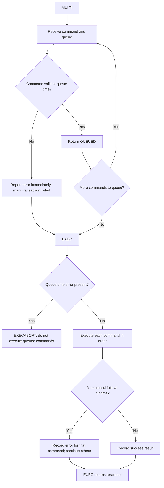

# Queue-Time Errors vs. Execution-Time Errors in Spring Data Redis Transactions

## 1. Why Must We Distinguish the Two Error Timings?

Redis transactions rely on three core commands:

- `MULTI`: starts a transaction and puts the connection into command-queuing state.
- Subsequent commands: Redis normally replies `QUEUED` rather than executing them immediately.
- `EXEC`: tells Redis to execute the queued commands in order.

When using Spring Data Redis's `RedisTemplate` or `StringRedisTemplate`, the application must understand this mechanism too. An error raised **before `EXEC` when Redis receives and checks a command** has a completely different consequence from an error raised **after `EXEC` while a command is being executed**.

Here is the key distinction:

> **A queue-time error** marks the transaction as invalid; when `EXEC` is called, Redis aborts the **entire** batch of queued commands. **An execution-time error** only causes that individual command to fail; Redis still executes the remaining commands in the same `EXEC` and does not automatically roll back commands that already succeeded.

If misunderstood, an application may assume either that every command in the transaction succeeded or that all changes were undone when an error occurred. Neither assumption holds in the case of individual command execution errors.

This lesson focuses on Redis `MULTI`/`EXEC` transactions accessed through Spring Data Redis. Relational database transactions, Redis Lua scripts, and Spring's `@Transactional` mechanism each have their own contracts and should not be conflated.

## 2. Lifecycle of a Redis Transaction



Characteristics of Redis transactions:

1. Commands within a single `EXEC` are processed sequentially; commands from other clients do not interleave between commands of the executing transaction.
2. Redis achieves **all-or-nothing** when the batch is aborted at queue time or aborted by `WATCH`.
3. Redis **does not roll back** successful commands if another command inside `EXEC` raises a runtime error.
4. `DISCARD` can cancel pending commands **before `EXEC`**; it does not undo changes already executed by `EXEC`.

The term “atomic” in Redis transactions primarily refers to uninterrupted execution of a command group and whole-batch rejection conditions before execution. It does not mean full rollback semantics like a conventional ACID database transaction.

## 3. Queue-Time Errors

### 3.1. What Does Redis Check Before Queuing?

After `MULTI`, Redis checks certain validity rules as soon as it receives a command. For example:

- Unrecognized command name.
- Wrong number of arguments, such as calling `INCR` without passing a key name.
- Other errors preventing Redis from accepting the command into the queue.

These errors may be reported **right when the command is sent**, instead of returning `QUEUED`. Redis remembers that the transaction encountered a queuing error.

Since Redis 2.6.5, when `EXEC` is sent after a queue-time error, Redis refuses to run the transaction's commands and returns `EXECABORT`. Commands that already received `QUEUED` before or after the bad command are **not executed either**.

### 3.2. Redis CLI Example: Wrong Number of Arguments

The keys below are for testing environments only:

```redis
DEL demo:tx:queue:a demo:tx:queue:b

MULTI
# OK

SET demo:tx:queue:a "first"
# QUEUED

INCR
# (error) ERR wrong number of arguments for 'incr' command

SET demo:tx:queue:b "second"
# QUEUED

EXEC
# (error) EXECABORT Transaction discarded because of previous errors.

EXISTS demo:tx:queue:a demo:tx:queue:b
# (integer) 0
```

Key observations:

- `SET ...a` was queued and received `QUEUED`.
- `INCR` lacked an argument, so Redis returned an error immediately.
- `SET ...b` may still receive `QUEUED` even though the transaction is already marked with an error.
- `EXEC` returns `EXECABORT` and **neither key `a` nor `b` was created** by this batch.

Here Redis did not run anything and then roll back. The entire batch was never executed at all because the queue was already invalid.

### 3.3. Not All Errors Can Be Detected Early

Redis does not run full command logic at queue time. It can verify that `LPUSH` has a valid argument count, yet **does not inspect the data type currently stored under that key** until execution.

For example:

```redis
SET demo:tx:item "plain-string"

MULTI
LPUSH demo:tx:item "value"
# QUEUED
EXEC
# 1) (error) WRONGTYPE Operation against a key holding the wrong kind of value
```

`LPUSH` had enough arguments, so it was queued. At `EXEC`, Redis discovers the key holds a String and cannot accept a List operation. This is an **execution-time error**, unlike the argumentless `INCR` in the previous example.

## 4. Execution-Time Errors

### 4.1. EXEC Does Not Stop When One Command Fails

Once Redis accepts all commands and begins `EXEC`, each command is processed in queued order. If one command hits a runtime error, that command's own result is an error reply, while the other commands in the batch **continue** to execute.

Typical errors:

- `WRONGTYPE`: command operates on the wrong Redis value type.
- `INCR` on a String that cannot be parsed as an integer.
- `RENAME` when the source key does not exist.
- Other data or runtime conditions arising during command execution.

The crucial point is that **there is no automatic rollback mechanism**. Data written successfully by preceding commands remains; commands following the failed one can still succeed.

### 4.2. Redis CLI Example: Middle Command Fails

```redis
SET demo:tx:runtime:payload "already-a-string"
DEL demo:tx:runtime:before demo:tx:runtime:after

MULTI
# OK

SET demo:tx:runtime:before "saved-before"
# QUEUED

LPUSH demo:tx:runtime:payload "x"
# QUEUED

SET demo:tx:runtime:after "saved-after"
# QUEUED

EXEC
# 1) OK
# 2) (error) WRONGTYPE Operation against a key holding the wrong kind of value
# 3) OK

GET demo:tx:runtime:before
# "saved-before"

GET demo:tx:runtime:payload
# "already-a-string"

GET demo:tx:runtime:after
# "saved-after"
```

What happened during `EXEC`:

| Position | Command | Result | Data state |
|---|---|---|---|
| 1 | `SET ...before` | Succeeded | Key `before` created |
| 2 | `LPUSH ...payload` | `WRONGTYPE` | Original String value preserved |
| 3 | `SET ...after` | Succeeded | Key `after` created |

If the application merely checks whether “`EXEC` returned a list” or “a command in the transaction reported an error” and concludes all changes were canceled, it will misread the real data state.

### 4.3. What Does EXEC Return?

In Redis CLI, a protocol-level successful `EXEC` returns a result collection matching the exact queued command order. Each slot can be:

- A success result such as `OK`, integer, string, or list.
- An **error reply** if the command at that slot failed during execution.

This is why we must distinguish:

- **`EXECABORT`**: Redis did not run the batch due to a queue-time error.
- **`EXEC` returning a list containing an error reply**: Redis ran the batch, and some commands may have mutated data.

Redis drivers and Spring Data Redis may expose individual error replies as result elements or throw an exception at the adapter layer, depending on the API and version. The application must account for both **exceptions** and **actual results** rather than assuming every `exec()` call returns an all-success list.

## 5. Direct Comparison of the Two Error Types

| Aspect | Queue-time error | Execution-time error |
|---|---|---|
| When detected | When sending a command after `MULTI`, before `EXEC` | Inside `EXEC`, while processing each command |
| Examples | Non-existent command, missing arguments | `WRONGTYPE`, value cannot increment as integer |
| Reply when queuing | Usually an immediate error reply | Still receives `QUEUED` |
| Overall `EXEC` reply | `EXECABORT` | Result list may contain an error reply |
| Do other valid commands run? | No | Yes, absent another abort condition |
| Is modified data rolled back? | No commands ran, so no rollback needed | No automatic rollback |
| Application handling | Fix command structure; cancel or rebuild transaction | Identify each succeeded/failed command and handle written state |
| Should you blindly retry? | No; fix the bad command first | No; may duplicate mutations or break consistency |

An easy rule to remember: **queue-time errors decide whether the batch starts running at all; execution-time errors occur while the batch is running and do not make Redis turn back time.**

## 6. How Does Spring Data Redis Queue Commands?

### 6.1. RedisTemplate and SessionCallback

Spring Data Redis provides `SessionCallback` to execute multiple commands on **the same Redis connection**, which is required so `MULTI`, pending commands, and `EXEC` belong to the same transaction.

With Spring Boot and `StringRedisTemplate`:

```groovy
dependencies {
    implementation 'org.springframework.boot:spring-boot-starter-data-redis'
}
```

```yaml
spring:
  data:
    redis:
      host: localhost
      port: 6379
```

Java example:

```java
package com.example.redis;

import java.util.List;
import org.springframework.dao.DataAccessException;
import org.springframework.data.redis.core.RedisOperations;
import org.springframework.data.redis.core.SessionCallback;
import org.springframework.data.redis.core.StringRedisTemplate;
import org.springframework.stereotype.Service;

@Service
public class TransactionDemo {

    private final StringRedisTemplate template;

    public TransactionDemo(StringRedisTemplate template) {
        this.template = template;
    }

    public List<Object> writeTwoKeys() {
        return template.execute(new SessionCallback<List<Object>>() {
            @Override
            @SuppressWarnings("unchecked")
            public <K, V> List<Object> execute(RedisOperations<K, V> operations)
                    throws DataAccessException {

                operations.multi();

                operations.opsForValue().set(
                        (K) "demo:tx:spring:first",
                        (V) "first-value"
                );

                operations.opsForValue().set(
                        (K) "demo:tx:spring:second",
                        (V) "second-value"
                );

                return operations.exec();
            }
        });
    }
}
```

The casts here merely accommodate the generic signature of `SessionCallback`. The example uses `StringRedisTemplate`, so keys and values are actually Strings. For applications with multiple object types, use the appropriate `RedisTemplate` and serializers.

Execution flow:

1. `operations.multi()` sends `MULTI`.
2. Both `set(...)` calls are sent to be **queued**.
3. `operations.exec()` sends `EXEC` and retrieves results from Redis.
4. Once `EXEC` completes, the values of both keys are considered applied if the commands succeeded.

Calls inside a transaction **do not return normal business results at queue time**. For example, `opsForValue().increment(...)` may return `null` while in the queue; do not interpret `null` as “Redis executed the command and returned empty” or “the command failed.”

Example to avoid:

```java
operations.multi();

Long current = operations.opsForValue()
        .increment((K) "demo:tx:counter");

// Wrong: here current may be null because the command was only queued.
if (current != null && current > 10) {
    // Cannot rely on uncomputed results inside MULTI.
}

List<Object> replies = operations.exec();
```

When branching on a stored value is needed, read before `MULTI` with `WATCH` and bounded retries, or use a Lua script/Redis Function for appropriate logic.

### 6.2. Errors Can Appear at Different Layers

In the Java example, three places deserve attention:

- **Before sending a Redis command**: Java validation or serialization may throw an exception. This is a client-side application error; Redis may not have seen the command, and the transaction may not be marked with a queue error.
- **When sending a command to queue**: Redis detects an invalid command and returns an error; the client/driver may translate it into `DataAccessException` or a related exception.
- **When calling `exec()`**: Redis executes each command; the driver returns results or throws an exception corresponding to failed commands.

Therefore, in Spring Data Redis do not infer simply that “an exception thrown before the Java `exec()` method is called” always equals a Redis queue-time error. It might be a serialization error, connection error, or local validation failure. Conversely, an exception from `exec()` may relate to an individual command's runtime error, `EXECABORT`, a `WATCH` change, or a lost connection.

### 6.3. Errors While Queuing: Ending the Session Properly

If code inside `SessionCallback` throws an exception **after `MULTI` began but before calling `EXEC`**, the connection may still be in transactional state. Proactively close the transaction with `DISCARD` when possible and ensure connection management cleans up properly.

A clean pattern for organizing code:

```java
public List<Object> writeWithCleanup() {
    return template.execute(new SessionCallback<List<Object>>() {
        @Override
        @SuppressWarnings("unchecked")
        public <K, V> List<Object> execute(RedisOperations<K, V> operations) {

            operations.multi();
            boolean execStarted = false;

            try {
                operations.opsForValue().set(
                        (K) "demo:tx:spring:primary",
                        (V) "ready"
                );
                operations.opsForValue().increment(
                        (K) "demo:tx:spring:count"
                );

                execStarted = true;
                return operations.exec();
            } catch (RuntimeException failure) {
                // DISCARD is only for transactions that have not sent EXEC.
                if (!execStarted) {
                    try {
                        operations.discard();
                    } catch (RuntimeException cleanupFailure) {
                        failure.addSuppressed(cleanupFailure);
                    }
                }
                throw failure;
            }
        }
    });
}
```

Once `execStarted` is `true`, the connection may already have sent `EXEC` and you cannot assume data has not been written. Do not automatically call `DISCARD` and tell the caller “rolled back,” because `DISCARD` after `EXEC` cannot undo any command that already ran.

The `writeWithCleanup` example shows how to distinguish **errors during queuing** from **errors after starting EXEC**. In production systems, beyond exception cleanup you also need telemetry and business state verification rules to handle network errors or uncertain outcomes.

## 7. Analyzing Execution-Time Errors in Spring Data Redis

An easily reproducible runtime error example:

- Redis currently holds a String key `demo:tx:spring:list`.
- Inside the transaction, the application attempts a List operation on that key.
- The List command queues validly, but fails with `WRONGTYPE` at execution.

```redis
SET demo:tx:spring:list "not-a-list"
MULTI
SET demo:tx:spring:before "one"
LPUSH demo:tx:spring:list "item"
SET demo:tx:spring:after "two"
EXEC
```

When `EXEC` returns results, the application must align them with the three commands sent. In raw Redis protocol, positions 1 and 3 succeed, while position 2 is an error.

At the Spring Data Redis layer, `exec()` returns `List<Object>` on success; elements are deserialized per template configuration, while the driver/adapter can alter how individual command errors are surfaced. Production handling code therefore needs two paths:

1. **If a result list is returned**: verify count, order, and result types against the specific contract. Do not treat a non-null list alone as complete success.
2. **If an exception is thrown during `exec()`**: do not assume the batch did not execute; record that the transaction started `EXEC` and verify required state before retrying or compensating.

Avoid hardcoding dependencies on exception message substrings like `"WRONGTYPE"` to drive business logic. Messages may be translated by drivers/adapters, and data-schema mismatches should be prevented beforehand via keyspace design, serializers, and validation.

### 7.1. Why Do Individual Command Outcomes Matter?

Suppose a transaction processes:

```text
1. INCR demo:tx:metrics:attempts
2. LPUSH demo:tx:details:user42 ...
3. SET demo:tx:state:user42 COMPLETED
```

If step 2 fails with a data-type error, step 1 may still increment the counter and step 3 may still mark `COMPLETED`. This is a dangerous business state: the completion flag does not reflect the detail data.

The fix is not merely catching exceptions in Java. You must design **valid preconditions before execution** or change the command model so an invalid write does not yield a half-finished state. A Lua script or Redis Function can validate preconditions before writing and then run the intended mutations; however, scripts also lack automatic rollback if they fail after already mutating data, so always validate first and mutate after.

## 8. WATCH: Another Abort Case Distinct from Errors

`WATCH` provides **optimistic locking** for one or more keys. Redis monitors changes to keys after `WATCH` and before `EXEC`. If a client modifies a watched key, `EXEC` does not run the command batch and returns an abort reply.

Example with two clients:

**Client A:**

```redis
SET demo:tx:stock "10"
WATCH demo:tx:stock
GET demo:tx:stock
# "10"
```

**Client B:** modifies the key before Client A calls `EXEC`:

```redis
DECR demo:tx:stock
# (integer) 9
```

**Client A:** proceeds:

```redis
MULTI
SET demo:tx:stock "8"
# QUEUED
EXEC
# (nil) — transaction aborted because WATCHed key changed
```

Three cases to distinguish:

| Case | Redis CLI behavior | Do commands inside MULTI run? |
|---|---|---|
| Queue-time error | `EXECABORT` | No |
| Watched key modified | `EXEC` returns nil/null reply | No |
| Execution-time command error | `EXEC` list contains error reply | Other commands still run |

`WATCH` is not a rollback mechanism when a command inside `EXEC` errors. It checks that previously read state did not change unexpectedly before starting the batch. If `EXEC` already started and hit `WRONGTYPE` on one command, `WATCH` does not turn the batch into an all-or-nothing transaction.

When a transaction aborts due to `WATCH`, the application can **re-read state, recompute the operation, and retry with a bound**. Avoid unbounded retries under high contention. Self-modifications to watched keys, key expiration or eviction, and concurrent client updates must all be considered according to Redis semantics and deployment version.

## 9. Does Spring's @Transactional Roll Back Redis Completely?

**No.** The `@Transactional` annotation coordinates transactions via the configured `PlatformTransactionManager` and resource. By default, `RedisTemplate` **does not automatically participate** in Spring-managed transactions unless transaction support is enabled.

Example enabling support:

```java
@Configuration
public class RedisTemplateConfig {

    @Bean
    public StringRedisTemplate stringRedisTemplate(
            RedisConnectionFactory connectionFactory) {

        StringRedisTemplate template =
                new StringRedisTemplate(connectionFactory);

        template.setEnableTransactionSupport(true);
        return template;
    }
}
```

When transaction support is enabled and an appropriate Spring transaction is active, Redis commands are queued in the Spring-managed transaction context; on commit, Spring sends `EXEC`, and on rollback prior to commit it may send `DISCARD`.

However, understand the limits:

- `DISCARD` before `EXEC` only drops unexecuted commands.
- If `EXEC` is running and one command fails at runtime, Redis does not roll back other commands that succeeded.
- Sharing one `@Transactional` across JDBC/JPA and Redis does not automatically provide an **atomic distributed transaction** between the relational database and Redis.
- How Spring binds connections and flushes results depends on the transaction manager, thread/context, and configuration. Do not rely on reads inside the same transaction seeing commands that are still queued.
- Return values of queued operations may be `null` at the call site; do not treat that as a business failure or success.

For example, suppose a system inserts an order in PostgreSQL and then `SET`s Redis status inside a `@Transactional` Spring service. If the SQL commit succeeds but the Redis write fails, you cannot conclude SQL rolled back alongside Redis. When cross-system synchronization is required, design mechanisms like transactional outbox, event retries, idempotency, or reconciliation.

## 10. Network Errors Behave Differently from Redis Command Errors

Not every error around `EXEC` is `EXECABORT` or `WRONGTYPE`. Connection loss can happen at several points:

| Disconnection timing | What you can know | What remains uncertain |
|---|---|---|
| Before starting `MULTI` | No transaction commands were sent by the app on that connection | State of earlier independent operations |
| After some commands were queued, before sending `EXEC` | Queued commands have not been asked to execute | Whether another client touched the data |
| While sending `EXEC` or awaiting reply | No complete confirmation received | Whether Redis ran `EXEC`; how many commands succeeded |
| After receiving the full `EXEC` result | Each command's result can be analyzed | Operations on systems outside Redis are not automatically guaranteed |

The hardest case is **outcome unknown**: the client sends `EXEC`, and the connection drops before receiving the reply. A transaction may have run completely, partially (due to runtime command errors), or not at all. If the application immediately retries a batch containing `INCR`/`LPUSH`, it could **increment the counter or push an item twice**.

Strategy:

1. Attach an operation ID or idempotency key for operations that must resist duplicate execution.
2. Provide a reliable way to inspect whether the target state was written, when feasible.
3. Prefer idempotent operations or appropriate atomic conditional designs where possible.
4. Separate “definitely did not run” errors from “unknown whether it ran” errors in logs/metrics.
5. Limit retries, add backoff, and avoid repeating side effects.

Never report confidently “the transaction failed and data did not change” based solely on a timeout in `exec()`.

## 11. Preventing Runtime Errors Through Command Design

### 11.1. Never Reuse One Key for Multiple Data Types

`WRONGTYPE` typically happens when components share a key name while expecting different types. Use prefixes that convey purpose:

```text
cache:profile:42         -> Redis String (JSON)
cart:items:42            -> Redis Hash
metrics:views:product42  -> Redis String holding integer
queue:notifications      -> Redis Stream or List by design
```

The same key should never be written with `SET` at one time and manipulated with `LPUSH` at another. If schema changes are necessary, plan a migration instead of reusing old names for new types.

### 11.2. Validate Data Before Sending the Transaction

For example, check client-supplied inputs before `MULTI`:

- Validate non-empty IDs/keys per application rules.
- Validate numeric increments/decrements.
- Normalize strings and serialize payloads before queuing.
- Verify data-type assumptions and business invariants.

However, checking `TYPE key` and then running a transaction on another connection can still hit a **race condition** if another client alters the key in between. If a condition must hold atomically, use `WATCH` combined with a read and `EXEC`, or a Lua script/Redis Function designed to validate before mutating. Do not treat a bare pre-check as a protective lock.

### 11.3. Order Commands Deliberately

In a multi-operation transaction, placing a “hard-to-fail” command earlier or later does not make Redis roll back automatically. Even so, deliberate ordering reduces dangerous states:

- Check conditions **before writing**, ideally inside the same atomic primitive when needed.
- Perform primary data writes before marking completion status, with proper result verification.
- Never treat `SET status=COMPLETED` as proof that all preceding commands succeeded if the transaction can return error replies.
- For complex workflows, build a state machine/idempotent recovery rather than hoping the transaction will undo itself.

### 11.4. When Business Rules Require All-or-Nothing

If the requirement is “allow no updates at all when a condition fails,” design an atomic operation that evaluates conditions **before writing**. A Redis Lua script or Redis Function can run multiple steps within one server-side execution and return an explicit status.

However:

> Lua scripts and Redis Functions also **do not automatically roll back** changes already executed prior to a runtime error. Write scripts so every check that can fail happens before commands with side effects, or pair them with proper compensation and idempotency.

Validation-first pattern:

```text
1. Validate data types of relevant keys.
2. Validate value constraints (balance, state, quota).
3. If invalid: return rejection result without modifying data.
4. If valid: apply designed write operations.
5. Return status and result data.
```

This is a business design considering Redis topology (especially Redis Cluster and hash slots), not an automatic feature of `@Transactional`.

## 12. Observability and Error Handling in Applications

### 12.1. Log by Phase

A useful error log should capture:

- `transactionId` or business correlation ID.
- Phase: `MULTI`, `QUEUE`, `EXEC`, `WATCH_ABORT`, `NETWORK_UNKNOWN`.
- Command sequence and types (never log sensitive values like passwords or tokens).
- Redis error category (`EXECABORT`, `WRONGTYPE`, connection error) when identifiable.
- Known outcome and degree of certainty regarding data state.
- Retry/compensation policy applied.

A message like “Redis transaction failed” is too vague. For runtime errors inside `EXEC`, operations teams need to know **whether any side effects were confirmed to have succeeded**.

### 12.2. Handle Results via Explicit Outcome Types

An application can model outcomes at the business layer such as:

```java
public enum TransactionOutcome {
    SUCCESS,
    REJECTED_BEFORE_EXEC,
    WATCH_CONFLICT,
    PARTIAL_EXECUTION,
    UNKNOWN
}
```

This is an **application-defined enum**, not an enum provided by Spring Data Redis. Meanings:

- `SUCCESS`: sufficient evidence that all required commands succeeded.
- `REJECTED_BEFORE_EXEC`: Redis confirmed the batch did not run, e.g., `EXECABORT`.
- `WATCH_CONFLICT`: Redis confirmed `EXEC` was aborted due to optimistic locking.
- `PARTIAL_EXECUTION`: one or more commands failed execution while others may have succeeded.
- `UNKNOWN`: insufficient evidence, especially due to timeout or connection loss around `EXEC`.

This classification helps callers decide whether to retry, re-read data, or compensate. Do not infer `PARTIAL_EXECUTION` from a generic exception if the driver did not indicate how much of the batch ran.

### 12.3. Intentional Test Scenarios

When learning or testing against an isolated Redis instance, you can reproduce these scenarios:

| Scenario | How to reproduce | Expected Redis outcome |
|---|---|---|
| Queue-time error | `INCR` missing argument inside `MULTI` | `EXECABORT`, queued commands do not run |
| Runtime error | `LPUSH` on a key holding a String | `EXEC` contains an error at `LPUSH`'s position; other commands still run |
| WATCH conflict | Another client modifies watched key before `EXEC` | `EXEC` returns nil, no queued commands run |
| Successful transaction | Valid commands, matching data types | `EXEC` returns success results in order |
| Error before sending EXEC | Client serialization/validation error | Close/discard pending transaction to avoid leaking connection state |
| Missing EXEC reply | Drop connection at an uncertain moment | Do not assume rollback; verify state and enforce idempotency |

At the Spring Data Redis layer, these scenarios can surface through different adapter exceptions or return structures. Tests should assert **final Redis data state** and application-level responses rather than merely checking that an exception was thrown.

## 13. Common Misconceptions

**“MULTI means either all commands succeed or none succeed.”** Incorrect. Redis guarantees transaction commands run consecutively without interleaving from other clients, but a runtime error in one command does not stop the rest from running.

**“If EXEC has an error reply, Redis automatically rolls back earlier commands.”** No. In the `SET` → `WRONGTYPE` `LPUSH` → `SET` example, both `SET` commands still succeed.

**“A command returning QUEUED means it is guaranteed to succeed.”** No. `QUEUED` only states that Redis accepted the command into the queue.

**“EXECABORT means it tried running and needs an undo.”** No. On a queue-time error, Redis refuses to execute the entire batch right at `EXEC`.

**“WATCH rolls back WRONGTYPE errors.”** No. `WATCH` detects changes before `EXEC` and can prevent the whole batch from running. It does not revert side effects of an executed command.

**“Spring's @Transactional gives Redis JPA-like rollback.”** No. You must enable transaction support on the template and still follow Redis `MULTI`/`EXEC` semantics, including limits on runtime errors and multiple resources.

**“No reply from EXEC means no data changed.”** No. On a connection timeout, the application may not know whether Redis received and ran `EXEC`.

## 14. Conclusion

In Redis transactions, **queue-time errors** and **execution-time errors** require two different handling strategies. Queue-time errors cause Redis to return `EXECABORT` and skip executing queued commands. Execution-time errors appear in individual command results while `EXEC` runs; other commands can still succeed and **there is no automatic rollback**.

With Spring Data Redis, `SessionCallback` helps keep `MULTI` and `EXEC` on the same connection; however, drivers may represent errors as exceptions or result elements, so the application must track which phase the transaction is in. When combining multiple business operations, design validation, idempotency, retries, and state verification rather than relying on an assumption that “the transaction will undo everything.” In particular, losing a reply around `EXEC` is an uncertain-outcome situation requiring more careful handling than an `EXECABORT` explicitly confirmed by Redis.
