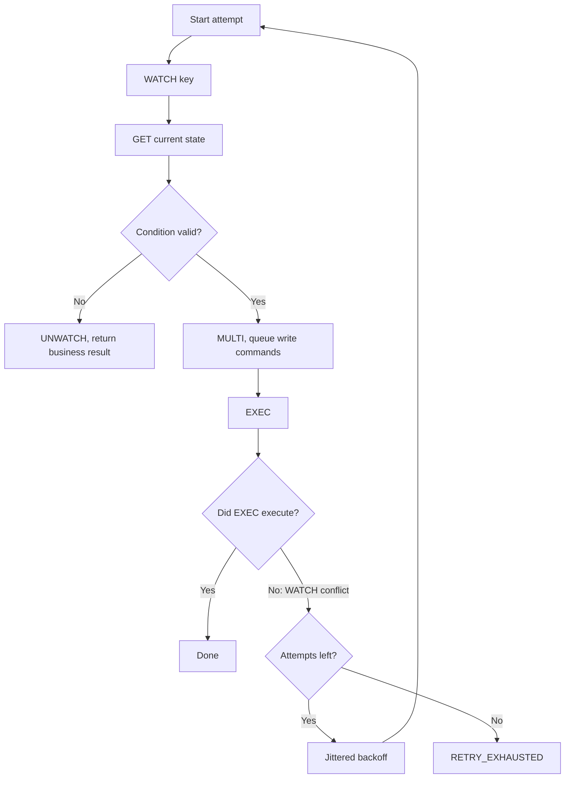

# Bounded Retries When WATCH Detects Key Modifications

In Spring Data Redis, `WATCH` combined with `MULTI` and `EXEC` lets you perform an **optimistic locking** transaction: the application reads the current state, checks a condition, and writes only if the watched keys have not changed in the meantime. If another process modifies a watched key, Redis aborts the transaction and the client can retry using fresh data.

Retries must have a **bounded attempt limit**, suitable pauses, and a clear result when committing is impossible. If looped infinitely, a continuously updated key can cause the application to tie up threads, overload Redis, and hang requests. This lesson builds a concrete retry flow with Spring Data Redis's `SessionCallback`, while distinguishing `WATCH` conflicts from business rejections and cases where it is unknown whether the transaction committed.

## 1. Why Does Read-Then-Write Easily Lose Updates?

Suppose Redis stores inventory for item `sku-42` under key `stock:sku-42`:

```redis
SET stock:sku-42 8
```

Two customers concurrently order 6 items:

```text
Request A                               Request B
---------                               ---------
GET stock:sku-42 -> "8"
                                        GET stock:sku-42 -> "8"
Sees 6 available; computes 2 left
                                        Sees 6 available; computes 2 left
SET stock:sku-42 2
                                        SET stock:sku-42 2
Reports order placed                    Reports order placed
```

The final value is 2, yet both requests believe they sold 6 items, totaling 12 sold. This is a *lost update* bug caused by checking a condition against stale data.

Simply wrapping `SET` in `MULTI`/`EXEC` is not enough: Redis still needs to know whether another process updated the key **after we read** and **before we commit**. `WATCH` handles that change detection.

## 2. How `WATCH`, `MULTI`, and `EXEC` Work Together

In each *attempt*, the core flow is:

1. Send `WATCH stock:sku-42` on the active Redis connection.
2. `GET stock:sku-42` to read the value and evaluate business rules.
3. If stock is insufficient, call `UNWATCH` and return the insufficient-stock result.
4. If stock is sufficient, call `MULTI`; queue the stock-deduction command in the transaction.
5. Call `EXEC`. Redis executes the queue only if the watched key has not changed.
6. If `EXEC` is aborted, start **a fresh attempt from `WATCH` and `GET`** without reusing the previous value.



A typical scenario:

```text
Client A                               Client B
--------                               --------
WATCH stock:sku-42
GET -> 8
                                       WATCH stock:sku-42
                                       GET -> 8
MULTI
DECRBY stock:sku-42 6
EXEC -> [2]
                                       MULTI
                                       DECRBY stock:sku-42 6
                                       EXEC -> nil (aborted)
                                       WATCH stock:sku-42
                                       GET -> 2
                                       UNWATCH (not enough for 6)
```

In Redis CLI, `EXEC` returns a **null reply** when a watched key was modified before commit. Queued write commands **are not executed**. Changes by another client, by the same connection before `MULTI`, or due to Redis key expiration/eviction can all invalidate `WATCH`. Starting in Redis `6.0.9`, expiration of watched keys also aborts the transaction.

`WATCH` monitors **the entire key**, not individual fields. An `HSET` to another field on the same hash can still trigger a conflict.

## 3. Designing a Bounded Retry Contract

A retry loop should make the following decisions explicit:

| Rule | Example | Rationale |
| --- | --- | --- |
| Max attempts | `MAX_ATTEMPTS = 4` | Includes the initial try plus three extra attempts |
| Retry condition | Only when `EXEC` is aborted by `WATCH` | Do not repeat data errors or already-committed actions |
| Backoff | 10–20, 20–40, 40–80 ms | Reduces immediate collision among competing clients |
| Jitter | Pick random delay within range | Prevents clients from retrying in lockstep |
| Exhaustion result | `RETRY_EXHAUSTED` | Caller decides whether to show an error or retry later |
| Time budget | E.g., 500 ms/request | Bounds waiting time beyond attempt count |

Distinguish clearly:

- **`WATCH_CONFLICT`:** Redis refused to run the transaction; re-reading and starting a new attempt is appropriate.
- **`INSUFFICIENT_STOCK`:** latest read data does not satisfy the condition; return immediately without retrying deductions.
- **`NOT_FOUND`:** key did not exist at read time; handle per business contract.
- **Connection/timeout/command errors:** must not be treated as conflicts by default. In particular, when `EXEC` was sent without receiving a reply, the transaction **may have run**.

Naming the parameter `maxAttempts` avoids ambiguity: `4 attempts` means at most **4 WATCH/EXEC cycles**, whereas `maxRetries = 3` typically means 3 retries after the first try.

## 4. Spring Data Redis Must Hold the Same Connection

`WATCH` is scoped to a **Redis connection**. Independent calls on `RedisTemplate` are not guaranteed to use the same connection, whereas `WATCH`, `GET`, `MULTI`, and `EXEC` must belong to the same session.

Spring Data Redis provides `SessionCallback` for this purpose:

```java
redis.execute(new SessionCallback<List<Object>>() {
    @Override
    @SuppressWarnings({"rawtypes", "unchecked"})
    public List<Object> execute(RedisOperations operations) {
        operations.watch("counter");

        // Run GET and check condition before MULTI.
        // If no write is needed: operations.unwatch(), then return.

        operations.multi();
        operations.opsForValue().increment("counter", 1L);
        return operations.exec();
    }
});
```

This snippet illustrates connection scoping; the full example in the next section also handles the no-write branch, cleanup, and retries.

**Do not read with `GET` after `MULTI` to decide whether to write.** While the transaction is open, commands are queued, so the Java call may return `null` instead of the real value; queued command results only arrive after `EXEC`.

`@Transactional` on a service does not replace `WATCH`: integrating Redis with Spring-managed transactions requires `setEnableTransactionSupport(true)` and carries different connection semantics. Using `SessionCallback` makes each attempt's boundaries explicit.

## 5. Example: Reserving Stock with WATCH and Up to Four Attempts

The example assumes `stock:<sku>` stores a non-negative integer as a Redis string. The service deducts only when enough stock remains; if two requests see the old count concurrently, only one transaction commits.

### 5.1. Complete Java Code

```java
package com.example.inventory;

import java.util.List;
import java.util.concurrent.ThreadLocalRandom;
import org.springframework.dao.DataAccessException;
import org.springframework.data.redis.core.RedisOperations;
import org.springframework.data.redis.core.SessionCallback;
import org.springframework.data.redis.core.StringRedisTemplate;
import org.springframework.stereotype.Service;

@Service
public class InventoryReservationService {

    private static final int MAX_ATTEMPTS = 4;
    private final StringRedisTemplate redis;

    public InventoryReservationService(StringRedisTemplate redis) {
        this.redis = redis;
    }

    public enum ReserveResult {
        RESERVED,
        NOT_FOUND,
        INSUFFICIENT_STOCK,
        RETRY_EXHAUSTED
    }

    private enum Attempt {
        COMMITTED,
        MISSING,
        NOT_ENOUGH,
        WATCH_CONFLICT
    }

    public ReserveResult reserve(String sku, long quantity) {
        if (sku == null || sku.isBlank()) {
            throw new IllegalArgumentException("sku must not be blank");
        }
        if (quantity <= 0) {
            throw new IllegalArgumentException("quantity must be positive");
        }

        String key = "stock:" + sku;
        for (int attemptNo = 1; attemptNo <= MAX_ATTEMPTS; attemptNo++) {
            Attempt outcome = attemptOnce(key, quantity);

            switch (outcome) {
                case COMMITTED:
                    return ReserveResult.RESERVED;
                case MISSING:
                    return ReserveResult.NOT_FOUND;
                case NOT_ENOUGH:
                    return ReserveResult.INSUFFICIENT_STOCK;
                case WATCH_CONFLICT:
                    if (attemptNo == MAX_ATTEMPTS) {
                        return ReserveResult.RETRY_EXHAUSTED;
                    }
                    boundedBackoff(attemptNo);
                    break;
            }
        }
        throw new IllegalStateException("Unreachable retry state");
    }

    private Attempt attemptOnce(String key, long quantity) {
        return redis.execute(new SessionCallback<Attempt>() {
            @Override
            @SuppressWarnings({"rawtypes", "unchecked"})
            public Attempt execute(RedisOperations operations)
                    throws DataAccessException {

                // Every command in the callback shares the same Redis connection.
                operations.watch(key);
                boolean inMulti = false;

                try {
                    // Read after WATCH, before MULTI.
                    String raw = (String) operations.opsForValue().get(key);
                    if (raw == null) {
                        operations.unwatch();
                        return Attempt.MISSING;
                    }

                    long available = Long.parseLong(raw);
                    if (available < quantity) {
                        operations.unwatch();
                        return Attempt.NOT_ENOUGH;
                    }

                    operations.multi();
                    inMulti = true;

                    // INCRBY with a negative delta. Unlike SET, this operation
                    // typically preserves any existing expiration.
                    operations.opsForValue().increment(key, -quantity);

                    List<Object> replies = operations.exec();
                    inMulti = false;

                    // Redis returns a null reply if EXEC is aborted by WATCH.
                    // A valid commit has exactly 1 INCRBY result.
                    if (replies == null || replies.isEmpty()) {
                        return Attempt.WATCH_CONFLICT;
                    }
                    if (replies.size() != 1 ||
                            !(replies.get(0) instanceof Number)) {
                        throw new IllegalStateException(
                                "Unexpected EXEC reply: " + replies);
                    }
                    return Attempt.COMMITTED;

                } catch (RuntimeException failure) {
                    // Do not leave the connection in MULTI/WATCH on error exit.
                    try {
                        if (inMulti) {
                            operations.discard();
                        } else {
                            operations.unwatch();
                        }
                    } catch (RuntimeException cleanupFailure) {
                        failure.addSuppressed(cleanupFailure);
                    }
                    throw failure;
                }
            }
        });
    }

    private static void boundedBackoff(int attemptNo) {
        long capMs = Math.min(160L, 20L << (attemptNo - 1));
        long delayMs = capMs / 2
                + ThreadLocalRandom.current().nextLong(capMs / 2 + 1);

        try {
            Thread.sleep(delayMs);
        } catch (InterruptedException interrupted) {
            Thread.currentThread().interrupt();
            throw new IllegalStateException(
                    "Interrupted during Redis WATCH retry", interrupted);
        }
    }
}
```

With this code, aborted attempts stop after at most four tries. Before the next three attempts, the service sleeps roughly 10–20, 20–40, and 40–80 milliseconds. Total latency also includes Redis network commands. `Thread.sleep` only suits synchronous code; **never block the WebFlux/Reactor event loop**. Reactive applications need non-blocking delay strategies and reactive-API connection scoping.

### 5.2. Preparing Data and Usage

Create the key in Redis for learning purposes:

```redis
SET stock:sku-42 8
```

Invoke from a service or controller:

```java
InventoryReservationService.ReserveResult result =
        inventoryReservationService.reserve("sku-42", 6);

switch (result) {
    case RESERVED -> System.out.println("Stock reserved");
    case NOT_FOUND -> System.out.println("Inventory not found");
    case INSUFFICIENT_STOCK -> System.out.println("Insufficient stock");
    case RETRY_EXHAUSTED -> System.out.println("Inventory busy, try again later");
}
```

If a single request runs when the key starts at `8`, the result is `RESERVED` and `2` remains. If two requests simultaneously request `6` against `8`, one transaction commits first; the other is rejected by `WATCH`. When it retries and reads `2`, that request returns `INSUFFICIENT_STOCK`.

### 5.3. Meaning of Code Branches

| Branch | Behavior |
| --- | --- |
| Key value is `null` | `UNWATCH`, returns `NOT_FOUND` |
| Key value is less than requested amount | `UNWATCH`, returns `INSUFFICIENT_STOCK` |
| Condition met and `EXEC` succeeds | Receives one numeric reply from `INCRBY`, returns `RESERVED` |
| `EXEC` aborted due to watched key change | Returns `WATCH_CONFLICT`; outer loop sleeps and retries if attempts remain |
| `NumberFormatException`, Redis exception, or unexpected reply | Does not mask errors as watch conflicts; cleans connection if possible and throws |
| Exhausted attempts with conflicts every time | Returns `RETRY_EXHAUSTED` |

`INCRBY` with a negative delta deducts inventory while avoiding overwriting the string with `SET` and losing existing TTL. **Using `INCRBY` alone does not enforce the "non-negative stock" rule**; the `WATCH` + `GET` + `EXEC` sequence is what ensures the read condition holds before the transaction commits.

This snippet restricts scope to the Redis transaction; `RESERVED` only means Redis inventory was deducted. If you also need to create an order in SQL, charge payment, or send a notification, design cross-system consistency and idempotency separately.

## 6. Interpreting EXEC Results and Distinguishing Errors

In Redis CLI:

```redis
WATCH stock:sku-42
# OK

GET stock:sku-42
# "8"

# Another connection modifies stock:sku-42 here.

MULTI
# OK

DECRBY stock:sku-42 6
# QUEUED

EXEC
# (nil)  — transaction rejected by Redis
```

In Spring Data Redis, `RedisOperations.exec()` returns results converted into Java objects. The exact representation of a null reply depends on the Spring Data Redis/driver version, but **an aborted transaction must never be treated as success**.

In our example queuing one `INCRBY`, a valid commit must have one numeric result. The sample code treats `null` or an empty list as a conflict and throws on unexpectedly shaped replies. In production, verify the exact `exec()` contract of your client version, especially on the abort branch.

`EXEC` aborted by `WATCH` differs from three other cases:

1. **`DISCARD`**: the client actively clears the transaction queue before commit and exits transaction mode.
2. **Error queuing a command**: Redis may refuse to run the transaction if a command is invalid during queuing.
3. **Runtime error executing a command inside `EXEC`**: Redis does not guarantee rolling back earlier commands in the same transaction if one command fails at runtime. Results may include per-command errors; do not retry the whole batch as if it were a `WATCH` abort.

If `EXEC` was already sent to Redis and the connection dropped before the client received a response, the transaction **may have committed**. Automatically retrying `DataAccessException` could deduct stock twice. In the sample, retry only on an explicit signal that Redis aborted the transaction due to `WATCH`.

## 7. Cleanup: UNWATCH and DISCARD

`WATCH` attaches to a Redis connection. When using a connection pool, cleaning up state on error paths is critical:

| Exit point | Appropriate command | Why |
| --- | --- | --- |
| `WATCH` called, `MULTI` not opened, no write needed | `UNWATCH` | Stops watching registered keys |
| `MULTI` opened, must cancel before `EXEC` | `DISCARD` | Clears transaction queue and watch state |
| `EXEC` returned success | No extra `UNWATCH` needed | Redis automatically clears watched keys upon completion |
| `EXEC` hit watch conflict | No extra `UNWATCH` needed | Redis ended the attempt and cleared watches |
| Connection loss or timeout | Do not assume cleanup succeeded | Driver/pool must handle broken connection; commit outcome may be unknown |

The `try/catch` inside the service attempts to call `DISCARD` if inside `MULTI`, or `UNWATCH` before `MULTI`, then rethrows the original exception. Never swallow cleanup errors to return a false success.

Do not perform external service calls, long SQL queries, or waits **between `WATCH` and `EXEC`**. The wider that window, the higher the chance the key gets modified. Backoff must happen **after a transaction aborts**, before the new attempt.

## 8. Calculating Backoff and Total Timeout

Backoff can be fixed, linear, or exponential. Under moderate contention, exponential backoff with jitter is a common choice:

```text
attempt 1: WATCH conflict -> sleep ~10..20 ms
attempt 2: WATCH conflict -> sleep ~20..40 ms
attempt 3: WATCH conflict -> sleep ~40..80 ms
attempt 4: WATCH conflict -> out of attempts, no further sleep
```

Even with `MAX_ATTEMPTS`, a request can still take long if each Redis command approaches a high timeout. An additional overall deadline keeps request duration bounded:

```java
long start = System.nanoTime();
long budget = java.util.concurrent.TimeUnit.MILLISECONDS.toNanos(500);

for (int attempt = 1; attempt <= MAX_ATTEMPTS; attempt++) {
    if (System.nanoTime() - start >= budget) {
        // Time budget exhausted; do not start another attempt.
        break;
    }

    // One attempt consists of WATCH, GET, MULTI, EXEC.
    // Sleep and retry only on a WATCH conflict.
}
```

This illustrates checking a time budget at **attempt boundaries**. It cannot interrupt a hung Redis command; the application still needs command timeouts, connection timeouts, circuit breakers, and request deadlines tuned to actual infrastructure.

When attempts run out, return a clear, meaningful result. In an HTTP API, you might return `409 Conflict` for contended operations, or `503 Service Unavailable` for transient overload, depending on the agreed contract. Callers should not assume every `500` error is safe to retry.

## 9. Multi-Key Retries and Redis Cluster

Some workflows must verify both stock and a coupon's status before committing:

```redis
WATCH stock:sku-42 coupon:code-7
GET stock:sku-42
GET coupon:code-7
MULTI
DECRBY stock:sku-42 1
SET coupon:code-7 used
EXEC
```

If **either** watched key is modified, Redis aborts the entire transaction. The next attempt must `WATCH` and re-read **all data** affecting the conditions.

In Spring Data Redis:

```java
operations.watch(java.util.List.of(
        "stock:sku-42",
        "coupon:code-7"));
```

With **Redis Cluster**, multi-key transactions must obey **same-hash-slot** constraints. One key-organization technique is a shared hash tag for data participating in the same transaction:

```text
stock:{checkout-123}
coupon:{checkout-123}
```

Keys sharing `{checkout-123}` route to the same hash slot. Never expect `WATCH` on keys in arbitrary slots to yield a cluster-wide atomic transaction.

However, watching more keys makes it easier for an unrelated modification to abort the transaction. Watch only keys that genuinely participate in the business rule.

## 10. Retry Traps to Avoid

### 10.1. Unbounded Retries

```java
// Avoid: no limit on attempts or elapsed time.
while (true) {
    // WATCH, GET, MULTI, EXEC; immediately loop on conflict.
}
```

During peak traffic, this loop can worsen contention rather than help transactions finish. Always enforce a hard cap and controlled error reporting.

### 10.2. Reusing Stale Data After Conflict

```text
Attempt 1: GET stock = 8, EXEC aborts
Attempt 2: still assumes stock = 8, skips GET, re-queues DECRBY 6
```

The current value may already be 2 or the key may have been deleted. **Restarting the entire attempt** and re-evaluating conditions on fresh data is mandatory.

### 10.3. Putting GET After MULTI

Inside a transaction, commands are queued, so `opsForValue().get()` called after `multi()` is not a normal synchronous read usable in an `if`. Read before `MULTI`, after `WATCH`.

### 10.4. Triggering Side Effects Inside the Retry Loop

Never send emails, call payment gateways, or create transactions in external services **before confirming the Redis commit succeeded**. If an attempt aborts, those external side effects will not roll back automatically. Even after commit, if a network reply is lost, idempotency may still be needed to prevent duplicate side effects when clients resend requests.

### 10.5. Treating Every Exception as a WATCH Conflict

`WRONGTYPE`, arithmetic errors, missing permissions, timeouts, and connection errors do not heal themselves on retry. In particular, `EXEC`'s outcome may be indeterminate if Redis executed it while the client lost the reply. Retry only on confirmed conflict branches; let other errors flow to proper handlers.

### 10.6. Thinking MULTI Locks Out Other Writers

`MULTI` does not prevent other clients from updating watched keys before `EXEC`. `WATCH` makes `EXEC` conditional and can force a transaction abort. This is **optimistic concurrency**, not an exclusive lock.

## 11. When to Use a Lua Script Instead of WATCH?

If the business logic simply needs “deduct stock if sufficient” and the key experiences high contention, a Lua script running all reads and writes in **one atomic execution** reduces round-trips and avoids `WATCH`/retry loops:

```lua
-- KEYS[1] = stock key
-- ARGV[1] = quantity to deduct
local current = redis.call('GET', KEYS[1])
if not current then
    return -1  -- key missing
end

local available = tonumber(current)
local requested = tonumber(ARGV[1])
if not available or not requested or requested <= 0 then
    return redis.error_reply('invalid stock or quantity')
end

if available < requested then
    return 0   -- insufficient stock
end

redis.call('DECRBY', KEYS[1], requested)
return 1       -- deducted successfully
```

Lua keeps concise logic on the Redis server and helps when a key is very hot. Still, scripts must execute quickly so they do not block other commands; in Redis Cluster, all involved keys must still share the same hash slot. **Lua does not automatically provide exactly-once execution** if a client retries a request after losing a reply. When double deductions must be prevented, add an **idempotency key** and record the processed marker alongside deducting stock in one atomic unit.

`WATCH` remains suitable when decisions require Java logic, when contention is low, or when evaluating conditions across multiple values cleanly before commit. Choosing Lua vs. `WATCH` is a decision about data modeling, complexity, and system load, not just line count.

## 12. Operational Observability

To know whether your retry strategy is effective, track:

| Metric | Purpose |
| --- | --- |
| `watch_attempts_total` | Total attempts, including the initial one |
| `watch_conflicts_total` | `EXEC` calls aborted by Redis due to watched-key changes |
| `watch_retry_exhausted_total` | Requests that exhausted the attempt limit |
| `reservation_rejected_total` | Requests failing business preconditions |
| `redis_transaction_errors_total` | Redis/driver exceptions, separated from conflicts |
| `watch_to_exec_latency` | Time from `WATCH` to `EXEC` within one attempt |
| `reservation_latency` | Total request duration including backoff |

Rising conflicts do not necessarily mean Redis is unhealthy. They can signal a hot key, transactions kept open too long, watching too many keys, or too many workers writing to one aggregate. Merely raising `MAX_ATTEMPTS` can add even more Redis load; revisit the access pattern when contention persists.

If business rules guarantee each request applies logic at most once, add a durable operation ID and processed state. A Redis transaction that committed before the caller lost the reply cannot be accurately recovered merely by re-running `WATCH`.

## 13. Practice Walkthrough

You can rehearse with two Redis CLI windows:

**Client A:**

```redis
SET demo:stock 8
WATCH demo:stock
GET demo:stock
```

**Client B:**

```redis
SET demo:stock 5
```

**Back to Client A:**

```redis
MULTI
DECRBY demo:stock 6
EXEC
# (nil): A is not allowed to commit based on the stale value 8
```

**Client A begins a new attempt:**

```redis
WATCH demo:stock
GET demo:stock
# "5": now insufficient for requesting 6
UNWATCH
```

This example shows why retry means **re-reading and re-deciding**. There is no reason to try deducting 6 again once Redis updated to 5.

## 14. Takeaways

`WATCH` lets a Redis transaction act as a conditional check-and-write. If a watched key changes, `EXEC` aborts and queued commands do not execute. In Spring Data Redis, each attempt must share **the same connection** via `SessionCallback`; `GET` occurs before `MULTI`, and every new attempt must re-read all relevant state.

A safe retry strategy sets a **bounded attempt count**, uses **backoff + jitter**, **stops immediately when business conditions fail**, and retries only confirmed `WATCH` conflicts. Never blindly retry timeouts after `EXEC`, since commit may already have occurred. For operations with critical side effects, add idempotency and consider Lua or a different data model when contention is high.

### References

- [Redis — Transactions](https://redis.io/docs/latest/develop/using-commands/transactions/): `WATCH`, `MULTI`, `EXEC`, null replies, `DISCARD`, and rollback limits.
- [Redis — WATCH](https://redis.io/docs/latest/commands/watch/): watch scope and modifications that abort a transaction.
- [Redis — EXEC](https://redis.io/docs/latest/commands/exec/): transactional execution of queued commands.
- [Spring Data Redis — Transactions](https://docs.spring.io/spring-data/redis/reference/redis/transactions.html): `SessionCallback`, `MULTI`/`EXEC`, and state cleanup on errors.
- [Spring Data Redis — SessionCallback API](https://docs.spring.io/spring-data/redis/reference/api/java/org/springframework/data/redis/core/SessionCallback.html): session scoping and holding a single Redis connection.
