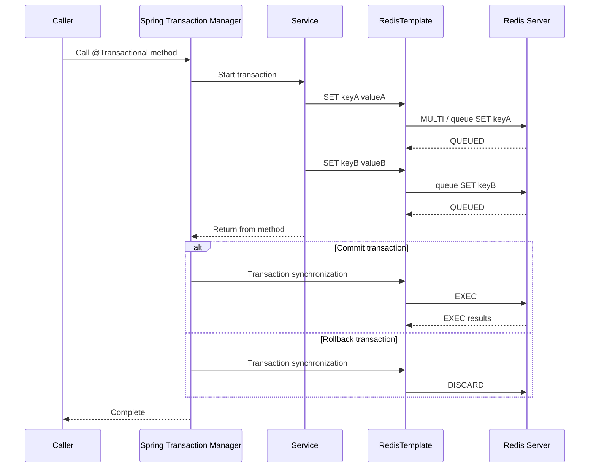

# Enabling Transaction Support on RedisTemplate in Spring Data Redis

## 1. Problem: Multiple Redis Commands Need to Run in One Transaction

Suppose an application confirms an order and needs to update two Redis keys:

```text
demo:order:501:status       → CONFIRMED
demo:order:501:confirmedBy  → staff-12
```

If each command runs independently, a connection failure between the two writes can leave Redis in an inconsistent state. Redis provides transactions via `MULTI`, `EXEC`, and `DISCARD` to group commands into a batch. Spring Data Redis lets you use this mechanism through `RedisTemplate` and integrate it into Spring-managed transactions.

A common pitfall: **putting `@Transactional` on a method does not automatically make all `RedisTemplate` commands participate in a Redis transaction**. By default, `RedisTemplate` transaction support is disabled. To participate in Spring transactions, the template must be configured:

```java
redisTemplate.setEnableTransactionSupport(true);
```

This lesson explains the conditions required for that configuration to take effect, how Spring binds a Redis connection to a transaction, how reads and writes behave while `MULTI` is active, and important limits when using Redis alongside a relational database.

## 2. Understanding Redis Transactions Before Configuring Spring

A typical Redis transaction:

```redis
MULTI
SET demo:tx:order:501:status CONFIRMED
SET demo:tx:order:501:confirmedBy staff-12
EXEC
```

What happens:

1. `MULTI` begins a transaction on **a single Redis connection**.
2. Subsequent commands are queued by Redis, which typically replies with `QUEUED`.
3. `EXEC` tells Redis to execute the queued commands in order.
4. `DISCARD` can be used prior to `EXEC` to clear the command queue and exit transaction mode.

Cancellation example:

```redis
MULTI
SET demo:tx:order:501:status CANCELLED
DISCARD
```

After `DISCARD`, the queued `SET` command is not executed.

### Where Do Redis Transactions Differ from Relational Database Transactions?

Redis guarantees that commands inside `EXEC` run sequentially without commands from other clients interleaving between commands of that transaction. However, Redis **does not support rolling back executed commands inside `EXEC`** the way an SQL engine can undo a transaction.

An error detected while **queuing a command** can cause `EXEC` to reject the entire transaction. By contrast, when a command raises an error only **during execution**, other commands in the transaction can still execute; Redis does not automatically undo the successful ones.

Example:

```redis
SET demo:tx:number not-a-number
MULTI
INCR demo:tx:number
SET demo:tx:other OK
EXEC
```

`INCR` cannot increment the string `not-a-number`, yet the remaining `SET` command can still complete inside `EXEC`. Thus, “Redis transaction” does not mean “all commands succeed or no changes occur.”

**Design consequence:** use Redis transactions only for command groups with suitable semantics; condition checks and business-level error handling strategies still need explicit design.

## 3. Role of RedisTemplate in Spring Data Redis

`RedisTemplate<K, V>` is the central class for Redis operations in a Spring application. `StringRedisTemplate` is a convenient variant for string keys and values.

A typical application stack looks like:

```text
Service
   |
   v
RedisTemplate or StringRedisTemplate
   |
   v
RedisConnectionFactory
   |
   v
Redis server
```

When transaction support is disabled, calls such as:

```java
redis.opsForValue().set("demo:tx:a", "one");
redis.opsForValue().set("demo:tx:b", "two");
```

execute via the standard connection flow; the two commands do not automatically form a Redis transaction merely because they appear consecutively in Java.

When transaction support is enabled **and an active Spring transaction exists**, Spring Data Redis can bind a `RedisConnection` to the current execution thread, start `MULTI`, and choose `EXEC` or `DISCARD` based on the transaction outcome.

It is the combination of **a transaction-enabled template** and **an actual Spring transaction** that produces this behavior.

## 4. Prerequisites Before Enabling Transaction Support

For `@Transactional` integration to work, you need:

1. A Spring application with the Spring Data Redis dependency, a Redis server, and a valid `RedisConnectionFactory`.
2. A `RedisTemplate` or `StringRedisTemplate` bean with `setEnableTransactionSupport(true)` enabled.
3. A `PlatformTransactionManager` for Spring to open and close transactions.
4. Spring transaction management activated, with calls to `@Transactional` methods passing through the Spring proxy or matching interception mechanism.
5. Redis operations inside the transaction actually using **that transaction-enabled template bean**.

With Spring Boot, the core Redis dependency is:

**Gradle:**

```kotlin
dependencies {
    implementation("org.springframework.boot:spring-boot-starter-data-redis")
}
```

**Maven:**

```xml
<dependency>
    <groupId>org.springframework.boot</groupId>
    <artifactId>spring-boot-starter-data-redis</artifactId>
</dependency>
```

Example local Redis connection config:

```yaml
spring:
  data:
    redis:
      host: localhost
      port: 6379
```

Spring Boot normally auto-creates a `RedisConnectionFactory` from Redis properties. To illustrate Spring transactions with an existing `PlatformTransactionManager`, the following sections assume an application with a JDBC transaction manager.

**Note:** Spring Data Redis does not supply a standalone `PlatformTransactionManager` just to enable `@Transactional` with the Redis starter alone. If an application uses only Redis without another transaction manager, explicitly pick a coordination strategy or use manual `MULTI`/`EXEC` APIs for a group of Redis operations.

## 5. Configuring a StringRedisTemplate with Transaction Support

For string data, you can define a dedicated bean to make its transactional intent explicit.

**`RedisTransactionConfig.java`**

```java
package com.example.demo.config;

import org.springframework.context.annotation.Bean;
import org.springframework.context.annotation.Configuration;
import org.springframework.data.redis.connection.RedisConnectionFactory;
import org.springframework.data.redis.core.StringRedisTemplate;
import org.springframework.transaction.annotation.EnableTransactionManagement;

@Configuration
@EnableTransactionManagement
public class RedisTransactionConfig {

    @Bean("transactionalRedisTemplate")
    public StringRedisTemplate transactionalRedisTemplate(
            RedisConnectionFactory connectionFactory
    ) {
        StringRedisTemplate template =
                new StringRedisTemplate(connectionFactory);

        template.setEnableTransactionSupport(true);

        return template;
    }
}
```

Here:

- `StringRedisTemplate` uses string serializers appropriate for `String` keys and values.
- `RedisConnectionFactory` supplied by Spring manages connections to Redis.
- `setEnableTransactionSupport(true)` allows the template to participate in Spring transaction synchronization.
- Naming the bean `transactionalRedisTemplate` distinguishes it if the application defines multiple templates.
- `@EnableTransactionManagement` enables Spring `@Transactional` handling; many Spring Boot apps already enable this automatically, though the example shows it explicitly for clarity.

When Spring Boot detects a user-defined `StringRedisTemplate` bean, default auto-configuration of `StringRedisTemplate` may back off due to conditional rules. Therefore, when a project needs multiple differently configured templates, check which beans are registered and use `@Qualifier` to select the exact bean.

### If Your Project Uses RedisTemplate<K, V>

For templates whose keys and values are not both strings, the idea is the same:

```java
RedisTemplate<String, MyValue> template = new RedisTemplate<>();

template.setConnectionFactory(connectionFactory);
template.setKeySerializer(new StringRedisSerializer());
// Configure value/hash serializers matching your model before using.

template.setEnableTransactionSupport(true);
template.afterPropertiesSet();
```

This snippet illustrates where to enable transaction support; it is not a full configuration for `MyValue`. Choose value and hash serializers per your project's conventions. Enabling transaction support **does not change serializers** and does not fix data-format mismatches.

## 6. PlatformTransactionManager: A Crucial Requirement of @Transactional

`@Transactional` does not create a transaction from the annotation alone. Spring needs a `PlatformTransactionManager` to open, commit, or roll back the execution flow's transaction.

In an application with JDBC, there may be a `JdbcTransactionManager` or `DataSourceTransactionManager`. With Spring Boot plus the appropriate dependencies and DataSource settings, a transaction manager is usually auto-configured. Add the bean manually only when custom setup is needed.

JDBC example:

```java
package com.example.demo.config;

import javax.sql.DataSource;

import org.springframework.context.annotation.Bean;
import org.springframework.context.annotation.Configuration;
import org.springframework.jdbc.support.JdbcTransactionManager;
import org.springframework.transaction.PlatformTransactionManager;

@Configuration
public class JdbcTransactionConfig {

    @Bean
    public PlatformTransactionManager transactionManager(
            DataSource dataSource
    ) {
        return new JdbcTransactionManager(dataSource);
    }
}
```

Do not add the bean above if your project already has a suitable transaction manager, as duplicate or multiple managers can make `@Transactional` selection ambiguous.

**Why does a JDBC transaction manager relate to Redis?** Spring Data Redis uses *transaction synchronization* attached to the transaction controlled by the active manager. When the Spring transaction ends, the Redis connection is notified to commit or roll back accordingly. This is **Spring lifecycle coordination**, not turning JDBC and Redis into a single atomic distributed transaction.

### If Your Application Has No SQL Database

If you only need a sequence of Redis operations with `MULTI`/`EXEC`, use `RedisTemplate.execute(SessionCallback)` to keep commands on the same connection and explicitly control `multi()`/`exec()`. That avoids creating a dummy JDBC transaction manager just to use `@Transactional`.

Never interpret `setEnableTransactionSupport(true)` as a new “RedisTransactionManager”: it only lets the template **participate in an existing Spring transaction**.

## 7. Using @Transactional with a Transaction-Enabled Bean

Suppose an application stores order status via JDBC and writes auxiliary state to Redis.

**`OrderConfirmationService.java`**

```java
package com.example.demo.service;

import java.time.Duration;

import org.springframework.beans.factory.annotation.Qualifier;
import org.springframework.data.redis.core.StringRedisTemplate;
import org.springframework.jdbc.core.JdbcTemplate;
import org.springframework.stereotype.Service;
import org.springframework.transaction.annotation.Transactional;

@Service
public class OrderConfirmationService {

    private final JdbcTemplate jdbc;
    private final StringRedisTemplate redis;

    public OrderConfirmationService(
            JdbcTemplate jdbc,
            @Qualifier("transactionalRedisTemplate")
            StringRedisTemplate redis
    ) {
        this.jdbc = jdbc;
        this.redis = redis;
    }

    @Transactional
    public void confirm(String orderId, String staffId) {
        int updated = jdbc.update(
                "UPDATE orders SET status = ? WHERE id = ?",
                "CONFIRMED",
                orderId
        );

        if (updated != 1) {
            throw new IllegalArgumentException(
                    "Expected exactly one matching order"
            );
        }

        String prefix = "demo:order:" + orderId + ":";

        redis.opsForValue().set(
                prefix + "status",
                "CONFIRMED",
                Duration.ofHours(1)
        );

        redis.opsForValue().set(
                prefix + "confirmedBy",
                staffId,
                Duration.ofHours(1)
        );
    }
}
```

This snippet assumes the application already has an `orders` table, a `JdbcTemplate` bean, and a JDBC transaction manager. It is a transaction integration example, not a standalone app runnable without a DataSource and SQL schema.

When `confirm(...)` is called through the Spring bean proxy:

1. Spring opens a JDBC transaction and activates transaction synchronization.
2. `JdbcTemplate` sends the SQL update statement within that JDBC transaction.
3. The first Redis call through `transactionalRedisTemplate` joins the Spring transaction; the Redis write command is queued in a Redis transaction.
4. The next Redis command is queued on the Redis connection serving the same transaction.
5. If the Spring transaction completes successfully, Spring Data Redis triggers `EXEC` via synchronization.
6. If the Spring transaction rolls back before commit, Spring Data Redis sends `DISCARD` to drop pending Redis commands.

**Important point:** SQL commit and Redis `EXEC` are not two branches of an XA/2-phase-commit transaction. A failure after SQL committed and before or during Redis `EXEC` can still leave the two data stores out of sync. If strong consistency between SQL and Redis is required, choose a fitting pattern such as a transactional outbox and retryable cache updates.

### Exception Scenarios

Suppose the end of the method adds:

```java
if (shouldReject) {
    throw new IllegalStateException("Cannot confirm order");
}
```

An unchecked runtime exception thrown before the Spring transaction finishes normally triggers a transaction manager rollback; pending Redis commands are discarded with `DISCARD`. By default, Spring `@Transactional` rolls back on `RuntimeException` and `Error`; checked exceptions follow different rules and may require configuring `rollbackFor`.

Do not rely on “an exception guarantees Redis did not change” if the error occurred **after** `EXEC` executed or if part of the commands inside `EXEC` hit a runtime error.

## 8. Where Does the Transaction Actually Happen?

You can visualize the control flow as follows:



The diagram omits JDBC details, connection lifecycle, and internal callbacks to highlight `RedisTemplate`'s role in the transaction. The exact commit callback order across different resources depends on the transaction manager; never treat the diagram as an inter-system atomic commit guarantee.

## 9. Reading Redis Immediately Inside @Transactional

This is a common source of confusion. Inside a Redis transaction, write commands are **queued** until `EXEC`. Spring Data Redis also handles read-only commands specially on a transaction-participating template: reads such as `GET` or `KEYS` may be dispatched on a different Redis connection **not inside the transaction**, returning current committed data.

Consider the example:

```java
@Transactional
public void updateAndInspect() {
    redis.opsForValue().set("demo:tx:flag", "NEW");

    String value = redis.opsForValue().get("demo:tx:flag");

    System.out.println(value);
}
```

Do not assume `value` is `NEW`. If the key did not exist in prior committed state, the result may be `null`; if it already existed, the read may return the old value. `NEW` is still waiting for `EXEC`.

This differs from SQL applications where developers are used to “read your writes” within the same transaction.

### Return Values of Write Commands Inside a Transaction

Many Redis commands return different values while queued than when executed immediately. In Spring Data Redis APIs, several methods return `null` when inside a pipeline or transaction.

For example:

```java
Boolean added = redis.opsForSet().add(
        "demo:tx:members",
        "member-1"
);
```

Do not immediately inspect `added.booleanValue()` to make business decisions while the Redis transaction has not run `EXEC`. A `null` value may reflect a pending queued operation rather than command failure.

If business logic needs the result of one Redis operation to decide the next command, design with conditional approaches such as `WATCH`/`MULTI`/`EXEC`, Lua scripts, or Redis Functions rather than trying to read queued command results.

## 10. When Does @Transactional Not Work?

### 10.1. Setting the Flag Without a Spring Transaction

```java
template.setEnableTransactionSupport(true);
template.opsForValue().set("demo:a", "one");
template.opsForValue().set("demo:b", "two");
```

Without an active Spring transaction, the two commands do not automatically group into a `MULTI`/`EXEC`. The flag only enables **participating** in a transaction when an appropriate Spring transaction context exists.

### 10.2. Having @Transactional While Injecting the Wrong Bean

If you configured a template named `transactionalRedisTemplate`, yet the service injects another `StringRedisTemplate` bean that lacks transaction support, that service's Redis calls will not participate in the transaction as intended.

Use `@Qualifier("transactionalRedisTemplate")`, or keep only a single properly configured bean of that type in the application.

### 10.3. Self-Invocation via `this`

```java
@Service
public class ExampleService {

    public void run() {
        updateInTransaction();  // Internal call via this
    }

    @Transactional
    public void updateInTransaction() {
        // Redis writes
    }
}
```

With standard Spring proxy-based `@Transactional`, calling a method on the same instance can **bypass the transaction interceptor**. Having the annotation on a method does not mean calling it from anywhere opens a transaction.

To use proxies, place the transactional method on a Spring bean called from another bean, or choose an appropriate service structure.

### 10.4. No Valid PlatformTransactionManager

An application with only the Redis starter and `@Transactional` but no matching transaction manager may fail at startup or invocation. Spring Data Redis does not supply a transaction manager simply because you set the flag on the template.

### 10.5. Calls Crossing onto Another Thread

Spring transaction synchronization in imperative code typically binds to thread context. If a `@Transactional` method spawns `new Thread(...)`, invokes `@Async`, or delegates to an asynchronous executor without its own transaction, do not assume the new thread shares the same Redis transaction.

## 11. Comparing Spring Transaction Support with Manual Transactions

Two common patterns exist:

| Model | Start/end | When appropriate |
|---|---|---|
| `setEnableTransactionSupport(true)` + `@Transactional` | Spring transaction manager drives lifecycle; Redis syncs `EXEC`/`DISCARD` | Application already uses Spring transactions and needs Redis to join the transaction lifecycle |
| `SessionCallback` with `multi()` / `exec()` / `discard()` | Application explicitly controls the Redis transaction on one connection | Only a Redis transaction is needed, with no SQL/JPA synchronization |

### Pure Redis Transaction Example via SessionCallback

When you only want a Redis transaction, invoke the operations inside a `SessionCallback` so they share the same connection:

```java
import java.util.List;

import org.springframework.dao.DataAccessException;
import org.springframework.data.redis.core.RedisOperations;
import org.springframework.data.redis.core.SessionCallback;
import org.springframework.data.redis.core.StringRedisTemplate;

// redis is a regular StringRedisTemplate.
List<Object> results = redis.execute(
        new SessionCallback<List<Object>>() {
            @Override
            public <K, V> List<Object> execute(
                    RedisOperations<K, V> operations
            ) throws DataAccessException {
                operations.multi();
                try {
                    operations.opsForValue().set(
                            (K) "demo:tx:manual:status",
                            (V) "CONFIRMED"
                    );
                    operations.opsForValue().set(
                            (K) "demo:tx:manual:by",
                            (V) "staff-12"
                    );

                    return operations.exec();
                } catch (RuntimeException ex) {
                    operations.discard();
                    throw ex;
                }
            }
        }
);
```

In this example, `K` and `V` are generic type parameters declared by the `SessionCallback` interface. The casts here illustrate the generic API with a `String`-typed template; to avoid casts, organize a dedicated callback using low-level `RedisCallback` and matching serializers.

`SessionCallback` is not mandatory when using `@Transactional` synchronized via the template. Conversely, with manual transactions, ensure `MULTI` and `EXEC` run on **the same connection**; never split individual commands across separate templates or connections.

**Do not arbitrarily mix automatic and manual modes:** avoid calling `multi()`/`exec()` explicitly on a connection already managed by Spring transaction synchronization without understanding connection state. Two lifecycle controllers acting simultaneously can produce unexpected behavior.

## 12. How to Verify Commit and Rollback Behavior

In a test environment with a valid transaction manager, you can build a Redis-writing service:

```java
package com.example.demo.service;

import org.springframework.beans.factory.annotation.Qualifier;
import org.springframework.data.redis.core.StringRedisTemplate;
import org.springframework.stereotype.Service;
import org.springframework.transaction.annotation.Transactional;

@Service
public class RedisTxDemoService {

    private final StringRedisTemplate redis;

    public RedisTxDemoService(
            @Qualifier("transactionalRedisTemplate")
            StringRedisTemplate redis
    ) {
        this.redis = redis;
    }

    @Transactional
    public void writeAndCommit(String id) {
        redis.opsForValue().set("demo:tx:" + id + ":one", "1");
        redis.opsForValue().set("demo:tx:" + id + ":two", "2");
    }

    @Transactional
    public void writeAndRollback(String id) {
        redis.opsForValue().set("demo:tx:" + id + ":one", "1");
        redis.opsForValue().set("demo:tx:" + id + ":two", "2");

        throw new IllegalStateException("Intentional rollback");
    }
}
```

Invoke both methods from **another bean** or an integration test class through the Spring proxy, using distinct test IDs for the two cases.

Check from Redis CLI after the methods finish:

```redis
GET demo:tx:commit-demo:one
GET demo:tx:commit-demo:two

GET demo:tx:rollback-demo:one
GET demo:tx:rollback-demo:two
```

Assuming the test keys did not exist beforehand and the Spring transaction opened properly:

- Commit case: the two keys hold `1` and `2` respectively.
- Rollback before `EXEC` case: the two writes were discarded, so the keys hold no new values.

Do not verify by reading immediately inside the same transactional method and assuming Redis already executed the `SET` commands.

### What Happens If EXEC Itself Errors?

If Spring commit has moved into its completion phase and Redis fails during `EXEC`, do not assume you can “roll back everything” in other resources like JDBC. Log sufficient detail, determine which parts committed, and apply appropriate synchronization or compensation.

## 13. WATCH, Optimistic Locking, and Conditional Writes

`MULTI`/`EXEC` batches commands for sequential execution, yet **does not prevent lost updates** when two clients read and then update a value.

For instance, two workers read the same counter before starting a transaction, then compute and write values based on the stale read. Even though each worker's writes sit inside `MULTI`, the second writer can still overwrite the first's result.

Redis provides `WATCH` to monitor key changes before starting a transaction. Conceptual sequence:

```redis
WATCH demo:wallet:balance
GET demo:wallet:balance
MULTI
SET demo:wallet:balance 900
EXEC
```

If another client modifies the `WATCH`ed key before `EXEC`, the transaction can be aborted and `EXEC` returns a result indicating non-execution. The application typically needs bounded retries and recomputation.

For check-then-update operations, avoid casually mixing `WATCH` with `@Transactional` and a template already inside `MULTI`. A valid `WATCH` flow must be structured so checks and transaction commands share the right connection in the right order. When a write condition can be expressed as one atomic operation, a Lua script or Redis Function is sometimes simpler and better suited.

## 14. Transaction Support and Consistency Between SQL and Redis

When an application uses both JDBC/JPA and Redis, many see `@Transactional` and assume “if SQL rolls back, Redis rolls back; if SQL commits, Redis commits; everything always succeeds together.” That claim is too strong.

Service example:

```text
1. Update orders table via JDBC.
2. Write cache order:501:status using transaction-enabled RedisTemplate.
3. Exit @Transactional.
```

If an error occurs before commit, Spring can roll back JDBC and discard queued Redis commands. Yet during transaction completion, a failure can happen in between:

```text
JDBC transaction commits successfully
        |
        v
Redis connection drops before EXEC completes
        |
        v
SQL holds new state, Redis cache may still be stale
```

There is no atomic distributed transaction solely from configuring `setEnableTransactionSupport(true)`. Redis also lacks the rollback of already-executed commands that an SQL transaction provides.

### Designing When the Cache Can Be Rebuilt

When Redis acts as a cache for SQL data, a common design is:

1. Commit business changes in the primary database.
2. After commit succeeds, delete relevant cache entries or emit a cache-update event.
3. Make cache operations retryable; on cache miss, read from the primary store and repopulate.

If a cache update event **must never be lost**, use a transactional outbox: persist the business change and an event record in **the same SQL transaction**, then have a worker read the outbox and update/invalidate Redis with retries.

Choose according to system requirements: pure caches can tolerate eventual consistency, whereas financial actions or critical business state demand an authoritative data source and stricter transaction control.

## 15. How Do Transaction Support, Pipelining, and Lua Scripts Differ?

| Technique | Primary purpose | Key characteristics |
|---|---|---|
| Redis transaction `MULTI`/`EXEC` | Queue commands and run them sequentially as a group | No per-command rollback after runtime errors inside `EXEC` |
| Spring `@Transactional` + RedisTemplate support | Let Redis transactions join the Spring transaction lifecycle | Requires `PlatformTransactionManager` and proper template; not a distributed transaction |
| Pipelining | Reduce round-trips when sending many commands | Does not automatically enforce conditional transactions or command isolation |
| Lua script / Redis Function | Execute multi-step logic on the server | Can handle conditional reads/writes in a single atomic Redis operation |
| `WATCH` + `MULTI`/`EXEC` | Optimistic locking when comparing before writing | Requires conflict detection and retries |

**Illustrative distinction:** sending two `SET` commands via pipeline reduces network hops but does not automatically create the condition “write both only if one key remained unchanged.” `MULTI`/`EXEC` provides sequential group execution. `WATCH` can abort a transaction when a key changes, while scripts encapsulate conditions and writes on the server.

In Redis Cluster, multi-key operations are also subject to hash slot and topology constraints. Never assume a transaction touching keys across multiple slots works as on standalone Redis. When a design needs multi-key `MULTI`/`EXEC` in a cluster, verify that keys map to compatible slots and check Redis driver capabilities.

## 16. Common Configuration Mistakes

| Symptom | Possible cause | Fix |
|---|---|---|
| `@Transactional` is present yet Redis still writes immediately | Template in use lacks transaction support | Check `setEnableTransactionSupport(true)` on the exact bean |
| Transaction support configured yet no `MULTI` occurs | No active Spring transaction | Ensure `@Transactional` is intercepted via Spring proxy and a transaction manager exists |
| No transaction manager found | Only Redis starter present, no `PlatformTransactionManager` | Add/configure an appropriate manager or use manual Redis transactions |
| Multiple transaction managers exist | `@Transactional` picks the wrong one or is ambiguous | Specify `transactionManager` by name when needed |
| Reading right after `SET` in the same transaction sees stale value | Write is queued for `EXEC`; read may use another connection | Read after transaction completes or redesign flow |
| Write return value is `null` | Command is queued | Do not use this return value for business decisions before `EXEC` |
| Manually calling `multi()` behaves strangely | Mixing manual transactions with Spring-managed transactions | Pick one consistent lifecycle management mechanism |
| Redis rolled back yet JDBC committed | No atomic commit between the two stores | Use post-commit sync, outbox, or compensation |
| `CROSSSLOT` in Redis Cluster | Multi-key command/transaction spans multiple hash slots | Design keys by slot or split operations appropriately |
| One command in `EXEC` errored yet others succeeded | Redis does not roll back successful commands after runtime errors | Validate preconditions first, inspect `EXEC` results, or use atomic logic |
| `@Transactional` method called via `this` | Spring proxy does not intercept self-invocation | Call through another Spring bean or refactor service |
| Transaction holds connection too long | Long transaction with blocking calls or slow I/O | Keep transactions short; avoid unnecessary external work |

### About Connection Lifecycle

When transaction support is enabled, Spring Data Redis binds a connection to the thread's transaction. A long-running transaction can hold connection resources longer than desired, especially with many operations or waits on external services.

Avoid placing slow HTTP calls, long sleeps, or user-interactive workflows inside a transaction just to hold a Redis connection waiting on `EXEC`. Separating data-reading/preparation from a short commit phase limits resource retention.

## 17. Controlled Rollout Process

When adding transaction support to a Spring Data Redis project, you can follow this sequence:

1. **Define scope.** Which Redis operations genuinely belong inside the Spring transaction? Do you actually need multiple commands committed together, or is one atomic Redis command enough?
2. **Confirm the manager.** Which JDBC/JPA transaction manager does the project use? If multiple managers exist, explicitly select the right one for `@Transactional`.
3. **Create or configure the template.** Call `setEnableTransactionSupport(true)` before the bean is used, and verify serializers and connection factory.
4. **Inject the right template.** Use `@Qualifier` where needed so services do not accidentally pick a non-transactional template.
5. **Place `@Transactional` boundaries carefully.** Methods must be intercepted by Spring; keep transactions short and avoid self-invocation.
6. **Understand read/write behavior.** Do not expect queued write commands to return final results or reads to see new values before `EXEC`.
7. **Choose an error strategy.** Distinguish pre-commit rollback, errors inside Redis `EXEC`, and coordination failures between Redis and other stores.
8. **Monitor operations.** Track Redis latency, connection counts, transaction durations, and abnormal transaction terminations.

## 18. Practice Questions

**Scenario 1:** A service uses `@Transactional` managed by a JDBC manager, yet `RedisTemplate` keeps its default configuration. If the method throws a `RuntimeException` after calling `redis.opsForValue().set(...)`, is Redis guaranteed unchanged?

**Explanation:** no. Default templates do not automatically participate in Spring transactions. The Redis command may already have written before JDBC rolled back. You must enable transaction support on the right template and understand the remaining coordination limits.

**Scenario 2:** `setEnableTransactionSupport(true)` is enabled, but `opsForValue().set(...)` is called from a method without a Spring transaction. Will Redis wait for `EXEC`?

**Explanation:** no. Setting the flag does not automatically open a Redis transaction. It only lets the template join synchronization when a Spring transaction is active.

**Scenario 3:** Inside a `@Transactional` method, you call `SET key NEW` and then `GET key` right after. Is the result guaranteed to be `NEW`?

**Explanation:** no. The write command is queued. The read command may observe the stale value from another connection; never assume “read your writes.”

**Scenario 4:** Inside `EXEC`, there are three commands; the second fails due to a mismatched data type. Does Redis undo the first command and cancel the third?

**Explanation:** not by default. A runtime error on one command during `EXEC` execution does not make Redis roll back other successful commands.

**Scenario 5:** JDBC commit succeeded, yet Redis lost connection before the cache update finished. Does `@Transactional` automatically revert SQL to its prior state?

**Explanation:** you cannot rely on such a guarantee. Spring Data Redis transaction synchronization is not a distributed transaction. For caches, consider post-commit invalidation with retries; if events must never be dropped, use a transactional outbox.

**Scenario 6:** Two Redis keys sit in different slots in Redis Cluster. Can you always place them in one transaction just like on standalone Redis?

**Explanation:** no. Redis Cluster imposes hash slot constraints on multi-key transactions; you must design key placement and execution paths accordingly.

## 19. Takeaways

To enable transaction support on `RedisTemplate`, the decisive configuration line is:

```java
template.setEnableTransactionSupport(true);
```

However, this line only takes full effect when **a Spring transaction is active**, a valid `PlatformTransactionManager` exists, and code uses that exact configured template. Under those conditions, Redis writes can be queued and finalized with `EXEC` or canceled with `DISCARD` alongside the Spring transaction lifecycle.

Keep three limits firmly in mind: **reads inside a transaction do not automatically see queued writes; Redis `EXEC` has no rollback after command runtime errors; and SQL + Redis do not become an atomic distributed transaction**. Understanding these boundaries helps you pick the right transaction scope, prevent data drift, and design recovery when failures occur.

### References

- [Spring Data Redis — Transactions](https://docs.spring.io/spring-data/redis/reference/redis/transactions.html)
- [Spring Data Redis — RedisTemplate](https://docs.spring.io/spring-data/redis/reference/redis/template.html)
- [Spring Framework — Transaction Management](https://docs.spring.io/spring-framework/reference/data-access/transaction.html)
- [Spring Data Redis — RedisTemplate API](https://docs.spring.io/spring-data/redis/reference/api/java/org/springframework/data/redis/core/RedisTemplate.html)
- [Redis — Transactions](https://redis.io/docs/latest/develop/using-commands/transactions/)
- [Redis — MULTI](https://redis.io/docs/latest/commands/multi/)
- [Redis — EXEC](https://redis.io/docs/latest/commands/exec/)
- [Redis — WATCH](https://redis.io/docs/latest/commands/watch/)
