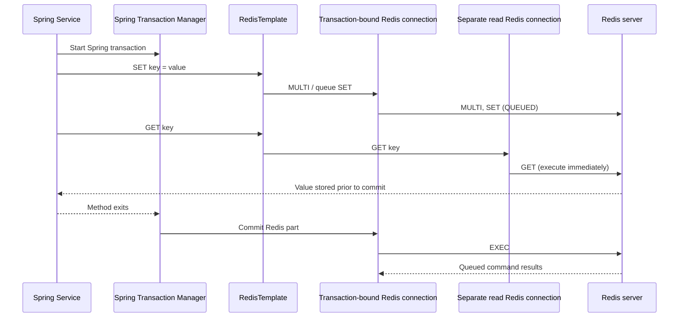

# Read Command Behavior Inside Spring-Managed Transactions with Spring Data Redis

## 1. Problem: Why Can `GET` Immediately After `SET` Return the Old Value?

When using Spring Data Redis, developers may place read and write operations inside a `@Transactional` method and expect them to behave like a relational database transaction:

```java
@Transactional
public String changeAndRead() {
    redis.opsForValue().set("cart:42:status", "CHECKED_OUT");
    return redis.opsForValue().get("cart:42:status");
}
```

In a **Spring-managed** Redis transaction using a `RedisTemplate` with transaction support enabled, the read inside the method **is not guaranteed to return `"CHECKED_OUT"`**. If the key initially held `"OPEN"`, `get(...)` may return `"OPEN"`; if the key did not exist, it may return `null`.

This happens because of how Spring Data Redis routes connections:

- **Write commands** are placed into the transaction queue on the Redis connection bound to the execution thread.
- **Pure read commands**, such as `GET` or `KEYS`, are executed on a Redis connection **not bound to the transaction queuing commands**.
- Redis only applies the queued commands on the transactional connection when Spring issues `EXEC` at transaction completion time.

Thus, the key question is **which connection a read command runs on and at which phase it executes**. Merely seeing two Java statements inside the same `@Transactional` method is not enough to conclude they read uncommitted state together.

## 2. Layers Participating in a Spring-Managed Redis Transaction

Separate four components:

| Component | Role |
| --- | --- |
| `@Transactional` and Spring transaction manager | Opens, manages, and closes the Spring transaction scope. |
| `RedisTemplate` / `StringRedisTemplate` | Redis operation interface, optionally participating in transaction scope via `setEnableTransactionSupport(true)`. |
| Thread-bound Redis connection | Receives `MULTI` and queues write operations for `EXEC`/`DISCARD` when the transaction ends. |
| Non-transactional Redis connection | Executes read commands to return results immediately, based on data already published by Redis at read time. |

Redis has no built-in XA/JTA transaction manager inside `RedisTemplate`. Spring Data Redis synchronizes the Redis transaction lifecycle with an active Spring transaction manager, such as a JDBC transaction manager. **A Redis transaction does not automatically create a single atomic transaction spanning Redis and an SQL database.**

### Enabling Transaction Support Is Mandatory

By default, `RedisTemplate` **does not** participate in Spring transactions. To use the Redis transaction management behavior described in this lesson, you must enable it:

```java
@Configuration
public class RedisConfig {

    @Bean("transactionalStringRedisTemplate")
    public StringRedisTemplate transactionalStringRedisTemplate(
            RedisConnectionFactory connectionFactory) {

        StringRedisTemplate template =
                new StringRedisTemplate(connectionFactory);
        template.setEnableTransactionSupport(true);
        return template;
    }
}
```

An actual Spring `PlatformTransactionManager` must exist and manage the transaction scope for the `@Transactional` call; for instance, Spring Boot usually auto-configures a transaction manager for JDBC/JPA when those components are present. The `@Transactional` annotation must be applied via a valid Spring AOP proxy, such as calling a public method from another Spring bean.

**Without transaction support enabled:** a normal `SET` is sent immediately; the subsequent `GET` may see the new result. Do not mistake that behavior for proof that Redis joined the Spring transaction.

**With transaction support enabled but no active Spring transaction:** `RedisTemplate` still executes commands normally and does not implicitly open a `MULTI` transaction just because the flag is set on the bean.

## 3. Lifecycle of the Transaction: `MULTI`, Queue, and `EXEC`

Suppose the method is invoked within a valid Spring transaction using a transaction-enabled template:

```java
@Transactional
public void updateCart() {
    redis.opsForValue().set("cart:42:status", "CHECKED_OUT");
    redis.opsForHash().put("cart:42", "paymentState", "CAPTURED");

    // By the time the method reaches here, both write commands
    // may still sit in the Redis transaction queue.
}
```

Conceptual flow:



The diagram depicts logical behavior. The “separate read connection” is a connection **not bound to the current Redis transaction**; the driver/pool may reuse physical sockets, so it does not necessarily open a brand-new TCP socket per read.

At the start of the transaction, `MULTI` puts the Redis connection into queuing mode. Redis replies `QUEUED` for commands inside that transaction without executing them yet. When `EXEC` is sent, Redis executes the queued commands in order. If Spring rolls back before `EXEC`, the transactional connection uses `DISCARD` to drop the queue.

Note: Redis transactions do not provide RDBMS-style rollback once commands have been executed by `EXEC`. A failure in one command while executing `EXEC` does not mean Redis automatically undoes other commands that succeeded in the same batch.

## 4. Command Classification Inside a Spring-Managed Transaction

| Operation invoked via template | Connection used when participating in a Spring-managed Redis transaction | Observed result inside the method |
| --- | --- | --- |
| `SET`, `HSET`, `DEL`, and typical write commands | Transaction-bound connection; commands are queued | Changes do not appear as committed data yet; the method may not receive final execution results immediately. |
| `GET`, `HGET`, `EXISTS`, `KEYS`, and commands recognized by the template as read-only | Non-transactional connection | Reads Redis data present at execution time; does not see writes still in the queue. |
| Read command after transaction committed | Normal connection | Can see data applied by `EXEC`, provided commit succeeded and no other writer overwrote it. |
| Read command after transaction rolled back | Normal connection | Does not see writes that were `DISCARD`ed. |
| Manual `MULTI`/`EXEC` using `SessionCallback` | One connection queuing both reads and writes | Results of read commands inside `MULTI` appear only in the result list of `EXEC`. |

The table describes **read commands routed by Spring Data Redis as read-only**. Do not assume every Java method named `get...` definitely uses the separate read path; commands that both read and mutate state, scripting commands, or Redis modules behave differently. Check the actual Redis command executed when using specialized APIs.

### Example: Reading a Non-Existent Key

Before the transaction:

```redis
GET cart:42:status
(nil)
```

Called from a Spring service:

```java
@Transactional
public String putAndReadStatus() {
    redis.opsForValue().set("cart:42:status", "CHECKED_OUT");
    return redis.opsForValue().get("cart:42:status");
}
```

Timeline:

1. `SET cart:42:status CHECKED_OUT` is queued on the transactional connection.
2. `GET cart:42:status` executes immediately on a non-transactional connection.
3. Since Redis has not yet received `EXEC` for the write, `GET` may return `null`.
4. After the Spring transaction commits and Redis `EXEC` succeeds, a `GET` outside the transaction will see `"CHECKED_OUT"`.

### Example: Reading a Key That Already Holds an Old Value

Before the transaction:

```redis
SET cart:42:status OPEN
```

Inside the service:

```java
@Transactional
public String updateStatus() {
    redis.opsForValue().set("cart:42:status", "CHECKED_OUT");
    return redis.opsForValue().get("cart:42:status");
}
```

`get(...)` may return `"OPEN"`. After the method finishes and the transaction commits cleanly, reading again can return `"CHECKED_OUT"`.

The word “may” is essential: if another task modifies the key right while the transaction is running, the read connection may observe the data committed by that other task. **There is no read-your-writes**, and **there is no fixed snapshot across the transaction** on the separate read path.

## 5. A Complete Service Example

Assume the application has a configured Spring transaction manager managing a valid Spring transaction and injects a transaction-enabled `StringRedisTemplate`.

```java
import org.springframework.beans.factory.annotation.Qualifier;
import org.springframework.data.redis.core.StringRedisTemplate;
import org.springframework.stereotype.Service;
import org.springframework.transaction.annotation.Transactional;

@Service
public class InventoryProjectionService {

    private final StringRedisTemplate redis;

    public InventoryProjectionService(
            @Qualifier("transactionalStringRedisTemplate")
            StringRedisTemplate redis) {
        this.redis = redis;
    }

    public record Observation(
            String valueReadInsideTransaction,
            boolean wasVisibleInsideTransaction) {}

    @Transactional
    public Observation stageStock(String sku, int amount) {
        String key = "stock:" + sku;

        // Write command is queued inside the Redis transaction.
        redis.opsForValue().set(key, Integer.toString(amount));

        // Read command executes over a separate connection.
        // It reflects committed Redis state, not the value
        // just queued on the line above.
        String observed = redis.opsForValue().get(key);

        return new Observation(observed, observed != null);
    }

    public String readStock(String sku) {
        return redis.opsForValue().get("stock:" + sku);
    }
}
```

On test data, if `stock:sku-1` did not previously exist:

```java
Observation o = service.stageStock("sku-1", 15);

// Inside transaction: o.valueReadInsideTransaction() may be null.
// Once stageStock(...) returns and commit finishes:
String after = service.readStock("sku-1"); // typically "15"
```

Assumptions of the example: `stageStock` is invoked through the Spring proxy, a Spring transaction manager is active, there are no competing writers, and the Redis commit succeeds. Calling `stageStock` directly from another method on the same instance (self-invocation) skips `@Transactional` and behaves differently.

In production code, never base critical business decisions on `observed` if you need to read **the exact value you just queued**. Depending on requirements, hold the computed value in Java, move the read timing, or use a different atomic update pattern.

## 6. Read First, Write Next, Then Read Again: Is It Consistent?

Consider the sequence:

```java
@Transactional
public void process() {
    String before = redis.opsForValue().get("account:42:state");
    redis.opsForValue().set("account:42:state", "ACTIVE");
    String after = redis.opsForValue().get("account:42:state");
}
```

If initially `"PENDING"` with no concurrent activity, `before` and `after` will both typically be `"PENDING"`. Reads observe committed state; `SET` remains queued so it does not affect reads.

However, if another thread executes:

```text
T1: GET state     -> PENDING
T1: queue SET state=ACTIVE
T2: SET state     -> LOCKED  (executed)
T1: GET state     -> LOCKED
T1: EXEC queued SET -> ACTIVE
```

then the second read in transaction T1 can differ from the first read, even though T1's queued change has not committed yet. This is not a transaction isolation level with repeatable snapshot reads as in many relational database systems.

Moreover, a key with a TTL can expire between two reads. The result can switch from the old value to `null` even with no new writers.

### Consequences for Conditional Checks

Code like this cannot guarantee correctness when multiple processes run concurrently:

```java
@Transactional
public void reserve(String sku) {
    String available = redis.opsForValue().get("available:" + sku);

    if ("1".equals(available)) {
        redis.opsForValue().set("available:" + sku, "0");
        redis.opsForValue().set("reserved:" + sku, "1");
    }
}
```

Two transactions can simultaneously read `available = 1` over separate read connections, both queue setting `0`, and both commit. Redis `MULTI/EXEC` does not automatically turn **an external read-and-check + queued write** into a compare-and-swap.

If you need “only one transaction reserves when the value equals 1,” use an atomic design such as a Lua script that checks and writes, or `WATCH`/`MULTI`/`EXEC` on the same connection with contention retries. The choice depends on requirements and data modeling.

## 7. Difference from Application-Driven `MULTI/EXEC`

Redis has its own transaction mechanism:

```redis
MULTI
SET example:key NEW
GET example:key
EXEC
```

In `redis-cli`, the replies to `SET` and `GET` before `EXEC` are both `QUEUED`. After `EXEC`, the result list contains the reply for `SET` and the value read by `GET` when Redis ran the commands in order, i.e., `NEW`.

This is a **different** model from calling `redisTemplate.opsForValue().get(...)` inside a Spring-managed transaction. For template reads recognized as read-only, Spring Data Redis uses an unbound connection to return a result immediately rather than queuing `GET` alongside the pending `SET`.

### Using a Direct Connection to Illustrate Queuing `GET`

Example with a regular `StringRedisTemplate` outside a Spring transaction:

```java
import java.nio.charset.StandardCharsets;
import java.util.List;
import org.springframework.data.redis.core.RedisCallback;
import org.springframework.data.redis.core.StringRedisTemplate;

public List<Object> writeThenReadAtExec(StringRedisTemplate template) {
    return template.execute((RedisCallback<List<Object>>) connection -> {
        byte[] key = "demo:transaction:key"
                .getBytes(StandardCharsets.UTF_8);
        byte[] value = "NEW"
                .getBytes(StandardCharsets.UTF_8);

        connection.multi();

        connection.stringCommands().set(key, value);
        // This GET is queued because the same Redis connection is in MULTI mode.
        // Any direct return value here is not the real post-EXEC value.
        connection.stringCommands().get(key);

        return connection.exec(); // Results are decoded per API/serializer.
    });
}
```

In this model, `GET` really is queued and returns its result after `EXEC`. Check the element types of `List<Object>` according to the connection driver and serializer; do not assume every byte array turns into a String automatically. Connections must be managed via callbacks or patterns that ensure `DISCARD` if an error occurs between `MULTI` and `EXEC`. This snippet illustrates the mechanism, not a production transaction helper with full error handling.

Spring Data Redis also supports `SessionCallback` with `multi()` and `exec()` to keep related operations on the same connection. When using a callback, read queued command results from the `exec()` list; do not rely on the return value of `get()` while inside `MULTI`.

**Do not arbitrarily mix `@Transactional`, `SessionCallback.multi/exec`, and custom connection callbacks.** Each has its own lifecycle; combining them without design can cause nested `MULTI`, connections stuck in transaction mode, or unexpected commits.

## 8. API Return Values When Commands Are Queued

When a command sits in a Redis transaction queue, the server has not returned a final value for that operation yet. Many Spring Data Redis methods therefore return `null` inside a transaction or do not provide the final result at the call site.

Two `null` cases to distinguish:

| Situation | Meaning of `null` |
| --- | --- |
| `get(key)` via `RedisTemplate` inside a Spring-managed transaction on a separate read connection | Key did not exist in committed Redis state at read time; `null` is the data-read result. |
| Command inside `MULTI` on the same Redis connection/`SessionCallback` returning `null` | Command was only queued; `null` is an API placeholder, and the actual result must come from `EXEC`. |

This distinction is critical when debugging. Seeing `null` from `get` and concluding “Redis cannot read inside a transaction” is incomplete: you must know whether `get` ran immediately on another connection or was queued inside `MULTI`.

When you need to know whether a queued write succeeded after commit, never judge success solely from the immediate return value of a queued API call. Inspect `EXEC` results, post-completion transaction callbacks, or committed state per your design. Also account for network and connection failures leaving commit status uncertain.

## 9. How Do Read-Only Transactions Differ?

A method annotated with:

```java
@Transactional(readOnly = true)
public String load(String key) {
    return redis.opsForValue().get(key);
}
```

does not create a Redis snapshot like default isolation levels in some SQL engines. `readOnly = true` is a Spring transaction attribute; whether the transaction manager optimizes or enforces read-only on a resource depends on that manager and resource configuration.

For Redis:

- Pure reads through the template do not need `MULTI/EXEC` just to fetch a single value.
- If the template has transaction support enabled and joins a Spring-managed transaction, read-only command routing still does not provide read-your-writes.
- `readOnly = true` **does not turn Redis into a snapshot-isolated store** and must not be treated as an authorization policy blocking Redis writes on the server.

If a method only reads cache entries, it normally does not need transaction support enabled for consistency; determine the required consistency guarantee separately. Reading multiple keys via separate commands can still observe modifications in between.

## 10. When Both an SQL Database and Redis Are Present

An application may use `@Transactional` to manage JDBC/JPA while also enabling `RedisTemplate.setEnableTransactionSupport(true)`:

```java
@Transactional
public void approveOrder(String orderId) {
    orderRepository.markApproved(orderId); // SQL
    redis.opsForValue().set("order:" + orderId, "APPROVED"); // queued Redis
}
```

Spring Data Redis synchronizes the Redis transaction with the active Spring transaction. However, **this is not a two-phase commit (2PC) distributed transaction** spanning SQL and Redis. If the system fails while committing one side, you cannot assume both resources remain strictly synchronized.

Related to read behavior: even in a combined SQL + Redis method, `redis.opsForValue().get("order:" + orderId)` over the separate read path still does not automatically see the queued `SET`.

If a business flow requires accurate alignment between SQL state and cache, define a concrete strategy: treat SQL updates as the source of truth; update or invalidate Redis after commit; add retries/outbox if eventual consistency must be guaranteed. Never rely on both calls appearing in `@Transactional` to assume cross-resource atomic rollback between Redis and SQL.

## 11. Hands-On Verification in an Isolated Redis Environment

This section is intended for a test application; keys use the `demo:tx:` prefix for easy inspection. Never run `FLUSHDB` or `FLUSHALL` on a shared Redis instance.

### Setup

- A Spring `StringRedisTemplate` bean with `setEnableTransactionSupport(true)`.
- An active Spring transaction manager.
- A service with a `@Transactional` method invoked through the Spring proxy.
- **Another** service or method to read results after the transactional method returns.

Before each test, set up initial data using a normal template **outside any transaction** or via `redis-cli` on the test keys.

### Case A — New Key

```text
Step 1: DEL demo:tx:new
Step 2: @Transactional -> SET demo:tx:new = X, then GET demo:tx:new
Step 3: Observe GET inside: typically null
Step 4: Commit succeeds
Step 5: GET outside transaction: X
```

### Case B — Pre-Existing Key

```text
Step 1: SET demo:tx:existing OLD
Step 2: @Transactional -> SET demo:tx:existing NEW, then GET
Step 3: Observe GET inside: typically OLD
Step 4: Commit succeeds
Step 5: GET outside transaction: NEW
```

### Case C — Rollback

```java
@Transactional
public void rollbackCase() {
    redis.opsForValue().set("demo:tx:rollback", "NEW");
    throw new IllegalStateException("Rollback example");
}
```

With an unchecked exception causing the properly configured Spring transaction to roll back, Redis `DISCARD`s the queue instead of running `EXEC`. After catching the error in the caller outside the transaction, inspect the key: no change occurred from the queued `SET`.

### Case D — Manual Redis Transaction

In a test environment:

```redis
MULTI
SET demo:tx:manual "NEW"
GET demo:tx:manual
EXEC
```

Before `EXEC`, both `SET` and `GET` report `QUEUED`. At `EXEC`, Redis runs `SET` before `GET`, so the result list includes `NEW` for `GET`.

### What to Observe

| Question | How to verify |
| --- | --- |
| Did `@Transactional` actually open a transaction? | Confirm the method was called through a Spring proxy and a transaction manager is active. |
| Is transaction support enabled on the template? | Confirm the injected bean name and configuration. |
| Did the write commit? | Read the result **after** the transactional method finishes, using a non-transactional connection. |
| Did `GET` inside the method see the uncommitted `SET`? | Compare the result with the state present prior to calling the method. |
| Does `null` mean “missing key” or “queued command”? | Identify whether the API uses Spring-managed transaction separate reads or manual `MULTI/EXEC`. |
| Can reads be affected by another writer? | Test two processes with coordinated ordering in a test environment. |

You do not need `MONITOR` on production Redis to prove this behavior; `MONITOR` carries heavy overhead and exposes data. Tests can use integration tests with an isolated Redis instance, service logs, and pre/post-commit reads.

## 12. Design Implications and Choosing the Right API

### When You Need the Value You Just Computed

If business logic needs the value you just computed and queued for writing, **keep that value in a Java variable**:

```java
@Transactional
public String updateAndReturn(String key, String newValue) {
    redis.opsForValue().set(key, newValue);
    return newValue; // Intended value to write, not commit confirmation.
}
```

This returns the intended value, though callers must still remember the transaction may roll back or fail at commit. Never treat the return value as confirmation that Redis succeeded in writing.

### When You Need Fresh Data After Commit

Place the read **after the transaction completes**, such as a call outside the scope or an appropriate `afterCommit` callback:

```text
@Transactional method:
    queue SET key=value
    method returns
Spring commit -> Redis EXEC
after commit:
    GET key
```

At that point the result typically reflects the committed write, though concurrent writers can still change the key post-commit. Enforce stronger consistency if the business logic cannot tolerate contention.

### When Conditional Read and Write Must Be Atomic

Use a Redis operation that atomically checks and updates, such as a Lua script:

```lua
-- KEYS[1]: state key
-- ARGV[1]: expected value
-- ARGV[2]: new value
if redis.call('GET', KEYS[1]) == ARGV[1] then
    redis.call('SET', KEYS[1], ARGV[2])
    return 1
end
return 0
```

Run the script via `RedisScript`/`RedisTemplate.execute(...)` with concrete keys and arguments, and define a retry strategy when it returns `0`. Checking and writing in one Redis execution avoids the race window between a `GET` on a separate connection and a `SET` queued for commit. Note that the script executes immediately on Redis; **it does not automatically become an operation that rolls back with an external SQL transaction**.

Alternatively, use `WATCH` + `MULTI/EXEC`, ensuring all watch/queue/exec logic runs on the same Redis connection and handling `EXEC` returning `null` if the key changed. Manage connection lifecycle carefully; never mix casually with an open Spring-managed transaction.

### When You Need to Read a Consistent Set of Keys

Reading multiple keys via separate commands inside a Spring-managed transaction does not create a snapshot. Depending on requirements, consider capturing a logical snapshot with an atomic command/script, or designing a versioned schema that checks versions before and after. Never project SQL transaction semantics onto Redis calls simply because they sit inside one `@Transactional` method.

## 13. Common Mental-Model Pitfalls

**“Being inside the same `@Transactional` means `GET` must see the preceding `SET`.”**  
Incorrect in a Spring-managed Redis transaction with a transaction-enabled template: writes are queued, while pure reads go over a separate connection.

**“`GET` returned `null` because Redis queued it like in `MULTI`.”**  
Not necessarily; with `RedisTemplate` inside a Spring-managed transaction, `GET` usually runs immediately on a separate read connection. Distinguish this from a manual `GET` inside `MULTI`, where the result only arrives after `EXEC`.

**“Disabling transaction support stops `@Transactional` from working for JDBC.”**  
No. The transaction manager still manages its own resources; `RedisTemplate` simply is not configured to synchronize Redis transactions with that Spring scope.

**“Enabling `@Transactional(readOnly = true)` guarantees every Redis read sees a consistent snapshot.”**  
No. Spring read-only transactions do not create Redis snapshots and do not replace dedicated isolation mechanisms.

**“Combining JDBC and Redis under one annotation creates a strictly guaranteed distributed transaction.”**  
No. Lifecycle synchronization does not mean atomic commit across multiple storage systems.

**“Redis transactions roll back all changes if one command in `EXEC` fails.”**  
No. `DISCARD` only drops the queue prior to execution; Redis has no rollback mechanism for commands already applied inside `EXEC` like an RDBMS transaction engine.

## 14. Self-Check Questions

1. Why can a `GET` inside a Spring-managed Redis transaction return the old value right after a `SET`?
2. How does `setEnableTransactionSupport(true)` differ from merely adding `@Transactional` to a service?
3. How does a `null` returned by `get(...)` in a Spring-managed transaction differ from a `null`/placeholder returned by a queued command in `SessionCallback.multi()`?
4. Why can two `GET` calls inside the same Spring transaction observe two different values if a third writer exists?
5. How does `SET` followed by `GET` inside a manual `MULTI/EXEC` differ from calling the corresponding two APIs on a Spring-managed template?
6. When you need to check stock and deduct inventory atomically, why is reading via a separate connection before queuing `SET` unsafe?
7. If a method writes both SQL and queued Redis commands, what risk remains even inside the same `@Transactional`?

**Takeaway:** In a **Spring-managed** Redis transaction, a transaction-enabled `RedisTemplate` normally **queues write commands on the transactional connection**, while **pure read commands run on a non-transactional connection** to return immediately. As a result, reads see already-executed Redis state, not writes from the same method still waiting for `EXEC`. When you need read results reflecting queued commands themselves, deliberately choose a different execution mechanism.

## References

- [Spring Data Redis Reference — Transactions](https://docs.spring.io/spring-data/redis/reference/redis/transactions.html): `RedisTemplate` transaction support, thread-bound connections, read command routing, and `MULTI/EXEC`.
- [Spring Data Redis Reference — `RedisTemplate`](https://docs.spring.io/spring-data/redis/reference/redis/template.html): executing commands via templates, connections, and callbacks.
- [Spring Framework Reference — Declarative Transaction Management](https://docs.spring.io/spring-framework/reference/data-access/transaction/declarative.html): proxies, scopes, and `@Transactional` semantics.
- [Redis Documentation — Transactions](https://redis.io/docs/latest/develop/interact/transactions/): `MULTI`, `EXEC`, `DISCARD`, and `WATCH`.
