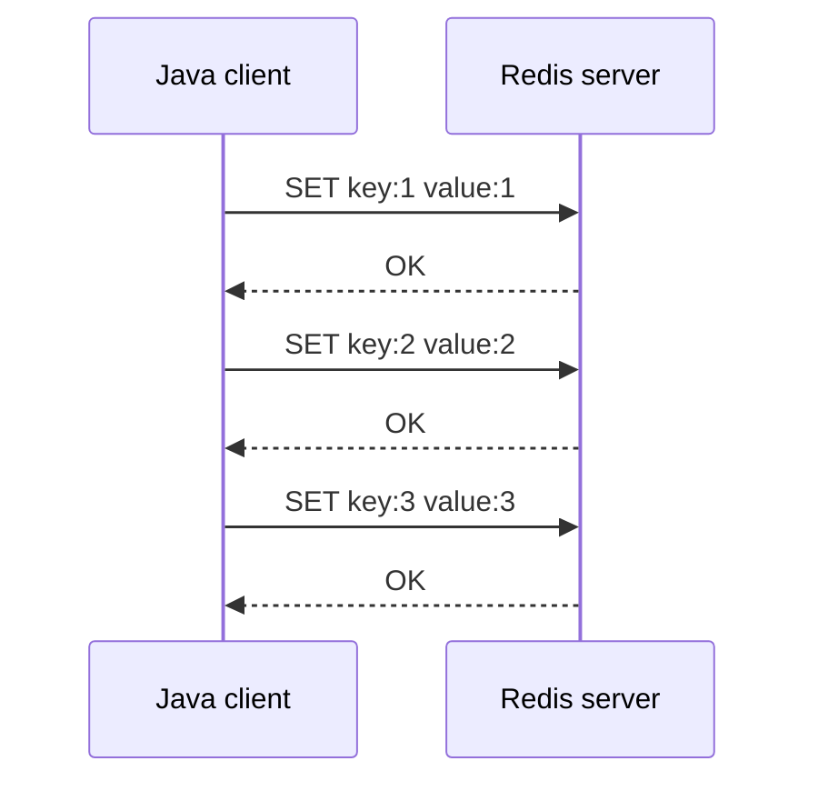
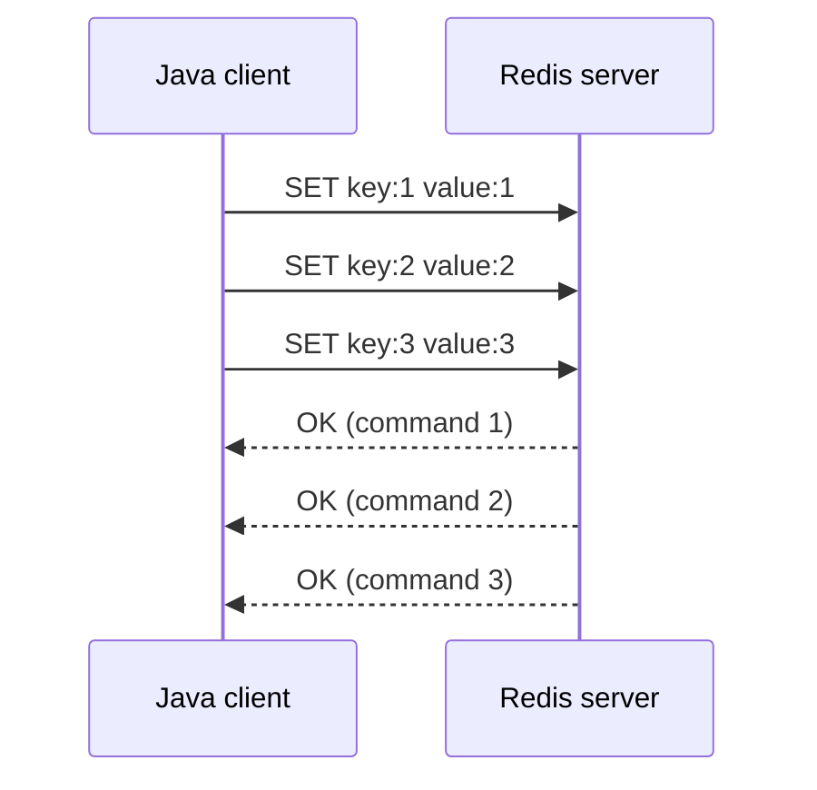

# What Is a Pipeline and How Does It Reduce Network Cost in Spring Data Redis

## 1. When a thousand small operations become slow

Suppose a service needs to update the status of 1,000 orders in Redis. The easiest way to write this is to call one Redis command per order:

```java
for (Map.Entry<String, String> entry : statuses.entrySet()) {
    redis.opsForValue().set(
        "order:status:" + entry.getKey(),
        entry.getValue()
    );
}
```

The code above can work correctly, but it creates many operations that send a command and wait for a response. If the application waits for the first command to return a result before sending the second command, network round-trip time can accumulate into a significant portion of the total time.

**Redis pipelining** is a technique that allows a client to **send multiple commands consecutively without waiting for the response to each command**, and then collect the corresponding responses. It is especially useful when there are many independent Redis operations, each processing very quickly, while the network connection has noticeable latency.

Three things must be distinguished right from the start:

1. **A pipeline reduces network waiting time**, rather than turning commands into a single processing command on Redis.
2. **A pipeline is not a transaction**: commands in a pipeline do not automatically have atomicity as a group and do not roll back when one command fails.
3. **A Java call containing a loop is not automatically a pipeline**. Spring Data Redis has an API for explicit pipelining execution; some drivers also have their own command-batching capabilities, but you should not infer that every `opsForValue().set(...)` loop receives the same benefits as a controlled pipeline.

This lesson explains the request/response mechanism, the RTT cost model, how to use `StringRedisTemplate.executePipelined(...)`, how to choose batch sizes, limitations in Redis Cluster, and common mistakes when optimizing.

## 2. Before pipelining: client sends and waits

Redis uses a request/response protocol. For the `SET` command:

```text
Client -> Redis: SET order:status:o-101 PAID
Redis  -> Client: OK
```

If the application executes multiple commands **sequentially and waits for each response**, the timeline looks like this:



For the second command to be sent, the client had to wait for the first command to travel across the network, be processed by Redis, and return its result. If each command takes very little server CPU time but the **round-trip time (RTT)** is long, performance is dominated by waiting time.

Hypothetical example:

- 1,000 small `SET` commands.
- Average RTT between client and Redis is 3 ms.
- Client waits for the response to each command before sending the next one.

The RTT waiting time alone is approximately:

```text
1,000 commands × 3 ms/wait = 3,000 ms = 3 seconds
```

The three-second figure is only **an illustrative model of the network waiting time portion**. Actual time also depends on Redis CPU, transferred data, serialization, connection pool, operating system, driver, and other clients. A driver with asynchronous I/O can also change the waiting pattern compared to the simple sequential model above.

The core issue: when processing many small commands, the application can spend most of its time **waiting for one result just to be able to send the next command**.

## 3. How does a pipeline change the request/response sequence?

With pipelining, the client can write a sequence of commands to the connection without **being required to read each response immediately after its corresponding command**:



Redis still receives and processes the commands with normal semantics. The client can group sending and receiving into fewer waiting rounds, thereby reducing the impact of repeated RTTs.

Within the same connection, **the order of responses corresponds to the order in which commands were sent**. As a result, when a callback sends `SET key1`, `SET key2`, `GET key3`, the list of responses can be matched according to the exact order in which the commands were queued. However, other clients can still send commands interleaved during processing; **a pipeline does not lock Redis exclusively for a single client**.

### 3.1. A pipeline does not mean a single TCP packet

The term "send at the same time" can easily be misleading. Pipelining **does not guarantee** that all commands fit in a single TCP packet or a single network write system call. The driver, socket buffers, and operating system decide the low-level transmissions.

What matters more is that the client **does not have to wait to receive the full response of the previous command before sending the next one**. Therefore, the number of causal waits decreases, even though the number of bytes and the number of Redis commands do not change.

### 3.2. The server still processes each command

Suppose there are 1,000 `SET` commands:

```text
Without pipeline:
  1,000 sequential send-and-wait-for-response cycles
  Redis processes 1,000 commands

With pipeline:
  send one batch or a few batches of commands, receive responses in batches
  Redis still processes 1,000 commands
```

A pipeline usually improves **client-side throughput** when RTT is the bottleneck. It does not by itself make a heavy Redis command faster, does not reduce the payload size to be transferred, and does not create extra CPU for Redis.

## 4. Understanding via the RTT and batch count model

Let:

- `N`: total number of Redis commands.
- `R`: average RTT between the application and Redis.
- `B`: number of commands sent in one pipeline batch, if processed in chunks.
- `K = ceil(N / B)`: number of batches when divided evenly.

For a client that **waits for each command**:

```text
RTT waiting portion ≈ N × R
```

For a client that sends pipeline batches and waits for each batch to complete:

```text
Waiting portion between batches ≈ K × R
```

This is a conceptual model under ideal conditions, **not a formula for measuring production latency**. A pipeline still has to account for the time the server takes to execute all `N` commands, transfer all responses, client overhead, and how the driver flushes data. With a large pipeline, this work does not disappear just because `K = 1`.

### 4.1. Quantitative example

Given `N = 1,000` and `R = 3 ms`:

| Hypothetical sending approach | Response-wait rounds | Ideal RTT component |
|---|---:|---:|
| Wait for each command | 1,000 | About 3,000 ms |
| Pipeline 10 commands/batch | 100 | About 300 ms |
| Pipeline 100 commands/batch | 10 | About 30 ms |
| Pipeline 500 commands/batch | 2 | About 6 ms |
| Pipeline 1,000 commands/batch | 1 | About 3 ms |

Do not interpret the last row as meaning all 1,000 commands will finish in 3 ms. As long as Redis still has to execute the commands and transfer data, total time remains greater than this single RTT component.

Practical takeaway: reducing from 1,000 waits down to 10 waits can bring a huge improvement; increasing further from a batch of 100 to a batch of 1,000 may bring smaller gains while consuming more memory and causing larger load spikes.

### 4.2. When RTT is low, the effect may be small

If Redis and the application are on the same machine or on a nearby network, RTT can be very small. In that case, serialization, the number of Redis commands, data size, or application overhead may dominate. Pipelining can still be useful, but you need to measure rather than assume the same level of improvement as in the high-latency network example.

## 5. Comparing pipelines with other optimization techniques

The following techniques solve different problems:

| Technique | Nature | Reduces command count on Redis? | Atomic grouping by default? |
|---|---|---|---|
| Sequential calls waiting for each result | Each command is one result-dependent cycle | No | No |
| **Pipelining** | Sends multiple commands without waiting for each response | No | **No** |
| `MGET` / `MSET` | One command processes multiple String keys | Can replace multiple single commands with one command | Multi-key command has command-level atomic semantics, depending on type |
| `MULTI` / `EXEC` | Groups multiple commands into a Redis transaction | Does not itself reduce the logic to be processed | Sequential group execution, no SQL-style rollback on command errors |
| Lua script | Executes server-side logic as a single script | Can reduce round trips and client-side computation | Script runs atomically relative to other Redis commands during execution |
| Multiple concurrent clients/connections | Keeps multiple requests in flight simultaneously | No | No |

### 5.1. Pipelining and `MSET`

When you only need to store multiple String pairs:

```redis
MSET status:o1 PAID status:o2 PACKED status:o3 SHIPPED
```

`MSET` is **one Redis command** writing multiple keys. A pipeline of three `SET` commands is still three commands:

```redis
SET status:o1 PAID
SET status:o2 PACKED
SET status:o3 SHIPPED
```

Both can reduce RTT waiting time compared to three sequential send-and-wait calls, but their semantics differ:

- `MSET` writes multiple String keys in a single command and does not allow setting an independent TTL on each key within the `MSET` syntax.
- A pipeline can mix `SET` with `INCR`, `HSET`, `EXPIRE`, `GET`, and other commands; each command retains its own semantics.
- `SET ... EX` in a pipeline can attach a TTL together with the write operation for each key.
- With Redis Cluster, multi-key commands may be restricted if keys belong to different hash slots; independent commands in a pipeline can be routed per node by a cluster-aware client.

There is no reason to replace every command with a pipeline if a simple multi-key command already satisfies the business requirement.

### 5.2. Pipelining and transactions

Suppose a pipeline consists of:

```redis
SET balance:a 100
SET balance:b 200
INCR counter:payments
```

If the second command fails due to an incompatible data type, the first command may already have succeeded, and the third command may still be processed. **A pipeline does not roll back results already executed**.

Conversely, `MULTI`/`EXEC` provides a mechanism to execute a group of Redis commands as a transaction, preventing other clients' commands from interleaving during execution. Even so, a Redis transaction **does not roll back commands that have already run when a command encounters a runtime error** the way a relational database transaction typically does.

If an operation needs to check a condition and then update atomically, you may need `WATCH`/`MULTI` or a Lua script depending on the business logic. Pipelining only addresses the **network waiting** problem.

## 6. Spring Data Redis example with `StringRedisTemplate`

Spring Data Redis provides `RedisTemplate.executePipelined(...)` to execute a callback in a pipeline context. For string keys and values, `StringRedisTemplate` is a convenient choice because it already uses a String serializer.

### 6.1. Dependency and connection

Example with a Spring Boot 3.x application:

```groovy
dependencies {
    implementation 'org.springframework.boot:spring-boot-starter-data-redis'
}
```

`application.yml` configuration for Redis running on a development machine:

```yaml
spring:
  data:
    redis:
      host: localhost
      port: 6379
```

Spring Boot can auto-configure `StringRedisTemplate` if the connection conditions are met. A service bean only needs to inject the template.

### 6.2. Writing multiple statuses without waiting for each command

```java
import java.util.List;
import java.util.Map;

import org.springframework.data.redis.connection.RedisStringCommands;
import org.springframework.data.redis.core.RedisCallback;
import org.springframework.data.redis.core.StringRedisTemplate;
import org.springframework.data.redis.core.types.Expiration;
import org.springframework.data.redis.serializer.RedisSerializer;
import org.springframework.stereotype.Service;

@Service
public class OrderStatusPipelineService {

    private final StringRedisTemplate redis;

    public OrderStatusPipelineService(StringRedisTemplate redis) {
        this.redis = redis;
    }

    public List<Object> writeStatuses(Map<String, String> statuses) {
        RedisSerializer<String> serializer = redis.getStringSerializer();

        return redis.executePipelined((RedisCallback<Object>) connection -> {
            for (Map.Entry<String, String> entry : statuses.entrySet()) {
                byte[] key = serializer.serialize(
                    "order:status:" + entry.getKey()
                );
                byte[] value = serializer.serialize(entry.getValue());

                connection.stringCommands().set(
                    key,
                    value,
                    Expiration.seconds(300),
                    RedisStringCommands.SetOption.upsert()
                );
            }

            // executePipelined requires the callback to return null.
            return null;
        });
    }
}
```

Usage:

```java
Map<String, String> updates = Map.of(
    "o-101", "PAID",
    "o-102", "PACKED",
    "o-103", "SHIPPED"
);

List<Object> responses = service.writeStatuses(updates);
```

Meaning of each step:

1. `StringRedisTemplate` provides the connection and the template's serializer.
2. `executePipelined(...)` creates the context for sending commands in a pipeline.
3. Inside the callback, each loop iteration sends a Redis `SET ... EX 300` command through `RedisConnection`.
4. **Do not wait directly for the result of each command** inside the callback.
5. The callback returns `null`; Spring Data Redis collects and decodes the responses when the pipeline closes.
6. `responses` contains the results in the order of the commands sent in the pipeline.

In the example above, each `SET` sets a new 300-second TTL at the same time it writes the value. This reduces the risk of a key being written successfully without getting an expiration attached if the application fails between `SET` and `EXPIRE`.

Each element in `responses` has type `Object` because responses can vary by command and driver. For typical `SET` commands, the response indicates success; in a real application you need to distinguish valid results, errors, and missing responses according to the driver's contract.

**Important:** the list of responses is returned **after** the callback finishes and the framework has processed the pipeline. Do not read values returned from `connection.stringCommands().set(...)` inside the callback itself and assume they are completed responses.

### 6.3. Why does the callback return `null`?

In pipelining, command responses are queued for the framework to retrieve at the end. If the callback tries to return its own result, Spring Data Redis will not use that result as the pipeline's response list. Therefore, the `executePipelined` API requires the callback to return `null`.

A pattern to avoid:

```java
redis.executePipelined((RedisCallback<Object>) connection -> {
    // Wrong mindset: returning a single command's response right while queuing.
    return connection.stringCommands().get(
        "order:status:o-101".getBytes(java.nio.charset.StandardCharsets.UTF_8)
    );
});
```

Instead:

```java
List<Object> result =
    redis.executePipelined((RedisCallback<Object>) connection -> {
        connection.stringCommands().get(
            "order:status:o-101".getBytes(
                java.nio.charset.StandardCharsets.UTF_8
            )
        );
        return null;
    });
```

The read result is in `result`, not in the callback's `return` value. When using a custom serializer, you must encode the key consistently with how the template stores it.

## 7. Pipelining read commands

Pipelines are not only for writes. Suppose an application wants to retrieve the statuses of 50 orders with known IDs. We can queue `GET` commands into a pipeline:

```java
import java.util.ArrayList;
import java.util.LinkedHashMap;
import java.util.List;
import java.util.Map;

import org.springframework.data.redis.core.RedisCallback;
import org.springframework.data.redis.core.StringRedisTemplate;
import org.springframework.data.redis.serializer.RedisSerializer;

public class OrderStatusBatchReader {

    private final StringRedisTemplate redis;

    public OrderStatusBatchReader(StringRedisTemplate redis) {
        this.redis = redis;
    }

    public Map<String, String> readStatuses(List<String> ids) {
        RedisSerializer<String> serializer = redis.getStringSerializer();

        List<Object> results = redis.executePipelined(
            (RedisCallback<Object>) connection -> {
                for (String id : ids) {
                    byte[] key = serializer.serialize(
                        "order:status:" + id
                    );
                    connection.stringCommands().get(key);
                }
                return null;
            }
        );

        Map<String, String> byId = new LinkedHashMap<>();
        for (int i = 0; i < ids.size(); i++) {
            Object value = results.get(i);
            byId.put(ids.get(i), value == null ? null : (String) value);
        }
        return byId;
    }
}
```

In this example, the callback issues one `GET` command per ID. Responses are matched by **position**; a non-existent key returns `null`. With `StringRedisTemplate` and the default serializer, string data can be read as `String`.

In applications using `RedisTemplate<K,V>` with a different serializer, responses may be decoded using the template's serializer or the chosen `executePipelined` overload. You should not arbitrarily cast every result to `String` if the template uses another value type.

### 7.1. When should you use `multiGet`?

For multiple String keys, the following approach is often more concise:

```java
List<String> keys = List.of(
    "order:status:o-101",
    "order:status:o-102",
    "order:status:o-103"
);

List<String> values = redis.opsForValue().multiGet(keys);
```

`multiGet` typically uses Redis `MGET`: a single server command that retrieves multiple keys. This can be a simpler and more efficient choice than pipelining multiple `GET`s, if the keys fit the Redis topology constraints and API semantics.

Pipelining is more flexible when you want to combine **multiple command types** or keys of different data types; `MGET` applies to a group of String keys.

## 8. Mixing multiple commands in one pipeline

A pipeline can contain different types of commands:

```java
List<Object> results = redis.executePipelined(
    (RedisCallback<Object>) connection -> {
        RedisSerializer<String> s = redis.getStringSerializer();

        connection.stringCommands().set(
            s.serialize("demo:order:o-101"),
            s.serialize("PAID")
        );

        connection.stringCommands().incr(
            s.serialize("demo:metrics:paid-count")
        );

        connection.stringCommands().get(
            s.serialize("demo:order:o-102")
        );

        return null;
    }
);
```

The order of responses corresponds to the `SET`, `INCR`, `GET` commands. That makes processing the returned list straightforward, but also creates the responsibility of **knowing what response type each position has**.

### 8.1. Commands dependent on a previous result are not suited to a single-pass pipeline

Business example:

```text
1. GET account:42:balance
2. If balance >= 100 then deduct 100
3. Record the transaction
```

If the client needs to read the `GET` response to decide whether to send the second command, it **cannot put that entire decision into a simple pipeline** and expect Redis to branch automatically based on the result. The pipeline callback queues commands, while the full responses arrive after it finishes.

In cases where a condition must be checked and modified atomically, use a design with a Lua script or an appropriate transaction/optimistic locking mechanism. Pipelining is not a substitute for business synchronization logic.

### 8.2. One invalid command can still affect how responses are read

If a pipeline issues:

```text
SET counter "hello"
INCR counter
GET counter
```

The `INCR` command will fail with a data type error because the value is not a valid integer. Whether subsequent commands are processed and how the application receives/interprets the error depend on the Redis client and result decoding mechanism. Do not assume the entire batch succeeded just because the callback ran to the end.

In critical workloads, monitor responses, exceptions, and the IDs corresponding to each command, while also designing safe retries.

## 9. Splitting a pipeline into manageable batches

You should not send all commands of an extremely large dataset in a single pipeline. Redis still has to buffer and transmit responses; the client also has to hold the received results. A pipeline of hundreds of thousands or millions of commands can increase memory usage, latency, and the likelihood of timeouts.

Example of splitting a list into chunks:

```java
import java.util.List;

public void updateInChunks(
        List<OrderStatusUpdate> updates,
        int chunkSize) {

    if (chunkSize <= 0) {
        throw new IllegalArgumentException(
            "chunkSize must be positive"
        );
    }

    for (int start = 0; start < updates.size(); start += chunkSize) {
        int end = Math.min(start + chunkSize, updates.size());
        List<OrderStatusUpdate> chunk = updates.subList(start, end);
        writeChunk(chunk);
    }
}
```

Where `OrderStatusUpdate` can be a record:

```java
public record OrderStatusUpdate(String id, String status) {
}
```

The `writeChunk(chunk)` method can use `executePipelined(...)` as in the pattern in section 6, converting each `id/status` pair into a `SET` command. The goal here is to **limit the number of commands and responses per pipeline execution**, without needing to recreate the entire input list.

Example with 10,000 updates, chunk size 200 commands:

```text
10,000 / 200 = 50 pipelines
```

### 9.1. Chunk size involves trade-offs

| Small batch | Large batch |
|---|---|
| More waiting rounds | Fewer waiting rounds |
| Reduces need to hold many responses at once | Increases buffer memory and result size |
| Easier error recovery on small groups | A failed batch can make it harder to tell which commands ran |
| Less likely to cause load spikes on Redis | Can cause bursts and increase latency for other clients |

Numbers like 50, 100, 500, or 1,000 are only **initial trial values**. The best size depends on RTT, average payload size, connection configuration, server resources, target throughput, and load conditions.

### 9.2. Very large responses may be returned

`executePipelined` typically creates a list of results corresponding to the commands. If each command returns a large value (such as `GET` on a blob of hundreds of KB), 1,000 responses can consume significant memory, even when the command count is not very large.

Therefore, distinguish between **commands per pipeline** and **response bytes per pipeline**. In many applications, data size is the critical limit.

## 10. Pipelines reduce RTT, but can increase server pressure

A common question: if a pipeline is faster, why not send as many commands as possible?

Because pipelining increases the rate at which the client **pushes work into Redis**, while Redis still has to execute the commands. When load arrives faster than processing capacity, several problems can appear:

- Command and response queues grow.
- Memory used for pending responses increases.
- Latency for other clients increases.
- Timeouts and closed connections occur under overload.
- A heavy command in the middle of the sequence makes subsequent commands wait longer.

Redis processes each command according to its server and data characteristics. Reducing network waiting time **does not eliminate the possibility of heavy commands or bounded Redis resources**.

If the application has multiple workers pipelining concurrently, the total commands hitting Redis can far exceed its capacity, even if each worker sees a low RTT. Measure throughput and latency on both the client and Redis when increasing concurrency.

## 11. Is a pipeline atomic?

**No.** A plain pipeline does not provide atomicity for the entire sequence of commands.

Suppose a client sends:

```redis
SET booking:42:status RESERVED
DECR inventory:item-1
SET booking:42:status CONFIRMED
```

In case Redis receives and executes some commands before the connection drops, the client may not know exactly how many commands completed. Moreover, commands from other clients can be processed interleaved between commands in the pipeline.

This is a **business correctness** problem that cannot be solved merely by reducing RTT.

If you need to ensure no overselling or only decrement inventory when conditions are valid:

- Use a Lua script when atomic check-and-update logic on Redis is needed for compatible keys.
- Consider Redis transactions and `WATCH` when optimistic concurrency is needed.
- Design idempotency and partial-failure handling if the operation spans multiple systems.
- With Redis Cluster, pay attention to key-slot restrictions for atomic multi-key operations.

A pipeline can contain `MULTI`/`EXEC` at the protocol level, but **the concepts of pipeline and transaction remain distinct**: a transaction manages execution semantics; a pipeline manages how commands are sent and received to reduce network waiting.

## 12. Retry scenarios where mistakes are easy

### 12.1. Writing fixed states is usually easier to retry than incrementing counters

If an application executes:

```redis
SET order:status:o-101 PAID
```

Resending the same value may be acceptable for the final state, provided no newer update is overwritten. However, the command:

```redis
INCR order:metrics:paid-count
```

if resent because the client did not receive a response, can **increment a second time** even though the first one was already processed by Redis. This is a double-counting risk.

### 12.2. Losing a response does not prove a command did not execute

When a pipeline times out:

```text
Client sends 200 commands
Redis may have received and processed part or all of them
Connection drops before client receives full responses
```

Do not assume "the whole batch failed" and retry unconditionally. You need to know:

1. Are the commands idempotent?
2. Do the keys carry identifiers and versions to prevent overwriting newer data?
3. Can server state be inspected after an error?
4. Are deduplication tokens or progress logs needed?

Choosing a large pipeline also affects the reconciliation scope if incomplete responses are received.

## 13. Redis Cluster makes pipelining more complex

Redis Cluster partitions keys into **hash slots** located on different nodes. If a pipeline contains keys belonging to multiple slots, a topology-aware driver may need to route commands to multiple connections/nodes and then aggregate the results.

```text
Application
   |
   |-- SET key in slot A --> Redis node A
   |-- SET key in slot B --> Redis node B
   |-- GET key in slot C --> Redis node C
```

Do not assume an entire pipeline to a Cluster is **one network trip to one server**. Properties to keep in mind:

- Independent commands can be routed by slot, depending on the driver.
- A **multi-key** command, such as `MGET`, may require keys to share the same hash slot when executed on the server; otherwise it may report `CROSSSLOT`.
- Slot migration/resharding or node failures can trigger redirects/retries and alter latency.
- API-level result ordering must follow the driver contract; do not infer execution order across nodes.
- Multi-key transactions/scripts have special restrictions regarding same-slot placement.

### 13.1. Hash tags to place related keys in the same slot

Redis Cluster supports hash tags:

```text
order:{o-101}:status
order:{o-101}:customer
order:{o-101}:payment
```

The `{o-101}` part ensures these keys are hashed by the same tag. It is useful for tasks that genuinely need multi-key commands on the same slot.

However, putting **every key** in the system under the same hash tag forces them onto a single shard, reducing load-distribution capability. Do not change keyspace conventions just for pipelining when there is no actual requirement for multi-key commands.

## 14. Pipelines and Spring Data Redis Repository

Redis Repository provides an entity-mapping API:

```java
@RedisHash("shop:orders")
public class OrderRecord {
    @Id
    private String id;

    @Indexed
    private String customerId;

    private String status;
    // Constructor/getter/setter
}
```

```java
orderRepository.saveAll(orders);
```

A Repository can manage multiple data structures for a single entity:

- The main Redis Hash.
- An identifier set by keyspace.
- Secondary indexes from `@Indexed`.
- TTL and metadata supporting expiration, when configured.

Therefore, **you should not replace `saveAll` by pipelining a series of manual `HSET` calls with hand-built keys** and assume the business behavior is equivalent:

```java
// Conceptual example that is insufficient to replace Repository:
connection.hashCommands().hSet(
    keyBytes, fieldBytes, valueBytes
);
```

This raw command may fail to update indexes, TTL, and metadata required by the repository. When you need to optimize multi-entity operations, start from Repository semantics and observe the actual commands issued. If a workload requires throughput beyond what Repository can reasonably support, design a custom storage layout along with a strategy to maintain auxiliary data.

Note: **`saveAll` does not by default mean a pipeline or a transaction**. The method name represents a multi-entity operation at the application layer, without promising a specific number of network round trips or command-sending strategy.

## 15. When should you use a pipeline?

A pipeline is usually appropriate when:

1. There are **many small Redis commands**, such as writing statuses, incrementing independent counters, checking or fetching many keys.
2. The commands can be **decided before receiving the result** of the previous command.
3. The entire group of commands does not need to execute atomically.
4. The client is paying significant cost due to RTT or sequential exchanges.
5. Batches can be split reasonably, errors monitored, and retries handled safely.

Practical examples:

| Scenario | Is pipeline useful? | Notes |
|---|---|---|
| Writing 500 independent String statuses | Usually yes | Use `SET ... EX` if TTL is needed |
| Incrementing 200 independent counters | Possibly | Retrying `INCR` is unsafe without deduplication |
| `GET` 100 independent keys | Possibly | Consider `MGET` if semantics and topology allow |
| Each command depends on a previous GET value | Unfavorable | Requires waiting and branching or moving logic server-side |
| Transferring money between two accounts | Pipeline is insufficient | Requires atomicity and business invariants |
| Saving `@RedisHash` entities with multiple indexes | Requires caution | Do not bypass Repository mapping |
| Executing only one Redis command | Almost no benefit | Pipeline setup overhead may be unnecessary |
| Sending one very CPU-heavy operation | Does not solve CPU bottleneck | Must optimize the command and data |

## 16. Measuring pipeline effectiveness properly

Do not just compare the timing of a Java loop. Measure from the application side, and observe Redis when needed.

### 16.1. Measuring total time in Java

```java
import java.util.Map;
import java.util.concurrent.TimeUnit;

public long measurePipelineMillis(
        OrderStatusPipelineService service,
        Map<String, String> updates) {

    long started = System.nanoTime();
    service.writeStatuses(updates);

    return TimeUnit.NANOSECONDS.toMillis(
        System.nanoTime() - started
    );
}
```

This measurement covers the entire pipeline call (building commands, transmitting, server processing, and receiving responses). For a fair evaluation, use the same payload, same topology, and compare against non-pipelined sending under similar conditions.

For very small batches, millisecond measurements can be heavily affected by JVM startup, JIT, GC, or measurement precision. Run multiple iterations after warm-up and report percentiles rather than picking only the fastest run.

### 16.2. Metrics to inspect

| Metric | Helps answer |
|---|---|
| Command throughput/sec | Are more commands being processed? |
| Full-batch latency | How long does the caller have to wait? |
| p95/p99 latency of other requests | Does the pipeline increase latency for the rest of the system? |
| Redis command count | Did the pipeline reduce waiting or actually reduce command count? |
| Client ↔ Redis RTT | Is network cost significant? |
| Redis CPU | Has the server reached its processing limit? |
| Network bytes/s | Is payload becoming a bottleneck? |
| Redis/client memory | Do large batches inflate response buffers? |
| Timeouts, connection errors | Do large pipelines make the system less stable? |

### 16.3. Observing on Redis

Commands that assist observation:

```redis
INFO commandstats
INFO stats
SLOWLOG GET 10
```

`INFO commandstats` provides statistics grouped by command; `SLOWLOG` shows server-side execution times for slow commands. **SLOWLOG does not include total network latency**, so Redis may report very fast commands while the application is slow due to RTT waits, connection pool contention, or serialization.

`MONITOR` can help inspect actual commands in a test environment, but it carries overhead and can expose data inside command payloads. Do not enable it routinely on high-load production systems just to observe pipelines.

## 17. A hands-on exercise you can try

**Goal:** compare 1,000 sequential `SET` commands against 1,000 similar commands placed in a pipeline.

### Step 1: prepare the data

Create 1,000 test keys with small values:

```java
import java.util.LinkedHashMap;
import java.util.Map;

Map<String, String> updates = new LinkedHashMap<>();
for (int i = 0; i < 1000; i++) {
    updates.put("o-" + i, "READY");
}
```

Use a dedicated keyspace for testing, such as `demo:pipeline:status:`, so real data is not affected.

### Step 2: run sequentially

```java
long t1 = System.nanoTime();

for (Map.Entry<String, String> entry : updates.entrySet()) {
    redis.opsForValue().set(
        "demo:pipeline:status:" + entry.getKey(),
        entry.getValue()
    );
}

long sequentialNanos = System.nanoTime() - t1;
```

This is a baseline using template calls waiting for results on each iteration in synchronous usage. Specific driver I/O optimizations may affect the measured numbers.

### Step 3: run with a pipeline

```java
var serializer = redis.getStringSerializer();

long t2 = System.nanoTime();

List<Object> replies = redis.executePipelined(
    (RedisCallback<Object>) connection -> {
        for (Map.Entry<String, String> entry : updates.entrySet()) {
            connection.stringCommands().set(
                serializer.serialize(
                    "demo:pipeline:status:" + entry.getKey()
                ),
                serializer.serialize(entry.getValue())
            );
        }
        return null;
    }
);

long pipelineNanos = System.nanoTime() - t2;
```

In this exercise, both approaches use `SET` **without TTL** for easy direct comparison. If test data needs to expire automatically, apply TTL to **both approaches** so semantics are equivalent; do not measure `SET` on one side and `SET ... EX` on the other and draw conclusions purely about pipelining.

### Step 4: calculate relative speedup

```text
sequentialMillis = sequentialNanos / 1_000_000
pipelineMillis   = pipelineNanos / 1_000_000

speedup = sequentialMillis / pipelineMillis
```

For example, if you measure 2,000 ms and 200 ms, the speedup is 10x. This is **an illustrative calculation only**; actual results do not have a fixed factor.

Repeat measurements multiple times, use different keyspaces across runs if needed, warm up the application, and record p95 latency of other requests while Redis is under load.

### Step 5: vary the pipeline size

Try splitting 1,000 commands into different batches:

| Chunk size | Corresponding pipeline runs |
|---:|---:|
| 10 | 100 |
| 50 | 20 |
| 100 | 10 |
| 250 | 4 |
| 500 | 2 |
| 1,000 | 1 |

Record time, memory, and errors. Observe whether improvements taper off as batch size grows; if so, the system may have shifted from an RTT bottleneck to CPU, network throughput, or buffers.

### Step 6: verify written data

```redis
GET demo:pipeline:status:o-0
GET demo:pipeline:status:o-999
```

Seeing correct results on two keys is only an initial check. To confirm all 1,000 operations, verify the full responses or re-read the keys that must be guaranteed, alongside an error-handling strategy. Do not treat the fact that `executePipelined` returned a list as sufficient proof that all business operations succeeded.

## 18. Common misconceptions

### "A pipeline is one big Redis command"

No. Redis still receives and executes individual commands; the difference is that the client can send multiple commands without waiting for each command's result first.

### "A pipeline is always faster in exact proportion to batch size"

No. Once RTT is no longer dominant, server CPU limits, payload size, and result transfer determine total time. Overly large batches can also increase load and memory usage.

### "A pipeline automatically creates a transaction"

No. One command can fail while others still take effect. Atomicity must be designed separately.

### "You can get the result of a GET inside the callback to decide the next command"

Not with standard pipelining: full responses are collected after the callback. If you need an earlier result to make a decision, split into steps or use server-side logic.

### "Increasing the number of commands in a pipeline does not affect Redis"

False. Redis still processes all commands and responses. Pipelining mainly reduces **client communication wait time**, not Redis computation work.

### "Pipelining a series of HSETs can replace Redis Repository saveAll"

Not automatically. Entities managed by a Repository may require tracking updates, indexes, TTLs, and other metadata.

### "A timeout means Redis executed nothing"

No. The connection can drop after Redis has executed part or all of the pipeline. Retries must account for idempotency.

### "A pipeline on Redis Cluster definitely goes to one node"

No. With multiple hash slots, the driver may need to communicate with multiple nodes; certain multi-key commands require the same slot.

## 19. Conclusion: reduce wait cycles, preserve data semantics

A pipeline is chosen when **many small independent commands are spending time because the client must repeatedly wait on request/response cycles**. For sequential operations, RTT wait time can grow roughly with the number of commands; a pipeline lets you send many commands consecutively, reducing network wait cycles.

In Spring Data Redis, `RedisTemplate.executePipelined(...)` and `StringRedisTemplate.executePipelined(...)` provide a clear mechanism to queue commands and collect responses. When using them:

1. Only put known commands into a pipeline that do not require earlier results to decide later commands.
2. Keep batch size large enough to reduce RTT but small enough to control memory, latency, and errors.
3. Use commands with appropriate semantics, especially for TTL, overwrites, and non-idempotent increments.
4. Do not replace transactions, Lua, or Repository mapping with a pipeline when atomicity, indexes, or entity lifecycles are needed.
5. Measure end-to-end latency, throughput, and impact on Redis to confirm the optimization actually helps.

**Key takeaway:** pipelining makes the client **wait less on the network**; it does not make Redis **process fewer commands**. This distinction determines both the performance benefits and the safety limits of the technique.

## References

- [Redis Documentation — Pipelining](https://redis.io/docs/latest/develop/using-commands/pipelining/)
- [Redis Documentation — Transactions](https://redis.io/docs/latest/develop/using-commands/transactions/)
- [Redis Documentation — MGET](https://redis.io/docs/latest/commands/mget/)
- [Redis Documentation — MSET](https://redis.io/docs/latest/commands/mset/)
- [Redis Documentation — Redis Cluster specification](https://redis.io/docs/latest/operate/oss_and_stack/reference/cluster-spec/)
- [Spring Data Redis Reference — Pipelining](https://docs.spring.io/spring-data/redis/reference/redis/pipelining.html)
- [Spring Data Redis Reference — RedisTemplate](https://docs.spring.io/spring-data/redis/reference/redis/template.html)
- [Spring Data Redis API — RedisTemplate](https://docs.spring.io/spring-data/redis/docs/3.3.7/api/org/springframework/data/redis/core/RedisTemplate.html)
