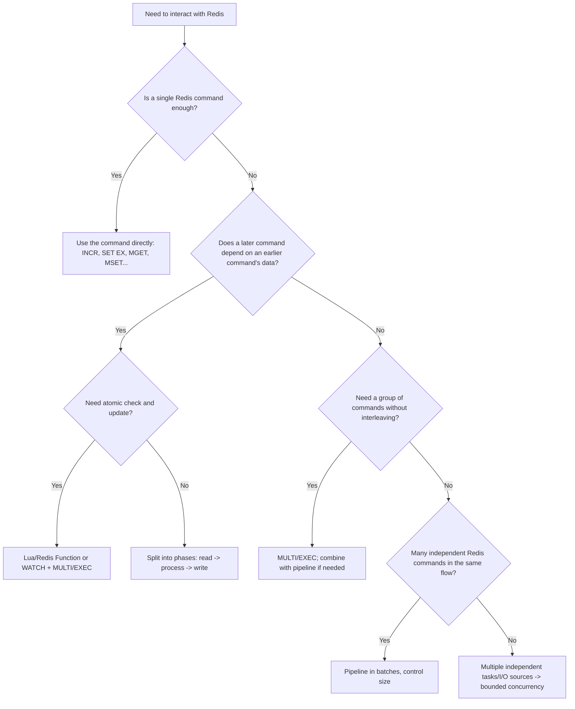

# Distinguishing Pipelines from Transactions and Parallel Execution in Spring Data Redis

> **Module:** Spring Data Redis  
> **Chapter:** Pipeline  
> **Topic:** Pipelines, transactions, and concurrent/parallel execution can all appear when an application sends many Redis commands, yet they solve different problems. This document clarifies their goals, guarantees, APIs, and how to choose among them in a Spring application.

## 1. Three easily confused concepts

Suppose a Spring Data Redis application needs to write 1,000 keys while updating order statuses and statistical counters. There are at least three ways to organize the commands:

- **Pipeline**: sends multiple commands over a Redis connection without waiting for the reply to each command before sending the next one. The primary goal is to **reduce network round-trip cost** and increase throughput.
- **Redis transaction (`MULTI`/`EXEC`)**: groups a sequence of commands so Redis executes them consecutively as a unit **without commands from other clients interleaved in between**. The primary goal is to **guarantee atomicity against execution interleaving** for the command sequence.
- **Parallel/concurrent execution**: multiple tasks or requests send commands at the same time, typically across multiple threads, async tasks, connections, or clients. The typical goal is to **distribute work, increase concurrency, or shorten waiting time across multiple independent tasks**.

An easy sentence to remember:

> **Pipelines optimize command transmission; transactions control how Redis executes a group of commands; parallel processing organizes multiple streams of work.**

The three concepts are not mutually exclusive: a system can have multiple workers running simultaneously, each worker sending commands via a pipeline, while certain command groups must be protected by a transaction or a Lua script.

### 1.1. The same 3 commands, three perspectives

Suppose we must run:

```redis
SET cache:a "A"
SET cache:b "B"
INCR stats:writes
```

**Sending sequentially and waiting for each result:**

```text
Client                      Redis
  | ---- SET a ------------> |
  | <--- OK ---------------- |
  | ---- SET b ------------> |
  | <--- OK ---------------- |
  | ---- INCR --------------> |
  | <--- 1 ----------------- |
```

The client waits for each command's response, so network latency repeats multiple times.

**Pipeline:**

```text
Client                      Redis
  | ---- SET a ------------> |
  | ---- SET b ------------> |
  | ---- INCR --------------> |
  | <--- OK ---------------- |
  | <--- OK ---------------- |
  | <--- 1 ----------------- |
```

The client pushes multiple requests out before waiting for the corresponding responses. Redis still executes the commands; the pipeline does not turn them into a single atomic command.

**Transaction:**

```text
Client                      Redis
  | ---- MULTI ------------> |
  | <--- OK ---------------- |
  | ---- SET a ------------> |
  | <--- QUEUED ------------ |
  | ---- SET b ------------> |
  | <--- QUEUED ------------ |
  | ---- INCR --------------> |
  | <--- QUEUED ------------ |
  | ---- EXEC -------------> |
  | <--- [OK, OK, 1] ------- |
```

Redis queues the commands in the transaction queue and executes them upon receiving `EXEC`. At `EXEC` time, the commands in the transaction are executed consecutively, with no other client's commands interleaved.

**Multiple parallel tasks:**

```text
Java worker A ---- SET cache:a ----> Redis
Java worker B ---- SET cache:b ----> Redis
Java worker C ---- INCR stats:writes -> Redis
                       |
                 Server processes commands
```

The three workers may operate simultaneously and finish in different orders. Redis still guarantees the atomicity of each individual command such as `INCR`, but **there is no transaction** ensuring all three commands form a single unified group.

## 2. Direct comparison table

| Criterion | Pipeline | Transaction (`MULTI`/`EXEC`) | Concurrent/parallel execution |
|---|---|---|---|
| Goal | Reduce round trips, increase batch throughput | Execute command group without interleaving other clients' commands | Increase concurrency across tasks |
| Mechanism | Send multiple requests before reading each response | Queue commands then execute at `EXEC` | Multiple threads/tasks/clients call Redis concurrently |
| Reduces batch RTT | Yes, if sent/flushed effectively | Not automatically; can be combined with pipelining | Not automatically; multiple requests still incur network overhead |
| Group-wide atomicity | **No** | **Yes** regarding execution interleaving | **No** |
| Other clients' commands can interleave inside group | Possible | No, while the group is being executed by `EXEC` | Possible |
| Rollback when a later command fails? | No | **No SQL-style rollback** | No |
| Read earlier command result to decide later command in same round | Inconvenient; results typically arrive only after pipeline flush | Cannot decide from a QUEUED command's result before `EXEC` | Can build per-task logic, but must handle races |
| Return value | List of responses in command order | List of results from `EXEC` or abort | Per-future/task results |
| Multi-key consistency | No greater than individual commands | Consecutive execution group; still needs `WATCH`/Lua for conditions | Depends on synchronization protocol and individual commands |
| Mid-batch failure | Earlier commands may have executed | Execution-time errors do not roll back already succeeded commands | Partial success across tasks is possible |
| Best suited for | Bulk writes, imports, cache batching, many independent GETs | Multi-state updates that must be grouped, optimistic locking | I/O to multiple services/partitions, many independent requests |
| Spring Data Redis API | `executePipelined(...)` | `multi()`, `exec()`, `watch()`, `SessionCallback` | `CompletableFuture`, `Executor`, async/reactive clients |
| Major risks | Response memory, oversized batches, assuming atomicity | Assuming rollback exists, long-lived transactions, wrong connection | Race conditions, connection/server overload, unordered results |

**Use the word "parallel" accurately:** multiple Java threads can truly run on multiple CPU cores, yet a single typical Redis instance still processes command logic according to Redis's execution model. Redis has multithreaded I/O optimizations in certain versions, but that **does not turn three commands from three clients into a single transaction**. Redis Cluster distributes keys across multiple shards to increase overall capacity, but it also imposes constraints on multi-key operations.

## 3. Pipeline: reducing network communication cost

### 3.1. Why is a pipeline faster than waiting for each command?

A normal request/response incurs:

```text
Time ≈ send time + Redis execution time + response time
       + connection/client round-trip cost
```

If you need to send `N` commands and **wait sequentially** for each result, network latency can make up most of the total time when Redis is remote from the application.

Illustrative example:

- There are 500 independent `SET` commands.
- RTT between the application and Redis is about 2 ms.
- Each command is very lightweight compared to the RTT.

If waiting one by one completely, the ideal RTT portion alone can reach around 500 × 2 ms = 1,000 ms. A pipeline lets multiple commands be in flight at once, avoiding 500 separate RTT waits.

This is **an intuitive model**, not a promise that "a pipeline always runs in a single RTT." Actual results also depend on payload size, flush counts, TCP, driver, network limits, Redis execution time, and how the server buffers/sends replies.

### 3.2. How does Redis process a pipeline?

1. The client prepares and sends multiple commands over one connection in exact order.
2. Redis receives and executes each command with normal semantics.
3. Redis buffers/sends the corresponding replies.
4. The client collects results in the order the commands were issued.

A pipeline **is not** a Redis command named `PIPELINE`. It is a way **the client uses the Redis protocol**: not waiting for each response before sending the next request.

If the 5th command fails with a data type error, commands 1–4 may still have executed successfully, and command 6 may still be processed. There is no full-batch rollback due to pipelining.

### 3.3. Spring Data Redis example with `StringRedisTemplate`

```java
import java.nio.charset.StandardCharsets;
import java.util.List;

import org.springframework.data.redis.connection.RedisConnection;
import org.springframework.data.redis.core.RedisCallback;
import org.springframework.data.redis.core.StringRedisTemplate;
import org.springframework.stereotype.Service;

@Service
public class ProductCacheBatchWriter {

    private final StringRedisTemplate redis;

    public ProductCacheBatchWriter(StringRedisTemplate redis) {
        this.redis = redis;
    }

    public List<Object> writeBatch(int count) {
        return redis.executePipelined((RedisCallback<Object>) connection -> {
            for (int i = 0; i < count; i++) {
                byte[] key = ("cache:product:" + i)
                        .getBytes(StandardCharsets.UTF_8);
                byte[] value = ("product-" + i)
                        .getBytes(StandardCharsets.UTF_8);

                connection.stringCommands().set(key, value);
            }

            // executePipelined requires the callback to return null.
            return null;
        });
    }
}
```

Explanation:

- `StringRedisTemplate` is typically auto-configured by Spring Boot when the Redis starter and connection factory are present.
- `executePipelined` opens the pipelining scope, runs the callback, and collects replies into `List<Object>`.
- The callback uses `RedisConnection` directly, so keys and values are converted to `byte[]` using UTF-8, matching the example's String usage.
- Each `SET` command has its own response. The result list corresponds to command order. For many commands returning `OK`, the information may be converted according to Spring Data Redis's serializer/template.
- **Do not read the result of each `SET` inside the loop to decide the next statement**. In a pipeline, operations that return values may return `null` inside the callback because replies are only available after the pipeline is executed/read.
- `executePipelined` requires the callback to return `null`, not a custom-built object. Read results from **the return value of `executePipelined`**.

Note: if the application uses `RedisTemplate` with a JDK/JSON serializer instead of String, low-level operations via `RedisConnection` must encode bytes in the actual format. Do not mix `UTF-8` and another serializer on the same key just because both APIs call Redis.

### 3.4. `executePipelined` with high-level template operations

When the application needs to leverage the template's serializers, `SessionCallback` can be used in a pipeline scope:

```java
import java.time.Duration;
import java.util.List;
import org.springframework.data.redis.core.RedisOperations;
import org.springframework.data.redis.core.SessionCallback;
import org.springframework.data.redis.core.StringRedisTemplate;

public class SessionPipelineExample {

    private final StringRedisTemplate redis;

    public SessionPipelineExample(StringRedisTemplate redis) {
        this.redis = redis;
    }

    public List<Object> writeWithTtl() {
        return redis.executePipelined(new SessionCallback<Object>() {
            @Override
            public <K, V> Object execute(RedisOperations<K, V> operations) {
                // This example uses a controlled cast because the actual bean
                // is a StringRedisTemplate configured for String.
                @SuppressWarnings("unchecked")
                RedisOperations<String, String> ops =
                        (RedisOperations<String, String>) operations;

                ops.opsForValue().set(
                        "cache:a", "A", Duration.ofMinutes(10));
                ops.opsForValue().set(
                        "cache:b", "B", Duration.ofMinutes(10));
                return null;
            }
        });
    }
}
```

The `SessionCallback` API ensures commands in the callback use the same Redis session according to Spring Data Redis's mechanism. Using this style of callback is helpful when high-level template operations must share one connection. The example demonstrates the mechanism; in production code, design clear generics/bean types and avoid casts where possible.

**Do not infer that pipelining creates a transaction** just because a callback uses the same connection. The two conditions remain independent: whether pipelining is active, and whether `MULTI`/`EXEC` is active.

### 3.5. Pipelines do not guarantee a consistent snapshot

Suppose client A pipelines two commands:

```redis
GET balance:wallet1
GET balance:wallet2
```

In between Redis processing the two commands, a client B can update one of the two keys. The two results may reflect **two different points in time**; there is no cross-key consistency guarantee.

If both keys are Redis Strings and meet multi-key conditions, `MGET balance:wallet1 balance:wallet2` is **a single Redis command**, reducing command count and having single-command atomic semantics on a single Redis instance. However, `MGET` applies only to the right data type and has restrictions when keys belong to multiple hash slots in Redis Cluster.

### 3.6. What problems do large pipelines cause?

Pipelines increase throughput, but batch size must be bounded:

- Redis must process pending requests and may accumulate replies in memory if the client does not read them fast enough.
- The client may hold a large response list in the Java heap.
- Huge batches cause one long request to occupy resources, increasing tail latency for other traffic.
- When the network fails mid-batch, the client may not know exactly which commands executed.
- When a batch contains non-idempotent operations like `INCR`, uncontrolled full retries can double-increment counters.

The practical approach is to **split into moderate batches**, measure throughput/latency/memory, and design retries with record awareness or idempotency. There is no fixed ideal batch size for every payload and infrastructure.

## 4. Transaction: atomic execution group, not a network speedup mechanism

### 4.1. What do Redis `MULTI` and `EXEC` guarantee?

A Redis transaction starts with `MULTI`. Subsequent commands on **the same connection** are queued and receive a `QUEUED` reply. When `EXEC` is called, Redis executes the queued commands in order, without interleaving commands from other clients while the transaction runs.

```redis
MULTI
SET orders:1001:status paid
INCR metrics:paid-orders
EXEC
```

The goal here is for both updates to execute back-to-back at `EXEC`. Another client cannot observe a state where the first command of the group has executed but the second has not by issuing a query between the transaction's commands on the same Redis instance.

**Transactions do not by themselves guarantee business correctness.** If one of the two commands can fail, Redis transactions do not have relational-database-style rollback. Transactions also do not let you read the result of the first command to write conditional logic inside the same queued command set.

### 4.2. Redis transactions do not roll back like SQL

Example:

```redis
MULTI
SET demo:kind "a-string"
LPUSH demo:kind "list-item"
EXEC
```

`SET` may succeed while `LPUSH` fails with `WRONGTYPE` because the key is currently a Redis String. An error when **executing** a command inside `EXEC` does not make Redis undo earlier commands. The result of `EXEC` can contain both successful results and per-command errors.

Distinguish between:

- **Queueing-time errors**: in some cases the transaction is marked aborted and `EXEC` refuses to execute the group.
- **Execution-time errors**: other valid commands may still execute; Redis does not provide automatic rollback for already written results.

Thus, "atomic transaction" in Redis mainly refers to **no interleaving of commands from other clients while the `EXEC` group is running**, which does not mean full rollback semantics like an RDBMS.

### 4.3. Spring Data Redis: transactions via `RedisConnection`

Example using a callback that holds the same connection throughout the `MULTI` to `EXEC` sequence:

```java
import java.nio.charset.StandardCharsets;
import java.util.List;

import org.springframework.data.redis.core.RedisCallback;
import org.springframework.data.redis.core.StringRedisTemplate;
import org.springframework.stereotype.Service;

@Service
public class PaidOrderUpdater {

    private final StringRedisTemplate redis;

    public PaidOrderUpdater(StringRedisTemplate redis) {
        this.redis = redis;
    }

    public List<Object> markPaid(String orderId) {
        return redis.execute((RedisCallback<List<Object>>) connection -> {
            byte[] statusKey = ("orders:" + orderId + ":status")
                    .getBytes(StandardCharsets.UTF_8);
            byte[] paid = "paid".getBytes(StandardCharsets.UTF_8);
            byte[] countKey = "metrics:paid-orders"
                    .getBytes(StandardCharsets.UTF_8);

            connection.multi();

            connection.stringCommands().set(statusKey, paid);
            connection.stringCommands().incr(countKey);

            return connection.exec();
        });
    }
}
```

Unlike `executePipelined`:

- `execute(...)` only opens a callback with a Redis connection; it **does not enable pipelining automatically**.
- `connection.multi()` and `connection.exec()` create the transaction.
- Commands between `MULTI`/`EXEC` are queued; actual command results arrive when `EXEC` runs.
- If `DISCARD` is called before `EXEC`, queued commands are discarded; that does not mean Redis automatically rolls back commands already executed after `EXEC`.

For complex transactions in Spring Data Redis, `SessionCallback` is the high-level API commonly used to keep the same session when calling `opsForValue()`, `multi()`, and `exec()`. Whichever API is used, the rule of **using the same connection throughout the transaction** must be maintained.

### 4.4. Does Spring's `@Transactional` mean Redis `MULTI`?

You cannot simply look at `@Transactional` and conclude Redis will run `MULTI`/`EXEC`. Spring's transaction abstraction is typically bound to a transaction manager (such as a database). `RedisTemplate` configuration and transaction synchronization must be enabled and properly bound for Redis commands to participate in the corresponding Redis transaction mechanism.

Spring Data Redis provides `setEnableTransactionSupport(true)` on `RedisTemplate` to support transaction-bound connections when combined with Spring-managed transactions. Be clear on the following:

- This is a **template configuration**, not an automatic transaction toggle for every piece of code calling Redis.
- Do not call `multi()`, then execute commands via an unrelated connection/template and expect `exec()` to group them all.
- With a transaction-bound context, read operations may be routed differently from queued write commands; do not assume "reading back the data just SET" works before `EXEC`.
- Spring Data Redis Repository does not support transactions under the Redis Repository model.
- A Redis transaction does not make a database transaction and Redis commit atomically together from a single annotation; these are two separate data stores.

To achieve business consistency between a database and Redis, explicitly design a transactional outbox, cache invalidation, retries, or an appropriate coordination protocol.

## 5. `WATCH`: detecting changes to perform conditional updates

A plain Redis `MULTI`/`EXEC` transaction does not by itself solve "update only if state has not changed since it was read." Redis provides `WATCH` to implement **optimistic locking**.

Example of two clients wanting to decrement inventory when stock remains:

```text
Client A:
  WATCH stock:sku-42
  GET stock:sku-42
  If stock <= 0:
      UNWATCH
      Finish
  MULTI
  DECR stock:sku-42
  EXEC
```

Flow:

1. `WATCH` marks the key to monitor on the current connection.
2. The application reads the value and decides whether to update.
3. The application calls `MULTI`/`EXEC` to execute the update.
4. If another client modified the watched key before `EXEC`, client A's transaction **does not execute**, and `EXEC` returns an abort result (null/nil depending on the client).
5. The application can retry the entire **read → check → write** cycle according to an appropriate policy.

The `WATCH` command must run on **the same connection** used for the check and `EXEC`. If you split the three steps into ordinary callbacks without session binding, you can inadvertently lose the watch context.

### 5.1. Why does a pipeline not replace `WATCH`?

Suppose you execute a pipeline:

```redis
GET stock:sku-42
DECR stock:sku-42
```

The application cannot use the return value of `GET` right inside the pipeline to decide whether to send `DECR` in the same round trip. And even if it reads first and then sends `DECR`, another client could modify the stock between the two commands.

For concise conditional operations that need atomicity, a **Lua script / Redis Function** running on Redis is often more suitable than hand-assembling a pipeline. Example using Lua to "decrement stock only if > 0":

```lua
local current = tonumber(redis.call('GET', KEYS[1]) or '0')
if current <= 0 then
    return 0
end
return redis.call('DECR', KEYS[1])
```

The script executes with Redis script execution atomicity on a single Redis instance, checking and updating within the same server context. When deploying on Redis Cluster, keys in the script must obey cluster slot/command constraints. Avoid long-running scripts that block Redis.

Do not use a pipeline to simulate a contended read-then-write condition.

## 6. Parallel execution: multiple independent tasks calling Redis simultaneously

### 6.1. Defining "concurrent" at the Spring layer

A Spring application can handle many HTTP requests or message consumers at the same time. Each request calls `RedisTemplate` or a repository, creating many Redis operations "in flight" simultaneously.

That is **concurrency**. With multiple CPU cores and threads, Java can execute part of the work truly in parallel. However:

- The order in which Redis receives commands from **different connections** can vary.
- Operations on two independent keys can finish at different times.
- If multiple workers modify **the same key**, you need atomic commands like `INCR`, transactions/`WATCH`, Lua, or a dedicated protocol to preserve invariants.
- Adding threads does not guarantee Redis processes faster; contention, queues, pools, and memory can become bottlenecks.

`RedisTemplate` is designed to be shared once fully configured, but **you should not arbitrarily share a single low-level `RedisConnection` across multiple threads**. Connection usage and reuse strategies depend on the client driver (Lettuce/Jedis), connection factory, pool, and transaction/pipeline mode.

### 6.2. `CompletableFuture` example reading independent keys

```java
import java.util.Arrays;
import java.util.List;
import java.util.concurrent.CompletableFuture;
import java.util.concurrent.Executor;

import org.springframework.beans.factory.annotation.Qualifier;
import org.springframework.data.redis.core.StringRedisTemplate;
import org.springframework.stereotype.Service;

@Service
public class ParallelCacheReader {

    private final StringRedisTemplate redis;
    private final Executor redisExecutor;

    public ParallelCacheReader(
            StringRedisTemplate redis,
            @Qualifier("redisReadExecutor") Executor redisExecutor) {
        this.redis = redis;
        this.redisExecutor = redisExecutor;
    }

    public List<String> readTwoProducts() {
        CompletableFuture<String> first = CompletableFuture.supplyAsync(
                () -> redis.opsForValue().get("cache:product:101"),
                redisExecutor);

        CompletableFuture<String> second = CompletableFuture.supplyAsync(
                () -> redis.opsForValue().get("cache:product:102"),
                redisExecutor);

        // Arrays.asList allows null when a key does not exist.
        return Arrays.asList(first.join(), second.join());
    }
}
```

`redisReadExecutor` is a Spring `Executor` bean defined elsewhere with appropriate thread/queue bounds. `CompletableFuture.join()` throws `CompletionException` when a task fails; production applications must handle timeouts, cancellation, and fallbacks as needed.

In this example:

- The two GET operations can be sent concurrently;
- there is no pipeline scope;
- there is no `MULTI`/`EXEC`;
- each future holds its own result;
- start/completion order at Redis may differ from future creation order;
- when keys are independent, concurrency is usually straightforward to manage.

### 6.3. If sharing one connection, is it still "parallel"?

Depending on the driver and configuration, multiple requests can be multiplexed over a single connection. Having many Java futures **does not guarantee multiple TCP connections**, nor does it mean Redis executes commands simultaneously on a single core.

Moreover, a client may automatically batch/flush commands at the I/O layer. This can yield pipelining-like benefits at the protocol level, but it does not replace the explicit semantics of `RedisTemplate.executePipelined(...)` and does not grant atomicity.

To decide on a strategy, measure concurrent requests, connection counts, throughput, server CPU, P95/P99 latency, timeouts, and executor queues.

### 6.4. Warning about race conditions in parallel execution

For example, two workers both do:

```text
Worker A: GET counter  ->  10
Worker B: GET counter  ->  10
Worker A: SET counter 11
Worker B: SET counter 11
Final result: 11, whereas 12 was expected
```

Even though workers A and B run sequentially at Redis, the **GET then SET** pattern still has a race because another client can interleave.

If the goal is just incrementing a counter, use:

```redis
INCR counter
```

`INCR` is **an atomic command**. Two workers calling `INCR` concurrently will increment twice without the lost update of a `GET`/`SET` sequence. No pipeline or transaction is needed for a single increment.

For complex logic like "check remaining quota then decrement quota and write a log," choices include a Lua script, `WATCH` + `MULTI`/`EXEC`, or a more precise lock/queue design.

## 7. Can pipelines and transactions be combined?

Yes. These are **two independent axes**:

- **Transaction** determines which commands belong to a `MULTI`/`EXEC` execution group.
- **Pipeline** determines how the client sends Redis protocol requests and collects replies without waiting for each round trip.

A client can send `MULTI`, queued commands, and `EXEC` through a pipeline to reduce round trips. Redis still executes the transaction at `EXEC`.

```text
Combined: pipeline transporting a transaction

Client                         Redis
   | ---- MULTI -------------> |  (command opening transaction)
   | ---- SET x 1 ------------> |  (queued)
   | ---- INCR y -------------> |  (queued)
   | ---- EXEC ---------------> |  (execute transaction)
   | <--- OK ----------------- |
   | <--- QUEUED ------------- |
   | <--- QUEUED ------------- |
   | <--- [OK, integer] ------ |
```

However, combining pipelining and transactions in Spring Data Redis also depends on how the driver/callback returns results, holds the connection, and manages state. Specifically:

- Do not assume `executePipelined` turns every command in the callback into a transaction.
- Do not call `MULTI` on one connection and `EXEC` on another.
- When a transaction is queued inside a pipeline, results returned inside the callback before flush may be `null`, and the final reply includes queue/`EXEC` details depending on the client.
- If there is no requirement to reduce RTT across multiple transactions, a plain transactional `SessionCallback` is usually easier to understand.

To access an earlier command's result and decide the next command, plain pipeline + transaction still **does not** solve the conditional problem. Use `WATCH` across multiple exchange rounds or appropriate server-side logic.

## 8. When is a pipeline not the best choice?

### 8.1. Only one command

`SET key value EX 60` is already a single command that writes the value with a TTL, atomic at the command level. Using a pipeline for:

```redis
SET key value
EXPIRE key 60
```

does not guarantee the two commands are an atomic update; another client can interleave or the second command can fail. When a single Redis command can express the full intent, **prefer a single command**.

### 8.2. Redis has a dedicated multi-key command

For example, reading multiple Redis Strings:

```redis
MGET cache:a cache:b cache:c
```

Compare with:

```redis
GET cache:a
GET cache:b
GET cache:c
```

`MGET` is a single command, which can be simpler than pipelining three `GET`s and reduces protocol processing overhead. For multi-key updates with `MSET`, the single command has atomic semantics under Redis rules on a single instance.

Still, `MGET`/`MSET` only fit supported data types and semantics. In Redis Cluster, multi-key commands must obey hash-slot constraints; pipelining independent `GET`s across different slots also requires a cluster-aware client to route to the right nodes.

### 8.3. Multi-step logic constraints are needed

For example, transferring an inventory amount between two keys only when stock is sufficient: pipelining multiple `GET`/`SET` commands risks races. You need a transaction plus `WATCH`, Lua/Functions, or a different data design.

### 8.4. Very large inputs or responses

A pipeline of 100,000 queries returning JSON payloads of several KB each can create a massive volume of replies in the server/client. Splitting into batches and applying backpressure is usually safer.

### 8.5. Commands depend on previous results

If command B must be constructed from the return value of command A, stuffing A and B into the same pipeline without replies leaves B without its input. Consider two phases (pipeline A, process results, pipeline B), or put the logic into a server-side script if atomicity is required.

## 9. Real-world scenarios in Spring Boot

### 9.1. Importing many regenerable cache entries

**Goal:** load 20,000 products into Redis before opening traffic. Each key holds an individual cache snapshot with a TTL.

**Choice:** pipeline in moderate batches.

```text
Read source data
   -> split into batches
   -> executePipelined(SET key value EX ttl)
   -> receive replies, inspect results
   -> record batch completion
```

Reason: each key is independent; no transaction is needed across all 20,000 keys. Pipelining avoids waiting on every RTT. With Redis Cluster, the client must handle routing to the right nodes; do not assume one Redis connection can write to every slot.

### 9.2. Creating an order requiring two Redis states updated together

**Goal:** set `orders:1001:status` to `paid` and increment `metrics:paid-orders` as a group.

**Choice:** a transaction if both keys belong to the same Redis instance/slot and have compatible semantics; or another command/script design for complex invariants.

Reason: to prevent other clients from observing the two updates with interleaved commands. Pipelining does not guarantee that. However, if the system also has a transactional database as the source of truth, a Redis transaction does not replace the database transaction.

### 9.3. Reading two independent profiles to assemble a UI view

**Goal:** fetch sender profile, recipient profile, and auxiliary info.

**Choice:** `MGET` if the data is compatible Redis Strings; pipeline `GET` if suited to batching; or parallel execution across **multiple systems** (Redis, database, HTTP service) when waiting latencies are independent.

Reason: concurrency helps overlap waiting times across multiple dependencies; pipelining reduces RTT when multiple commands go to Redis. Avoid spawning hundreds of threads just to execute a few lightweight Redis GETs.

### 9.4. Multiple workers consuming quota simultaneously

**Goal:** across multiple HTTP instances, decrement quota without letting it go negative.

**Choice:** Lua script or `WATCH` + transaction and retry. Or use a dedicated quota data structure/system.

Reason: the problem is **race conditions**, not sending commands fast. Pipelining does not prevent double-spends or lost updates.

### 9.5. Multiple notification services updating send counts

**Goal:** increment an email-sent counter from multiple workers.

**Choice:** each worker calls `INCR metrics:mail-sent`. If there are many independent keys, pipelining can be used for independent commands within each worker.

Reason: the atomicity of a single `INCR` command handles shared updates; opening a transaction for every single counter increment is usually unnecessary.

### 9.6. Redis Repository and pipelines

Redis Repository focuses on entity mapping and CRUD operations. A single `save` may perform multiple operations involving Hashes, indexes, and TTLs. Do not confuse calling `repository.saveAll(...)` with a transaction or guaranteed pipeline in all cases.

If you need simple cache loading with custom-defined keys, `RedisTemplate.executePipelined(...)` is an explicit choice. If you need Redis Repository entities and indexes, follow the repository's mapping mechanism. Directly writing internal Hash or Set index structures via a pipeline can corrupt metadata/indexes.

Redis Repository also does not support transactions in the way `RedisTemplate` does. Do not assume `@Transactional` wraps every `repository.save(...)` into a Redis transaction.

## 10. Failure characteristics and retries

Pipelines, transactions, and concurrency can all encounter network errors. They differ in how outcomes can be determined and in execution boundaries.

### 10.1. Mid-pipeline failures

For example, a pipeline has 100 `SET` commands. The connection drops while the client is receiving responses, so the client only sees 70 results.

You cannot conclude the remaining 30 commands **did not run**. Redis may have received and executed additional commands whose replies were lost in transit.

Measures:

- Prefer idempotent commands like `SET` with deterministic values when retrying a batch.
- Attach an idempotency key or sequence number when processing work with side effects.
- Record progress per batch; retry according to an acceptable protocol.
- Avoid blindly retrying `INCR`, `LPUSH`, or event appends if duplication produces wrong results.

### 10.2. Failures in transactions

If `EXEC` already ran but the connection drops before the client receives the reply, the client may not know whether the transaction succeeded. Redis guarantees how the command group executes, but **does not solve every case of network delivery confirmation**.

For example, a transaction containing `INCR metrics:paid-orders` that a client retries when unsure of the outcome can double the count. Design idempotency or query a verifiable business state.

### 10.3. Failures in parallel execution

One `CompletableFuture` may succeed while another fails. Waiting with `allOf`/`join` does not automatically undo operations that already succeeded.

In a Spring application, handle:

- Redis timeouts and limits on concurrent tasks;
- per-task exceptions;
- retries with backoff to avoid traffic spikes when Redis is overloaded;
- cancellation and live connections;
- aggregated results when part of the data is missing.

### 10.4. No cross-system atomicity

For example, updating a PostgreSQL database and then sending a Redis pipeline or Redis transaction: **there is no guarantee both commit together**. If exact synchronization is required, use an appropriate business pattern (outbox, event-driven retry, cache-aside, saga, or a purpose-built transaction mechanism). Do not use pipelines or `MULTI` as a substitute for cross-system consistency protocols.

## 11. Differences from Redis Lua scripts and Redis Functions

A related option distinct from the three main mechanisms is executing logic directly on Redis.

| Approach | Where logic lives | Main advantage | Limitations |
|---|---|---|---|
| Pipeline | Client builds command list | Reduces round trips for multiple commands | Not automatically atomic |
| `MULTI`/`EXEC` | Client queues, Redis runs group | No interleaving between transaction commands | Cannot branch on queued replies, no rollback |
| Lua/Redis Function | Code runs on Redis side | Conditional logic and atomic updates in one server-side pass | Long scripts block server; cluster/script constraints |
| Parallel | Multiple tasks/clients | Increases concurrency for independent work | Must prevent races, bound resources |

Example Lua atomic quota decrement:

```lua
local quota = tonumber(redis.call('GET', KEYS[1]) or '0')
if quota <= 0 then
    return -1
end
return redis.call('DECR', KEYS[1])
```

In Spring Data Redis, `DefaultRedisScript` and `RedisTemplate.execute(...)` provide a way to invoke Lua scripts with the appropriate keys and arguments.

Do not move every batch into Lua: scripts must fit execution limits, maintainability, latency, cluster slot rules, and input sizes. For an independent cache batch, a pipeline is usually simpler.

## 12. How does Redis Cluster change the choice?

In Redis standalone, all keys go through a single instance; multi-key transactions can execute as a group. In Redis Cluster, keys are mapped to hash slots distributed across nodes.

### 12.1. Pipelines on Cluster

A pipeline containing commands across multiple slots may require the client to **group, route, send, and receive responses** across multiple nodes. You cannot conclude that using a single fixed `RedisConnection` to one node will handle every key.

The client driver and Spring Data Redis must support cluster topology, redirects, and the pipelining rules in use. Check the documentation for your specific driver/Lettuce/Jedis version, especially when combining pipelining with transactions.

### 12.2. Transactions in Cluster

Multi-key transactions and commands requiring multiple keys in Redis Cluster are constrained by **hash slots**. They do not provide arbitrary cross-shard atomicity.

You can use hash tags to pin related keys to the same slot:

```text
order:{1001}:status
order:{1001}:payment
```

Two keys sharing the same substring inside braces `{1001}` are hashed by the same tag and typically land in the same slot. Do not overuse a single hash tag for too many keys because it easily creates a hotspot on one shard.

### 12.3. Parallelism across shards

A Cluster can process workloads distributed across nodes, so appropriate concurrency can increase overall system throughput. However, commands involving multiple keys still have same-slot constraints. Distributing workloads does not automatically create distributed transactions or global ordering.

## 13. Meaningful performance testing and benchmarking

Choose a pipeline because of **measurable benefits**, not just because the command count is high.

### 13.1. Variables to control

| Variable | Why control it? |
|---|---|
| Client ↔ Redis RTT | The larger the RTT, the more pipelining usually helps compared to waiting per command |
| Command and response sizes | Large payloads can saturate bandwidth and heap |
| Commands per batch | Too small shows little gain; too large hurts memory/tail latency |
| Clients/connections | Excessive concurrency increases contention and queuing |
| Pipeline depth | Tuning in-flight commands affects memory and throughput |
| Redis CPU | If Redis CPU is saturated, reducing RTT won't necessarily increase throughput |
| GET/SET/Hash/Script workload | Each command has different complexity; scripts/large values have distinct costs |
| Redis Cluster/replication | Network conditions, slot routing, and lag differ from standalone |
| Client serializer | JSON/JDK conversion and byte allocation can consume time |
| P95/P99 latency | High throughput with unacceptable tail latency may not be viable |

### 13.2. Using `redis-benchmark` to observe pipelining

On a dedicated test Redis instance, you can run:

```bash
# Sequential SETs at pipeline depth 1 with concurrency 20
redis-benchmark -h 127.0.0.1 -p 6379 -t set -n 100000 -c 20 -P 1 -q

# Same commands/clients, pipeline depth 16
redis-benchmark -h 127.0.0.1 -p 6379 -t set -n 100000 -c 20 -P 16 -q
```

`-P` sets pipeline depth, `-c` sets concurrent clients, `-n` sets total requests. `-P` and `-c` test **two different factors**: in-flight commands per client and concurrent active clients.

Do not run heavy load benchmarks on a production Redis serving users, as it can consume CPU, bandwidth, and memory and impact SLAs.

### 13.3. Reading results correctly

Suppose pipeline depth 16 increases requests/second compared to depth 1. That shows reduced round trips or more efficient command sending under test conditions; **it does not prove**:

- the group of 16 commands became atomic;
- Redis executed all 16 commands concurrently on the same instance;
- every individual request dropped in latency;
- there is no impact on other services sharing Redis.

Observe throughput, average/P95/P99 latency, CPU, network, memory, and timeout errors together. Measure with value sizes and key distributions close to production.

## 14. Mistakes to avoid

### 14.1. "A pipeline executes all commands at the same time"

Incorrect. A pipeline lets you send and receive in batches. Redis still executes each command according to its semantics; there is no guarantee all commands run simultaneously.

### 14.2. "With a pipeline, two commands cannot be interleaved"

Incorrect. Another client's commands can execute between two commands of a pipeline. To prevent interleaving of a `MULTI`/`EXEC` group, create a transaction; for conditional logic, add `WATCH` or an appropriate mechanism.

### 14.3. "Transactions are always faster than pipelines because they group commands"

Incorrect. `MULTI`/`EXEC` focuses on group atomicity semantics. If each command is still sent and waited on per round trip, it does not automatically cut RTT like pipelining.

### 14.4. "A Redis transaction rolls back everything if one command fails"

Incorrect for errors occurring during execution. Redis has no SQL-style rollback for earlier commands that succeeded in the transaction.

### 14.5. "Having many CompletableFutures means Redis runs every command in multithreaded parallel"

Incorrect. Java concurrency and Redis server command execution are two separate layers. Adding futures can also overload Redis or the connection pool.

### 14.6. "Using `@Transactional` automatically makes Redis Repository transactional"

Incorrect. `RedisTemplate` has mechanisms to support Redis transactions with explicit configuration; Redis Repository does not automatically support transactional operations via that annotation.

### 14.7. "Retrying a pipeline from the beginning is always safe"

False for non-idempotent commands. `INCR`, `LPUSH`, and event-writing side effects can happen twice if the reply was lost after Redis executed the command.

### 14.8. "MGET, pipeline, and transaction are three ways of writing the same thing"

No. `MGET` is **one Redis command**. A pipeline is a strategy for sending multiple commands. A transaction is a group of commands executed by `EXEC` without interleaving.

### 14.9. "Pipeline combined with MULTI is enough for any business condition"

No. A `GET` queued in a transaction does not return actual data for the client to decide on. You need `WATCH`/retry or Lua/Redis Functions for atomic check-and-update.

## 15. Solution selection decision tree



The decision tree is a guideline. Redis Cluster, command keyspaces, consistency requirements, and driver capabilities may rule out certain options.

## 16. Synthesis example: three different problems in the same system

Suppose an e-commerce system uses Spring Data Redis.

**Problem A: Warming product cache before a campaign**

The application loads 10,000 independent keys. Choose pipelining in batches of 100–500 keys or a measured size. No transaction is needed across all keys because the cache is regenerable. Track replies and progress to retry properly.

**Problem B: Decrementing stock without going negative**

Many purchase requests arrive simultaneously. Do not pipeline `GET`/`DECR`. Use an atomic Lua script, or `WATCH` + `MULTI`/`EXEC` with retries. If primary inventory lives in a database, the database must hold primary business consistency and Redis serves only as an appropriate cache/projection.

**Problem C: Simultaneously fetching customer profile, promotion config, and shipping price**

Three sources may be independent: profile from Redis, config from Redis, shipping price from an HTTP service. Run I/O tasks concurrently with an executor/reactive composition, with timeouts and bounded concurrency. If there are only multiple GETs from Redis, pipelining or `MGET` can be more efficient and simpler than spawning multiple threads.

Each approach solves a different problem, and the right decision usually starts from **consistency requirements first**, then optimizes **latency and throughput**.

## 17. Key takeaways

- **Pipeline = round-trip optimization:** multiple requests go ahead before replies, increasing batch throughput, **without creating atomicity**.
- **Transaction = execution group:** `MULTI`/`EXEC` runs queued commands consecutively, **without SQL-style rollback** and without automatically solving read-then-write conditions.
- **Parallelism/concurrency = organizing multiple tasks:** helps overlap I/O wait time and distribute work, but requires handling races, timeouts, pools, and server limits.
- **`WATCH` = optimistic concurrency:** aborts the transaction if the key changed before `EXEC`; the client must retry when needed.
- **Lua/Redis Function = server-side atomic logic:** fits conditional operations, but keep execution time short and obey cluster constraints.
- **A built-in single command is often best:** `INCR`, `SET ... EX`, `MGET`, `MSET` avoid hand-combining multiple commands unnecessarily.
- **In Spring Data Redis:** `executePipelined(...)` is for pipelining; `multi()/exec()/watch()` and `SessionCallback` are for transactions; `CompletableFuture`/executor/reactive APIs are for concurrency. Use the right connection and serializer to preserve intended semantics.

## References

- Redis — [Pipelining](https://redis.io/docs/latest/develop/using-commands/pipelining/): mechanism for sending multiple commands without waiting for each reply, benefits, and memory overhead.
- Redis — [Transactions](https://redis.io/docs/latest/develop/interact/transactions/): `MULTI`, `EXEC`, `DISCARD`, `WATCH`, errors, and atomicity.
- Redis — [`MGET` command](https://redis.io/docs/latest/commands/mget/): reading multiple String keys in one command.
- Redis — [`MSET` command](https://redis.io/docs/latest/commands/mset/): writing multiple String keys and atomic semantics.
- Redis — [Scripting with Lua](https://redis.io/docs/latest/develop/programmability/eval-intro/): running server-side logic and execution-time limits.
- Spring Data Redis — [Pipelining](https://docs.spring.io/spring-data/redis/reference/redis/pipelining.html): `RedisTemplate.executePipelined(...)`, callbacks, and result handling.
- Spring Data Redis — [Redis Transactions](https://docs.spring.io/spring-data/redis/reference/redis/transactions.html): `SessionCallback`, `multi()`/`exec()`, `setEnableTransactionSupport(true)`.
