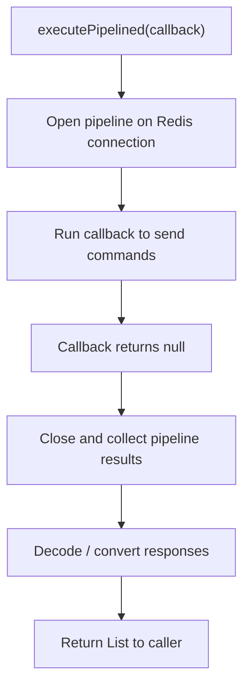

# Result Ordering and Callback Return Values in Spring Data Redis Pipelines

Pipelining is a technique for sending multiple Redis commands consecutively without waiting for each command's response before sending the next one. When using Spring Data Redis, the common approach is calling `RedisTemplate.executePipelined(...)` and placing Redis operations inside a `RedisCallback` or `SessionCallback`.

The most important point when reading and writing pipeline code is that **there are completely different kinds of return values**:

1. **Values returned by Redis methods while the callback is running:** usually `null` because the command has been queued into the pipeline and does not yet have a corresponding response for synchronous handling.
2. **The value the callback must `return`:** must be `null` according to the `executePipelined(...)` contract. Real results do not travel through the callback's return value.
3. **The return value from `executePipelined(...)` itself:** a `List<Object>` containing results after Spring Data Redis finishes the pipeline and converts responses according to configuration.

Therefore, ending the callback with `return null;` **does not mean the pipeline returns `null`**. The caller still receives a list of results in the order the commands were sent in the pipeline.

This lesson focuses on this contract, result ordering, response types, how to use high-level and low-level callbacks, and error-prone situations when working with Redis data.

## 1. What problem does pipelining solve?

Suppose an application needs to read 100 keys from Redis.

If calling each `GET` command synchronously:

```text
Application                       Redis
    | --- GET key:1 ------------> |
    | <----------- value:1 ------ |
    | --- GET key:2 ------------> |
    | <----------- value:2 ------ |
    |            ...              |
    | --- GET key:100 ----------> |
    | <----------- value:100 ---- |
```

The application may have to wait for many network round trips. Even though each Redis command executes quickly, accumulated round-trip costs can be substantial.

With a pipeline:

```text
Application                       Redis
    | --- GET key:1 ------------> |
    | --- GET key:2 ------------> |
    | --- GET key:3 ------------> |
    |            ...              |
    | --- GET key:100 ----------> |
    | <----------- value:1 ------ |
    | <----------- value:2 ------ |
    | <----------- value:3 ------ |
    |            ...              |
    | <----------- value:100 ---- |
```

The application sends multiple commands without waiting individually for each response. The driver and Spring Data Redis collect the responses to return to the caller when the pipeline completes.

**Pipelining optimizes communication with Redis; it does not automatically turn a group of commands into an atomic transaction.** Redis processes commands on the same connection in the order received, but operations from other clients can still interleave between commands in the pipeline. To get transaction semantics, explicitly use a mechanism like `MULTI`/`EXEC` or an appropriate script.

## 2. Three levels of return values to distinguish

The code below is the simplest example of the `executePipelined(...)` contract:

```java
List<Object> results = stringRedisTemplate.executePipelined(
        (RedisCallback<Object>) connection -> {
            byte[] key = "sample:key".getBytes(StandardCharsets.UTF_8);

            connection.stringCommands().get(key);

            // The callback contract in executePipelined requires null.
            return null;
        });
```

Looking at this code, you might ask: "The callback returns `null`, so why is `results` a `List<Object>`?"

Because Spring Data Redis performs roughly the following steps:



| Location | Java example | Meaning |
|---|---|---|
| Return value of a Redis call inside the callback | `connection.stringCommands().get(key)` | While the pipeline is open, the call does not wait for a response like a normal synchronous query |
| `return` value of the callback | `return null;` | Finishes the **command-queuing** phase; does not contain the result list |
| Value received outside the callback | `List<Object> results = ...` | List of command responses collected after the pipeline completes |

Spring Data Redis requires callbacks used with `executePipelined(...)` to return `null`. Do not `return "done";`, `return 42;`, or `return someList;` trying to pass results out. Those values are not the pipeline result-return mechanism and can cause Spring to throw an error for violating the callback contract.

## 3. Result ordering: matching by sent command order

Suppose Redis already holds:

```redis
SET demo:pipeline:message "hello"
SET demo:pipeline:counter "0"
```

Then the application queues three commands into a pipeline:

```redis
GET demo:pipeline:message
INCR demo:pipeline:counter
GET demo:pipeline:counter
```

Redis processes the commands on this connection in exact order:

| Position in pipeline | Command | Illustrative result |
|---|---|---|
| 0 | `GET demo:pipeline:message` | `"hello"` |
| 1 | `INCR demo:pipeline:counter` | `1` |
| 2 | `GET demo:pipeline:counter` | `"1"` |

In Java, `executePipelined(...)` returns results in the exact order the commands were issued:

```text
results
  ├── [0] = "hello"
  ├── [1] = 1L
  └── [2] = "1"
```

The second and third values share the same numeric meaning yet have **different data types**: `INCR` returns a Redis integer result, whereas `GET` returns a string value decoded by the template's serializer.

Ordering here refers to **the order commands were sent**, not alphabetical key order, not the order the server found data, and not the completion order of parallel application work running outside the callback.

A command like `MGET` can return a list of values inside **a single position** of the pipeline results. Do not confuse the number of values inside `MGET` with the number of positions created by the number of commands.

## 4. Complete example with StringRedisTemplate and SessionCallback

`StringRedisTemplate` is suitable for this example because values are stored as strings. `SessionCallback` lets you call high-level `RedisOperations` APIs within a single session.

### 4.1. Preparing data

```java
stringRedisTemplate.opsForValue()
        .set("demo:pipeline:message", "hello");

stringRedisTemplate.opsForValue()
        .set("demo:pipeline:counter", "0");
```

These two `SET` commands run **before** the pipeline so the illustrative results are predictable. In a multi-writer environment, data can still be changed by other clients; the example simply assumes no concurrent interference during the run.

### 4.2. Sending commands and reading results outside the callback

```java
package com.example.redis.pipeline;

import java.util.List;

import org.springframework.data.redis.core.RedisOperations;
import org.springframework.data.redis.core.SessionCallback;
import org.springframework.data.redis.core.StringRedisTemplate;
import org.springframework.stereotype.Service;

@Service
public class PipelineReadService {

    private final StringRedisTemplate redis;

    public PipelineReadService(StringRedisTemplate redis) {
        this.redis = redis;
    }

    public PipelineReport readAndIncrement() {
        List<Object> results = redis.executePipelined(
                new SessionCallback<Object>() {
                    @Override
                    public <K, V> Object execute(
                            RedisOperations<K, V> operations) {

                        // Callback is invoked from StringRedisTemplate.
                        @SuppressWarnings("unchecked")
                        RedisOperations<String, String> stringOperations =
                                (RedisOperations<String, String>) operations;

                        // results[0]: GET message.
                        String queuedMessage = stringOperations
                                .opsForValue()
                                .get("demo:pipeline:message");

                        // results[1]: INCR counter.
                        Long queuedIncrement = stringOperations
                                .opsForValue()
                                .increment("demo:pipeline:counter");

                        // results[2]: GET counter after INCR.
                        String queuedCounter = stringOperations
                                .opsForValue()
                                .get("demo:pipeline:counter");

                        // queuedMessage/queuedIncrement/queuedCounter
                        // are typically null while the pipeline is open.
                        // They are not the final results.
                        return null;
                    }
                });

        if (results.size() != 3) {
            throw new IllegalStateException(
                    "Expected 3 pipelined command results, got "
                            + results.size());
        }

        String message = (String) results.get(0);
        long incremented = ((Number) results.get(1)).longValue();
        String counterAsText = (String) results.get(2);

        return new PipelineReport(
                message,
                incremented,
                counterAsText);
    }

    public record PipelineReport(
            String message,
            long incremented,
            String counterAsText
    ) {}
}
```

With the prepared data above, illustrative output:

```java
PipelineReport report = service.readAndIncrement();

System.out.println(report.message());       // "hello"
System.out.println(report.incremented());   // 1
System.out.println(report.counterAsText()); // "1"
```

Key takeaways:

- Variable names `queuedMessage`, `queuedIncrement`, and `queuedCounter` intentionally highlight that **you must not use them as business data inside the callback**.
- The order of the three Redis calls inside the callback determines the positions `results.get(0)`, `results.get(1)`, and `results.get(2)`.
- The callback always `return null`, while `executePipelined(...)` is the call that returns the response list.
- `INCR` returns a numeric result; `GET` returns a value decoded by `StringRedisTemplate`. Do not cast all three elements to the same type.
- The example does not use a transaction; if another client modifies `demo:pipeline:counter` between commands, observed values may differ from expectations.

In production code, omit the `queued...` variables because their values are unused. They are kept in the lesson to highlight a common trap.

## 5. RedisCallback: working with low-level Redis commands

Instead of `SessionCallback`, you can pass a `RedisCallback` to send commands directly through `RedisConnection`.

```java
import java.nio.charset.StandardCharsets;
import java.util.List;

import org.springframework.data.redis.core.RedisCallback;
import org.springframework.data.redis.core.StringRedisTemplate;

public List<Object> fetchWithLowLevelCallback(
        StringRedisTemplate template) {

    byte[] first = "catalog:item:1"
            .getBytes(StandardCharsets.UTF_8);
    byte[] second = "catalog:item:2"
            .getBytes(StandardCharsets.UTF_8);

    return template.executePipelined(
            (RedisCallback<Object>) connection -> {
                connection.stringCommands().get(first);  // results[0]
                connection.stringCommands().get(second); // results[1]
                return null;
            });
}
```

This is a low-level API where keys/values are bytes and the application explicitly chooses key encoding. Results returned through `StringRedisTemplate.executePipelined(...)` are typically processed using the template's corresponding serializers before being handed to Java.

If you use another `RedisTemplate` with a binary or JSON serializer, elements of `results` may be decoded into other objects. Using `RedisConnection` inside the callback **does not mean** the outer results are always `byte[]`.

For simple command sequences expressing business logic, `SessionCallback` with `RedisOperations` is usually easier to read. `RedisCallback` is helpful when you need connection-level APIs or explicit byte handling.

## 6. Queued return values are not execution results

Compare a synchronous call and a pipelined call:

```java
// Without pipeline: synchronous read call returns the actual result.
String actual = stringRedisTemplate.opsForValue()
        .get("demo:pipeline:message");

// Inside pipeline: command is sent, response is collected afterward.
List<Object> results = stringRedisTemplate.executePipelined(
        new SessionCallback<Object>() {
            @Override
            public <K, V> Object execute(
                    RedisOperations<K, V> operations) {

                @SuppressWarnings("unchecked")
                RedisOperations<String, String> typed =
                        (RedisOperations<String, String>) operations;

                String queued = typed.opsForValue()
                        .get("demo:pipeline:message");
                // queued is typically null, not the Redis data.
                return null;
            }
        });

String pipelined = (String) results.get(0);
```

In the first case, the application can use `actual` immediately after calling `get`. In the second case, only after `executePipelined(...)` completes does the application have the data in `results`.

Thus, the following logic is wrong regarding when data is observed:

```java
template.executePipelined((RedisCallback<Object>) connection -> {
    byte[] key = "user:1:status"
            .getBytes(StandardCharsets.UTF_8);

    byte[] queued = connection.stringCommands().get(key);

    if (queued != null) {
        // Cannot conclude whether the Redis key exists from queued.
        processStatus(queued);
    }
    return null;
});
```

The `queued` variable does not hold the `GET` response at check time. If deciding the next command depends on the read value, split into two phases or move conditional logic to the server using conditional Redis commands or a Lua script.

## 7. The result list is not the callback's return value

Call form:

```java
List<Object> returnedByExecutePipelined =
        redisTemplate.executePipelined(callback);
```

Where:

```java
// Callback is invoked to send commands, not to build the result list.
RedisCallback<Object> callback = connection -> {
    connection.stringCommands().get(myKey);
    return null;
};
```

Do not do this:

```java
// Wrong example: callback returns a non-null value.
redisTemplate.executePipelined((RedisCallback<Object>) connection -> {
    connection.stringCommands().get(myKey);
    return "completed";
});
```

In `executePipelined`, a non-`null` result from the callback **does not become** the final return value. The API contract requires `null`, and Spring Data Redis may throw an error because the callback returned an invalid value.

Do not do this either:

```java
// Wrong example: collecting direct return values of pipelined calls.
List<Object> guessed = new ArrayList<>();

redisTemplate.executePipelined((RedisCallback<Object>) connection -> {
    guessed.add(connection.stringCommands().get(myKey));
    return null;
});

// guessed holds the return values from queuing time,
// not the values returned by Redis after the pipeline finishes.
```

Use the list returned by `executePipelined(...)` itself.

One thing to distinguish: regular `RedisTemplate.execute(...)` and `executePipelined(...)` have **different return contracts**. With `execute(...)`, the callback's return value can be used as the method's return value. When moving to `executePipelined(...)`, do not carry that assumption over.

## 8. Command ordering when using loops

Suppose you want to read product keys:

```java
List<String> keys = List.of(
        "catalog:item:1",
        "catalog:item:2",
        "catalog:item:3");
```

One way to send commands in order:

```java
List<Object> results = stringRedisTemplate.executePipelined(
        new SessionCallback<Object>() {
            @Override
            public <K, V> Object execute(
                    RedisOperations<K, V> operations) {

                @SuppressWarnings("unchecked")
                RedisOperations<String, String> typed =
                        (RedisOperations<String, String>) operations;

                for (String key : keys) {
                    typed.opsForValue().get(key);
                }
                return null;
            }
        });

for (int i = 0; i < keys.size(); i++) {
    String key = keys.get(i);
    String value = (String) results.get(i);
    System.out.println(key + " -> " + value);
}
```

Meaning:

```text
keys[0] -> GET catalog:item:1 -> results[0]
keys[1] -> GET catalog:item:2 -> results[1]
keys[2] -> GET catalog:item:3 -> results[2]
```

If a key does not exist, its `GET` response can be `null` at its **corresponding position**. Remaining elements do not shift positions in the list because of it.

Therefore, for bulk-read pipelines, preserve the input key order and fetch results by the same index. If you need to associate results with keys via a `Map`:

```java
Map<String, String> byKey = new LinkedHashMap<>();
for (int i = 0; i < keys.size(); i++) {
    byKey.put(keys.get(i), (String) results.get(i));
}
```

If `keys` contains duplicate entries, a `Map` keeps one entry per distinct key; that may or may not fit your problem. For requirements that need to keep duplicate occurrences, retain a list of key–result pairs by position.

### Avoid issuing extra commands inside the callback

If the callback issues an extra Redis check or logging command, the count and positions of results change:

```java
for (String key : keys) {
    typed.opsForValue().get(key); // Produces one result.
    typed.hasKey(key);            // Produces an extra result.
}
```

Then:

```text
results[0] = GET key[0]
results[1] = EXISTS key[0]
results[2] = GET key[1]
results[3] = EXISTS key[1]
...
```

You can no longer use `results.get(i)` to get the `GET` value for each key. You must define a new indexing scheme, or send only the commands actually needed for the desired output.

## 9. Each command produces one position, though one position may contain a collection

Example using `MGET`:

```redis
MGET catalog:item:1 catalog:item:2 catalog:item:3
GET catalog:item:4
```

At the protocol response level, `MGET` produces **one array response** containing three values, while `GET` produces a scalar response. In the pipeline result list:

```text
results[0] = [value1, value2, value3]  // One result from MGET
results[1] = value4                   // One result from GET
```

Do not assume the pipeline "flattens" the `MGET` response into three separate top-level elements.

Similarly:

- `HGETALL` can produce a map result.
- `SMEMBERS` can produce a set/collection of elements.
- `LRANGE` can produce a list result.
- Write commands can return status, Boolean, or modification counts depending on the adapter.

When mixing these command types, distinguish the **outer pipeline result list** from a **collection nested inside one element**.

## 10. Decoded data types: String, Number, Boolean, Map, List

Redis returns bytes and protocol response types; Spring Data Redis converts pipeline results according to how the command, connection, and serializers are configured.

| Illustrative command | Logical result | Common Java type after conversion |
|---|---|---|
| `GET` with String serializer | String value | `String` or `null` |
| `INCR` | New integer | `Long` |
| `EXISTS` | Present or not | `Boolean` or numeric in lower-level APIs |
| `HGETALL` | Fields/values | `Map<?, ?>` |
| `MGET` | Multiple values | `List<?>`, may contain `null` |
| `SADD` | Number of newly added elements | Converted numeric value |
| `SET` | Write status | Status/Boolean representation handled by adapter |

The table describes **common** types, not a guarantee that every driver and every version returns the exact same Java class for each command. In particular, low-level connection APIs can return byte arrays or statuses differently from high-level template APIs.

Example of controlled reading:

```java
Object incrementResult = results.get(1);

if (!(incrementResult instanceof Number number)) {
    throw new IllegalStateException(
            "Expected a numeric INCR result, got: "
                    + incrementResult);
}

long counter = number.longValue();
```

When a Redis key is absent:

```java
Object getResult = results.get(0);

if (getResult == null) {
    // GET ran, but the key does not exist.
} else if (getResult instanceof String text) {
    // GET ran and returned a string.
} else {
    throw new IllegalStateException(
            "Unexpected GET result type: "
                    + getResult.getClass().getName());
}
```

This snippet assumes `StringRedisTemplate` and a `GET` command on a string value. With a template using a JSON serializer, the result can be another object; decode according to the actual serializer contract.

## 11. What does RedisTemplate's serializer affect?

Spring Data Redis manages independent serializers for Redis keys, values, hash keys, and hash values. In a pipeline, returned results are converted based on the template's configured serializers/conversion mechanism.

Example `StringRedisTemplate` configuration:

```java
StringRedisTemplate template =
        new StringRedisTemplate(redisConnectionFactory);
```

This template uses string serialization for the corresponding keys and values, making `GET` results straightforward to handle as `String`.

Conversely, if `RedisTemplate<String, Product>` stores JSON and the pipeline contains:

```java
operations.opsForValue().get("product:1");
operations.opsForHash().entries("product:1:metadata");
```

then the returned values may be a `Product` object and a `Map` depending on how value/hash serializers are configured. You cannot cast the entire `List<Object>` to `List<String>`.

An overload of `executePipelined(...)` lets you pass a result serializer, for example:

```java
List<Object> results = redisTemplate.executePipelined(
        (RedisCallback<Object>) connection -> {
            connection.stringCommands().get(rawKey);
            return null;
        },
        someResultSerializer);
```

`someResultSerializer` in the example is a serializer configured by the application to match the data being read. This is a **result-decoding** option; it does not replace defining the serializer used when writing data, and it does not mean every numeric/status reply or nested structure gets turned into a single Java type.

For Hash operations, distinguish between the hash-key serializer and the hash-value serializer. An `HGETALL` may contain field names and values decoded by different serializers.

**Do not change serializers merely to silence a `ClassCastException` when reading results.** First identify which command is at each position and what byte format Redis is storing.

## 12. Null results have at least two different causes

In pipelining:

**Case A — null when calling a command inside the callback.**

```java
String queuedValue = typed.opsForValue().get("some:key");
// Usually null because pipelining is active: command has no synchronous reply yet.
```

**Case B — null element inside List<Object> after the pipeline.**

```java
List<Object> results = ...;
Object value = results.get(0);
// null can be a GET of a non-existent key.
```

These two `null`s mean different things:

| Where it appears | What it can mean | How to handle |
|---|---|---|
| Direct return value from `get()` inside callback | Response deferred due to pipeline | Do not use for business decisions inside callback |
| Element corresponding to `GET` in result list | Key does not exist, nil data, or adapter representation | Handle per that command's semantics |
| Element corresponding to write/status command | May be due to conversion or driver | Do not infer "missing key" without checking command and response type |

Additionally, an exception while sending commands, collecting replies, or deserializing is a separate case. Do not turn every exception into `null` and treat it as Redis having no data.

## 13. Pipelines do not automatically guarantee atomicity

Suppose you send:

```java
typed.opsForValue().set("account:1:status", "ACTIVE");
typed.opsForValue().increment("account:1:revision");
```

Both commands are sent in order over a pipelined connection, yet another client **can still operate between the two commands**. If business logic requires "status and revision must change together without another client interleaving," pipelining alone is not enough.

Comparison:

| Criterion | Pipeline | MULTI/EXEC |
|---|---|---|
| Primary goal | Reduce network waiting when sending multiple commands | Queue commands then execute back-to-back |
| When does Redis execute commands? | As commands are received and processed | When `EXEC` is called |
| Can other clients' commands interleave? | Possible | No interleaving within the `EXEC` sequence |
| Intermediate results available synchronously in callback? | Not in standard pipelining | Not before `EXEC` |
| Automatic rollback if one command fails at runtime? | No | No |
| Where are results read? | List returned by `executePipelined` | List returned by `exec()` |

You may encounter pipelining combined with `MULTI`/`EXEC` in advanced APIs. In that case, result structure and conversion also depend on how the driver wraps transaction replies; do not infer result positions as if it were a plain `GET`/`INCR` pipeline. Master the two models separately first.

If a write decision depends on a value just read, suitable options include:

- `WATCH` and reading before `MULTI`, then checking the `EXEC` result.
- A Lua script performing check-and-update on the server.
- A conditional Redis command such as `SET ... NX` when it matches the requirement.
- Splitting into two phases (read–process–write) when strong consistency is not required.

Do not try to write a Java `if` checking `get()` right inside a pipeline callback to simulate an atomic operation.

## 14. Results and errors when one command in a pipeline fails

Pipelines do not provide rollback. If one command fails at runtime, other commands may still have executed.

Example:

```redis
SET demo:count "not-a-number"
INCR demo:count
SET demo:other "saved"
```

If the last two commands are sent via a pipeline, `INCR` fails because the value is not an integer; however, `SET demo:other` may still have executed.

In Java, how the driver and Spring Data Redis report pipeline errors can vary: an error may be thrown while collecting results or appear as a response representation provided by the connection adapter. Therefore, do not assume `results.size()` always equals the command count in **all error cases**, and do not assume a complete result list exists if the pipeline threw an exception.

In particular, a timeout while reading results can occur **after the server has already executed part or all of the commands**. Retrying the entire pipeline containing non-idempotent commands like `INCR` risks applying the change twice.

When building a pipeline job:

1. Identify which commands are idempotent and which are not.
2. Record an operation ID or recovery strategy if duplicate operations must be prevented.
3. Do not treat an exception as proof that no commands ran.
4. Track which batches were sent, which received complete replies, and which need reconciliation.
5. Limit commands per batch so a single error does not create an overly large uncertainty window.

## 15. Bounding pipeline size and memory

Pipelines reduce round trips, but they are not free. Redis must process commands and buffer responses during transmission; the client also must store results to build `List<Object>`.

Therefore:

- Do not open an unbounded pipeline with millions of commands.
- Choose pipeline size not only by key count, but also by each command's response size.
- `GET` on a large value differs vastly from `INCR` in returned data volume.
- `HGETALL` or `LRANGE` results can be larger than expected, even as a single command.
- A long-running pipeline callback easily consumes memory and increases error-handling time.

For large volumes, split the key list into reasonably sized batches and process each batch upon receiving results.

Example service reading many keys in fixed batches:

```java
import java.util.ArrayList;
import java.util.List;

import org.springframework.data.redis.core.RedisOperations;
import org.springframework.data.redis.core.SessionCallback;
import org.springframework.data.redis.core.StringRedisTemplate;

public class BatchedValueReader {

    private static final int BATCH_SIZE = 200;
    private final StringRedisTemplate redis;

    public BatchedValueReader(StringRedisTemplate redis) {
        this.redis = redis;
    }

    public List<String> readInInputOrder(List<String> keys) {
        List<String> allValues = new ArrayList<>(keys.size());

        for (int start = 0; start < keys.size(); start += BATCH_SIZE) {
            int end = Math.min(start + BATCH_SIZE, keys.size());
            List<String> batch = keys.subList(start, end);

            List<Object> results = redis.executePipelined(
                    new SessionCallback<Object>() {
                        @Override
                        public <K, V> Object execute(
                                RedisOperations<K, V> operations) {

                            @SuppressWarnings("unchecked")
                            RedisOperations<String, String> typed =
                                    (RedisOperations<String, String>) operations;

                            for (String key : batch) {
                                typed.opsForValue().get(key);
                            }
                            return null;
                        }
                    });

            if (results.size() != batch.size()) {
                throw new IllegalStateException(
                        "Unexpected result count in batch");
            }

            for (Object result : results) {
                allValues.add((String) result);
            }
        }

        return allValues;
    }
}
```

The method returns a `List<String>` with the same length and order as the input; values can be `null` if keys do not exist.

In this example, the full result list is still held in memory to return to the caller, yet **each pipeline** contains at most 200 commands. If data volume is unbounded, provide a per-batch callback API or stream results to the next stage instead of keeping every value in `allValues`.

There is no universally optimal `BATCH_SIZE` for every environment; measure actual Redis latency, response sizes, and memory.

## 16. Be careful with command count and interpreting List<Object>

Thinking "every Java line calling Redis creates one element" can sometimes be overly simplistic:

- Some high-level APIs use multiple Redis commands internally to carry out one operation.
- Some Redis commands return arrays or maps, yet remain one top-level command response.
- Nested collection operations can produce multiple replies if implemented via multiple Redis commands.
- Some APIs or drivers handle status, void results, or errors differently.

Thus, for pipelines **using explicit commands such as `GET`, `INCR`, and `EXISTS`**, positional mapping is relatively easy to control. For complex APIs, verify which commands are actually sent rather than assuming every Java call yields one reply.

A maintainable practice is centralizing mapping logic:

```java
record LookupResult(String value, long version) {}

static LookupResult decodeLookupResult(List<Object> results) {
    if (results.size() != 2) {
        throw new IllegalStateException(
                "Expected GET and INCR results");
    }

    String value = (String) results.get(0);
    Object versionRaw = results.get(1);

    if (!(versionRaw instanceof Number number)) {
        throw new IllegalStateException(
                "INCR result is not a number");
    }

    return new LookupResult(value, number.longValue());
}
```

This method does not issue Redis commands itself; it simply interprets a contract of exactly two replies, in `GET` then `INCR` order.

If you change command order in the callback, update the decoding logic accordingly. Giving the DTO descriptive names prevents callers from guessing what `results.get(0)` means.

## 17. Common mistakes

### Mistake 1: Returning a non-null value from the callback

```java
template.executePipelined((RedisCallback<Object>) connection -> {
    connection.stringCommands().get(key);
    return "done"; // Violates the executePipelined contract.
});
```

The callback must return `null`; pipeline results come from the return value of `executePipelined(...)`.

### Mistake 2: Using a GET return value directly inside the callback

```java
String value = typed.opsForValue().get("demo:key");
if ("READY".equals(value)) {
    // Condition does not reflect the GET result while the pipeline is open.
}
```

With pipelining, read `List<Object>` after the callback finishes. If you need to decide the next operation based on a `GET` result, split into appropriate phases.

### Mistake 3: Forgetting ordering after inserting a new command

Initially there are `GET a`, `GET b`; later `EXISTS a` is added in between. The result of `GET b` is no longer at index `1`. Update decoding logic or track how many commands each operation emits.

### Mistake 4: Casting the entire List<Object> to List<String>

A pipeline with `INCR`, `EXISTS`, and `GET` can return `Long`, `Boolean`, and `String`. Avoid blind casts because generic types do not check element contents at runtime.

### Mistake 5: Confusing a null element with a pipeline error

`GET` on an absent key validly returns `null` after the pipeline completes. Distinguish missing data, write command statuses, and driver exceptions.

### Mistake 6: Assuming a pipeline is a transaction

Pipelining does not turn commands into an atomic unit. If business rules require conditional updates, use an appropriate tool such as `MULTI/EXEC`, `WATCH`, or Lua.

### Mistake 7: Sending too many commands in one pipeline

Creating a huge pipeline increases memory consumption, result size, and latency. Batch by both command count and expected response size.

### Mistake 8: Retrying an INCR batch after a timeout

On timeout, the client does not necessarily know how far commands executed. Retrying `INCR` can double the effect. Evaluate idempotency and reconciliation capability.

### Mistake 9: Mixing multiple RedisTemplates inside one callback

If the callback queues commands through the provided `operations`, calling another template may pick a different connection or bypass the pipeline. Keep operations that belong in the same session/connection inside the callback mechanism.

### Mistake 10: Assuming results are ordered by key name

`List<Object>` is returned in **the order commands were sent**, even when key names are not alphabetical. Match results back to inputs by index; do not re-sort keys after queuing commands.

## 18. Practice exercises

### Exercise 1 — Predict callback values and pipeline results

Given data:

```redis
SET tutorial:a "alpha"
SET tutorial:counter "5"
```

The callback sends:

```java
String a = typed.opsForValue().get("tutorial:a");
Long count = typed.opsForValue().increment("tutorial:counter");
String after = typed.opsForValue().get("tutorial:counter");
return null;
```

Determine:

1. What might `a`, `count`, and `after` receive while the callback is queuing commands?
2. What values and types do `results.get(0)`, `results.get(1)`, and `results.get(2)` have if no other client interferes?
3. Why can't `return null` be replaced with `return count`?

Guided answer: variables capturing direct return values are typically `null` inside a pipeline; final results in order are `"alpha"`, integer `6`, string `"6"`.

### Exercise 2 — How many positions does MGET occupy?

Inside one callback, send one `MGET` with three keys and one `GET` with another key. Determine the number of top-level replies in the pipeline result list and their corresponding types. Explain why the total top-level result count must not be assumed to be four.

### Exercise 3 — Mixing GET and EXISTS

For keys `a` and `b`, send `GET a`, `EXISTS a`, `GET b`, `EXISTS b`. Write a decoder function that maps the four positions into two `KeyState(key, value, exists)` objects while handling a `null` `GET` value.

### Exercise 4 — Reading thousands of keys in batches

Create a list of 2,000 key names. Use `executePipelined` with batches of 100–200 commands, and compare result retrieval with a synchronous `GET` loop. Measure time, result size, and memory instead of assuming pipelining is always faster in every situation.

### Exercise 5 — Distinguishing pipelines from atomic updates

A business rule requires incrementing a counter and writing a status only if the previous value is below a threshold. Explain why you cannot rely on the return variable of `GET` inside the callback to write an `if`, then propose a solution using `WATCH`/`MULTI` or suitable Lua.

## 19. Takeaways

| Question | Answer |
|---|---|
| Do Redis commands in a pipeline return results immediately usable inside the callback? | Usually no; responses are collected afterward |
| What must the `executePipelined(...)` callback return? | `null` |
| Where are actual pipeline results received? | From the `List<Object>` returned by `executePipelined(...)` |
| What is the order of results? | Matches the order commands were actually sent |
| Does a three-key `MGET` create three top-level positions? | No; one command returns one collection-shaped result |
| Can a `GET` result be `null`? | Yes, when data does not exist or nil is valid |
| Are all elements in `List<Object>` `String`? | No; depends on the command and serializer |
| Does pipelining make commands atomic? | No |
| Is one million commands in one callback a good fit? | Split into batches and manage memory |

A maintainable pipeline preserves **clear command emission order**, **returns `null` from the callback**, **reads results after `executePipelined(...)`**, and **decodes each position with the right response type**. When work depends on data read midway through the sequence, move to a staged design or an atomic mechanism on Redis.

### References

- [Spring Data Redis — Pipelining](https://docs.spring.io/spring-data/redis/reference/redis/pipelining.html)
- [Spring Data Redis — RedisTemplate API](https://docs.spring.io/spring-data/redis/reference/api/java/org/springframework/data/redis/core/RedisTemplate.html)
- [Spring Data Redis — RedisCallback API](https://docs.spring.io/spring-data/redis/reference/api/java/org/springframework/data/redis/core/RedisCallback.html)
- [Spring Data Redis — SessionCallback API](https://docs.spring.io/spring-data/redis/reference/api/java/org/springframework/data/redis/core/SessionCallback.html)
- [Redis — Pipelining](https://redis.io/docs/latest/develop/using-commands/pipelining/)
- [Redis — MGET](https://redis.io/docs/latest/commands/mget/)
- [Redis — MULTI](https://redis.io/docs/latest/commands/multi/)
