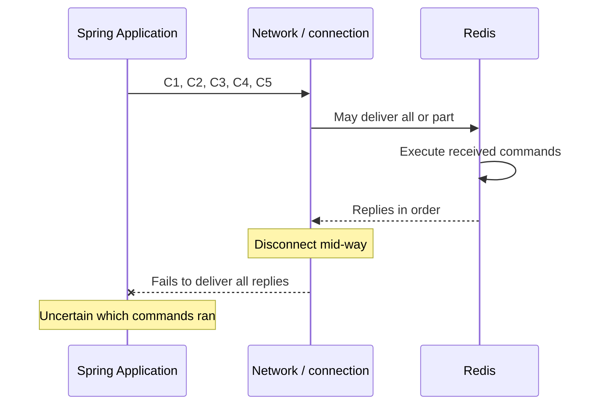
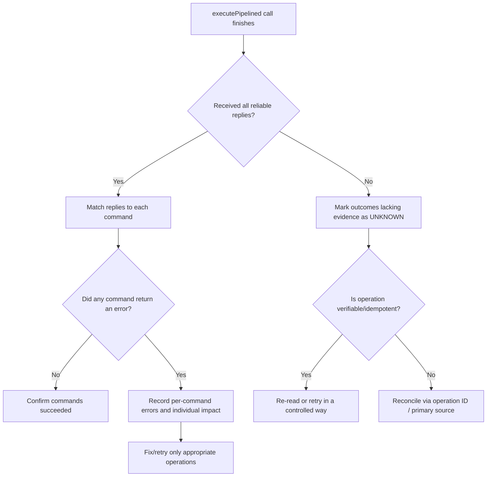

# Per-Command Error Handling and Uncertain State on Disconnect in Spring Data Redis Pipelines

## 1. The problem: sending many commands fast while still knowing what happened

**Redis pipelining** lets a client send multiple commands consecutively without waiting for each command's response before sending the next one. Instead of repeating the cycle "send one command → wait for result → send next command," the client can push a group of commands onto the connection and collect responses in order. Spring Data Redis supports this via `RedisTemplate.executePipelined(...)`, `StringRedisTemplate.executePipelined(...)`, and the corresponding connection APIs.

Pipelining is especially useful when an application operates on many independent keys and network latency is significant compared to Redis's execution time per command. However, **a pipeline is not a transaction**:

- Redis does not automatically roll back earlier commands if a later command fails.
- Commands may be sent as a group, yet Redis still processes each command under its own semantics.
- A single command's error must be distinguished from a network failure while sending/receiving responses for the whole pipeline.
- If the connection drops mid-way, the client may **not know exactly how many commands Redis received and executed**.

Suppose a system executes three commands in a pipeline:

```text
1. SET order:42:state "PAID"
2. INCR metrics:orders:paid
3. LPUSH notifications:pending "42"
```

If `notifications:pending` currently holds a Redis String, the third command will hit `WRONGTYPE`. The first two commands may have succeeded. If the connection drops before the client reads all replies, the application may not even know whether some commands actually ran. These two situations require **two different handling strategies**.

The goal of this lesson is to identify per-command errors, classify known vs. unknown outcomes, avoid retries that duplicate side effects, and design an appropriate recovery flow when using pipelines in Spring Data Redis.

## 2. How does a pipeline work?

### 2.1. Sending in groups and receiving replies in order

Example without pipelining:

```text
Application               Redis
    | ---- SET k1 v1 ----> |
    | <------ OK --------- |
    | ---- GET k1 -------> |
    | <------ v1 --------- |
    | ---- INCR counter -> |
    | <------ 1 ---------- |
```

With pipelining, commands are placed onto the connection without waiting for each response before continuing:

```text
Application               Redis
    | ---- SET k1 v1 ----> |
    | ---- GET k1 -------> |
    | ---- INCR counter -> |
    | <------ OK --------- |
    | <------ v1 --------- |
    | <------ 1 ---------- |
```

Redis processes commands on **a single connection in the order received** and returns replies in that same order. Drivers may buffer and flush commands in their own ways, so "pipeline" does not mean all commands necessarily travel in one TCP packet. The primary benefit is reducing wait time across multiple request–response round trips.

Across multiple connections, multiple Redis Cluster nodes, or concurrent pipelines, there is no global ordering equivalent to "all commands across all nodes executed as a single command."

### 2.2. Pipelines do not guarantee group-wide atomicity

Each Redis command retains its own execution characteristics. On a single Redis instance, commands from other clients can be processed **interleaved** between commands belonging to the pipeline. Therefore, do not infer that a pipeline batch has the same atomicity as `MULTI`/`EXEC`.

| Mechanism | Primary meaning | Automatically rolls back earlier commands on later error? |
|---|---|---|
| Sequential commands waiting per reply | Easy to handle replies immediately, many network round trips | No |
| **Pipeline** | Reduces network wait cycles by sending many commands before receiving results | **No** |
| `MULTI` / `EXEC` | Queues and executes a transaction without other clients interleaving during `EXEC` | Does not roll back per-command runtime errors |
| Lua script / Redis Function | Moves certain logic to the server and executes continuously | Does not automatically roll back changes made before a script error |
| Other database transactions | Depends on that DBMS | Semantics cannot be imposed onto Redis pipelines |

You can **pipeline transaction commands**, but then `MULTI`/`EXEC` semantics belong to the transaction, not the pipeline itself. Using pipelining alone does not turn `SET`, `INCR`, and `LPUSH` into a single transaction.

## 3. Three outcome categories to distinguish

When multiple commands are sent in a pipeline, there are at least three important business states.

| State | Evidence | Conclusion that can be drawn |
|---|---|---|
| **Confirmed success** | Received a success reply for the command | Redis processed the command and produced a success reply at that point |
| **Confirmed command error** | Received a specific error reply from Redis | That command was rejected/failed per the message; other commands may still have succeeded |
| **Uncertain (unknown outcome)** | No reliable reply received due to timeout, disconnect, or driver error at an unclear stage | Cannot assert whether the command executed or not |

An additional state is **definitely not sent** if the application has reliable evidence the command was rejected during validation before sending to Redis. Do not assign this state to every error occurring before `executePipelined(...)` returns: the driver may already have sent part or all of the batch.

Remember: **"Receiving no result" is not equivalent to "Redis did not execute the command"**.

## 4. Per-command errors: one error reply does not cancel the whole pipeline

### 4.1. Example of WRONGTYPE mid-batch

Prepare keys on a test Redis instance:

```redis
SET demo:pipe:payload "this-is-a-string"
DEL demo:pipe:before demo:pipe:after
```

Suppose the client sends these three commands in the same pipeline:

```text
SET demo:pipe:before "first"
LPUSH demo:pipe:payload "item"
SET demo:pipe:after "last"
```

The protocol-level reply flow can be understood as:

```text
Command 1: SET demo:pipe:before "first"
Reply   1: OK

Command 2: LPUSH demo:pipe:payload "item"
Reply   2: WRONGTYPE Operation against a key holding the wrong kind of value

Command 3: SET demo:pipe:after "last"
Reply   3: OK
```

Redis state after the commands are processed:

```redis
GET demo:pipe:before
# "first"

GET demo:pipe:payload
# "this-is-a-string"

GET demo:pipe:after
# "last"
```

**Command 2 failed, yet commands 1 and 3 still took effect.** Redis does not stop the pipeline after `WRONGTYPE` and does not revert data back to the pre-pipeline state.

Another error can occur when running `INCR` on a non-numeric string:

```redis
SET demo:pipe:counter "not-a-number"
INCR demo:pipe:counter
# (error) ERR value is not an integer or out of range
```

If `INCR` is inside a pipeline, that command receives its own error reply. Commands before and after it must be evaluated by their corresponding results.

### 4.2. Some common error types

| Error/condition | Example | Consequence to care about |
|---|---|---|
| `WRONGTYPE` | `LPUSH` onto a String | That command fails to perform the intended operation; other commands are not undone |
| Invalid value | `INCR` on a String that cannot represent an integer | Increment command fails |
| Missing key/unmet condition | `RENAME` with non-existent source | Rename command fails |
| Redis/ACL limits | `NOPERM`, `READONLY`, OOM errors per config | Some commands may be rejected; do not assume the entire batch was canceled |
| Syntax error or missing arguments | Malformed or invalid command | Redis returns an error reply for that command, independent of other commands |
| Client/serialization error | Failed to serialize an object before or during sending | That command may not have been sent, though previously sent commands must be assessed separately |
| Connection loss | Connection closes while flushing/reading replies | May not be able to tell which commands ran |

Do not treat the number of Java exceptions as the number of failed Redis commands. One exception reported by the driver while reading a pipeline could represent a specific command error, a response decoding failure, or a transport failure.

### 4.3. Per-command results can be represented differently by adapters

In the Redis protocol, responses are ordered and each command has its own reply. However, driver APIs and Spring Data Redis may:

- Return a list of deserialized results.
- Turn an error reply into an exception.
- Halt returning results to the caller when processing a failed reply.
- Wrap exceptions at the Spring Data layer under a `DataAccessException` or related exception type.

There is **no guarantee** that every Spring Data Redis version always returns a `List<Object>` containing an error object at the exact failed index. When a complete list is received, match result positions to command positions; when an exception is thrown, examine **what evidence exists** about which commands completed before deciding on retries.

Therefore, application design should separate **confirmed Redis outcomes** from **how the framework represents those outcomes**.

## 5. Pipeline example in Spring Data Redis

### 5.1. Dependency and connection

Example using Spring Boot with Lettuce via the standard starter:

```groovy
dependencies {
    implementation 'org.springframework.boot:spring-boot-starter-data-redis'
}
```

```yaml
spring:
  data:
    redis:
      host: localhost
      port: 6379
```

`StringRedisTemplate` uses string serializers for keys/values, convenient for comparing with the Redis CLI.

### 5.2. Using executePipelined with RedisCallback

```java
package com.example.redis.pipeline;

import java.nio.charset.StandardCharsets;
import java.util.List;
import org.springframework.data.redis.core.RedisCallback;
import org.springframework.data.redis.core.StringRedisTemplate;
import org.springframework.stereotype.Service;

@Service
public class BatchRedisService {

    private final StringRedisTemplate redisTemplate;

    public BatchRedisService(StringRedisTemplate redisTemplate) {
        this.redisTemplate = redisTemplate;
    }

    private static byte[] bytes(String value) {
        return value.getBytes(StandardCharsets.UTF_8);
    }

    public List<Object> runPipeline() {
        return redisTemplate.executePipelined(
                (RedisCallback<Object>) connection -> {
                    connection.stringCommands().set(
                            bytes("demo:pipe:task:42"),
                            bytes("READY")
                    );

                    connection.stringCommands().get(
                            bytes("demo:pipe:task:42")
                    );

                    connection.stringCommands().incr(
                            bytes("demo:pipe:metrics:executed")
                    );

                    // Callback must return null: replies are returned
                    // separately from executePipelined after closing the pipeline.
                    return null;
                }
        );
    }
}
```

Three commands are sent in order: `SET`, `GET`, and `INCR`. If the pipeline executes and returns full results, `executePipelined(...)` returns a `List<Object>` representing the replies to those commands in order. Exact Java types depend on the command, serializer, and adapter (for example, `GET` result may be a deserialized String, `INCR` a number).

**Do not** write code inside the callback depending on the direct return value of `connection.stringCommands().incr(...)` to decide the next command. While the pipeline is open, actual results may not yet be received; some operation APIs return `null` for queued calls. Only consume data returned by `executePipelined(...)` after replies have been collected.

### 5.3. Why must the callback return null?

`executePipelined(RedisCallback<?>)` collects and returns pipeline results itself. The callback's direct return value is not used as the final result, and by Spring Data Redis contract the callback should return `null`. The right mental model:

```text
Callback:
  send commands
  return null

RedisTemplate:
  close pipeline / collect replies
  deserialize replies
  return List<Object>
```

This differs from normal `RedisTemplate.execute(...)` usage, where the callback can directly return an operation's result.

### 5.4. Using SessionCallback

When you need to work at the `RedisOperations` level instead of `RedisConnection`, you can use the overload accepting `SessionCallback<?>`:

```java
List<Object> replies = redisTemplate.executePipelined(
        new SessionCallback<Object>() {
            @Override
            @SuppressWarnings("unchecked")
            public <K, V> Object execute(
                    RedisOperations<K, V> operations) {

                operations.opsForValue().set(
                        (K) "demo:pipe:status:42",
                        (V) "PROCESSING"
                );

                operations.opsForValue().get(
                        (K) "demo:pipe:status:42"
                );

                return null;
            }
        }
);
```

Import `org.springframework.data.redis.core.SessionCallback` and `org.springframework.data.redis.core.RedisOperations`. The two casts here only satisfy the callback's generic signature; the example uses `StringRedisTemplate` so the actual values are Strings. In production code, pick a unified abstraction and serializer, avoiding arbitrary casts.

Commands sent on the same connection in a pipeline do not inherently have a transaction relationship; `SessionCallback` preserves the connection context and **does not automatically call `MULTI`**.

## 6. Designing results reconcilable per command

When a batch contains multiple command types, create an explicit "command plan" **before sending**:

| Position | Operation ID | Planned command | Result type to read |
|---|---|---|---|
| 0 | `op-001` | `SET batch:42:item:a READY` | Success or error |
| 1 | `op-002` | `GET batch:42:item:a` | Value or error |
| 2 | `op-003` | `INCR batch:42:attempts` | Numeric value or error |
| 3 | `op-004` | `SADD batch:42:members user-7` | New member count or error |

If a complete reply list is returned, each result is paired with the command at the same index. However, when the driver throws an exception midway through collecting replies, there may be no complete list to match against. **Do not automatically fill in "FAILED" for every position missing from the list**, since some commands may have executed even though their replies never reached the application.

An application-level outcome model:

```java
public enum CommandOutcome {
    CONFIRMED_SUCCESS,
    CONFIRMED_COMMAND_ERROR,
    UNKNOWN
}
```

This enum is **application-defined**, not a type provided by Spring Data Redis.

Meaning:

- `CONFIRMED_SUCCESS`: a success reply definitely matched to the command.
- `CONFIRMED_COMMAND_ERROR`: evidence that Redis returned an error for the command.
- `UNKNOWN`: insufficient evidence to conclude whether it succeeded or failed.

If the application knows for certain a command was rejected during validation and **was never sent**, a separate `NOT_SENT` state can be used. However, do not infer "caller has not received a reply" as `NOT_SENT`.

## 7. Mid-pipeline disconnect: why do results become uncertain?

Suppose a client pipelines 5 commands:

```text
C1: SET user:42:lastSeen ...
C2: INCR metrics:logins
C3: SADD online:users 42
C4: LPUSH audit:logins ...
C5: EXPIRE user:42:session 600
```

From the client's perspective, any of the following can happen:

1. No commands sent because local preparation failed.
2. Some bytes of the batch reached the socket; Redis received and ran **part** of the commands.
3. Redis received and ran all commands, but replies were lost on the way back to the client.
4. Client received partial replies before the connection closed prior to reading them all.
5. Redis processed a command and returned an error reply, yet the driver could not surface per-command details to the application.

Therefore, an exception such as `RedisConnectionFailureException` or a timeout around `executePipelined(...)` **does not allow you to automatically conclude** the entire batch failed and can be safely re-run.

### 7.1. Both ends of the connection



A successful socket write on the client primarily confirms data was handed to the socket/driver layer at a point in time; it does not necessarily confirm all commands were executed by Redis. Conversely, a timeout waiting for replies does not prove Redis did not run the commands.

### 7.2. Known partial success vs. unknown outcome

**Known partial success**: the application receives replies confirming C1 and C2 succeeded, C3 had a command error, and C4 and C5 succeeded. Clear evidence exists for each position. Collapsing the result into "pipeline failed" throws away information.

**Unknown outcome**: the connection closes before the application receives all replies. Even knowing bytes were put into the pipeline, you cannot deduce whether C3–C5 ran. If C1 and C2 were already confirmed successful, keep that evidence; mark only the commands lacking evidence as `UNKNOWN`.

Depending on the driver, surfacing partial replies to the application may be limited; in that case the service must be conservative and not claim per-command outcomes if it only receives an overall exception.

### 7.3. Acknowledgement does not equal permanent durability

Even when Redis returns a success reply, that confirms the command was processed on the server at that moment. Whether data survives a server crash depends on persistence, replication, failover, and the durability mechanism in place. Pipelining adds no new durability guarantee.

Do not conflate three distinct questions: "Did Redis return success?", "Did the other commands succeed?", and "Is the data durable across failover?" Each question has a different level of evidence.

## 8. How blind retries can corrupt data

### 8.1. Idempotent commands

An **idempotent** operation yields the same final state when reapplied with the same input, provided no concurrent changes alter its meaning.

Example:

```redis
SET demo:pipe:state:42 "READY"
SET demo:pipe:state:42 "READY"
```

Two `SET`s with the same value leave the key in the same state. However, if a TTL is attached via `SET ... EX 600`, retrying can **extend the TTL**, changing time-based behavior. If another client updated the key in between, retrying can also overwrite the newer state.

Other examples typically idempotent in target state given unchanged input:

| Command | Condition for relatively safe retry |
|---|---|
| `SET key fixedValue` | Overwriting the same value is acceptable and won't clobber a newer write |
| `HSET hash field fixedValue` | Same field and value, not overwriting a valid update from another process |
| `SADD set member` | If already a member, not added twice; integer return count may differ |
| `SREM set member` | An absent member stays absent |
| `ZADD zset fixedScore member` | Same score and member; does not apply to score increments |
| `DEL key` | Final state remains "key absent"; deleted-key count reply may differ |

**Final-state idempotency** does not mean commands can be replayed regardless of order. Under concurrent writes, retrying an old command can overwrite a valid newer value.

### 8.2. Non-idempotent commands

Some operations produce an additional side effect every time they run:

| Command | Harm if retried after previously running |
|---|---|
| `INCR counter` | Increments a second time |
| `DECR stock` | Decrements inventory a second time |
| `LPUSH queue item` | Inserts a duplicate element |
| `RPUSH queue item` | Inserts a duplicate element |
| `XADD stream * fields...` | Can create a second entry with a new ID |
| `ZINCRBY score member` | Adds score a second time |
| `RPOP queue` | Pops and loses an additional element |

Dangerous example:

```text
Application sends: INCR metrics:payments
Redis increments:  100 -> 101
Reply lost when network drops
Application retries: INCR metrics:payments
Redis increments again: 101 -> 102
```

One actual payment occurred, yet the counter incremented twice. If handling account balances, stock quantities, or access permissions, the outcome can be far worse.

### 8.3. Do not retry the entire batch just because you caught an Exception

Pseudocode illustrating wrong usage:

```java
try {
    runPipeline();
} catch (Exception error) {
    runPipeline(); // Dangerous: may re-execute INCR/LPUSH/XADD
}
```

This ignores the possibility that Redis already executed the first batch. Retries must be based on **per-command semantics and outcome evidence**, not solely on catching an exception type.

## 9. Strategies to reduce unknown outcomes

### 9.1. Assign an operation ID to the business intent

An important business action should carry a stable identifier across attempts, such as `payment:invoice-42:attempt-1` or a UUID. Within a pipeline, metadata can link each command to its `operationId` and `batchId`.

Operation IDs help:

- Correlate execution attempts in logs.
- Locate related written data.
- Build duplicate-prevention mechanisms.
- Reconcile against the primary source of truth.

However, **merely logging an operation ID does not automatically guarantee exactly-once execution**. Redis and the write operations must be designed to recognize already-processed operations.

### 9.2. Use a single conditional command when sufficient

If business logic only needs to record an initial state:

```redis
SET demo:op:invoice-42 "ACCEPTED" NX EX 86400
```

`SET ... NX` sets the key only if it does not already exist, and `EX` attaches a TTL in the same Redis command. When retrying with the same operation ID, the return value may differ from the first call while the marker state is preserved under the configured policy.

However:

- `NX` returning "not written" does not by itself prove **this exact attempt** wrote it earlier; verify the value carries the operation ID if contention is possible.
- The marker TTL must be long enough to cover the expected retry and duplicate window.
- If the marker only records "processed" while the side effect lives in a **separate command**, the marker does not automatically make both steps atomic.

### 9.3. Warning: pipelining marker + side effect is still not atomic

This example is **not safe enough** to guarantee once-only execution:

```text
Pipeline:
  1. SET processed:invoice-42 1 NX EX 86400
  2. INCR revenue:events
```

If command 1 succeeds while command 2 fails or wasn't sent, the marker exists even though the event was never counted. If both succeeded and the client retries the entire pipeline, command 1 won't overwrite, yet command 2 **can still increment again**. Pipelining does not automatically turn command 2 into "run only if command 1 returned true."

To execute a side effect alongside an idempotency check, you need an **atomic execution unit** on the Redis side that checks the condition and applies the effect with proper logic—such as a carefully designed Lua script / Redis Function, or a single atomic command if the data model allows it.

### 9.4. Validate before mutating inside a script/function

A Lua script for "increment counter once per operation ID" should handle:

1. Check the operation's marker.
2. Check the counter's data type and preconditions.
3. Validate values that could cause runtime errors **before any side effect**.
4. If unprocessed and all conditions are valid, update both counter and marker in an intentional flow.
5. Return the result to the caller, allowing the caller to retry with the same operation ID if no reply was received.

Do not claim scripts have built-in rollback: a Lua script / Redis Function **does not automatically undo writes executed before hitting a runtime error**. Ensure validation is strict, handle overflows and predictable errors, and respect hash-slot constraints in Redis Cluster.

For business workflows spanning multiple systems, a Redis script does not create a distributed transaction across Redis, a database, and external services. Mechanisms like transactional outbox and idempotent consumers are usually more appropriate.

### 9.5. Re-reading state for reconciliation

When an outcome is unknown, one approach is looking up final state from a **trusted source**:

```text
Incomplete pipeline replies received
           |
           v
Mark batch/operation ID = UNKNOWN
           |
           v
Read state by operation ID or primary source
           |
           +-- Already applied properly? ---> Confirm completion
           |
           +-- Definitely not applied? -----> Re-run in a controlled way
           |
           +-- Still undetermined? ---------> Keep pending, bounded retry/reconcile
```

For instance, a `SET key status` can be verified with `GET` if the key still exists, its value embeds a version/operation ID, and no concurrent modification overwrote it. Seeing `READY` alone does not always prove *which specific send* produced it. For `INCR`, merely reading the current counter is usually **not enough** to determine whether one specific operation incremented it or not.

Designing data so reconciliation is possible is part of the solution, not an afterthought after production fails.

## 10. Error-handling flow based on observed outcomes

A rule applicable to pipelines:



When full results arrive, process per command instead of assigning a single "pipeline success/failed" status. When results are incomplete, preserve the **unknown** state and manage a dedicated recovery flow.

A detailed decision table:

| Evidence received | Classification | Reasonable action |
|---|---|---|
| Success reply for specific command | Confirmed success | Record success; avoid re-running side effects |
| Error reply `WRONGTYPE` for specific command | Confirmed command error | Fix schema/key type; do not assume other commands failed |
| Client validation definitely failed before sending batch | Not sent | Fix input; can resend once valid |
| Timeout after starting send, incomplete replies | Unknown | Do not retry blindly; verify operation ID and state |
| Received replies only for a prefix of the batch | Prefix confirmed, remainder unknown | Keep separate evidence per command |
| Driver throws exception while reading a reply | Inconclusive if corresponding reply is unknown | Classify by root cause and observed data |
| Target key holds expected value | Current-state evidence | Check version/operation ID; do not automatically deduce which send succeeded |
| Received success response then immediate failover | Acknowledged | Evaluate persistence/replication requirements separately |

## 11. Structuring Java services without masking errors

### 11.1. Do not turn every exception into "rolled back"

Example of an explicit handling path:

```java
package com.example.redis.pipeline;

import java.util.List;
import org.springframework.dao.DataAccessException;
import org.springframework.stereotype.Service;

@Service
public class PipelineOrchestrator {

    private final BatchRedisService batchRedisService;

    public PipelineOrchestrator(BatchRedisService batchRedisService) {
        this.batchRedisService = batchRedisService;
    }

    public List<Object> executeOnce() {
        try {
            // Only API-level success allows reading replies.
            return batchRedisService.runPipeline();
        } catch (DataAccessException failure) {
            // Could be a command or connection failure; classify using
            // driver evidence and data state.
            // Do not claim the entire pipeline was rolled back.
            throw failure;
        }
    }
}
```

In a real application, the orchestration layer can store `batchId`, command descriptors, and outcome status, combining driver metrics/logs to drive recovery. Catching an exception only to rethrow it in this example illustrates the **classification boundary**, not a complete recovery strategy.

### 11.2. A persistable state model

A long-running batch service can define its own state model:

```java
public enum BatchState {
    PREPARED,
    SENT,
    PARTIALLY_CONFIRMED,
    CONFIRMED,
    NEEDS_RECONCILIATION,
    FAILED_WITH_KNOWN_ERRORS
}
```

This is an application enum, not part of Spring Data Redis. If recovery is required after a process crash, batch metadata and operation IDs must live in an **appropriate durable store** before or during orchestration, not solely in the RAM of the process sending the pipeline.

Separate two responsibilities:

- **Transport adapter**: knows how the driver was invoked and what response/exception arrived.
- **Business workflow**: knows which commands can be replayed, which invariants to verify, and what compensation or reconciliation is needed.

Keeping these two separate prevents embedding business rules inside Redis library exceptions.

## 12. Driver timeouts, reconnects, and automatic retries

Spring Data Redis typically uses Lettuce as the Redis driver in modern Spring Boot; a system may also use another driver or custom settings.

Distinguish three timeout/failure kinds:

1. **Connect timeout**: failed to establish a connection.
2. **Command timeout**: call did not yield a result within the wait limit.
3. **Network read/write failure**: connection closed, reset, or stalled mid-transfer.

Not every timeout proves Redis never received the command. Drivers can also have reconnects, command queues, or automatic retries depending on configuration and version. Automatically resending a non-idempotent command after a reconnect can produce duplicate effects if the earlier attempt actually succeeded.

Therefore:

- Identify the exact driver and whether auto-reconnect/auto-retry policies are enabled.
- Do not layer overlapping retries in a Spring service if the driver already has its own policy.
- Track **batch ID**, **operation ID**, and attempt counts; define the deduplication window.
- Set timeouts appropriate to commands per batch and Redis pressure, without raising timeouts indefinitely to mask system congestion.
- Separate errors returned by Redis from transport drops using root-cause evidence when available.

Do not use `catch (RuntimeException e) { retry(); }` around an entire pipeline containing `INCR`, `LPUSH`, `XADD`, or cumulative writes.

## 13. Pipeline size and observability

Pipelining optimizes latency, yet an overly large batch creates additional problems:

- Consumes application memory to hold commands and results.
- Increases Redis memory used to buffer replies for slow-reading clients.
- Lengthens time waiting to close the pipeline and collect all replies.
- On disconnect, widens the set of commands left in an unknown state.
- Makes error classification and per-operation recovery harder.

Choose batch size from latency, throughput, payload size, memory limits, and recovery requirements. No single fixed number fits every workload. Smaller batches usually make the uncertainty window easier to manage, even if they add more network round trips.

A system can record metrics such as:

| Metric | Purpose |
|---|---|
| `pipeline.commands.submitted` | Number of commands intended to send |
| `pipeline.commands.confirmed` | Number of commands confirmed successful |
| `pipeline.commands.command_error` | Number of commands with identified Redis errors |
| `pipeline.commands.unknown` | Number of commands with inconclusive outcomes |
| `pipeline.roundtrip.duration` | Time to send and collect results |
| `pipeline.batch.size` | Batch size |
| `pipeline.reconciliation.pending` | Number of operations needing re-verification |
| `pipeline.retries` | Number of controlled retries |

These metric names are examples, not metrics auto-generated by Spring Data Redis. When logging, recording command type and operation ID is often sufficient; avoid logging passwords, tokens, customer data, or sensitive payloads.

### 13.1. Grouping batches by business consequence

Do not mix 1,000 retryable cache writes with a `DECR inventory` or `INCR paymentCounter` command in the same pipeline handled by one exception block.

You can group into:

- **Cache batch**: idempotent overwrites, easy to retry and refresh.
- **Index batch**: set membership additions/removals with a plan to repair index drift.
- **Business batch with side effects**: needs operation IDs, invariant checks, and dedicated handling; may not suit an isolated pipeline.

Grouping by failure consequence makes logging and recovery far more reliable than grouping merely by "proximity in source code."

## 14. Redis Cluster and multiple connections

In Redis Cluster, keys can reside across multiple hash slots and multiple nodes. A cluster-aware client may route commands to the nodes owning the keys. Hence:

- Do not assume a pipeline containing keys from multiple slots runs sequentially over **one** single connection.
- Response order at the application may be aligned by the driver to match the command list, but do not infer global execution order across nodes.
- Multi-key commands, Lua scripts, and Redis transactions must obey Cluster hash-slot limits.
- Redirect errors, topology changes, reconnects, or failovers can make outcome reasoning more complex.

If a business operation needs to update multiple keys **atomically**, do not rely solely on a pipeline spanning multiple slots. Consider designing hash tags for related keys, respecting Cluster transaction/script constraints, or using an external coordination mechanism.

Example of hash tags for related keys in the same slot:

```text
invoice:{42}:state
invoice:{42}:events
invoice:{42}:dedup
```

These keys share the `{42}` hash tag, placing them in the same hash slot in Redis Cluster. That only solves **same-slot routing**; it does not make a pipeline atomic or give it rollback.

## 15. Practical scenario: updating status and sending notifications

Suppose upon receiving payment, the application wants to:

```text
SET invoice:42:status PAID
INCR stats:paid-invoices
LPUSH notifications:pending invoice-42
```

If the pipeline times out, retrying all three commands can increment stats twice and enqueue two notifications. If `LPUSH` returns `WRONGTYPE` while the first two commands succeeded, the invoice status becomes `PAID` with no notification queued.

A more reliable design could be:

1. Write the invoice's business state into the **primary data store** using an appropriate transaction, alongside an event/outbox entry if using a transactional database.
2. Assign a unique ID to the payment event.
3. Use an idempotent event consumer; each side effect checks/deduplicates by that ID using an appropriate atomic operation.
4. Use Redis pipelines only where duplicates and partial failures already have explicit resolution policies.
5. When incomplete replies arrive, route the operation to a reconciliation queue rather than assuming everything failed.

In systems using Redis alone as the primary store, you still must explicitly define state storage, deduplication, and related operations to handle atomicity and Cluster rules; you cannot assume guarantees from another database by default.

### 15.1. Lighter case: bulk cache writes

If a pipeline consists only of:

```text
SET cache:product:P100 {...}
SET cache:product:P101 {...}
SET cache:product:P102 {...}
```

with fixed payloads and no concurrent writes, retries can be designed fairly simply, especially when the cache can be regenerated from the primary source. However, if values carry versions or TTLs, you must still avoid a late retry overwriting a newer version or extending TTLs unexpectedly. Embed versions in the data or apply an appropriate invalidation policy when needed.

## 16. Common misconceptions

**"A pipeline runs fast so it must be a transaction."** False. Pipelines reduce network waiting; transactions and scripts have their own contracts.

**"When one command in a pipeline errors, Redis stops subsequent commands."** False. Redis processes commands independently and returns a reply per command; a `WRONGTYPE` error does not cancel other commands.

**"executePipelined returning a List means every command succeeded."** Insufficient. If the library returns a full list, read the result corresponding to each command. The driver layer may also surface errors via an exception instead of an error element in the list.

**"No reply means the command didn't run."** False. Replies can be lost after Redis has already executed the command.

**"Retrying the entire batch fixes timeouts."** Unsafe for `INCR`, `LPUSH`, `XADD *`, and many other side effects.

**"SETNX marker then INCR in a pipeline is exactly-once."** False. These are two independent commands with no atomic binding between checking the marker and incrementing the counter.

**"Redis Lua scripts automatically roll back on runtime errors."** False. Validation and updates must be designed intentionally.

**"Increasing timeouts solves all errors."** Larger timeouts may reduce timeout counts, yet they do not fix logic bugs, system pressure, dropped connections, or unknown-outcome handling.

## 17. Summary

**Error handling in Redis pipelines has two levels.** At the **command** level, Redis returns individual results or errors; one command failing does not roll back other commands. At the **connection** level, a timeout or disconnect can leave the client unaware of which commands executed. This is an **unknown outcome** state, distinct from a confirmed command error.

With Spring Data Redis, `executePipelined(...)` helps run batches and collect replies, yet the application must preserve command ordering, understand how drivers represent exceptions, and avoid relying on direct return values inside the callback. When designing recovery, classify outcomes, use operation IDs and idempotency, verify state via a trusted source, bound retries, and choose transactions/scripts or other synchronization mechanisms when business rules genuinely demand atomicity.

A solid pipeline does not just run fast under normal conditions; it also enables the system to **know what was confirmed, what failed, and what remains inconclusive** after a network failure.
