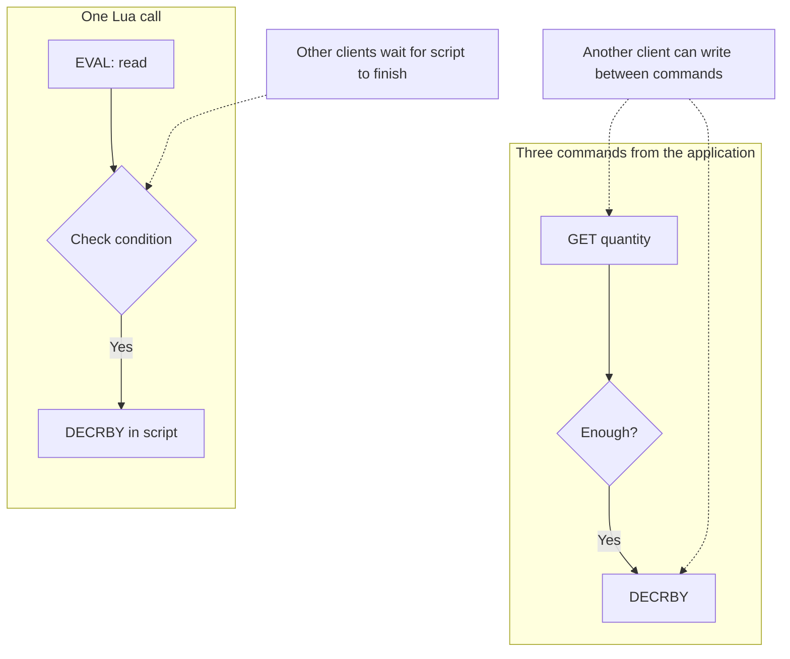
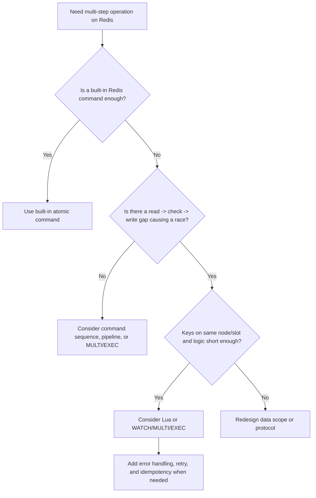

# When to Use Lua Instead of Application Command Sequences in Spring Data Redis

## 1. The Problem: Each Redis Command Can Be Correct, Yet the Sequence Fails

Redis executes each individual command atomically for standard operations on a single Redis server. However, a **business workflow consisting of multiple commands** sent sequentially by an application does not automatically become an atomic operation.

Consider a product quantity reservation workflow. Redis stores:

```text
app:stock:{sku-1001}:remaining = 5
```

Two concurrent requests both want to reserve 4 items. The naive approach:

```java
String stockKey = "app:stock:{sku-1001}:remaining";

String raw = redis.opsForValue().get(stockKey);
long available = Long.parseLong(raw);

if (available >= 4) {
    redis.opsForValue().set(stockKey, Long.toString(available - 4));
    // The application considers the reservation successful.
}
```

This command sequence can interleave as follows:

```text
Time        Request A                  Request B
---------   -------------------------  -------------------------
T1          GET stock -> 5
T2                                     GET stock -> 5
T3          5 >= 4 -> sufficient
T4                                     5 >= 4 -> sufficient
T5          SET stock 1
T6                                     SET stock 1
T7          Report 4 reserved          Report 4 reserved
```

Both requests are accepted, reserving a total of 8 items even though only 5 were initially available. Redis did not execute any command incorrectly: **the bug lies in the gap between reading, checking the condition, and writing**.

That gap is called a *race condition*. If the rule "only subtract when sufficient stock remains" must be checked and executed as a single unit, we need a way to bring **read + decision + write** closer together. In Redis, a Lua script is an important option.

## 2. When Is a Single Redis Command Enough?

Before choosing Lua, determine what built-in atomic commands Redis already provides for the required operation.

| Requirement | Built-in command/approach | Is Lua strictly needed? |
|---|---|---|
| Increment a counter | `INCR`, `INCRBY` | No |
| Decrement a counter, allowing negative values | `DECRBY` | No |
| Add an element to a Set | `SADD` | No |
| Set a key only if it does not exist | `SET key value NX` | No |
| Create a temporary lock with TTL | `SET key token NX PX milliseconds` | No |
| Replace an old key with a new value and get the old value | Check supported options of `SET`/`GETSET` | Usually no |
| Decrement stock **only when sufficient** | Needs read, compare, decrement | Lua or an equivalent conditional mechanism is well suited |
| Delete a lock only when the token still matches | Needs compare and delete together | Lua or a Redis-supported conditional atomic command |
| Increment a counter and set TTL only on initial creation | Needs conditional combination of `INCR` and `EXPIRE` | Lua is often useful |
| Update multiple keys with conditional constraints | Must consider key/slot scope and business rules | Lua, `WATCH`/`MULTI`, or a different design |

**First principle:** if a single Redis command already expresses the rule accurately, use that command. Wrapping a simple `INCR` in Lua only adds code to maintain without providing useful guarantees.

Lua is appropriate when **multiple steps depend on each other**, especially when a later step makes a decision based on data read by an earlier step and no other client may interleave between them.

## 3. Why Does Lua Solve the Race Condition?

Redis supports running Lua scripts on the server using `EVAL` and `EVALSHA`. While a script executes, Redis treats it as an atomic unit: while the script is running, commands from other clients cannot interleave between the Redis commands invoked by the script.

Comparing the two flows:



In a typical Java flow, another client can modify the key after `GET` and before `DECRBY`. In a short Lua script running on Redis, reading the quantity, checking it, and decrementing it happen consecutively within a single execution.

### Understanding "Atomicity" Properly

With Redis Lua:

- Other clients cannot observe intermediate states between the commands executed by the script.
- A short script can perform reads, conditional checks, and writes on the server in one round trip from the application.
- **There is no automatic rollback** for commands already executed if the script raises an error after partially writing data.
- A long-running script **blocks Redis from serving other requests** while the script is still executing.
- Script atomicity on Redis does not equate to an atomic distributed transaction across Redis, SQL, HTTP, and messaging systems.

Therefore, a script should **validate inputs and required state before starting to write**, keep the number of operations small, and avoid any loop that could run unboundedly.

## 4. Complete Example: Reserving Stock with Lua

Problem:

> Decrement stock only when the key has been initialized and the current quantity is at least the requested amount. If the condition is not met, do not modify the stock.

Convention for storing remaining quantity as a Redis String containing a non-negative integer:

```text
Key:   app:stock:{sku-1001}:remaining
Value: 5
```

The curly braces in the key name are a Redis Cluster *hash tag*. For a single key it is optional, but it establishes a convention for later when multiple keys need to reside in the same hash slot.

### 4.1. Create the Lua File

**`src/main/resources/scripts/reserve-stock.lua`**

```lua
-- KEYS[1]: key storing the remaining quantity
-- ARGV[1]: quantity to reserve, a positive integer
--
-- Return values:
--   >= 0: remaining quantity after a successful reservation
--   -1:   stock key does not exist
--   -2:   insufficient quantity
--
-- Invalid data/input cases return a Redis error.

if #KEYS ~= 1 or #ARGV ~= 1 then
    return redis.error_reply("Expected one key and one quantity")
end

local quantity = tonumber(ARGV[1])

if not quantity
        or quantity <= 0
        or quantity % 1 ~= 0
        or quantity > 2147483647 then
    return redis.error_reply("Invalid quantity")
end

local stockKey = KEYS[1]
local raw = redis.call("GET", stockKey)

if not raw then
    return -1
end

local available = tonumber(raw)

if not available
        or available < 0
        or available % 1 ~= 0
        or available > 2147483647 then
    return redis.error_reply("Invalid stock value")
end

if available < quantity then
    return -2
end

return redis.call("DECRBY", stockKey, quantity)
```

Step-by-step explanation:

1. `KEYS[1]` is the key passed from the application, and `ARGV[1]` is the quantity to reserve.
2. The script validates argument counts, numeric type, integrality, and value bounds.
3. `GET` reads the current stock count, returning `-1` if the key has not been initialized.
4. If insufficient, it returns `-2` without writing any data.
5. If sufficient, it calls `DECRBY` and returns the remaining quantity.

The example intentionally bounds quantities to 32-bit integers so that converting strings to Lua numbers in Redis's Lua engine avoids precision issues with very large integers. Systems needing larger quantities should choose an appropriate representation and handling strategy.

**Key takeaway:** `GET`, the `available < quantity` check, and `DECRBY` all reside inside **a single script**. Two concurrent requests cannot both read the old value and both be accepted beyond the available stock.

### 4.2. Testing Lua with redis-cli

Initialize test data:

```bash
redis-cli SET 'app:stock:{sku-1001}:remaining' 5
```

Invoke the Lua file from the CLI in the project directory:

```bash
redis-cli --eval src/main/resources/scripts/reserve-stock.lua \
  'app:stock:{sku-1001}:remaining' , 4
```

This command requests reserving 4 items. The expected result is `1`: stock decreases from 5 to 1.

Call again:

```bash
redis-cli --eval src/main/resources/scripts/reserve-stock.lua \
  'app:stock:{sku-1001}:remaining' , 4
```

The script returns `-2`, because only 1 item remains in stock, which is insufficient to reserve another 4. The quantity in Redis remains 1.

```bash
redis-cli GET 'app:stock:{sku-1001}:remaining'
```

The comma `,` in `redis-cli --eval` syntax separates the **key** list on the left from the **argument** list on the right. Lua receives the `KEYS` and `ARGV` tables accordingly. The shell example above uses `\` line continuation for environments that support it; the entire command can be written on a single line in PowerShell or CMD.

### 4.3. Script Output Is Part of the Protocol

Do not reuse a single return code for two different meanings. For example, the script defines:

| Value | Meaning | Appropriate application response |
|---|---|---|
| `>= 0` | Reservation succeeded; this is the remaining quantity | Continue the reservation workflow |
| `-1` | Stock key does not exist | Report uninitialized data or investigate |
| `-2` | Insufficient stock | Return out-of-stock / insufficient-quantity result |
| Redis error | Invalid arguments or data, execution error | Handle as a technical error, log, and investigate |

Distinguishing **insufficient stock** from **technical errors** is especially important. Never treat a network exception or timeout as proof that the reservation failed: the script may have executed successfully while the response to the client was lost.

## 5. Invoking the Script with Spring Data Redis

Spring Data Redis provides the `RedisScript<T>` abstraction and script execution via `RedisTemplate.execute(...)` or `StringRedisTemplate.execute(...)`. There is no need to manually assemble raw `EVAL` command strings.

### 5.1. Dependencies and Connection

A typical Spring Boot project needs the Redis starter.

**Gradle:**

```kotlin
dependencies {
    implementation("org.springframework.boot:spring-boot-starter-data-redis")
}
```

**Maven:**

```xml
<dependency>
    <groupId>org.springframework.boot</groupId>
    <artifactId>spring-boot-starter-data-redis</artifactId>
</dependency>
```

Example local Redis configuration using `application.yml`:

```yaml
spring:
  data:
    redis:
      host: localhost
      port: 6379
```

In real environments, configure connections, authentication, TLS, topology, and secrets according to your infrastructure.

### 5.2. Declaring RedisScript<Long> as a Bean

**`RedisScriptConfig.java`**

```java
package com.example.stock.config;

import org.springframework.context.annotation.Bean;
import org.springframework.context.annotation.Configuration;
import org.springframework.core.io.ClassPathResource;
import org.springframework.data.redis.core.RedisScript;
import org.springframework.data.redis.core.script.DefaultRedisScript;

@Configuration
public class RedisScriptConfig {

    @Bean("reserveStockScript")
    public RedisScript<Long> reserveStockScript() {
        DefaultRedisScript<Long> script = new DefaultRedisScript<>();
        script.setLocation(
                new ClassPathResource("scripts/reserve-stock.lua")
        );
        script.setResultType(Long.class);
        return script;
    }
}
```

Meaning:

- `ClassPathResource` loads the Lua file from `src/main/resources` when the application runs.
- `DefaultRedisScript<Long>` describes the script content and result data type.
- `setResultType(Long.class)` tells Spring Data that the integer reply from Redis should be converted to `Long`.
- Declaring a bean lets the same script be reused, avoiding re-reading and re-initializing the script on every request.

For scripts returning complex lists, the result type and serializer must be configured appropriately. In this example, only a single integer is returned, so `Long` suffices.

### 5.3. Writing a Service to Call Lua

**`StockReservationService.java`**

```java
package com.example.stock.service;

import java.util.List;
import java.util.regex.Pattern;

import org.springframework.beans.factory.annotation.Qualifier;
import org.springframework.data.redis.core.RedisScript;
import org.springframework.data.redis.core.StringRedisTemplate;
import org.springframework.stereotype.Service;

@Service
public class StockReservationService {

    private static final Pattern SKU_PATTERN =
            Pattern.compile("[A-Za-z0-9_-]{1,64}");

    private final StringRedisTemplate redis;
    private final RedisScript<Long> reserveStockScript;

    public StockReservationService(
            StringRedisTemplate redis,
            @Qualifier("reserveStockScript")
            RedisScript<Long> reserveStockScript
    ) {
        this.redis = redis;
        this.reserveStockScript = reserveStockScript;
    }

    /**
     * Returns the remaining quantity if the reservation succeeds.
     *
     * Throws IllegalStateException if stock is missing or insufficient.
     * Actual Redis errors are allowed to propagate for the caller to handle.
     */
    public long reserve(String sku, int requestedQuantity) {
        if (sku == null || !SKU_PATTERN.matcher(sku).matches()) {
            throw new IllegalArgumentException("Invalid SKU");
        }

        if (requestedQuantity <= 0) {
            throw new IllegalArgumentException(
                    "requestedQuantity must be positive"
            );
        }

        String key = "app:stock:{" + sku + "}:remaining";

        Long result = redis.execute(
                reserveStockScript,
                List.of(key),
                Integer.toString(requestedQuantity)
        );

        if (result == null) {
            throw new IllegalStateException(
                    "Redis returned no script result"
            );
        }

        if (result == -1L) {
            throw new IllegalStateException(
                    "Stock has not been initialized"
            );
        }

        if (result == -2L) {
            throw new IllegalStateException(
                    "Insufficient stock"
            );
        }

        if (result < 0L) {
            throw new IllegalStateException(
                    "Unexpected script result: " + result
            );
        }

        return result;
    }
}
```

Example invocation:

```java
long remaining = stockReservationService.reserve("sku-1001", 4);
System.out.println("Remaining quantity: " + remaining);
```

Notable points in `redis.execute(...)`:

- `reserveStockScript` holds the loaded Lua script.
- `List.of(key)` passes the key name into `KEYS[1]`.
- `Integer.toString(requestedQuantity)` passes the quantity into `ARGV[1]`.
- `StringRedisTemplate` ensures keys and arguments use appropriate string serialization.

Having the application **validate the SKU and quantity before sending** helps fail fast. The script still validates again to protect the rule directly inside Redis, even if calls originate from another client or processing flow.

### 5.4. Executing EVAL or EVALSHA?

Typically, Spring Data Redis's script executor uses the script hash to try `EVALSHA`. If Redis does not yet have the script in its cache, the mechanism can fall back to `EVAL` to execute the script body.

Advantages of using `RedisScript`:

- Scripts live in source files that can be read, version-controlled, and reviewed.
- The return type is clearly specified.
- Scripts are reused and leverage Redis's script cache mechanism.
- The application does not need to manually manage `EVALSHA` strings or cache-miss handling for common flows.

However, the script cache is **not durable storage to rely on like business data**. Restarts, failovers, administrative commands, or Redis version upgrades can evict or clear scripts from the cache. The application must have a way to reload/re-execute the script when needed. Using Spring Data Redis's `RedisScript` handles this scenario much more conveniently than hard-coding a SHA and always calling `EVALSHA`.

## 6. Comparing a Java Command Sequence vs. Lua for the Same Use Case

Returning to the reservation problem:

**Java command sequence:**

```java
String raw = redis.opsForValue().get(key);
long available = Long.parseLong(raw);

if (available >= quantity) {
    redis.opsForValue().decrement(key, quantity);
}
```

Even though `DECRBY` is an atomic command, the condition `available >= quantity` in Java relies on a snapshot that **may already be stale**. After `GET`, another client can still decrement the stock.

**Lua:**

```lua
local available = tonumber(redis.call("GET", KEYS[1]))
local quantity = tonumber(ARGV[1])

if available < quantity then
    return -2
end

return redis.call("DECRBY", KEYS[1], quantity)
```

In the simplified snippet above, the condition and decrement sit in the same script. This snippet illustrates the principle; to handle missing keys, invalid values, and bad arguments, use the full script version from the previous section.

### Is a Single Round Trip the Main Benefit?

Lua often reduces the number of requests the application has to send to Redis, especially for multi-step workflows. However, **the most important reason in this example is atomicity**, not just network latency.

A long script may reduce round trips while blocking Redis for too long. Therefore, do not bundle unrelated commands into one script just to cut request counts. Prefer Lua when multiple steps **must observe and make decisions on state without interleaved modifications**.

## 7. When to Use MULTI/EXEC Instead of Lua?

Redis supports transactions using `MULTI` and `EXEC`:

```redis
MULTI
SET app:order:1001:status RESERVED
SET app:order:1001:owner user-42
EXEC
```

Redis executes the queued commands sequentially without letting other clients interleave while `EXEC` runs. This fits when **the command list and arguments are known upfront**, without needing to read a value and branch immediately inside the transaction.

Now consider a workflow:

```text
GET stock
if stock >= 4 then DECRBY stock 4
```

If `GET` is placed inside `MULTI`, the actual reply of `GET` only arrives after `EXEC`. The application cannot inspect the `GET` result while queuing commands to decide whether to enqueue `DECRBY` in the same transaction.

Redis provides `WATCH` to solve some read-modify-write problems using optimistic concurrency:

1. `WATCH` the stock key.
2. `GET` the key and check the quantity in the application.
3. If sufficient, call `MULTI` and queue `DECRBY`.
4. Call `EXEC`. If another client modified the key since `WATCH`, the transaction aborts and the application can recompute and retry.

| Aspect | Lua | `WATCH` + `MULTI`/`EXEC` |
|---|---|---|
| Read-decide-write condition | Everything happens on the Redis server inside one script | Application reads/checks, Redis checks for conflicts on `EXEC` |
| Round trips | Usually a single script call | Multiple commands/round trips |
| Under high contention | Scripts execute serially; other requests wait | May have to retry when `WATCH` detects changes |
| Business logic | Written in Lua, deployed as a script | Written in Java, using conditional Redis operations |
| Maintainability | Requires managing additional Lua code | Keeps logic in the application, but retry flows are more complex |
| Operational risk | Long scripts block Redis | Excessive retries can amplify load under contention |

**Practical choice:** for concise conditions using few keys that need clear atomicity, Lua is usually a great fit. If the workflow already has a suitable optimistic locking mechanism, using `WATCH` is also reasonable. Both approaches require understanding network failures and cases where the client does not know whether the request succeeded.

## 8. When Is Lua Needed for Rate Limiting?

A common case is a **counter limiting requests within a time window**.

Writing it from Java:

```java
Long count = redis.opsForValue().increment(key);

if (count == 1L) {
    redis.expire(key, Duration.ofSeconds(60));
}
```

The two commands `INCR` and `EXPIRE` are separate Redis commands. If the application crashes or loses connection **after `INCR` but before `EXPIRE`**, the key may lack a TTL and persist longer than intended.

We can combine both operations in a single script while also checking the limit.

**`src/main/resources/scripts/fixed-window-rate-limit.lua`**

```lua
-- KEYS[1]: counter key for a subject
-- ARGV[1]: allowed requests within the window
-- ARGV[2]: window duration in milliseconds
-- Returns 1 if allowed, 0 if rejected.

if #KEYS ~= 1 or #ARGV ~= 2 then
    return redis.error_reply("Invalid number of arguments")
end

local limit = tonumber(ARGV[1])
local windowMs = tonumber(ARGV[2])

if not limit or limit < 1 or limit % 1 ~= 0 then
    return redis.error_reply("Invalid limit")
end

if not windowMs or windowMs < 1 or windowMs % 1 ~= 0 then
    return redis.error_reply("Invalid window")
end

local count = redis.call("INCR", KEYS[1])

if count == 1 then
    redis.call("PEXPIRE", KEYS[1], windowMs)
end

if count <= limit then
    return 1
end

return 0
```

This model is a **fixed window starting on the first request when the key does not yet exist**. At any moment, only one script checks/increments the counter for the same key, so concurrent requests cannot interleave between `INCR` and setting the expiration when count equals 1.

For example, with a limit of 5 requests/60 seconds:

```text
Request 1 -> count=1, set TTL near 60s, return 1
Request 2 -> count=2, return 1
...
Request 5 -> count=5, return 1
Request 6 -> count=6, return 0
When key expires -> next request starts a new window
```

This script demonstrates atomic decision-making and coupling a counter with a TTL. It does **not** solve every rate-limiting requirement: fixed windows can allow bursts at window boundaries; for sliding windows, token buckets, or other distributed accuracy requirements, select an appropriate algorithm and Redis data model.

Moreover, a script that errors after a write command **is not automatically rolled back by Redis**. Hence, validating inputs before `INCR` is critical. Production systems also need to handle keys modified to another data type, network failures, retries, and resource bounds.

## 9. When to Use Lua to Release a Distributed Lock?

A common pattern:

1. The application acquires a lock using `SET key token NX PX ttl`.
2. When finished, the application deletes the lock.
3. However, between reading to verify the token and deleting, the lock could expire and be re-acquired by someone else.

Dangerous approach:

```java
String current = redis.opsForValue().get(lockKey);

if (token.equals(current)) {
    redis.delete(lockKey);
}
```

Race condition:

```text
A holds lock token=A.
A reads GET -> A.
Lock expires.
B acquires a new lock with token=B.
A calls DEL -> accidentally deletes B's lock.
```

Lua can combine **token comparison and deletion** into a single operation.

**`src/main/resources/scripts/release-lock.lua`**

```lua
if redis.call("GET", KEYS[1]) == ARGV[1] then
    return redis.call("DEL", KEYS[1])
end

return 0
```

Invoking with Spring Data Redis:

```java
// releaseLockScript has type RedisScript<Long>,
// configured from resource scripts/release-lock.lua.
Long removed = stringRedisTemplate.execute(
        releaseLockScript,
        List.of("app:lock:invoice:1001"),
        token
);
```

A result of `1` means the script deleted the lock matching the token. A result of `0` means the key did not exist or the token did not match; the application did not delete that lock.

**Do not treat this lock-release script as a complete safe distributed lock protocol.** You need a random/unique token per lock acquisition, an appropriate TTL, a renewal strategy, crash handling, and potentially *fencing tokens* if external resources could still be mutated by a worker that lost its lock. For Redis versions that support value-conditional deletion commands, consider an equivalent atomic command before choosing Lua.

## 10. Using Lua on Redis Cluster: Pay Attention to All Keys

On a single-node Redis instance, a script can access any valid keys in that Redis instance. In Redis Cluster, operations must account for **hash slots**. A multi-key script generally must use keys residing in the **same hash slot** so it can execute on a single node.

Example of two keys with the same hash tag:

```text
app:stock:{sku-1001}:remaining
app:stock:{sku-1001}:reserved
```

Both use `{sku-1001}` to determine the same hash slot, even though their prefixes/suffixes differ.

Conversely:

```text
app:stock:{sku-1001}:remaining
app:stock:{sku-2002}:remaining
```

the two keys may sit in different slots. Do not write a script assuming it can atomically transfer quantities between them across multiple Redis Cluster nodes.

### Rules for KEYS and ARGV

For scripts operating on Redis keys:

- Pass **all accessed key names** through `KEYS`.
- Pass values, quantities, tokens, TTLs, and other regular parameters through `ARGV`.
- Do not pass a prefix and dynamically construct new Redis key names inside Lua as though Redis would automatically know which slot those keys belong to.
- When multiple keys must be used together, design hash-slot placement upfront.

Improper organization:

```lua
-- Avoid constructing keys from data not declared as keys.
local key = "app:stock:" .. ARGV[1]
return redis.call("GET", key)
```

Clear expression:

```lua
-- The application passes the Redis key name in KEYS[1].
return redis.call("GET", KEYS[1])
```

Declaring keys explicitly also helps Redis Cluster, client routing mechanisms, and observability tools analyze scripts more easily.

## 11. Limitations and Risks of Redis Lua

### 11.1. Long Scripts Can Block All Other Requests

Redis executes a script as an atomic unit, so while a script is running, other commands cannot interleave. That is both its strength and its cost.

**Do:** read/write a bounded number of keys, perform a few simple comparisons, and return quickly.

**Don't:** iterate over millions of keys, process large datasets with unbounded loops, run CPU-heavy computations, or treat Redis Lua as a place to run full business processing.

If you need to clean up large datasets by namespace, use `SCAN` and process in bounded batches; do not put the entire scan-and-delete over a huge volume into a single Lua script just to achieve atomicity.

Redis has mechanisms to detect slow scripts and tools to handle stuck scripts, though a script that has already written data has limitations on being stopped; it is best to bound execution time by design.

### 11.2. Errors Mid-Script Have No Rollback

Dangerous example:

```lua
redis.call("SET", KEYS[1], "changed")

-- The next step may fail if the key is not numeric.
redis.call("INCR", KEYS[2])
```

If `INCR` errors because the value is non-numeric, the change to `KEYS[1]` **is not automatically reverted by Redis**.

To reduce risk, validate data types and business conditions before write commands; design clear error responses; limit the number of operations; and choose a data model with minimal intermediate state.

`redis.call(...)` raises a Lua error when a Redis command fails; `redis.pcall(...)` returns an error object for the script to handle. Use `pcall` deliberately and never turn Redis errors into "success" by accidentally swallowing failures.

### 11.3. A Timeout Does Not Prove the Script Did Not Run

A `redis.execute(script, keys, args)` call can time out because:

- The client lost connection after sending the request.
- Redis completed the script, but the response to the client was lost.
- Redis was overloaded or the script was slow.
- A failover occurred during processing.

Never blindly retry an operation like **decrementing stock**: the first attempt may already have decremented the quantity, and the retry would decrement it a second time.

If safe retries are required, design an **idempotency key** for each business request. For example, for a request with ID `reservation-123`, the script checks whether this ID has already been processed before reserving; record the result status and modify stock within the same atomic operation, with a clear TTL/lifecycle for the idempotency key.

### 11.4. Redis Scripts Do Not Cover Databases or External Services

Lua runs inside Redis. It cannot guarantee on its own that:

- A transaction in PostgreSQL/MySQL has committed.
- A payment request to an external provider succeeded.
- A Kafka message was published exactly once.
- Changes executed atomically across multiple different Redis nodes.

If authoritative stock is managed in SQL, Redis reservations need a clear synchronization and compensating-release protocol. Do not turn Redis Lua into the guarantor for an entire business transaction when the rest happens outside Redis.

### 11.5. Script Cache, Permissions, and Compatibility

When using scripts in a long-lived application:

- Store Lua as files in source control and review them alongside the corresponding Java code.
- Treat the structure of `KEYS`, `ARGV`, and return codes as a versioned protocol.
- Do not rely on the script cache persisting forever, because Redis may clear it on restart/failover or via administrative operations.
- Configure Redis ACLs to allow the command groups and keys the script actually needs, per your organization's security policy.
- Never pass arbitrary user-supplied Lua scripts into `EVAL`; scripts are executable code on the Redis server.
- Track Lua/script limits and behavioral changes across Redis versions if using advanced APIs.
- In Redis Cluster, script updates and distribution must account for the nodes/slots that calls reach.

For long-lived server behavior, you can explore Redis Functions in compatible versions; Functions manage server-side code differently from on-demand loaded scripts. However, if the requirement is just a small conditional check and you are using Spring Data Redis, `RedisScript` is usually clear enough.

## 12. Distinguishing Atomicity, Consistency, Idempotency, and Performance

These four concepts are often conflated:

| Concept | Question to answer | Does Lua guarantee it automatically? |
|---|---|---|
| **Atomicity wrt other clients** | Can another client interleave a command between GET and DECRBY? | Yes, within the scope of the script on the Redis server executing it |
| **Business consistency** | After Redis writes, are SQL/queues/other services consistent? | No |
| **Idempotency** | Does replaying the same request mutate data a second time? | Not automatically; must be designed |
| **Good performance** | Under high load, does latency stay within bounds? | Not automatically; scripts can block the server |

For stock reservation, the sample script solves the **race condition when checking and decrementing on a single key**. If the application needs to prevent reserving twice for one order, or ensure payment and order updates succeed together, the corresponding design pieces must still be added.

### How Is an Idempotency Key Used?

An idea for an advanced script:

```text
KEYS[1]: app:stock:{sku-1001}:remaining
KEYS[2]: app:reservation:{sku-1001}:request-abc

ARGV[1]: quantity
ARGV[2]: idempotency result TTL

1. If KEYS[2] has already recorded the request → return the previous result.
2. If not → check stock.
3. If sufficient → decrement stock.
4. Write the result to KEYS[2].
5. Return the result.
```

Both keys use the same hash tag `{sku-1001}` so they land in the same slot in Redis Cluster. You also need policies for when the idempotency record expires, when a request is resent after expiration, errors after partial writes, and released reservation states. This architecture is more complex than a basic script and should only be implemented when business requirements genuinely demand it.

## 13. Organizing Scripts in a Spring Boot Project

A clean structure:

```text
src/
├── main/
│   ├── java/com/example/stock/
│   │   ├── config/
│   │   │   └── RedisScriptConfig.java
│   │   └── service/
│   │       └── StockReservationService.java
│   └── resources/
│       ├── application.yml
│       └── scripts/
│           ├── reserve-stock.lua
│           ├── fixed-window-rate-limit.lua
│           └── release-lock.lua
```

Placing Lua files in `resources/scripts` lets the build package them with the application. Each file should document:

1. A brief business description and the meaning of each `KEYS[n]`.
2. Types and validation rules for `ARGV[n]`.
3. The list of return values or result structure.
4. Assumptions such as key type, TTL, hash slot, and idempotency.
5. Limits on the data the script is permitted to process.

Keeping scripts under source control helps maintainers see the contract between Java and Lua in the same application version whenever the Java service changes.

If multiple application versions run concurrently during deployment, changing the meaning of an existing return code can cause older versions to misinterpret it. Therefore, when changing a script's protocol, manage compatibility and rollouts according to system procedures.

## 14. Tips for Observing and Testing Atomic Behavior

In a test environment, you can simulate multiple clients concurrently calling the script to reserve a key holding 5 items.

Expected example:

```text
Initial: stock = 5
Client A reserves 4
Client B reserves 4

One client       → succeeds, stock = 1
Remaining client → insufficient quantity
Final            → stock = 1
```

Which client succeeds first is non-deterministic. What matters is that **two reservations of 4 cannot both succeed** from an initial stock of 5.

With the rate-limiting script, concurrent requests must be counted in Redis execution order, avoiding keys without a TTL caused by a client stopping between separate `INCR` and `PEXPIRE` calls in application code.

In production observability, track:

- Script success rate, valid business rejections, and technical error rate.
- Script execution latency and overall Redis latency.
- Number of request retries after timeouts or connection errors.
- Contention levels on hot keys.
- Shifts in Redis load from moving multi-round-trip logic into scripts.
- Hash slot distribution if running Redis Cluster.

Do not conclude from a single benchmark that Lua is always faster. Some tasks fit a built-in Redis command that is faster and simpler than a script. Complex or long-running tasks can degrade overall Redis throughput because other clients have to wait.

## 15. Common Pitfalls When Introducing Lua into Spring Data Redis

| Symptom | Common cause | Resolution |
|---|---|---|
| Race conditions still occur | Checking the condition in Java first and only writing in Lua | Move **read, condition check, and write** into one script |
| `NOSCRIPT` when calling `EVALSHA` manually | Script is no longer in the node's cache | Add an `EVAL`/script-load fallback, or use `RedisScript` |
| `Long` result is `null`/wrong type | Misconfigured result type/serializer, or executed in a context that does not support immediate reads | Review `DefaultRedisScript`, return type, and execution path |
| `CROSSSLOT` in Redis Cluster | Script accesses keys in different hash slots | Place required keys in the same slot and declare all of them in `KEYS` |
| Long-running script slows the system | Overly large loops or operations on huge datasets | Split work; keep scripts short with bounded key counts |
| Script errors after writing | Missing validation before writes; Redis does not roll back executed parts | Validate before mutating, keep steps minimal, handle errors clearly |
| Retries decrement stock twice | Uncertain outcome of the first attempt after timeout | Use request IDs and business-level idempotency |
| Lua reads the wrong key | Keys concatenated from arguments or mismatched serializers | Pass keys through `KEYS`, use `StringRedisTemplate` or exact serializers |
| Script works locally, fails on cluster | Differences in topology, slots, ACLs, or Redis features | Verify environment compatibility, key bounds, and driver behavior |
| Simple conditional command is overengineered | Using Lua for something `SET NX` or `INCR` already handles | Choose built-in atomic Redis commands |
| Script updates Redis but SQL fails to commit | Lua is atomic only within Redis | Implement synchronization across data stores |
| Lock-release script deletes the wrong lock | Checking the token in Java and deleting afterwards | Compare and delete in the same atomic operation |

## 16. How to Decide Whether to Use Lua

Ask these questions before adding a script:

**Step 1 — Is a single Redis command enough?** If the goal is just incrementing a counter, adding a Set member, or `SET NX PX`, use the built-in command.

**Step 2 — Does the write decision depend on the immediately preceding read?** If yes, and another client modifying data between those two steps would cause a business bug, that is a clear signal to consider Lua.

**Step 3 — Is the logic short, deterministic, and contained inside Redis?** Scripts work best for a few specific key reads/writes, with no external service dependencies and no large loops.

**Step 4 — Can keys be declared explicitly and share the same hash slot in Cluster?** If not, adjust the data model or split responsibilities; Lua cannot bypass multi-node data distribution constraints.

**Step 5 — Are safe retries and cross-system synchronization required?** If yes, add idempotency, transaction state, and recovery mechanisms. Lua atomicity only solves part of the problem.

**Step 6 — Is a Java flow or another Redis transaction approach a better fit?** If conditions do not require server-side atomicity or an existing optimistic locking mechanism is sufficient, Lua is not mandatory. Choose the option that ensures correctness and remains maintainable long-term.

A short decision flowchart:



## 17. Conclusion

Lua is most valuable when a business rule must **read state, evaluate a condition, and mutate data** without other requests interleaving in between. Typical examples include decrementing stock only when sufficient, incrementing a counter with a conditional TTL, or deleting a lock only when the token still matches.

In Spring Data Redis, the common implementation places Lua scripts in `src/main/resources/scripts`, declares `DefaultRedisScript<T>`, and executes them via `StringRedisTemplate.execute(script, keys, args)`. Always declare `KEYS` and `ARGV` explicitly, validate inputs before writing, understand the return values, and keep scripts short.

What matters most is choosing Lua **in the right places**: skip Lua when a single Redis command already solves the problem; and do not expect scripts to automatically roll back executed writes, prevent duplicate retries, or guarantee atomicity between Redis and external systems.

### References

- [Spring Data Redis — Scripting](https://docs.spring.io/spring-data/redis/reference/redis/scripting.html)
- [Spring Data Redis — RedisScript API](https://docs.spring.io/spring-data/redis/reference/api/java/org/springframework/data/redis/core/RedisScript.html)
- [Spring Data Redis — RedisTemplate API](https://docs.spring.io/spring-data/redis/reference/api/java/org/springframework/data/redis/core/RedisTemplate.html)
- [Redis — Scripting with Lua](https://redis.io/docs/latest/develop/programmability/eval-intro/)
- [Redis — EVAL](https://redis.io/docs/latest/commands/eval/)
- [Redis — EVALSHA](https://redis.io/docs/latest/commands/evalsha/)
- [Redis — Transactions](https://redis.io/docs/latest/develop/using-commands/transactions/)
- [Redis — WATCH](https://redis.io/docs/latest/commands/watch/)
- [Redis — SET](https://redis.io/docs/latest/commands/set/)
