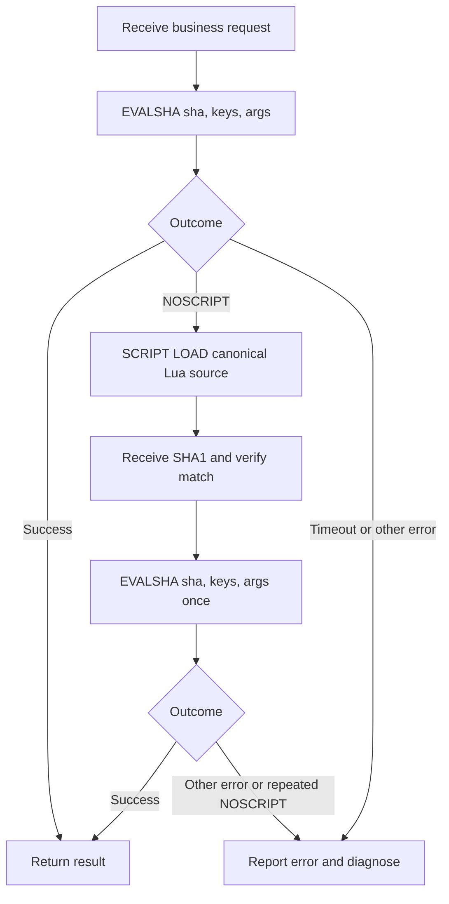

# Loading Scripts, Using EVALSHA, and Handling Lost Script Cache in Spring Data Redis

## 1. Scenario: A Lua Script Runs Smoothly, Then Suddenly Fails with `NOSCRIPT`

A service uses Redis to manage temporary locks (*distributed locks*). When releasing a lock, the application must verify the ownership token before deleting the key. Two separate commands like `GET` and `DEL` leave a window for another client to interfere, so the application uses Lua:

```lua
-- release-lock.lua
if redis.call('GET', KEYS[1]) == ARGV[1] then
    return redis.call('DEL', KEYS[1])
end
return 0
```

This Lua script runs on the Redis side: checking and deleting occur in a single atomic execution. The application can pass **the full script body** via `EVAL`. However, when executing the same script thousands of times, resending the Lua source bytes repeatedly adds unnecessary overhead.

Redis lets you **load a script into cache with `SCRIPT LOAD`**, receive its SHA1 identifier, and **execute the cached script with `EVALSHA`**. Subsequent calls only need the SHA1, key count, key list, and arguments.

Trouble appears when Redis restarts, fails over to another node, or has its script cache cleared:

```text
Application holds SHA1 of release-lock.lua
                |
                v
         EVALSHA <sha1> ...
                |
                v
 Current Redis node lacks script in cache
                |
                v
 (error) NOSCRIPT No matching script. Please use EVAL.
```

**The SHA1 is still valid, yet the server no longer holds the corresponding Lua source.** A well-built application must know how to reload or re-execute the **script source**, while distinguishing cache loss from timeouts, Lua errors, and business errors.

After this lesson, you will understand:

- How `EVAL`, `SCRIPT LOAD`, `SCRIPT EXISTS`, and `EVALSHA` relate to one another.
- Why the same SHA1 can succeed on one node yet return `NOSCRIPT` on another.
- How to handle `NOSCRIPT` safely when calling directly, inside pipelines/transactions, and across Redis Cluster failovers.
- How Spring Data Redis uses `RedisScript`, `DefaultRedisScript`, and `ScriptExecutor` for automatic fallback.
- Limits around atomicity, keys/arguments, runtime duration, retries, logging, and script caching.

## 2. Redis Lua Scripts and Atomicity

Redis supports executing Lua scripts on the server via `EVAL` and `EVALSHA`. While a script executes, other Redis commands cannot run interleaved between the script's steps on the same server.

Check-and-delete scenario:

```text
Client A                      Redis                       Client B
   |                            |                             |
   |  EVAL release-lock.lua     |                             |
   |--------------------------->|                             |
   |                            | GET lock:job:42              |
   |                            | compare token                |
   |                            | DEL lock:job:42              |
   |                            |                             |
   |<---------------------------| return 1                    |
   |                            |                             |
   |                            | process next command         |
```

Compared to issuing `GET` then `DEL` in two separate Java calls, the script prevents cases where the lock expires and is re-acquired by another client between the two commands. Inside the script, `DEL` runs only when the value still matches the supplied token.

Atomicity **does not mean an SQL transaction with rollback**. If a Lua script writes data and then hits a runtime error in a later step, earlier changes can remain. Therefore, scripts must be short, validate preconditions before writing whenever possible, and avoid error-prone steps after mutating state.

Scripts also execute on the Redis server, so they must not contain unbounded loops, scan huge datasets, or perform heavy CPU work. A script that blocks the server too long increases latency for all other clients.

## 3. Four Core Commands of the Script Cache Mechanism

| Command | Inputs | Effect | Runs Lua logic immediately? |
|---|---|---|---|
| `EVAL` | **Lua source**, numkeys, keys, arguments | Executes the script and places it in cache | **Yes** |
| `SCRIPT LOAD` | **Lua source** | Loads/compiles and caches the script, returning SHA1 | **No** |
| `EVALSHA` | **SHA1**, numkeys, keys, arguments | Runs a script **already in cache** | **Yes, if present** |
| `SCRIPT EXISTS` | One or more SHA1s | Checks which SHA1s the queried server recognizes | **No** |
| `SCRIPT FLUSH` | Optional flush mode depending on version | Clears the script cache on the server | **No** |

Both `EVAL` and `EVALSHA` share the same input layout for **key count and parameters**, differing only in whether the Lua source or SHA1 is sent. `SCRIPT LOAD` separates loading from execution, useful when preparing scripts before calling them inside pipelines or transactions.

### 3.1. `EVAL`: Sending Full Source Code

Example in `redis-cli`:

```redis
EVAL "return redis.call('GET', KEYS[1])" 1 demo:greeting
```

Breakdown:

- `"return redis.call('GET', KEYS[1])"` is the Lua source.
- `1` indicates the script expects **one key name**.
- `demo:greeting` is placed into Lua variable `KEYS[1]`.
- The result is the key's value, or nil if the key does not exist.

Every time `EVAL` is sent, the client transmits the Lua string. Redis recognizes whether the script is already cached and can reuse it, yet the request payload still carries **the full source**.

### 3.2. `SCRIPT LOAD`: Loading Without Executing

```redis
SCRIPT LOAD "return redis.call('GET', KEYS[1])"
```

Redis returns a 40-character hex SHA1 string. Always **copy the value the server actually returns**, never guess the digest:

```text
> SCRIPT LOAD "return redis.call('GET', KEYS[1])"
"<actual-SHA1-of-script>"
```

`SCRIPT LOAD` **does not read `demo:greeting`** and does not modify business keys. It loads the code so subsequent invocations can run by SHA1.

Calling `SCRIPT LOAD` again with the exact same Lua source is valid: identical script bytes yield the same SHA1. However, **reloading on every request** adds needless round trips; design load-on-demand or client-side fallback instead.

### 3.3. `EVALSHA`: Executing by Digest

Once you have the SHA1 returned above:

```redis
EVALSHA <actual-SHA1-of-script> 1 demo:greeting
```

In this example, `<actual-SHA1-of-script>` is a **placeholder to replace with the real SHA1**, not a literal string to type. Redis looks up the script in the handling node's cache and executes it with `KEYS[1] = "demo:greeting"`.

The advantage is that the application avoids resending dozens or hundreds of lines of Lua on every request. This benefit is more noticeable for longer, frequently called scripts; for tiny scripts, source transmission overhead may be negligible compared to other costs.

### 3.4. `SCRIPT EXISTS`: Checking the Cache

```redis
SCRIPT EXISTS <actual-SHA1-of-script>
```

A result of `1` means the queried node currently has the script cached; `0` means it does not. Multiple SHA1s can be passed to check in one call.

**Never treat `SCRIPT EXISTS` as a lock preserving the cache.** Between checking and sending `EVALSHA`, the server may restart, fail over, have its cache flushed, or route the request to a different node. Thus, even after receiving `1`, the client must still be prepared to handle `NOSCRIPT`.

## 4. SHA1 Identifies Script Content, Not Cache State

Redis computes SHA1 from **the exact script bytes provided**. Changing a single byte in Lua source can change the digest:

```lua
return redis.call('GET', KEYS[1])
```

and:

```lua
-- Read a value
return redis.call('GET', KEYS[1])
```

are **two distinct script contents** even though the read command does the exact same thing, so they produce different SHA1s.

Changes that can alter the digest:

- Adding or removing comments.
- Changing whitespace or newline characters.
- Renaming Lua variables.
- Switching CRLF/LF line endings.
- Modifying conditions or statement order.

Therefore, in a Spring application:

1. Store Lua source as a stable file in resources.
2. Deploy identical script content across all instances running the same version.
3. Pass **per-request changing data via `KEYS` and `ARGV`**, instead of interpolating data directly into the source string.
4. Treat SHA1 as a **content identifier**, not a security certificate, secret token, or guarantee that the server has cached the script.

### 4.1. Do Not Generate a New Script per Request

Bad practice:

```java
// Bad idea: each owner produces a different Lua source.
String lua = "return redis.call('GET', 'lock:" + ownerId + "')";
```

Interpolating IDs directly into the source causes each request to produce a different SHA1, filling the cache with redundant scripts and defeating `EVALSHA`.

The right approach is keeping Lua static:

```lua
return redis.call('GET', KEYS[1])
```

and passing `lock:42`, `lock:43`, ... as individual keys. Passing key names in `KEYS` also lets Redis Cluster and drivers route requests to the proper hash slot.

Since Redis 7.4, Redis applies least-recently-used (*LRU*) eviction to scripts loaded via `EVAL`/`EVAL_RO` once the cache reaches its limit. Redis documentation describes `SCRIPT LOAD` as retaining scripts in cache until flushed during the server's lifetime. Either way, **applications must still expect cache loss after restarts, failovers, or administrative actions**.

## 5. What Does `NOSCRIPT` Actually Mean?

When `EVALSHA` is called with a digest absent from the current Redis server's cache:

```text
(error) NOSCRIPT No matching script. Please use EVAL.
```

This is a **missing script definition on the server** error—not a sign that the Lua source is invalid, nor that data keys were lost.

Three distinct states:

| State | `EVALSHA` | Appropriate handling |
|---|---|---|
| SHA1 loaded and present in cache | Script executes | Process business result |
| SHA1 never loaded or cache just cleared | Returns `NOSCRIPT` | Reload source with `SCRIPT LOAD` then `EVALSHA`, or fall back to `EVAL` |
| SHA1 in cache, but Lua/execution condition errors | Returns another error | Investigate Lua error, data type, or business rule; do not lump into `NOSCRIPT` |

An important detail: when Redis returns `NOSCRIPT` for an `EVALSHA` call, **the script was not executed by that call**. Thus, you can load and run it once after `NOSCRIPT` without duplicating side effects from the rejected call.

By contrast, if the client experiences a **timeout/connection drop** instead of `NOSCRIPT`, the situation is completely different: the script **may have already executed** while the reply was lost. Never automatically replay arbitrary write scripts in that scenario without idempotency or verification.

## 6. Why Can the Script Cache Disappear?

The Redis script cache is **ephemeral server state**, not committed durable application data. Common causes include:

### 6.1. Redis Restart

```text
Before restart:
  Redis process A
    script cache: SHA1-A, SHA1-B

After restart:
  Redis process B
    script cache: empty or missing application scripts
```

Even when business keys are recovered from RDB/AOF, never assume the script cache survived. The application must retain the Lua source to reload it.

### 6.2. Failover

With Redis Sentinel or replica setups:

```text
Application ---> old primary (has script SHA1-A)
                    |
                    | primary fails
                    v
Application ---> new primary (may lack SHA1-A)
```

The client may still hold the SHA1 in Java memory, yet that SHA1 does not guarantee the new primary has loaded the script body. The first `EVALSHA` after failover can hit `NOSCRIPT` and need a fallback.

### 6.3. `SCRIPT FLUSH`

```redis
SCRIPT FLUSH
```

This command clears the script cache on the server. It is used for administration or testing recovery behavior; **never run it on shared or production Redis just to test an application**, because it affects every other client relying on cached scripts.

### 6.4. Node Switching and Redis Cluster

In Redis Cluster, keys belonging to different hash slots can route to different nodes. A script loaded on node A **is not automatically present on node B**.

```text
Spring app -> EVALSHA sha1, key in slot A -> node A: OK
Spring app -> EVALSHA sha1, key in slot B -> node B: NOSCRIPT
```

If keys migrate slots or a node fails over, missing-script errors can also appear. The cache is scoped per **command-handling node**, not a global cache managed by the JVM.

### 6.5. Script Eviction in Newer Redis Versions

Redis 7.4 added eviction for scripts loaded via `EVAL`/`EVAL_RO` to manage cache memory. Applications that dynamically generate many distinct sources by embedding parameters in Lua face higher churn risk. On supported Redis versions, you can inspect the `evicted_scripts` metric in `INFO`.

Never assume a digest that ran once will be recognized by `EVALSHA` forever.

## 7. Handling `NOSCRIPT` Directly with Redis Commands

### 7.1. Preload and Execute Sequence

Example script incrementing a counter by a passed amount:

```lua
-- increment-by.lua
local delta = tonumber(ARGV[1])
if not delta or delta < 1 then
    return redis.error_reply('delta must be a positive integer')
end
return redis.call('INCRBY', KEYS[1], delta)
```

Sequence:

```text
1. SCRIPT LOAD "<full-source-increment-by.lua>"
   -> receives sha1

2. EVALSHA <sha1> 1 demo:counter 5
   -> Redis increments demo:counter by 5

3. EVALSHA <sha1> 1 demo:counter 2
   -> Redis increments demo:counter by 2
```

Here `KEYS[1] = "demo:counter"` and `ARGV[1]` is `"5"`, then `"2"`. Because the script source is identical, both calls use the same SHA1.

### 7.2. When the Script Is No Longer in Cache

A client managing its own script cache can follow this flow:



Or more simply:

```text
EVALSHA sha ...
  -> NOSCRIPT
EVAL "<Lua source>" numkeys keys... args...
  -> script executes and repopulates cache
```

**Two fallback options:**

1. `SCRIPT LOAD` then `EVALSHA`: load first, execute second.
2. Direct `EVAL`: execute the source and populate the cache in one command.

When a single request hits `NOSCRIPT`, `EVAL` is simpler because it avoids an extra load round trip. If preparing to run many `EVALSHA` calls inside a pipeline or transaction, preloading can be a better fit.

### 7.3. Never Catch All Exceptions and Retry with `EVAL`

This is an anti-pattern:

```text
try EVALSHA
catch any error:
    EVAL same script
```

If the true failure was a timeout after the script already ran, replaying `EVAL` can cause **double writes**, such as incrementing a counter twice. If the error was `WRONGTYPE`, `CROSSSLOT`, missing permissions, or a Lua runtime error, reloading the script will not fix the root cause.

Trigger the script-cache recovery branch **only when the error is explicitly identified as `NOSCRIPT`**; handle all other errors according to business, network, and topology semantics.

### 7.4. `SCRIPT EXISTS` Does Not Replace Fallback

You can run:

```redis
SCRIPT EXISTS <sha1>
```

before executing. Yet this sequence:

```text
SCRIPT EXISTS -> 1
Redis fails over or cache is flushed
EVALSHA -> NOSCRIPT
```

can still occur. Thus, a precheck only reports point-in-time state; it cannot eliminate state changes between two commands.

## 8. Spring Data Redis: Use `RedisScript` Instead of Managing SHA1 Manually

In a Spring Boot application, it is usually best to let **Spring Data Redis `ScriptExecutor`** handle command selection and fallback.

Spring Data Redis documentation describes the default mechanism:

1. Compute/obtain the script's SHA1.
2. Attempt `EVALSHA` outside special pipeline/transaction contexts.
3. If Redis does not have the script cached, fall back to `EVAL` to run the source.
4. Serialize keys and arguments and deserialize results using the template's serializers.

This marks the difference between holding only a `String sha` in Java versus holding a **`RedisScript` object that retains the source**: with the source available, the framework can send `EVAL` whenever needed instead of getting stuck on `NOSCRIPT`.

### 8.1. Creating a Fixed Script Resource

In a Spring Boot project, place the file at:

```text
src/main/resources/
└── redis/
    └── release-lock.lua
```

Contents of `src/main/resources/redis/release-lock.lua`:

```lua
-- Delete the lock only if the current value matches the owner's token.
if redis.call('GET', KEYS[1]) == ARGV[1] then
    return redis.call('DEL', KEYS[1])
end
return 0
```

The script embeds no hardcoded key names or tokens. Every request therefore uses the **same source and same SHA1**, while variable data moves into `KEYS[1]` and `ARGV[1]`.

### 8.2. Declaring a `DefaultRedisScript<Long>` Bean

```java
package com.example.demo.redis;

import org.springframework.context.annotation.Bean;
import org.springframework.context.annotation.Configuration;
import org.springframework.core.io.ClassPathResource;
import org.springframework.data.redis.core.script.DefaultRedisScript;
import org.springframework.data.redis.core.script.RedisScript;

@Configuration
public class RedisLuaConfig {

    @Bean
    public RedisScript<Long> releaseLockScript() {
        DefaultRedisScript<Long> script = new DefaultRedisScript<>();
        script.setLocation(new ClassPathResource("redis/release-lock.lua"));
        script.setResultType(Long.class);
        return script;
    }
}
```

`DefaultRedisScript` reads the source from the classpath and exposes its SHA1 to the executor. Declaring a reusable bean avoids reconstructing script objects and recalculating digests on every request.

`Long.class` matches the integer replies returned by `DEL` or `return 0` in Lua. For scripts returning other types, declare the matching return type such as `Boolean`, `List`, or a deserializable type. Never guess `String.class` for a script that actually returns an integer.

### 8.3. Service Running the Script Atomically

```java
package com.example.demo.redis;

import java.util.Collections;
import java.util.Objects;

import org.springframework.data.redis.core.StringRedisTemplate;
import org.springframework.data.redis.core.script.RedisScript;
import org.springframework.stereotype.Service;

@Service
public class RedisLockReleaseService {

    private final StringRedisTemplate redis;
    private final RedisScript<Long> releaseLockScript;

    public RedisLockReleaseService(
            StringRedisTemplate redis,
            RedisScript<Long> releaseLockScript) {
        this.redis = redis;
        this.releaseLockScript = releaseLockScript;
    }

    public boolean releaseIfOwned(String lockKey, String token) {
        Objects.requireNonNull(lockKey, "lockKey");
        Objects.requireNonNull(token, "token");

        Long removed = redis.execute(
            releaseLockScript,
            Collections.singletonList(lockKey),
            token
        );

        return Long.valueOf(1L).equals(removed);
    }
}
```

When invoked:

```java
boolean removed =
    lockReleaseService.releaseIfOwned("locks:job:42", ownerToken);
```

- `locks:job:42` is serialized as a key via `StringRedisTemplate` and passed to `KEYS[1]`.
- `ownerToken` is passed as `ARGV[1]`.
- Lua compares the token and deletes the key **in a single server-side execution**.
- Result `1` means the matching key was deleted; `0` means nothing was deleted (e.g., token mismatch or lock already absent).

For distributed locks, generate an independent, unpredictable token per lock acquisition, such as a random UUID; never share a fixed value across clients. Having a safe lock-release script does not replace other lock algorithm requirements like timeouts, renewal, or fencing tokens when protecting resources outside Redis.

### 8.4. Acquiring and Owner-Checked Release of a Lock

Simple lifecycle example:

```java
import java.time.Duration;
import java.util.UUID;

String token = UUID.randomUUID().toString();
String lockKey = "locks:job:42";

boolean acquired = Boolean.TRUE.equals(
    redis.opsForValue().setIfAbsent(
        lockKey, token, Duration.ofSeconds(30)
    )
);

if (!acquired) {
    // Lock not acquired; handle according to business logic.
    return;
}

try {
    // Run work only while holding the lock.
    doJob();
} finally {
    lockReleaseService.releaseIfOwned(lockKey, token);
}
```

This shows a TTL-backed lock lifecycle. `SET NX` with expiration creates the lock with a deadline; Lua protects lock release from accidentally deleting another owner's lock. If `doJob()` runs longer than 30 seconds, the lock can expire before work finishes, so the system must handle that case separately.

## 9. Why Can Spring Data Redis Fall Back Automatically?

When calling:

```java
redis.execute(releaseLockScript, List.of(lockKey), token);
```

`RedisScript` holds or can load the Lua body and provides its digest. The default `ScriptExecutor` can therefore run:

```text
First call after Redis restarts:
  EVALSHA sha 1 lock-key token
    -> NOSCRIPT
  EVAL <Lua source> 1 lock-key token
    -> executes, cache is repopulated

Subsequent calls on the same node while cached:
  EVALSHA sha 1 lock-key token
    -> executes from cache
```

Key points to remember:

- The application **does not need to call `SCRIPT LOAD` before every request** when using the default executor above.
- Do not catch all exceptions at the service layer and blindly re-invoke `redis.execute(...)`, because the executor already handles missing-script cache fallbacks.
- If you want to preload proactively to prevent fallback on specific hot paths, account for target nodes, startup timing, scripting permissions, and node changes after preload.
- With a custom `ScriptExecutor` or native driver API, fallback behavior may differ. Never assume `RedisTemplate.execute(RedisScript, ...)` behavior applies to custom `EVALSHA` calls you write yourself.

### 9.1. Role of Serializers

Scripts receive **byte values**. Spring Data Redis normally uses the key serializer to encode `KEYS` and the value serializer for `ARGV`.

With `StringRedisTemplate`:

```text
Java String "locks:job:42" -> Redis key bytes
Java String token          -> ARGV[1] bytes
Lua redis.call('GET', ...) -> byte string compared against ARGV[1]
```

If one component creates a lock using a JSON serializer while the release script uses `StringRedisTemplate`, the stored Redis value will have a different byte representation than the passed token. Comparisons will fail even though both values "look identical" in Java code.

Therefore, key creation, token storage, and script execution must use consistent serializers. When using a custom-configured `RedisTemplate<K,V>`, use the `execute` overload that accepts explicit serializers for arguments and results.

### 9.2. Handling Nulls or Exceptions

`redis.execute(...)` can return `null` in contexts such as pipelines/transactions or due to result/serializer behavior. In the service above, `Long.valueOf(1L).equals(removed)` safely returns `false` when `removed == null` instead of throwing a `NullPointerException`.

Still, for critical business logic, **never treat every null as proof that no side effect occurred**. Distinguish normal script results, queued operations, and communication failures reported by the framework or driver.

## 10. Low-Level `SCRIPT LOAD` / `EVALSHA` in Spring Data Redis

When you need direct access to raw Redis commands (for example, a custom script manager or operational tool), Spring Data Redis provides connection-level APIs:

| Redis command | Spring Data Redis low-level API |
|---|---|
| `SCRIPT LOAD` | `connection.scriptingCommands().scriptLoad(scriptBytes)` |
| `SCRIPT EXISTS` | `connection.scriptingCommands().scriptExists(shas...)` |
| `EVALSHA` | `connection.scriptingCommands().evalSha(sha, returnType, numKeys, keysAndArgs...)` |
| `EVAL` | `connection.scriptingCommands().eval(scriptBytes, returnType, numKeys, keysAndArgs...)` |
| `SCRIPT FLUSH` | `connection.scriptingCommands().scriptFlush()` |

The example below intentionally loads and executes a script once to illustrate the exact API layer. In normal business flows, loading scripts on every request is unnecessary:

```java
import java.nio.charset.StandardCharsets;
import org.springframework.data.redis.connection.ReturnType;
import org.springframework.data.redis.core.RedisCallback;
import org.springframework.data.redis.core.StringRedisTemplate;

public class RawLuaExample {

    private final StringRedisTemplate redis;

    public RawLuaExample(StringRedisTemplate redis) {
        this.redis = redis;
    }

    public Long incrementBy(String key, long delta) {
        byte[] lua = (
            "return redis.call('INCRBY', KEYS[1], ARGV[1])"
        ).getBytes(StandardCharsets.UTF_8);

        byte[] keyBytes = redis.getStringSerializer().serialize(key);
        byte[] deltaBytes = redis.getStringSerializer()
            .serialize(Long.toString(delta));

        return redis.execute((RedisCallback<Long>) connection -> {
            String sha = connection.scriptingCommands().scriptLoad(lua);
            return connection.scriptingCommands().evalSha(
                sha, ReturnType.INTEGER, 1, keyBytes, deltaBytes
            );
        });
    }
}
```

This snippet **deliberately invokes two commands** in one Java call to show:

1. `scriptLoad(lua)` returns the SHA1 of the loaded source.
2. `evalSha(sha, ReturnType.INTEGER, 1, ...)` uses that SHA1 to execute the script.
3. `1` is the key count, followed in order by `keyBytes` and `deltaBytes`.
4. The return type is integer and is returned as `Long`.

For production optimization, avoid loading every time and prefer `RedisScript` + `StringRedisTemplate.execute(...)`. If managing SHA1s and raw commands manually, code must handle `NOSCRIPT` properly after restarts/failovers. Inside pipeline/transaction callbacks, some connection methods return `null` during queuing; do not read immediate values as executed results.

## 11. `EVALSHA` in Pipelines and Transactions: An Important Exception

When sending a pipeline, the client queues multiple commands **without receiving immediate responses**. If an `EVALSHA` inside that batch returns `NOSCRIPT`, the client only discovers the error **after subsequent commands may already have been sent**.

```text
Pipeline:
  SET demo:a 1
  EVALSHA sha 1 demo:b
  INCR demo:c
          |
          v
Responses collected at end of batch:
  OK
  NOSCRIPT
  1
```

There is no clean way to inject `SCRIPT LOAD` **at that exact spot mid-pipeline** before subsequent commands execute. Similarly, if `EVALSHA` is queued inside `MULTI` before `EXEC`, handling `NOSCRIPT` after `EXEC` cannot "rewind time before the transaction" to insert the source.

Consequently, Spring Data Redis `DefaultScriptExecutor` has an important behavior: **it does not attempt `EVALSHA` when executing a script inside a pipeline or transaction**, using `EVAL` instead to avoid cache-miss failures.

This differs from normal execution:

| Context | Default Spring Data Redis ScriptExecutor strategy |
|---|---|
| Standard `RedisTemplate.execute(script, keys, args)` call | Tries `EVALSHA`, falls back to `EVAL` on cache miss |
| Script execution in a pipeline | Uses `EVAL` instead of attempting `EVALSHA` |
| Script execution in a transaction | Uses `EVAL` instead of attempting `EVALSHA` |
| Raw `EVALSHA` call via `RedisConnection` | Caller is responsible for `NOSCRIPT` and cache lifecycle |

**Key point:** the pipeline/transaction script strategy is built into Spring Data Redis's implementation; do not enforce "always send `EVALSHA` for speed" in contexts where immediate fallback is impossible.

### 11.1. Should You Preload and Use Raw `EVALSHA` in a Pipeline?

You can if you **fully control** preloading and routing, though you must still account for:

- A Redis node restarting after preload.
- A replica getting promoted to primary.
- The cluster migrating keys to a node that was not preloaded.
- The script cache getting flushed.
- Pipelines having no mid-batch cache-miss recovery mechanism.

For reliability, using `RedisScript` with the default `ScriptExecutor` is usually simpler. Whenever raw `EVALSHA` inside a pipeline is unavoidable, design error handling, replays, and idempotency from the outset.

## 12. Redis Cluster: Where Are Scripts Loaded?

In Redis Cluster, data is partitioned across **hash slots**. Scripts accessing multiple keys must pass all key names via `KEYS`, and related keys generally must belong to the **same hash slot** for a multi-key script to execute.

### 12.1. Example of Two Keys in Different Slots

```lua
local a = tonumber(redis.call('GET', KEYS[1]) or '0')
local b = tonumber(redis.call('GET', KEYS[2]) or '0')
return a + b
```

Call:

```redis
EVAL "<Lua source>" 2 counter:a counter:b
```

On Redis Cluster, if `counter:a` and `counter:b` map to different slots, the multi-key command can be rejected due to cross-slot restrictions. Having the script already loaded in cache does not change key partitioning rules.

### 12.2. Hash Tags for Keys That Must Stay Together

```text
balance:{user-42}:available
balance:{user-42}:reserved
```

The `{user-42}` substring is the hash tag. Both keys hash by the same tag and thus land in the same slot, allowing one script to access both.

Avoid putting every key in the entire system under one shared hash tag. That concentrates load onto a single shard and hurts Redis Cluster scalability.

### 12.3. Script Cache Belongs to Nodes, Not Global Hash Slots

Suppose:

```text
Primary A: SHA1-A present
Primary B: SHA1-A absent
Primary C: SHA1-A absent
```

A successful `EVALSHA SHA1-A` to A does not prove requests routed to B or C will succeed. If using `SCRIPT LOAD` to warm up scripts manually, load into **every relevant primary** using driver/topology-aware node discovery, or ensure clients fall back on the receiving node.

During cluster resharding or failover, a newly introduced node may also lack cached scripts. Preloading therefore reduces initial cache misses, **not the need for runtime recovery**.

## 13. When Should You Preload Scripts?

Running `SCRIPT LOAD` ahead of time helps when:

- The application is about to send a burst of `EVALSHA` calls and wants to avoid `NOSCRIPT` on the first wave.
- The set of frequently used scripts is known upfront.
- The environment requires verifying scripting permissions before accepting traffic.
- An internal management tool needs to track exact digests loaded per node.

However, preloading is not always necessary:

- With Spring Data Redis's default `ScriptExecutor`, `EVAL` fallback already handles cache misses in normal flows.
- A separate `SCRIPT LOAD` adds an extra round trip before initial execution.
- The target Redis instance can change after preload; clients must still handle cache loss.
- Preloading many unused scripts increases operational tracking and memory overhead.

### 13.1. What Are the Limits of Preloading at Startup?

```text
Application starts -> SCRIPT LOAD -> receives SHA1
                   -> receives request -> EVALSHA
```

If Redis is not ready yet, the application may need startup retry/backoff; during failover, fallback should handle requests once connectivity recovers. Avoid tight infinite script-loading loops with tiny timeouts that flood an unhealthy Redis instance.

In particular, storing a SHA1 in a Java static variable after preload **does not make the server cache durable**. The SHA1 is only an identifier; keep the script source to reload it later.

### 13.2. Keep Script Ownership in the Application

A practical layout:

```text
src/main/resources/redis/
  release-lock.lua
  update-cart-quantity.lua
  check-and-increment.lua
```

Files are versioned alongside application source code. Each instance knows the exact source matching its version. During a rolling update, two script versions can coexist under two distinct SHA1s; that is normal behavior provided data semantics remain compatible.

Never treat a SHA1 as a static version label while quietly changing the Lua body. Whenever the source changes, the digest changes; use that difference to track rollouts clearly.

## 14. Observing and Diagnosing Script Errors

### 14.1. Error Differentiation Table

| Symptom | Likely cause | Investigation path |
|---|---|---|
| `NOSCRIPT` on `EVALSHA` | Cache lacks SHA1 | Use canonical source to `SCRIPT LOAD`/`EVAL`; check restarts/failovers |
| `CROSSSLOT` | Keys belong to different slots in Cluster | Inspect `KEYS` and hash tags |
| `MOVED` / `ASK` | Cluster routing/topology changed | Check cluster-aware driver and topology refresh |
| `WRONGTYPE` | Script invoked a command on wrong key type | Inspect stored data and key type assumptions |
| Lua error | Syntax bug, Lua type issue, or inner command error | Inspect exact message; fix source and redeploy |
| `READONLY` | Write operation sent to replica or read-only connection | Verify routing and write permissions |
| Timeout/connection lost | Uncertain whether script executed | Inspect state and idempotency; do not blindly replay |
| Slow script execution | Loops/CPU-heavy work or large datasets | Reduce work, measure latency, check script limits |

A single `NOSCRIPT` right after failover is normally handled by fallback. Conversely, continuous `NOSCRIPT` on every request can indicate code keeping only a SHA1 without source, routing across un-preloaded nodes, or a broken reload path.

### 14.2. Inspection Tools in Operational Environments

```redis
SCRIPT EXISTS <sha1>
INFO commandstats
INFO stats
```

- `SCRIPT EXISTS` checks whether the script is present on **the queried node**.
- `INFO commandstats` shows call counts and relative time spent in commands like `EVAL`, `EVALSHA`, and `SCRIPT LOAD`.
- `INFO stats` may report script cache/eviction counters depending on Redis version (e.g., `evicted_scripts` from Redis 7.4).

Measure on the Java side:

- `NOSCRIPT` rate or fallback counts after deploys/failovers.
- p50/p95/p99 latency for script-backed operations.
- Timeouts and retries caused by network errors.
- Loaded script counts per node if using custom warm-up.
- Redis CPU, network, and Lua calls at risk of blocking the server.

Never run `SCRIPT FLUSH` in production just to "see if scripts self-heal." It is an administrative command affecting all clients sharing that Redis instance. Test cache loss only on isolated instances.

### 14.3. Never Log Sensitive Tokens

Some scripts process lock tokens, login sessions, or sensitive business values. When logging `EVALSHA` errors, log the **logical script name, SHA1, node/slot, and error type** instead of dumping all of `ARGV`.

The source SHA1 is technical metadata, not a secret. By contrast, `ARGV` can contain tokens or user data and must follow your application's security policy.

## 15. Critical Decisions Around Retries

Distinguish three cases:

### Case A: Receiving a Clear `NOSCRIPT` Error

```text
EVALSHA -> NOSCRIPT
EVAL source -> success
```

The rejected `EVALSHA` never executed the logic, so fallback can safely run for the same request. This is what the default `ScriptExecutor` handles.

### Case B: Timeout After `EVALSHA`

```text
EVALSHA -> connection times out
Uncertain whether the server ran the script
```

Take a script incrementing a counter by 1. If the first call actually ran and the reply was lost, resending increments it to 2. You cannot fix this with a "catch error and `EVAL`" branch as with `NOSCRIPT`.

When retry safety is required, consider:

- Designing idempotent operations with a request ID.
- Recording that the request was processed inside the script itself, if all keys lie within valid atomicity scope.
- Re-reading Redis state before deciding to retry, when business rules permit.
- Treating the result as "unknown" and routing it through reconciliation rather than assuming failure.

### Case C: Lua Error After Partial Writes

A script may perform its first write command and then fail at a later step. Script atomicity prevents other clients from interleaving while running, **but does not roll back writes that succeeded before Lua raised an error**.

Before writing multi-step scripts, validate preconditions, check key data types, assess runtime error risks, and decide how failure states are represented.

## 16. Hands-On Exercise: Reproducing and Recovering from a Cache Miss

Practice on a **dedicated learning** Redis instance, because we will use `SCRIPT FLUSH` to simulate cache loss.

### Step 1: Prepare a Key

```redis
SET demo:script:key hello
```

### Step 2: Load a Key-Reading Script

```redis
SCRIPT LOAD "return redis.call('GET', KEYS[1])"
```

Record the **actual SHA1** returned by Redis.

### Step 3: Verify Cache Presence and Run

```redis
SCRIPT EXISTS <sha1-just-received>
EVALSHA <sha1-just-received> 1 demo:script:key
```

Expected output:

```text
SCRIPT EXISTS -> 1
EVALSHA      -> "hello"
```

Replace `<sha1-just-received>` with the real digest. Some `redis-cli` interfaces require interactive entry once you obtain the SHA1, since `redis-cli` does not expand placeholders automatically.

### Step 4: Flush the Cache in Test Redis

```redis
SCRIPT FLUSH
SCRIPT EXISTS <sha1-just-received>
EVALSHA <sha1-just-received> 1 demo:script:key
```

Result:

```text
SCRIPT EXISTS -> 0
EVALSHA      -> (error) NOSCRIPT ...
```

The key `demo:script:key` **still exists**; `SCRIPT FLUSH` only clears the script cache, not key/value data.

### Step 5: Recover with `EVAL` or `SCRIPT LOAD`

Option one:

```redis
EVAL "return redis.call('GET', KEYS[1])" 1 demo:script:key
```

`EVAL` runs the source and reloads the script into cache. Then verify:

```redis
SCRIPT EXISTS <sha1-just-received>
EVALSHA <sha1-just-received> 1 demo:script:key
```

Option two:

```redis
SCRIPT LOAD "return redis.call('GET', KEYS[1])"
EVALSHA <sha1-just-received> 1 demo:script:key
```

Both options must use **the exact Lua source from Step 2**, because SHA1 depends on source content. Adding a space or comment can change the SHA1, causing `SCRIPT EXISTS <old-sha1>` to keep returning `0`.

### Step 6: Observe with Spring Data Redis

In the Spring application configured with `RedisScript<Long>` from Section 8, try:

1. Calling `releaseIfOwned(...)` on a key with the matching token.
2. Recreating the test key with a different token.
3. On a **dedicated test Redis**, running `SCRIPT FLUSH`.
4. Calling `releaseIfOwned(...)` again and observing whether `RedisTemplate.execute(script,...)` falls back automatically and returns the right result.
5. Inspecting the key afterwards to verify the business effect.

The key lesson is that **script execution continues working even when the cache is cleared**, because Spring Data Redis retains the source on the classpath and its executor knows when to issue `EVAL`. Limit `SCRIPT FLUSH` cache-miss testing strictly to isolated test Redis instances.

## 17. Common Misconceptions

| Misconception | Accurate understanding |
|---|---|
| "Having the SHA1 in Java guarantees Redis has the script." | SHA1 only identifies the source; the cache lives on the Redis server and can vanish. |
| "`SCRIPT LOAD` executes the business logic immediately." | It only loads the script; it does not run the Lua code. |
| "`EVALSHA` failing means Redis lost data." | `NOSCRIPT` only means the Lua source is missing from the script cache. |
| "`SCRIPT EXISTS = 1` guarantees the next request runs." | The cache or target node can change between two commands. |
| "Cache loss requires restarting the application." | You can fall back to `EVAL` or reload via `SCRIPT LOAD` at runtime. |
| "Every `EVALSHA` error should be retried with `EVAL`." | Only handle `NOSCRIPT` that way; timeouts and logic errors have different semantics. |
| "Lua scripts are atomic, so errors roll everything back." | Runtime errors after writes can leave earlier changes in place. |
| "Preloading one node covers all of Redis Cluster." | Caches are per-node; failovers and slot migrations can still cause cache misses. |
| "Scripts in pipelines retry `EVALSHA` on `NOSCRIPT`." | Spring Data Redis's default executor sends `EVAL` inside pipelines and transactions. |
| "Embedding IDs in source is convenient." | It creates many SHA1s and causes script cache churn. Use `KEYS`/`ARGV`. |
| "`SCRIPT FLUSH` affects only the current application." | It is a server-wide operation affecting every client sharing that node's cache. |
| "Lua does not affect other clients' latency." | Long/blocking scripts can raise latency for other operations. |

## 18. When to Consider Redis Functions?

Redis 7.0 introduced **Redis Functions**, letting you load function libraries with `FUNCTION LOAD` and invoke them with `FCALL`/`FCALL_RO`. Functions are managed as a more durable part of Redis state than the ephemeral `EVAL` script cache.

Redis Functions are worth considering when:

- The system maintains long-lived Lua logic shared across multiple clients.
- You want structured versioning and deployment of server-side capabilities.
- You do not want applications individually reloading large sets of ephemeral scripts after failovers.

Still, moving from the script cache to Functions is a **different design and deployment choice**, not a mandatory fix for `NOSCRIPT`. Many Spring Data Redis applications operate cleanly with `RedisScript` and automatic fallback.

## 19. Conclusion: Keep Source, Understand Nodes, and Handle Each Error Properly

The workflow to remember:

```text
Fixed Lua source in application
            |
            v
ScriptExecutor / SCRIPT LOAD
            |
            v
SHA1 identifies loaded script
            |
            v
EVALSHA -> cached? ── Yes ──> Execute
            |
           No (NOSCRIPT)
            |
            v
EVAL source or SCRIPT LOAD + EVALSHA
            |
            v
         Execute
```

`EVALSHA` is a way to **shrink payloads when repeatedly invoking the same Lua script**, while `SCRIPT LOAD` prepares the script in cache. Neither changes script semantics, and neither guarantees the cache survives restarts, failovers, or flushes. In Spring Data Redis, declaring a `RedisScript` with a stable source and calling it through `RedisTemplate.execute(...)` lets the framework try `EVALSHA` and fall back to `EVAL` in standard flows.

To operate safely, always distinguish **`NOSCRIPT`** from **timeouts or runtime errors**, pass every key name via `KEYS`, avoid generating dynamic script source, bound script execution time, and verify behavior on Redis Cluster. Most importantly, **never blindly retry a script with side effects without knowing whether the earlier attempt executed**.

## References

- [Redis — Introduction to Eval Scripts](https://redis.io/docs/latest/develop/programmability/eval-intro/)
- [Redis — EVAL](https://redis.io/docs/latest/commands/eval/)
- [Redis — EVALSHA](https://redis.io/docs/latest/commands/evalsha/)
- [Redis — SCRIPT LOAD](https://redis.io/docs/latest/commands/script-load/)
- [Redis — SCRIPT EXISTS](https://redis.io/docs/latest/commands/script-exists/)
- [Redis — SCRIPT FLUSH](https://redis.io/docs/latest/commands/script-flush/)
- [Redis — NOSCRIPT error](https://redis.io/docs/latest/develop/reference/errors/common/noscript/)
- [Redis — Functions](https://redis.io/docs/latest/develop/programmability/functions-intro/)
- [Spring Data Redis — Scripting](https://docs.spring.io/spring-data/redis/reference/3.5/redis/scripting.html)
- [Spring Data Redis 3.3 — RedisScriptingCommands API](https://docs.spring.io/spring-data/redis/docs/3.3.7/api/org/springframework/data/redis/connection/RedisScriptingCommands.html)
- [Spring Data Redis — DefaultScriptExecutor API](https://docs.spring.io/spring-data/redis/docs/current/api/org/springframework/data/redis/core/script/DefaultScriptExecutor.html)
