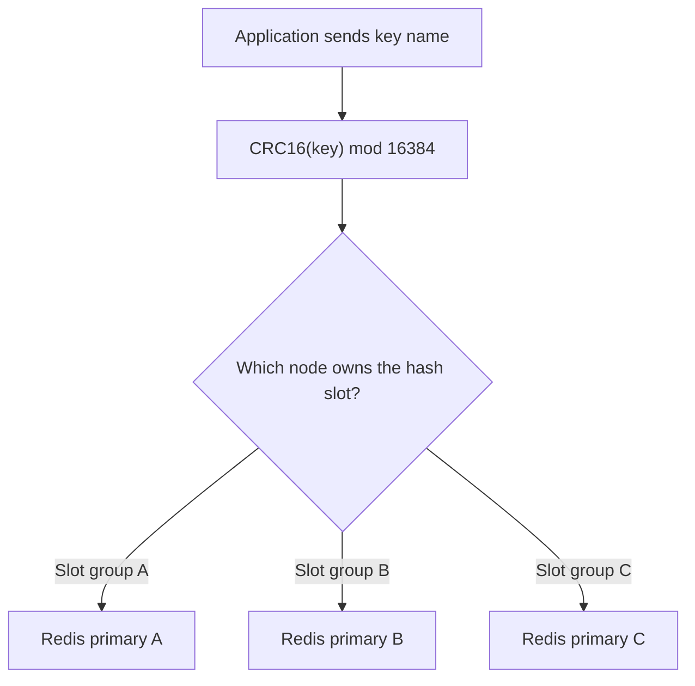

# Key Constraints for Scripts in Redis Cluster with Spring Data Redis

Lua scripts are a vital tool when a Spring Data Redis application needs to **read, check conditions, and update data in a single atomic execution**. In standalone Redis, a script can operate on multiple keys within the same database. Once you move to **Redis Cluster**, however, keys are distributed across multiple nodes by *hash slot*. That introduces an essential constraint: **every key a script accesses must be declared in the key list when invoking the script, and keys used together in a single execution must belong to the same hash slot**.

For example, suppose a script updates an order's status while also recording the update timestamp in a second Redis key. If those two keys map to different slots, a single `EVAL` passing both keys cannot create an atomic transaction spanning two Redis Cluster nodes. Redis or the client can reject the call with an error like `CROSSSLOT`. Worse, if the script dynamically builds another key name inside Lua, it can fail trying to access a key not owned by the executing node.

In this lesson, we walk from hash-slot architecture to key naming design, `KEYS` and `ARGV` usage, writing Lua scripts, and invoking them with Spring Data Redis. We also cover resharding, retries, runtime errors, and redesign options when a business rule genuinely spans keys in different slots.

## 1. How Do Lua Scripts Provide Atomicity?

Redis provides commands like `EVAL` and `EVALSHA` to execute Lua scripts on the server. A single script can run multiple Redis commands, for instance:

```lua
local current = redis.call('GET', KEYS[1])
if current == ARGV[1] then
    redis.call('SET', KEYS[1], ARGV[2])
    return 1
end
return 0
```

This script performs a *compare-and-set*:

1. Read the value of the key passed via `KEYS[1]`.
2. Compare it against the expected value in `ARGV[1]`.
3. If equal, write the new value from `ARGV[2]` and return `1`.
4. If different, keep the data unchanged and return `0`.

Because Redis executes the entire script without interruption, commands from other clients cannot interleave between `GET` and `SET`. This avoids the race condition typical of two independent Redis calls from Java:

```java
String oldValue = redis.opsForValue().get(key);
if ("PENDING".equals(oldValue)) {
    redis.opsForValue().set(key, "PROCESSING");
}
```

In the Java version above, two workers can both read `PENDING` and both overwrite with `PROCESSING`. Moving the check and update into a script performs validation and mutation in one atomic step.

**Limit to remember:** script atomicity applies to execution on **a single Redis node**. It does not create a distributed transaction across multiple nodes. Furthermore, Redis **does not roll back** already-executed commands if a script hits a runtime error after writing data.

## 2. Redis Cluster Distributes Keys Using Hash Slots

Redis Cluster uses **16,384 hash slots**, numbered `0` through `16383`. Each slot is managed by one primary node at any given time. Nodes may have replicas for redundancy, but routing writes and executing scripts must still target the primary owning the slot.

For an ordinary key, Redis computes its slot using:

```text
HASH_SLOT = CRC16(key) mod 16384
```

Two keys with similar names **do not automatically** share a slot:

```text
order:42:status
order:42:updatedAt
```

Despite sharing the `order:42:` prefix, Redis hashes each full key name. These keys can therefore land in different slots, served by different nodes.

Distribution flow:



For single-key commands like `GET order:42:status`, a Redis Cluster client resolves the owning node and routes the command there. For **multi-key** operations, you must consider whether a single node can execute every command involved.

### 2.1. Why Are Multi-Key Scripts Constrained?

Suppose a script runs:

```lua
local status = redis.call('GET', KEYS[1])
redis.call('SET', KEYS[2], 'updated')
return status
```

If `KEYS[1]` lives on node A and `KEYS[2]` lives on node B, a Lua execution on node A cannot make an operation on node B part of an atomic execution on node A. Redis Cluster has no general mechanism for executing one atomic Lua script across two primaries.

Therefore, **all keys passed to a script invocation must belong to the same slot** under standard `EVAL`, `EVALSHA`, and Spring Data Redis usage.

### 2.2. Checking Slots via Redis CLI

Redis provides the `CLUSTER KEYSLOT` command:

```redis
CLUSTER KEYSLOT order:42:status
CLUSTER KEYSLOT order:42:updatedAt
```

In a Cluster environment, these commands return the slot number for each key. If the two slots differ, those two keys cannot participate in the same single-node atomic script under this key design.

Never rely on "in our test environment both keys happen to sit on the same physical machine." **Being on the same node right now while having different slots is not a valid contract** for a multi-key script. Once the cluster rebalances slots, that assumption breaks immediately.

## 3. Hash Tags: Deliberately Placing Related Keys in the Same Slot

Redis Cluster supports **hash tags**: when a key name contains a valid pair of curly braces with non-empty content inside, Redis computes the slot using only the substring inside those braces.

Example:

```text
order:{42}:status
order:{42}:updatedAt
order:{42}:revision
```

For all three keys, the substring hashed is `42`:

```text
CRC16("42") mod 16384
```

As a result, all three keys land in the **same hash slot**, even though their full names differ.

| Key | Hashed portion | Same slot as `order:{42}:status`? |
|---|---|---|
| `order:{42}:status` | `42` | Yes |
| `order:{42}:updatedAt` | `42` | Yes |
| `invoice:{42}:link` | `42` | Yes |
| `order:{43}:status` | `43` | Not guaranteed |
| `order:42:updatedAt` | Full key | Not guaranteed |
| `{orders}:42:status` | `orders` | Not guaranteed |

Note that two different hash values **can still collide into the same slot by coincidence** because there are only 16,384 slots. System design must rely on shared hash tags guaranteeing colocation, never on accidental slot collisions between unrelated keys.

### 3.1. Key Naming Convention for an Aggregate

A common convention:

```text
<namespace>:{<aggregate-id>}:<field-or-purpose>
```

Example for order `42`:

```text
order:{42}:status
order:{42}:updatedAt
order:{42}:revision
order:{42}:auditFlag
```

Keys belonging to the same order share a slot so they can be updated together inside a script. Order `43` uses `{43}`, letting different aggregates spread across slots.

Choose hash tags based on the **required atomicity boundary**, not merely module names. If every key used `{orders}`, they would pile onto one slot, defeating Cluster load distribution.

### 3.2. Never Use One Global Hash Tag for the Entire System

Anti-pattern to avoid at scale:

```text
order:{all}:1:status
order:{all}:2:status
order:{all}:3:status
payment:{all}:4:state
```

Every key containing `{all}` maps to one slot. If all business data and traffic funnel there, one primary becomes a hot spot while other nodes sit underutilized.

Use sufficiently granular hash tags:

```text
order:{1}:status
order:{2}:status
order:{3}:status
```

This means a script updating **two orders with different IDs** generally cannot execute atomically in Redis Cluster. That is a natural trade-off of aggregate partitioning that must be accounted for in business design.

### 3.3. Watch the Content Inside Curly Braces

Redis parses hash tags syntactically from the key string, not from application ID concepts. Malformed braces or empty braces prevent the intended tag from taking effect.

Examples:

```text
order:{42}:status   → tag "42"
order:{42}:audit    → tag "42"
order:{}:status     → no non-empty tag as intended
order:{42:status    → missing closing brace
```

When IDs come from external input, enforce safe key construction and prevent unexpected `{` or `}` characters inside the hash tag. A centralized key-builder helper is far easier to govern than ad-hoc string concatenation across services.

## 4. KEYS and ARGV in EVAL: Completely Different Roles

The Redis `EVAL` command has the syntax:

```text
EVAL <lua-script> <numkeys> <key1> ... <keyN> <arg1> ... <argM>
```

Example:

```redis
EVAL "return {KEYS[1], KEYS[2], ARGV[1]}" 2 order:{42}:status order:{42}:updatedAt PROCESSING
```

Here:

- `2` is the number of Redis keys passed to the script.
- `KEYS[1]` is `order:{42}:status`.
- `KEYS[2]` is `order:{42}:updatedAt`.
- `ARGV[1]` is the string `PROCESSING`.

| Component | Holds what? | Participates in key routing contract? |
|---|---|---|
| `KEYS[1]`, `KEYS[2]`... | Names of Redis keys accessed by the script | Yes |
| `ARGV[1]`, `ARGV[2]`... | Values, conditions, quantities, timestamps, business data | No |
| `numkeys` | Count of leading parameters treated as keys | Yes, separates keys and arguments |

**Core rule:** keys accessed by a script must be explicitly declared via the key arguments list at invocation time. Never use `ARGV` to smuggle key names past client or Redis hash-slot validation.

### 4.1. Right: Pass All Key Names in KEYS

```lua
local state = redis.call('GET', KEYS[1])
if state ~= ARGV[1] then
    return 0
end

redis.call('SET', KEYS[1], ARGV[2])
redis.call('SET', KEYS[2], ARGV[3])
return 1
```

The application must pass both keys via `KEYS`. Under Redis Cluster, both keys must share the same slot.

### 4.2. Wrong: Dynamically Constructing Keys from ARGV in Lua

Avoid writing:

```lua
-- Violates the Redis Cluster key declaration contract:
local key = 'order:' .. ARGV[1] .. ':status'
return redis.call('GET', key)
```

With a call like `EVAL ... 0 42`, Redis receives no key in `KEYS` for client routing to the proper slot. Sometimes such code appears to work in standalone mode or a single-node test, yet cannot be relied upon in Cluster deployments.

Similarly, avoid this pattern:

```lua
-- KEYS[2] was not declared in EVAL:
local first = redis.call('GET', KEYS[1])
local second = redis.call('GET', KEYS[2])
return {first, second}
```

If Java passes only one element in `keys`, `KEYS[2]` is missing. Inferring additional keys from the first key also breaks the rule of declaring every accessed key.

### 4.3. Do Not Read Key Names from Data Stored in Redis

Another pitfall:

```lua
local linkedKey = redis.call('GET', KEYS[1])
return redis.call('GET', linkedKey)
```

Here the script reads **the contents of the first key** and treats that content as another key name. This breaks routing and can hit keys in other slots or undeclared keys. In Cluster, avoid scripts that dynamically discover target keys from runtime values.

Instead, the application should determine target keys ahead of time, declare them in `KEYS`, and model data so all keys in one call share the same slot.

## 5. Practical Example: Transitioning Order Status and Recording Update Time

Requirement:

> Transition an order from `PENDING` to `PROCESSING` only if its current status is `PENDING`; upon success, also record the processing timestamp. Both updates must happen contiguously in Redis.

We use two keys:

```text
order:{42}:status       = "PENDING"
order:{42}:updatedAt    = "2026-11-13T02:00:00Z"
```

Both share hash tag `{42}`, placing them in the same slot.

### 5.1. Lua Script

```lua
-- KEYS[1] = status key
-- KEYS[2] = updatedAt key
-- ARGV[1] = expected current status
-- ARGV[2] = new status
-- ARGV[3] = timestamp prepared by the application

local current = redis.call('GET', KEYS[1])
if current ~= ARGV[1] then
    return 0
end

redis.call('SET', KEYS[1], ARGV[2])
redis.call('SET', KEYS[2], ARGV[3])
return 1
```

The script reads status and writes both keys only if the condition holds. `SET` here does not need to read the old timestamp. It returns `1` when the status transitioned and `0` when the expected status did not match.

Running in Redis CLI:

```redis
SET order:{42}:status PENDING
SET order:{42}:updatedAt 2026-11-13T02:00:00Z
EVAL "local s=redis.call('GET',KEYS[1]); if s~=ARGV[1] then return 0 end; redis.call('SET',KEYS[1],ARGV[2]); redis.call('SET',KEYS[2],ARGV[3]); return 1" 2 order:{42}:status order:{42}:updatedAt PENDING PROCESSING 2026-11-13T02:30:00Z
```

Read back:

```redis
GET order:{42}:status
GET order:{42}:updatedAt
```

Expected results when no errors occurred and no other client modified state first:

```text
"PROCESSING"
"2026-11-13T02:30:00Z"
```

If invoked again still expecting `PENDING`, the script returns `0` and leaves `PROCESSING` untouched.

### 5.2. Why Did This Example Use Two SET Commands?

The example focuses on same-slot constraints and conditional logic in Lua. Two `SET` commands with prepared arguments clearly illustrate key ownership and execution order. If the application must preserve existing TTLs, use `SET` options supported by your Redis version, such as `KEEPTTL` (Redis 6.0+), or apply TTLs inside the script per policy.

For counters, stock, or financial workloads, scripts must also check data types, numeric limits, and overflow thresholds. A Redis script **can write one key and then error on the next key without automatic rollback**. Thus, validating error-prone conditions before writes is a separate design requirement alongside "same hash slot."

## 6. Calling the Lua Script with Spring Data Redis

Spring Data Redis provides `RedisScript<T>` and `RedisTemplate.execute(...)`. With `StringRedisTemplate`, string keys and arguments are encoded appropriately when sent to Redis.

### 6.1. Declaring RedisScript<Long>

```java
package com.example.redis.cluster;

import org.springframework.context.annotation.Bean;
import org.springframework.context.annotation.Configuration;
import org.springframework.data.redis.core.script.DefaultRedisScript;
import org.springframework.data.redis.core.script.RedisScript;

@Configuration
public class OrderScriptConfiguration {

    @Bean
    RedisScript<Long> transitionOrderScript() {
        String lua = """
                local current = redis.call('GET', KEYS[1])
                if current ~= ARGV[1] then
                    return 0
                end

                redis.call('SET', KEYS[1], ARGV[2])
                redis.call('SET', KEYS[2], ARGV[3])
                return 1
                """;

        DefaultRedisScript<Long> script = new DefaultRedisScript<>();
        script.setScriptText(lua);
        script.setResultType(Long.class);
        return script;
    }
}
```

Spring Data Redis runs scripts via `EVALSHA` when cached and falls back to `EVAL` as needed. Script caching is scoped per Redis node handling the request; never treat loading on one node as proof that every Cluster node has cached the script.

### 6.2. Building Keys with Hash Tags and Passing All KEYS

```java
package com.example.redis.cluster;

import java.time.Instant;
import java.util.List;

import org.springframework.data.redis.core.StringRedisTemplate;
import org.springframework.data.redis.core.script.RedisScript;
import org.springframework.stereotype.Service;

@Service
public class OrderTransitionService {

    private final StringRedisTemplate redis;
    private final RedisScript<Long> transitionOrderScript;

    public OrderTransitionService(
            StringRedisTemplate redis,
            RedisScript<Long> transitionOrderScript) {
        this.redis = redis;
        this.transitionOrderScript = transitionOrderScript;
    }

    public boolean transition(
            String orderId,
            String expectedState,
            String nextState) {

        if (orderId == null
                || !orderId.matches("[A-Za-z0-9_-]+")) {
            throw new IllegalArgumentException("Invalid orderId");
        }
        if (expectedState == null || nextState == null) {
            throw new IllegalArgumentException(
                    "State must not be null");
        }

        // Curly braces create a shared hash tag for both keys.
        String tag = "{order-" + orderId + "}";
        String statusKey = "order:" + tag + ":status";
        String updatedAtKey = "order:" + tag + ":updatedAt";

        List<String> keys = List.of(statusKey, updatedAtKey);
        String timestamp = Instant.now().toString();

        Long result = redis.execute(
                transitionOrderScript,
                keys,
                expectedState,
                nextState,
                timestamp);

        return Long.valueOf(1L).equals(result);
    }
}
```

When `orderId = "42"`, the keys and arguments passed to the script are:

```text
KEYS[1] = order:{order-42}:status
KEYS[2] = order:{order-42}:updatedAt

ARGV[1] = expectedState
ARGV[2] = nextState
ARGV[3] = timestamp
```

Because both keys contain `{order-42}`, they hash to the same slot. Both keys must appear in the `keys` list passed to `execute(...)`. The next three parameters are **values**, not key names, and are not used for routing.

### 6.3. Why Not Pass the Second Key in ARGV?

A common mistake:

```java
// Violates the Cluster Lua script key declaration contract.
redis.execute(
        transitionOrderScript,
        List.of(statusKey),  // Only one key declared.
        expectedState,
        nextState,
        updatedAtKey);       // Second key hidden in ARGV.
```

If the script then uses `ARGV[3]` as a Redis key name to write data, the client library lacks complete routing metadata for the full set of accessed keys. Moreover, `ARGV[3]` in the correct contract is a **timestamp**, not a Redis key.

Always pass every accessed key in `keys`, and pass all remaining business values as arguments.

### 6.4. Script Results and Serializers

With `DefaultRedisScript<Long>`, the script returns integer `0` or `1` and Spring Data Redis converts it to `Long`. Use:

```java
Long result = redis.execute(script, keys, args);
boolean changed = Long.valueOf(1L).equals(result);
```

This contract avoids manual `Object` casts. When a script returns strings, lists, or complex values, configure matching result types and serializers for Spring Data Redis decoding.

`StringRedisTemplate` also requires matching serializers between initial writes and script calls. If a key was stored with a binary serializer, a seemingly right Java key string can encode to bytes that do not match the stored data.

## 7. The CROSSSLOT Error: Cause and Fix

Suppose an application tries to run a script on two keys:

```text
inventory:sku-42:available
inventory:sku-42:reserved
```

Sharing a prefix does not guarantee sharing a slot. If the call:

```redis
EVAL "return {redis.call('GET', KEYS[1]), redis.call('GET', KEYS[2])}" 2 inventory:sku-42:available inventory:sku-42:reserved
```

touches keys in two different slots, Redis Cluster or the client can reject it with an error like:

```text
CROSSSLOT Keys in request don't hash to the same slot
```

Fix it by aligning on one hash tag:

```text
inventory:{sku-42}:available
inventory:{sku-42}:reserved
```

Then check:

```redis
CLUSTER KEYSLOT inventory:{sku-42}:available
CLUSTER KEYSLOT inventory:{sku-42}:reserved
```

Both commands must return **the exact same slot number**. When calling `EVAL`, still pass `numkeys = 2`.

### 7.1. Do Not Try to Fix CROSSSLOT by Arbitrarily Switching Drivers

Lettuce and other Redis Cluster clients can:

- Determine slots from the key list.
- Pick the node owning that slot.
- Track topology changes and follow `MOVED`/`ASK` redirects as needed.
- Reject operations that cannot be routed cleanly under Cluster rules.

Changing drivers does not magically enable atomic cross-slot Lua transactions. The constraint stems from Redis Cluster's data distribution model, so the real fix is **designing keys around proper atomicity boundaries**.

### 7.2. Do Not Try to Fix It by Passing numkeys = 0

A broken workaround:

```redis
EVAL "return redis.call('GET', ARGV[1])" 0 order:42:status
```

This command treats an argument as a key name while declaring zero routing keys. It breaks the key-declaration contract and produces non-portable, Cluster-incompatible code.

When a script genuinely accesses no keys, `numkeys = 0` is valid for pure computation; that is completely different from hiding key names inside `ARGV`.

## 8. Scripts Accessing Off-Node Keys Can Fail Even When KEYS Looks Right

The problem is not limited to passing two differently slotted keys to `EVAL`. A script can also access an **undeclared** or dynamically constructed key inside Lua:

```lua
local userId = ARGV[1]
local key = 'user:' .. userId .. ':balance'
return redis.call('GET', key)
```

If that key sits in a slot owned by another node, Redis can fail the script for accessing a **non-local key**. Even when the key happens to land on the same node, the code violates the key-declaration contract and can break when the cluster reshards.

Another pattern to avoid:

```lua
local ids = redis.call('SMEMBERS', KEYS[1])
for _, id in ipairs(ids) do
    redis.call('GET', 'user:' .. id .. ':balance')
end
```

A script cannot assume every key derived from Redis Set members shares the same slot and was declared. When dynamic key lookups are needed, you can:

1. Read the IDs in a separate step so the application knows the target keys before invoking the script.
2. Invoke the script only on a known, same-slot subset passed entirely in `KEYS`.
3. If the keys span multiple slots, split by aggregate or redesign the data model.

There is no way to "bundle arbitrary keys" into a cluster-wide atomic script when they reside on different slots.

## 9. Designing a Stock Transfer Command Between Two Keys

A classic inventory scenario:

```text
inventory:{sku-42}:available
inventory:{sku-42}:reserved
```

To move stock from available to reserved, both keys share the `{sku-42}` hash tag. Lua can check stock and update both counters within a single execution on the slot-owning node.

Illustrative script:

```lua
-- KEYS[1] = available
-- KEYS[2] = reserved
-- ARGV[1] = quantity (positive integer)

local quantity = tonumber(ARGV[1])
if not quantity or quantity <= 0 or quantity % 1 ~= 0 then
    return redis.error_reply('quantity must be a positive integer')
end

local availableRaw = redis.call('GET', KEYS[1])
local reservedRaw = redis.call('GET', KEYS[2])

local available = tonumber(availableRaw)
local reserved = tonumber(reservedRaw or '0')

if not available or not reserved then
    return redis.error_reply('invalid inventory counter')
end

if available < quantity then
    return 0
end

redis.call('DECRBY', KEYS[1], quantity)
redis.call('INCRBY', KEYS[2], quantity)
return 1
```

Meaning:

- Validates quantity and both counter values before writing.
- Leaves data unchanged if available stock is insufficient.
- Writes inside the script run contiguously without other clients interleaving.
- Both keys must share a slot, e.g., via `{sku-42}`.

**This is a learning model, not an exhaustive production inventory design.** Redis enforces 64-bit integer bounds on `INCRBY`/`DECRBY`; scripts must validate value ranges and guard against overflow before running commands if counters can grow huge. Lua numbers also have precision bounds for large integers. If `DECRBY` succeeds and `INCRBY` then fails due to wrong type or overflow, Redis **does not automatically roll back** the earlier change.

For high-precision systems, consider using a single data structure with appropriate atomic operations, or design scripts that check every precondition before writing, govern data ownership, and test boundary failures.

## 10. Can You Use One Redis Hash Instead of Multiple Keys?

Often the simplest way to avoid multi-key coordination is grouping related fields into **one Redis Hash**:

```text
Redis key: inventory:{sku-42}

field       value
available   18
reserved     4
```

Hash-based script:

```lua
local available = tonumber(
    redis.call('HGET', KEYS[1], 'available'))

local reserved = tonumber(
    redis.call('HGET', KEYS[1], 'reserved') or '0')

local quantity = tonumber(ARGV[1])

if not available or not reserved or not quantity then
    return redis.error_reply('invalid inventory values')
end
if quantity <= 0 or quantity % 1 ~= 0 then
    return redis.error_reply('invalid quantity')
end
if available < quantity then
    return 0
end

redis.call('HINCRBY', KEYS[1], 'available', -quantity)
redis.call('HINCRBY', KEYS[1], 'reserved', quantity)
return 1
```

Here there is **only one Redis key** (`KEYS[1]`), storing both values as fields of that key. This avoids passing multiple key names, though you must still validate numeric format, overflow, and business rules.

Comparison criteria:

| Option | Pros | Considerations |
|---|---|---|
| Two String keys with shared hash tag | Flexible per-key updates and TTLs | Must keep in same slot; multi-key schema |
| One Redis Hash with multiple fields | Single key; fits small aggregates | TTL typically applies to whole key; per-field expiration needs extra design |
| Multiple keys in different slots | Load distribution, flexible partitioning | Cannot run a single atomic Lua script across slots |

Good design aligns atomicity boundaries with **aggregates**: fields that change together belong in one Hash or a group of same-tag keys, while independent aggregates distribute across slots.

## 11. What Should You Do When Two Keys Belong to Different Slots?

Suppose a business feature transfers points between two accounts:

```text
account:{alice}:balance
account:{bob}:balance
```

Different hash tags mean the two keys **are not guaranteed to share a slot**. You cannot use a single Lua script to debit Alice and credit Bob in an atomic transaction on Redis Cluster.

Options depend on business requirements:

### 11.1. Redesign Data Boundaries

If two values always belong to the same business entity, consider sharing a hash tag, such as a `transferGroupId` or master account. This fits when keys genuinely share ownership and require atomic updates.

Never merge the entire system into one tag just for a rare cross-entity action; that creates hot slots and degrades Cluster scalability.

### 11.2. Split into Independent Compensable Steps

If two keys truly represent distributed aggregates, build a multi-step workflow:

```text
Record transfer request with operationId
        |
        v
Execute step 1 on slot A
        |
        v
Execute step 2 on slot B
        |
        v
Mark complete or compensate on failure
```

This is a distributed workflow—**not cluster-wide atomicity like a single script**. It requires handling retries, idempotency, intermediate states, and reconciliation. For financial transactions, an authoritative database with full transactional guarantees and durability is usually required as the system of record.

### 11.3. Choose a Different Storage Mechanism

If strict atomic transactions across distributed entities are mandatory, a transactional database meets that requirement far more directly. Redis can still serve as a cache, counter, or high-speed coordinator without carrying guarantees Redis Cluster does not offer.

## 12. Resharding, Failover, and Script Routing Errors

In Redis Cluster, operators or autoscalers can migrate slots from one primary to another. Clients can encounter:

- `MOVED`: the slot now belongs to another node; update routing.
- `ASK`: the slot is actively migrating; follow temporary redirection.
- `TRYAGAIN`: the operation cannot complete temporarily during certain slot-migration states.
- `CROSSSLOT`: multi-key operation keys do not share a hash slot.
- Non-local key script errors: script attempted to access a key outside its routed node/scope.

Cluster-aware drivers handle many redirects automatically. However, a **script with side effects** experiencing a network timeout may have executed on the server without returning a response to the client. Never retry a non-idempotent operation blindly just because of a connection error.

For instance, a counter-incrementing script:

```lua
return redis.call('INCR', KEYS[1])
```

If Redis executed `INCR` and the response dropped, retrying increments it a second time. For "process at most once" operations, store an operation ID and processed marker **in the same slot**, so checking and updating run atomically in one script.

### 12.1. Operation-ID Idempotency Technique

You can store:

```text
order:{42}:status
order:{42}:processed-ops
```

Because both keys share `{42}`, the script checks whether the operation ID exists in the Set before changing state, then records it in the same execution. Conceptual example:

```lua
if redis.call('SISMEMBER', KEYS[2], ARGV[1]) == 1 then
    return 2  -- Operation already processed.
end

if redis.call('GET', KEYS[1]) ~= ARGV[2] then
    return 0  -- State transition not allowed.
end

redis.call('SET', KEYS[1], ARGV[3])
redis.call('SADD', KEYS[2], ARGV[1])
return 1
```

Here:

- `KEYS[1]`: status key.
- `KEYS[2]`: Set storing operation IDs.
- `ARGV[1]`: operation ID.
- `ARGV[2]`: expected status.
- `ARGV[3]`: next status.

This detects replayed calls with the same operation ID **as long as the processed record is retained**. Applications still must define Set TTL/retention, error states, memory growth limits, and protection against misusing old operation IDs. Because Redis does not roll back runtime errors inside scripts, design operations carefully to avoid errors after partial writes.

## 13. Script Caching and EVALSHA in Cluster

When using `RedisScript`, Spring Data Redis computes the script's SHA1 and attempts `EVALSHA`. If Redis replies `NOSCRIPT`, the framework resends the script body via `EVAL` according to its executor strategy.

In Redis Cluster:

1. Scripts execute on the node responsible for the keys' slot.
2. Script caches belong to individual Redis servers, not a single global registry guaranteed across all nodes.
3. After failover, restart, or cache flush, the target node may no longer hold the script in cache.
4. Routing to a new node does not require altering the Java script; the client/framework handles `NOSCRIPT` and reloads when supported.

Never conclude a script is loaded cluster-wide just because `SCRIPT LOAD` succeeded on one node. In addition, Redis 7.4 can evict scripts loaded via `EVAL`/`EVAL_RO` under certain cache conditions, so client code must accept resending scripts.

For frequently called scripts, declaring them as reusable `RedisScript` beans in the Spring Context avoids reconstructing script metadata on every call. That improves application-side management; **same-slot key constraints remain unchanged**.

## 14. Which Redis Commands Can Lua Call in Cluster?

Inside Lua, `redis.call(...)` runs commands on the Redis server executing the script. Standard constraints still apply:

- Accessed keys must lie within declared keys available on the executing node.
- For multi-key scripts, keys must obey same-slot constraints.
- Commands incompatible with script semantics or Cluster scope may be rejected by Redis.
- Read/write commands must be compatible with script mode and Redis version.
- Long-running scripts can block other commands on the node; bound processing work.

Specifically, never use Lua to scan the whole keyspace with `KEYS *` or build unbounded loops. Scripts run inside the server and can prolong Redis blocking; pipelines or batched workers are better suited for large datasets.

### 14.1. Read-Only Scripts Still Obey Routing Rules

Redis provides read-only script execution commands such as `EVAL_RO` on supported versions. Even a non-writing script must still target the right keys on the right node. **Read-only does not permit freely reading keys across different slots** in a single Lua execution on Cluster.

In Spring Data Redis, select appropriate APIs/connections if leveraging read-only script modes supported by your Redis/driver version; standard `RedisTemplate.execute(RedisScript, ...)` should not simply be assumed to invoke `EVAL_RO`.

### 14.2. Redis Functions Do Not Remove Slot Constraints Either

Redis Functions allow registering server-side logic more durably than dynamic scripts in some scenarios. Even so, logic running on each Redis node still obeys Cluster key and routing rules. Moving from `EVAL` to `FCALL` does not create cross-slot transactions.

## 15. Common Deployment Mistakes with Spring Data Redis

### Mistake 1: Keys Share a Prefix Without Sharing a Hash Tag

```java
List<String> keys = List.of(
        "order:" + orderId + ":status",
        "order:" + orderId + ":updatedAt");
```

The two keys can land in different slots. Use a shared tag:

```java
String tag = "{order-" + orderId + "}";
List<String> keys = List.of(
        "order:" + tag + ":status",
        "order:" + tag + ":updatedAt");
```

### Mistake 2: Sending a Key Name Inside ARGV

```java
redis.execute(script, List.of(statusKey), updatedAtKey);
```

If the script uses `updatedAtKey` as a Redis key, this violates the key-declaration contract. Pass:

```java
redis.execute(script, List.of(statusKey, updatedAtKey), timestamp);
```

### Mistake 3: Generating a New Key Inside Lua

```lua
local nextKey = KEYS[1] .. ':metadata'
redis.call('SET', nextKey, ARGV[1])
```

Even if the key happens to share a slot via a hash tag, the script was still not given **all accessed keys** in its inputs. Build `nextKey` in Java and pass it explicitly in `KEYS[2]`.

### Mistake 4: Putting All Keys Under One Static Hash Tag

```text
user:{global}:1:profile
user:{global}:2:profile
user:{global}:3:profile
```

This funnels huge amounts of data and traffic onto a single slot. Scope tags to aggregates or small groups genuinely requiring atomicity.

### Mistake 5: Using Data on One Redis Node to Reference Keys on Another

Scripts that read IDs or key names from a Set/Hash and access dynamically built keys cannot guarantee same-slot placement. Move key discovery outside the script and enforce clear data boundaries.

### Mistake 6: Assuming Atomic Scripts Always Roll Back

Scripts execute contiguously, yet a runtime error after a write command **does not undo** earlier succeeded commands. Check conditions, data types, numeric bounds, and validity before operations that could fail later.

### Mistake 7: Using Multiple RedisTemplates with Mismatched Serializers

If one template writes keys with a different serializer, a script receiving plain string keys from `StringRedisTemplate` may look up different bytes than expected. Align key serializers and storage schemas.

### Mistake 8: Thinking WATCH or MULTI Replaces Scripts Across Slots

`MULTI/EXEC` and `WATCH` face the same Redis Cluster slot constraints. Swapping Lua for transactions does not magically make cross-slot updates across primaries atomic.

### Mistake 9: Ignoring Resharding and Uncertain Connection States

During slot migrations, clients can see redirects or transient failures. For write operations, distinguish safe retries from retries risking duplicate side effects.

### Mistake 10: Building Key Names from Unvalidated Input

Concatenating arbitrary IDs into `{...}` lets braces inside user input alter how Redis selects hash tags. Use a helper with strict ID validation or deterministic encoding.

## 16. Design Workflow for Multi-Key Scripts on Redis Cluster

Before deploying a script with multiple `KEYS`, follow these steps:

1. **List every Redis key the script reads or writes.** Never omit keys derived indirectly from payloads or other keys.
2. **Define the required atomicity boundary.** One order, one cart, one inventory SKU, one job, or multiple independent aggregates?
3. **Choose a hash-tag convention.** Every key used together in one script must share a tag; separate aggregates should have distinct tags to spread load.
4. **Construct key names in the application.** Pass all of them in `keys` of `RedisTemplate.execute(...)`.
5. **Place values/conditions in ARGV.** Include expected state, next state, quantities, timestamps, or operation IDs.
6. **Verify slots.** Run `CLUSTER KEYSLOT` on sample keys and remember shared prefixes are not enough.
7. **Design error handling.** Distinguish unmet conditions, `CROSSSLOT`, data-type errors, Redis timeouts, `NOSCRIPT`, slot migrations, and unknown execution states.
8. **Bound script runtime and resources.** Avoid unbounded loops, excessive key counts, or huge replies.
9. **Add idempotency when retries are possible.** Operation IDs must have an appropriate lifecycle and same-slot key scope.
10. **Assess hot slots.** Shared hash tags support business atomicity, but ensure they do not unbalance cluster load.

When a requirement demands atomic updates across independent aggregates in different slots, address it at the design stage: a Lua script is not a solution for distributed transactions.

## 17. Hands-On Exercises

### Exercise 1 — Identifying Same-Slot Keys

Given these keys:

```text
cart:{u-17}:items
cart:{u-17}:total
cart:{u-18}:items
cart:u-17:total
user:{u-17}:profile
```

Identify which keys are guaranteed to share a slot with `cart:{u-17}:items`. Answer: `cart:{u-17}:total` and `user:{u-17}:profile` because they share `{u-17}`. The remaining keys are not guaranteed to share a slot.

### Exercise 2 — Fixing a Script with Undeclared Keys

Original script:

```lua
local current = redis.call('GET', KEYS[1])
local auditKey = ARGV[1]
redis.call('SET', auditKey, current)
return 1
```

Required fixes:

1. Build `auditKey` in Java and pass it via `KEYS[2]`.
2. Apply a shared hash tag to both source and audit keys.
3. Move any other business values into `ARGV`.
4. Explain why this fix lets Redis Cluster route accurately.

### Exercise 3 — Invoking a Script with RedisScript<Long>

Create a script that updates `job:{jobId}:status` and `job:{jobId}:updatedAt` only when the old status matches the expected value. Declare a `@Bean RedisScript<Long>` and invoke it via `StringRedisTemplate.execute(...)`, returning `1L` or `0L`.

Test:

- First transition from `PENDING` to `RUNNING`: expect `1`.
- Second call still expecting `PENDING`: expect `0`.
- Replace the second key with one lacking the shared hash tag on Cluster: observe the error or invalid routing behavior.

### Exercise 4 — Redesigning a Points Transfer Problem

Initial layout:

```text
account:{alice}:points
account:{bob}:points
```

Explain why a Lua script cannot guarantee atomic point transfers between two accounts in different slots. Propose either grouping data into an aggregate with shared ownership or building a transfer workflow with operation IDs, status tracking, and reconciliation.

### Exercise 5 — Investigating Hot Slots

Compare:

```text
session:{all}:1001
session:{all}:1002
session:{all}:1003
```

against:

```text
session:{user-1}:1001
session:{user-2}:1002
session:{user-3}:1003
```

Explain the differences in slot distribution, cost of accessing related keys together, and hot-spot risk under rising traffic.

## 18. Key Takeaways

| Question | Rule |
|---|---|
| How many hash slots does Redis Cluster have? | 16,384 slots, from `0` to `16383` |
| Do two keys with the same prefix always share a slot? | No |
| How do you guarantee keys share a slot? | Use the same hash tag, e.g., `{order-42}` |
| Can a script run atomically across multiple primaries in different slots? | No |
| Where must keys be declared? | In the `KEYS` list when calling `EVAL`/`RedisTemplate.execute(...)` |
| What is `ARGV` for? | Business values and parameters, never for hiding key names |
| How do you fix `CROSSSLOT` errors? | Redesign keys to share a slot, or change the operation boundary |
| Should you put all keys under one shared tag? | Syntactically possible, but creates hot slots and should be avoided |
| Does a runtime error in Lua roll back prior executed commands? | No |
| How do you check a key's slot? | `CLUSTER KEYSLOT key` |
| Can you unconditionally retry after a timeout? | No; the operation may have run, so use idempotency/reconciliation |

The most important constraint for Lua in Redis Cluster is that **every accessed key must be declared upfront and reside within a scope a single node can process—normally the same hash slot**. In Spring Data Redis, achieve this by **building all key names in Java, using shared hash tags for related keys, passing them in `execute(...)`'s `keys` parameter, and using `ARGV` strictly for data**.

When a business flow truly requires atomic updates across data that must live in different slots, revisit data boundaries or adopt an appropriate distributed workflow rather than trying to circumvent Cluster routing rules.

### References

- [Redis — Scripting with Lua](https://redis.io/docs/latest/develop/programmability/eval-intro/)
- [Redis — EVAL](https://redis.io/docs/latest/commands/eval/)
- [Redis — EVALSHA](https://redis.io/docs/latest/commands/evalsha/)
- [Redis — Redis Cluster specification](https://redis.io/docs/latest/operate/oss_and_stack/reference/cluster-spec/)
- [Redis — CLUSTER KEYSLOT](https://redis.io/docs/latest/commands/cluster-keyslot/)
- [Redis — Transactions](https://redis.io/docs/latest/develop/using-commands/transactions/)
- [Spring Data Redis — Scripting](https://docs.spring.io/spring-data/redis/reference/redis/scripting.html)
- [Spring Data Redis — RedisScript API](https://docs.spring.io/spring-data/redis/reference/api/java/org/springframework/data/redis/core/script/RedisScript.html)
