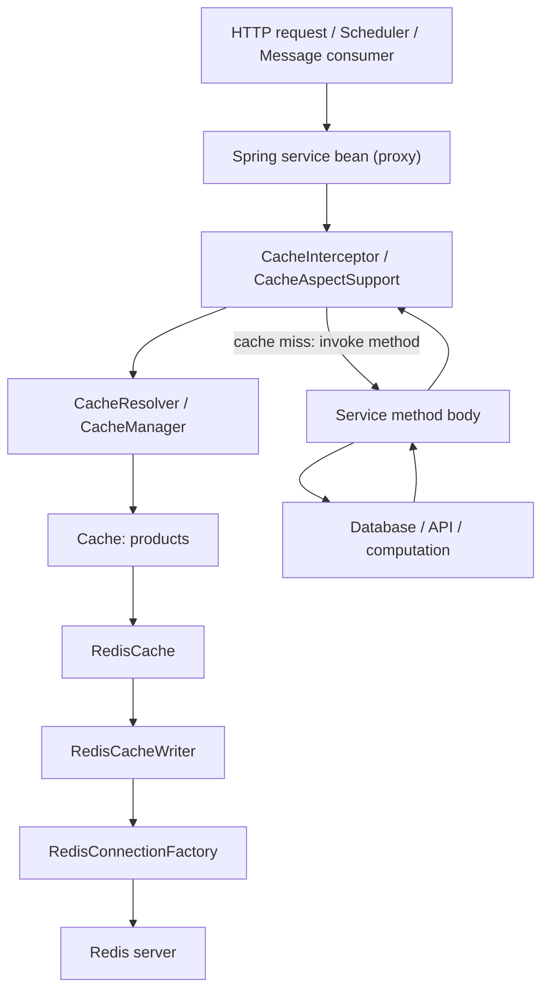
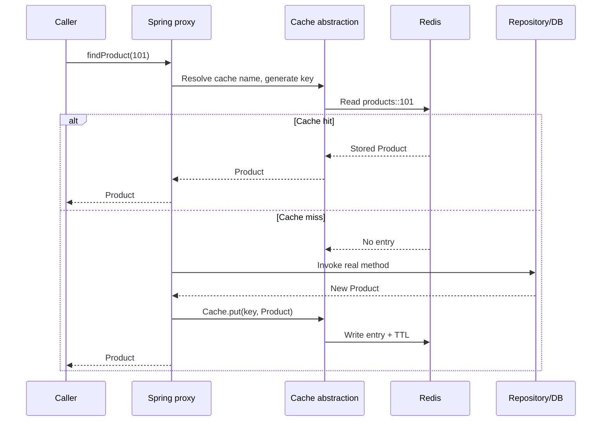
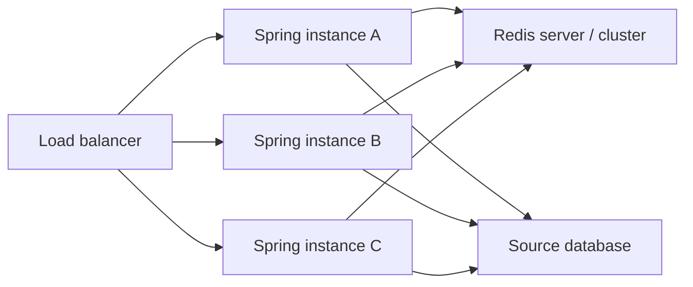

# Spring Cache Abstraction Mechanism and the Role of Redis

> **Module:** Spring Data Redis  
> **Chapter:** Spring Cache  
> **Objective:** Understand how Spring Cache manages cache reads and writes through annotations and interfaces, why Redis is only a specific cache provider, and how Spring Data Redis connects the two layers in a Spring Boot application.

## 1. What problem does the Spring Cache abstraction solve?

An application often needs to read the same data repeatedly: product details, category information, exchange rate tables, display settings, computation results, or expensive aggregate queries. If every request re-executes the database query or makes an HTTP call to another service, latency and system load increase.

Caching allows temporarily storing a **reusable result** under a key. The first time, the application computes or loads the data; on subsequent requests, it can immediately return the cached result as long as it remains valid under the system's policy.

Spring provides the **Spring Cache abstraction**, a unified interface layer for cache operations:

- Developers mark methods to cache with `@Cacheable`, `@CachePut`, `@CacheEvict`, and related annotations.
- Spring intercepts method calls through an advice/proxy mechanism and decides **whether to access the cache, invoke the actual method, store, or evict an entry**.
- A `CacheManager` provides `Cache` instances corresponding to cache region names.
- The underlying cache provider performs storage operations: it may be an in-JVM RAM cache, Caffeine, Redis, or another system.

**Redis is not the Spring Cache abstraction.** Redis is a Redis server with data structures, commands, TTL, eviction, and network data sharing capabilities. Spring Data Redis provides an implementation that allows a `CacheManager` to use Redis as the store for cached values.

An important distinction: using `@Cacheable` does not require using Redis; having a `RedisTemplate` also does not mean all application methods are automatically cached by Spring.

### 1.1. Visualizing a method call

Suppose a service has the following method:

```java
@Cacheable(cacheNames = "products", key = "#id")
public Product findProduct(Long id) {
    return productRepository.findById(id).orElse(null);
}
```

The first time `findProduct(101L)` is called:

1. Spring generates the cache key from the `id` argument.
2. Spring looks up the cache named `products`.
3. The cache does not yet have an entry for that key (*cache miss*).
4. Spring invokes the body of `findProduct` and loads the actual data.
5. Spring stores the returned result in the cache according to the configuration.
6. The caller receives `Product`.

The second time, if the entry is still valid:

1. Spring looks up the same cache and the same key.
2. The cache returns the stored entry (*cache hit*).
3. Spring returns the result to the caller.
4. **The body of `findProduct` is not invoked**; the database query is skipped.

With Redis as the backend, a cache lookup is one or more commands sent to Redis over the network. With a local cache, this may simply be an in-memory operation within the Java process.

## 2. Architecture: Where does Spring Cache sit and where does Redis sit?



The diagram represents the **primary responsibilities** and is not intended to describe every internal class of a specific Spring version.

### 2.1. Components in Spring Cache

| Component | Responsibility | Does it depend directly on Redis? |
|---|---|---|
| `@Cacheable`, `@CachePut`, `@CacheEvict` | Describe cache behavior on methods | No |
| `@EnableCaching` | Enable annotation processing and cache advice | No |
| `CacheInterceptor` and advice infrastructure | Inspect configuration and intercept method calls | No |
| `CacheManager` | Return a cache region by name | No |
| `Cache` | Interface for `get`, `put`, `evict`, `clear`… | No |
| `KeyGenerator` | Generate a key from the invocation and arguments | No |
| `CacheResolver` | Decide which cache region to use | No |
| `CacheErrorHandler` | Handle errors in cache operations | No |
| `RedisCacheManager` | Create/manage `RedisCache` | Yes |
| `RedisCache` and `RedisCacheWriter` | Read, write, and delete entries in Redis | Yes |
| `RedisConnectionFactory` | Provide Redis connections to Spring Data Redis | Yes |
| Redis server | Data storage, TTL, eviction, memory, network | External system |

Because these layers are separated, the same service using `@Cacheable` can run with `ConcurrentMapCacheManager` during testing, Caffeine for local caching, or `RedisCacheManager` when deploying multiple instances, provided the configuration and semantics meet requirements.

### 2.2. Two main layers to understand

**The Spring Cache abstraction** decides *when* the cache is used:

- Before calling the method, should the cache be checked?
- On a cache hit, should calling the method be skipped?
- After the method returns a result, should it be cached?
- When updating/deleting data, which entry must be evicted?

**The Redis backend** decides *how* cached data is stored and persists:

- How are keys/values serialized into bytes?
- What TTL does the Redis key have?
- How does Redis place data in RAM, replicate, and persist it?
- When `maxmemory` is reached, which entries may be evicted?
- How do multiple application instances read/write the cache concurrently?

Do not confuse `@Cacheable` with the Redis `GET` command; the annotation can lead to a `GET` when using Redis, but it also involves method invocation logic, key generation, conditions, null handling, and cache error handling.

## 3. CacheManager and Cache: the interfaces that form the abstraction

Spring defines the core contract in the `org.springframework.cache` package.

### 3.1. The `CacheManager` interface

Core idea:

```java
public interface CacheManager {
    Cache getCache(String name);
    Collection<String> getCacheNames();
}
```

An implementation manages cache regions such as `products`, `categories`, and `exchangeRates`. Each name typically represents a dataset or caching policy.

- With `ConcurrentMapCacheManager`, cache regions may be held in a `ConcurrentMap` inside the JVM.
- With `CaffeineCacheManager`, cache regions are backed by Caffeine with local policies.
- With `RedisCacheManager`, cache regions are implemented via Redis; regions typically use key prefixes to separate names.

Cache names have meaning at the **Spring layer**. Redis has no native concept named `CacheManager` or annotation `@Cacheable`.

### 3.2. The `Cache` interface

`Cache` provides operations such as:

- `get(key)`: read an entry;
- `get(key, type)`: read with the expected type;
- `get(key, Callable)`: read or compute a value if absent, depending on provider support;
- `put(key, value)`: store an entry;
- `evict(key)`: remove an entry;
- `clear()`: remove entries belonging to the cache region;
- related methods such as `putIfAbsent`, `evictIfPresent`, or `invalidate` depending on the API version and implementation.

`Cache` communicates in Java objects, whereas Redis stores bytes/its own data types. `RedisCache` is responsible for translating between the Spring Cache contract and Redis operations.

### 3.3. CacheManager is resolved at runtime

Example service:

```java
@Service
public class CatalogService {
    @Cacheable(cacheNames = "products", key = "#id")
    public Product findProduct(long id) {
        // Load product from the canonical data source.
    }
}
```

The source code of `CatalogService` does not need to know whether the bean is a `RedisCacheManager` or a `CaffeineCacheManager`. Spring retrieves the `CacheManager` implementation from the application context and uses it to serve annotations. If there are multiple cache managers, you must specify the corresponding bean or `cacheManager`/`cacheResolver` attribute to avoid ambiguity.

However, "swapping the provider without modifying the service" does not mean all behaviors are identical: providers differ in TTL, eviction, null support, consistency, serialization, locking, and latency.

## 4. Advice/proxy mechanism when `@Cacheable` executes

### 4.1. How does Spring intercept methods?

In the default mode, `@EnableCaching` uses the **Spring AOP proxy** mechanism. Spring creates a proxy for the Spring bean containing cache operations. External calls pass through the proxy and reach `CacheInterceptor`; the interceptor applies caching behavior before/after deciding whether to invoke the actual method.



Because the interceptor sits in front of the method, annotating a method does not make Redis natively understand Java methods. Redis only sees key read/write operations from the Spring Data Redis adapter.

### 4.2. The self-invocation problem

Example:

```java
@Service
public class ProductService {

    @Cacheable(cacheNames = "products", key = "#id")
    public Product findProduct(long id) {
        return loadFromDatabase(id);
    }

    public Product findForHomepage(long id) {
        return this.findProduct(id); // Internal call within the same object
    }
}
```

The call `this.findProduct(id)` does not pass through Spring's outer proxy. In the default proxy mode, `@Cacheable` advice is typically **not applied to this internal call**.

A straightforward design is to have the cached method called through another Spring bean, or to extract the caching responsibility into a separate service. If AspectJ weaving mode is used, the interception mechanism differs; you should not assume all configurations share the same proxy limitations.

Related points:

- Methods not called through a Spring bean proxy will not be handled by cache advice.
- Calling a method from a constructor or during the initialization lifecycle may not go through the proxy as expected.
- Interception depends on visibility, proxy type, `final`, and Spring AOP configuration; using public service methods called through Spring beans is usually predictable.
- Annotations are metadata; they only take effect when `@EnableCaching` and the appropriate infrastructure are enabled.

## 5. Key annotations

### 5.1. `@Cacheable`: read first, compute only on miss

```java
@Cacheable(cacheNames = "products", key = "#id")
public Product getProduct(long id) {
    return repository.findById(id).orElse(null);
}
```

- **Hit:** returns the stored value and normally does not invoke the method.
- **Miss:** invokes the method and then stores the result if permitted.
- If the cache provider or serializer encounters an error, behavior depends on `CacheErrorHandler` and application configuration; by default, exceptions are usually propagated to the caller.

Common attributes:

| Attribute | Meaning |
|---|---|
| `cacheNames` / `value` | Name of the cache region |
| `key` | SpEL expression to generate the key |
| `keyGenerator` | Custom bean to generate the key when `key` is not used |
| `condition` | Condition deciding whether to apply the cache operation, evaluated before the method |
| `unless` | Condition vetoing result storage, evaluated after the method runs |
| `sync` | Requests the provider to coordinate concurrent loads for the same key to avoid duplicate computation, with specific limitations |
| `cacheManager` | Name of the CacheManager bean specified for the operation |
| `cacheResolver` | Name of the CacheResolver bean selecting the cache for the operation |

Example:

```java
@Cacheable(
    cacheNames = "products",
    key = "#id",
    condition = "#id > 0",
    unless = "#result == null"
)
public Product getProduct(long id) {
    return repository.findById(id).orElse(null);
}
```

In the example above, invalid IDs are not cached; `null` results are not stored because of `unless`. `unless` can only evaluate the result after the method runs, so it does not prevent the method from being called on a cache miss.

### 5.2. `@CachePut`: always invoke the method, then update the cache

```java
@CachePut(cacheNames = "products", key = "#result.id")
public Product updateProduct(long id, ProductPatch patch) {
    Product product = repository.findById(id).orElseThrow();
    product.setName(patch.name());
    return repository.save(product);
}
```

`@CachePut` **does not skip the method body when the cache already has data**. It executes the method and uses the return value to update the entry.

This is useful when database update logic returns the new version of the data. However, you should not arbitrarily combine `@Cacheable` and `@CachePut` on the same method, because one annotation wants to skip the method on a hit while the other wants the method to always run.

In the example, `Product` and `ProductPatch` are application domain types illustrating annotation usage, not built-in Spring classes.

### 5.3. `@CacheEvict`: delete cache entries when data changes

```java
@CacheEvict(cacheNames = "products", key = "#id")
public void deleteProduct(long id) {
    repository.deleteById(id);
}
```

By default `beforeInvocation = false`: Spring performs cache eviction **after the method completes successfully**. If the method throws an exception, post-method eviction will not normally occur.

If you want to evict regardless of method outcome, there is the `beforeInvocation = true` option, but you must understand the risk of the cache being cleared before the actual work finishes.

Evicting an entire cache region:

```java
@CacheEvict(cacheNames = "products", allEntries = true)
public void rebuildProductCatalog() {
    refreshSourceData();
}
```

With Redis, `allEntries = true` can lead to deleting many keys; you must evaluate the key count, scanning algorithm, and cost. Do not use it casually as a periodic action on large caches.

### 5.4. `@Caching` and `@CacheConfig`

`@Caching` is used when a method needs multiple cache operations:

```java
@Caching(evict = {
    @CacheEvict(cacheNames = "products", key = "#id"),
    @CacheEvict(cacheNames = "productSearch", allEntries = true)
})
public void deleteProductAndInvalidateSearch(long id) {
    repository.deleteById(id);
}
```

`@CacheConfig` sets shared configuration at the class level:

```java
@CacheConfig(cacheNames = "products")
@Service
public class ProductQueryService {

    @Cacheable(key = "#id")
    public Product findById(long id) {
        return repository.findById(id).orElseThrow();
    }
}
```

`@CacheConfig` **does not automatically enable caching for every method**. Method-level annotations still need an operation such as `@Cacheable` or `@CacheEvict`.

## 6. Cache keys: from Java arguments to Redis keys

### 6.1. Default keys in Spring Cache

Spring Cache has a default key generation mechanism, typically using `SimpleKeyGenerator`:

| Method arguments | Default logical key |
|---|---|
| No arguments | `SimpleKey.EMPTY` |
| One non-`null` argument | That argument |
| Multiple arguments | A `SimpleKey` containing the arguments |

Example:

```java
@Cacheable("products")
public Product findById(long id) { ... }

@Cacheable("products")
public Product findByStoreAndId(String store, long id) { ... }
```

The logical key in Spring is an object. When using Redis, `RedisCache` must also **convert the key into a string/byte representation** according to the key conversion and serializer configuration.

### 6.2. Why define keys explicitly?

If one cache name is used by multiple methods that have the same argument types but different meanings, keys can collide:

```java
@Cacheable("users")
public User findById(long id) { ... }

@Cacheable("users")
public User findOwnerByOrderId(long orderId) { ... }
```

Both methods can produce the default key `123`; however, `userId = 123` and `orderId = 123` are not the same data entity. The solution is to separate cache names or define keys with context:

```java
@Cacheable(cacheNames = "usersById", key = "#id")
public User findById(long id) { ... }

@Cacheable(cacheNames = "ownerByOrder", key = "#orderId")
public User findOwnerByOrderId(long orderId) { ... }
```

The cache name is typically added to the prefix by `RedisCacheManager`. With the default configuration, keys can take the form:

```text
products::101
categories::5
ownerByOrder::9001
```

This is a **common default convention**, not a mandatory Redis syntax. Prefixes and serialization can be configured differently.

### 6.3. SpEL expressions

`@Cacheable` supports SpEL:

```java
@Cacheable(
    cacheNames = "prices",
    key = "#region + ':' + #sku"
)
public Price findPrice(String region, String sku) { ... }
```

When the method is cached, the logical key reflects both region and SKU. Keep keys stable, deterministic, and free of unnecessary sensitive data. Excessively long keys can increase memory usage and management overhead.

Do not use mutable objects as keys if their `equals`/`hashCode`/`toString` can change between calls. Do not rely on an unstable object's default `toString()` as a Redis key.

## 7. How is Redis integrated via RedisCacheManager?

Spring Data Redis provides `RedisCacheManager` in the package:

```text
org.springframework.data.redis.cache.RedisCacheManager
```

This implementation supplies `RedisCache` instances by name, using `RedisCacheWriter` and `RedisConnectionFactory` to communicate with Redis. General operating model:

```text
@Cacheable("products")
       |
       v
CacheInterceptor
       |
       v
CacheManager.getCache("products")
       |
       v
RedisCache.get(logicalKey)
       |
       v
Convert key to bytes (prefix + serializer)
       |
       v
Redis GET on corresponding Redis key
       |
       +-- hit --> Deserialize value --> return result
       |
       +-- miss --> invoke method --> Serialize --> Redis SET + TTL
```

To use Redis as a cache provider, the application needs:

- A connection to Redis, typically via `RedisConnectionFactory` (Lettuce or Jedis).
- A `RedisCacheManager` configured with the corresponding factory.
- `@EnableCaching` so Spring processes cache annotations.
- Domain methods invoked through a Spring proxy.
- An appropriate strategy for TTL, serializer, key prefix, and invalidation.

You **do not need** to define a Redis Repository just to use Spring Cache. Redis Repository (`@RedisHash`, `CrudRepository`) is a different API intended to store entities as Redis Hashes.

### 7.1. Spring Boot starters and basic configuration

Example dependencies for Gradle Kotlin DSL:

```kotlin
dependencies {
    implementation("org.springframework.boot:spring-boot-starter-cache")
    implementation("org.springframework.boot:spring-boot-starter-data-redis")
}
```

A Spring Boot application can be configured as:

```yaml
spring:
  data:
    redis:
      host: localhost
      port: 6379
      timeout: 2s

  cache:
    type: redis
    cache-names:
      - products
      - categories
    redis:
      time-to-live: 15m
      cache-null-values: false
      use-key-prefix: true
```

The property `spring.cache.type: redis` instructs Spring Boot to use the Redis cache provider when the corresponding infrastructure is present. `spring.cache.redis.time-to-live` is the default TTL passed by Spring Boot to the Redis cache configuration; it does **not** set a TTL on every key written via `RedisTemplate` and does **not** adjust `maxmemory` on the Redis server.

`spring.cache.cache-names` declares the expected cache regions. Depending on the `CacheManager` configuration, whether dynamic creation of new caches is allowed and the set of pre-defined caches may differ.

Enable caching in the application:

```java
import org.springframework.boot.SpringApplication;
import org.springframework.boot.autoconfigure.SpringBootApplication;
import org.springframework.cache.annotation.EnableCaching;

@SpringBootApplication
@EnableCaching
public class CatalogApplication {

    public static void main(String[] args) {
        SpringApplication.run(CatalogApplication.class, args);
    }
}
```

Provided Spring Boot successfully auto-configures `RedisCacheManager`, `@Cacheable` calls will use Redis.

### 7.2. Configuring RedisCacheManager directly in Java

When multiple caches need different TTLs:

```java
import java.time.Duration;
import java.util.Map;

import org.springframework.cache.annotation.EnableCaching;
import org.springframework.context.annotation.Bean;
import org.springframework.context.annotation.Configuration;
import org.springframework.data.redis.cache.RedisCacheConfiguration;
import org.springframework.data.redis.cache.RedisCacheManager;
import org.springframework.data.redis.connection.RedisConnectionFactory;

@Configuration
@EnableCaching
public class CacheConfiguration {

    @Bean
    public RedisCacheManager cacheManager(
            RedisConnectionFactory connectionFactory) {

        RedisCacheConfiguration defaults =
                RedisCacheConfiguration.defaultCacheConfig()
                        .entryTtl(Duration.ofMinutes(15))
                        .disableCachingNullValues();

        RedisCacheConfiguration productCache =
                defaults.entryTtl(Duration.ofHours(2));

        RedisCacheConfiguration categoryCache =
                defaults.entryTtl(Duration.ofMinutes(30));

        return RedisCacheManager.builder(connectionFactory)
                .cacheDefaults(defaults)
                .withInitialCacheConfigurations(Map.of(
                        "products", productCache,
                        "categories", categoryCache))
                .build();
    }
}
```

This example demonstrates:

- Caches without specific configuration use a 15-minute TTL.
- `products` has a 2-hour TTL.
- `categories` has a 30-minute TTL.
- `null` values are not stored in cache regions under this configuration.
- TTL here is applied to **entries managed by the Cache abstraction**.

When providing a custom `RedisCacheManager` bean yourself, some automatic customizations from Spring Boot's `spring.cache.redis.*` properties may not be applied as they are when Boot creates the bean. Therefore, clearly identify the **actual source of configuration**—properties, customizer, or self-declared bean; do not assume they will merge automatically.

### 7.3. Default TTL if unconfigured

`RedisCacheConfiguration.defaultCacheConfig()` typically defaults to:

- no expiration set on entries (`eternal` in the sense that no TTL is automatically attached);
- allowing caching of `null` values via the cache's wrapper mechanism;
- using the cache name prefix for Redis keys;
- using String serialization for keys;
- using JDK serialization for values.

These are the **defaults of Spring Data Redis configuration**, which may be overridden by Spring Boot properties or custom configuration.

If the system's cache needs to refresh data automatically, set an explicit TTL. "No TTL" does not guarantee an entry will persist forever: Redis can still remove keys due to eviction, manual deletion, restarts, or data loss depending on persistence configuration.

## 8. Serialization: how are Java values stored in Redis?

### 8.1. Redis does not store Java objects directly

Redis works with bytes and Redis types such as String, Hash, List, and Set. With `RedisCache`, a cache entry is typically written as a **Redis String key/value**:

```text
Java Product object
        |
        v
RedisCacheConfiguration (serializer)
        |
        v
Byte array
        |
        v
Redis String value under "products::101"
```

On a cache hit, `RedisCache` reads the value and deserializes it back into a Java object to return. If the writing and reading serializers are incompatible, deserialization errors, wrong types, or logical cache misses due to mismatched key formats may occur.

### 8.2. Why does the default JDK serializer need attention?

JDK serialization is convenient if object types and structures are compatible, but it has limitations:

- Binary values are hard to read with `redis-cli GET`.
- Serialized data may become incompatible after changing Java classes or application versions.
- There are security requirements when processing untrusted serialized data.
- It is inconvenient when applications written in other languages also read Redis.

In real-world projects, many teams switch to JSON format with a controlled serializer or store simple DTOs. Choosing a serializer should not be based solely on wanting something "human-readable"; you must consider versioning, security, performance, payload size, and compatibility with existing data.

### 8.3. Example of customizing the value serializer

For a system choosing JSON to exchange cached values:

```java
import java.time.Duration;

import org.springframework.context.annotation.Bean;
import org.springframework.context.annotation.Configuration;
import org.springframework.data.redis.cache.RedisCacheConfiguration;
import org.springframework.data.redis.cache.RedisCacheManager;
import org.springframework.data.redis.connection.RedisConnectionFactory;
import org.springframework.data.redis.serializer.GenericJackson2JsonRedisSerializer;
import org.springframework.data.redis.serializer.RedisSerializationContext;

@Configuration
public class JsonCacheConfiguration {

    @Bean
    public RedisCacheManager cacheManager(
            RedisConnectionFactory connectionFactory) {

        var jsonSerializer = new GenericJackson2JsonRedisSerializer();

        RedisCacheConfiguration settings =
                RedisCacheConfiguration.defaultCacheConfig()
                        .entryTtl(Duration.ofMinutes(30))
                        .disableCachingNullValues()
                        .serializeValuesWith(
                                RedisSerializationContext.SerializationPair
                                        .fromSerializer(jsonSerializer));

        return RedisCacheManager.builder(connectionFactory)
                .cacheDefaults(settings)
                .build();
    }
}
```

This example is **an alternative** to the `CacheManager` bean in the previous section; do not declare both beans with the same name simultaneously. `GenericJackson2JsonRedisSerializer` can use type metadata to reconstruct objects; choose a library version, polymorphic typing mechanism, and allowed deserialization classes matching your project's security policy.

For newer JSON APIs or multi-service architectures, you can proactively design DTOs, schema versions, type allowlists, and specific serializers. Changing the serializer while old cache entries still exist in Redis requires a plan to delete or migrate data: a JDK byte sequence may not be readable by a JSON parser.

### 8.4. Does configuring RedisTemplate automatically change RedisCacheManager's serializer?

**Do not assume so.**

- `RedisTemplate` has its own `keySerializer`, `valueSerializer`, `hashKeySerializer`, and `hashValueSerializer` for operations using that template.
- `RedisCacheManager` uses each cache's `RedisCacheConfiguration` for converting keys/values to bytes.
- `Redis Repository` uses entity-to-Hash mapping and `RedisConverter`/index metadata.

All three APIs can share the same `RedisConnectionFactory`, but serialization rules are configured at each layer. Changing `redisTemplate.setValueSerializer(...)` **does not automatically update** the serializer of an independently configured `RedisCacheManager`.

## 9. Cache-aside mechanism and source data changes

### 9.1. Spring Cache is commonly used in the cache-aside pattern

A `@Cacheable` method implements an **application-level read-through**, closely resembling the cache-aside pattern:

1. The application checks the cache first.
2. On a miss, the application calls the method to fetch from the source data.
3. The application stores the result in the cache.
4. Next time, the application uses the cached result if still present.

This pattern works well when data is read-heavy, updated infrequently, and tolerates lagging behind the true source by a bounded period.

Redis **does not automatically synchronize** when the database changes. If a tool outside Spring modifies a record, Redis does not automatically know `products::101` is stale. Therefore, an invalidation strategy or calculated lifetime is needed.

### 9.2. Example service reading and evicting cache on write

```java
import org.springframework.cache.annotation.CacheEvict;
import org.springframework.cache.annotation.Cacheable;
import org.springframework.stereotype.Service;
import org.springframework.transaction.annotation.Transactional;

@Service
public class CatalogService {

    private final ProductRepository repository;

    public CatalogService(ProductRepository repository) {
        this.repository = repository;
    }

    @Cacheable(cacheNames = "products", key = "#id",
               unless = "#result == null")
    public Product findById(long id) {
        return repository.findById(id).orElse(null);
    }

    @Transactional
    @CacheEvict(cacheNames = "products", key = "#id")
    public void renameProduct(long id, String newName) {
        Product product = repository.findById(id).orElseThrow();
        product.setName(newName);
        repository.save(product);
    }
}
```

`Product` and `ProductRepository` are application domain/persistence types; the example shows the placement of cache annotations.

When the update succeeds, eviction causes the next read to hit the database for fresh data. However, placing `@CacheEvict` alongside `@Transactional` **is not sufficient by itself to guarantee** that eviction occurs after the database commit. Advice ordering, the transaction manager, and cache transaction-awareness configuration can affect actual timing.

### 9.3. Consistency with database transactions

A risk:

```text
T1: Update product in database transaction, not yet committed
T2: Spring evicts cache products::101
T3: Another request cache misses, reads old database data
T4: That other request writes old data back into Redis
T5: Transaction commits new value
Result: Redis may hold a stale cached copy
```

To reduce this risk, you can use a **transaction-aware** cache manager to defer `put`/`evict`/`clear` until after a Spring-managed transaction commits, or explicitly publish invalidation after commit using application events or transaction synchronization.

In Spring Data Redis, `RedisCacheManager`'s builder supports `transactionAware()`:

```java
return RedisCacheManager.builder(connectionFactory)
        .cacheDefaults(settings)
        .transactionAware()
        .build();
```

This illustrates a builder snippet to add to the `CacheManager` configuration; `settings` is the `RedisCacheConfiguration` created earlier. It **does not** turn Redis and the database into a single unified ACID transaction. Immediate operations such as `putIfAbsent` or `evictIfPresent` have their own semantics and are not deferred like ordinary cache operations.

Even with post-commit eviction, races between readers and updaters or across multiple instances can still occur; consider versioned keys, invalidation events, reasonable TTLs, or careful cache-aside protocols depending on consistency requirements.

### 9.4. Cache data must be treated as expendable

For a `@Cacheable` method, Redis removing an entry due to TTL, eviction, restart, or a routine clear should only increase the number of times the real method is called.

If the application **cannot reconstruct** the data when a Redis key disappears, it may no longer fit the cache model; you must determine the canonical data source and appropriate durability.

Do not make irreversible decisions (such as finalizing a payment) based solely on the presence of a cache key. Caches can lose entries or fail even while the Redis connection is healthy.

## 10. TTL and eviction: who controls what?

### 10.1. TTL is attached when writing an entry

`RedisCacheConfiguration.entryTtl(Duration.ofMinutes(15))` instructs `RedisCache` to write entries with the corresponding time to live. TTL typically counts from when the entry was **created or updated**, and does not automatically renew on reads by default.

Example:

```text
12:00:00  Cache miss -> store products::101 with 15-minute TTL
12:05:00  Cache hit  -> remaining TTL approx. 10 minutes
12:14:00  Cache hit  -> remaining TTL approx. 1 minute
12:15:00  Key expires; next read misses and reloads
```

Some versions of Spring Data Redis provide **time to idle (TTI)** emulation via `GETEX` when `enableTimeToIdle()` is enabled on the cache configuration. This is a **separate** configuration and requires Redis support for `GETEX`; do not confuse it with Spring Cache's default TTL.

### 10.2. Redis server eviction is independent of TTL

Redis can be configured with:

```conf
maxmemory 512mb
maxmemory-policy allkeys-lru
```

When memory exceeds the threshold, Redis can evict entries according to server policy. A cache key with a 2-hour TTL can still be evicted early if Redis runs low on memory.

Distinction:

| Mechanism | Where is it controlled? | Effect |
|---|---|---|
| `@Cacheable` | Spring method annotation | Decides whether to read/cache the method result |
| `entryTtl(...)` | `RedisCacheConfiguration` | TTL for entries in `RedisCache` |
| `@CacheEvict` | Spring Cache advice | Proactively removes an entry or cache region |
| `maxmemory` | Redis server | Memory threshold Redis uses to trigger eviction |
| `maxmemory-policy` | Redis server | Rule for evicting keys under memory pressure |
| `EXPIRE`, `DEL` | Redis commands | Set TTL or delete keys directly |

Spring Cache's `@CacheEvict` **is not equivalent to** Redis `maxmemory eviction`. Both cause keys to disappear, but their causes, timing, and monitoring differ.

### 10.3. How to choose a TTL?

TTL depends on the nature of the data:

- Infrequently changing categories: can be cached longer, but must be invalidated on update.
- Rapidly changing prices or inventory: need shorter TTLs or explicit synchronization mechanisms.
- Licensed or sensitive data: must consider lifecycle, revocability, and data protection.
- Very expensive query results: long TTLs benefit performance, but increase the risk of stale data.

Distinguish between **acceptable staleness** (freshness requirement) and **maximum lifetime** (TTL). TTL alone does not guarantee data remains fresh during the TTL window; invalidation and versioning determine that.

## 11. Cache names, prefixes, and avoiding key collisions

A single Redis server can simultaneously store:

```text
products::101             <-- Spring Cache
categories::2             <-- Spring Cache
session:auth:abc          <-- StringRedisTemplate
inventory:sku-42          <-- RedisTemplate / business logic
users:100                 <-- Redis Repository Hash
```

Spring Data Redis can apply the `cacheName::` prefix to `RedisCache` keys. Prefixes prevent collisions between `products` and `categories` sharing the same logical key `101`.

Example prefix configuration:

```java
RedisCacheConfiguration config =
        RedisCacheConfiguration.defaultCacheConfig()
                .computePrefixWith(cacheName -> "catalog:v1:" + cacheName + "::");
```

Illustrative result:

```text
catalog:v1:products::101
catalog:v1:categories::2
```

A versioned prefix like `catalog:v1` helps avoid reading old entries when the value schema changes. However, old keys can continue occupying memory until their TTL expires or they are cleaned up.

**Do not share the same Redis key** between two APIs expecting different Redis data types or serializers. For example, if Redis Repository uses `users:100` as a Redis Hash, a Spring Cache named `users`—depending on prefix configuration—could conflict if prefixes are disabled or matching keys are constructed.

`disableKeyPrefix()` increases the risk of collisions across cache regions and can make `clear()` scope hard to control; use it only when you fully understand its impact.

## 12. Comparing Spring Cache with RedisTemplate and Redis Repository

### 12.1. Three APIs, three responsibilities

| Criterion | Spring Cache + RedisCacheManager | RedisTemplate / StringRedisTemplate | Redis Repository |
|---|---|---|---|
| Programming input | Method result | Redis key/value and native commands | Entity, id, mapping |
| Primary API | `@Cacheable`, `@CachePut`, `@CacheEvict` | `opsForValue`, `opsForHash`, `expire`, script… | `save`, `findById`, finder |
| How Redis is used | Backend for `Cache` | Direct Redis data store | Stores entities as Redis Hashes |
| TTL | `RedisCacheConfiguration` | `EXPIRE`/`SET EX` commands… | `@RedisHash(timeToLive)`, `@TimeToLive` |
| Serializer/mapping | `RedisCacheConfiguration` | Per-template `RedisSerializer` | `RedisConverter`, mapping context |
| Can skip method call on hit? | Yes, via cache advice | Not automatically | Not automatically |
| Auto-indexes domain fields? | No | No | Possible via `@Indexed` |
| `CacheManager` required? | Yes | No | No |
| Spring AOP proxy needed for annotations? | Yes in default proxy mode | No | No for repository CRUD operations |
| Can share the same Redis server? | Yes | Yes | Yes |

Example of reading the same product:

**Spring Cache:**

```java
@Cacheable(cacheNames = "products", key = "#id")
public Product load(long id) {
    return database.loadProduct(id);
}
```

**RedisTemplate:**

```java
String cacheKey = "product:" + id;
String json = stringRedisTemplate.opsForValue().get(cacheKey);
if (json == null) {
    Product product = database.loadProduct(id);
    json = objectMapper.writeValueAsString(product);
    stringRedisTemplate.opsForValue().set(
            cacheKey, json, Duration.ofMinutes(15));
}
```

The template snippet illustrates the idea only; real applications must handle JSON exceptions and corresponding domain data types. With a template, the developer writes every hit/miss branch, serialization, TTL, and fallback manually.

**Repository:**

```java
Optional<ProductRedisEntity> entity = productRepository.findById(id);
```

The repository returns entities stored in Redis; it does not automatically query the source database on a Redis miss. If you want cache-aside with a repository, the developer must design the flow to load canonical data and save the entity.

### 12.2. When to use which?

- **Spring Cache:** the result of a method is reconstructible and the primary need is avoiding recomputation or repeated calls.
- **RedisTemplate:** you need Redis data structures, atomic counters, sorted sets, Lua, transactions, pipelines, or direct key/value control.
- **Redis Repository:** you need entity CRUD on Redis and repository-style mapping/indexing.

One application can use all three. However, establish **key ownership**: which layer creates, updates, deletes, and modifies TTLs. Deleting or writing directly with a template to Redis keys managed by `RedisCacheManager` can break cache semantics.

## 13. Redis as a shared cache: benefits and trade-offs

### 13.1. One Redis for multiple application instances



A shared Redis backend allows Spring instances to see the same cache keys/values when serializer and prefix configurations are compatible. One instance warming the cache can yield immediate hits for another instance.

With a local cache (such as Caffeine per JVM), instances A and B maintain separate cache copies. Updates and invalidations must be designed separately if synchronization across instances is required.

### 13.2. Common benefits

- Reduces query volume to the data source.
- Shares cache across multiple pods/instances.
- Centralizes TTL/eviction management.
- Improves cache hit rates in multi-instance systems.
- Makes Redis server metrics easy to monitor.
- Avoids writing manual cache-aside logic for every method.

### 13.3. Costs and limitations

- A Redis cache hit still requires network access: RTT, serialization, and potential timeouts.
- Redis becomes a dependency requiring monitoring and capacity planning.
- Storing large objects increases network traffic, RAM usage, and serialization CPU.
- Redis does not automatically guarantee consistency with the database.
- Redis may evict entries earlier than their TTL.
- Bulk cache clearing can generate heavy load.
- Recovery after a Redis restart/failover depends on operations and fallback design.

Do not expect Redis to always be faster than Caffeine for a small single-JVM cache: local caches avoid the network. However, local caches do not share entries across instances; distributed sharing is usually why Redis is chosen.

## 14. Challenging problems when caching real-world data

### 14.1. Cache stampede: many concurrent misses

Suppose key `products::101` has just expired and 200 requests arrive simultaneously:

```text
200 requests
    |
    +--> Redis miss
    +--> Redis miss
    +--> Redis miss
    ...
    +--> 200 database queries for the same key
```

When using standard `@Cacheable`, multiple concurrent invocations of the real method can occur on a cache miss. One option is:

```java
@Cacheable(cacheNames = "products", key = "#id", sync = true)
public Product getProduct(long id) {
    return repository.findById(id).orElseThrow();
}
```

`sync = true` requests the cache provider to support synchronized loading per key. There are limitations: it cannot be freely combined with `unless`, typically applies to a single cache name, and cannot be combined with other cache operations on the same method.

**Do not infer that `sync = true` is a distributed lock guaranteeing only one database call across all Spring nodes.** The actual synchronization level depends on the `Cache` implementation, `RedisCacheWriter`, and version. For heavy load risks across multiple pods, design additional stampede-mitigation mechanisms (request coalescing, TTL jitter, appropriate distributed coordination, prewarming, or stale-while-revalidate).

### 14.2. Cache penetration: nonexistent keys

If clients repeatedly query an ID absent from the database:

```text
GET /products/999999
Redis miss
Database miss
Redis does not store null
Next request repeats
```

If `disableCachingNullValues()` is configured, `null` results are not stored, so missing-data queries can hit the database repeatedly.

Some applications allow caching "not found" results with a short TTL to reduce repeated queries; be careful because the product might be created later and the negative cache will mask the new result temporarily.

### 14.3. Cache avalanche: many keys expiring together

If 100,000 keys are created around the same time with the same 30-minute TTL, they can expire near one another, causing a simultaneous spike in cache misses and load on the data source.

Solutions include staggering refresh times, TTL jitter, prewarming, rate limiting, tiered caching, and database protection. `RedisCacheConfiguration` TTLs are normally configured per cache name; if per-entry TTL or jitter is needed, design it appropriately for the Spring Data Redis API/version in use.

### 14.4. Cache staleness: old data continues to be served

If a service modifies the database without evicting or updating the cache, other services may continue reading old values until the TTL expires. This is an **invalidation** issue rather than a Redis performance issue.

For critical data, define the canonical source, update path, and invalidation timing. With event-driven updates, the system must account for lost, duplicate, or out-of-order events.

### 14.5. Object version changes

When deploying a new version, the `Product` class may add or remove fields. Old Redis entries may fail to deserialize under the new serializer, especially with the JDK serializer or JSON containing polymorphic type metadata.

Strategies include:

- Including a version in the key prefix (e.g., `catalog:v2:`).
- Using cache DTOs with explicit schemas/versions.
- Designing backward-compatible deserialization.
- Proactively clearing old cache regions in a controlled manner.
- Setting reasonable TTLs so old data ages out naturally.

If storing sensitive data, enforce Redis ACL/TLS, connection permissions, logging controls, and retention policies; the `@Cacheable` annotation does not automatically encrypt values.

## 15. Redis failure and CacheErrorHandler

### 15.1. Is the cache an optimization or a hard dependency?

In a cache-aside design, missing data in Redis or temporary Redis failures can often be handled by calling the canonical data source. However, Spring Cache **does not automatically ignore all Redis errors**: behavior when a cache operation fails depends on the provider and `CacheErrorHandler`.

By default, cache access errors can cause the method call to fail rather than falling back automatically. If the application wants Redis to act as a "best effort" cache, configure an appropriate policy to ignore read/write errors, alongside alerts so prolonged outages are not hidden.

### 15.2. Example CacheErrorHandler for reconstructible caches

```java
import org.springframework.cache.Cache;
import org.springframework.cache.interceptor.CacheErrorHandler;
import org.springframework.cache.interceptor.CachingConfigurer;
import org.springframework.context.annotation.Configuration;

@Configuration
public class CacheFailureConfiguration implements CachingConfigurer {

    @Override
    public CacheErrorHandler errorHandler() {
        return new CacheErrorHandler() {

            @Override
            public void handleCacheGetError(
                    RuntimeException exception, Cache cache, Object key) {
                // Real logging/metrics should be recorded here.
                // Do not throw exception: treat as cache miss and invoke source method.
            }

            @Override
            public void handleCachePutError(
                    RuntimeException exception, Cache cache,
                    Object key, Object value) {
                // Method already produced result: log the put error.
            }

            @Override
            public void handleCacheEvictError(
                    RuntimeException exception, Cache cache, Object key) {
                // Must not silently ignore in use cases requiring consistency.
            }

            @Override
            public void handleCacheClearError(
                    RuntimeException exception, Cache cache) {
                // Must alert when cache clear fails.
            }
        };
    }
}
```

This is an **illustrative fail-open policy** for reconstructible data, not a recommendation to use verbatim in every system. Ignoring `evict` errors can leave Redis holding **stale** values. Therefore, evaluate the risk of `get`, `put`, `evict`, and `clear` separately; for data requiring strict freshness, you may need to fail closed or retry/invalidate through another mechanism.

A handler that swallows errors neither restores Redis nor guarantees that fallback is always safe. Fallback is only safe if the source method can execute and return a valid result.

## 16. Observing and measuring Spring Cache + Redis effectiveness

### 16.1. Application-level metrics

What to measure:

- Cache hits, misses, and puts/evictions per cache name.
- Method processing time on cache misses vs. hits.
- Number of resulting database/source API queries.
- Redis command latency and timeouts.
- Deserialization, connection, and permission error rates.
- Cache invalidation count and its impact on source load.

Not every `RedisCache` implementation provides internal hit/miss statistics by default; Spring Data Redis supports enabling local cache statistics on the `CacheManager` builder, for example:

```java
RedisCacheManager cacheManager = RedisCacheManager
        .builder(connectionFactory)
        .cacheDefaults(settings)
        .enableStatistics()
        .build();
```

Spring Data Redis cache statistics are **local to the application/`CacheManager`**, not automatically totals across an entire Redis Cluster or all pods. If system-wide metrics are needed, aggregate metrics from application instances and the Redis server through appropriate monitoring.

### 16.2. Redis server metrics

```bash
redis-cli INFO stats
redis-cli INFO memory
redis-cli INFO keyspace
redis-cli CONFIG GET maxmemory
redis-cli CONFIG GET maxmemory-policy
```

Notable metrics:

| Redis metric | Meaning |
|---|---|
| `keyspace_hits` | Number of successful key lookups on Redis |
| `keyspace_misses` | Number of key lookups not found |
| `expired_keys` | Keys removed due to expiration |
| `evicted_keys` | Keys removed due to memory pressure |
| `used_memory` | Memory allocated as reported by Redis |
| `used_memory_rss` | Process memory in OS RAM |
| `maxmemory` | Memory threshold applied for eviction |
| `connected_clients` | Number of connected clients |
| `instantaneous_ops_per_sec` | Approximate Redis operations per second at measurement time |

**Note:** `keyspace_hits`/`keyspace_misses` reflect all corresponding lookups across Redis, not just `@Cacheable` calls from a single application. You cannot take the Redis global totals and treat them as the hit ratio of the `products` cache when the instance also serves `RedisTemplate`, Repositories, or other services.

### 16.3. Cache hit ratio formula

Over the same measurement interval, you can use:

```text
hit_ratio = hits / (hits + misses)
```

When reading cumulative Redis counters, use the **delta between two points in time** rather than dividing lifetime totals directly when evaluating a specific time window.

A high hit ratio does not always mean an effective cache: an enormous cache entry can inflate RAM and network usage; frequent cache hits can still incur high deserialization cost; or stale entries can cause business errors. Combine hit ratio with latency, memory, freshness, and source data load.

## 17. Testing and diagnosing non-working annotations

### 17.1. An example of expected behavior

Suppose the method is:

```java
@Cacheable(cacheNames = "products", key = "#id")
public Product load(long id) {
    System.out.println("Load product from source: " + id);
    return repository.findById(id).orElseThrow();
}
```

When called **through the Spring bean proxy** twice with the same id:

```text
Call 1: load(101) -> cache miss -> prints log -> reads database -> stores in Redis
Call 2: load(101) -> cache hit  -> does not print method log -> returns cached value
```

If called directly via `this.load(101)` inside the same object, behavior may differ due to self-invocation.

### 17.2. Common configuration mistakes

| Symptom | Causes to check | Remediation |
|---|---|---|
| Method always runs despite `@Cacheable` | Missing `@EnableCaching`; call bypasses proxy | Enable caching and call via Spring bean |
| Cache uses RAM instead of Redis | Active `CacheManager` is not `RedisCacheManager` | Check auto-configuration, bean names, `spring.cache.type` |
| No `CacheManager` bean | Missing starter/config or ambiguous multiple beans | Check dependencies, Boot conditions, `@Primary`/qualifier |
| Cache name not found | `CacheManager` does not create dynamic caches or name is undeclared | Check `cache-names` and `CacheManager` |
| Multiple methods return wrong cached data | Colliding keys/cache names | Separate caches, define explicit keys |
| Redis key visible but unreadable | Different serializer across versions or apps | Check key/value serialization and schema |
| Redis key never expires | TTL config not applied to active `CacheManager` | Check `RedisCacheConfiguration` and `TTL` |
| Too many cache misses | Short TTL, aggressive eviction, unstable keys | Measure hit ratio, `expired_keys`, `evicted_keys` |
| Stale data after update | Missing eviction, race with DB transaction | Design invalidation and after-commit handling |
| Redis failure breaks API | Default cache error behavior propagates exceptions | Define fail-open/fail-closed policy and monitoring |
| Slow cache clear | `allEntries = true` on large cache region | Adjust batch strategy, avoid full-region clears |
| Only one pod has new cache | May be using local cache | Verify all pods share `RedisCacheManager` and Redis endpoint |

### 17.3. Inspecting keys directly

On a test Redis instance with access:

```bash
redis-cli PING
redis-cli SCAN 0 MATCH 'products::*' COUNT 100
redis-cli TYPE 'products::101'
redis-cli TTL 'products::101'
redis-cli EXISTS 'products::101'
```

`SCAN` returns a cursor and a batch of keys; keep calling until the cursor returns 0 to scan completely. Do not run `KEYS *` indiscriminately on production Redis with a large keyspace.

If values use JDK serialization or JSON with type metadata, `redis-cli GET` will not necessarily display human-readable text. For entities/caches with specialized serializers, use an appropriate decoding tool or code.

## 18. A complete deployment model

Suppose a system has:

- PostgreSQL as the canonical source for `Product`.
- Three Spring Boot instances running behind a load balancer.
- A Redis instance/cluster as the shared cache.
- `CatalogService` with read and update methods.

### 18.1. Configuration section

```yaml
spring:
  data:
    redis:
      host: redis.internal
      port: 6379
  cache:
    type: redis
    redis:
      time-to-live: 20m
      cache-null-values: false
```

The address `redis.internal` is an illustrative name. Production environments must use the real hostname, TLS, ACL/credentials, and cluster configuration from your infrastructure.

### 18.2. Product read flow

```text
Client -> Pod A -> @Cacheable("products", id=101)
                    |
                    v
                Redis GET
                    |
       +------------+-------------+
       |                          |
      HIT                        MISS
       |                          |
       v                          v
 Return Product                PostgreSQL
                                  |
                                  v
                              Redis SET
                                  |
                                  v
                            Return Product
```

If the next request lands on Pod B, Pod B can read the same Redis key and get a hit provided Pod A and Pod B use compatible prefix/serializer configurations.

### 18.3. Product update flow

```text
Client -> Pod C -> Update Product in DB
                         |
                         v
                  Commit succeeds
                         |
                         v
                Invalidate cache key
                         |
                         v
            Next read loads fresh data
```

The diagram illustrates the goal of **post-commit invalidation**. To guarantee this ordering, the application must configure a transaction-aware cache or an appropriate after-commit mechanism. Simply placing `@Transactional` next to `@CacheEvict` does not prove eviction timing.

### 18.4. Flow when Redis is unavailable

```text
Request -> Cache GET times out
              |
              v
      CacheErrorHandler?
        /           \
   Fail-open      Fail-closed
      |               |
  Call source    Return error / retry
      |
  Return result if source works
```

Choose the policy according to business goals. For reconstructible caches, fail-open can be useful but increases PostgreSQL load; rate limiting and observability must be in place. For data that must not serve stale values or ignore eviction failures, a different design is required.

## 19. Frequently asked questions

**Q1. Is Redis a mandatory component of Spring Cache?**

No. The Spring Cache abstraction works with other cache managers. Redis is one of the supported backends via Spring Data Redis.

**Q2. If `StringRedisTemplate` is configured, will `@Cacheable` automatically use that template?**

No. `@Cacheable` uses `CacheManager`/`CacheResolver`. A standalone `StringRedisTemplate` bean does not automatically become a cache manager.

**Q3. Is `@RedisHash` required to cache a Java object with `@Cacheable`?**

No. `@RedisHash` is for Redis Repository mapping. Spring Cache with `RedisCacheManager` has its own serializer to store method results.

**Q4. Does a cache hit guarantee the real method is never called?**

Normally with `@Cacheable` and calls going through a proxy, a hit makes Spring return the cached value without calling the real method. `condition`, `unless`, `sync`, `CacheResolver` configuration, and interception conditions can affect behavior.

**Q5. Why does the method log still appear after running twice?**

Possible causes include missing `@EnableCaching`, self-invocation, differing keys, cache misses from TTL/eviction, calling the method on an object not managed by Spring, or `RedisCacheManager` not actually being used.

**Q6. Can one RedisCacheManager serve multiple cache regions with different TTLs?**

Yes. `withInitialCacheConfigurations(...)` can configure individual cache names; unspecified regions use defaults.

**Q7. If the database changes, does Redis update automatically?**

No. The cache layer requires an invalidation/update policy implemented by the application or integration layer.

**Q8. Does `@CachePut` skip calling the method on a cache hit?**

No. `@CachePut` proactively invokes the method and writes the result; that is the core difference from `@Cacheable`.

**Q9. Does Redis keep a cache entry at least until its TTL expires?**

Not guaranteed. Keys may be evicted early or deleted by other operations. TTL is a time-based expiration limit, not a retention guarantee.

**Q10. Can `@CacheEvict(allEntries = true)` wipe all data in Redis?**

The annotation's purpose is to delete **entries belonging to the selected cache region**, not to run `FLUSHALL` on all of Redis. However, with an improperly configured prefix/clear strategy, the operation can affect many keys or a broad namespace; scope must be controlled.

**Q11. Is `@Cacheable(sync = true)` a guaranteed distributed lock across all pods?**

Do not assume so. It asks the provider to support synchronized loading; guarantees across multiple JVMs/Redis clusters depend on the implementation and configuration.

**Q12. Why can Redis cache be slower than a local cache?**

Redis requires network round trips and serialization. Local caches avoid the network but do not share data across instances; the choice depends on distribution needs and measured performance.

## 20. Checklist for designing Spring Cache with Redis

Before caching a method, answer clearly:

1. **What is the canonical source?** If the entry disappears, can it be reconstructed from a database/API/computation?
2. **What is the key?** Is it stable, collision-free, and inclusive of all parameters affecting the result?
3. **What is the cache name scope?** Are data types and methods sharing the cache region compatible?
4. **How long is the TTL?** How long can stale data remain, and is invalidation needed on writes?
5. **Which serialization?** Will cached data remain compatible across application versions?
6. **Null/negative caching?** Do you want to cache "not found" results, and for how long?
7. **When Redis fails?** Should the system fail open or fail closed? Can the source handle the load?
8. **When updating the DB?** How is post-commit eviction ensured?
9. **Multiple pods missing concurrently?** Do you need `sync`, locking, prewarming, TTL jitter, or rate limiting?
10. **What to monitor?** Cache hits/misses, latencies, key expirations, evictions, connection errors, and database load?

In production systems, answering these ten questions is usually more important than how quickly `@Cacheable` can be added.

## 21. Summary

**Spring Cache is a method-level cache orchestration layer; Redis is a storage backend that Spring Cache can use.** `@EnableCaching` enables the interceptor; `@Cacheable`, `@CachePut`, and `@CacheEvict` direct cache flow; `CacheManager` and `Cache` form the intermediate contract; and `RedisCacheManager` together with `RedisCache`/`RedisCacheWriter` translate those operations into Redis commands via `RedisConnectionFactory`.

When using Redis, clearly separate three configuration groups: **caching semantics** in Spring annotations, **TTL/serializer/key prefix** in `RedisCacheConfiguration`, and **memory/eviction/persistence/cluster** on the Redis server. Redis enables multiple instances to share a cache, but does not automatically solve data consistency, proxy self-invocation, transaction ordering, cache stampedes, or network failures. A sound design defines the canonical data source, keys, TTL, invalidation, monitoring, and behavior when cache data is lost.

## References

- Spring Framework — [Cache Abstraction](https://docs.spring.io/spring-framework/reference/integration/cache.html): `@EnableCaching`, `@Cacheable`, `@CachePut`, `@CacheEvict`, key generation, and proxy mechanisms.
- Spring Data Redis — [Redis Cache](https://docs.spring.io/spring-data/redis/reference/redis/redis-cache.html): `RedisCacheManager`, `RedisCacheConfiguration`, TTL, serializers, prefixes, writers, and statistics.
- Spring Boot — [Caching](https://docs.spring.io/spring-boot/reference/io/caching.html): cache provider auto-configuration, Redis cache properties, and cache managers.
- Spring Framework — [CacheManager API](https://docs.spring.io/spring-framework/docs/current/javadoc-api/org/springframework/cache/CacheManager.html): `CacheManager` contract.
- Spring Framework — [Cache API](https://docs.spring.io/spring-framework/docs/current/javadoc-api/org/springframework/cache/Cache.html): `get`/`put`/`evict`/`clear` and cache operations.
- Redis — [Key eviction](https://redis.io/docs/latest/reference/eviction/): `maxmemory`, eviction policies, expiration, and memory pressure.
- Redis — [EXPIRE command](https://redis.io/docs/latest/commands/expire/): server-side TTL of a Redis key.
