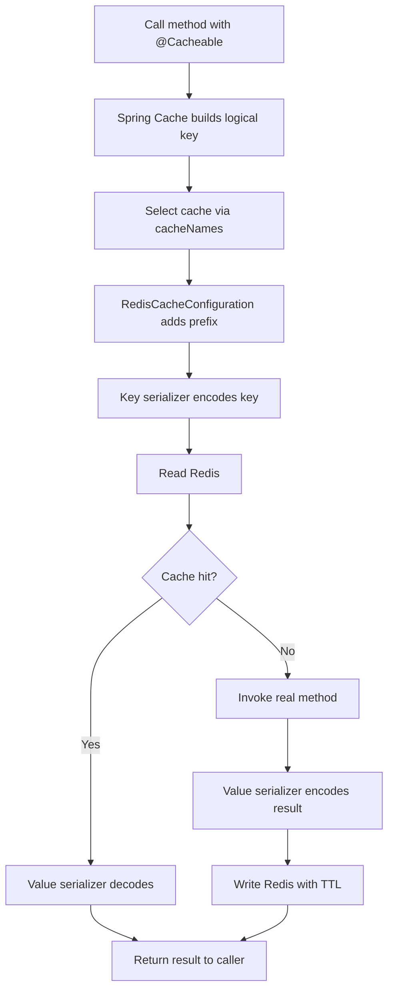
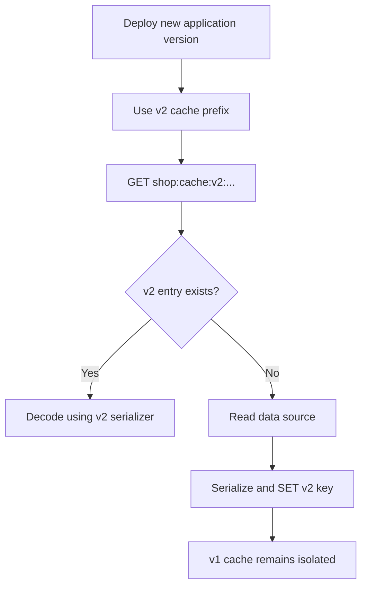

# Configuring Cache Serializers and Key Prefixes in Spring Data Redis

When using Spring Cache with Redis, many applications simply annotate a method with `@Cacheable` and data gets stored in Redis. This usage is simple, yet **the format of Redis keys and cached value bytes is not determined by the annotation alone**. Both depend on `RedisCacheManager`, `RedisCacheConfiguration`, serializers, and Spring Cache's key generation rules.

For example, a product read method:

```java
@Cacheable(cacheNames = "productDetail", key = "#id")
public ProductDto findById(String id) {
    return productClient.load(id);
}
```

When `findById("p-42")` is called, the application needs to know:

- Is the actual Redis key `productDetail::p-42`, or does it include an environment prefix or schema version?
- Is the `ProductDto` value stored using JDK serialization, JSON, or another format?
- When deploying a new version, can old cached entries still be deserialized?
- If two services share the same cache name and ID, could they accidentally share the same Redis key?
- Will clearing an entire cache affect keys that do not belong to that cache?

This lesson explains how to configure **cache serializers and key prefixes** at the Spring Cache layer of Spring Data Redis, how they interact with `@Cacheable`, `@CachePut`, and `@CacheEvict`, and a configuration design supporting multiple caches with different TTLs.

## 1. Where do Spring Cache and RedisCacheManager sit?

Spring Cache is an abstraction providing annotations such as `@Cacheable`, `@CachePut`, and `@CacheEvict`. It does not mandate Redis. When Redis is chosen as the cache provider, Spring Data Redis provides the corresponding components:

| Component | Primary responsibility |
|---|---|
| `@Cacheable` / `@CachePut` / `@CacheEvict` | Determines when to read, write, and delete cache entries per method call |
| `CacheManager` | Looks up or creates caches by name |
| `RedisCacheManager` | Manages Redis caches, default configuration, and per-cache configurations |
| `RedisCacheConfiguration` | Defines TTL, prefix, serializers, and key/value conversion rules |
| `RedisCache` | Implements cache operations on Redis |
| `RedisCacheWriter` | Performs low-level Redis operations to read/write/delete cached data |
| `RedisSerializer` | Converts Java objects to bytes and reads bytes back into Java objects |

Basic flow of a cache hit:



The separation to understand: **Spring Cache produces a logical key from method parameters**, then **RedisCacheConfiguration turns the cache name and logical key into a physical Redis key**, and finally **serializers encode keys/values into bytes**.

## 2. Important defaults of RedisCacheConfiguration

With `RedisCacheConfiguration.defaultCacheConfig()` in common Spring Data Redis 3.x versions:

| Setting | Default |
|---|---|
| Key prefix | Enabled, by cache name |
| Default prefix format | `<cacheName>::` |
| Key serializer | `StringRedisSerializer` |
| Value serializer | `JdkSerializationRedisSerializer` |
| TTL | Does not expire automatically (`eternal`) |
| Cache `null` values | Allowed |
| Convert logical key to string | Based on Redis Cache's default conversion service |

Example:

```java
RedisCacheConfiguration defaults =
        RedisCacheConfiguration.defaultCacheConfig();
```

These are the defaults of Spring Data Redis configuration, **which does not mean every Spring Boot application runs with these exact values**. Spring Boot may apply property settings, a custom `RedisCacheConfiguration` bean, a manually declared `RedisCacheManager`, or a different `CacheManager`. When investigating a real application, verify the **actual active `CacheManager`**.

In particular, without a TTL, cached entries can persist until evicted, deleted, dropped by Redis under memory pressure, or purged by an administrator. A cache without a TTL does not imply business data remains valid indefinitely.

## 3. Three key-naming concepts easily confused

Consider the method:

```java
@Cacheable(cacheNames = "productDetail", key = "#id")
public ProductDto findById(String id) { ... }
```

When `id` is `"p-42"`, there are three layers:

1. **Cache name:** `productDetail`, specified by `cacheNames` or `value` on the annotation.
2. **Logical cache key:** `p-42`, specified by the expression `key = "#id"`.
3. **Physical Redis key:** e.g., `productDetail::p-42` when using the default prefix.

```text
cacheNames = "productDetail"
        +
key = "#id"  ->  "p-42"
        |
        v
default prefix: "productDetail::"
        +
logical key: "p-42"
        |
        v
StringRedisSerializer
        |
        v
Redis key: productDetail::p-42
```

If you change the prefix to `shop:cache:v1:productDetail::`, **the logical key remains `p-42`**. This changes the physical namespace in Redis without altering how annotations resolve cache keys.

### 3.1. Cache name is not the full Redis key name

`@Cacheable("productDetail")` only specifies the cache name. Spring Cache still generates a key from method arguments, and Redis Cache adds the configured prefix.

### 3.2. Annotation `key` attribute is not a key serializer

`key = "#id"` is a SpEL expression computing the logical key. `StringRedisSerializer` is the rule encoding the key after converting it to a string for Redis storage. Both solve separate concerns.

### 3.3. Cache prefix is not a prefix set by RedisTemplate

`RedisTemplate` and `RedisCacheManager` may share the same `RedisConnectionFactory` while having **separate serialization configurations**. Calling `redisTemplate.setKeySerializer(...)` does not alter the prefix or serializer of caches managed by `RedisCacheManager`.

## 4. How does Spring Cache construct logical keys?

When neither `key` nor `keyGenerator` is specified, Spring Cache normally uses `SimpleKeyGenerator`:

| Method parameter(s) | Default logical key |
|---|---|
| No parameters | `SimpleKey.EMPTY` |
| One non-`null` parameter | That parameter object itself |
| Multiple parameters | A `SimpleKey` wrapping the parameters |

Example:

```java
@Cacheable("productDetail")
public ProductDto findById(String id) { ... }

@Cacheable("priceQuote")
public Quote quote(String sku, String currency) { ... }
```

For the first method, the logical key is normally the string `"p-42"`. For the second, the logical key takes a form like `SimpleKey[sku, currency]` under the default mechanism. Redis Cache must convert it to a string before passing it to the key serializer.

In applications needing a stable key contract, declare keys explicitly:

```java
@Cacheable(cacheNames = "priceQuote",
           key = "#sku + ':' + #currency")
public Quote quote(String sku, String currency) { ... }
```

However, concatenating with `:` can still collide if parameters contain that character. For external inputs, pick an unambiguous encoding rule, such as a shared key generator using field lengths or unambiguous encoding.

**Avoid relying directly on a complex DTO's `toString()` as a key contract** if the string representation can change on refactoring, field reordering, or contains sensitive data. When keys change, old cache entries stop matching; when they contain sensitive values, keys can leak into logs and Redis admin tools.

## 5. Configuring cache key prefixes

Spring Data Redis offers multiple ways to customize prefixes in `RedisCacheConfiguration`.

### 5.1. Using the default prefix

```java
RedisCacheConfiguration config =
        RedisCacheConfiguration.defaultCacheConfig();
```

With cache name `productDetail` and logical key `p-42`, the physical key looks like:

```text
productDetail::p-42
```

Spring Cache uses prefixes to prevent distinct caches from accidentally overwriting the same Redis key.

### 5.2. Adding an application prefix with prefixCacheNameWith

```java
RedisCacheConfiguration config =
        RedisCacheConfiguration.defaultCacheConfig()
                .prefixCacheNameWith("shop:cache:v1:");
```

With cache `productDetail` and key `p-42`:

```text
shop:cache:v1:productDetail::p-42
```

`prefixCacheNameWith(...)` prepends a prefix before the cache name while preserving the default separator between cache name and logical key.

This is convenient when all caches in an application share a common namespace, such as:

```text
shop:cache:v1:productDetail::p-42
shop:cache:v1:productStock::p-42
shop:cache:v1:customerProfile::c-18
```

### 5.3. Computing the prefix directly with computePrefixWith

When full control over prefix construction is needed:

```java
RedisCacheConfiguration config =
        RedisCacheConfiguration.defaultCacheConfig()
                .computePrefixWith(
                        cacheName -> "shop:cache:v2:" + cacheName + "::");
```

With `computePrefixWith(...)`, the callback returns the **complete prefix string**. The application must include an appropriate separator in the return value; omitting it causes the cache name and logical key to run together without clear separation.

Poor design example:

```java
// "shop:cache:v2:productDetail" + "p-42"
// -> "shop:cache:v2:productDetailp-42" (hard to tell boundary)
.computePrefixWith(cacheName -> "shop:cache:v2:" + cacheName)
```

Good design example:

```java
.computePrefixWith(cacheName -> "shop:cache:v2:" + cacheName + "::")
```

If prefixes reflect the environment, load them from reliable deployment config such as `dev`, `staging`, or `prod`, rather than injecting dynamic request information into a singleton `CacheManager` without boundary controls.

### 5.4. Why keep prefixes enabled?

`RedisCacheConfiguration.disableKeyPrefix()` disables prefixes, allowing logical keys to be used directly as Redis keys:

```java
RedisCacheConfiguration dangerous =
        RedisCacheConfiguration.defaultCacheConfig()
                .disableKeyPrefix();
```

With two caches `productDetail` and `customerProfile` sharing logical key `"42"`, both can collide on Redis key `42`. Additionally, clearing an entire cache lacks a clear namespace boundary; Spring Data Redis warns that **disabling prefixes can cause cache clearing to delete unrelated keys in the database**.

Therefore, keep the default prefix or define custom prefixes that cleanly separate application, environment, and cache.

## 6. Key serializer vs. value serializer

In Redis, both keys and values are transmitted as bytes. Spring Data Redis provides `RedisSerializationContext.SerializationPair` to configure serialization separately for each.

```java
RedisCacheConfiguration config =
        RedisCacheConfiguration.defaultCacheConfig()
                .serializeKeysWith(
                        RedisSerializationContext.SerializationPair
                                .fromSerializer(new StringRedisSerializer()))
                .serializeValuesWith(
                        RedisSerializationContext.SerializationPair
                                .fromSerializer(
                                        new GenericJackson2JsonRedisSerializer()));
```

| Setting | Effect | Common practice |
|---|---|---|
| `serializeKeysWith(...)` | Bytes of the physical key in Redis | UTF-8 strings so keys can be inspected and scanned by prefix |
| `serializeValuesWith(...)` | Bytes of the cached object | JSON/JDK/binary matching the data contract |
| `computePrefixWith(...)` | String prepended before logical key | App namespace, version, cache name |
| `entryTtl(...)` | Lifetime of each entry | Depends on data freshness and business needs |
| `disableCachingNullValues()` | Disallow storing nulls | Pair with appropriate `unless` on annotations |

Here, **prefix is a key-naming string, while serializer is the rule converting keys/values to bytes**. Do not treat choosing a JSON value serializer as a way to fix key names, nor treat prefixes as object encoding rules.

## 7. Choosing a value serializer

### 7.1. JdkSerializationRedisSerializer

A configuration matching Spring Data Redis's default:

```java
RedisCacheConfiguration config =
        RedisCacheConfiguration.defaultCacheConfig()
                .serializeValuesWith(
                        RedisSerializationContext.SerializationPair
                                .fromSerializer(
                                        new JdkSerializationRedisSerializer()));
```

Characteristics:

- Stores data in Java native serialization format, hard to inspect directly via Redis CLI.
- Objects typically must implement `Serializable` when using Java serialization.
- Cache entries depend on class names, class layout, `serialVersionUID`, and compatibility across deployments.
- Unsuitable as a cross-language data contract shared freely among Java, Node.js, Python, or other languages.
- Java deserialization carries security risks if input bytes can be controlled by an untrusted source.

Use this serializer only in trusted environments when the application specifically relies on Java serialization. For systems needing inspectable data or cross-service clarity, JSON is usually easier to operate.

### 7.2. GenericJackson2JsonRedisSerializer

```java
GenericJackson2JsonRedisSerializer jsonSerializer =
        new GenericJackson2JsonRedisSerializer();
```

This serializer stores diverse object types as JSON alongside type metadata required to reconstruct the corresponding object. It is convenient when one `RedisCacheManager` manages multiple caches returning different types:

```java
@Cacheable("productDetail")
ProductDto findProduct(String id) { ... }

@Cacheable("customerProfile")
CustomerDto findCustomer(String id) { ... }
```

Understand clearly:

1. JSON payloads may contain Java type metadata; the format is not necessarily Java-independent API JSON.
2. Renaming packages/classes or refactoring models can make older entries unreadable.
3. Jackson configuration, modules for Java time/records, and polymorphism settings affect output.
4. Redis must be treated as a trusted source before allowing type-metadata-driven deserialization. Avoid enabling unrestricted subtype deserialization from untrusted data.
5. `null` values may be represented by Spring Cache using a sentinel object. When customizing `ObjectMapper`, keep compatibility with the serializer's null-value handling or disable null caching per design.

Not every JSON serializer can read bytes written by `GenericJackson2JsonRedisSerializer`. Never switch to another serializer without a plan to migrate or purge cached data.

### 7.3. Jackson2JsonRedisSerializer<T>

When a cache holds a single known type, consider a typed serializer such as `Jackson2JsonRedisSerializer<ProductDto>`. This helps keep JSON free of dynamic type metadata in every entry.

However, **a serializer bound to `ProductDto` is unsuitable for every cache** if other caches store `CustomerDto` or `List<OrderDto>`. In that case, configure per-cache serializers or choose a polymorphic serializer with an appropriate security contract.

Exact class names and Jackson serializer constructors may differ across Spring Data Redis versions; use the API matching your project's dependency version. In this lesson, the full configuration below uses `GenericJackson2JsonRedisSerializer` to demonstrate one `RedisCacheManager` handling multiple value types.

### 7.4. Other options

An application can use:

- `StringRedisSerializer` for **cache values that are genuinely strings**.
- Custom binary serializers such as Protobuf/Avro when schema and version contracts are established.
- Per-cache typed JSON serializers for stable DTOs.
- A specialized serializer wrapping a version header or envelope to ease migrations.

Choosing a serializer is not only about byte size. Weigh cross-deployment compatibility, object types, performance, debuggability, deserialization risks, and cross-service sharing needs.

## 8. Complete RedisCacheManager configuration for multiple caches

The example below targets Spring Boot 3.x and Spring Data Redis 3.x, with Spring Cache enabled and Redis connection configured. Goals:

- Every cache uses namespace `shop:cache:v2:`.
- Keys are serialized as strings.
- Values use a JSON serializer supporting multiple DTO types.
- Default TTL is 10 minutes.
- `productDetail` cache has a 20-minute TTL.
- `productStock` cache has a 15-second TTL.
- `null` results are not cached.

```java
package com.example.shop.cache;

import java.time.Duration;
import java.util.Map;

import org.springframework.cache.annotation.EnableCaching;
import org.springframework.context.annotation.Bean;
import org.springframework.context.annotation.Configuration;
import org.springframework.data.redis.cache.RedisCacheConfiguration;
import org.springframework.data.redis.cache.RedisCacheManager;
import org.springframework.data.redis.connection.RedisConnectionFactory;
import org.springframework.data.redis.serializer.GenericJackson2JsonRedisSerializer;
import org.springframework.data.redis.serializer.RedisSerializationContext;
import org.springframework.data.redis.serializer.StringRedisSerializer;

@Configuration
@EnableCaching
public class RedisCacheConfig {

    @Bean
    public RedisCacheManager cacheManager(
            RedisConnectionFactory connectionFactory) {

        RedisCacheConfiguration defaults =
                RedisCacheConfiguration.defaultCacheConfig()
                        .computePrefixWith(
                                cacheName ->
                                        "shop:cache:v2:" + cacheName + "::")
                        .serializeKeysWith(
                                RedisSerializationContext.SerializationPair
                                        .fromSerializer(
                                                new StringRedisSerializer()))
                        .serializeValuesWith(
                                RedisSerializationContext.SerializationPair
                                        .fromSerializer(
                                                new GenericJackson2JsonRedisSerializer()))
                        .disableCachingNullValues()
                        .entryTtl(Duration.ofMinutes(10));

        Map<String, RedisCacheConfiguration> perCache = Map.of(
                "productDetail",
                defaults.entryTtl(Duration.ofMinutes(20)),
                "productStock",
                defaults.entryTtl(Duration.ofSeconds(15))
        );

        return RedisCacheManager.builder(connectionFactory)
                .cacheDefaults(defaults)
                .withInitialCacheConfigurations(perCache)
                .build();
    }
}
```

Configuration breakdown:

| Configuration line | Effect |
|---|---|
| `@EnableCaching` | Enables interception for Spring cache annotations |
| `@Bean RedisCacheManager` | Creates the Redis CacheManager used by the application |
| `computePrefixWith(...)` | Places namespace and cache name into Redis keys |
| `serializeKeysWith(StringRedisSerializer)` | Ensures keys are stored as strings |
| `serializeValuesWith(GenericJackson2JsonRedisSerializer)` | Writes cache values as JSON matching the serializer |
| `disableCachingNullValues()` | Disallows storing entries for null values |
| `entryTtl(Duration.ofMinutes(10))` | Default TTL |
| `withInitialCacheConfigurations(...)` | Overrides configuration for two specific caches |

Configuration methods on `RedisCacheConfiguration` produce immutable new configuration instances. Therefore, `defaults.entryTtl(Duration.ofSeconds(15))` creates a dedicated configuration for `productStock` without altering lifetimes of other caches.

**Note on Spring Boot auto-configuration:** when declaring your own `RedisCacheManager` bean, your configuration becomes the authoritative source for that manager. Do not assume Boot's `spring.cache.redis.*` properties will continue applying automatically to your custom bean. If your project prefers property-driven configuration, let Boot build the manager or use appropriate extension points instead of maintaining two conflicting configuration sources.

## 9. Using with @Cacheable, @CachePut, and @CacheEvict

Suppose the application has a DTO:

```java
package com.example.shop.product;

public record ProductDto(
        String id,
        String name,
        long priceCents
) {}
```

Service reading and modifying products:

```java
package com.example.shop.product;

import org.springframework.cache.annotation.CacheEvict;
import org.springframework.cache.annotation.CachePut;
import org.springframework.cache.annotation.Cacheable;
import org.springframework.stereotype.Service;

@Service
public class ProductService {

    private final ProductGateway gateway;

    public ProductService(ProductGateway gateway) {
        this.gateway = gateway;
    }

    @Cacheable(
            cacheNames = "productDetail",
            key = "#id",
            unless = "#result == null")
    public ProductDto findById(String id) {
        return gateway.load(id);
    }

    @CachePut(
            cacheNames = "productDetail",
            key = "#result.id",
            unless = "#result == null")
    public ProductDto update(ProductDto product) {
        return gateway.save(product);
    }

    @CacheEvict(
            cacheNames = "productDetail",
            key = "#id")
    public void delete(String id) {
        gateway.delete(id);
    }
}
```

`ProductGateway` is an application dependency interface illustrating the real data source. `findById` may return null if not found; `unless = "#result == null"` avoids storing null when the configuration calls `disableCachingNullValues()`.

For `findById("p-42")`:

```text
cacheName        productDetail
logical key      p-42
prefix           shop:cache:v2:productDetail::
physical key     shop:cache:v2:productDetail::p-42
value serializer JSON
TTL              20 minutes
```

On the first call when no entry exists, the service reads data and writes to Redis. If called again before TTL expires and before eviction, Spring Cache returns the decoded value without calling `gateway.load`.

When `update(...)` succeeds, `@CachePut` invokes the real method and updates the cache with the returned value. `key = "#result.id"` reads the ID from the returned DTO. If the method can return null, be careful with key expressions referencing `#result`; for APIs that may return null, keying from input parameter `#product.id` avoids property access failures on a null result.

When `delete(...)` succeeds, `@CacheEvict` deletes the corresponding entry. Remember that cache annotations operate via Spring proxies/interceptors; **an internal call from another method on the same instance to `this.findById(...)` can bypass the cache interceptor** under default proxy mode.

### 9.1. Example using parameter-based key in @CachePut

To reduce reliance on `#result`:

```java
@CachePut(
        cacheNames = "productDetail",
        key = "#product.id",
        unless = "#result == null")
public ProductDto update(ProductDto product) {
    return gateway.save(product);
}
```

Input-based keys make the rule clear, provided `gateway.save(...)` does not alter the ID. If the saved result can have a different ID from the input, establish a business contract defining which key is refreshed or evicted.

## 10. Cache names, prefixes, and keys: comparison examples

Suppose configuration is:

```java
.computePrefixWith(
        cacheName -> "shop:cache:v2:" + cacheName + "::")
```

And methods are:

```java
@Cacheable(cacheNames = "productDetail", key = "#id")
ProductDto findProduct(String id) { ... }

@Cacheable(cacheNames = "productStock", key = "#sku")
Integer stock(String sku) { ... }

@Cacheable(cacheNames = "customerProfile", key = "#customerId")
CustomerDto profile(String customerId) { ... }
```

Physical Redis keys:

| Cache | Logical key | Redis key |
|---|---|---|
| `productDetail` | `p-42` | `shop:cache:v2:productDetail::p-42` |
| `productStock` | `p-42` | `shop:cache:v2:productStock::p-42` |
| `customerProfile` | `c-17` | `shop:cache:v2:customerProfile::c-17` |

Two caches share logical key `p-42` yet **do not collide on Redis keys** because their cache names differ.

If the same Redis database is shared by multiple applications, separate namespaces further:

```text
shop:cache:v2:productDetail::p-42
billing:cache:v1:productDetail::p-42
```

If staging and production share Redis infrastructure, enforce strict isolation by database/cluster or namespace. Prefixes prevent naming collisions; they are **not an authorization or data-security mechanism**.

## 11. Caching null: a choice that directly impacts serializers

A method:

```java
@Cacheable(cacheNames = "productDetail", key = "#id")
public ProductDto findById(String id) {
    return gateway.load(id); // May return null.
}
```

If caching nulls is allowed, Spring Cache may store an internal representation for `null` instead of a plain JSON `null`. The serializer must handle this representation. With customized Jackson serializers, this can cause deserialization failures if compatibility with Spring Cache's `NullValue` mechanism is broken.

In the example configuration:

```java
.disableCachingNullValues()
```

and annotation:

```java
@Cacheable(
        cacheNames = "productDetail",
        key = "#id",
        unless = "#result == null")
```

a lookup that finds no product creates no cache entry. Later calls keep checking the data source until the product exists or another negative-result mechanism is introduced.

Some applications need **negative caching** to shed load for frequently queried nonexistent IDs. In that case, model an explicit sentinel DTO with a short TTL, or retain null caching with a properly supporting serializer. Do not toggle null caching casually without evaluating miss rates and data correctness.

**Distinguishing `condition` and `unless`:** `condition` evaluates before invoking the method, while `unless` evaluates after obtaining the result and allows skipping storage—ideal for `#result == null`.

## 12. How do TTL and cache prefixes support each other?

TTL is how long Redis keeps an entry before expiration, independent of prefix naming. For example:

```java
RedisCacheConfiguration config =
        RedisCacheConfiguration.defaultCacheConfig()
                .entryTtl(Duration.ofMinutes(20))
                .prefixCacheNameWith("shop:cache:v2:");
```

The Redis key looks like:

```text
shop:cache:v2:productDetail::p-42
```

and receives the corresponding TTL when written via the cache, depending on observation timing and write policy.

Points to understand:

- TTL is normally counted from cache write; standard cache reads **do not renew TTL** as sliding expiration.
- `@CachePut` or a cache miss rewriting the entry starts a fresh TTL.
- `@CacheEvict` deletes the entry by key without waiting for TTL.
- When changing prefix from `v1` to `v2`, `v1` keys are neither renamed nor deleted automatically; they remain until TTL expires, explicit eviction, or administrative cleanup.
- Caches without TTL can hold stale data indefinitely, so define cleanup policies whenever changing schemas or prefixes.

Short TTLs bound the age of cached data, yet **do not create strict consistency** with the source database. When source data changes, applications still need cache updates/evictions if waiting for TTL expiration is unacceptable.

## 13. Per-cache configuration with withInitialCacheConfigurations

Many systems have distinct data groups:

- Product details change relatively rarely.
- Stock quantities change frequently.
- Customer profiles have distinct security policies and lifecycles.

You do not have to force one TTL and value serializer across every cache.

Example:

```java
RedisCacheConfiguration base =
        RedisCacheConfiguration.defaultCacheConfig()
                .computePrefixWith(
                        name -> "shop:cache:v3:" + name + "::")
                .serializeValuesWith(
                        RedisSerializationContext.SerializationPair
                                .fromSerializer(
                                        new GenericJackson2JsonRedisSerializer()))
                .entryTtl(Duration.ofMinutes(10));

Map<String, RedisCacheConfiguration> configs = Map.of(
        "productDetail", base.entryTtl(Duration.ofMinutes(30)),
        "productStock", base.entryTtl(Duration.ofSeconds(10)),
        "customerProfile", base.entryTtl(Duration.ofMinutes(2)));

RedisCacheManager manager = RedisCacheManager
        .builder(connectionFactory)
        .cacheDefaults(base)
        .withInitialCacheConfigurations(configs)
        .build();
```

When creating per-cache configurations, keep a **predictable shared prefix convention** unless there is a clear reason to split namespaces. If a cache is accessed by the same method across multiple app versions, changing that cache's serializer or prefix alters its storage contract.

### 13.1. Separate serializer for a specialized cache

For a cache storing only Strings:

```java
RedisCacheConfiguration stringValues =
        base.serializeValuesWith(
                RedisSerializationContext.SerializationPair
                        .fromSerializer(new StringRedisSerializer()));
```

You can then attach `stringValues` to a string-only cache. However, if a method using that cache starts returning a DTO, the string serializer will reject the new type. **Each cache should have a stable value-type contract**, not just a cache name.

### 13.2. Avoid two methods sharing a cache name with incompatible return types

```java
@Cacheable(cacheNames = "shared", key = "#id")
ProductDto findProduct(String id) { ... }

@Cacheable(cacheNames = "shared", key = "#id")
CustomerDto findCustomer(String id) { ... }
```

If both are called with `"42"`, they share Redis key `shared::42`. Reads will fail business-type expectations even if a JSON serializer decodes a Java object.

Use distinct cache names or include an unambiguous logical namespace in keys. Cache names are part of the data-partitioning contract.

## 14. Spring Boot properties vs. Java configuration

Spring Boot can auto-configure Redis caching when:

1. Spring Cache is enabled.
2. Redis dependencies and connection settings are present.
3. Redis cache provider is selected or detected by Boot auto-configuration.
4. No custom `CacheManager` bean replaces it.

Example properties configuration:

```yaml
spring:
  cache:
    type: redis
    cache-names:
      - productDetail
      - productStock
    redis:
      time-to-live: 10m
      key-prefix: "shop:cache:v2:"
      use-key-prefix: true
      cache-null-values: false
```

With corresponding Boot defaults, `key-prefix` precedes the cache name; Spring Data Redis still handles prefix logic and key conversion. Exact physical key formatting should be verified against your deployed Boot/Spring Data Redis version.

**Important:** the Boot properties above **do not automatically switch the value serializer to JSON**. Typically you must declare a `RedisCacheConfiguration` bean, `RedisCacheManagerBuilderCustomizer`, or custom manager bean to use a non-default serializer.

Example supplying `RedisCacheConfiguration` to auto-configuration when keeping manager creation with Spring Boot:

```java
@Configuration
public class RedisCacheSerializationConfig {

    @Bean
    RedisCacheConfiguration redisCacheConfiguration() {
        return RedisCacheConfiguration.defaultCacheConfig()
                .computePrefixWith(
                        name -> "shop:cache:v2:" + name + "::")
                .serializeValuesWith(
                        RedisSerializationContext.SerializationPair
                                .fromSerializer(
                                        new GenericJackson2JsonRedisSerializer()))
                .disableCachingNullValues()
                .entryTtl(Duration.ofMinutes(10));
    }
}
```

This bean can be picked up by Boot when creating `RedisCacheManager` via the auto-configuration path. **Do not configure the same setting in multiple places expecting all settings to merge cumulatively**; precedence depends on Boot mechanics and existing beans.

If different TTLs per cache are needed, `RedisCacheManagerBuilderCustomizer` or an explicit manager bean as in Section 8 usually expresses intent more clearly.

## 15. Inspecting keys and serializers in Redis

After calling a `@Cacheable` method, inspect Redis to confirm what the system actually writes.

### 15.1. Scanning keys by prefix with SCAN

```redis
SCAN 0 MATCH shop:cache:v2:productDetail::* COUNT 100
```

Redis returns a cursor and a list of keys. Until the cursor returns `0`, continue calling `SCAN` with the new cursor. `COUNT` is only a hint; a single call may return fewer than 100, more than 100, or zero matching keys.

Avoid running `KEYS *` in production environments with large keyspaces merely to locate cache keys, as it can impact Redis responsiveness.

### 15.2. Checking Redis key type and TTL

```redis
TYPE shop:cache:v2:productDetail::p-42
TTL shop:cache:v2:productDetail::p-42
PTTL shop:cache:v2:productDetail::p-42
```

In typical Spring Cache Redis setups, each entry is a Redis String key holding serialized value bytes. `TTL` returns remaining seconds and `PTTL` returns milliseconds; Redis uses special values `-1` when a key exists with no expiration and `-2` when the key does not exist.

### 15.3. Inspecting stored values

```redis
GET shop:cache:v2:productDetail::p-42
```

If the value serializer is JSON, output may be readable JSON text, possibly including class/type metadata. If using JDK serialization or custom binary formats, output may be unreadable or contain non-printable terminal bytes.

Seeing JSON **does not guarantee** every Java version can deserialize it into a compatible DTO; verify type metadata, schemas, and Jackson configuration.

### 15.4. Distinguishing template GET from cache GET

Example:

```java
redisTemplate.opsForValue()
        .get("shop:cache:v2:productDetail::p-42");
```

If `redisTemplate` uses a different serializer from `RedisCacheManager`, the result may have the wrong type or fail deserialization. When inspecting from Java, use the **same serializer as the cache** or read raw bytes via connection APIs/Redis CLI as appropriate. Do not conclude the cache is broken just because a differently configured template cannot read it.

## 16. @CacheEvict(allEntries = true) and prefixes

`@CacheEvict(cacheNames = "productDetail", allEntries = true)` requests deleting all entries of one cache:

```java
@CacheEvict(cacheNames = "productDetail", allEntries = true)
public void invalidateAllProductDetails() {
    // Trigger cache invalidation.
}
```

Redis has no native command called "clear Spring cache." `RedisCacheWriter` must identify keys belonging to the cache's namespace and delete them. Prefixes are essential to bound the set of keys to delete.

In standard Spring Data Redis versions, clearing may use `KEYS` by default. On large keyspaces, this can create heavy load; `RedisCacheWriter` also supports a `SCAN`-based batch strategy in compatible setups.

Example configuring a writer with `SCAN`:

```java
import org.springframework.data.redis.cache.BatchStrategies;
import org.springframework.data.redis.cache.RedisCacheManager;
import org.springframework.data.redis.cache.RedisCacheWriter;

RedisCacheWriter writer =
        RedisCacheWriter.nonLockingRedisCacheWriter(
                connectionFactory,
                BatchStrategies.scan(1000));

RedisCacheManager manager = RedisCacheManager.builder(writer)
        .cacheDefaults(redisCacheConfiguration)
        .build();
```

`1000` is a batch-size hint, not a guarantee each Redis command returns exactly 1000 keys. On Redis Cluster, `SCAN` effectiveness and coverage also depend on the driver and multi-node scanning support; pick settings compatible with your driver version.

**Do not disable cache prefixes to "simplify" key names**: clear operations could wipe Redis data outside the cache. For caches with many entries, design scoped invalidation methods, partition data, or version namespaces when bulk discarding old entries.

## 17. Versioning prefixes to avoid errors after changing serializers

One of the trickiest scenarios is switching from serializer A to serializer B while millions of old entries remain in Redis.

Example:

**Version 1:**

```text
shop:cache:v1:productDetail::p-42
value = bytes via JDK serialization
```

**Version 2:**

```text
shop:cache:v2:productDetail::p-42
value = JSON
```

If you change the serializer while keeping the old prefix, the new application may try reading JDK bytes as JSON and throw errors. Switching the prefix to `v2` lets the new version ignore `v1` entries, reload from the source, and write in the new format.



Design considerations during version transitions:

1. **Temporary spike in cache misses.** `v2` entries are cold, so the canonical data source may see higher traffic.
2. **Higher memory usage during overlap.** Both `v1` and `v2` caches coexist until old data expires by TTL or is cleaned up.
3. **Rolling deployments.** Old instances keep reading/writing `v1` while new instances use `v2`, avoiding mixed serializer formats on the same key.
4. **TTL on old cache.** If `v1` had no TTL, plan a controlled cleanup.
5. **Cleanup timing.** Do not purge `v1` early while old instances still depend on it if doing so triggers load spikes or business errors.

Prefix versioning is a **cache format isolation** technique; it does not replace source database versioning and migrations.

## 18. Multi-tenancy and permissions: are prefixes enough?

Suppose a multi-tenant application shares one Redis instance:

```java
@Cacheable(cacheNames = "accountBalance", key = "#accountId")
BalanceDto balance(String accountId) { ... }
```

If two tenants both have account ID `42`, logical keys match and cache names match. A static prefix `app:cache:accountBalance::` resolves to the **exact same Redis key**, risking one tenant receiving another tenant's cached balance.

The key contract must include tenant:

```java
@Cacheable(
        cacheNames = "accountBalance",
        key = "#tenantId + ':' + #accountId")
public BalanceDto balance(String tenantId, String accountId) { ... }
```

For IDs that may contain delimiters, use a key generator or unambiguous stable encoding; never concatenate strings casually.

Separate two layers:

- **Cache-level prefix**: identifies application, environment, cache name, and format version.
- **Request-level logical key**: identifies the specific object, including tenant or business scope when applicable.

A singleton `RedisCacheManager` with a static prefix cannot distinguish tenants per request if the logical key omits the tenant ID. Furthermore, key namespaces are not an authorization mechanism; services must still enforce access control at the business layer.

## 19. Redis Cluster: are prefixes hash tags?

Redis Cluster distributes keys across hash slots. Prefixes such as:

```text
shop:cache:v2:productDetail::p-42
shop:cache:v2:productDetail::p-43
```

do not force keys onto the same slot, because slots are computed from the actual key name (or the `{...}` hash tag if present). In most caching workloads, spreading entries for different IDs across slots is **desirable**.

Occasionally an application needs related keys on the same slot for a multi-key script. Hash tags can be used, e.g.:

```text
shop:cache:product:{p-42}:detail
shop:cache:product:{p-42}:inventory
```

Both keys share `{p-42}`, so they hash to the same slot. However, Spring Cache normally operates per single entry; never force an entire cache onto one tag like `{all-cache}`, which creates a **hot slot**.

If hash tags are needed in Spring Cache keys, structure prefix/key rules so the **final physical name** contains a per-aggregate tag. A static prefix embedding one shared tag for every entry degrades Redis Cluster load distribution.

## 20. Common configuration errors

### Error 1: Changing RedisTemplate serializer expecting Spring Cache to follow

```java
redisTemplate.setValueSerializer(
        new GenericJackson2JsonRedisSerializer());
```

This applies to the configured `RedisTemplate` and **does not change `RedisCacheManager`'s value serializer**. Use `RedisCacheConfiguration.serializeValuesWith(...)` for caches.

### Error 2: Disabling prefixes for shorter keys

```java
.disableKeyPrefix()
```

This causes collisions across caches and renders clear operations unsafe in scope. Keep namespaces explicit.

### Error 3: Assuming any JSON can decode any DTO

`GenericJackson2JsonRedisSerializer` can include type metadata. Renaming packages/classes or reading old payloads with a different mapper can fail object reconstruction. Maintain schema contracts and migration plans.

### Error 4: Using a string serializer for object-returning caches

`StringRedisSerializer` fits String values; a Java DTO is not automatically converted to JSON simply because Spring Cache is used. Choose the matching serializer type.

### Error 5: Changing prefixes and forgetting old entries

`v1` keys remain in Redis after the app switches to `v2`. Nothing automatically purges old-version keys just because the app uses a new prefix.

### Error 6: Writing null data with disableCachingNullValues

If `@Cacheable` attempts to store null results, the cache may reject null puts under that configuration. Add `unless = "#result == null"` or design an explicit absence marker.

### Error 7: Sharing a cache name without domain separation in keys

`@Cacheable(cacheNames = "lookup", key = "#id")` on two methods for two domains can collide. Give cache names clear semantics or partition logical keys by domain.

### Error 8: Relying on SimpleKey of objects with unstable toString

Complex key objects may produce different representations across deployments or depend on `toString()` formatting. Use stable keys for caches shared across versions.

### Error 9: Using prefixes as tenant data protection

A static prefix cannot substitute for including tenant IDs in keys and checking authorization. Two tenants sharing an object ID still risk sharing cache entries if logical keys omit tenant.

### Error 10: Calling @CacheEvict(allEntries = true) on large keyspaces unmeasured

Clearing an entire cache may scan numerous keys. Verify whether `RedisCacheWriter` uses `KEYS` or `SCAN` and assess load on Redis.

### Error 11: Expecting TTL to auto-renew on every cache hit

Standard Redis Cache TTL is not sliding expiration per read. If access-based renewal is required, design and configure a dedicated mechanism accordingly.

### Error 12: Treating serializers as internal details needing no versioning

Redis cache formats persist across application deployments. Switching serializers without changing prefixes, migrating, or performing a controlled flush risks deserialization errors on the very first request after deploy.

## 21. Workflow for designing cache keys and serializers

To keep a cache reliable, follow this sequence:

1. **Choose domain-specific cache names.** E.g., `productDetail`, `productStock`, `customerProfile`; avoid vague names like `data` or `lookup`.
2. **Design logical keys.** Use stable IDs or deterministic parameter combinations; include tenant, locale, or business version when they affect output.
3. **Define Redis prefixes.** Include application, environment if shared, schema version, and cache name; keep separators clear.
4. **Select key serializer.** For string-based keys, `StringRedisSerializer` is easy to inspect and Redis CLI-friendly.
5. **Select value serializer.** Base the choice on object types, round-trip fidelity, refactoring resilience, and security requirements.
6. **Specify null handling.** Cache nulls or skip them? If skipping, align annotations accordingly.
7. **Specify TTLs.** Match each cache's staleness tolerance instead of forcing one value system-wide.
8. **Define invalidation.** Evict per key, update via `@CachePut`, or clear the cache? Is clearing safe at large keyspace scale?
9. **Plan schema changes.** When changing serializers or DTOs, should you bump prefix versions, purge old caches, or prewarm?
10. **Verify in practice.** Inspect prefixes via `SCAN`, TTL via `PTTL`, values via Redis CLI or matching serializer, and confirm the app uses the intended `CacheManager`.

This is a sequence of architectural decisions—not merely picking JSON over JDK serialization because one looks cleaner.

## 22. Exercises

### Exercise 1 — Compute the physical Redis key

Given:

```java
.computePrefixWith(name -> "learning:cache:v1:" + name + "::")
```

And:

```java
@Cacheable(cacheNames = "courseDetail", key = "#courseId")
CourseDto loadCourse(String courseId) { ... }
```

With `courseId = "java-101"`, the expected Redis key is:

```text
learning:cache:v1:courseDetail::java-101
```

Explain which part comes from the cache name, which from the logical key, and which from the custom prefix.

### Exercise 2 — Compare JSON vs. JDK serialization

Create a `CourseDto` containing `id`, `title`, and `durationMinutes`. Write entries using one cache with JDK serialization and another with JSON. Inspect raw bytes in Redis CLI, compare readability, and analyze what happens if the class changes package name.

### Exercise 3 — Per-cache TTL configuration

Create:

- `courseDetail` cache with 30-minute TTL.
- `courseAvailability` cache with 10-second TTL.
- `coursePreview` cache with 2-minute TTL.

Use `RedisCacheManager.withInitialCacheConfigurations(...)` and a shared prefix. Invoke the methods and inspect with `TTL`/`PTTL`.

### Exercise 4 — Fix multi-tenant key collision

Initially:

```java
@Cacheable(cacheNames = "studentProfile", key = "#studentId")
StudentDto getProfile(String tenantId, String studentId) { ... }
```

Two tenants share `studentId = "42"`. Fix the logical key so data never collides, and check encoding rules when tenant IDs contain delimiters.

### Exercise 5 — Practice schema evolution

Version 1 stores `CourseDto` with the JDK serializer under prefix `v1`. Version 2 switches to JSON and prefix `v2`. Predict cache miss spikes immediately after deploy, rolling-update coexistence of old/new instances, and cleanup plans for old entries.

### Exercise 6 — Test cache clear scoping

Use two caches `courseDetail` and `courseAvailability` in the same Redis database. Run `@CacheEvict(allEntries = true)` on `courseDetail` and verify `courseAvailability` entries remain intact. Then explain why disabling prefixes makes clearing risky.

## 23. Key takeaways

| Question | Answer |
|---|---|
| What defines the cache name? | `cacheNames` / `value` on the annotation |
| What defines the logical key? | `key`, `keyGenerator`, or default `SimpleKeyGenerator` |
| What constructs the Redis key prefix? | `RedisCacheConfiguration` |
| What is the default prefix format? | `<cacheName>::` |
| What is the common default key serializer? | `StringRedisSerializer` |
| What is the common default value serializer? | `JdkSerializationRedisSerializer` |
| How to use JSON for Redis Cache? | `serializeValuesWith(...)` with a suitable serializer such as `GenericJackson2JsonRedisSerializer` |
| Does changing RedisTemplate's serializer update Redis Cache? | No |
| Why are prefixes needed? | Avoid namespace collisions and bound cache clear scope |
| Should prefixes be disabled? | Usually no; increases collision and unintended deletion risks |
| How to set different TTLs per cache? | `withInitialCacheConfigurations(...)` |
| Does changing prefix delete old caches? | No; old keys remain until TTL expiration or cleanup |
| What should be done when changing serializers/DTOs? | Design backward compatibility or version cache namespaces |

In Spring Data Redis, **good cache configuration starts from the key and value storage contract**. Distinguish cache names, logical keys, and physical Redis keys; maintain namespaced prefixes; select serializers matching value types and trust boundaries; and configure appropriate TTLs and invalidation policies. When changing cache formats across deployments, treat it as a schema lifecycle change rather than a single line of Java config.

### References

- [Spring Data Redis — Redis Cache](https://docs.spring.io/spring-data/redis/reference/redis/redis-cache.html)
- [Spring Data Redis — RedisCacheConfiguration API](https://docs.spring.io/spring-data/redis/reference/api/java/org/springframework/data/redis/cache/RedisCacheConfiguration.html)
- [Spring Data Redis — RedisCacheManager API](https://docs.spring.io/spring-data/redis/reference/api/java/org/springframework/data/redis/cache/RedisCacheManager.html)
- [Spring Data Redis — Serialization](https://docs.spring.io/spring-data/redis/reference/redis/template.html)
- [Spring Framework — Cache Abstraction](https://docs.spring.io/spring-framework/reference/integration/cache.html)
- [Spring Boot — Caching](https://docs.spring.io/spring-boot/reference/io/caching.html)
- [Redis — TTL](https://redis.io/docs/latest/commands/ttl/)
- [Redis — SCAN](https://redis.io/docs/latest/commands/scan/)
