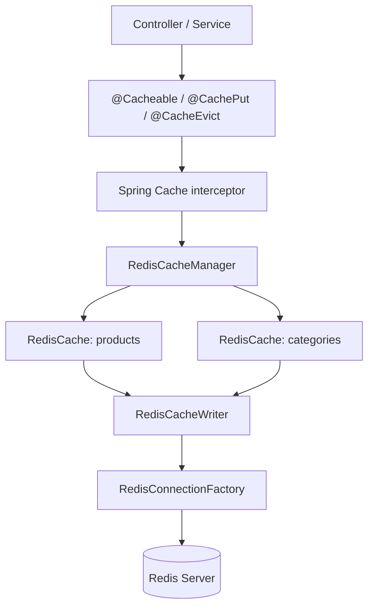
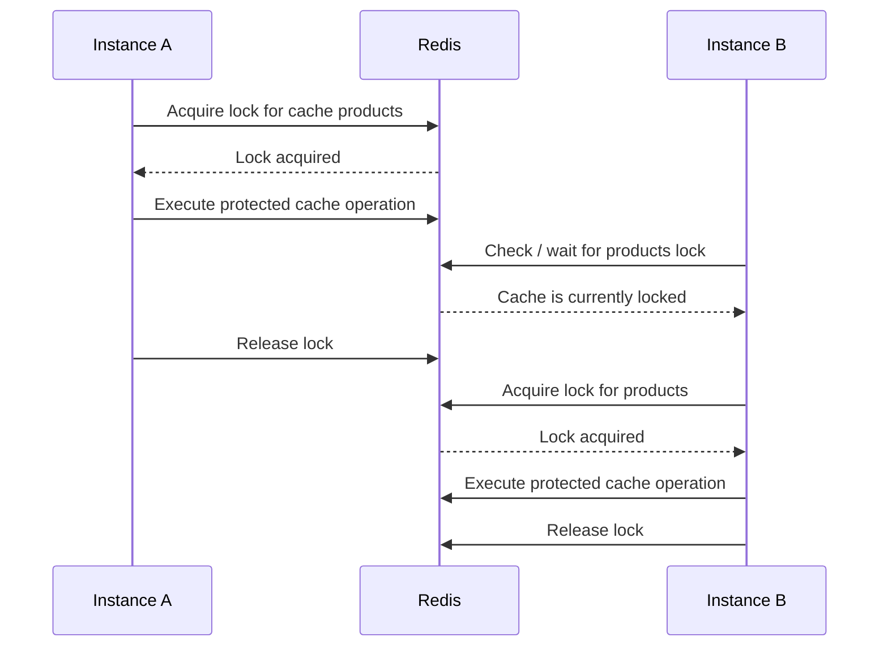
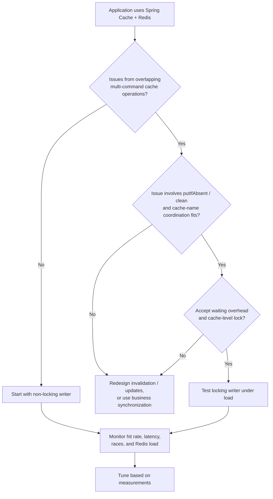

# Choosing a Locking or Non-Locking RedisCacheWriter

In **Spring Cache with Spring Data Redis**, `RedisCacheWriter` is the component directly responsible for reading, writing, and deleting cache data over Redis connections. When constructing `RedisCacheManager`, an application can select a **non-locking writer** or a **locking writer**. This choice governs how multi-step cache operations coordinate under concurrent requests, impacting latency, throughput, and observed cache consistency.

Most importantly, **locking in a locking `RedisCacheWriter` applies at the scope of a cache (cache name), not an individual data key**. It does not turn Redis Cache into a database transaction, does not lock all of Redis, and does not by itself guarantee that business methods are computed only once.

This lesson explains how writers work, how to configure them in Spring Boot, when each option makes sense, and how to manage contention when multiple applications share a cache.

## 1. Where does RedisCacheWriter sit in Spring Cache?

In Spring Framework, annotations such as `@Cacheable`, `@CachePut`, and `@CacheEvict` interact with the `Cache` abstraction. With a Redis backend, `RedisCacheManager` manages `RedisCache` instances; each `RedisCache` delegates to a `RedisCacheWriter` to execute Redis commands.



Responsibilities to separate:

| Component | Responsibility |
| --- | --- |
| Spring Cache abstraction | Decides when to read, write, or delete cache entries per method call |
| `RedisCacheManager` | Creates and manages caches by name; configures default and per-cache settings |
| `RedisCacheConfiguration` | Specifies TTL, key prefix, serializer, `null` caching policy, and cache properties |
| `RedisCacheWriter` | Executes cache operations at the Redis layer; locking vs. non-locking choice |
| `RedisConnectionFactory` | Provides Redis connections via the configured driver |

`RedisCacheWriter` is an infrastructure component of Spring Data Redis. In everyday application development, you do not invoke it directly: business code keeps using `@Cacheable`, while the writer choice is made when configuring `RedisCacheManager`.

## 2. Non-locking writer: the default choice

Spring Data Redis uses a **non-locking `RedisCacheWriter` by default**. You can instantiate it explicitly:

```java
RedisCacheWriter writer =
        RedisCacheWriter.nonLockingRedisCacheWriter(connectionFactory);
```

This writer **does not set lock keys** to block concurrent cache operations. Standalone Redis commands execute normally; Redis still provides inherent atomicity for **individual single commands**.

However, some cache methods may involve **multiple commands**. Spring Data Redis documentation notes `putIfAbsent` and clearing an entire cache (`clean`, corresponding to `Cache.clear()`) as cases where commands from two operations can interleave under a non-locking writer.

Conceptual example:

```text
Writer A: starts clearing cache products
Writer A: locates keys belonging to products
Writer B: updates products::42
Writer A: deletes the keys it found
Writer B: assumes it just updated the cache
```

Depending on actual command interleaving, B's update may be wiped out by A's clear. This is an expected characteristic of unguarded multi-command cache sequences, not a Redis bug.

**Advantages:** avoids extra round trips checking lock keys and waiting on locks. Consequently, this writer delivers lower latency and fits workloads prioritizing throughput that tolerate brief cache inconsistencies.

**Limitations:** provides no extra coordination across multi-step operations. When two instances operate on the same cache concurrently, outcomes depend on Redis command execution order and application logic.

## 3. Locking writer: coordinating operations at the cache level

Spring Data Redis also provides:

```java
RedisCacheWriter writer =
        RedisCacheWriter.lockingRedisCacheWriter(connectionFactory);
```

A locking writer uses **a dedicated lock key** to coordinate protected operations. Before performing a locked operation, the writer must acquire the lock; other writers following the same locking convention wait until the lock is released.



The diagram is a conceptual model. Exact command counts and lock polling behavior depend on the library version and `RedisCacheWriter` options.

Key points to notice:

- The lock is **scoped to the cache name**, e.g., `products`, not individually to `products::42`.
- Two operations must wait on each other even if they touch **two completely different entries** in the same cache, whenever both traverse locked writer operations.
- A different cache, such as `categories`, has its own independent lock scope.
- Only operations going through compatible locking writers coordinate. Redis commands sent manually by another app, or clients writing directly to cache keys, **do not automatically respect the lock**.
- A locking writer aims to prevent overlap in specific multi-step cache operations; it is **not a business lock**, a distributed transaction mechanism, or a guarantee of strict linearizability across all operations.

**Trade-off:** preventing overlap incurs extra commands to inspect and wait for locks. Under heavy load or frequent `clear()` calls, latency can rise and throughput can drop noticeably.

## 4. Why is lock scope the decisive factor?

Suppose there are three methods:

```java
@Cacheable(cacheNames = "products", key = "#id")
public Product getProduct(String id) { ... }

@CachePut(cacheNames = "products", key = "#product.id")
public Product updateProduct(Product product) { ... }

@CacheEvict(cacheNames = "products", allEntries = true)
public void invalidateAllProducts() { ... }
```

Entries might be:

```text
products::p-101
products::p-102
products::p-103
```

Because the locking writer manages locks per **cache `products`**, coordination of protected operations can impact multiple keys belonging to that cache. Do not assume `p-101` and `p-102` are always handled independently just because their keys differ.

Conversely, do not assume every `get`/`put` in a locking writer is strictly serialized end-to-end. Which writer methods acquire locks depends on the implementation contract, and this option primarily addresses overlaps described by Spring Data Redis for multi-command operations like `putIfAbsent` and `clean`.

Consider two declared caches:

```text
products    -> product details, prices, and displayed stock
categories  -> product categories
```

Clearing `products` has no reason to lock `categories`. That is the benefit of cache-scoped locking; nevertheless, a huge or heavily updated cache can create a broad contention bottleneck.

## 5. Comparing locking vs. non-locking

| Criterion | Non-locking writer | Locking writer |
| --- | --- | --- |
| Default in Spring Data Redis | **Yes** | No |
| Factory method | `nonLockingRedisCacheWriter(...)` | `lockingRedisCacheWriter(...)` |
| Additional lock keys | No | Yes, when protecting operations |
| Lock scope | No writer-level lock | **Per cache name**, not per entry |
| Latency under contention | Usually lower | Can increase due to lock checks and waiting |
| Throughput | Usually higher under concurrent load | Can degrade on hot caches |
| Can `putIfAbsent`/`clean` commands interleave? | Yes | Coordinated via the writer's locking mechanism |
| Protects against direct Redis writers | No | **No** |
| Guarantees `@Cacheable` computes once cluster-wide | No | **Not part of writer contract** |
| Replaces business transactions | No | No |
| Best suited for | Best-effort caches, high load, low miss cost | Reducing overlap in protected cache ops when lock latency is acceptable |

Do not choose solely because the word "locking" sounds safer. Spring Cache is a data-access optimization layer; business correctness must still be protected at the data source and appropriate transactional layer.

## 6. Configuring a non-locking writer in Spring Boot

Assuming an application uses Spring Boot 3.x and Spring Data Redis, declare the required dependencies:

```groovy
// build.gradle
dependencies {
    implementation 'org.springframework.boot:spring-boot-starter-cache'
    implementation 'org.springframework.boot:spring-boot-starter-data-redis'
}
```

Connection configuration:

```yaml
# src/main/resources/application.yml
spring:
  data:
    redis:
      host: localhost
      port: 6379
```

Enable Spring Cache:

```java
package com.example.shop;

import org.springframework.boot.SpringApplication;
import org.springframework.boot.autoconfigure.SpringBootApplication;
import org.springframework.cache.annotation.EnableCaching;

@SpringBootApplication
@EnableCaching
public class ShopApplication {

    public static void main(String[] args) {
        SpringApplication.run(ShopApplication.class, args);
    }
}
```

Spring Boot can auto-create a `RedisCacheManager` with a non-locking writer when auto-configuration conditions apply. If the application wants to **explicitly specify the writer type** and cache policies in code, declare a `RedisCacheManager` bean:

```java
package com.example.shop.config;

import java.time.Duration;

import org.springframework.cache.CacheManager;
import org.springframework.context.annotation.Bean;
import org.springframework.context.annotation.Configuration;
import org.springframework.data.redis.cache.RedisCacheConfiguration;
import org.springframework.data.redis.cache.RedisCacheManager;
import org.springframework.data.redis.cache.RedisCacheWriter;
import org.springframework.data.redis.connection.RedisConnectionFactory;

@Configuration
public class CacheConfig {

    @Bean
    public CacheManager cacheManager(RedisConnectionFactory connectionFactory) {
        RedisCacheWriter writer =
                RedisCacheWriter.nonLockingRedisCacheWriter(connectionFactory);

        RedisCacheConfiguration defaults =
                RedisCacheConfiguration.defaultCacheConfig()
                        .entryTtl(Duration.ofMinutes(10))
                        .disableCachingNullValues();

        return RedisCacheManager.builder(writer)
                .cacheDefaults(defaults)
                .build();
    }
}
```

`RedisConnectionFactory` is supplied by Spring Boot once Redis connection settings are configured. `entryTtl(Duration.ofMinutes(10))` sets a **10-minute** default lifetime for cache entries. `disableCachingNullValues()` omits storing `null` values in the cache.

When declaring your own `CacheManager` bean as shown above, remember that Boot auto-configuration backs off in favor of the custom bean. Any `spring.cache.redis.*` properties Boot previously applied will **not automatically carry over in full** to the new `RedisCacheConfiguration` unless configured explicitly. Centralize cache policy in one clear configuration source.

## 7. Switching to a locking writer

To use a locking writer, replace only the writer creation in the configuration above:

```java
RedisCacheWriter writer =
        RedisCacheWriter.lockingRedisCacheWriter(connectionFactory);
```

The rest remains:

```java
return RedisCacheManager.builder(writer)
        .cacheDefaults(defaults)
        .build();
```

**Do not register two `CacheManager` beans serving the same set of `@Cacheable` methods without an explicit selection mechanism.** This example uses **one** `CacheManager` bean and selects one writer type at initialization.

Complete configuration using a locking writer:

```java
package com.example.shop.config;

import java.time.Duration;
import org.springframework.cache.CacheManager;
import org.springframework.context.annotation.Bean;
import org.springframework.context.annotation.Configuration;
import org.springframework.data.redis.cache.RedisCacheConfiguration;
import org.springframework.data.redis.cache.RedisCacheManager;
import org.springframework.data.redis.cache.RedisCacheWriter;
import org.springframework.data.redis.connection.RedisConnectionFactory;

@Configuration
public class LockingCacheConfig {

    @Bean
    public CacheManager cacheManager(RedisConnectionFactory connectionFactory) {
        RedisCacheWriter writer =
                RedisCacheWriter.lockingRedisCacheWriter(connectionFactory);

        RedisCacheConfiguration defaults =
                RedisCacheConfiguration.defaultCacheConfig()
                        .entryTtl(Duration.ofMinutes(10))
                        .disableCachingNullValues();

        return RedisCacheManager.builder(writer)
                .cacheDefaults(defaults)
                .build();
    }
}
```

**Note:** `CacheConfig` and `LockingCacheConfig` above are **two mutually exclusive alternatives**; do not place both in the same application under the same `cacheManager` bean name. Choose one class or one configuration style.

## 8. Applying in a service using @Cacheable

Suppose product details are loaded from a database:

```java
package com.example.shop.service;

import org.springframework.cache.annotation.CacheEvict;
import org.springframework.cache.annotation.CachePut;
import org.springframework.cache.annotation.Cacheable;
import org.springframework.stereotype.Service;

@Service
public class ProductService {

    private final ProductRepository products;

    public ProductService(ProductRepository products) {
        this.products = products;
    }

    @Cacheable(cacheNames = "products", key = "#id")
    public Product find(String id) {
        return products.findById(id).orElseThrow();
    }

    @CachePut(cacheNames = "products", key = "#result.id")
    public Product update(Product product) {
        return products.save(product);
    }

    @CacheEvict(cacheNames = "products", key = "#id")
    public void evictOne(String id) {
        // Method body can contain appropriate business logic.
    }

    @CacheEvict(cacheNames = "products", allEntries = true)
    public void evictAll() {
        // Clear all entries in the products cache.
    }
}
```

This example assumes the project already defines `Product` and `ProductRepository` in its persistence layer. The code focuses on Spring Cache and does not require `Product` to be stored via Redis Repository. The product database may be PostgreSQL or another source, with Redis acting purely as the cache layer.

When `find("p-101")` is called first, a cache miss queries the data source and stores the result. Subsequent calls can read from cache, subject to TTL and invalidation policies.

Choosing a locking writer **does not mean** concurrent `find("p-101")` calls will automatically execute `ProductRepository.findById` only once. Two requests can still miss simultaneously before data is populated. Distinguish **writer locking on cache operations** from **loading synchronization (cache stampede control)**.

## 9. Distinguishing locking writer from @Cacheable(sync = true)

`@Cacheable(sync = true)` lets Spring Cache ask the cache provider to synchronize computation when multiple threads miss the same key concurrently:

```java
@Cacheable(cacheNames = "products", key = "#id", sync = true)
public Product find(String id) {
    return products.findById(id).orElseThrow();
}
```

The two concepts are related yet serve different objectives:

| Mechanism | Purpose |
| --- | --- |
| `RedisCacheWriter.lockingRedisCacheWriter(...)` | Coordinates supported multi-step cache operations protected by the writer using a **cache-name** lock |
| `@Cacheable(sync = true)` | Requests the cache implementation to synchronize value computation on concurrent cache misses |
| Business distributed lock | Protects a business resource/workflow with dedicated identity, lease duration, and failure handling |

`sync = true` carries Spring Cache abstraction and per-provider limitations. Never assume this annotation creates an **exact-once distributed mutex** across processes, restarts, and network failures. Check the execution contract of your Spring Data Redis version if business rules depend on strict concurrency guarantees.

If the problem is "two requests executing a payment simultaneously," do not try to solve it by switching `RedisCacheWriter`; implement idempotency and transactions where canonical data is written.

## 10. Which operations deserve the closest attention?

### 10.1. putIfAbsent

The cache API includes:

```java
Cache cache = cacheManager.getCache("products");

if (cache != null) {
    cache.putIfAbsent("p-101", product);
}
```

`putIfAbsent` means "write only if no entry exists yet." Per Spring Data Redis documentation, implementing this operation in the writer layer can involve multiple Redis commands and risk interleaving under non-locking mode.

A locking writer coordinates cache operations to reduce that overlap. Nevertheless, **never use `Cache.putIfAbsent` to grant ownership of a business distributed lock**: it does not replace locks with owner tokens/leases/fencing and lacks guarantees against ambiguous commit failures across systems.

### 10.2. clear / clean

`@CacheEvict(allEntries = true)` or `Cache.clear()` wipes **the entire cache**. This operation may need to:

1. Locate Redis keys matching the cache's prefix.
2. Delete that group of keys according to a batch strategy.

While other processes continuously write to the cache, key scanning and deletion can interleave with writes. Non-locking allows operations to proceed without waiting for a cache lock. A locking writer coordinates within the scope of writer operations using the corresponding lock.

Even with a locking writer, do not treat `clear()` as a snapshot or atomic transaction for the entire application: another client writing directly to Redis or a system bypassing the lock convention can still mutate data.

### 10.3. Single-key get, put, evict

Most single-key reads, writes, and deletes do not need cache-level locks to benefit from Redis's per-command atomicity. A locking writer does not automatically turn arbitrary accesses into conditional read-modify-write operations. If you need "update only if version still matches," use atomic Redis commands, Lua, or optimistic locking against the data source instead of relying on the writer's name.

## 11. Selecting a writer based on system characteristics

### Prefer non-locking when

- The cache serves high-throughput reads and values can be reconstructed from the data source.
- Occasional misses or slightly out-of-order invalidations are tolerable.
- Most operations are single-entry `get`, `put`, and `evict`, with rare full-cache `clear()` calls.
- Low latency and high throughput outweigh strict coordination of multi-step cache operations.
- Critical data is already safeguarded at the persistence layer.

### Consider locking when

- Workloads involve concurrent `putIfAbsent` or cache clears and you want to reduce overlap among writer-supported operations.
- Protected operations happen infrequently enough that cache-name contention is acceptable.
- Extra network round trips and lock wait time are tolerable.
- All instances use compatible cache names, prefixes, and writer configurations.
- Operations teams can monitor lock contention and clean up lingering lock keys during incidents.

### When neither option solves the problem

- Needing strictly accurate updates to source records under concurrent writes.
- Needing exactly one worker to execute a job or process a payment once.
- Needing cross-instance cache stampede prevention with dedicated lease/idempotency semantics.
- Needing transactions spanning both Redis and SQL.
- Needing per-**business-key** locking without blocking an entire cache name.

Such cases require dedicated business synchronization mechanisms and should not lean on a locking `RedisCacheWriter` as a catch-all solution.

## 12. The cost of cache-level locking

Suppose the `products` cache holds 50,000 entries and two requests operate on completely different products. If they hit writer operations requiring locks, they may still **queue behind the same cache lock**.

```text
T0  Instance A starts a locked operation on products
T1  Instance B wants to run a locked operation on products
T2  B waits or polls the lock key
T3  A releases lock
T4  B proceeds
```

Costs include:

- **Extra round trips:** acquiring, polling, and releasing the lock.
- **Waiting time:** requests stalled waiting for another operation on the same cache to finish.
- **Contention:** a slow `clear()` can back up a queue of protected operations.
- **Failure risk:** if a process crashes or loses connectivity while holding a lock, automatic release depends on the lock expiration mechanism and writer version configuration.

Do not assume lock keys always share the exact same default safety TTL across all Spring Data Redis versions. Under strict operational requirements, verify the locking API/configuration for your active version and monitor for stuck locks.

## 13. BatchStrategy and full-cache deletion

Locking is **one configuration axis**; how keys are discovered and deleted during `clear()` is a **separate axis**.

Spring Data Redis provides `BatchStrategy` options used with writers:

```java
import org.springframework.data.redis.cache.BatchStrategies;
import org.springframework.data.redis.cache.RedisCacheWriter;

RedisCacheWriter writer = RedisCacheWriter.nonLockingRedisCacheWriter(
        connectionFactory,
        BatchStrategies.scan(1000)
);
```

`SCAN` iterates incrementally and is usually preferable to `KEYS` for very large caches, though Redis `SCAN` has limits: it is not a snapshot; duplicates, new keys, or vanished keys may appear during traversal. The number `1000` is a batch-size hint, not a promise Redis returns exactly 1000 keys per call.

The `KEYS` strategy can force Redis to do heavy work in one blocking command on large keyspaces. With `SCAN`, work is spread across multiple commands, yet driver and Redis topology compatibility (especially Redis Cluster) must be checked. Certain driver/cluster combinations limit `SCAN` support during cache clears.

**Important:** choosing a locking writer **does not automatically replace `KEYS` with `SCAN`**, nor does it make `SCAN` a point-in-time consistent transaction. Evaluate `clear()` cost and lock contention independently.

## 14. TTL and serialization do not depend directly on lock choice

`RedisCacheConfiguration` controls expiration and data encoding; for instance:

```java
RedisCacheConfiguration defaults =
        RedisCacheConfiguration.defaultCacheConfig()
                .entryTtl(Duration.ofMinutes(15))
                .disableCachingNullValues()
                .computePrefixWith(cacheName -> "shop:" + cacheName + "::");
```

Cache entries receive a 15-minute TTL regardless of whether the writer is locking or non-locking. The example prefix produces keys like:

```text
shop:products::p-101
shop:products::p-102
shop:categories::c-1
```

Do not confuse **cache entry TTL** with the **lock key lease** of a locking writer. They are completely distinct:

| Component | Function |
| --- | --- |
| Cache entry TTL | Determines how long a cached product stays valid |
| Writer lock key | Coordinates protected cache operations |
| Key prefix | Partitions key names by cache, module, or environment |
| Serializer | Converts keys/values between Java objects and Redis bytes |

Changing an entry's TTL does not change lock wait times. Changing serializers does not make a writer locking; however, when multiple instances share Redis, they must agree on serializers and key prefixes to avoid misreading or overwriting each other's data.

## 15. Caution when multiple applications share Redis

Suppose two instances of the same service exist:

```text
shop-api-1 --> RedisCacheManager --> RedisCacheWriter --> Redis
shop-api-2 --> RedisCacheManager --> RedisCacheWriter --> Redis
```

If both use a locking writer, matching cache names, and the same Redis namespace, they can coordinate via the writer's lock key for supported operations. Avoid the following misconceptions:

1. **"Having one instance use locking is enough."** False; an instance using non-locking or writing directly to Redis bypasses the other instance's lock.
2. **"Locks protect individual SKUs."** False; lock scope is the cache name, so contention across entries may be broader than business needs require.
3. **"Cache locks keep SQL data consistent."** False; SQL changes still need proper transactions and invalidation strategies.
4. **"All environments sharing a cache name should share data."** False; isolate Redis databases, key prefixes, or infrastructure per environment to prevent unintended overwrites and contention.
5. **"Locking guarantees zero stale reads."** False; caches can lag behind the data source, especially when source updates and invalidations are not atomic.

If separating caches across environments, configure explicit names or prefixes; also check how your writer constructs lock keys from cache names in the active version. Changing only the entry prefix while sharing lock configurations should not be assumed to create completely isolated lock namespaces.

## 16. Observing and benchmarking under load

When considering switching to a locking writer, measure instead of guessing. Run comparative tests using **the same instance count, key set, TTL, serializer, connection pool, and request workload**.

Scenarios to measure:

| Benchmark | What to observe |
| --- | --- |
| `@Cacheable` across many distinct keys | p50/p95/p99 latency and throughput |
| Concurrent cache misses on one key | Source query counts and latency |
| Concurrent `Cache.putIfAbsent` | Outcomes when writers execute concurrently |
| `@CacheEvict(allEntries=true)` under write load | Clear duration and post-clear cache values |
| Multiple instances sharing one cache | Lock wait times and operation failures |
| Large cache batch clear | Redis CPU, command count, `KEYS`/`SCAN` impact |

Operational signals to collect: API latency, cache hit/miss rates, database call counts, Redis command latency, CPU, network traffic, pool exhaustion, timeout counts, and error rates. If your library/driver exposes them, track lock wait or command metrics; otherwise instrument methods invoking `clear()` and `putIfAbsent`.

If locking noticeably inflates p99 while `putIfAbsent`/`clear` overlaps rarely occur and remain tolerable, non-locking is likely better. If a cache-operation race causes real operational issues that locking resolves within acceptable overhead, consider locking.

## 17. Common configuration errors and misconceptions

### 17.1. Looking for a YAML property to enable locking writer

Spring Boot exposes Redis Cache properties like TTL and key prefix, but do not assume a `spring.cache.redis.locking=true` property exists to switch writer types. Explicitly construct the desired `RedisCacheWriter` and pass it to `RedisCacheManager.builder(writer)`.

### 17.2. Having @EnableCaching while the app uses a different cache

`@EnableCaching` only activates annotation-driven caching. If multiple cache providers exist on the classpath or in configuration, verify the injected `CacheManager` is genuinely `RedisCacheManager`. When declaring beans manually, verify bean types and `CacheManager` selection if multiple managers exist.

### 17.3. Assuming locking solves cache stampedes automatically

A locking writer does not guarantee "only one database query for the same key." To mitigate stampedes, evaluate `@Cacheable(sync = true)` per provider support, prewarming, TTL jitter, stale-while-revalidate, or a dedicated single-flight/distributed lock designed for that purpose.

### 17.4. Clearing an entire cache on a huge cache name

`allEntries = true` can trigger scanning/deleting vast numbers of keys. With locking, that operation can stall the cache; with non-locking, clears and writes can interleave. Consider per-key invalidation, splitting cache names thoughtfully, and avoiding global clears.

### 17.5. Mistaking cache writer for repository locking

`RedisCacheWriter` belongs to **Spring Cache**, distinct from **Spring Data Redis Repository** using `@RedisHash`, `CrudRepository`, and `RedisKeyValueTemplate`. Enabling a locking writer does not add optimistic locking to Redis Repository entities.

### 17.6. Ignoring Redis connections or network failures

A locking writer adds extra Redis round trips. When Redis times out, pools exhaust, or networks drop, requests can stall longer. Configure proper timeouts, explicit cache error policies, and monitoring; do not blindly swallow cache errors and serve potentially corrupt state.

### 17.7. Using cache to guard side-effecting actions

If an action must run exactly once—such as creating an order or submitting a payment—never rely on `Cache.putIfAbsent` or writer locking. Use idempotency keys, unique constraints in the canonical store, proper transactions, and failure recovery.

## 18. Decision workflow



Use these practical questions:

1. Can this cache reconstruct its data from the primary source?
2. What percentage of operations are single-key `get`/`put`/`evict` vs. `putIfAbsent` or `clear`?
3. How many instances update the same cache name concurrently?
4. If `clear()` overlaps with concurrent writes, does the application suffer severe impact?
5. Could a cache-level lock bottleneck unrelated entries?
6. Do metrics confirm switching writers actually improves outcomes?

## 19. Summary

`RedisCacheWriter.nonLockingRedisCacheWriter(...)` is the default in Spring Data Redis: minimal coordination overhead, ideal for reconstructible caches and heavy concurrency, though multi-command operations like `putIfAbsent` and `clean` can interleave with concurrent operations.

`RedisCacheWriter.lockingRedisCacheWriter(...)` uses a **cache-name**-scoped lock to coordinate protected writer operations. It can reduce overlap, yet adds Redis commands and waiting latency—especially when many operations share one cache. Its scope is **not per-key locking**, **not a business transaction**, and **not an exactly-once processing guarantee**.

Start from your cache's real consistency requirements, select the matching writer, and measure latency, cache hits/misses, and clear durations under concurrent load. Design TTLs, serializers, batch strategies, and stampede protections separately, as they solve different problems from choosing a locking vs. non-locking writer.

### References

- [Spring Data Redis — Redis Cache](https://docs.spring.io/spring-data/redis/reference/redis/redis-cache.html): locking and non-locking `RedisCacheWriter`, multi-command operations, and batch strategies.
- [Spring Data Redis — RedisCacheWriter API](https://docs.spring.io/spring-data/redis/reference/api/java/org/springframework/data/redis/cache/RedisCacheWriter.html): factory methods for locking and non-locking writers.
- [Spring Data Redis — RedisCacheManager API](https://docs.spring.io/spring-data/redis/reference/api/java/org/springframework/data/redis/cache/RedisCacheManager.html): `RedisCacheManager` configuration and builder.
- [Spring Framework — Declarative Annotation-based Caching](https://docs.spring.io/spring-framework/reference/integration/cache/annotations.html): `@Cacheable`, `@CachePut`, `@CacheEvict`, `sync=true`.
- [Redis — SCAN](https://redis.io/docs/latest/commands/scan/): cursor-based keyspace iteration and scanning limitations.
