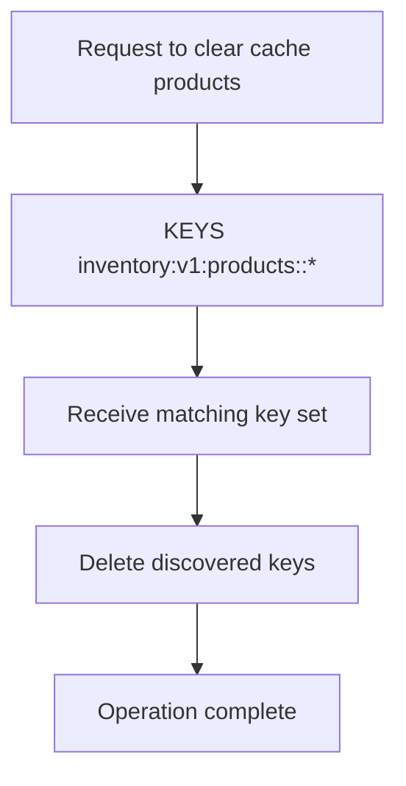
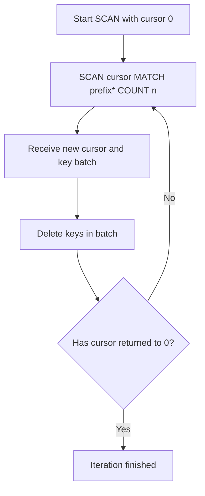

# Cache Eviction Strategies Using KEYS or SCAN and Driver Limitations in Spring Data Redis

## 1. Why does the full-cache eviction strategy matter?

Spring Cache allows Java applications to cache method results via annotations such as `@Cacheable`, `@CachePut`, and `@CacheEvict`. When using **Spring Data Redis** as the cache store, a cache can hold thousands or millions of Redis keys. Deleting a single entry whose key is known is straightforward; **clearing all entries of a cache** is more complex because Redis has no command to directly delete a "cache folder" by name.

Suppose a product-management application maintains two cache regions:

```text
inventory:v1:products::SKU-1001
inventory:v1:products::SKU-1002
inventory:v1:products::SKU-1003
inventory:v1:product-prices::SKU-1001
inventory:v1:product-prices::SKU-1002
```

Requirements might be:

- When updating one product, delete only `products::SKU-1001`.
- When re-importing the full catalog, delete **all** entries of cache `products`.
- Do not touch the `product-prices` cache or Redis keys not managed by Spring Cache.

Spring Data Redis performs full-cache clearing through `RedisCacheWriter`. This component supports **batch strategies**, notably **`KEYS`** and **`SCAN`**.

The difference directly impacts Redis latency, temporary memory usage, cleanup speed, and compatibility with Redis clients/drivers such as Lettuce or Jedis, particularly in Redis Cluster.

## 2. Distinguishing single-entry eviction from clearing an entire cache

In Spring Cache, these two operations mean very different things.

**Evicting a specific key:**

```java
@CacheEvict(cacheNames = "products", key = "#p0")
public void evictProduct(String sku) {
}
```

With an identified key, the cache provider can delete the corresponding Redis key directly. There is no need to traverse all keys searching for other entries.

**Evicting every entry in a cache region:**

```java
@CacheEvict(cacheNames = "products", allEntries = true)
public void evictAllProducts() {
}
```

Here, Spring Cache requests clearing the entire `products` region. Because Redis stores each entry as an individual key, `RedisCacheWriter` must **locate keys belonging to that cache region** and then delete them. That is where `KEYS` and `SCAN` come into play.

It can also be invoked via the direct API:

```java
Cache cache = cacheManager.getCache("products");

if (cache != null) {
    cache.clear();
}
```

Calling `Cache.clear()` likewise triggers clearing the group of keys for the Redis cache. It does not necessarily wipe the entire cache atomically while other requests keep writing.

### Comparing the three cases

| Scenario | Scope | Requires key traversal strategy? |
|---|---|---|
| `@CacheEvict(key = "...")` | One identified entry | Normally no |
| `@CacheEvict(allEntries = true)` | All entries in the named cache | Yes, if the backend must locate keys by prefix |
| Automatic Redis TTL expiration | Each key at its expiration time | No full-cache scan requested by the app |

**Key point:** configuring `BatchStrategies.scan(...)` primarily governs how **entries sharing a prefix** are cleaned up; it does not turn every `@CacheEvict` call into a Redis scan.

## 3. How does RedisCacheWriter identify keys belonging to a cache?

`RedisCacheManager` manages Redis cache regions. Each `RedisCache` uses `RedisCacheConfiguration` to determine key assembly, serializers, TTL, and prefixes. When clearing a region, the cache writer uses that region's prefix information to select the relevant Redis keys.

Normally, Redis Cache prepends a prefix based on the cache name. For example:

```text
Cache name: products
Cache key : SKU-1001

Redis key : products::SKU-1001
```

If the application configures a custom prefix:

```text
Redis prefix: inventory:v1:products::
Redis key   : inventory:v1:products::SKU-1001
```

then clearing the entire `products` cache searches for and removes keys matching the corresponding prefix.

**A prefix is simply a Redis key naming convention.** It must be specific enough that other caches and applications do not overlap the same keyspace.

### Consequences of disabling prefixes

Spring Data Redis allows customizing or disabling prefixes. If prefixes are disabled, the cache name may no longer appear in Redis keys. When two caches use the same keys, they risk overwriting or accidentally deleting each other's data.

In particular, `allEntries = true` becomes difficult to keep safely scoped once a cache name lacks a clear prefix boundary. Therefore, in applications sharing Redis across multiple caches, keep prefixes enabled and establish application/environment namespace conventions.

## 4. The KEYS strategy: simple but expensive on large keyspaces

The Redis command:

```redis
KEYS inventory:v1:products::*
```

finds keys matching the pattern. Given the returned list of keys, the application can send commands to delete them.

Conceptual flow:



In Spring Data Redis, `BatchStrategies.keys()` represents the strategy using `KEYS` when clearing caches.

### Why can KEYS cause problems?

`KEYS` has **O(N)** complexity relative to the number of keys in the inspected Redis keyspace. It searches in a single Redis command and can return a massive result.

When Redis serves low-latency requests:

- A `KEYS` command on a large keyspace can occupy Redis processing time for a long period, stalling other requests.
- The returned set of key names can be huge, creating network transfer and client memory allocation overhead.
- Follow-up delete commands can also cause heavy load, especially when large key batches or large data structures are processed together.
- Even a small cache may reside inside a Redis database containing **millions of keys from other caches**; scan cost depends on the full keyspace, not only matching keys.

For example, if a database holds 10 million keys and only 3,000 belong to `products`: `KEYS products::*` still inspects the Redis keyspace to identify matching keys.

### When can KEYS be acceptable?

`KEYS` is simple and generally acceptable when:

- Redis contains only a small, known, bounded number of keys.
- Development/testing environments need pattern-based diagnostics.
- Maintenance tasks run intentionally on bounded datasets.
- Infrastructure and driver versions do not support the required alternative strategy.

On production Redis with large keyspaces or significant traffic, consider the `SCAN` strategy and approaches that avoid clearing entire cache regions under load.

## 5. The SCAN strategy: incremental cursor traversal

Redis provides the `SCAN` command, enabling clients to iterate over the keyspace using a cursor:

```redis
SCAN 0 MATCH inventory:v1:products::* COUNT 500
```

Redis returns two parts:

1. **Cursor for the next iteration**.
2. **List of keys discovered in the current batch**.

The client continues sending:

```text
SCAN <returned-cursor> MATCH inventory:v1:products::* COUNT 500
```

and loops until the returned cursor is `0`.

Flow:



In Spring Data Redis, `BatchStrategies.scan(batchSize)` selects the `SCAN`-based clearing strategy. For example, `BatchStrategies.scan(500)` supplies a batch size/hint while scanning; it does **not** cap total deleted keys at 500.

### What are the advantages of SCAN?

Unlike asking Redis to return every key in one `KEYS` command, `SCAN` splits traversal into multiple iterations. Redis can serve other requests between scan iterations.

Common benefits:

- Avoids one long-running blocking Redis command to find all keys.
- Avoids receiving an entire key list in a single giant response.
- Allows tuning work done per iteration.
- Better suited for large keyspaces and live traffic systems, if supported by driver and topology.

However, `SCAN` is not free: a full traversal still scales with total keys in the scanned keyspace. It can require many network round trips and prolong a `clear` operation, especially when only a tiny fraction of keys match the pattern.

### Commonly misunderstood rules of SCAN

- `COUNT` is a **work-per-call hint**, not a guarantee of the exact number of keys returned per iteration.
- A `SCAN` iteration can return an empty list while the cursor is still non-`0`; do not terminate the loop early.
- During a scan, the same key can be returned more than once. Deleting an already-deleted key must be handled safely.
- When concurrent writes/deletes happen, the observed key set is not an immutable snapshot: new keys may or may not be seen.
- Complete traversal requires following the cursor until `0`; never stop merely because one iteration returned empty.
- `MATCH` uses glob syntax, so prefix/pattern strings must be controlled to avoid matching beyond the intended scope.

For cache clearing, the key takeaway is that **clearing via SCAN does not guarantee the cache region will be completely empty upon completion if other writers keep inserting keys**.

## 6. KEYS vs. SCAN: comparing what actually matters

| Criterion | KEYS | SCAN |
|---|---|---|
| Key discovery | One command returning matching keys | Multiple cursor-based iterations |
| Total scan complexity | O(N) | O(N) for a complete traversal |
| Single-call latency | Can be very high on large keyspaces | Can be spread across smaller calls |
| Large keyspace suitability | Limited due to blocking and large responses | Generally more suitable |
| Client temporary memory | May need to hold a huge list | Can process in batches |
| Round trips | Fewer for key discovery | More, depending on cursor and COUNT |
| Concurrent mutations during scan | Single point-in-time command execution | No consistent point-in-time snapshot across iterations |
| Duplicates/misses during scan | Not a cursor artifact | Duplicates possible; concurrent changes may be missed |
| Driver limitations | `BatchStrategies.keys()` widely supported | `BatchStrategies.scan(...)` depends on driver and Redis mode |
| Spring Cache clear usage | Simple, often default | Must be explicitly selected if desired |

**SCAN reduces per-call blocking**, but does not turn clearing millions of keys into an O(1) operation, does not solve every concurrent write scenario, and does not change the scope of keys the cache writer intends to delete.

## 7. Configuring KEYS or SCAN in RedisCacheManager

Spring Data Redis configures the clear strategy on `RedisCacheWriter`, which is then passed to `RedisCacheManager`.

Example Spring Boot project using Redis Cache. Gradle dependencies:

```kotlin
dependencies {
    implementation("org.springframework.boot:spring-boot-starter-data-redis")
    implementation("org.springframework.boot:spring-boot-starter-cache")
}
```

Simple connection settings in `application.yml`:

```yaml
spring:
  data:
    redis:
      host: localhost
      port: 6379
```

In production systems, host, port, authentication, TLS, and topology must match the deployed Redis infrastructure.

### 7.1. Choosing SCAN and a custom prefix for caches

**File `RedisCacheConfig.java`:**

```java
package com.example.inventory.config;

import java.time.Duration;

import org.springframework.cache.annotation.EnableCaching;
import org.springframework.context.annotation.Bean;
import org.springframework.context.annotation.Configuration;
import org.springframework.data.redis.cache.BatchStrategies;
import org.springframework.data.redis.cache.RedisCacheConfiguration;
import org.springframework.data.redis.cache.RedisCacheManager;
import org.springframework.data.redis.cache.RedisCacheWriter;
import org.springframework.data.redis.connection.RedisConnectionFactory;

@Configuration
@EnableCaching
public class RedisCacheConfig {

    @Bean
    public RedisCacheManager cacheManager(
            RedisConnectionFactory connectionFactory
    ) {
        RedisCacheWriter writer =
                RedisCacheWriter.nonLockingRedisCacheWriter(
                        connectionFactory,
                        BatchStrategies.scan(500)
                );

        RedisCacheConfiguration config =
                RedisCacheConfiguration.defaultCacheConfig()
                        .entryTtl(Duration.ofMinutes(15))
                        .computePrefixWith(
                                name -> "inventory:v1:" + name + "::"
                        )
                        .disableCachingNullValues();

        return RedisCacheManager.builder(writer)
                .cacheDefaults(config)
                .build();
    }
}
```

The configuration above reflects distinct decisions:

- `RedisCacheWriter.nonLockingRedisCacheWriter(...)` creates a writer that does not use cache-level locks to synchronize all operations.
- `BatchStrategies.scan(500)` instructs the writer to use `SCAN` when clearing a group of keys.
- `entryTtl(Duration.ofMinutes(15))` sets default TTL for cache **entries**, independent of how keys are found during `clear`.
- `computePrefixWith(...)` embeds environment/application and cache names into keys for namespace isolation.
- `disableCachingNullValues()` avoids storing null values—an example choice, not a prerequisite for `SCAN`.
- `RedisCacheManager.builder(writer)` attaches the configured writer to the cache regions managed by this manager.

With cache name `products` and logical key `SKU-1001`, the expected Redis key has prefix:

```text
inventory:v1:products::SKU-1001
```

Actual key suffix formatting still depends on the key generator and key serializer. This example uses default string-style keys for clarity.

### 7.2. Choosing KEYS when genuinely appropriate

To explicitly configure the `KEYS` strategy, change writer creation to:

```java
RedisCacheWriter writer =
        RedisCacheWriter.nonLockingRedisCacheWriter(
                connectionFactory,
                BatchStrategies.keys()
        );
```

In standard Redis Cache configuration, `KEYS` is the default batch strategy of `RedisCacheWriter` when no other strategy is specified. Writing it explicitly makes the application's operational policy easier to track.

**Essential rule:** select `BatchStrategies.scan(...)` where `RedisCacheWriter` is configured. Adding `@CacheEvict(allEntries = true)` without changing writer configuration does not switch the clear algorithm to `SCAN`.

### 7.3. If Spring Boot already created a CacheManager

When an application declares its own `RedisCacheManager` bean as above, that bean typically replaces the conditional auto-configured Redis `CacheManager`. If the project has multiple cache managers or customizers, verify which bean Spring Cache actually selects.

Do not create a second `RedisCacheManager` merely to test `SCAN` without matching bean names/`@Primary`/`@CacheConfig` or annotation `cacheManager` attributes. If annotations continue targeting the old manager, clear operations will still execute the old strategy.

## 8. Using @Cacheable and @CacheEvict with the configuration above

Example product read service:

**`ProductQueryService.java`:**

```java
package com.example.inventory.service;

import org.springframework.cache.annotation.Cacheable;
import org.springframework.stereotype.Service;

@Service
public class ProductQueryService {

    private final ProductGateway gateway;

    public ProductQueryService(ProductGateway gateway) {
        this.gateway = gateway;
    }

    @Cacheable(cacheNames = "products", key = "#p0")
    public ProductView findProduct(String sku) {
        return gateway.loadProduct(sku);
    }
}
```

`ProductGateway` is an abstraction accessing the real data source; `ProductView` is the application's product data type. They illustrate the service layer and are not Spring Data Redis classes.

After the first call:

```java
productQueryService.findProduct("SKU-1001");
```

the result is stored in the `products` Redis Cache. Subsequent calls with the same SKU read from cache, provided the entry remains valid and caching conditions apply.

Service responsible for eviction:

**`ProductCacheMaintenance.java`:**

```java
package com.example.inventory.service;

import org.springframework.cache.annotation.CacheEvict;
import org.springframework.stereotype.Service;

@Service
public class ProductCacheMaintenance {

    // Deletes a single entry by SKU, without scanning the whole cache region.
    @CacheEvict(cacheNames = "products", key = "#p0")
    public void evictOne(String sku) {
    }

    // Deletes every entry in the "products" cache.
    @CacheEvict(cacheNames = "products", allEntries = true)
    public void evictAllProducts() {
    }
}
```

Both methods are processed by Spring Cache when invoked **through a Spring bean proxy**. Do not invoke them internally via `this.evictAllProducts()` expecting annotations to be intercepted under standard proxy mode.

`@CacheEvict` defaults to running eviction **after** the method completes successfully. If an administrative task must clear the cache before running its body, choose `beforeInvocation = true` according to business semantics:

```java
@CacheEvict(
        cacheNames = "products",
        allEntries = true,
        beforeInvocation = true
)
public void prepareFullReload() {
    // Business logic.
}
```

Changing eviction timing does not change how multi-key cleanup works: the algorithm still depends on `RedisCacheWriter`. Also, `allEntries = true` applies to **the entire named cache**, not only entries matching method parameters like SKU or tenant.

## 9. Driver limitations: Lettuce and Jedis

Not every driver executes the `SCAN` strategy identically across all Redis topologies. Spring Data Redis notes an important distinction when choosing a batch strategy:

| Redis driver | Redis standalone / non-clustered | Redis Cluster | Notes |
|---|---|---|---|
| **Lettuce** | `KEYS` and `SCAN` | Supports `KEYS` and `SCAN` per `RedisCacheWriter`/Spring Data Redis capabilities | Preferred choice when `SCAN` strategy is needed on a cluster |
| **Jedis** | `KEYS` and `SCAN` | `KEYS` supported; `SCAN` in batch strategy **not fully supported** per limitations noted in Spring Data Redis docs | Verify driver/Spring Data Redis version before enabling `SCAN` on cluster |

Per Spring Data Redis reference documentation on Redis Cache, the `KEYS` strategy is supported across common drivers and Redis deployment modes. For `SCAN`, **Lettuce is fully supported**, whereas **Jedis supports `SCAN` only in non-clustered mode** within the scope documented.

Library versions evolve over time; check your exact combination of Spring Data Redis, Lettuce/Jedis, and application topology. Do not assume that merely having the Redis `SCAN` command on the server guarantees `RedisCacheWriter` with your driver supports `SCAN`-based cache clearing in Redis Cluster.

### Why does Redis Cluster complicate matters?

Redis Cluster partitions the keyspace across multiple primary nodes by hash slot. Running `SCAN` on one node does not cover the entire cluster keyspace. A cache-level batch strategy must use driver and connection-abstraction capabilities to traverse all relevant nodes.

In cluster mode:

- Cache Redis keys may span multiple hash slots and multiple nodes.
- Scanning keys on a single node does not prove the cache is empty on remaining nodes.
- Topology changes, failovers, or resharding during cleanup must be accounted for.
- Multi-key deletes across different slots must be routed or batched properly by the driver; sending an incompatible multi-key command triggers `CROSSSLOT` errors.
- A driver supporting basic `SCAN` does not automatically imply full multi-node cache-clearing support.

If deploying Redis Cluster with Jedis, verify what your Spring Data Redis and client versions support first. You may need `KEYS` within acceptable operational bounds, switch to Lettuce, or redesign cache invalidation.

### Identifying which driver is actually active

Spring Boot normally defaults to Lettuce when using the Redis starter, though projects can swap dependencies or define a custom `RedisConnectionFactory`. Therefore, do not pick a batch strategy based solely on starter names in the build file.

Check the active connection factory, driver version, and actual Redis mode: standalone, Sentinel, or Cluster. Redis Sentinel manages failover to a single primary, unlike Redis Cluster which shards the keyspace by slot.

## 10. Tuning batchSize when using SCAN

`BatchStrategies.scan(500)` and `BatchStrategies.scan(1000)` are both valid configurations. **There is no single optimal number for every application.**

On the Redis side, `SCAN ... COUNT n` treats `COUNT` as a work hint rather than promising exactly `n` keys per response. On the cache writer side, batch size influences how scanning and deleting proceed incrementally, without capping total entries cleared.

Guidelines when choosing:

| Smaller batch size | Larger batch size |
|---|---|
| Usually less work per iteration | Potentially fewer network round trips |
| Easier to bound single-iteration tail latency | Can create larger concentrated work bursts |
| Total clear duration may increase due to more iterations | Can improve throughput depending on Redis and network |
| Suits latency-sensitive systems | Requires assessing CPU, network, and delete load |

You can start from a few hundred up to around a thousand as an **initial benchmark baseline**, then tune based on key volume, value sizes, network latency, node count, QPS, and SLOs. This range is for testing, not a performance guarantee.

### Often-overlooked costs

Even with `SCAN`:

1. Redis must still traverse a broad keyspace to match the pattern.
2. Discovered keys still require delete commands.
3. Bulk deletions can raise latency and impact memory reclamation.
4. `Cache.clear()` at the application layer can still take significant wall-clock time to finish the full loop, even though individual `SCAN` calls do not block as long as `KEYS`.

Avoid calling `@CacheEvict(allEntries = true)` repeatedly on latency-critical HTTP threads when the cache region is large.

## 11. Consequences of concurrent cache writes during clear

Suppose two threads run concurrently:

```text
Thread A: clears cache "products" via SCAN
Thread B: user calls findProduct("SKU-9001")
```

A possible interleaving:

```text
A: begins SCAN over existing keys
A: scans past part of the keyspace
B: writes new cache entry for SKU-9001
A: finishes remaining SCAN iterations
A: completes
```

The entry written by B may still exist after A finishes. A `SCAN` pass provides no point-in-time snapshot lock at start and has no default "namespace-wide write freeze."

The same can occur with `KEYS`: between collecting key names and issuing deletes, another request can write a new entry. Thus **prefix-based clearing never freezes concurrent cache writes during the operation**.

### Non-locking vs. locking RedisCacheWriter

`RedisCacheWriter.nonLockingRedisCacheWriter(...)` is commonly used to avoid cache-level lock overhead. Multi-command Redis operations can interleave when multiple clients operate concurrently.

Spring Data Redis also provides **locking RedisCacheWriter** to reduce overlap among multi-command writer operations, at the cost of lock coordination commands and wait time. This locking pertains to cache scope and how the writer executes operations, not a distributed transaction ensuring every writer across all services follows one protocol.

Using a locking writer does not turn a `SCAN` loop into an atomic keyspace snapshot, nor does it replace coordination across all data writers.

### If you need to "cleanly discard an old cache generation"

An alternative is **versioned namespaces**:

```text
inventory:v1:products::*  <- old cache
inventory:v2:products::*  <- new cache
```

The application switches reads/writes to the new namespace version; the old cache is cleaned up later or expires via TTL. Ensure all application instances have moved to the new version and nothing still writes to the old prefix before cleaning up.

Versioned namespaces avoid giant clears on live request paths, though you still must manage the lifecycle of old keys and multi-instance rollouts.

## 12. Per-tenant caches: allEntries can wipe more than expected

A common design mistake puts tenant into the **cache key** while sharing the **cache name**:

```java
@Cacheable(
        cacheNames = "products",
        key = "#tenantId + ':' + #sku"
)
public ProductView getProduct(String tenantId, String sku) {
    // ...
}
```

Redis holds:

```text
inventory:v1:products::tenantA:SKU-1001
inventory:v1:products::tenantB:SKU-1001
```

If you call:

```java
@CacheEvict(cacheNames = "products", allEntries = true)
public void evictTenantProducts(String tenantId) {
}
```

`allEntries = true` still requests clearing **the entire `products` cache region**, affecting both `tenantA` and `tenantB`. The `tenantId` method parameter does not automatically narrow the clear scope.

To evict only one tenant's cache, design proper partitioning: per-tenant cache names/managers, tenant-scoped versioned namespaces, key index sets, or controlled namespace cleanup. `RedisCacheWriter` batch strategies do not infer tenants embedded between cache names and keys.

In multi-tenant systems, authorization and preventing prefix mix-ups matter just as much as choosing `KEYS` vs. `SCAN`.

## 13. Observing eviction operations in Redis

In a test environment, first call the `@Cacheable` API with several SKUs to populate entries.

Inspect with Redis CLI using `SCAN`:

```redis
SCAN 0 MATCH inventory:v1:products::* COUNT 100
```

Continue passing the cursor returned by Redis until cursor `0` is reached. Individual iterations may return empty lists before completion; key order is unspecified.

Check TTL on a specific key:

```redis
TTL inventory:v1:products::SKU-1001
```

Then call `evictOne("SKU-1001")`. Check that key again:

```redis
EXISTS inventory:v1:products::SKU-1001
```

With `evictAllProducts()`, re-inspect keys under the `products` prefix and verify the `product-prices` cache remains untouched. When concurrent requests are writing to the cache, observed keys may change right after clearing; this reflects cache-model concurrency, not necessarily a driver bug.

### Why avoid inspecting with KEYS in production?

`KEYS` is tempting for seeing all matches at once, yet can stall Redis on large keyspaces. When inspecting production data, favor incremental traversal tools and procedures bounded by operational safeguards. `SCAN` still adds load and must be used carefully.

Additionally, caches using non-string key serializers produce Redis CLI output that is hard to read. To match prefixes accurately, check your active `RedisCacheConfiguration`, key serializer, and key generator.

## 14. Common failure scenarios and troubleshooting

| Symptom | Possible cause | Remediation |
|---|---|---|
| `@CacheEvict(allEntries = true)` spikes Redis latency | Writer uses `KEYS` on a large keyspace | Consider `BatchStrategies.scan(...)` if driver/topology supports it |
| Configured `SCAN` yet `KEYS` still runs | Annotations use another `CacheManager` or writer was not wired | Verify `CacheManager` bean and where `RedisCacheWriter` is built |
| `SCAN` fails in Redis Cluster with Jedis | Driver batch strategy limitation | Check docs for active version; consider Lettuce or another approach |
| Clear finishes yet entries in the cache remain | Concurrent requests populated keys during scan | Coordinate writes or switch namespace/version |
| Clear deletes unintended Redis data | Prefix too broad, prefix disabled, or shared keyspace | Enable prefixes and define clear namespace conventions |
| Tenant clear wipes other tenants | `allEntries=true` on shared cache name | Design isolated cache regions/namespaces per tenant |
| Batch size 500 yet more than 500 keys deleted | Confusing `COUNT` with total limit | Understand `SCAN` loops until cursor 0; batch size tunes per iteration |
| `SCAN` returns duplicate keys or empty batches | Standard `SCAN` cursor behavior | Do not stop on empty batches; delete idempotently |
| Cache clear takes too long despite `SCAN` | Huge total keyspace, many network round trips and deletes | Measure total cost; narrow scope, tune TTL, or use versioning |
| Permission error during clear | ACL denies `KEYS`, `SCAN`, or delete commands | Verify Redis ACL grants commands needed by chosen strategy |
| Deleted via Redis CLI yet cache returns unexpected values | Wrong Redis instance, DB, prefix, or serializer | Verify connection factory, `RedisCacheManager`, and key format |
| Eviction skips when calling method in same class | Self-invocation bypasses Spring AOP proxy | Extract bean or call through the proper proxy |
| Cache repopulates right after eviction | Next request hits `@Cacheable` and reloads | Normal cache warming; verify underlying data source |

### Logging and load observation

During large clear operations, monitor:

- Redis command latency and application request latency.
- Redis key counts, CPU, memory, and network bandwidth.
- Cleanup rate and total duration of the clear method.
- Frequency of cache clears; watch for unexpected repeated triggers.
- Impact on other caches sharing the same Redis instance.

Do not run `KEYS` on production first just to "count keys before deciding whether to run `SCAN`"; that pre-count alone can trigger the very latency spike you wanted to avoid.

## 15. Alternatives to full-cache clearing by prefix

Choosing `SCAN` improves how clearing executes, yet often the better question is **whether clearing the entire cache is truly necessary**.

### Evicting only the exact modified entry

When a single SKU is updated, delete that one key:

```java
@CacheEvict(cacheNames = "products", key = "#p0")
public void invalidateProduct(String sku) {
}
```

The scope is tiny, with no need to traverse unrelated SKUs. Whenever affected keys can be identified accurately, targeted eviction is far cheaper than clearing everything.

### Per-entry TTL

Example:

```java
RedisCacheConfiguration.defaultCacheConfig()
        .entryTtl(Duration.ofMinutes(15));
```

Entries expire automatically via Redis TTL. TTL does not guarantee immediate consistency after source updates, yet bounds staleness and reduces the need for massive clear jobs.

### Versioned prefixes

Instead of hunting down millions of old keys on request paths, switch to a new prefix and clean up the old prefix asynchronously. Coordinate deployments so old instances stop writing to the old prefix.

### Splitting caches by domain

Separate `products`, `product-prices`, and `inventory-status` into distinct cache regions with separate prefixes. Clearing one invalidates only the dataset business logic actually needs to reset.

### Version-tagged cache entries

Embed data versions in cache keys or validate source versions to avoid serving stale entries after updates. This adds key-management overhead and does not clean up old versions by itself, so pair it with TTLs.

## 16. Strategy selection across deployment environments

| Context | Option worth considering | Additional conditions |
|---|---|---|
| Local dev Redis, few keys, learning | Default `KEYS` may suffice | Do not carry performance assumptions to production |
| Production standalone Redis, large keyspace | `SCAN` with Lettuce/Jedis in supported modes | Measure Redis load and clear duration |
| Redis Sentinel with one active primary | `SCAN` if client/connection abstraction supports mode | Account for failovers and in-flight operations |
| Redis Cluster with Lettuce | `SCAN` as supported by Spring Data Redis | Monitor topology, resharding, and clear duration |
| Redis Cluster with Jedis | Do not assume `SCAN` batch strategy works | Check version limits; change driver or design |
| Evicting a single SKU | `@CacheEvict(key = ...)` | No need to clear all keys |
| Resetting huge cache while serving live traffic | Switch prefix/version + TTL + background cleanup | Coordinate all instances switching namespace |
| Clearing data for one tenant only | Tenant-scoped cache region | `allEntries` on shared cache does not filter by tenant |

This table summarizes architectural guidelines. Actual driver, library, serializer, Redis topology, and operational constraints determine the concrete configuration.

## 17. Practice questions

**Scenario 1.** Redis holds one million keys, of which only 2,000 belong to `products`. Why can `KEYS products::*` still hurt latency?

**Explanation:** `KEYS` searches across the keyspace rather than jumping straight to the 2,000 keys of that cache name. It can run long inside a single command and delay other Redis requests.

**Scenario 2.** You configure `BatchStrategies.scan(1000)` with 50,000 cache entries. Are only 1,000 entries deleted?

**Explanation:** no. `1000` governs per-iteration scanning/processing work, not a cap on total keys. The strategy loops until traversal finishes.

**Scenario 3.** Spring Boot uses Redis Cluster with Jedis. Can you switch to `BatchStrategies.scan(500)` and assume it works out of the box?

**Explanation:** no. Spring Data Redis documentation notes Jedis supports the `SCAN` strategy only in non-clustered mode; verify your exact library version and deployment.

**Scenario 4.** A service stores `tenantA:SKU-01` and `tenantB:SKU-01` inside the same `products` cache. Does `@CacheEvict(allEntries = true)` with a `tenantA` parameter delete only `tenantA`?

**Explanation:** no. `allEntries = true` deletes every entry in the named cache region and does not use method parameters as a prefix filter.

**Scenario 5.** After clearing with `SCAN`, the application still sees a key with that prefix created a few milliseconds earlier. Did `RedisCacheWriter` malfunction?

**Explanation:** not necessarily. Another request may have written the key while the cursor was advancing or right after clearing finished. `SCAN` does not freeze the cache region at a single point in time.

**Scenario 6.** An API updates the price of one SKU yet clears the entire `products` region every time. Will switching from `KEYS` to `SCAN` alone fix the heavy load?

**Explanation:** it only changes how clearing scans; the deletion scope remains far too broad. Whenever possible, evict only the modified SKU key.

## 18. Summary

In **Spring Data Redis Cache**, `RedisCacheWriter` is where you choose the strategy for deleting many keys of a cache:

```java
// Default/simple clear strategy:
BatchStrategies.keys();

// Incremental batch traversal:
BatchStrategies.scan(500);
```

`KEYS` fits small or controlled datasets, yet risks blocking Redis on large keyspaces. `SCAN` spreads scanning across iterations and usually suits production workloads better, though it still traverses the keyspace and provides no atomic clear under concurrent writes.

**Driver limitations must be evaluated alongside topology:** Spring Data Redis documents full `SCAN` strategy support for Lettuce, while Jedis supports `SCAN` only outside Redis Cluster. Beyond the driver, safe cache clearing requires maintaining **safe prefixes**, choosing the right `RedisCacheManager`, avoiding overusing `allEntries = true`, and considering TTLs, single-key evictions, or namespace versioning when clear scopes grow too large.

### References

- [Spring Data Redis — Redis Cache](https://docs.spring.io/spring-data/redis/reference/redis/redis-cache.html)
- [Spring Data Redis — RedisCacheWriter API](https://docs.spring.io/spring-data/redis/reference/api/java/org/springframework/data/redis/cache/RedisCacheWriter.html)
- [Spring Data Redis — BatchStrategies API](https://docs.spring.io/spring-data/redis/reference/api/java/org/springframework/data/redis/cache/BatchStrategies.html)
- [Spring Framework — Cache Abstraction](https://docs.spring.io/spring-framework/reference/integration/cache.html)
- [Spring Framework — @CacheEvict](https://docs.spring.io/spring-framework/reference/integration/cache/annotations.html)
- [Redis — KEYS](https://redis.io/docs/latest/commands/keys/)
- [Redis — SCAN](https://redis.io/docs/latest/commands/scan/)
- [Redis — Redis Cluster Specification](https://redis.io/docs/latest/operate/oss_and_stack/reference/cluster-spec/)
